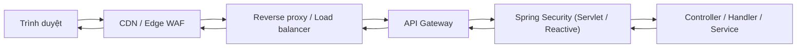
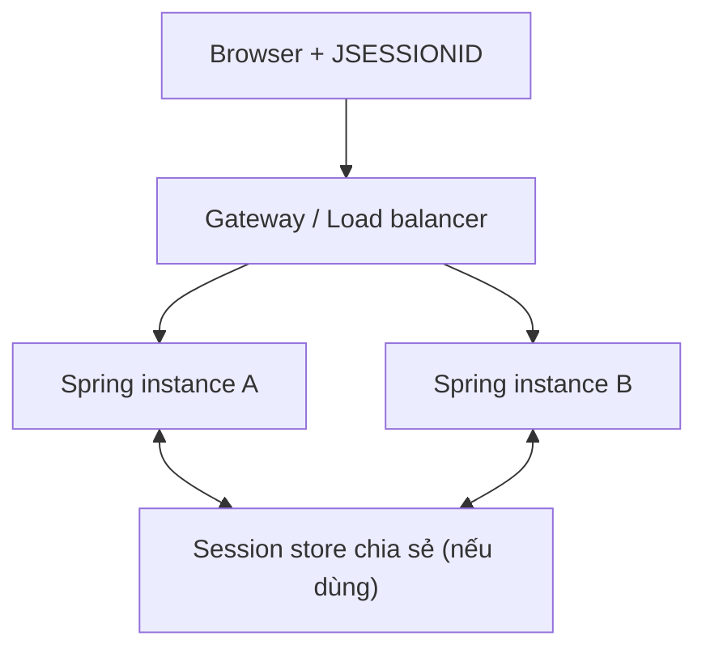

# Phối hợp chính sách ứng dụng với CDN, proxy và gateway

Trong chương **Vận hành và giám sát** của **SPRING_SECURITY_HTTP_PROTECTION**, bài học này tập trung vào một nguyên nhân thường gặp của sự cố bảo mật sau triển khai: **mỗi tầng xử lý HTTP hiểu hoặc áp dụng chính sách theo một cách khác nhau**. Ứng dụng Spring Security có thể đã cấu hình đúng CSRF, CORS, security headers, CSP, HSTS, HTTP firewall và session; tuy nhiên CDN, reverse proxy, load balancer hoặc API gateway vẫn có thể thay đổi URL, cache response, chèn header hoặc chặn request trước khi ứng dụng nhìn thấy.

Mục tiêu không phải dồn mọi quy tắc về một tầng, mà là xác định **ai sở hữu từng chính sách, đâu là ranh giới tin cậy, dữ liệu nào phải được truyền nguyên vẹn, và cách kiểm chứng response cuối cùng tại trình duyệt**. Các nguyên tắc áp dụng cho cả ứng dụng Spring MVC/Servlet và Spring WebFlux/Reactive, dù API cấu hình và hành vi của từng hạ tầng có thể khác nhau.

Sau bài học, người học có thể:

1. Lập bảng phân quyền giữa CDN, proxy, gateway và Spring Security cho TLS, forwarding, CORS, CSP, HSTS, cache, cookie, CSRF và rate limiting.
2. Giải thích tác động của `Forwarded`/`X-Forwarded-*` tới nhận diện HTTPS, redirect, cookie và quyết định bảo mật; thiết lập ranh giới proxy đáng tin cậy.
3. Tránh sự cố cache rò dữ liệu, CORS preflight bị chặn, security headers bị ghi đè và request path bị diễn giải khác nhau giữa các tầng.
4. Kiểm thử đường đi từ browser đến origin và xây dựng log/metric để chẩn đoán lỗi theo đúng tầng phát sinh.

## 1. Một request đi qua những tầng nào?

Xét cổng quản trị `https://app.example.com`, giao diện gọi API tại `https://api.example.com`. Đường đi thường gặp:



Đây là một kiến trúc minh họa, không phải hệ thống nào cũng có đủ bốn tầng trung gian. CDN có thể tự trả response từ cache hoặc WAF; gateway có thể xử lý xác thực và trả `401` trước khi request đi tới Spring Security; proxy có thể đổi scheme hoặc host; browser chỉ quan sát **response cuối cùng sau mọi tầng**.

Ví dụ một request login ban đầu:

```http
GET /login HTTP/2
Host: app.example.com
```

Nhưng Spring Boot phía sau proxy có thể nhận được:

```http
GET /login HTTP/1.1
Host: app-internal:8080
X-Forwarded-Host: app.example.com
X-Forwarded-Proto: https
```

Nếu ứng dụng **không hiểu** thông tin được proxy xác thực này, nó có thể tạo redirect sang `http://app-internal:8080/login`, không nhận diện request là HTTPS, hoặc xử lý sai cookie. Nếu ứng dụng **tin vào header do người dùng tự cung cấp**, kẻ tấn công có thể giả mạo host, scheme hoặc địa chỉ IP. Cả hai phía đều phải được cấu hình đồng bộ.

## 2. Bảng phân quyền: mỗi chính sách có một nơi chịu trách nhiệm chính

| Chính sách | Đầu mối chịu trách nhiệm chính được đề xuất | Vai trò các tầng còn lại |
|---|---|---|
| TLS, HTTPS redirect, chứng chỉ | Edge/proxy nhận kết nối công khai | Ứng dụng nhận đúng external scheme và bảo vệ link/redirect; kết nối nội bộ có TLS/mTLS nếu mô hình đe dọa yêu cầu. |
| HSTS | Một đầu mối quản lý response HTTPS công khai (thường edge) | Spring Security chỉ phát HSTS nếu được giao quyền; hai bên đối chiếu chính sách thống nhất. |
| CORS | Một đầu mối cho từng API/path (Spring hoặc gateway) | Các tầng còn lại phải chuyển tiếp preflight, giữ đúng `Origin` và `Vary`, không chèn trùng `Access-Control-Allow-Origin`. |
| CSRF | Ứng dụng quản lý session và thay đổi trạng thái | Gateway/proxy truyền đủ cookie, request method, token header/body; không tắt xác thực ở backend chỉ vì edge có quy tắc. |
| Authorization/method security | Spring Security cùng dịch vụ nghiệp vụ | Gateway có thể xác thực sơ bộ nhưng không thay quyết định quyền trên tài nguyên riêng tư. |
| CSP, frame policy, security headers | Ứng dụng sở hữu giao diện HTML; edge sở hữu các header được phân công rõ | Không chèn hoặc sửa vô điều kiện; đặc biệt giữ nonce CSP động, đối chiếu các header trùng lặp. |
| Cache dữ liệu đã xác thực | Ứng dụng phân loại dữ liệu và gửi `Cache-Control`; CDN thực thi chính sách bypass | CDN có quy tắc loại trừ path, cookie, Authorization; kiểm tra response công khai có thực sự được cache đúng. |
| Session/cookie và logout | Backend/IdP sở hữu xác thực | Edge giữ `Set-Cookie`, `Cookie`, `SameSite`, `Secure`, `Domain`, `Path`; không cache các response đăng nhập/đăng xuất. |
| Kiểm tra URL, method và WAF | Edge lọc sớm; Spring `HttpFirewall` kiểm soát đầu vào tới filter chain | Hai tầng thống nhất cách decode/normalize path và HTTP method; các quyền cuối vẫn được kiểm tra trong ứng dụng. |
| Rate limit/bảo vệ DDoS | Edge/gateway trên lưu lượng diện rộng; ứng dụng cho hạn mức nghiệp vụ | Chỉ tin IP từ đường proxy xác thực; theo dõi `429` và lỗi bị chặn theo từng tầng. |
| Trace ID, log, cảnh báo | Quy ước vận hành dùng chung | Mỗi tầng nối cùng định danh, bổ sung `decision_source`; không ghi token, cookie hoặc dữ liệu nhạy cảm. |

**Nguyên tắc vận hành:** chủ sở hữu chính sách chịu trách nhiệm duy trì cấu hình nguồn, kiểm thử và rollback. Một tầng khác có thể thêm lớp kiểm soát, nhưng phải chứng minh không thay đổi ý nghĩa của quyết định gốc.

## 3. Ranh giới tin cậy của `Forwarded` và `X-Forwarded-*`

### 3.1. Header nào quan trọng?

| Header | Thông tin truyền tải | Sai sót có thể dẫn đến |
|---|---|---|
| `Forwarded` (RFC 7239) | `for`, `proto`, `host` theo cú pháp chuẩn | Giả mạo scheme/host/client nếu tin dữ liệu do client tự nhập. |
| `X-Forwarded-Proto` | Scheme công khai, ví dụ `https` | Redirect HTTP, thiếu HSTS hoặc cookie có thuộc tính không đúng. |
| `X-Forwarded-Host` / `X-Forwarded-Port` | Host và port ở phía người dùng | Tạo absolute URL/reset-password URL/OAuth redirect URI sai. |
| `X-Forwarded-For` | Chuỗi IP client và các proxy đã đi qua | Rate limit, audit và allowlist IP có thể bị qua mặt nếu chọn IP giả mạo. |
| `X-Forwarded-Prefix` | Tiền tố path khi gateway mount ứng dụng dưới `/portal` | Link, redirect hoặc cookie path không khớp đường dẫn công khai. |

`Forwarded` và `X-Forwarded-*` là **dữ liệu khai báo trong request**, tự chúng không có chữ ký hay bằng chứng nguồn gốc. Một người dùng có thể gửi:

```http
X-Forwarded-Proto: https
X-Forwarded-Host: attacker.example
X-Forwarded-For: 127.0.0.1
```

Nếu một backend mở trực tiếp ra Internet hoặc proxy giữ nguyên header tùy ý của client rồi backend dùng giá trị đầu tiên, mọi cơ chế dựa vào scheme, host hay IP có thể bị đánh lừa.

**Hợp đồng ở ranh giới tin cậy** nên gồm:

1. Chặn truy cập trực tiếp vào origin, chỉ cho các proxy/gateway đã biết kết nối tới backend.
2. Tại điểm đầu tiên **đáng tin cậy**, xóa/ghi đè các header forwarding có thể do client cung cấp; nếu có nhiều proxy, xác định cụ thể proxy nào thêm bước nào.
3. Chọn đúng cách suy ra client IP từ chuỗi proxy tin cậy; không mặc định lấy IP bên trái cùng của `X-Forwarded-For`.
4. Cho Spring xử lý forwarded headers chỉ sau khi đường đi vào ứng dụng đã được giới hạn và chuẩn hóa.
5. Giữ `Host` công khai thuộc danh sách host được phép; không dùng `X-Forwarded-Host` tự do để tạo liên kết nhạy cảm.

### 3.2. Cấu hình Spring Boot phụ thuộc phiên bản

Với **Spring Boot 3.x**, nếu hạ tầng đã bảo đảm forwarded headers đáng tin cậy, có thể chọn cơ chế của Spring Framework:

```properties
# Spring Boot 3.x
server.forward-headers-strategy=framework
```

Trong cách này, Spring Framework dùng `ForwardedHeaderFilter` cho Servlet hoặc `ForwardedHeaderTransformer` cho Reactive. Một lựa chọn khác là `native` để container/web server xử lý khi nó hỗ trợ đầy đủ.

Với **Spring Boot 4.x**, nhóm thuộc tính đã thay đổi:

```properties
# Spring Boot 4.x
server.request.header.forwarded.strategy=framework
```

Boot 4.x cũng có lựa chọn `web-server` khi web server hỗ trợ. **Không copy khóa cấu hình của Boot 3.x sang Boot 4.x mà không xác minh phiên bản**. Dù chọn phương án nào, không nên đăng ký filter thủ công trùng với cơ chế Boot đang tự tạo, vì có thể xử lý forwarded headers hai lần.

Ví dụ trong **Spring MVC/Servlet** có reverse proxy kết thúc TLS: `request.getScheme()`, `request.isSecure()`, redirect URL và các `HeaderWriter` của Spring Security phải nhìn thấy scheme công khai `https` sau khi request được xử lý đúng. **Spring WebFlux** cần kiểm tra tương ứng qua `ServerWebExchange.getRequest().getURI()` và thông tin request sau khi `ForwardedHeaderTransformer` áp dụng.

> **Chú ý:** đặt `server.forward-headers-strategy=framework` hoặc cấu hình tương ứng trong Boot 4 **không biến một proxy chưa đáng tin thành proxy an toàn**. Việc loại bỏ/ghi đè header giả mạo phải được bảo đảm ở ingress và quyền truy cập mạng.

### 3.3. Ví dụ proxy một tầng ở biên công khai

Đoạn NGINX dưới đây chỉ minh họa proxy **nhận kết nối trực tiếp từ client tại HTTPS**, không nằm sau CDN khác:

```nginx
location / {
    proxy_pass http://spring_internal;
    proxy_set_header Host $host;
    proxy_set_header X-Forwarded-Host $host;
    proxy_set_header X-Forwarded-Proto $scheme;
    proxy_set_header X-Forwarded-Port $server_port;
    proxy_set_header X-Forwarded-For $remote_addr;
    proxy_set_header Forwarded "";
}
```

`$remote_addr` khi này là IP peer kết nối vào proxy; ghi đè `X-Forwarded-For` giúp tránh tin giá trị client tự gửi. Khi **CDN đứng phía trước NGINX**, `$remote_addr` sẽ là IP của CDN. Lúc đó phải cấu hình NGINX nhận diện IP client từ **dải IP CDN được tin cậy** và header phù hợp, rồi mới chuyển tiếp; không sao chép cấu hình trên như thể luôn thu được client IP thực. Các chỉ thị này cũng chưa thay thế cấu hình TLS, upstream, timeout hay giới hạn mạng cần có ở deployment thực.

## 4. HSTS, HTTPS và cookie khi TLS được kết thúc ở proxy

### 4.1. HSTS có hiệu lực ở phía trình duyệt

Ví dụ policy HSTS:

```http
Strict-Transport-Security: max-age=31536000
```

Trình duyệt chỉ ghi nhớ HSTS qua **response HTTPS hợp lệ**; gửi header trên HTTP không làm HTTP trở nên an toàn. Nếu edge đã quản lý HSTS cho hostname công khai, ứng dụng có thể không cần viết lại cùng header. Nếu giao cho Spring Security viết HSTS, proxy phải chuyển tiếp response và Spring phải nhận diện đúng HTTPS, bởi HSTS writer mặc định của Spring Security chỉ phát header cho request được xem là secure.

Không tự thêm `includeSubDomains` hoặc `preload` chỉ vì muốn “bật bảo mật mạnh nhất”. Trước hết phải xác nhận tất cả subdomain liên quan đều cung cấp HTTPS phù hợp, có quyền vận hành chung và có kế hoạch thay đổi lâu dài. Tránh các chính sách HSTS khác nhau cùng xuất hiện ở CDN và ứng dụng.

### 4.2. Đối chiếu cookie sau khi đi qua mọi tầng

Ứng dụng dùng session thường tạo response:

```http
Set-Cookie: JSESSIONID=...; Path=/; Secure; HttpOnly; SameSite=Lax
Cache-Control: no-store
```

Giá trị cookie chỉ mang tính minh họa, không bao giờ ghi session ID thật vào log hoặc tài liệu. Khi kiểm tra:

- `Secure`: cookie xác thực chỉ được gửi qua HTTPS; quy tắc tạo cookie phải phản ánh kết nối công khai.
- `HttpOnly`: script trên trang không đọc được cookie xác thực, nhưng không thay cơ chế CSRF.
- `SameSite`: lựa chọn phải theo luồng đăng nhập, callback, POST cross-site và yêu cầu sản phẩm; `SameSite=None` đòi hỏi `Secure` trong trình duyệt hiện đại.
- `Domain`/`Path`: giới hạn nơi trình duyệt gửi cookie. Proxy rewrite prefix từ `/portal` về `/` có thể làm sai phạm vi nếu cookie path không được thiết kế theo URL công khai.
- Cookie tiền tố `__Host-` cần `Secure`, `Path=/` và không có `Domain`; không thể “sửa cho hoạt động” bằng việc thêm `Domain` tùy ý.

Không dùng quy tắc edge tự động bỏ `Set-Cookie` trên response login/logout. Đồng thời không coi sự xuất hiện của `Set-Cookie` là điều kiện cache bypass duy nhất: quy tắc CDN có thể được cấu hình bỏ qua mặc định của nhà cung cấp.

### 4.3. CSRF, callback và logout không đi qua cùng một chính sách

CDN/proxy cần truyền đúng HTTP method, cookie và các header như `X-CSRF-TOKEN` hoặc `X-XSRF-TOKEN` nếu ứng dụng sử dụng. Các POST thay đổi trạng thái vẫn phải được Spring Security bảo vệ bằng CSRF trong mô hình dựa trên cookie/session. Không nên mở `permitAll` cho `POST /logout` hoặc vô hiệu CSRF chỉ để vượt qua một quy tắc WAF.

Với đăng nhập OAuth2/OIDC, redirect URI công khai và scheme/host sau proxy phải nhất quán với cấu hình của Identity Provider. Callback dùng state/nonce và cookie có chính sách SameSite phù hợp. Nếu có lỗi login loop, cần kiểm tra cả việc giữ cookie, `X-Forwarded-Proto`, redirect URI và path rewriting trước khi sửa cấu hình authentication.

## 5. Phối hợp CORS giữa browser, gateway và Spring Security

### 5.1. CORS không phải cơ chế phân quyền backend

Frontend `https://app.example.com` gọi API `https://api.example.com` là **cross-origin**. Trình duyệt có thể gửi preflight trước request thật:

```http
OPTIONS /api/orders HTTP/1.1
Host: api.example.com
Origin: https://app.example.com
Access-Control-Request-Method: POST
Access-Control-Request-Headers: content-type,x-csrf-token
```

Response hợp lệ khi origin được phép có thể là:

```http
HTTP/1.1 200 OK
Access-Control-Allow-Origin: https://app.example.com
Access-Control-Allow-Methods: GET, POST
Access-Control-Allow-Headers: content-type,x-csrf-token
Access-Control-Allow-Credentials: true
Access-Control-Max-Age: 600
Vary: Origin, Access-Control-Request-Method, Access-Control-Request-Headers
```

Preflight thường **không mang cookie đăng nhập**; nếu gateway/Spring yêu cầu xác thực nó như request dữ liệu thông thường, kết quả có thể là `401`/`403` trước khi browser gửi POST. Spring Security cung cấp tích hợp CORS trước bước xác thực để xử lý tình huống này.

Khi dùng credential (cookie, Authorization hoặc client certificate), phản hồi không được dùng `Access-Control-Allow-Origin: *` kết hợp `Access-Control-Allow-Credentials: true`. Chỉ cho phép các origin cụ thể; với giá trị origin được chọn động, cần `Vary: Origin`. Nếu cache preflight ở CDN, quy tắc cache key còn phải tính đến **requested method** và **requested headers** khi chính sách thay đổi theo chúng.

**CORS không thay thế authentication, authorization hay CSRF.** `Origin` không phải bằng chứng định danh người dùng; một HTTP client ngoài browser có thể gửi request không chịu ràng buộc CORS của trình duyệt.

### 5.2. Chọn một tầng sở hữu response CORS

Có hai mô hình thường gặp:

1. **Spring Security sở hữu CORS:** gateway chuyển tiếp `OPTIONS` và các header cần thiết; Spring kiểm tra origin/method/header; proxy không thêm các `Access-Control-Allow-*` mâu thuẫn.
2. **Gateway sở hữu CORS:** gateway xác thực allowlist và trả lời preflight ngay tại biên; Spring vẫn xác thực/ủy quyền **request thật**. Cần đảm bảo quy tắc gateway bao phủ chính xác mọi path/method/tenant, và không tạo một bộ header CORS thứ hai từ backend.

Trộn cả hai nguồn bằng cách `add_header Access-Control-Allow-Origin *` tại proxy trong khi ứng dụng trả origin cụ thể có thể khiến browser thấy **hai giá trị `Access-Control-Allow-Origin`** và từ chối response.

### 5.3. Ví dụ CORS ở Spring Security Servlet

Nếu Spring làm chủ chính sách cho `/api/**`, một cấu hình Java DSL cho ứng dụng có sẵn cơ chế xác thực có thể dùng:

```java
import java.util.List;
import org.springframework.context.annotation.Bean;
import org.springframework.context.annotation.Configuration;
import org.springframework.security.config.Customizer;
import org.springframework.security.config.annotation.web.builders.HttpSecurity;
import org.springframework.security.web.SecurityFilterChain;
import org.springframework.web.cors.CorsConfiguration;
import org.springframework.web.cors.UrlBasedCorsConfigurationSource;

@Configuration
class ApiCorsSecurityConfig {

    @Bean
    UrlBasedCorsConfigurationSource corsConfigurationSource() {
        CorsConfiguration cors = new CorsConfiguration();
        cors.setAllowedOrigins(List.of("https://app.example.com"));
        cors.setAllowedMethods(List.of("GET", "POST"));
        cors.setAllowedHeaders(List.of("Content-Type", "X-CSRF-TOKEN"));
        cors.setAllowCredentials(true);
        cors.setMaxAge(600L);

        UrlBasedCorsConfigurationSource source =
            new UrlBasedCorsConfigurationSource();
        source.registerCorsConfiguration("/api/**", cors);
        return source;
    }

    @Bean
    SecurityFilterChain securityFilterChain(HttpSecurity http) throws Exception {
        http
            .cors(Customizer.withDefaults())
            .authorizeHttpRequests(auth -> auth
                .requestMatchers("/actuator/health").permitAll()
                .anyRequest().authenticated());

        // Giữ cơ chế xác thực và CSRF phù hợp với ứng dụng thực tế.
        return http.build();
    }
}
```

Với `CorsConfigurationSource` trên, Spring xử lý preflight ở đúng vị trí mà Spring Security hỗ trợ. Trong ứng dụng có nhiều `SecurityFilterChain`, cần xác định source CORS theo chain hoặc dùng `cors.configurationSource(...)` rõ ràng; đừng mặc định Spring sẽ tự chọn giữa nhiều bean.

### 5.4. Nguyên tắc tương đương trong Reactive/WebFlux

Với WebFlux, `ServerHttpSecurity` dùng API Reactive khác Servlet; ví dụ rút gọn:

```java
import org.springframework.context.annotation.Bean;
import org.springframework.http.HttpMethod;
import org.springframework.security.config.web.server.ServerHttpSecurity;
import org.springframework.security.web.server.SecurityWebFilterChain;
import org.springframework.web.cors.CorsConfiguration;
import org.springframework.web.cors.reactive.CorsConfigurationSource;
import org.springframework.web.cors.reactive.UrlBasedCorsConfigurationSource;

class ReactiveCorsSecurityConfig {

    @Bean
    CorsConfigurationSource reactiveCorsSource() {
        CorsConfiguration cors = new CorsConfiguration();
        cors.addAllowedOrigin("https://app.example.com");
        cors.addAllowedMethod("GET");
        cors.addAllowedMethod("POST");
        cors.addAllowedHeader("Content-Type");
        cors.addAllowedHeader("X-CSRF-TOKEN");
        cors.setAllowCredentials(true);

        UrlBasedCorsConfigurationSource source =
            new UrlBasedCorsConfigurationSource();
        source.registerCorsConfiguration("/api/**", cors);
        return source;
    }

    @Bean
    SecurityWebFilterChain springSecurityFilterChain(
        ServerHttpSecurity http, CorsConfigurationSource reactiveCorsSource) {

        return http
            .cors(cors -> cors.configurationSource(reactiveCorsSource))
            .authorizeExchange(exchanges -> exchanges
                .pathMatchers(HttpMethod.GET, "/actuator/health").permitAll()
                .anyExchange().authenticated())
            .build();
    }
}
```

Ví dụ thể hiện **điểm tích hợp CORS**; authentication, session và CSRF cần được bổ sung theo kiến trúc cụ thể. Với gateway tự xử lý preflight, không nhất thiết phải lặp lại chính sách CORS tại ứng dụng, nhưng phải chứng minh request thường vẫn đi vào filter chain được bảo vệ.

## 6. Cache của CDN và dữ liệu người dùng

**Rò dữ liệu qua cache dùng chung** là lỗi nghiêm trọng trong hệ thống có CDN. Ví dụ:

1. Alice đăng nhập và gọi `GET /api/me`.
2. Origin trả thông tin cá nhân của Alice.
3. Một quy tắc `cache everything` hoặc cache key thiếu thông tin phân biệt làm CDN lưu response đó dưới `/api/me`.
4. Bob gọi cùng URL và nhận bản sao của Alice từ edge, có thể không có request nào đi tới Spring Security.

Ở tình huống này, `@PreAuthorize`, `SecurityFilterChain` hoặc session validation phía ứng dụng **không có cơ hội thực thi** trên cache hit. Cần bảo vệ cả chính sách cache tại origin lẫn quy tắc edge.

### 6.1. Phân loại response trước khi đặt TTL

| Loại response | Header gợi ý | Cách xử lý ở CDN |
|---|---|---|
| HTML/JSON chứa dữ liệu xác thực, trang tài khoản, `/api/me` | `Cache-Control: no-store` | Bypass; không có shared cache hit cho nội dung riêng tư. |
| Login, logout, callback OAuth2, token refresh, response có CSRF token | `Cache-Control: no-store` | Không cache; giữ đầy đủ cookie và redirect. |
| Asset tĩnh có tên chứa content hash (`app.8bc123.js`) | `Cache-Control: public, max-age=31536000, immutable` nếu pipeline thay tên khi cập nhật | Cho phép cache dài, purge/rollout theo phiên bản. |
| HTML shell của SPA | Thường `no-cache` hoặc TTL ngắn theo cơ chế deploy | Không dùng cache dài khiến người dùng giữ HTML tham chiếu asset đã gỡ. |
| API công khai thật sự không phụ thuộc cookie/Authorization | Cache theo TTL và cache key được thiết kế | Kiểm tra `Vary`, query, method, host và khả năng có dữ liệu theo tenant. |

Phân biệt các directive:

- `no-store`: yêu cầu cache **không lưu** response (phù hợp dữ liệu nhạy cảm).
- `private`: chỉ cho phép **private cache** lưu; không phù hợp nếu yêu cầu không để dữ liệu trên browser disk cache.
- `no-cache`: **vẫn có thể lưu** response, nhưng phải revalidate trước khi dùng lại.
- `public`/`s-maxage`: có thể cho phép shared cache lưu nội dung mà lẽ ra không được dùng chung; chỉ bật khi đã xác nhận dữ liệu công khai.

Spring Security mặc định ghi các header chống cache cho response ứng dụng, nhưng khi ứng dụng đã ghi `Cache-Control` riêng hoặc gateway/CDN override, cần kiểm tra lại kết quả cuối. **Không thể dựa riêng vào header** nếu CDN có rule buộc cache bất chấp chỉ thị origin. Cũng không mặc định rằng request có `Authorization` hoặc response có `Set-Cookie` luôn khiến mọi CDN tự bypass: hành vi phụ thuộc cấu hình dịch vụ.

### 6.2. `Vary` và cache key phải nhất quán

Khi response có `Access-Control-Allow-Origin` thay đổi theo `Origin`:

```http
Access-Control-Allow-Origin: https://app.example.com
Vary: Origin
```

Điều này báo cho cache rằng response của request `Origin: https://app.example.com` có thể khác response của một origin khác. Với preflight thay đổi theo method và header, có thể dùng:

```http
Vary: Origin, Access-Control-Request-Method, Access-Control-Request-Headers
```

Một số CDN có **cache key tùy chỉnh hoặc giới hạn hỗ trợ `Vary`**. Cần cấu hình cache key thực tế phù hợp, không chỉ nhìn thấy `Vary` là cho rằng hệ thống đã an toàn. Với dữ liệu đã xác thực, ưu tiên bypass shared cache hơn là cố cache theo `Cookie` hoặc `Authorization` trừ khi có thiết kế phân vùng rất chặt và đã được đánh giá.

### 6.3. Các nhóm response đặc biệt

- **CSP có nonce sinh theo request:** không cache HTML gắn nonce theo cách để nhiều người dùng nhận lại nonce cũ; kiểm tra chính sách cache và cách tạo nonce.
- **`Set-Cookie` trên response cacheable:** kiểm tra rõ CDN có cache body, bỏ header hoặc phát lại `Set-Cookie` không; tránh lộ session hoặc gián tiếp tạo session chung.
- **`Clear-Site-Data` sau logout:** không để CDN cache hoặc phát lại response có header dọn dữ liệu; có thể vô tình xóa storage của người dùng không thực hiện logout.
- **Response lỗi `401`/`403`/`429`:** cần quyết định rõ TTL và cache key; không cache chung một response chứa thông tin theo user.

## 7. Header bảo mật: thống nhất giá trị nhìn thấy ở browser

### 7.1. Không kiểm tra chỉ tại origin

Ví dụ ứng dụng phát:

```http
Content-Security-Policy: default-src 'self'; object-src 'none'; frame-ancestors 'none'
X-Content-Type-Options: nosniff
Referrer-Policy: strict-origin-when-cross-origin
```

CDN có thể xóa CSP, thay `frame-ancestors` hoặc thêm CSP thứ hai. Với **nhiều CSP header**, trình duyệt thực thi các policy cùng lúc; thêm policy chặt hơn có thể khiến script, style hoặc iframe hợp lệ bị chặn. Không giả định policy cuối sẽ “ghi đè” policy trước như biến cấu hình thông thường.

Nên chọn một nơi phát **CSP cho HTML động** vì ứng dụng biết script, nonce, hash và frame integration cần thiết. Edge có thể phụ trách header ổn định toàn hệ thống nếu đã có hợp đồng rõ ràng. `X-Frame-Options` cần thống nhất với `frame-ancestors`: ví dụ `DENY` có thể chặn nhu cầu embed trong hệ thống cũ, còn CSP cho phép cụ thể, gây khác biệt theo browser.

### 7.2. Phân biệt header theo loại tài nguyên

| Header | Thường đặt ở đâu? | Lưu ý khi có CDN/gateway |
|---|---|---|
| `Strict-Transport-Security` | Tầng phát response HTTPS công khai | Bảo đảm không có giá trị mâu thuẫn giữa edge và app; đánh giá subdomain. |
| `Content-Security-Policy` | Ứng dụng web phát HTML | Cân nhắc nonce/hash, iframe, CDN domain; tránh policy thứ hai vô tình làm chặt hơn. |
| `X-Content-Type-Options` | Ứng dụng hoặc edge | `nosniff` cần kèm `Content-Type` đúng, nhất là JavaScript/CSS. |
| `X-Frame-Options` / CSP `frame-ancestors` | Ứng dụng sở hữu chính sách embed | Không tự mở cho mọi domain; kiểm tra logic tương thích. |
| `Referrer-Policy` | Ứng dụng hoặc edge | Đồng nhất với yêu cầu điều hướng và dữ liệu URL. |
| `Cross-Origin-Opener-Policy`, `Cross-Origin-Embedder-Policy`, `Cross-Origin-Resource-Policy` | Ứng dụng hiểu quan hệ tài nguyên | Có thể ảnh hưởng popup, iframe, OAuth và CDN assets; thử toàn bộ luồng. |
| `Permissions-Policy` | Ứng dụng/web platform | Kiểm tra camera, microphone, geolocation, iframe được cấp quyền có chủ đích. |

**Kiểm chứng đúng:** so sánh header tại origin (kiểm thử trong mạng nội bộ) với header **trên URL công khai** khi đi qua CDN và gateway. Header browser nhìn thấy mới là dữ liệu quyết định các chính sách phía browser.

## 8. WAF, gateway routing và `StrictHttpFirewall`

### 8.1. Không nhất quán decode/normalize URL

Một URL có thể thay đổi khi đi qua các tầng:

```text
/api/admin%2Fusers
/api//admin/users
/api/admin;flag=1/users
/api/%2e%2e/admin
```

CDN có thể decode `%2F`, proxy chuẩn hóa `//`, gateway rewrite path prefix, Spring Servlet container diễn giải `servletPath` khác với chuỗi mà WAF đã kiểm tra. Nếu **tầng kiểm tra quyền** và **tầng xử lý request** không nhìn thấy cùng một tài nguyên, có nguy cơ bypass rule theo path.

Spring Security Servlet sử dụng `HttpFirewall` để kiểm tra request vào `FilterChainProxy`. `StrictHttpFirewall` mặc định từ chối nhiều kiểu URL không bình thường như encoded slash, semicolon hoặc path không chuẩn hóa. Khi nhận `RequestRejectedException`, điều tra request thô và từng lần rewrite trước khi nới lỏng firewall. Đừng chọn `setAllowUrlEncodedSlash(true)` hoặc cho phép dấu chấm phẩy chỉ để “hết lỗi 400” mà chưa chứng minh tất cả tầng hiểu URL giống nhau.

**Nguyên tắc triển khai:**

- Định nghĩa một đường dẫn công khai và phép rewrite chính xác tới backend; trong mọi log truy vết, giữ thông tin path **công khai** và path **sau rewrite** theo định dạng an toàn.
- Không để edge cho phép `/admin` theo biểu thức khác biệt với matcher ở Spring.
- Kiểm tra HTTP method đầu vào: WAF, gateway và `StrictHttpFirewall` phải thống nhất `GET/POST/PATCH/DELETE/OPTIONS` cần thiết.
- Nếu route có yêu cầu đặc biệt như matrix variable hoặc encoded path, thiết kế API để loại bỏ sự mơ hồ trước khi cân nhắc tùy chỉnh firewall.
- Duy trì kiểm tra quyền tại tầng service/method cho tài nguyên nhạy cảm, kể cả khi gateway đã xác thực.

### 8.2. Rate limit và IP thực

Edge có thể giới hạn lưu lượng theo IP, gateway giới hạn theo API key, ứng dụng giới hạn theo tài khoản hoặc thao tác nghiệp vụ. Đây là **ba khóa khác nhau**; chúng không loại trừ nhau.

Ví dụ nếu Spring dùng `X-Forwarded-For` giả mạo để tính rate limit, kẻ tấn công có thể đổi header liên tục để tránh giới hạn. Chỉ dùng client IP sau khi proxy tin cậy đã chuẩn hóa và mạng đã khóa truy cập trực tiếp origin. Trong log, ghi nhận quyết định chặn của từng tầng cùng mã response (thường `429`) và request ID; không mặc định mọi `403` đều do Spring Security.

### 8.3. Các giao thức sử dụng HTTP upgrade

Nếu hệ thống có **WebSocket/STOMP**, gateway phải hỗ trợ `Upgrade` và chuyển tiếp những header/cookie cần cho handshake; chính sách `Origin` của WebSocket và xác thực STOMP cần được xem xét riêng, không dựa vào CORS browser như cơ chế bảo vệ đầy đủ. Với SSE/streaming, timeout/response buffering ở proxy có thể ảnh hưởng kết nối dài và trạng thái session. Cần kiểm thử lưu lượng đặc thù này qua đúng tuyến công khai.

## 9. Phiên đăng nhập trong kiến trúc nhiều instance

Ngay cả khi tất cả header đều đúng, hệ thống vẫn có thể lỗi khi load balancer chuyển request giữa các node:



Nếu dùng HTTP session lưu **trong bộ nhớ của từng instance**, request tiếp theo tới instance khác có thể không tìm thấy phiên. Có thể sử dụng sticky session trong phạm vi phù hợp, hoặc Spring Session và kho lưu session dùng chung nếu cần khả năng failover và scale ngang. Thiết kế session phải thống nhất với cơ chế revoke/logout, rotation session ID khi login và chính sách cookie trên hostname công khai.

Khi backend dùng JWT stateless, chuyển node ít phụ thuộc session store hơn, nhưng vẫn cần phân biệt access token, refresh token, TTL và cách thu hồi. Gateway xác minh chữ ký JWT không thay thế kiểm tra quyền dữ liệu ở service. Không để shared cache ghi lại response của một tài khoản chỉ vì endpoint được bảo vệ bởi Bearer token.

Đối với CSRF token, cần đảm bảo token gắn với phiên hoặc cookie tương ứng, được chuyển nguyên vẹn qua proxy; những lỗi như mất `X-CSRF-TOKEN` hoặc client nhận token từ session node A rồi gửi tới node B có thể dẫn tới `403` khó chẩn đoán.

## 10. Quan sát và chẩn đoán theo từng tầng

### 10.1. Bộ dữ liệu cần có trong log

Mỗi tầng nên dùng một định danh xuyên suốt như `traceparent` (W3C Trace Context) hoặc request ID nội bộ có kiểm soát, đồng thời ghi:

| Nhóm dữ liệu | Ví dụ | Mục đích |
|---|---|---|
| Request | timestamp, method, public host, public path, normalized/rewritten route | Tìm request có đi đúng route không. |
| Quyết định tầng | `layer=edge`, `layer=gateway`, `layer=app` và `decision=allow/deny/cache` | Biết ai thực sự trả response. |
| Kết quả | status, latency, upstream status, cache status, retry count | Phân biệt WAF `403`, auth `401`, CSRF `403`, upstream `502`. |
| Header chính sách | policy version/ID, CORS origin **đã chuẩn hóa**, CSP report ID, cache policy ID | Tìm version thay đổi gây regression. |
| Xác thực an toàn | auth scheme, authenticated yes/no, principal ID đã hạn chế hoặc băm nếu cần | Kết nối lỗi với phiên mà không lộ bí mật. |
| Tương quan | trace ID, edge request ID, gateway request ID, app request ID | Truy vết qua nhiều hệ thống. |

Không ghi trực tiếp `Authorization`, `Cookie`, `Set-Cookie`, CSRF token, raw session ID, access token, refresh token hoặc nội dung nhạy cảm. Nếu cần điều tra CORS, lưu host/origin đã kiểm soát và loại bỏ query/userinfo không cần thiết.

Các metric hữu ích gồm: tỷ lệ preflight thành công/thất bại theo origin và method; `401/403/429` theo tầng; `RequestRejectedException` theo nhóm nguyên nhân; cache HIT cho path động cần bypass; HTTPS redirect loop; tỷ lệ login thành công; lỗi CSRF; báo cáo CSP; và số response không có HSTS trên hostname được chính sách yêu cầu.

### 10.2. Bảng chẩn đoán nhanh

| Triệu chứng | Nghi ngờ đầu tiên | Cách xác minh |
|---|---|---|
| Browser báo CORS, `OPTIONS` trả `401/403` | Gateway yêu cầu auth trước preflight hoặc Spring CORS sai vị trí | So sánh response OPTIONS ở edge và app; kiểm tra `Access-Control-Request-*`. |
| Browser báo “multiple values” cho CORS | Proxy và Spring cùng thêm `Access-Control-Allow-Origin` | Xem toàn bộ header response thực, xác định tầng chèn trùng. |
| Login redirect sang HTTP hoặc host nội bộ | Sai `X-Forwarded-Proto/Host`, Boot chưa bật xử lý forwarded | Kiểm tra location, scheme/host tại Spring và bản ghi ở ingress. |
| Login loop, session biến mất | Cookie `Secure`/`SameSite`/`Domain`/`Path`, cookie bị proxy bỏ, session node khác | Kiểm tra cookie browser và session store/load balancer. |
| Người B thấy dữ liệu người A | CDN cache dữ liệu cá nhân | Đối chiếu `Age`, `Via`, `X-Cache` hoặc header cache của nhà cung cấp; audit cache key và bypass. |
| CSP hoạt động tại origin nhưng fail trên public URL | Edge ghi đè/thêm CSP, nonce bị cache | So sánh CSP origin/edge và kiểm tra nonce/response cache. |
| Request hợp lệ bị `400` trước controller | WAF, gateway rewrite hoặc `StrictHttpFirewall` | Trace đến tầng cuối đã nhận request; kiểm tra path thô và path sau rewrite. |
| `403` chỉ xảy ra sau thêm proxy | CSRF token/cookie/header bị mất, origin/host thay đổi | Đối chiếu request headers và thông tin CSRF ở Spring, không tắt CSRF. |
| HSTS chỉ thiếu ở production | TLS termination và forwarded config không đúng, edge bỏ header | Kiểm tra response HTTPS công khai và trạng thái secure của backend. |
| `429` xảy ra cho nhiều user sau cùng một IP | Gateway nhìn CDN IP thay client IP | Kiểm tra chuỗi proxy tin cậy và khóa rate limit được sử dụng. |

### 10.3. Tránh suy diễn từ status code

Cùng mã `403` có thể được tạo bởi WAF, gateway authentication, Spring Security authorization, CSRF filter hoặc yêu cầu firewall bị chuyển đổi thành response tùy cấu hình. `401` có thể đến từ IdP hoặc backend; `502` có thể do proxy không kết nối được upstream. Để phân biệt, cần kết hợp **request ID, log từng tầng, response headers và đường đi thực**, thay vì đổi code Spring ngay khi thấy `403`.

## 11. Kiểm thử xuyên tầng và smoke test sau triển khai

### 11.1. Kiểm tra URL công khai trước

Chạy các lệnh dưới đây trong môi trường kiểm thử có domain ví dụ được thay bằng hostname thực. `curl` cho thấy response/redirect; kiểm chứng tính năng trình duyệt như CSP, HSTS, CORS enforcement cần chạy trên browser thật.

```bash
# Xem header của trang công khai qua CDN/proxy/gateway
curl -sS -D - -o /dev/null https://app.example.com/login

# Xem một redirect, tránh tự động đi theo để biết scheme/host đích
curl -sS -D - -o /dev/null --max-redirs 0 https://app.example.com/protected

# Mô phỏng preflight CORS
curl -sS -i -X OPTIONS https://api.example.com/api/orders \
  -H 'Origin: https://app.example.com' \
  -H 'Access-Control-Request-Method: POST' \
  -H 'Access-Control-Request-Headers: content-type,x-csrf-token'
```

Đối chiếu `Strict-Transport-Security`, `Content-Security-Policy`, `X-Content-Type-Options`, `Cache-Control`, `Location`, `Access-Control-Allow-Origin` và `Vary`. Với `HEAD`, lưu ý một số ứng dụng/edge xử lý khác `GET`; lệnh trên dùng `GET` và bỏ body để quan sát response thật.

### 11.2. Kiểm thử CORS với origin không được phép

```bash
curl -sS -i -X OPTIONS https://api.example.com/api/orders \
  -H 'Origin: https://evil.example' \
  -H 'Access-Control-Request-Method: POST' \
  -H 'Access-Control-Request-Headers: content-type,x-csrf-token'
```

Kỳ vọng: **không có CORS policy cho phép `https://evil.example` đọc API**. Status cụ thể có thể là `403`, `200` hoặc `204` tùy hệ thống, vì điều cốt lõi là browser không nhận được một bộ header cho phép origin không được duyệt. Đồng thời request thật vào endpoint đã xác thực vẫn phải kiểm tra credentials và quyền ở server.

### 11.3. Kiểm thử cache với hai người dùng

Trong một môi trường thử nghiệm cô lập:

1. Tạo tài khoản A và B với hai bản ghi `/api/me` khác nhau; dùng hai browser profile hoặc session độc lập.
2. Gọi GET dữ liệu riêng của A; ghi lại response và cache status ở edge.
3. Gọi đúng URL bằng phiên B; B chỉ nhận dữ liệu của B, tuyệt đối không nhận dữ liệu A; lặp lại khi cache đã ấm.
4. Đảm bảo endpoint cá nhân có `Cache-Control: no-store` trên public URL và rule CDN thực sự bypass.
5. Ghi lại kết quả cả khi `Authorization` hoặc cookie có/không có, và trường hợp response `401/403`.

Không đưa token thật vào shell history hoặc log của CI. Nên sử dụng môi trường kiểm thử và dữ liệu giả.

### 11.4. Ma trận kiểm tra trước khi chuyển traffic

| Kịch bản | Kỳ vọng quan sát được |
|---|---|
| HTTP sang HTTPS | Redirect không trỏ host nội bộ, không lặp và không tạo mixed content. |
| HSTS public HTTPS | Một chính sách thống nhất trên host cần bảo vệ; quyết định includeSubDomains có phê duyệt. |
| `POST /logout` có CSRF hợp lệ | Session bị hủy, cookie/redirect phù hợp, response không bị cache. |
| `POST /logout` thiếu CSRF | Bị từ chối theo chính sách, không vì gateway mà vượt qua xác thực. |
| Preflight từ origin được phép và không được phép | Chỉ origin cho phép nhận CORS headers thích hợp; không có header trùng. |
| Đường dẫn mã hóa bất thường | WAF/gateway/firewall xử lý nhất quán; không bypass quyền. |
| Bản ghi cá nhân và static asset | Nội dung cá nhân bypass cache; asset có hash được cache đúng TTL. |
| OAuth2 redirect/callback | External URL, cookie, state/nonce, session cùng hoạt động qua proxy. |
| Nhiều instance | Session hoặc token hoạt động đúng qua load balancing, logout vô hiệu hóa phiên cần thiết. |
| Reactivity/WebSocket/SSE | Header, origin, timeout và upgrade/streaming qua proxy hoạt động đúng nếu ứng dụng dùng các giao thức này. |

## 12. Quy trình thay đổi và rollback chính sách vận hành

Một thay đổi ở CDN hoặc gateway có thể ảnh hưởng toàn bộ ứng dụng mà không cần phát hành artifact Spring. Vì thế nên quản lý **policy như một phần của cấu hình hệ thống**:

1. **Ghi rõ mục tiêu:** ví dụ thêm CDN cache cho asset tĩnh, cho phép origin SPA mới hoặc điều chỉnh HSTS. Xác định endpoint và hostname bị tác động.
2. **Cập nhật ma trận ownership:** chủ sở hữu policy, nơi lưu cấu hình, phiên bản triển khai, bộ test và người chịu trách nhiệm rollback.
3. **Thử nghiệm trên đường đi thật:** kiểm tra public URL qua TLS/CDN/gateway; không chỉ chạy unit test với MockMvc/WebTestClient vì chúng không mô phỏng hạ tầng ngoài ứng dụng.
4. **Triển khai theo giai đoạn:** một hostname hoặc nhóm traffic nếu hạ tầng cho phép; theo dõi `403/429`, preflight, cache hit, CSP report và login success.
5. **Rollback đúng tầng:** nếu thêm `Access-Control-Allow-Origin` ở edge gây trùng, rollback edge rule thay vì tắt CORS hoặc CSRF trong Spring. Với HSTS đã được browser ghi nhớ, rollback header không lập tức xóa policy khỏi browser; thiết kế chuyển đổi phải tính đến thời gian `max-age`.
6. **Lưu bằng chứng:** request/response mẫu đã lược bỏ bí mật, trace ID, policy version và kết quả kiểm thử hai người dùng.

Đừng đánh đồng `Cache-Control: no-store` trong source code với việc CDN chắc chắn không lưu: cần quan sát **hành vi thực** trên public URL. Cũng không coi một `200` ở preflight là bằng chứng request thật đã vượt qua authorization một cách hợp lệ.

## 13. Bài tập tình huống tổng hợp

**Bối cảnh:** một đội triển khai Spring Boot sau CDN và gateway. Frontend ở `https://portal.example.com`, API ở `https://api.example.com`; Spring Security bảo vệ API bằng session cookie và CSRF. Sau khi bật cache HTML, route rewrite và chuyển TLS termination sang gateway, hệ thống xuất hiện đồng thời:

- Khi đăng nhập, browser có lúc chuyển sang `http://api-internal:8080`.
- Preflight cho `POST /api/orders` trả `401`.
- Hai người dùng thử nghiệm đôi khi nhận cùng nội dung `GET /api/me`.
- Browser báo có hai giá trị `Access-Control-Allow-Origin`.
- Lệnh `GET /api/admin%2Fusers` bị chặn `400` dù request thông thường hoạt động.

**Yêu cầu:** nêu tầng cần kiểm tra trước, bằng chứng cần thu và sửa đổi đề xuất cho từng triệu chứng.

**Gợi ý phân tích:**

| Triệu chứng | Vị trí cần điều tra | Hướng xử lý |
|---|---|---|
| Redirect ra HTTP và host nội bộ | Forwarded headers, trusted ingress, config Boot 3/4 | Chuyển đúng external scheme/host và để Spring dùng header đã được xác thực. |
| Preflight `401` | Gateway auth policy và xử lý Spring CORS | Cho preflight hợp lệ được xử lý trước authentication, nhưng request thật vẫn phải xác thực. |
| Hai user cùng `/api/me` | CDN cache policy, cache key, response headers | Bypass shared cache cho dữ liệu riêng tư và dùng `Cache-Control: no-store`. |
| Hai `Access-Control-Allow-Origin` | Gateway/edge rule và Spring CORS filter | Chọn một nơi làm chủ CORS, bỏ cấu hình chèn trùng. |
| Encoded slash bị `400` | WAF/proxy/gateway path rewrite, `StrictHttpFirewall` | Tìm nơi từ chối và đối chiếu path; giữ rule chặn URL mơ hồ khi không có yêu cầu nghiệp vụ rõ ràng. |

Kết quả mong đợi là một **bảng quyết định có thể vận hành**: mỗi lỗi có một policy owner, một kiểm thử trên đường đi công khai và một điều kiện rollback quan sát được.

## Tài liệu tham khảo

- [Spring Security — CORS cho Servlet](https://docs.spring.io/spring-security/reference/servlet/integrations/cors.html) và [CORS cho Reactive](https://docs.spring.io/spring-security/reference/reactive/integrations/cors.html): vị trí xử lý preflight.
- [Spring Security — Security HTTP Response Headers](https://docs.spring.io/spring-security/reference/features/exploits/headers.html): Cache-Control, HSTS và các header bảo vệ trình duyệt.
- [Spring Security — HttpFirewall](https://docs.spring.io/spring-security/reference/servlet/exploits/firewall.html): hành vi mặc định và yêu cầu với path.
- [Spring Boot 3.5 — Running Behind a Front-end Proxy Server](https://docs.spring.io/spring-boot/3.5/how-to/webserver.html): `server.forward-headers-strategy`.
- [Spring Boot 4.x — Running Behind a Front-end Proxy Server](https://docs.spring.io/spring-boot/how-to/webserver.html): `server.request.header.forwarded.strategy`.
- [Spring Framework — Forwarded Header Filter](https://docs.spring.io/spring-framework/reference/web/webmvc/filters.html): ranh giới tin cậy và sử dụng forwarded headers trong Servlet.
- [MDN — CORS](https://developer.mozilla.org/en-US/docs/Web/HTTP/Guides/CORS), [Cache-Control](https://developer.mozilla.org/en-US/docs/Web/HTTP/Reference/Headers/Cache-Control), [X-Forwarded-For](https://developer.mozilla.org/en-US/docs/Web/HTTP/Reference/Headers/X-Forwarded-For): cú pháp và rủi ro kết hợp với shared cache/proxy.
- [Cloudflare — Cache responses](https://developers.cloudflare.com/cache/concepts/cache-responses/): ví dụ về việc các quy tắc CDN có thể thay đổi hành vi cache, `BYPASS` và `Age`.
