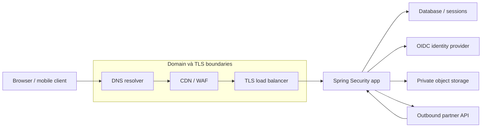
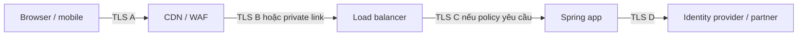
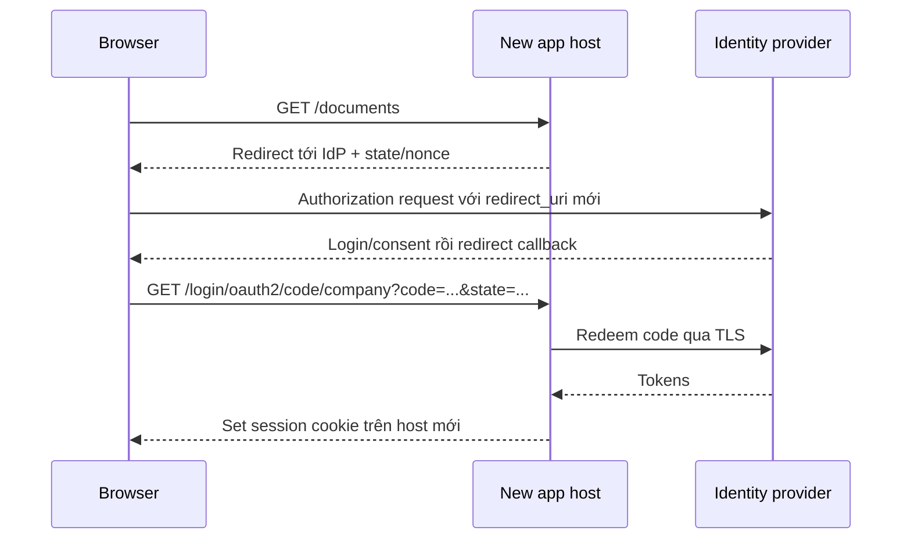

# Đánh giá thay đổi domain, subdomain và hạ tầng TLS

Đổi domain hoặc đưa một ứng dụng Spring Security ra sau CDN, load balancer, reverse proxy, API gateway hay điểm kết thúc TLS mới thường được mô tả như một thao tác hạ tầng: sửa DNS, cấp chứng chỉ và đổi cấu hình proxy. Nhưng với ứng dụng có **cookie session, CSRF, CORS, CSP, HSTS, OAuth2/OIDC login, logout và authorization**, hostname và cấu trúc TLS chính là **một phần ranh giới bảo mật**. Việc website vẫn tải được qua HTTPS không chứng minh mọi luồng authentication, trình duyệt và kết nối nội bộ còn đúng.

Bài này thuộc chương **Vận hành và giám sát** của module **SPRING_SECURITY_HTTP_PROTECTION**. Mục tiêu là biến một thay đổi domain/TLS thành **thay đổi có quản trị rủi ro, có thử nghiệm hồi quy, có quan sát và kế hoạch khôi phục**, thay vì chỉ sửa DNS và đợi người dùng báo lỗi.

**Tình huống xuyên suốt:** hệ thống quản lý hồ sơ DocumentHub có giao diện browser dùng session cookie và CSRF token, API cho SPA, API Bearer cho mobile, đăng nhập OIDC, webhook đối tác và dịch vụ Java WebClient gọi bên ngoài. Công ty đang chuyển:

| Thành phần | Trước thay đổi | Sau thay đổi |
| --- | --- | --- |
| Giao diện | `https://portal.old-example.test` | `https://app.new-example.test` |
| API cho browser | `https://api.old-example.test` | `https://api.new-example.test` |
| Identity provider callback | `/login/oauth2/code/company` tại host cũ | Callback trên host mới đã đăng ký |
| Public ingress | NGINX với TLS tại máy chủ ứng dụng | CDN/WAF → load balancer TLS → Spring |
| Internal API hop | Proxy → app trên một mạng riêng | Load balancer → app qua TLS nội bộ nếu policy yêu cầu |
| File downloads | Host riêng tại domain cũ | Host/URL mới có chính sách download và cache riêng |

Các hostname `*.example.test` là ví dụ minh họa; môi trường sản phẩm phải dùng DNS và certificate thật. Bài không giả định rằng subdomain của cùng một tổ chức luôn có cùng độ tin cậy. Đồng thời cần tách biệt **chuyển hostname** với **đổi authentication model**: hai thay đổi cùng lúc làm số biến cần kiểm thử tăng mạnh.

## 1. Kết quả học tập

Sau bài, người học có thể:

1. Phân biệt **origin**, **schemeful site**, hostname, registrable domain, DNS name, certificate SAN, SNI và HTTP `Host`/`:authority`.
2. Lập danh sách tất cả phụ thuộc domain/subdomain của browser, Spring Security, identity provider, đối tác và internal services.
3. Đánh giá tác động đến cookie `Domain`, `Path`, `Secure`, `HttpOnly`, `SameSite`, prefix `__Host-`/`__Secure-`, cookie-session và CSRF token.
4. Chuyển CORS origin allowlist đúng cách, kể cả preflight và `Vary`; không dùng wildcard hoặc phản chiếu origin vô kiểm soát.
5. Hiểu HSTS ở mức hostname, `includeSubDomains`, `preload` và rủi ro khi di chuyển/rollback các subdomains chưa sẵn sàng HTTPS.
6. Kiểm kê URL absolute, OAuth2/OIDC redirect URI, SAML ACS/logout endpoints, callback/webhook, links trong email và CSP `connect-src`, `frame-ancestors`.
7. Kiểm tra certificate SAN/chain, thời hạn, SNI, hostname verification, TLS policy, mTLS khi cần và tính toàn vẹn TLS qua các proxy hops.
8. Phân biệt cấu hình proxy tin cậy với HTTP headers do client tự khai; tránh host-header/open-redirect và forwarded-header spoofing.
9. Triển khai các ví dụ Spring Security Servlet và Reactive để giữ auth/CSRF/CORS/headers đúng sau migration.
10. Xây **ma trận regression tests** từ DNS/TLS tới browser, MockMvc/WebTestClient, HTTP client thực, OIDC login, logout, upload/download và WebSocket.
11. Xây giám sát cho DNS, certificate expiry, TLS handshake, origin mismatch, redirect loops, cookies, CSRF/CORS 403 và authentication failures.
12. Viết kế hoạch canary, chạy song song domain cũ/mới, rollback an toàn và xác định khi nào không thể rollback ngay vì HSTS/cookie/identity-provider state.

## 2. Thay đổi hostname là thay đổi ranh giới bảo mật

Sơ đồ đích minh họa:



Một thay đổi như `portal.old-example.test` → `app.new-example.test` có thể làm thay đổi:

- **Browser origin:** JavaScript fetch từ đâu tới đâu, CORS cho phép origin nào, local storage hoặc service worker scope nào.
- **Cookie reachability:** cookie host-only hay Domain cookie có còn được gửi, có bị chặn vì SameSite hoặc Secure không.
- **Session continuity:** session ID cũ còn hữu dụng trên host mới không, có chủ động yêu cầu login lại không.
- **CSRF:** token repository và cách frontend lấy/gửi token có còn phù hợp; cookie CSRF có được đọc ở frontend origin hay không.
- **Login callbacks:** URI nào được identity provider tin, OAuth2 state/nonce/correlation được giữ ở browser session ra sao.
- **HTTPS guarantee:** certificate có hợp lệ cho SNI/hostname mới không, edge-to-origin có verify certificate không, hạ tầng cũ/mới có khác TLS policy không.
- **HSTS:** parent domain cũ/mới có `includeSubDomains` không, có preload không, HTTP fallback/rollback còn khả thi không.
- **HTTP headers:** CSP `connect-src`/`form-action`, `frame-ancestors`, CORS, Referrer-Policy, cross-origin isolation có khớp hosts mới không.
- **Outbound/partner trust:** webhook URLs, signed callback endpoints, mTLS SAN/hostname, allowlist của đối tác hoặc corporate firewall.
- **Operations:** log domains, rate-limit keys, canonical redirects, SEO, DNS TTL, monitors, incident runbooks và alert ownership.

**Câu hỏi quan trọng:** “Đổi A record/CNAME thành công” là bằng chứng DNS, **không phải** bằng chứng cookie/CORS/CSRF/OIDC/TLS và authorization đều hoạt động.

### 2.1. Phân loại thay đổi trước khi làm

| Thay đổi | Rủi ro nổi bật | Test quan trọng |
| --- | --- | --- |
| Chuyển `app.example.test` sang máy chủ mới, giữ host | TLS chain, trusted proxy, origin IP, sticky session | Handshake, cookie/session, forwarded headers, health |
| `app.example.test` → `portal.example.test` | Origin khác nhưng có thể cùng site | Cookie host/domain, CSP, CORS, SSO callback |
| `app.example.test` → `app.example.net` | Site/registrable domain mới | SameSite, cookie scope, re-login, redirect allowlists |
| Thêm API subdomain | CORS, preflight, cookie/CSRF | Browser fetch với credentials, OPTIONS/POST |
| Chuyển TLS termination về CDN | HSTS/secure scheme, forwarding, origin TLS | HTTPS redirects, certificate, proxy trust |
| Bật HSTS `includeSubDomains` | Subdomains legacy bị ép HTTPS | Kiểm kê toàn subdomain, browser tests |
| Bật HSTS preload | Cam kết dài hạn theo ecosystem browser | Điều kiện preload, rollback khó, domain governance |
| Thay wildcard certificate | SAN matching, key exposure, SNI routing | TLS handshake của mỗi hostname |
| Thay IdP hoặc redirect host | Login state/nonce/callback và token validation | OIDC/SAML end-to-end, logout |
| Đổi hostname download/upload | Cookies, CORS, cache, browser MIME policy | Private file authorization, redirects, Content-Disposition |

Không gộp một thay đổi từ session-cookie sang stateless Bearer với đổi domain nếu có thể tách rollout; hai thay đổi có những giả định CSRF khác nhau.

## 3. Origin, site, hostname và cookie scope không đồng nghĩa

**Origin** của trang web được xác định bởi scheme, hostname và port. `https://app.example.test` và `https://api.example.test` là **khác origin** dù có thể cùng **site** cho cookie `SameSite`.

**Schemeful site** xét scheme và registrable domain theo quy tắc public suffix; khi đổi `https` sang `http`, site context cũng có thể thay đổi. Không tự suy `example.co.uk` có registrable domain là `co.uk`: phải hiểu Public Suffix List và ranh giới host dưới dạng canonical khi cần.

| Cặp URL | Cùng origin? | Có thể cùng site? | Hệ quả chính |
| --- | --- | --- | --- |
| `https://app.example.test/a` và `https://app.example.test/b` | Có | Có | CORS không cần cho same-origin fetch |
| `https://app.example.test` và `https://api.example.test` | Không | Có | CORS vẫn có thể cần; SameSite khác CORS |
| `https://app.example.test` và `http://app.example.test` | Không | Không theo schemeful site | TLS/HSTS/Secure/SameSite behavior |
| `https://app.example.test` và `https://app.example.net` | Không | Thường không | Cross-site cookie/CSRF/SSO cần review |
| `https://app.example.test` và `https://app.example.test:8443` | Không | Có thể có | CORS/redirect port cần tính rõ |

### 3.1. Cookie host-only và Domain cookie

Một server trả:

```http
Set-Cookie: JSESSIONID=<opaque-value>; Path=/; Secure; HttpOnly; SameSite=Lax
```

Khi **không có thuộc tính `Domain`**, cookie là **host-only**, chỉ được gửi tới host đặt cookie theo rules user-agent. Cookie tạo ở `portal.old-example.test` **không tự chuyển** sang `app.new-example.test` chỉ vì cả hai cùng thuộc một công ty.

Ngược lại:

```http
Set-Cookie: SHARED_SESSION=<opaque-value>; Domain=example.test; Path=/; Secure; HttpOnly; SameSite=Lax
```

Một Domain cookie (khi hợp lệ với public-suffix rules) có thể được gửi tới các subdomains dưới domain đó, tăng phạm vi chia sẻ **và** blast radius của compromise/subdomain takeover. **Không mở rộng `Domain` chỉ để sửa lỗi login** mà chưa đánh giá trust của toàn bộ subdomains.

### 3.2. SameSite không thay thế CORS và CSRF

- `SameSite` giới hạn bối cảnh **browser gửi cookie** theo site; không quyết định JavaScript ở origin nào được đọc response.
- **CORS** áp theo **origin** đối với browser cross-origin fetch/response/preflight.
- **CSRF** bảo vệ unsafe browser requests có ambient credentials theo threat model; cookie `SameSite=Lax` là defense in depth, không được mặc định thay token.
- `HttpOnly` giúp JavaScript không đọc session cookie trực tiếp, nhưng script XSS chạy cùng origin vẫn có thể gửi request mang cookie.
- `Secure` chỉ hạn chế cookie transmission trên secure channels theo user-agent behavior, không chứng minh proxy-to-backend TLS an toàn.

### 3.3. Prefix cookie để giảm rủi ro domain rộng

Khi cần host-only session cookie, cân nhắc prefix theo browser support:

```http
Set-Cookie: __Host-DHSESSION=<opaque-value>; Path=/; Secure; HttpOnly; SameSite=Lax
```

Quy tắc với `__Host-` là cookie phải có `Secure`, `Path=/` và **không có `Domain`**. Nó hỗ trợ chống một số tình huống scope rộng/subdomain can thiệp, nhưng không thay server session validation, origin authorization hoặc xử lý XSS.

**Lưu ý:** Đổi tên cookie/session ID của framework cần cấu hình đồng nhất giữa các app instances và reverse proxies; không tự thêm prefix vào ví dụ rồi mặc định backend đã biết đọc cookie mới.

## 4. Kiểm kê đầy đủ trước khi thay DNS

Tạo **bản kê vận hành** cho từng hostname/URL (đây là biểu mẫu khái niệm, không cần ghi ra file riêng trong STEP 4):

| Loại tài nguyên | Câu hỏi cần xác minh | Owner thường gặp |
| --- | --- | --- |
| Public DNS | A/AAAA/CNAME/ALIAS, TTL, DNSSEC nếu dùng, vùng DNS thuộc ai? | DNS/platform |
| TLS certificate | SAN, issuer/chain, private-key management, expiry, auto-renew? | Platform/security |
| CDN/WAF | Origin host, cache key, custom hostname, redirects, WAF/rate, TLS mode? | Edge/platform |
| Load balancer | Listener, SNI map, health path, backend TLS, forwarded headers? | SRE/platform |
| Spring application | External base URL, allowed hosts, CORS, CSRF, cookie config? | Backend |
| Frontend | CSP, `fetch` API base URL, web sockets, service worker, assets? | Frontend |
| Identity provider | Exact redirect URI, logout callback, issuer, client registration? | Identity team |
| Mobile clients | Pinned hosts/certificates nếu có, deep links, API base URL? | Mobile |
| Webhook partners | Registered callback endpoints, signature validation, IP/network policy? | Integration |
| Email/templates | Password reset links, verification URLs, signed links, image assets? | Product/backend |
| OAuth state/session | Cookies across redirects, SameSite, secure scheme, session store? | Security/backend |
| Downloads/storage | Signed URL host, CDN/private cache, Content-Disposition, CORS? | Storage/backend |
| Observability | Synthetic monitors, certificate expiry alerts, logs, dashboards? | SRE |
| Ops/runbooks | Rollback DNS, disaster recovery domain, incident contact? | SRE/security |

### 4.1. Không chỉ kiểm kê URL hiện ra ở frontend

Các URL ẩn thường bị bỏ quên:

- `redirect_uri` đã đăng ký với OIDC provider; callback SAML ACS/SLO.
- Link password reset và email verification sinh bằng request `Host` hay base URL.
- Swagger/OpenAPI `servers`, API SDK base URL, callback URL trong mobile app.
- CSP source lists, `form-action`, `frame-ancestors`, `connect-src`, WebSocket endpoints.
- CORS allowed origins, CSRF cookie domain/path và custom cookie header naming.
- Payment callback, webhook, pre-signed upload/download origins và CDN storage aliases.
- URL trong database/queued jobs hoặc notification được tạo **trước cutover**.
- URL hardcoded ở partner allowlists, corporate firewall, mTLS SAN checks.
- Service mesh routing, health checks, readiness probes và tracing collector host.
- SSO `post_logout_redirect_uri` và provider-specific allowed origins.

Không nên yêu cầu người dùng đăng xuất/mất phiên ngoài kế hoạch chỉ vì đội hạ tầng đổi domain mà chưa ghi nhận tác động.

## 5. DNS, quyền sở hữu subdomain và takeover risk

DNS giúp hostname tìm tới hạ tầng; DNS **không tự chứng minh** một SaaS/CNAME target vẫn thuộc kiểm soát doanh nghiệp.

### 5.1. Rủi ro dangling DNS records

Ví dụ một CNAME `legacy.example.test` vẫn trỏ tới ứng dụng cloud đã bị hủy. Tùy nhà cung cấp, một actor khác có thể đăng ký lại target/resource và phục vụ nội dung tại hostname của tổ chức (subdomain takeover). Hậu quả có thể gồm:

- Phục vụ phishing hoặc script ở một subdomain vốn được tin cậy.
- Cookie scope/rủi ro cookie tossing nếu có Domain cookies rộng.
- CSP allowlist `*.example.test` hoặc OAuth allowed origins quá rộng bị lạm dụng.
- Cơ chế redirect, email verification hoặc password reset tin subdomain bị chiếm.
- Certificate issuance hoặc response content under organizational host tùy quyền kiểm soát DNS/cloud.

**Biện pháp:** xác nhận resource tồn tại và ownership trước khi trỏ DNS; dọn records sau decommission, có inventory chủ sở hữu, kiểm tra cloud domain verification và tránh wildcard trust. Không cung cấp wildcard CORS/CSP cho toàn bộ subdomains nếu một subdomain ít được quản trị.

### 5.2. DNS TTL không bảo đảm mọi client chuyển đồng thời

Giảm DNS TTL trước cutover giúp giảm thời gian cache ở một số resolvers, nhưng:

- Một số clients/proxies có cache policies riêng.
- Existing TCP/TLS sessions có thể tiếp tục dùng IP cũ.
- CDN propagation và load balancer health states có thời gian riêng.
- Mobile apps hoặc SDKs có thể pin host/IP/certificate.
- DNS AAAA/IPv6 vẫn có thể trỏ hạ tầng cũ dù A record đã đổi.
- DNSSEC/CAA và certificate issuance có lifecycle riêng.

Vì vậy phải **giữ old ingress vận hành có kiểm soát** trong giai đoạn tương thích hoặc quyết định rõ khi nào được chặn host cũ; không coi một lần `nslookup` thành công là migration hoàn tất.

### 5.3. CAA và Certificate Transparency là tín hiệu vận hành

DNS CAA records có thể giới hạn Certificate Authorities được phép cấp chứng chỉ cho tên miền theo chính sách issuance; Certificate Transparency (CT) logs giúp phát hiện chứng chỉ cấp ngoài dự kiến. Hai cơ chế này **không thay** quản lý private keys, certificate renewal hoặc bảo vệ DNS ownership.

Đặt alert cho certificate issuance đáng ngờ, subdomain mới, dangling CNAME và biến động DNS không theo change ticket khi tổ chức có khả năng giám sát.

## 6. Certificate, SAN, SNI và TLS termination

Khi client kết nối `https://api.new-example.test`, hostname verification yêu cầu certificate phù hợp host được kết nối, thường thông qua **Subject Alternative Name (SAN)**. Một certificate chỉ hợp lệ cho `api.old-example.test` không mặc định hợp lệ cho host mới.

### 6.1. SNI và hostname verification

TLS client thường gửi Server Name Indication (SNI) để server/CDN chọn certificate/virtual host đúng. **SNI không phải user identity**, và client có thể lựa chọn/giả SNI; hạ tầng phải đồng bộ listener, HTTP Host/`:authority` routing và certificate mapping.

- Kiểm tra SAN cho **mỗi hostname**: frontend, API, download, auth callback, uploads, admin nếu được công khai.
- Wildcard `*.example.test` thường bao phủ các hostname **một cấp** dưới `example.test`, **không mặc định** bao phủ apex `example.test` hoặc `a.b.example.test`.
- Một wildcard certificate có blast radius lớn hơn nếu private key bị lộ và được dùng rộng; có thể tách certificates theo service boundary.
- Không tắt hostname verification ở client để né certificate mismatch.
- Kiểm tra certificate chain/intermediates; một browser có thể có cache intermediate khác CLI hoặc mobile.
- Kiểm tra certificate renewal với DNS challenge/HTTP challenge và quyền cập nhật DNS sau khi thay CDN.

### 6.2. TLS topology có nhiều hops



“HTTPS đã bật” là một khẳng định **chưa đủ** nếu không nêu hop:

1. Client → CDN: public certificate và hostname verification.
2. CDN → load balancer/origin: origin TLS mode, certificate verification và policy của provider.
3. Load balancer → Spring: plaintext trong private trusted network hay TLS/mTLS tùy rủi ro; nếu yêu cầu end-to-end encryption thì không được bỏ hop này.
4. Spring → Identity Provider/partner: Java TLS trust, hostname validation, proxy/mTLS policy.

Một CDN hỗ trợ “Flexible” kiểu HTTPS-to-edge nhưng HTTP-to-origin **không tương đương TLS được xác minh từ edge đến origin**. Chọn TLS mode phù hợp và validate origin certificate, không chỉ mã hóa một chiều.

### 6.3. Những lỗi thường phát sinh sau chuyển TLS

| Hiện tượng | Giả thuyết | Kiểm chứng |
| --- | --- | --- |
| Browser báo certificate mismatch | SAN thiếu host mới, sai virtual host | SNI/certificate chain của từng hostname |
| 502 sau khi bật HTTPS origin | LB dùng HTTP sai cổng hoặc không trust origin CA | Proxy upstream TLS logs, origin health |
| App redirect HTTP ↔ HTTPS liên tục | App hiểu scheme sai sau TLS termination | Trusted `X-Forwarded-Proto`/`Forwarded` và redirect config |
| HSTS không xuất hiện | Spring thấy request insecure hoặc header ở sai response | Xác minh trên public HTTPS ingress |
| Mobile SDK lỗi nhưng browser hoạt động | OS trust store, certificate pinning, chain/ALPN khác | Test mobile/SDK, chain & pin policy |
| Một host chạy, host khác trả default certificate | SNI listener mapping thiếu | Check từng hostname + edge config |
| WebSocket/SSE đứt | Proxy idle timeout, upgrade hoặc HTTP/2 config | Network integration với protocol thật |
| Login callback về `http://` | External base URL/forwarded scheme sai | OIDC redirect URI và request scheme |

Tất cả thông số cipher/protocol cần theo baseline hiện hành của hạ tầng và hỗ trợ client; không hardcode một danh sách cipher lỗi thời trong bài học. TLS 1.2/1.3 thường là mục tiêu hiện đại, nhưng phải kiểm tra hệ sinh thái mobile/partner và policy doanh nghiệp.

## 7. HSTS: chính sách của browser theo hostname và bài toán rollback

`Strict-Transport-Security` (HSTS) cho HSTS-aware user agents biết phải truy cập host qua HTTPS trong thời hạn `max-age`. Khi browser đã ghi nhớ HSTS cho host cũ, một DNS rollback hoặc redirect sang HTTP **không thể tùy tiện vô hiệu hóa ký ức ấy**. Đó là lý do HSTS phải được đánh giá **trước** khi thay domain hoặc mở rộng subdomain.

### 7.1. Ba cấp triển khai cần phân biệt

```http
Strict-Transport-Security: max-age=300
```

Một giá trị ngắn có thể được dùng trong giai đoạn xác minh hạn chế (tùy policy và môi trường). Sau khi mọi host/hop đã đúng:

```http
Strict-Transport-Security: max-age=31536000
```

Với các tổ chức **đã kiểm soát đầy đủ mọi subdomain**, có thể cân nhắc:

```http
Strict-Transport-Security: max-age=31536000; includeSubDomains
```

`includeSubDomains` áp bảo vệ cho các subdomains của host phát chính sách, kể cả những subdomains không trực tiếp phát header. Nếu parent `example.test` phát HSTS có `includeSubDomains`, một subdomain legacy `legacy.example.test` vẫn chỉ chạy HTTP có thể **trở nên không thể truy cập qua browser tuân HSTS**, dù team legacy không chủ động thay đổi gì.

### 7.2. Preload là cam kết dài hạn, không phải “bật thêm một flag”

`preload` không chỉ là một text directive; các browser preload lists có quy trình/điều kiện riêng. Khi domain đã được preload, những browser nhận danh sách có thể áp HTTPS policy **trước cả lần truy cập đầu tiên**. Việc rút tên miền khỏi preload và lan truyền bản cập nhật browser mất thời gian và **không phải rollback tức thì**.

Không thêm `preload` hoặc `includeSubDomains` trong ngày cutover khi chưa kiểm kê tất cả host/cấp DNS và còn ứng dụng HTTP-only.

### 7.3. Đổi domain không chuyển HSTS state theo tổ chức

HSTS state gắn với hostname/policy, **không gắn với legal entity “cùng công ty”**. `portal.old-example.test` đã có HSTS không bảo đảm `app.new-example.test` có cùng trạng thái. Cần TLS/HTTPS/redirect an toàn ở tên mới và phát HSTS phù hợp. Đối với browser chưa từng tới tên mới, luôn cân nhắc **first-visit/downgrade threat** theo chính sách.

### 7.4. Xóa HSTS không phải thay DNS

Một server có thể gửi `max-age=0` qua HTTPS hợp lệ để yêu cầu client tuân chuẩn xóa HSTS policy cho chính host đó, nhưng:

- Client phải **nhận được** response qua HTTPS từ host thích hợp.
- HSTS policy của **parent host với includeSubDomains** vẫn có thể tác động.
- Preload list không bị xóa ngay chỉ nhờ một response.
- Một số clients offline/không truy cập lại host vẫn giữ state đến khi nhận thông tin mới hoặc state hết hạn theo rules.

Do đó rollback HSTS cần runbook và test client thực, không chỉ đổi DNS/CNAME.

### 7.5. Ai nên phát HSTS: edge hay Spring?

Có thể phát ở CDN/ingress hoặc Spring Security, nhưng phải có **một nguồn chính sách được quản lý rõ**. Nếu edge phát một giá trị còn Spring phát giá trị khác, multiple headers và đường response khác nhau (302/401/403/5xx) có thể gây hành vi khó dự đoán/quan sát.

Cần kiểm tra **public HTTPS response mà browser thật thấy**, bao gồm redirects/error pages, không chỉ request vào localhost Spring. Khi TLS kết thúc ở proxy, Spring có thể tưởng request là HTTP; điều này ảnh hưởng cách HSTS/security redirects được tạo ra nếu forwarded scheme không được xử lý đúng từ nguồn đáng tin.

## 8. Cookie/session migration: không có cơ chế chuyển phiên ma thuật

Một session cookie tạo ở `portal.old-example.test` không tự được browser gửi tới `app.new-example.test` nếu cookie host-only. Ngay cả với cùng tenant và cùng database session store, **khác host scope vẫn khiến browser không gửi session ID**.

### 8.1. Những chiến lược migration session

| Chiến lược | Lợi ích | Đánh đổi/rủi ro |
| --- | --- | --- |
| **Re-login có chủ đích** tại host mới | Đơn giản, cô lập cookie/host | Gián đoạn người dùng; cần UX thông báo |
| Giữ domain cũ và redirect sang host mới | Link cũ vẫn hoạt động | Redirect **không chuyển cookie host-only** sang host mới |
| Sử dụng central IdP SSO ở host mới | Re-auth tiện hơn nếu IdP session còn | Redirect URI/state/callback và cookies phải đúng |
| Chuyển session qua backend-mediated flow riêng | Có thể giảm re-login nếu thật cần | Phức tạp, nguy cơ token leak/session fixation/open redirect |
| Dùng Domain cookie chung giữa subdomains có trust cao | SSO nội bộ cùng registrable domain có thể đơn giản hơn | Blast radius, subdomain takeover/cookie tossing, không dùng qua registrable domains khác nhau |

**Khuyến nghị thực tế:** ưu tiên **re-authentication hoặc IdP SSO** tại domain mới nếu thay registrable domain, thay vì cố cho cookie cũ đi qua host mới bằng URL token hoặc domain quá rộng.

### 8.2. Cookie attributes ảnh hưởng migration

Một cookie nên được rà soát theo từng thuộc tính:

- `Name`: đổi tên có làm app không nhận cookie cũ, hoặc trùng với cookie tên giống ở parent domain?
- `Domain`: host-only hay rộng cho subdomain? Tên mới có cùng registrable domain không?
- `Path`: cookie cũ `Path=/oldapp` sẽ không tự có ở `/` hoặc `/api` mới.
- `Secure`: kết nối mới phải dùng HTTPS; mọi proxy hops và secure scheme detection phải hợp lệ.
- `HttpOnly`: frontend JavaScript không thể tự đọc session ID để “copy sang domain khác” (và không nên làm như vậy).
- `SameSite`: OAuth redirects, iframe, SPA cross-site credentials hay cross-origin fetch cần đánh giá.
- `Expires`/`Max-Age`: cookie cũ sẽ sống bao lâu; logout/expiry có thật sự dọn state không?
- `Partitioned` (CHIPS/browser-specific nếu dùng): cookie partition theo top-level site có thể thay đổi khi frontend/domain thay đổi; test hỗ trợ và hành vi riêng.

### 8.3. Cookie tossing và subdomain trust

Nếu dùng `Domain=example.test`, nhiều subdomains có thể được gửi cùng cookie trên các host phù hợp. Một subdomain bị chiếm hoặc cấu hình không đáng tin có thể gây **cookie scope conflict/override** trong một số trường hợp. Prefix `__Host-` giúp enforce host-only trong user agents hỗ trợ:

```http
Set-Cookie: __Host-DHSESSION=<opaque>; Path=/; Secure; HttpOnly; SameSite=Lax
```

Dù vậy, session server-side vẫn cần chống fixation, invalidation/logout, session rotation khi login và authz theo tài nguyên. Prefix/cookie flags không giải quyết cross-tenant IDOR.

### 8.4. Có thể dùng cookie session mới cùng IdP session cũ

Đây là điểm dễ gây nhầm:

- Browser **không có** DocumentHub session cookie tại host mới.
- Browser **có thể còn** IdP SSO session tại IdP host.
- Một lần OAuth2/OIDC login redirect mới có thể nhận authentication mà user không cần nhập mật khẩu lại.
- Nhưng app vẫn phải xác minh OAuth `state`, nonce theo flow, callback URI, token signature/issuer/audience và domain-level authorization.

SSO “tự đăng nhập lại” không phải chuyển cookie host-only; nó là một **authentication protocol flow khác**.

## 9. CSRF khi tách API và frontend sang subdomain mới

Giả sử frontend `https://app.new-example.test` gọi `https://api.new-example.test` với cookie-based session. Đây là **cross-origin**, có thể là same-site khi cùng schemeful site. Không thể chỉ thấy “cùng example.test” rồi bỏ CORS/CSRF.

### 9.1. Cấu hình token flow phải khớp cookie scope

Một frontend SPA có thể gửi:

```javascript
async function renameDocument(id, title, csrfHeaderName, csrfToken) {
  const response = await fetch(
    "https://api.new-example.test/api/documents/" +
      encodeURIComponent(id) + "/rename",
    {
      method: "POST",
      credentials: "include",
      headers: {
        "Content-Type": "application/json",
        [csrfHeaderName]: csrfToken
      },
      body: JSON.stringify({ title })
    }
  );
  if (!response.ok) {
    throw new Error("Đổi tên không thành công");
  }
}
```

Phải kiểm tra đồng thời:

1. **CORS:** API cho đúng frontend origin, credential policy phù hợp và preflight headers có custom CSRF header.
2. **Cookie:** session cookie được gửi đến API host theo `Domain`/`Path`/`Secure`/`SameSite` và browser policy.
3. **CSRF:** frontend có cách lấy token hợp lệ từ server theo repository/handler, không phải đoán token hoặc lấy từ cookie chỉ tồn tại ở một host khác.
4. **Authorization:** actor có quyền sửa document cụ thể, không chỉ có role chung.
5. **TLS:** frontend/API đều dùng HTTPS đúng certificate và edge policy.

Nếu CSRF token trước đây được frontend đọc từ một **non-HttpOnly cookie host-only của API** thì JavaScript ở frontend host mới **không tự đọc được** cookie đó. Cần thiết kế endpoint bootstrap/token retrieval hoặc same-origin backend-for-frontend phù hợp, với CORS và token transport được review. **Không mở Domain cookie cho session secret chỉ để frontend đọc CSRF token.**

### 9.2. SameSite khi chuyển sang registrable domain mới

Khi `app.old-example.test` gọi `api.old-example.test` có thể là same-site; nhưng `app.new-example.test` gọi **API cũ** `api.old-example.test` là cross-site. Cookie `SameSite=Lax` thường không được gửi trong cross-site fetch/XHR như một cookie gửi ở same-site context, khiến API trả 401/redirect bất ngờ.

Tùy mô hình, có thể:

- Chuyển frontend và browser API sang cùng schemeful site.
- Dùng backend-for-frontend/same-origin proxy để giảm phức tạp cookie/CORS.
- Thiết kế flow cross-site cookie có `SameSite=None; Secure` khi thực sự cần, nhưng phải hiểu third-party cookie blocking/partitioning và browser compatibility.
- Chuyển auth model cho public API nếu business thực sự cần khác, **không tắt CSRF một cách vô điều kiện**.

### 9.3. Không coi POST bị 403 sau migration là “lỗi CORS” tự động

- **CORS failure:** preflight/response không đáp ứng browser CORS policy.
- **401/redirect login:** session cookie không được gửi/không còn hiệu lực.
- **403 CSRF:** token thiếu/sai/stale, repository/handler không khớp hoặc session đổi.
- **403 authorization:** role/tenant/owner thiếu dù CSRF đúng.
- **400/413:** request parser/size policy của gateway mới.
- **429:** rate limit mới phân key khác hoặc shared state khác.

Quan sát server logs có reason code an toàn thay vì chỉ nhìn DevTools console.

Trong Spring Security Servlet, `CsrfFilter` tham gia xác minh CSRF token cho unsafe requests theo cấu hình; trong WebFlux là `CsrfWebFilter`. Đổi domain không làm biến mất cơ chế này, nhưng có thể làm cookie/session/token repository không còn khớp hoặc frontend không lấy được token. Cần xem log nguyên nhân 403 và đối chiếu cả request method, session, token transport, không chỉ sửa CORS.

## 10. CORS allowlist migration: cẩn thận với dual-domain giai đoạn chuyển tiếp

Trong giai đoạn chuyển host, browser frontend **cũ và mới** có thể đồng thời phục vụ người dùng. API có thể cần tạm cho hai origin đã phê duyệt, nhưng thời hạn và scope phải rõ.

### 10.1. Allowlist chính xác thay vì wildcard

Ví dụ Servlet `CorsConfigurationSource` (lý thuyết cho dual-origin browser API):

```java
import java.util.List;
import org.springframework.context.annotation.Bean;
import org.springframework.context.annotation.Configuration;
import org.springframework.web.cors.CorsConfiguration;
import org.springframework.web.cors.CorsConfigurationSource;
import org.springframework.web.cors.UrlBasedCorsConfigurationSource;

@Configuration
public class MigratingCorsPolicy {

    @Bean
    CorsConfigurationSource corsConfigurationSource() {
        CorsConfiguration cors = new CorsConfiguration();

        cors.setAllowedOrigins(List.of(
                "https://portal.old-example.test",
                "https://app.new-example.test"));

        cors.setAllowedMethods(List.of(
                "GET", "POST", "PUT", "PATCH", "DELETE"));

        cors.setAllowedHeaders(List.of(
                "Content-Type", "X-CSRF-TOKEN", "X-XSRF-TOKEN"));

        cors.setExposedHeaders(List.of(
                "Content-Disposition", "Retry-After"));

        cors.setAllowCredentials(true);
        cors.setMaxAge(600L);

        UrlBasedCorsConfigurationSource source =
                new UrlBasedCorsConfigurationSource();
        source.registerCorsConfiguration("/api/browser/**", cors);
        return source;
    }
}
```

Chú ý:

- **Mỗi origin** phải có scheme/host/port đúng. CORS không chấp nhận “cùng công ty” theo heuristic.
- `allowCredentials(true)` với wildcard `Access-Control-Allow-Origin: *` không tương thích credentialed browser CORS.
- **Không phản chiếu Origin tùy ý** thành allowlist tự động.
- Với CDN/shared caches, `Vary: Origin` và preflight vary dimensions phải được xử lý; không dùng CORS để bảo vệ cache private data.
- `setMaxAge(600L)` là thời lượng cache **preflight**, không phải session/CSRF token TTL.
- Sau cutover, **loại bỏ** origin cũ nếu nó không còn đáng tin. Một app cũ bị takeover và vẫn allowlisted có thể đọc dữ liệu cross-origin của users được xác thực theo các điều kiện browser liên quan.

### 10.2. CORS không phải IP allowlist hay authorization

Một native client có thể gửi `Origin: https://app.new-example.test` hoặc không gửi `Origin`. Server phải xác thực Bearer/session/mTLS và phân quyền từng tài nguyên. Nếu CORS processor từ chối một request có Origin bị cấm, điều đó **không chứng minh** chỉ clients thật ở allowlisted origin có thể gọi API.

### 10.3. Preflight thường không mang cookie session

Browser gửi:

```http
OPTIONS /api/browser/documents HTTP/1.1
Host: api.new-example.test
Origin: https://app.new-example.test
Access-Control-Request-Method: POST
Access-Control-Request-Headers: content-type,x-csrf-token
```

Spring Security cần CORS integration phù hợp để preflight được xử lý **trước bước authentication/authorization của request nghiệp vụ**. Nhưng preflight pass không có nghĩa POST thật được phép; POST vẫn cần cookie, CSRF token, quyền và validation.

### 10.4. URL redirect và CORS có thể tương tác khó hiểu

Một API URL cũ trả `301/302/307/308` sang host mới có thể gây vấn đề cho browser CORS/preflight, unsafe methods và credentials. Đặc biệt:

- 301/302 có lịch sử/semantics tương tác method rewriting ở nhiều clients; không dùng cho unsafe API requests khi chưa test.
- 307/308 giữ method/body theo HTTP semantics, nhưng không có nghĩa CSRF/cookies/cross-origin credentials tự đúng.
- Một preflight tới host cũ redirect sang host mới có thể không được browser/client hỗ trợ như mong đợi trong mọi bối cảnh.
- Redirect tới API domain mới không thể khiến frontend script tự có quyền đọc response nếu CORS policy ở đích chưa đúng.
- Với upload bodies lớn, redirect có thể làm clients gửi lại body, tăng băng thông và xử lý.

**Ưu tiên cập nhật API base URL tại client/SDK** thay vì dựa vĩnh viễn vào chuỗi redirects; giữ legacy routing dưới policy được kiểm tra nếu cần tương thích trong ngắn hạn.

## 11. OAuth2/OIDC, SAML và login callback sau đổi host

### 11.1. Redirect URI thường yêu cầu khớp chính xác

OIDC/OAuth2 authorization code flow thường đăng ký một hoặc nhiều **redirect URIs** với provider. Khi từ `https://portal.old-example.test/login/oauth2/code/company` chuyển sang host mới, cần đăng ký URI mới theo cấu hình provider. Không dùng wildcard open redirect để “khỏi cập nhật IdP”.

Ví dụ đường đi:



Cần xác minh:

- Redirect URI đăng ký tại IdP có **scheme HTTPS, host, path và port** đúng.
- Spring app tạo external callback URL theo public host/scheme thật, không phải `http://internal:8080`.
- Browser giữ tương quan OAuth `state` và `nonce` theo implementation, session/authorization request repository không bị mất trong quá trình cross-site redirects.
- Nếu IdP POST callback (một số SAML/OIDC response modes), `SameSite` và cookie availability khác GET redirect; phải test flow thực.
- Resource Server JWT checks `issuer`/`audience`/signature không tự đổi theo public app domain; chỉ sửa token validation settings khi identity provider/issuer thật thay đổi.
- Logout/revocation/back-channel và `post_logout_redirect_uri` phải được review, không chỉ login callback.
- Provider có thêm allowed web origins, CORS, logout origins hoặc application domain allowlist, phải update đúng scope.
- Đối với multi-tenant IdP, bảo đảm tenant routing và account binding không bị lẫn khi domain cũ/mới đồng thời hoạt động.

### 11.2. Session và CSRF token trong callback flow

OAuth `state` là control chống login CSRF/correlation theo OAuth flow; nó **không phải** token CSRF chung để dùng cho mọi `POST /api/documents`. Hai mục tiêu liên quan browser nhưng có lifecycle/purpose khác.

Nếu session cookie không sống qua redirect/callback hoặc app instances không chia sẻ authorization request state, thường xuất hiện lỗi “invalid state”, “authorization request not found” hoặc redirect loop. Cần kiểm tra cookie policy và shared session/authorization request repository đúng implementation, không vô hiệu state checking để làm login chạy được.

### 11.3. Absolute URL generation và password-reset links

Các URL được tạo từ `Host`/`X-Forwarded-Host` mà không có trusted-proxy/allowed-host policy có thể gây **host-header injection**, mở đường cho password-reset poisoning hoặc open redirects.

Nên ưu tiên **configured public base URL** cho links gửi email và callbacks quan trọng; nếu dùng current request URL, chỉ dùng external host/scheme đã được proxy tin cậy và app allowlist xác minh.

## 12. CSP, frame protections và các response headers gắn hostname

Khi origin chuyển đổi, frontend vẫn có thể tải được HTML nhưng bị CSP chặn gọi API hoặc WebSocket tới host mới. Đặc biệt:

- `connect-src`: `fetch`, XHR, WebSocket/EventSource theo CSP semantics.
- `form-action`: nơi HTML forms được submit.
- `frame-ancestors`: trang có được embed bởi origin đối tác mới không.
- `frame-src`/`child-src`: trang của bạn nhúng frame từ đâu.
- `img-src`/`font-src`/`style-src`/`script-src`: assets từ CDN hoặc subdomain mới.
- `base-uri`: hạn chế `<base>` thay URL resolution.
- `report-uri`/`report-to` hoặc Reporting API endpoints: domain báo cáo có còn hợp lệ không.

### 12.1. Policy ví dụ cho frontend gọi API riêng origin

```http
Content-Security-Policy: default-src 'self'; script-src 'self'; connect-src 'self' https://api.new-example.test; object-src 'none'; base-uri 'self'; frame-ancestors 'none'
```

Policy phải được phát trên **HTML/document ở `app.new-example.test`**. Thêm CSP vào JSON response của `api.new-example.test` **không thay** CSP của trang frontend nếu host đó không trả HTML document. Trên browser, CSP có thể chặn fetch **trước khi** CORS trở thành vấn đề; vì thế cần phân biệt lỗi CSP `connect-src` với lỗi preflight.

### 12.2. Migrating CSP không nên quá rộng vì muốn hỗ trợ song song

Một cách tạm thời có thể allow cả old/new API origins nếu cần dual support; nhưng:

- Có thời hạn loại host cũ sau cutover.
- Không dùng `*.example.test` hoặc `https:` rộng khi chưa đánh giá quyền quản trị subdomains.
- Tránh `'unsafe-inline'`/`'unsafe-eval'` chỉ vì một assets loader bị lỗi.
- Dùng CSP Report-Only trên domain mới trước khi enforce, theo dõi vi phạm thực tế, sau đó thu hẹp.
- Frame policy có thể gây lỗi với SSO popup/iframe, payment/partner portal; phải test luồng cụ thể, không tắt `frame-ancestors` vô điều kiện.

### 12.3. HSTS khác CSP và CORS

- HSTS liên quan HTTPS transport policy theo host.
- CSP liên quan browser resource execution/loading và framing theo document.
- CORS liên quan browser cross-origin response access/preflight.
- CSRF liên quan forged unsafe requests khi ambient credentials được dùng.
- Authentication/authorization liên quan người gọi và tài nguyên nghiệp vụ.

Một hostname mới có thể yêu cầu điều chỉnh cả bốn, nhưng **không lớp nào thay được lớp khác**.

## 13. Reverse proxy và forwarded headers: xác định public scheme/host đáng tin

Ứng dụng Spring đứng sau CDN/load balancer thường nhận kết nối nội bộ dạng `http://10.0.0.10:8080` trong khi browser dùng `https://api.new-example.test`. App có thể cần external scheme/host để tạo redirects, secure cookies, HSTS hoặc absolute URLs. Proxy thường truyền metadata:

```http
Host: api.new-example.test
X-Forwarded-Proto: https
X-Forwarded-Host: api.new-example.test
X-Forwarded-Port: 443
X-Forwarded-For: 203.0.113.8
```

**Sai lầm nguy hiểm:** bật forwarding support rồi để Internet tự đặt `X-Forwarded-Host: attacker.example.test` hoặc `X-Forwarded-Proto: https` mà không có tầng sanitize/allowlist. Một client tùy ý có thể gửi raw headers, gây lỗi redirect, password-reset host poisoning, cache poisoning hoặc rate-limit key spoofing.

### 13.1. Cần hai ranh giới: network trust và application host policy

1. **Network:** origin chỉ nhận traffic từ reverse proxy/load balancer được phê duyệt (security groups/firewall/mTLS khi cần).
2. **Header sanitization:** proxy tại trust boundary **loại bỏ/ghi đè** các forwarded headers chưa tin; những proxy hops bên trong chỉ tiếp tục metadata đã được xác minh.
3. **Host allowlist:** application/gateway chỉ phục vụ những public hosts được phép, ví dụ `api.new-example.test` và host legacy được duyệt tạm.
4. **URL generation:** link quan trọng như reset password/OIDC callbacks dùng configured public base URL hoặc metadata đã validated, không dùng raw `Host`.
5. **Telemetry:** ghi request host/scheme sau normalize và reason codes của rejected host, không log raw secret-bearing URLs.

**Không nên coi `server.forward-headers-strategy=framework` hoặc `native` là một bộ lọc trusted proxies hoàn chỉnh.** Những lựa chọn này điều chỉnh cách framework/server xử lý headers; khả năng tin đúng nguồn còn phụ thuộc hạ tầng đã chặn đường direct-to-origin và sanitize headers.

### 13.2. NGINX minh họa TLS termination và forwarding

Đoạn cấu hình giả định **NGINX là ingress trực tiếp nhận client không tin cậy** và Spring chỉ có thể được truy cập từ NGINX. Không áp dụng nguyên xi khi trước NGINX còn CDN/proxy; trường hợp ấy phải cấu hình trusted-real-IP handling theo chain được xác minh.

```nginx
# Chỉ minh họa; certificate paths và upstream phải cấu hình thật.
server {
    listen 443 ssl;
    server_name api.new-example.test;

    ssl_certificate     /etc/tls/api-fullchain.pem;
    ssl_certificate_key /etc/tls/api-key.pem;

    # Chặn request body quá lớn từ sớm; ví dụ để học.
    client_max_body_size 8m;

    location / {
        proxy_pass http://spring_backend;

        # Host đích cố định cho backend URL routing.
        proxy_set_header Host api.new-example.test;

        # Không chuyển tiếp giá trị do client tự khai.
        proxy_set_header X-Forwarded-Host api.new-example.test;
        proxy_set_header X-Forwarded-Proto https;
        proxy_set_header X-Forwarded-Port 443;
        proxy_set_header X-Forwarded-For $remote_addr;

        # Không cho raw Forwarded header của Internet đi tiếp.
        proxy_set_header Forwarded "";
    }
}
```

Các điểm vận hành:

- Cấu hình trên chỉ dành cho **một public host**. Legacy host nếu được phục vụ cần `server`/vhost rule rõ, không vô tình nhận mọi Host.
- `$remote_addr` ở ingress trực tiếp là peer kết nối; nếu có CDN trước NGINX, đây có thể là CDN IP, phải xử lý trusted-client-IP chain theo provider và CIDR thực, không tin raw `X-Forwarded-For`.
- `proxy_pass http://spring_backend` minh họa một hop HTTP private; nếu threat model yêu cầu TLS tới origin, dùng `https` upstream, certificate verification/SNI/trust chain phù hợp. Không gọi toàn tuyến “end-to-end TLS” khi hop còn plaintext.
- `client_max_body_size` không thay multipart per-file limits, actor quotas hoặc Spring Security authentication.
- HSTS nếu được phát ở NGINX, cần kiểm tra host scope, `always` cho status codes phù hợp và tránh xung đột policy với Spring.
- Có thể thêm server block bắt `Host` không hợp lệ và từ chối; cách xây default server chính xác tùy NGINX/CDN deployment.

### 13.3. Redirect HTTP → HTTPS và canonical host

Ví dụ ý tưởng cho một host đã có HTTPS hợp lệ:

```nginx
server {
    listen 80;
    server_name api.new-example.test;

    # Đích tuyệt đối đã cố định; không dùng $host tùy ý
    # để tạo redirect tới domain do attacker khai.
    return 308 https://api.new-example.test$request_uri;
}
```

`308` giữ method/body theo HTTP semantics, nhưng **không bảo đảm browser/API client sẽ replay an toàn mọi POST**. Với endpoints chứa credentials và unsafe operations, tốt hơn là clients dùng HTTPS đúng ngay từ đầu; redirect không thay transport validation hoặc CSRF. Dữ liệu nhạy cảm không được phục vụ qua HTTP.

Canonicalization theo host phải xét host cũ và mới, cookie/session lifecycle, CORS preflight, OAuth callbacks, webhook methods, download signed URLs và link reset/password. Không chuyển mọi URL bằng một redirect global thiếu kiểm thử.

### 13.4. Spring Boot forwarded-header handling

Trong một Servlet app chỉ nhận traffic qua trusted ingress:

```yaml
server:
  forward-headers-strategy: framework
  servlet:
    session:
      cookie:
        secure: true
        http-only: true
        same-site: lax
      timeout: 30m
```

`framework` có thể dùng Spring Framework forwarding infrastructure như `ForwardedHeaderFilter` trong Servlet; ở WebFlux, cơ chế tương ứng là `ForwardedHeaderTransformer` tùy Boot/Framework configuration. **Không tự đăng ký nhiều filter/transformer trùng nhau** khi Boot đã cấu hình. Quan trọng hơn, việc dùng forwarded headers **chỉ an toàn khi ingress đã sanitize headers và backend không public direct**.

Một số triển khai chọn `native` để container xử lý hoặc cấu hình proxy-specific. Chọn theo actual proxy/server, test `request.isSecure()`, redirect URL và HSTS header trên public HTTPS path.

### 13.5. Host header và reset password poisoning

Anti-pattern:

```java
// KHÔNG DÙNG untrusted Host để sinh link gửi email.
String resetLink = request.getScheme() + "://"
        + request.getHeader("Host")
        + "/reset?token=" + resetToken;
```

Với input Host bị spoof, email có thể chứa URL tới host không đáng tin. Nên dùng configured public base URL hoặc allowlist/verified external host:

```java
// Ví dụ giá trị từ cấu hình server quản trị,
// không lấy từ raw request headers.
URI resetBase = URI.create(
        "https://app.new-example.test/reset");
```

Code tạo link thật còn phải encode token an toàn, giới hạn token lifetime/single-use, không ghi token vào logs và đánh giá rủi ro secret-in-URL trong password reset flow. Thay đổi domain cần cập nhật templates và hết hạn links trước cutover theo policy.

## 14. Spring Security Servlet: browser/session policy khi thay hostname

Ví dụ một ứng dụng Spring MVC dùng cookie session ở `api.new-example.test`, với frontend browser `app.new-example.test`. CORS allowlist từ mục 10 được áp cho `/api/browser/**`.

### 14.1. SecurityFilterChain giữ CSRF, authorization và headers

```java
import org.springframework.context.annotation.Bean;
import org.springframework.context.annotation.Configuration;
import org.springframework.http.HttpMethod;
import org.springframework.security.config.Customizer;
import org.springframework.security.config.annotation.web.builders.HttpSecurity;
import org.springframework.security.web.SecurityFilterChain;

@Configuration
public class MigratedBrowserSecurity {

    @Bean
    SecurityFilterChain browserChain(HttpSecurity http)
            throws Exception {

        return http
                .cors(Customizer.withDefaults())
                .authorizeHttpRequests(auth -> auth
                        .requestMatchers(
                                "/health/public", "/login", "/assets/**")
                            .permitAll()
                        .requestMatchers(HttpMethod.GET,
                                "/api/browser/documents/*")
                            .hasRole("DOCUMENT_READER")
                        .requestMatchers(HttpMethod.POST,
                                "/api/browser/documents/*/rename")
                            .hasRole("DOCUMENT_EDITOR")
                        .anyRequest().denyAll())
                .formLogin(login -> login.permitAll())
                // Browser session vẫn dùng ambient cookies.
                .csrf(Customizer.withDefaults())
                .headers(headers -> headers
                        .httpStrictTransportSecurity(hsts -> hsts
                                .includeSubDomains(false)
                                // Giá trị ngắn để demo/đo trước rollout.
                                .maxAgeInSeconds(300))
                        .contentSecurityPolicy(csp -> csp
                                .policyDirectives(
                                        "default-src 'self'; "
                                      + "script-src 'self'; "
                                      + "connect-src 'self' "
                                      + "https://api.new-example.test; "
                                      + "object-src 'none'; "
                                      + "frame-ancestors 'none'")))
                .build();
    }
}
```

**Ràng buộc quan trọng:**

- `httpStrictTransportSecurity` ở đây minh họa một **host-only policy ngắn hạn**; giá trị thực phải theo HSTS rollout plan. Một số ingress có thể quản lý HSTS thay vì Spring — chọn một nơi chịu trách nhiệm và verify public responses.
- `headers.contentSecurityPolicy` phát CSP trên những responses của application. Nếu HTML frontend do `app.new-example.test`/CDN phục vụ, cần cấu hình CSP **ở host trả HTML**; policy của JSON API không thay CSP frontend.
- `formLogin(...permitAll())` là ví dụ login session; auth endpoints và SSO/OIDC callback phải được cấu hình theo flow thực.
- `.authorizeHttpRequests(...denyAll())` là default an toàn cho demo; product cần khai các endpoints khác (logout, callback, assets, health) theo access matrix. Không mở rộng `permitAll` chỉ vì CORS lỗi.
- `ROLE_DOCUMENT_READER` chỉ cho quyền gọi loại route, không xác nhận user sở hữu document ID; cần domain-level authorization.
- Không ghép config này nguyên xi với multi-chain Bearer-only app nếu chưa thiết kế matcher order và CSRF policy riêng.
- `max-age=300` ở HSTS demo không làm thay đổi `server.servlet.session.timeout`; hai thứ hoàn toàn khác nhau.

### 14.2. Controller và service permission để bảo đảm không phụ thuộc Origin

```java
import java.security.Principal;
import java.util.Map;
import java.util.UUID;
import org.springframework.http.HttpStatus;
import org.springframework.http.ResponseEntity;
import org.springframework.web.bind.annotation.*;

public interface MigratedDocumentService {
    String titleFor(UUID id, String actor);
    void rename(UUID id, String actor, String title);
}

@RestController
public class BrowserDocumentController {
    private final MigratedDocumentService documents;

    public BrowserDocumentController(
            MigratedDocumentService documents) {
        this.documents = documents;
    }

    public record Rename(String title) {}

    @GetMapping("/health/public")
    Map<String, String> health() {
        return Map.of("status", "ok");
    }

    @GetMapping("/api/browser/documents/{id}")
    Map<String, String> title(
            @PathVariable UUID id, Principal actor) {
        return Map.of("title",
                documents.titleFor(id, actor.getName()));
    }

    @PostMapping("/api/browser/documents/{id}/rename")
    ResponseEntity<Void> rename(
            @PathVariable UUID id,
            @RequestBody Rename body,
            Principal actor) {
        documents.rename(
                id, actor.getName(), body.title());
        return ResponseEntity.status(
                HttpStatus.NO_CONTENT).build();
    }
}
```

**Mục tiêu thiết kế:** controller nhận authenticated principal, service kiểm tra tenant/owner và permission trước khi đọc/sửa record. CORS/HSTS/cookie flags không bảo vệ cross-tenant data nếu service bỏ qua owner. Implementation của `MigratedDocumentService` phải validate title, dùng parameterized queries và không tin `X-User-ID`/`tenantId` do client tự khai.

*Khi dùng trong dự án Java thật, đặt mỗi `public` top-level interface/class ở một tệp `.java` riêng. Các declaration ở cùng khối mã phía trên nhằm trình bày ngắn gọn contract và controller.*

### 14.3. HSTS/CSP không giải quyết API hostname mismatch

Nếu proxy gửi response từ host cũ nhưng frontend fetch sang host mới, browser sẽ xét **CORS theo origin thực**, certificate theo **TLS hostname**, cookies theo host/site và redirect theo policy. Không có một property Spring Security đơn lẻ tự điều chỉnh tất cả các lớp khi đổi DNS.

## 15. Reactive WebFlux: cùng threat model, cấu hình khác

Một ứng dụng Reactive độc lập dùng `ServerHttpSecurity`, `SecurityWebFilterChain` và `org.springframework.web.cors.reactive.*`. Không copy Servlet `HttpSecurity`, `OncePerRequestFilter` hay `server.servlet.session.*` rồi tưởng những API ấy áp dụng cho Reactor Netty.

### 15.1. Reactive CORS config cho dual-origin tạm thời

```java
import java.util.List;
import org.springframework.context.annotation.Bean;
import org.springframework.context.annotation.Configuration;
import org.springframework.web.cors.CorsConfiguration;
import org.springframework.web.cors.reactive.CorsConfigurationSource;
import org.springframework.web.cors.reactive.UrlBasedCorsConfigurationSource;

@Configuration
public class ReactiveMigratingCors {

    @Bean
    CorsConfigurationSource corsConfigurationSource() {
        CorsConfiguration cors = new CorsConfiguration();

        cors.setAllowedOrigins(List.of(
                "https://portal.old-example.test",
                "https://app.new-example.test"));
        cors.setAllowedMethods(
                List.of("GET", "POST", "PUT", "PATCH", "DELETE"));
        cors.setAllowedHeaders(
                List.of("Content-Type", "X-CSRF-TOKEN"));
        cors.setAllowCredentials(true);
        cors.setMaxAge(600L);

        UrlBasedCorsConfigurationSource source =
                new UrlBasedCorsConfigurationSource();
        source.registerCorsConfiguration(
                "/api/reactive/**", cors);
        return source;
    }
}
```

### 15.2. SecurityWebFilterChain với browser CSRF

```java
import org.springframework.context.annotation.Bean;
import org.springframework.context.annotation.Configuration;
import org.springframework.http.HttpMethod;
import org.springframework.security.config.Customizer;
import org.springframework.security.config.web.server.ServerHttpSecurity;
import org.springframework.security.web.server.SecurityWebFilterChain;

@Configuration
public class ReactiveMigratedSecurity {

    @Bean
    SecurityWebFilterChain browserChain(
            ServerHttpSecurity http) {

        return http
                .cors(Customizer.withDefaults())
                .authorizeExchange(auth -> auth
                        .pathMatchers("/health/public", "/login")
                            .permitAll()
                        .pathMatchers(HttpMethod.GET,
                                "/api/reactive/documents/*")
                            .hasRole("DOCUMENT_READER")
                        .pathMatchers(HttpMethod.POST,
                                "/api/reactive/documents/*/rename")
                            .hasRole("DOCUMENT_EDITOR")
                        .anyExchange().denyAll())
                .formLogin(Customizer.withDefaults())
                .csrf(Customizer.withDefaults())
                .build();
    }
}
```

HSTS/CSP trong Reactive có cấu hình security headers riêng hoặc có thể đặt ở trusted HTTPS ingress; **đừng giả định Spring MVC filter/Servlet headers có hiệu lực trong WebFlux**. Nếu ingress phát headers, phải test 200, redirects và errors từ public host.

Với Reactive:

- Cookie và WebSession có repository/lifecycle khác Servlet; kiểm thử session persistence/CSRF token khi dùng distributed instances.
- Dùng `ForwardedHeaderTransformer` (hoặc Boot forwarding strategy phù hợp) **chỉ khi proxy metadata đáng tin**, không nhận client-supplied values.
- Không block Reactor Netty event loop bằng Redis/DB/filesystem I/O để xác minh host/scheme.
- `WebClient` outbound có TLS/hostname verification riêng, không được CORS/CSP browser bảo vệ.
- Nếu dùng custom WebFilters cho host validation, xác định thứ tự với security chain và error-handling, rồi test cancellation/redirect behavior.

### 15.3. Migration với Bearer-only Resource Server

Các APIs chỉ sử dụng Bearer tokens chủ động gửi trong `Authorization`, không dùng ambient cookie authentication, có threat model CSRF khác browser session. Có thể tách chain/matcher, giữ đúng `issuer`/`audience`/scopes và object authorization. Không tắt CSRF toàn ứng dụng chỉ vì một mobile client không gửi cookie; browser routes vẫn phải được bảo vệ.

Nếu đổi hostname public API mà IdP issuer giữ nguyên, **không đổi `issuer-uri` thành API host mới**. JWT issuer là danh tính của token issuer, không phải host bất kỳ đang phục vụ resource.

## 16. Đánh giá ảnh hưởng đến WebSocket, SSE, uploads và downloads

Các luồng này thường không xuất hiện trong smoke test GET/200 nhưng có thể hỏng khi chuyển CDN/TLS.

### 16.1. WebSocket origin, scheme và Upgrade

- Frontend HTTPS phải dùng `wss://` cho WebSocket; hostname/certificate tương ứng phải hợp lệ.
- Browser WebSocket handshake có `Origin`, nhưng **không dùng CORS preflight giống fetch**. Validate handshake Origin theo browser threat model và authentication/authorization; non-browser clients có thể tự khai Origin.
- Load balancer phải hỗ trợ connection upgrade/HTTP protocol tương ứng, sticky/session strategy nếu cần, timeout hợp lý.
- Sau khi kết nối thành công, vẫn phải xác minh quyền theo message/channel/tenant, không chỉ handshake role.
- Khi chuyển WebSocket URL, cập nhật CSP `connect-src` và clients, kiểm tra proxy routing tới đúng service.

### 16.2. SSE/long polling

SSE qua browser `EventSource` có CORS/credentials behavior tùy origin; proxy idle/buffering và timeout có thể làm stream ngắt. Test reconnect, authentication/session expiry, event replay `Last-Event-ID` theo contract và quota active subscriptions.

### 16.3. Upload

- Domain mới có thể đi qua CDN với body cap thấp hơn cũ, gây 413 trước Spring.
- Multipart parser/temp disk có thể chạy trước CSRF filter, nhất là khi token nằm trong form body.
- CORS preflight của JS `FormData`/custom CSRF header có thể khác logic cũ.
- Signed upload URL có host/bucket/path/timestamp/signature đã cố định; **redirect host có thể làm mất hiệu lực signature**.
- Client có thể phải gửi body lại sau redirect; không rely vào redirect với upload lớn.
- Request-size/part/field/concurrency quota cần test trên **HTTP server và gateway thật**, không chỉ MockMvc.

### 16.4. Download

- `Content-Disposition`, `X-Content-Type-Options: nosniff`, cache policy và owner authorization vẫn cần trên host mới.
- CDN key/`Vary`/cookies sai có thể trả tài liệu của Alice cho Bob dù browser CORS đúng.
- Signed download URLs cũ có thể phải tồn tại đến expiry hoặc được thay qua authorization flow an toàn, không tự forward secrets.
- Tránh phục vụ untrusted HTML/SVG trong trusted app origin nếu có thể thực thi code theo browser policy.
- Nếu downloads chuyển sang storage origin khác, frontend cần chính sách URL/cross-origin phù hợp, nhưng owner check phải xảy ra **trước khi cấp signed URL**.

## 17. Lập ma trận hồi quy theo từng ranh giới

Một HTTP `200` trên domain mới không chứng minh CORS/CSRF/SSO/TLS end-to-end, và một MockMvc test cũng không chứng minh CDN dùng đúng certificate. Cần phân loại bằng chứng:

| Ranh giới | Bằng chứng trước cutover | Test sau cutover | Kỳ vọng |
| --- | --- | --- | --- |
| DNS/ownership | Inventory A/AAAA/CNAME/zone/TTL | Query nhiều resolvers/regions | Đúng edge, không dangling subdomain |
| SNI/SAN/cert | Certificate issuance/chain inventory | TLS client với đúng SNI/hostname | Chain hợp lệ, chưa hết hạn |
| TLS edge→origin | Upstream TLS/mTLS policy | TLS handshake/health/logs | Không hạ mức bảo vệ ngoài policy |
| Redirect/forwarded | Trusted proxy config review | Public HTTPS request/login redirect | Không internal host/scheme, không loop |
| Cookie/session | Name/Domain/Path/SameSite/expiry inventory | Browser login + requests + logout | Cookie đúng host, không rơi session |
| CSRF | Repository/handler/CSRF token flow | Browser unsafe POST, missing/valid token | Không mutate nếu token sai |
| CORS | Exact origin allowlist | Browser preflight old/new/unknown origin | Policy đúng, không wildcard credentials |
| OAuth/OIDC/SAML | Registered redirect URIs/state storage | End-to-end login/logout | Callback host đúng, không mất state |
| CSP/frame | Source lists và owners | Browser Report-Only/enforced | Không phá UI; nguồn xấu bị chặn |
| HSTS | Host/preload/inherited-policy inventory | HTTPS probes/browser state | Đúng hostname/max-age, subdomains không lỗi |
| Authorization | Role/method tests | Hai tenants và private documents | Không lộ/sửa dữ liệu sai quyền |
| Upload/download | Body limits, signed links/cache | HTTP thật qua CDN, file staging | 413/owner/caching/signature đúng |
| WebSocket/SSE | Origin, idle timeout, reconnect | Browser/WS client qua LB | Connect/auth/stream/cancel đúng |
| Observability | Dashboards/alert thresholds | Canary metrics synthetic | Phân biệt TLS/CORS/CSRF/5xx |

**Mỗi hàng cần owner, dữ liệu test, điều kiện PASS và mức nghiêm trọng nếu FAIL**. Không chỉ kiểm tra header có tồn tại mà phải chứng minh cơ chế đúng trong browser hoặc kết nối thật.

## 18. MockMvc: kiểm chứng Spring Security Servlet sau đổi host

Dùng `BrowserDocumentController`, `MigratedBrowserSecurity` và `MigratingCorsPolicy` từ những mục trước. Ví dụ dành cho Spring Framework 6.2+/Spring Boot 3.4+ với `@MockitoBean`; ở phiên bản cũ dùng annotation mocking tương ứng.

```java
import static org.mockito.Mockito.*;
import static org.springframework.security.test.web.servlet.request
        .SecurityMockMvcRequestPostProcessors.csrf;
import static org.springframework.security.test.web.servlet.request
        .SecurityMockMvcRequestPostProcessors.user;
import static org.springframework.test.web.servlet.request
        .MockMvcRequestBuilders.get;
import static org.springframework.test.web.servlet.request
        .MockMvcRequestBuilders.options;
import static org.springframework.test.web.servlet.request
        .MockMvcRequestBuilders.post;
import static org.springframework.test.web.servlet.result
        .MockMvcResultMatchers.*;

import java.util.UUID;
import org.junit.jupiter.api.Test;
import org.springframework.beans.factory.annotation.Autowired;
import org.springframework.boot.test.autoconfigure.web.servlet.WebMvcTest;
import org.springframework.context.annotation.Import;
import org.springframework.http.HttpHeaders;
import org.springframework.http.MediaType;
import org.springframework.test.context.bean.override.mockito.MockitoBean;
import org.springframework.test.web.servlet.MockMvc;

@WebMvcTest(BrowserDocumentController.class)
@Import({MigratedBrowserSecurity.class, MigratingCorsPolicy.class})
class BrowserDomainMigrationTests {
    static final UUID ID = UUID.fromString(
            "65e9fba6-f5b3-49af-9ae4-ef5ee52b2d29");

    @Autowired MockMvc mvc;
    @MockitoBean MigratedDocumentService documents;

    @Test
    void approvedPreflightDoesNotExecuteBusinessCode() throws Exception {
        mvc.perform(options("/api/browser/documents/" + ID + "/rename")
                .header(HttpHeaders.ORIGIN,
                        "https://app.new-example.test")
                .header(HttpHeaders.ACCESS_CONTROL_REQUEST_METHOD,
                        "POST")
                .header(HttpHeaders.ACCESS_CONTROL_REQUEST_HEADERS,
                        "content-type,x-csrf-token"))
                .andExpect(status().isOk())
                .andExpect(header().string(
                        HttpHeaders.ACCESS_CONTROL_ALLOW_ORIGIN,
                        "https://app.new-example.test"));
        verifyNoInteractions(documents);
    }

    @Test
    void unknownOriginPreflightIsRejected() throws Exception {
        mvc.perform(options("/api/browser/documents/" + ID + "/rename")
                .header(HttpHeaders.ORIGIN,
                        "https://untrusted.example.test")
                .header(HttpHeaders.ACCESS_CONTROL_REQUEST_METHOD,
                        "POST"))
                .andExpect(status().isForbidden());
        verifyNoInteractions(documents);
    }

    @Test
    void trustedOriginDoesNotGrantRole() throws Exception {
        mvc.perform(get("/api/browser/documents/" + ID)
                .header(HttpHeaders.ORIGIN,
                        "https://app.new-example.test")
                .with(user("bob").roles("VIEWER")))
                .andExpect(status().isForbidden());
        verifyNoInteractions(documents);
    }

    @Test
    void approvedOriginAndRoleDoNotBypassCsrf() throws Exception {
        mvc.perform(post("/api/browser/documents/" + ID + "/rename")
                .header(HttpHeaders.ORIGIN,
                        "https://app.new-example.test")
                .with(user("alice").roles("DOCUMENT_EDITOR"))
                .contentType(MediaType.APPLICATION_JSON)
                .content("""
                        {"title":"Bản sửa"}
                        """))
                .andExpect(status().isForbidden());
        verifyNoInteractions(documents);
    }

    @Test
    void validCsrfCanReachAuthorizedDomainOperation()
            throws Exception {
        mvc.perform(post("/api/browser/documents/" + ID + "/rename")
                .header(HttpHeaders.ORIGIN,
                        "https://app.new-example.test")
                .with(user("alice").roles("DOCUMENT_EDITOR"))
                .with(csrf())
                .contentType(MediaType.APPLICATION_JSON)
                .content("""
                        {"title":"Bản sửa"}
                        """))
                .andExpect(status().isNoContent());
        verify(documents).rename(ID, "alice", "Bản sửa");
    }

    @Test
    void hstsEmittedWhenRequestIsKnownSecure() throws Exception {
        mvc.perform(get("/health/public").secure(true))
                .andExpect(status().isOk())
                .andExpect(header().string(
                        HttpHeaders.STRICT_TRANSPORT_SECURITY,
                        "max-age=300"));
    }
}
```

Các hạn chế của test:

- `.secure(true)` **giả lập** request HTTPS trong Servlet; không kiểm tra certificate/SNI hoặc forwarded headers của gateway thật.
- MockMvc không thực thi browser SOP/CORS engine, cookie SameSite hoặc OIDC redirect flow thực.
- `with(user(...))` tạo test principal, không phải session được browser đăng nhập.
- Service mock không chứng minh tenant/owner check; cần repository integration test với hai tenants.
- Sau khi ngừng cho phép domain cũ, cập nhật test preflight: legacy origin phải **không còn được allow**.
- Nếu CDN phát HSTS/CSP, test tại public host còn cần thiết để phát hiện header xung đột/trùng lặp trên HTTP 2xx, redirects và errors.

## 19. WebTestClient: bảo vệ tương ứng trong WebFlux

Một app Reactive riêng có thể dùng interface domain và controller:

```java
import java.security.Principal;
import java.util.Map;
import java.util.UUID;
import org.springframework.web.bind.annotation.*;
import reactor.core.publisher.Mono;

// Đặt mỗi public top-level type vào file .java riêng khi triển khai.
public interface ReactiveMigratedDocuments {
    Mono<String> titleFor(UUID id, String actor);
    Mono<Void> rename(UUID id, String actor, String title);
}

@RestController
public class ReactiveMigrationController {
    private final ReactiveMigratedDocuments documents;

    public ReactiveMigrationController(
            ReactiveMigratedDocuments documents) {
        this.documents = documents;
    }

    public record RenameBody(String title) {}

    @GetMapping("/health/public")
    Mono<Map<String, String>> health() {
        return Mono.just(Map.of("status", "ok"));
    }

    @GetMapping("/api/reactive/documents/{id}")
    Mono<Map<String, String>> title(
            @PathVariable UUID id, Mono<Principal> principal) {
        return principal.flatMap(actor ->
                documents.titleFor(id, actor.getName())
                    .map(value -> Map.of("title", value)));
    }

    @PostMapping("/api/reactive/documents/{id}/rename")
    Mono<Void> rename(
            @PathVariable UUID id,
            @RequestBody Mono<RenameBody> body,
            Mono<Principal> principal) {
        return principal.flatMap(actor ->
                body.flatMap(value ->
                    documents.rename(id, actor.getName(), value.title())));
    }
}
```

Kiểm tra Reactivity + Spring Security với `WebTestClient`, không dùng Servlet `MockMvc` cho filter behavior WebFlux:

```java
import static org.mockito.Mockito.*;
import static org.springframework.security.test.web.reactive.server
        .SecurityMockServerConfigurers.csrf;
import static org.springframework.security.test.web.reactive.server
        .SecurityMockServerConfigurers.mockUser;
import static org.springframework.security.test.web.reactive.server
        .SecurityMockServerConfigurers.springSecurity;

import java.util.UUID;
import org.junit.jupiter.api.BeforeEach;
import org.junit.jupiter.api.Test;
import org.springframework.beans.factory.annotation.Autowired;
import org.springframework.boot.test.autoconfigure.web.reactive.WebFluxTest;
import org.springframework.context.ApplicationContext;
import org.springframework.context.annotation.Import;
import org.springframework.http.HttpHeaders;
import org.springframework.http.MediaType;
import org.springframework.test.context.bean.override.mockito.MockitoBean;
import org.springframework.test.web.reactive.server.WebTestClient;
import reactor.core.publisher.Mono;

@WebFluxTest(ReactiveMigrationController.class)
@Import({ReactiveMigratedSecurity.class, ReactiveMigratingCors.class})
class ReactiveDomainMigrationTests {
    static final UUID ID = UUID.fromString(
            "65e9fba6-f5b3-49af-9ae4-ef5ee52b2d29");

    @Autowired ApplicationContext context;
    @MockitoBean ReactiveMigratedDocuments documents;
    WebTestClient client;

    @BeforeEach
    void setUp() {
        client = WebTestClient.bindToApplicationContext(context)
                .apply(springSecurity()).configureClient().build();
    }

    @Test
    void newOriginPreflightIsPermitted() {
        client.options()
            .uri("/api/reactive/documents/" + ID + "/rename")
            .header(HttpHeaders.ORIGIN,
                    "https://app.new-example.test")
            .header(HttpHeaders.ACCESS_CONTROL_REQUEST_METHOD,
                    "POST")
            .header(HttpHeaders.ACCESS_CONTROL_REQUEST_HEADERS,
                    "content-type,x-csrf-token")
            .exchange()
            .expectStatus().isOk()
            .expectHeader().valueEquals(
                    HttpHeaders.ACCESS_CONTROL_ALLOW_ORIGIN,
                    "https://app.new-example.test");
        verifyNoInteractions(documents);
    }

    @Test
    void allowedOriginDoesNotGrantRole() {
        client.mutateWith(mockUser("bob").roles("VIEWER"))
            .get().uri("/api/reactive/documents/" + ID)
            .header(HttpHeaders.ORIGIN,
                    "https://app.new-example.test")
            .exchange().expectStatus().isForbidden();
        verifyNoInteractions(documents);
    }

    @Test
    void cookieSessionPostWithoutCsrfStillForbidden() {
        client.mutateWith(
                mockUser("alice").roles("DOCUMENT_EDITOR"))
            .post().uri("/api/reactive/documents/" + ID + "/rename")
            .header(HttpHeaders.ORIGIN,
                    "https://app.new-example.test")
            .contentType(MediaType.APPLICATION_JSON)
            .bodyValue("""
                    {"title":"Bản sửa"}
                    """)
            .exchange().expectStatus().isForbidden();
        verifyNoInteractions(documents);
    }

    @Test
    void csrfAndRoleCanReachService() {
        when(documents.rename(ID, "alice", "Bản sửa"))
                .thenReturn(Mono.empty());
        client.mutateWith(
                mockUser("alice").roles("DOCUMENT_EDITOR"))
            .mutateWith(csrf())
            .post().uri("/api/reactive/documents/" + ID + "/rename")
            .header(HttpHeaders.ORIGIN,
                    "https://app.new-example.test")
            .contentType(MediaType.APPLICATION_JSON)
            .bodyValue("""
                    {"title":"Bản sửa"}
                    """)
            .exchange().expectStatus().isOk();
        verify(documents).rename(ID, "alice", "Bản sửa");
    }
}
```

`WebTestClient.bindToApplicationContext` dùng in-process mock exchange, **không chạy Netty TLS, CDN/certificate, public DNS hoặc browser cookie jar**. Dùng `RANDOM_PORT` và client authentication thật để test network. Mọi tenant owner checks cần test service/repository riêng. Nếu test cần HSTS/cookie behavior ở Reactive, nên xác minh response **qua ingress public HTTPS** thay vì giả lập Servlet secure request.

## 20. TLS, certificate và DNS: kiểm chứng qua endpoint thật

Các lệnh sau là ví dụ cho hệ thống staging/prod thuộc quyền quản trị hoặc được phép. Domain và IP đều minh họa, không chạy trên các dịch vụ không được ủy quyền.

### 20.1. Xác minh DNS

```bash
dig +short A api.new-example.test
dig +short AAAA api.new-example.test
dig +short CNAME api.new-example.test
dig +short A api.old-example.test
```

Kiểm tra từ nhiều DNS resolvers/regions nếu cần, so sánh record/TTL với thay đổi dự kiến. Không quên AAAA/IPv6 và record liên quan wildcard/subdomains.

### 20.2. TLS handshake với đúng SNI/hostname

```bash
openssl s_client \
  -connect api.new-example.test:443 \
  -servername api.new-example.test \
  -verify_hostname api.new-example.test \
  -verify_return_error </dev/null
```

Kiểm tra certificate SAN, issuer/chain, negotiated TLS version, hostname verification và phản hồi trên **mỗi public hostname**. Đây khác với chỉ parse certificate trong kho file nội bộ.

### 20.3. Certificate validity offline và ở edge

```bash
openssl x509 -in api-fullchain.pem -noout \
  -dates -issuer -subject -ext subjectAltName

# Kiểm tra còn hạn tối thiểu khoảng 30 ngày
openssl x509 -in api-fullchain.pem -noout -checkend 2592000
```

Cần đồng thời kiểm tra certificate thực sự đang được CDN/LB phát; một file cert mới trong repository không có nghĩa edge đã rollout.

### 20.4. Public HTTPS và preflight test

```bash
curl -i "https://api.new-example.test/health/public"

curl -i -X OPTIONS \
  -H "Origin: https://app.new-example.test" \
  -H "Access-Control-Request-Method: POST" \
  -H "Access-Control-Request-Headers: content-type,x-csrf-token" \
  "https://api.new-example.test/api/browser/documents/42/rename"
```

Dùng thêm Origin không hợp lệ để kiểm tra response, nhưng **curl không tự thực thi CORS**. Muốn chứng minh JavaScript ở origin sai không đọc được response, phải dùng browser thật. Khi kiểm tra redirects/cookies, không gửi credentials thật hoặc tự động follow tới các host chưa xác minh.

### 20.5. Kiểm tra origin IP trước cutover

```bash
curl --resolve \
  api.new-example.test:443:203.0.113.10 \
  -i "https://api.new-example.test/health/public"
```

`--resolve` chọn IP thử nghiệm nhưng vẫn dùng URL hostname cho TLS SNI/verification và HTTP routing phù hợp. IP `203.0.113.10` là placeholder tài liệu, không phải máy chủ thật; dùng IP của ingress staging được phép.

### 20.6. Phân biệt lỗi theo tầng

| Triệu chứng | Khả năng | Nguồn cần điều tra |
| --- | --- | --- |
| NXDOMAIN/SERVFAIL | DNS zone/record/delegation | Authoritative DNS/resolvers |
| TLS mismatch/untrusted | SAN, SNI, CA chain, origin cert | CDN/LB TLS config |
| 301/302 loop | Sai scheme/host/forwarded headers | Proxy + Spring redirect |
| 400/421 wrong host | SNI/Host/`:authority` mismatch | Virtual host/HTTP server |
| 401/login loop | Cookie scope/session/IdP callback | Browser cookie jar + security logs |
| 403 CSRF | Token/repository/session lệch | Spring CSRF filter |
| 403 CORS | Origin/preflight/method/header sai | CORS processor/gateway |
| 403 business | Role hoặc owner/tenant thiếu | Security/service |
| 413 | Gateway/body/multipart file cap | CDN/HTTP server/parser |
| 429 | Per-IP/user/tenant limiter | Gateway/app rate policy |
| 502/503/504 | Upstream health/TLS/timeout/overload | LB/origin/dependencies |
| CSP error | `connect-src`/`script-src`/frame policy | HTML origin CSP reports |
| OAuth invalid state | Session/redirect/correlation sai | IdP + app login state |
| WebSocket disconnect | Upgrade/timeout/handshake auth | Proxy + WS endpoint |

Không tắt CSRF, mở CORS wildcard hoặc bỏ TLS hostname verification chỉ để làm health check chuyển xanh.

## 21. Browser E2E: những gì MockMvc/WebTestClient không thể chứng minh

Lý do cần browser E2E là **cookie jar, SameSite, CORS engine, CSP, HSTS và redirect handling là hành vi của user agent**. Không thể chỉ giả lập headers trong JVM rồi kết luận việc đổi registrable domain là an toàn.

### 21.1. Kịch bản trước/sau cutover

Dựng ít nhất ba môi trường test:

- **Legacy host:** `https://portal.old-example.test` (đang phục vụ trong giai đoạn chuyển).
- **New host:** `https://app.new-example.test` (đã có HTTPS, UI, API integration).
- **Untrusted origin:** `https://untrusted.example.test` (do đội kiểm thử kiểm soát, không nằm trong allowlist).

Các bước E2E:

1. Mở mới browser profile không có cookies, vào host mới và xác nhận HTTPS/certificate đúng.
2. Theo dõi redirect HTTP→HTTPS và canonical host, không có loop hoặc chuyển về internal host.
3. Login bằng IdP trên host mới; xác minh `state`/nonce callback, session cookie được tạo ở đúng host.
4. Trong DevTools, kiểm tra `Set-Cookie` Name/Domain/Path/Secure/HttpOnly/SameSite và cookie thực sự được gửi cho API.
5. Từ frontend mới gọi GET private với `credentials: include`; xác minh role/tenant và JSON response đúng.
6. Thử POST thiếu CSRF token → không thay dữ liệu; POST token đúng → thành công nếu có quyền.
7. Thử browser fetch từ untrusted origin → không đọc response trái phép; xác định request có được gửi trước khi bị block không.
8. Đọc CSP violations của trang **HTML frontend**, gồm `connect-src` cho API/WebSocket mới, `form-action` và assets CDN.
9. Thử upload/download file nhỏ và hợp lệ; kiểm tra Content-Disposition, nosniff, cache policy và owner.
10. Logout; xác minh session bị vô hiệu, request tới API phải yêu cầu authentication lại.
11. Mở lại bookmark/link email cũ; xác minh redirect/signed URL còn đúng theo migration contract.
12. Thử browser có **cookie và HSTS state cũ**, không chỉ profile trắng; đây là đường người dùng thật sẽ trải qua.

### 21.2. Cross-site khi giai đoạn dual-domain

Khi `app.new-example.test` gọi `api.old-example.test` trước khi API hoàn tất chuyển, request có thể là cross-site. Cookie `SameSite=Lax` trong browser hiện đại có thể không được gửi trong cross-site fetch. Việc CORS preflight pass **không sửa** SameSite cookie. Browser test phải quan sát actual Cookie header và session lookup.

Một biến thể dùng `SameSite=None; Secure` có thể cần thiết cho một số business flow nhưng còn chịu third-party cookie restrictions/partitioning, nên đừng coi đó là cách “tự động giải quyết” mọi browser.

### 21.3. Kiểm tra CSP Report-Only trước enforce

Ở domain mới, một HTML response có thể gửi:

```http
Content-Security-Policy-Report-Only: default-src 'self'; script-src 'self'; connect-src 'self' https://api.new-example.test; object-src 'none'; base-uri 'self'; frame-ancestors 'none'
```

Đây là **reporting policy** — các directives được hỗ trợ có thể ghi violation thay vì chặn; không đồng nghĩa bảo vệ tương đương CSP enforce. Cần kiểm tra nơi nhận reports, lưu trữ dữ liệu an toàn và tránh lộ URL/token/PII trong report content.

Hãy phân biệt CSP violation thật do host mới chưa allowlisted với script injection chưa xử lý. Không mở wildcard `script-src *` hoặc `connect-src *` chỉ vì có nhiều reports mà chưa phân loại.

## 22. Monitoring: đặt chỉ báo theo đường đi người dùng

DNS, TLS và Spring Security có thể phát hiện lỗi ở những tầng khác nhau. Một synthetic monitor chỉ gọi `GET /health/public` có thể xanh trong khi **mọi user đều không login được** vì callback URI sai.

### 22.1. Synthetic probes theo lớp

| Probe | Chạy ở đâu? | Điều kiện PASS |
| --- | --- | --- |
| DNS resolve/TTL | Nhiều resolvers/vị trí | A/AAAA/CNAME dự kiến, không unexpected target |
| Certificate SAN/expiry | Public edge + origin nếu cần | Hostname/chain đúng, expiry nằm ngoài ngưỡng cảnh báo |
| TLS handshake | Client thật với SNI/ALPN | Không verify error, version/cipher theo policy |
| HTTP→HTTPS/canonical redirect | Public internet qua edge | Không loop, không open redirect, không trả dữ liệu nhạy cảm HTTP |
| HSTS/headers | Public HTTPS responses | Scope, max-age, CSP/cookie policy đúng |
| CORS preflight | Browser-like OPTIONS | Chỉ allow origins/methods/headers phê duyệt |
| Login E2E | Browser synthetic test account | Redirect→IdP→callback→session hoạt động |
| CSRF E2E | Browser với test data | Valid token được phép, invalid token bị từ chối |
| Private document access | Synthetic user A/B | A không thấy tài liệu B, owner vẫn đúng |
| Logout/session revocation | Synthetic browser | Session không tiếp tục truy cập sau logout |
| API Bearer | API test client | Token đúng hoạt động; sai audience/expiry bị từ chối |
| WebSocket/SSE | Protocol client qua edge | Kết nối và heartbeat không đứt bất thường |
| Upload/download | Test tenant, file nhỏ | Signed links/owner/cache/body limits hoạt động |
| Origin bypass | Network verification có phép | Direct-to-backend không public |

Tần suất probe phụ thuộc mức quan trọng và chi phí, tránh tạo synthetic load hoặc leak credentials. Với IdP login E2E, cần tài khoản/automation được phép và xử lý MFA phù hợp chính sách.

### 22.2. Metrics và dimensions hữu ích

Ghi những metrics **cardinality thấp**, có policy và host phân loại:

| Metric (minh họa) | Ý nghĩa |
| --- | --- |
| `tls_handshake_failures_total{edge,reason}` | Chứng chỉ/handshake/negotiation lỗi |
| `certificate_days_remaining{hostname_class}` | Giám sát thời hạn cert theo nhóm host |
| `http_requests_total{host,route,status_class}` | Tách legacy/new host và 2xx/3xx/4xx/5xx |
| `http_redirects_total{host,target_class}` | Phát hiện loop/canonical redirect sai |
| `security_denials_total{reason,route}` | Phân biệt auth/CSRF/authorization |
| `cors_preflight_rejected_total{policy}` | Kiểm tra allowlist preflight sau cutover |
| `oidc_callback_failures_total{reason}` | State/redirect/correlation errors |
| `login_completed_total{host}` | Funnel thực sau Identity Provider callback |
| `session_created_total{host_class}` | Session creation trend, login loop |
| `csp_violations_total{directive,frontend_release}` | Phân loại CSP regression |
| `gateway_upstream_errors_total{reason}` | TLS/origin health/capacity |
| `download_errors_total{reason}` | Signed link/cross-host/caching issues |

Không gắn raw user IDs, cookie values, JWTs, password reset token, full query strings hoặc arbitrary Origin/Host vào metric labels: chúng có thể tạo **cardinality bùng nổ và lộ dữ liệu nhạy cảm**.

### 22.3. Thresholds và alerts không chỉ dựa vào HTTP 500

Một cutover có thể gây ra **nhiều 401/403 mà rất ít 500**. Vì vậy:

- So sánh tỉ lệ login thành công, CSRF 403, CORS preflight failures **theo host và browser version** với baseline.
- Đặt alert khi OAuth invalid state tăng sau rollout, không chỉ khi IdP không hoạt động.
- Đặt certificate expiry alerts theo mức khẩn cấp (ví dụ 30/14/7 ngày trước khi hết hạn, điều chỉnh policy), kèm kiểm tra renewal automation.
- Theo dõi redirect chain length và canonical-host loops.
- Theo dõi 502/503 của edge khi origin TLS/certificate đổi.
- Theo dõi 413 sau khi CDN mới có default body limit khác cũ.
- Theo dõi 429 nếu rate key theo hostname/ingress IP bị merge nhầm.
- Theo dõi session creation và logout spikes, vì cookie không được gửi có thể gây login loop.
- Quan sát API p95/p99, WebSocket disconnect, cache hit/miss và error spikes của file downloads.

Một lần 403 hợp lệ khi user thiếu quyền không phải outage; cần **reason code đáng tin** và synthetic E2E để phân loại 403 do policy đúng và 403 do migration sai.

### 22.4. Log correlation qua edge, gateway, app và IdP

Có thể dùng một request/correlation ID qua trusted infrastructure; log chứa:

```text
traceId = 7f...
edge: host=api.new-example.test, tls_valid=true
gateway: route=/api/browser/documents/{id}, origin=allowed
security: session=valid, csrf=valid, role=allowed
domain: tenant_permission=allowed
response: status=200, hsts_policy=v2
```

Tránh log session ID, raw cookie/CSRF token, raw Authorization header, OIDC `code`/`state`, reset-password token hoặc full redirect URL. Những giá trị đó có thể chứa credentials hoặc correlation data nhạy cảm.

Nếu cần log denied hosts/Origins, cân nhắc normalize hoặc phân lớp (approved/unknown) thay vì chèn chuỗi raw attacker-controlled vào log message/metric dimension.

## 23. Kế hoạch rollout có điều kiện PASS/STOP

Thay đổi domain/TLS khó rollback nếu đã phát preload/HSTS dài hạn, thay cookie name/domain hoặc thay identity-provider registration. Thay vì một lần “flip DNS”, nên chia thành stages có tiêu chí.

### 23.1. Giai đoạn A — chuẩn bị và phê duyệt

- Đóng inventory domain, subdomain, A/AAAA/CNAME/CAA, certificates, public base URLs.
- Kiểm tra DNS/cloud resource ownership, dangling aliases và wildcard trust.
- Rà soát tất cả cookie/session/CSRF/CORS/CSP/HSTS/SSO/callback/download flows.
- Xác định vai trò owners: DNS, edge, identity, Spring app, frontend, integration, on-call.
- Chuẩn bị certificate trước DNS cutover; xác minh SAN, chain, automated renewal.
- Đăng ký redirect URIs/allowed origins với IdP và đối tác trước khi chuyển.
- Xác nhận target TLS topology và trusted forwarded headers; chặn direct-to-origin.
- Thống nhất hạn mức/caching policy của gateway mới.
- Xây rollback checkpoints và **điều kiện không được rollback qua HTTP** khi browser HSTS/preload đã áp.

### 23.2. Giai đoạn B — preproduction/dark launch

- Thiết lập host mới và certificate hợp lệ ở staging/production edge nhưng chưa public traffic chính.
- Dùng DNS override `curl --resolve` hoặc test route được phép để đi đúng SNI/host.
- Chạy synthetic HTTP/TLS, browser login/CSRF/CORS, signed links và real WebSocket.
- Chạy security tests: unknown Origin bị từ chối, missing role/CSRF bị từ chối, cross-tenant ID không lộ.
- Kiểm tra host-header spoofing và forwarded-header sanitation tại ingress.
- Bật CSP Report-Only nếu migration ảnh hưởng frontend assets/API domain.
- Ghi baseline latency và error rates trước khi chuyển người dùng.

**PASS:** tất cả primary security invariants được giữ, browser chức năng chính hoạt động, TLS/SNI/redirects đúng. **STOP:** cert mismatch, insecure origin, login invalid state, open redirect, unknown origin được phép, cross-tenant access, private cache leak.

### 23.3. Giai đoạn C — canary traffic và dual-host support

- Chuyển một tỷ lệ nhỏ traffic hoặc một nhóm user nội bộ nếu infrastructure hỗ trợ routing nhất quán.
- Giữ legacy domain **còn HTTPS hợp lệ** trong thời gian chuyển tiếp nếu cần.
- Giữ old/new CORS allowlist đúng scope trong thời hạn xác định.
- Tránh ép tất cả users logout nếu chưa có kế hoạch; nếu cần re-login, có UX/helpdesk thông báo.
- Theo dõi login success, CSRF 403, CORS preflight, 301/302 loops, TLS errors và 502.
- So sánh canary với baseline cho cùng client/browser/region; tránh hiểu nhầm traffic mix.
- Có on-call và rollback command đã được diễn tập/phê duyệt.

**STOP khi** có certificate errors, login callback failures vượt ngưỡng cho phép, data access sai quyền, signed links không hoạt động hoặc tỷ lệ 5xx/403 sai nguyên nhân tăng đáng kể.

### 23.4. Giai đoạn D — cutover toàn phần

- Đổi DNS/routing theo kế hoạch; theo dõi TTL/connections/regions.
- Giám sát cả legacy host và new host, kể cả requests từ SDKs/email links cũ.
- Cập nhật public URLs trong ứng dụng, templates, developer docs và mobile clients theo version support.
- Có phiên bản rollback ứng dụng tương thích API/session nếu cần.
- Không áp HSTS `preload`/`includeSubDomains` dài hạn ngay khi chưa có soak period và readiness subdomains.
- Xác nhận certificate renewal job hoạt động với DNS/challenge path **sau** cutover.

### 23.5. Giai đoạn E — decommission và thu hẹp trust

Sau khi traffic/links cũ đã hết hạn theo policy:

- Gỡ CORS origin cũ, CSP allowlist cũ và OAuth redirect URIs không dùng nữa.
- Xóa DNS records/aliases trỏ tới cloud resources đã hủy (tránh dangling CNAME).
- Thu hồi chứng chỉ/credentials cũ khi cần, xóa secret không dùng và cập nhật certificate inventory.
- Ngừng legacy ingress theo kế hoạch, đảm bảo không mở cổng direct-to-origin.
- Thu hẹp firewall rules, partner callbacks và login/logout allowlists.
- Giữ audit/change record và cập nhật runbook, alert ownership.
- Rà soát session/token/callback links phát trước cutover có còn khả năng dùng đến hết thời hạn hay phải thu hồi có kiểm soát.

**Không để trạng thái dual-origin vĩnh viễn**, vì nó mở rộng bề mặt bảo mật và khiến origin cũ bị chiếm sau decommission trở thành nguy cơ.

## 24. Rollback: DNS có thể quay lại, browser/security state chưa chắc

### 24.1. Những gì thường đảo được nhanh

- Routing/DNS hoặc weight canary (còn phụ thuộc caches/connections).
- App release/config hoặc CORS allowlist version.
- Proxy upstream target và TLS cert mapping nếu cả hai còn hợp lệ.
- Một số header policies với client chưa cache trạng thái dài hạn.

### 24.2. Những gì có state khó đảo

| Trạng thái | Vì sao rollback không tức thì? |
| --- | --- |
| HSTS `max-age` dài | Browser đã cache policy, có thể không quay lại HTTP |
| HSTS `includeSubDomains` | Parent policy còn tác động lên child hosts |
| HSTS preload | Browser lists/updates có lifecycle riêng |
| Host-only cookie mới | Browser không tự chuyển cookie sang host cũ |
| Cookie `SameSite` và third-party restrictions | Cookie gửi/không gửi theo site/top-level context, không theo DNS |
| OAuth redirect registration | IdP/partners có propagation/approval, URI phải chính xác |
| Signed URLs trong email | Host và signature có thể cố định, client dùng links cũ |
| CDN/private cache | Object/variant có TTL/purge propagation |
| DNS resolver caches | TTL không đảm bảo mọi client đổi ngay |
| Mobile pinned hosts/certs | App release và pin rotation theo vòng đời mobile |
| In-flight jobs/webhooks | Queue callbacks có thể lưu URL cũ, retries kéo dài |

Do đó **giữ HTTPS và các host/callbacks cần thiết** cho đến khi có căn cứ thu hồi, và không xem rollback là quay về cấu hình HTTP cũ nếu HSTS/preload đã được công bố.

### 24.3. Rollback phải giữ nguyên các bất biến bảo mật

- **Không tắt hostname verification/certificate validation** để khôi phục kết nối.
- **Không tắt CSRF/authorization** để giảm số lượng 403.
- **Không cấp wildcard CORS credentials** để làm cả old/new frontend “đều chạy”.
- **Không cho signed URLs redirect tùy ý** hoặc chuyển tokens qua URL giữa domains.
- **Không mở direct-to-origin** để né CDN lỗi nếu mất WAF/rate/body/TLS protections.
- **Không quên rollback policy edge-to-origin TLS** nếu revert một load balancer/certificate.

Nếu phương án rollback an toàn không tồn tại cho một thay đổi dự kiến (đặc biệt HSTS/preload), **phải trì hoãn thay đổi** và lập kế hoạch migration thay thế thay vì hứa có thể đảo ngay.

## 25. Runbook: chẩn đoán sự cố trong ca cutover

| Triệu chứng | Nguyên nhân khả dĩ | Bước kiểm tra và xử lý |
| --- | --- | --- |
| Browser cảnh báo TLS cert | SAN thiếu new host, SNI/vhost sai | Inspect public cert với SNI; sửa routing/cert trước khi chuyển traffic |
| Browser redirect loop | Proxy scheme sai, app tin forwarded headers không đúng | Trace 3xx chain, `request.isSecure`, trusted proxy |
| API trả 401 sau đổi frontend | Cookie host-only/domain/SameSite không gửi | Kiểm tra actual Cookie trong browser và session server |
| Login OIDC invalid state | Cookie/correlation session mất, callback khác host, nodes thiếu shared state | Xác minh redirect URI, cookies, session store và state handling |
| OIDC redirect URI mismatch | URI host/scheme/path chưa đăng ký | Đăng ký exact callback tại IdP và deploy config đồng bộ |
| Browser preflight 403 | Origin/method/header chưa được allow | CORS allowlist + OPTIONS order, không mở wildcard |
| Unsafe POST 403 nhưng GET 200 | CSRF token stale/thiếu hoặc authority sai | Kiểm tra repository/handler, token bootstrap và 403 reason |
| CSP block API | `connect-src` còn chỉ host cũ | Cập nhật policy trên HTML origin, thử Report-Only |
| HSTS làm legacy subdomain chết | Parent `includeSubDomains`/preload nhưng child chưa HTTPS | Khôi phục HTTPS cho child; đánh giá điều kiện HSTS rollback |
| 502 từ CDN | Edge-to-origin TLS trust/SNI/port/health sai | Inspect origin handshake, upstream cert và listener |
| 421 / wrong host | TLS SNI/HTTP Host/`:authority` routing không khớp | Kiểm tra vhost map và trusted host policy |
| 413 upload mới | CDN/gateway body cap thấp hơn | So sánh request/file/part limits, không tắt mọi caps |
| Signed download URL 403 | Host/path trong signature khác, URL hết hạn | Cấp lại URL sau authorization, giữ legacy flow theo expiry |
| PDF/HTML preview lỗi | MIME/CSP/frame/Download hostname policy | Kiểm tra content class và browser enforcement |
| WebSocket `wss` mất kết nối | TLS/Upgrade/proxy idle timeout/Origin mismatch | Handshake logs, connections, CSP connect-src |
| Cache trả dữ liệu khác tenant | Shared CDN cache key/`Vary`/cookie sai | Ngừng caching private, purge, điều tra và khắc phục leakage |
| 429 tăng đột ngột | IP key đổi vì proxy mới, NAT merge | Trusted real-IP chain, per-principal quotas |
| Mobile lỗi cert, desktop hoạt động | Chain/pinning/trust store khác | Test SDK/OS trust/pin rotation |
| Outbound partner call lỗi | Client truststore, outbound proxy/SNI/mTLS không tương thích | Verify server identity, rotate client cert/allowlist đúng |
| Có response HTTP ở origin cũ | Legacy host còn mở plaintext/direct bypass | Network policy và HTTPS-only plan |
| CSP/HSTS headers mất trên 403/302 | Headers chỉ phát ở 2xx hoặc từ app vs edge | Test public error/redirect paths, cấu hình owner |
| Cookie xuất hiện hai tên giống nhau | Cookie Domain/Path/name conflict | Kiểm tra browser cookie jar và decommission policy |

### 25.1. Quy trình điều tra ưu tiên

1. Kiểm tra **DNS/TLS/SNI** của hostname public trước khi nhìn Spring logs.
2. Xem toàn bộ redirect chain và request `Host`/scheme qua trusted proxy.
3. Xác định request thuộc browser session, mobile bearer, OAuth callback, webhook hay WS/SSE.
4. Kiểm tra cookie được **gửi thực sự** hay chỉ có trong browser storage.
5. Kiểm tra CORS preflight và CSP violations trên **đúng HTML origin**.
6. Phân biệt 401, CSRF 403, authorization 403, 413/429, gateway 502.
7. Đối chiếu ID/tenant authorization và cache safety, không chỉ route 200.
8. Kiểm tra rate/size limits, WebSocket/redirect, signed URLs và background callbacks.
9. Quyết định giữ canary, rollback **an toàn** hoặc tiếp tục; không giảm controls khi chưa hiểu root cause.
10. Ghi incident timeline, tác động users, dữ liệu/session có nguy cơ, corrective actions và regression test.

## 26. Checklist vận hành trước, trong và sau migration

### 26.1. DNS, domain ownership và certificate

- [ ] Tất cả public hostname/alias/subdomains được liệt kê với owner, mục đích và lifecycle.
- [ ] A/AAAA/CNAME/ALIAS records, DNS provider, TTL và DNSSEC/CAA (nếu có) đã được review.
- [ ] Không có dangling CNAME hoặc cloud resource đã hủy nhưng DNS còn trỏ tới.
- [ ] Certificate SAN bao phủ **từng** hostname mới, đúng wildcard depth, không dựa vào CN cũ.
- [ ] Certificate chain, expiry, key storage và auto-renewal của CDN/LB/origin được xác minh.
- [ ] SNI listener map và HTTP Host/`:authority` routing khớp host được phép.
- [ ] Certificate Transparency/issuance alerts nếu có được cập nhật đúng domain.
- [ ] Từng TLS hop (client-edge, edge-LB, LB-app, app-partner) có policy rõ, xác minh hostname và không hạ TLS ngoài phạm vi phê duyệt.
- [ ] TLS hostname verification trong SDK/mobile/WebClient không bị tắt để né lỗi.
- [ ] Direct-to-origin public access bị chặn nếu lẽ ra phải đi qua gateway/WAF.

### 26.2. Spring Security, browser và identity

- [ ] Cookie `Name/Domain/Path/Secure/HttpOnly/SameSite/expiry` được kiểm kê theo **host cũ/mới**.
- [ ] Có quyết định rõ: re-login tại host mới hay SSO; không mặc định cookie host-only tự chuyển host.
- [ ] Session fixation/logout/rotation và session store đa instance được kiểm chứng.
- [ ] Browser unsafe requests vẫn có CSRF protection; token retrieval/header/form flow đúng.
- [ ] CORS exact origins có old/new thời hạn rõ, không wildcard credentials hay Origin reflection.
- [ ] CORS preflight pass không cấp quyền cho POST thật; auth/CSRF/owner vẫn được thực thi.
- [ ] SPA `fetch` API base URL, credentials handling, WebSocket URL và CSP `connect-src` được cập nhật.
- [ ] CSP, frame protections, HSTS, nosniff và Cache-Control được đặt trên đúng **HTML/API/download response class**.
- [ ] Parent HSTS `includeSubDomains`/preload và các subdomains HTTP-only đã được rà soát trước khi rollout.
- [ ] OAuth2/OIDC/SAML redirect/callback/logout URIs được đăng ký theo exact public scheme/host/path; state/nonce hoạt động.
- [ ] Reset-password/email-verification links, mobile deep links và signed upload/download URLs đã được cập nhật hoặc có compatibility plan.
- [ ] API Bearer-only giữ issuer/audience/scopes/role checks; không đổi JWT issuer khi chỉ đổi public API hostname.
- [ ] Domain service vẫn kiểm tra tenant/owner/record state trước data access bất kể CORS/cookie/SSO hoạt động.

### 26.3. Proxy trust, mạng và resource budgets

- [ ] Ingress sanitize forwarded headers và chỉ proxy sources đã được phê duyệt có thể gọi app origin.
- [ ] Public external base URL được cấu hình rõ cho email/OAuth redirects; không sinh password reset links từ raw Host.
- [ ] Host allowlist/challenge routing ngăn Host header injection và cache poisoning.
- [ ] Redirects giữ HTTPS và không loop; unsafe API methods không dựa vào redirect để duy trì payload/CSRF.
- [ ] Edge và Spring không phát HSTS/CSP conflict hoặc duplicates không được quản lý.
- [ ] Gateway mới có request-body/file/part/header/timeouts phù hợp; không dùng CORS để thay body limits.
- [ ] Rate limit key không phụ thuộc spoofed forwarded IP; actor/tenant quotas không bị merge nhầm khi đổi proxy.
- [ ] WebSocket/SSE Upgrade, heartbeat, idle timeout, Origin/auth và CSP `connect-src` được test qua public ingress.
- [ ] Outbound WebClient, webhook/mTLS và partner DNS/certificate allowlists được cập nhật.
- [ ] Private CDN caching, `Vary` và owner access không có khả năng trả chéo user.
- [ ] Có retry/idempotency/queue policy cho in-flight webhook jobs và signed URLs cũ.

### 26.4. Test, rollout và giám sát

- [ ] MockMvc/WebTestClient có test preflight old/new/unknown origin, role, CSRF và HSTS (khi cấu hình phù hợp).
- [ ] Có browser integration test thực về cookies, SameSite, CORS, CSP và OIDC callback.
- [ ] Có TLS/SNI hostname verification trên **public ingress** cho từng host.
- [ ] Có synthetic login/logout, API Bearer, private document test A/B tenants.
- [ ] Có kiểm thử uploads/downloads/signed URLs, WS/SSE và Cache-Control qua gateway.
- [ ] Có so sánh baseline/canary error rates cho login, CSRF 403, CORS 403, 413, 429, 502 và redirect loops.
- [ ] Có certificate renewal alerts với owners, thresholds, on-call và backup cert rotation.
- [ ] HSTS và preload rollout có plan riêng, không bật rủi ro cao cùng ngày cutover.
- [ ] Có feature flag/traffic weight/canary và stop criteria dựa trên security invariants.
- [ ] Có legacy hostname HTTPS support đến hết thời gian cần thiết; rollback không đòi tắt TLS/CSRF/auth.
- [ ] Sau decommission sẽ xóa origins/callbacks/DNS/credentials/old trust rules không dùng.
- [ ] Runbook incident phân biệt app, CDN, DNS, IdP và browser issues; đã có người nhận cảnh báo.
- [ ] Logs không chứa raw session cookies, CSRF token, OAuth code/state, Bearer token hay reset links.
- [ ] Khi hoàn tất có post-cutover review, owner xác nhận và cập nhật risk register.

## 27. Case study: ba thay đổi tưởng đơn giản nhưng tạo sự cố khác nhau

### 27.1. Tình huống A — Chuyển frontend sang registrable domain mới

**Thay đổi:** `portal.old-example.test` → `app.new-example.test`, trong khi API chưa đổi host.

**Triệu chứng:** trang tải được; API trả 401 khi dùng `fetch` dù login trên host cũ vẫn còn.

**Cách suy luận:**

1. TLS/front-end HTML có thể đã đúng.
2. Fetch từ site mới tới API host cũ đã thay **schemeful-site relationship**.
3. Browser có thể không gửi cookie `SameSite=Lax` trong cross-site XHR/fetch; CORS allowlist mới dù pass vẫn không tự gửi cookie.
4. Cookie host-only session cũ có thể chỉ dùng cho API/host cũ, frontend mới không thể đọc; CSRF token bootstrap cũng có thể lệch.
5. Giải pháp cần là thiết kế lại browser-to-API trust: chuyển API cùng site mới, same-origin backend-for-frontend hoặc flow được hỗ trợ; không hạ role/CSRF để tránh 401.

**Test đóng sự cố:** browser E2E với user mới/cũ, actual Cookie header, valid/missing CSRF POST, owner permission và OIDC callback; xác minh không có 403/401 bất ngờ trên flow hợp lệ.

### 27.2. Tình huống B — CDN mới kết thúc TLS nhưng Spring redirect loop

**Thay đổi:** TLS từ browser kết thúc tại CDN; Spring nhận HTTP từ nội bộ.

**Triệu chứng:** browser truy cập `https://app.new-example.test` rồi bị redirect liên tục hoặc OAuth redirect URI thành `http://internal-host:8080`.

**Cách suy luận:**

1. Edge public HTTPS có thể hợp lệ; sai ở **external request scheme/host propagation**.
2. Forwarded headers có thể thiếu hoặc bị strip, hoặc Spring forwarding strategy chưa khớp proxy.
3. Nếu bật trust forwarded headers trực tiếp từ Internet để sửa, tạo **host-header/forwarded spoofing risk**.
4. Cần ingress sanitize, chặn direct-to-origin, cấu hình Boot strategy đúng và check absolute URL generation.
5. HSTS nếu do Spring phát có thể bị mất do app nhìn request “không secure”.

**Test đóng sự cố:** trace public redirect chain, kiểm tra `Set-Cookie Secure`, HSTS, OAuth callback host/scheme, spoofed Forwarded header rejection và 502/health metrics.

### 27.3. Tình huống C — Bật HSTS `includeSubDomains` trong một domain nhiều dịch vụ

**Thay đổi:** `example.test` phát `Strict-Transport-Security: max-age=31536000; includeSubDomains`.

**Triệu chứng:** `legacy.example.test` chỉ có HTTP trước đây bỗng không truy cập được bằng browser đã ghi HSTS state.

**Cách suy luận:**

1. Browser áp policy của parent domain cho child host.
2. Sửa DNS mà child vẫn HTTP-only không giải quyết; browser vẫn cố HTTPS.
3. `max-age=0` trên child không tự hủy parent policy; preload có lifecycle bổ sung.
4. Biện pháp an toàn là cung cấp HTTPS hợp lệ cho child hoặc thiết kế migration toàn subdomain trước khi áp `includeSubDomains`.
5. Không dùng `--insecure` trong browser automation hoặc tắt certificate validation để “pass”.

**Test đóng sự cố:** kiểm kê subdomains, public TLS handshake từng host, browser profile đã có HSTS state và runbook rollback không dùng HTTP.

## 28. Bài thực hành tổng hợp: kế hoạch cutover 48 giờ và kiểm thử an toàn

**Bối cảnh:** DocumentHub chạy Spring Boot Servlet và một service Reactive riêng, có browser cookie-session, OIDC login, CSRF protected POST, mobile Bearer API, public downloads và inbound webhooks. Trong giai đoạn chuyển tiếp, hạ tầng phải hỗ trợ host cũ/mới cùng HTTPS.

### 28.1. Nhiệm vụ

1. **Lập asset và dependency inventory** cho frontend, API, mobile, IdP, callback, DNS, CDN, TLS, storage và queue.
2. **Vẽ trust boundaries** browser → CDN → TLS LB → app → DB/storage và app → partner qua TLS.
3. **Tạo bảng domain migration** gồm old/new host, scheme, port, owner, certificate SAN, CORS/CSP/cookie dependencies và điều kiện tắt host cũ.
4. **Phân loại site/origin** của tất cả luồng old/new; giải thích khi nào cần CORS và khi nào SameSite đổi hành vi.
5. **Chọn session strategy**: re-login hay IdP SSO; mô tả vì sao cookie host-only không tự sang host mới.
6. **Tạo CORS exact allowlist** dual-origin có thời hạn; không dùng wildcard credentials.
7. **Cấu hình Spring Security Servlet** giữ CSRF browser sessions và URL role checks; test với MockMvc.
8. **Cấu hình WebFlux** tương đương và test với WebTestClient; không paste Servlet filter APIs.
9. **Rà lại HSTS** parent/child và quyết định có thể bật `includeSubDomains`/`preload` hay phải hoãn.
10. **Kiểm tra SAN/SNI/TLS chain** cho frontend/API/download/IdP redirect host; xác nhận edge-to-origin TLS phù hợp.
11. **Thiết kế trusted forwarded headers** và external base URL; mô phỏng Host spoofing ở ingress test.
12. **Cập nhật OIDC redirect URI/logout URL** và kiểm tra state/nonce/session correlation trong browser.
13. **Cập nhật CSP** trên HTML frontend, chủ yếu `connect-src`/`form-action`/assets; thử Report-Only trước enforce.
14. **Thử WebSocket/SSE** từ frontend mới, gồm Origin/credentials/Upgrade/idle timeouts.
15. **Thử API upload/download** có CSRF, body limits, signed URL và private CDN cache.
16. **Lập synthetic probes** cho DNS, certificate expiry, TLS handshake, GET, login/logout, CSRF, CORS preflight và cross-tenant access.
17. **Đặt stop criteria** dựa vào certificate errors, invalid state, wrong-host redirects, unintended CSRF 403, cross-tenant data leak và 502/503.
18. **Mô phỏng rollback** khi users đã có HSTS/cookie state trên host mới; giải thích những thứ không thể hoàn tác bằng đổi DNS.
19. **Lập giai đoạn decommission**: gỡ old CORS/CSP/IdP allowlists, DNS aliases/certificates không dùng, webhook endpoints cũ sau thời hạn.
20. **Viết post-cutover report** có timeline, SLI/metrics, những sự cố/rủi ro còn lại và owner.

### 28.2. Ma trận nghiệm thu

| Điều kiện | Kết quả mong đợi |
| --- | --- |
| HTTPS host mới | Certificate chain hợp lệ cho đúng SAN/SNI |
| Một origin trình duyệt được phép | CORS preflight pass; authentication/CSRF vẫn áp ở POST |
| Origin không được phép | Browser không đọc response theo CORS; unknown Origin không cấp quyền |
| API không có token | 401/denied theo contract dù Host/Origin hợp lệ |
| API có token nhưng sai tenant | Không trả private data, không mở private storage key |
| Browser session trên host mới | Cookie đúng scope, login/logout/CSRF hoạt động |
| Cookie từ host cũ | Không giả định tự di chuyển; có re-login/SSO strategy |
| OIDC callback host mới | State/nonce/redirect URI khớp, không redirect loop |
| HSTS với subdomains | Không làm HTTP-only legacy host mất truy cập ngoài kế hoạch |
| CDN TLS-to-origin | Đáp ứng policy, hostname/trust verification đúng |
| WebSocket từ frontend mới | WSS/certificate/Origin/auth/Upgrade hoạt động |
| Upload lớn | Gateway/multipart size caps vẫn chặn đúng |
| Signed download link cũ | Được duy trì tới expiry hoặc chuyển đổi an toàn có authorization |
| Redirect error | Không lộ internal host hay gửi session/token tới unapproved host |
| CDN cache | Không trả tài liệu user A cho B |
| Bất thường sau canary | Có cảnh báo và quyết định STOP/rollback theo runbook |
| Decommission | Không còn dangling DNS, wildcard trust hoặc callback cũ không cần thiết |

**Tiêu chí đạt:** người học không chỉ cập nhật một danh sách hostnames, mà phải chứng minh được **mỗi trust boundary vẫn đúng sau thay đổi** và có phương án ứng phó phù hợp khi HSTS/cookies/IdP hoặc TLS state không thể đảo tức thì.

## 29. Tổng kết

Sáu nguyên tắc dùng để review mọi thay đổi domain/subdomain/TLS trong Spring Security:

1. **Hostnames là một phần của security architecture.** Origin/SameSite/cookie/certificate/SNI/CORS/CSP/HSTS/OIDC phụ thuộc vào hostname theo những cách khác nhau.
2. **Bảo vệ ứng dụng cần đúng điểm thực thi.** CORS là browser access policy, CSRF cho unsafe browser requests, HTTPS/HSTS cho transport, route/owner authorization cho dữ liệu và gateway limits cho resources.
3. **TLS không chỉ là certificate ở mép ngoài.** Kiểm tra từng hop, SNI/hostname verification, forwarded-proxy trust và khả năng bypass origin.
4. **Cookie/session và HSTS có state phía browser.** DNS rollback không chuyển cookie host-only và không xóa HSTS/preload đã ghi nhớ; phải có migration strategy có chủ đích.
5. **Kiểm thử từ nhiều tầng.** MockMvc/WebTestClient kiểm tra security filters; browser E2E kiểm tra session/CORS/CSRF/CSP; HTTPS probes và network tests kiểm tra certificate, proxy và public routing.
6. **Vận hành là một phần của bảo mật.** Inventory, owner, canary, synthetic probes, alerts, rollback criteria và decommission cũ tránh làm migration thành một bề mặt tấn công dài hạn.

Câu hỏi review cuối:

> **“Nếu người dùng vẫn giữ cookie/HSTS của domain cũ, một proxy mới kết thúc TLS, IdP callback chuyển host và frontend gọi API ở subdomain khác, lớp nào xác minh mỗi yêu cầu trước khi dữ liệu được trả hoặc trạng thái bị thay đổi?”**

## Tài liệu tham khảo

- [Spring Security — Servlet Security Architecture](https://docs.spring.io/spring-security/reference/servlet/architecture.html): `SecurityFilterChain`, filter order, request matching.
- [Spring Security — Servlet CSRF](https://docs.spring.io/spring-security/reference/servlet/exploits/csrf.html): CSRF token cho browser cookie-session flows.
- [Spring Security — Reactive CSRF](https://docs.spring.io/spring-security/reference/reactive/exploits/csrf.html): `CsrfWebFilter`, Reactive token flows.
- [Spring Security — Servlet CORS](https://docs.spring.io/spring-security/reference/servlet/integrations/cors.html): preflight và `CorsConfigurationSource`.
- [Spring Security — WebFlux CORS](https://docs.spring.io/spring-security/reference/reactive/integrations/cors.html): Reactive CORS configuration.
- [Spring Security — Servlet Security Headers](https://docs.spring.io/spring-security/reference/servlet/exploits/headers.html): HSTS, CSP, clickjacking, nosniff.
- [Spring Security — Reactive Security Headers](https://docs.spring.io/spring-security/reference/reactive/exploits/headers.html): Reactive header configuration.
- [Spring Security — Servlet Session Management](https://docs.spring.io/spring-security/reference/servlet/authentication/session-management.html): cookie/session lifecycle, fixation và logout.
- [Spring Security — OAuth2 Login](https://docs.spring.io/spring-security/reference/servlet/oauth2/login/index.html): login redirects/callback handling.
- [Spring Security — OAuth2 Resource Server JWT](https://docs.spring.io/spring-security/reference/servlet/oauth2/resource-server/jwt.html): issuer và JWT validation.
- [Spring Framework — Forwarded Headers](https://docs.spring.io/spring-framework/reference/web/webmvc/filters.html#filters-forwarded-headers): `ForwardedHeaderFilter` và trusted proxy assumptions.
- [Spring Boot — Common Application Properties](https://docs.spring.io/spring-boot/appendix/application-properties/index.html): session cookie, forwarded-header strategy, TLS/server settings theo version.
- [MDN — Same-origin policy](https://developer.mozilla.org/en-US/docs/Web/Security/Same-origin_policy): origin vs browser security boundary.
- [MDN — CORS](https://developer.mozilla.org/en-US/docs/Web/HTTP/Guides/CORS): preflight, credentials và Vary.
- [MDN — Set-Cookie](https://developer.mozilla.org/en-US/docs/Web/HTTP/Headers/Set-Cookie): Domain, Path, Secure, HttpOnly, SameSite và cookie prefixes.
- [MDN — Strict-Transport-Security](https://developer.mozilla.org/en-US/docs/Web/HTTP/Headers/Strict-Transport-Security): HSTS max-age, includeSubDomains, preload.
- [MDN — Content-Security-Policy](https://developer.mozilla.org/en-US/docs/Web/HTTP/Headers/Content-Security-Policy): CSP sources và browser enforcement.
- [RFC 6797 — HTTP Strict Transport Security](https://www.rfc-editor.org/rfc/rfc6797): cơ chế HSTS theo hostname.
- [RFC 6265 — HTTP State Management Mechanism](https://www.rfc-editor.org/rfc/rfc6265): cookie scope và truyền cookie (xem thêm cập nhật browser hiện hành).
- [RFC 9110 — HTTP Semantics](https://www.rfc-editor.org/rfc/rfc9110): redirects, Host, representation và HTTP behaviors.
- [OWASP — Transport Layer Security Cheat Sheet](https://cheatsheetseries.owasp.org/cheatsheets/Transport_Layer_Security_Cheat_Sheet.html): thiết kế TLS, certificates và validation.
- [OWASP — HTTP Strict Transport Security Cheat Sheet](https://cheatsheetseries.owasp.org/cheatsheets/HTTP_Strict_Transport_Security_Cheat_Sheet.html): triển khai HSTS an toàn.
- [OWASP — Session Management Cheat Sheet](https://cheatsheetseries.owasp.org/cheatsheets/Session_Management_Cheat_Sheet.html): session/cookie security.
- [OWASP — Cross-Site Request Forgery Prevention](https://cheatsheetseries.owasp.org/cheatsheets/Cross-Site_Request_Forgery_Prevention_Cheat_Sheet.html): cookie/CSRF/browser threat model.
- [OWASP — Content Security Policy Cheat Sheet](https://cheatsheetseries.owasp.org/cheatsheets/Content_Security_Policy_Cheat_Sheet.html): CSP rollout và pitfalls.
- [OWASP — Unvalidated Redirects and Forwards Cheat Sheet](https://cheatsheetseries.owasp.org/cheatsheets/Unvalidated_Redirects_and_Forwards_Cheat_Sheet.html): canonical host, redirects và allowlists.
- [OWASP — Forgot Password Cheat Sheet](https://cheatsheetseries.owasp.org/cheatsheets/Forgot_Password_Cheat_Sheet.html): password reset URL integrity và host-header risk.
- [OWASP — Subdomain Takeover](https://owasp.org/www-project-web-security-testing-guide/latest/4-Web_Application_Security_Testing/02-Configuration_and_Deployment_Management_Testing/10-Test_for_Subdomain_Takeover): dangling DNS records và kiểm tra ownership.
- [NGINX — ngx_http_proxy_module](https://nginx.org/en/docs/http/ngx_http_proxy_module.html): upstream headers/proxy configuration.
- [NGINX — ngx_http_ssl_module](https://nginx.org/en/docs/http/ngx_http_ssl_module.html): TLS termination và certificate mapping.
- [OpenSSL — s_client](https://docs.openssl.org/master/man1/openssl-s_client/): SNI/hostname/chain verification trong TLS probes.
