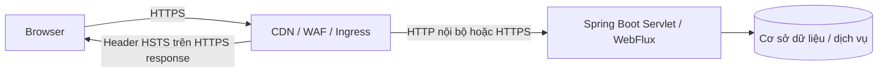

# Triển khai chính sách HSTS theo phạm vi quản lý

Trong chương **Vận hành và giám sát** của `SPRING_SECURITY_HTTP_PROTECTION`, triển khai HTTP Strict Transport Security (HSTS) không đơn thuần là thêm một response header. HSTS là lời cam kết của chủ sở hữu hostname rằng trình duyệt phải tiếp tục kết nối qua HTTPS trong một khoảng thời gian, kể cả khi người dùng gõ `http://` hoặc bấm liên kết HTTP cũ. Khi chính sách được mở rộng bằng `includeSubDomains` hoặc đưa vào danh sách preload của trình duyệt, lời cam kết còn ảnh hưởng đến những hệ thống, đội nhóm và đối tác có thể nằm ngoài phạm vi kiểm soát trực tiếp của ứng dụng Spring Security.

Bài học tập trung vào **triển khai HSTS đúng phạm vi quản lý**: xác định hostname thuộc quyền vận hành của ai, kiểm kê phụ thuộc TLS trước khi mở rộng, cấu hình nhất quán tại Spring Security hoặc reverse proxy, triển khai theo từng mức `max-age`, theo dõi kết quả, xử lý sự cố và lập kế hoạch hoàn nguyên. Các ví dụ áp dụng cho cả ứng dụng Servlet và Reactive/WebFlux trong hệ thống có load balancer, ingress hoặc API gateway.

## 1. HSTS bảo vệ điều gì và không bảo vệ điều gì?

Một response HTTPS có thể mang header:

```http
HTTP/1.1 200 OK
Strict-Transport-Security: max-age=300
```

Trình duyệt nhận và chấp nhận header qua **kết nối HTTPS hợp lệ** sẽ ghi nhớ rằng hostname đó chỉ được truy cập qua HTTPS trong 300 giây. Trong thời gian còn hiệu lực, nếu người dùng hoặc trang web chuẩn bị truy cập `http://portal.example.com/`, trình duyệt sẽ tự nâng cấp sang `https://portal.example.com/` **trước khi gửi request HTTP lên mạng**. Với kết nối HSTS, lỗi chứng chỉ TLS nghiêm trọng không có cơ chế bấm bỏ qua thông thường như khi truy cập website không có chính sách HSTS.

HSTS giúp giảm nguy cơ tấn công **SSL stripping/downgrade** đối với những truy cập tiếp theo của trình duyệt. Tuy nhiên, một trình duyệt chưa từng thấy header từ hostname đó vẫn có rủi ro ở **lần truy cập đầu tiên** qua HTTP. HSTS preload có thể đóng khoảng trống này đối với các hostname được trình duyệt biết trước, nhưng yêu cầu kiểm soát phạm vi dài hạn chặt chẽ hơn.

HSTS không thực hiện các chức năng sau:

- Không tự cấp chứng chỉ, gia hạn TLS, sửa chuỗi chứng chỉ hoặc tạo HTTPS listener cho dịch vụ còn chạy HTTP.
- Không thay thế chuyển hướng HTTP sang HTTPS ở server đối với client chưa biết HSTS.
- Không thay thế CSRF, CORS, CSP, kiểm soát cookie `Secure`, authentication/authorization, security headers khác hoặc HTTP firewall trong Spring Security.
- Không bảo đảm mọi client API, CLI, service-to-service hoặc thư viện HTTP sẽ lưu và tuân thủ HSTS như trình duyệt. Các client cần cấu hình TLS/HTTPS riêng.
- Không bảo vệ một hostname khác chỉ vì hai hostname dùng chung IP, load balancer hoặc cùng một ứng dụng.

Với URL có cổng, HSTS vẫn áp dụng theo **hostname**. Khi nâng `http` lên `https`, cổng mặc định HTTP 80 được thay bằng cổng mặc định HTTPS 443, còn cổng tường minh khác thường được giữ. Vì thế hệ thống dùng dịch vụ `http://host:8080` trên tên miền chịu HSTS cần kiểm tra khả năng phục vụ HTTPS tại cổng đó hoặc chuyển đường dẫn/kiến trúc trước khi bật chính sách rộng.

## 2. Hiểu chính xác các directive và phạm vi hostname

| Directive | Tác dụng | Hệ quả vận hành |
| --- | --- | --- |
| `max-age=N` | Lưu chính sách HSTS của hostname trong **N giây** kể từ lần HTTPS response hợp lệ gần nhất | Mỗi lần nhận lại header sẽ gia hạn thời điểm hết hạn; giá trị lớn khó đảo ngược nhanh |
| `includeSubDomains` | Mở rộng HSTS của hostname tới **mọi hostname con**, ở mọi cấp bên dưới | Có thể ảnh hưởng hệ thống legacy, subdomain do đối tác quản lý và tên DNS tạo trong tương lai |
| `preload` | Bày tỏ ý định đăng ký hostname vào danh sách HSTS preload | Chỉ đặt directive không đồng nghĩa hostname đã được preload; cần quy trình đăng ký và đáp ứng điều kiện hiện hành |
| `max-age=0` | Xóa chính sách đã ghi nhớ **cho đúng hostname gửi header** khi được nhận qua HTTPS hợp lệ | Không tự xóa chính sách độc lập của hostname con, chính sách HSTS kế thừa từ cha hoặc bản ghi preload đã phát hành |

Ví dụ cấu trúc DNS:

```text
example.com                         (domain cấp cha)
├── portal.example.com              (ứng dụng người dùng)
│   └── api.portal.example.com      (API của ứng dụng)
├── payroll.example.com             (hệ thống khác)
└── legacy.example.com              (dịch vụ HTTP cũ)
```

Nếu `portal.example.com` trả `Strict-Transport-Security: max-age=300; includeSubDomains`, trình duyệt áp dụng chính sách cho `portal.example.com`, `api.portal.example.com` và hostname con của `portal.example.com`. Chính sách này **không tự áp dụng** cho `example.com`, `payroll.example.com` hoặc `legacy.example.com`.

Nếu `example.com` trả chính sách có `includeSubDomains`, toàn bộ các hostname con trên đều thuộc phạm vi HSTS, kể cả hostname được tạo sau này. Việc `legacy.example.com` tự trả `max-age=0` hoặc một chính sách ngắn hơn **không thể phủ định** chính sách đang có hiệu lực từ `example.com`; trình duyệt lưu chính sách của cha và con độc lập.

**Đừng đồng nhất “quản lý ứng dụng” với “quản lý tên miền”.** Nhóm ứng dụng có thể sở hữu `portal.example.com` nhưng không có quyền quyết định cho `example.com` và các ứng dụng bên dưới. Một bản ghi CNAME trỏ về CDN/nhà cung cấp cũng không chuyển nghĩa vụ bảo vệ hostname sang người khác: khách truy cập vẫn nhận chính sách theo hostname mà họ truy cập.

## 3. Lập bản đồ quyền sở hữu trước khi đổi cấu hình

Trước khi nâng phạm vi HSTS, đội vận hành cần một danh sách **đầy đủ trong phạm vi tên miền định mở rộng**, bao gồm các hostname đang hoạt động, hostname dự phòng, tích hợp đối tác, địa chỉ cũ và kế hoạch tạo hostname mới. Chỉ kiểm kê endpoint đang chạy trong một repository là chưa đủ.

| Hostname minh họa | Chủ sở hữu vận hành | Hiện trạng TLS | Chính sách có thể tự phê duyệt | Điều kiện khi mở rộng |
| --- | --- | --- | --- | --- |
| `portal.example.com` | Nhóm ứng dụng Portal | HTTPS hoạt động, có redirect HTTP | HSTS cho **chính hostname này** | Kiểm tra mọi route, edge, lỗi và certificate rotation |
| `api.portal.example.com` | Nhóm API | HTTPS hoạt động | HSTS cho hostname API nếu có browser dùng | Nếu Portal dùng `includeSubDomains`, API phải luôn sẵn sàng HTTPS |
| `payroll.example.com` | Nhóm Payroll | HTTPS; chứng chỉ do nhóm khác gia hạn | Chỉ sau thống nhất với Payroll | Thuộc phạm vi khi apex `example.com` bật `includeSubDomains` |
| `legacy.example.com` | Nhà cung cấp bên ngoài | Chỉ HTTP | Chưa thể áp HSTS | Bắt buộc chuyển dịch vụ sang HTTPS hoặc thay đổi cách truy cập trước khi phủ chính sách từ cha |
| `example.com` | Nhóm DNS/platform chung | HTTPS nhưng nhiều subdomain | Chỉ triển khai theo quyết định liên nhóm | Kiểm kê mọi DNS delegation, CDN, môi trường test và legacy |

Danh sách cần ghi rõ **chủ sở hữu quyết định**, nơi cấu hình header (ứng dụng, ingress, CDN, WAF), phương án cấp và gia hạn chứng chỉ, nơi terminate TLS, HTTP redirect, mức bao phủ subdomain, và cách liên hệ khi lỗi. Các mục cần kiểm tra gồm:

1. **DNS thực tế:** A/AAAA, CNAME, wildcard, phân quyền zone/subzone, host ít người dùng, domain redirect và hệ thống đang tạm ngừng hoạt động.
2. **TLS thực tế:** chứng chỉ hợp lệ cho từng hostname/SNI, toàn bộ chain, renewal tự động, load balancer dự phòng, đường lỗi `4xx`/`5xx`, môi trường khôi phục thảm họa và endpoint của đối tác.
3. **Kênh truy cập:** website, callback OAuth/OIDC, deep link, tài nguyên tĩnh, tệp tải về, WebSocket qua `wss://`, cổng không chuẩn và các URL hard-code dùng `http://`.
4. **Quyền thay đổi:** bộ phận nào có thể cấp chứng chỉ, sửa DNS, vận hành edge và xử lý sự cố của **từng hostname** dưới phạm vi dự kiến.
5. **Khả năng hồi phục:** người có quyền cấu hình nhanh tại edge, backup cấu hình, cửa sổ triển khai, alert TLS và phương án thông báo người dùng.

Một hostname chưa tìm được chủ sở hữu không được xem là “không dùng”. Nếu muốn bật `includeSubDomains` tại cha mà vẫn còn hostname chỉ hỗ trợ HTTP hoặc quyền quản lý chưa rõ, phải xử lý khoảng trống đó **trước khi triển khai**.

## 4. Chọn phạm vi bảo vệ theo từng giai đoạn

Có ba cấp quyết định khác nhau:

**Cấp ứng dụng/hostname đơn:** bật HSTS trên `portal.example.com` với `includeSubDomains=false`, `preload=false`. Đây là điểm khởi đầu phù hợp khi đội Portal chỉ kiểm soát đúng hostname của mình. Chính sách có thể chạy đồng thời với HTTPS redirect và các biện pháp bảo vệ Servlet/Reactive hiện có.

**Cấp cây subdomain:** chỉ bật `includeSubDomains` trên `portal.example.com` khi sở hữu hoặc đã có cam kết vận hành HTTPS cho **tất cả hostname bên dưới**, bao gồm hostname được tạo trong tương lai. Một kế hoạch tạo subdomain mới phải có kiểm tra TLS/HSTS tự động trước khi công bố DNS.

**Cấp domain cha hoặc preload:** chỉ triển khai khi có người phê duyệt quản trị toàn bộ domain và subdomain, DNS/certificate/redirect được quản lý đồng bộ, mọi phụ thuộc đáp ứng HTTPS, quy trình xử lý sự cố có mặt. Đây là quyết định tổ chức, không nên do riêng một nhóm phát triển tự bật trên apex.

Một lộ trình thí điểm có thể dùng các mức sau; thời lượng chỉ là **ví dụ để cân nhắc**, cần điều chỉnh theo thực tế lưu lượng và cách kiểm thử:

| Giai đoạn | Header minh họa tại hostname thí điểm | Mục đích | Điều kiện tiến tiếp |
| --- | --- | --- | --- |
| Chuẩn bị | Chưa công bố HSTS mới; HTTPS và redirect đã hoạt động | Kiểm kê, kiểm chứng TLS và khả năng khôi phục | Có owner, chứng chỉ tự gia hạn, test endpoint/edge |
| Canary | `max-age=300` | Thử ảnh hưởng trong vài phút | Không có lỗi TLS, mixed scheme hoặc client/browser flow liên quan |
| Ngắn hạn | `max-age=86400` | Thu thập số liệu tối thiểu một ngày và kiểm tra failover | Kết quả đạt tiêu chí, trực vận hành đã sẵn sàng |
| Trung hạn | `max-age=604800` hoặc `max-age=2592000` | Theo dõi trong nhiều chu kỳ deploy/renewal | Không còn phụ thuộc HTTP ngoài kế hoạch |
| Dài hạn | `max-age=31536000` | Duy trì chính sách ổn định khoảng một năm | Chứng chỉ/ownership/SLO và quy trình incident ổn định |
| Mở rộng phạm vi | Thêm `includeSubDomains` ở cấp đã được duyệt | Bao phủ cây hostname do mình quản lý | Hoàn tất kiểm kê + phê duyệt mọi owner liên quan |
| Preload, nếu thật sự cần | Ví dụ `max-age=63072000; includeSubDomains; preload` | Phòng vệ trước lần kết nối đầu tiên trên browser hỗ trợ | Đáp ứng điều kiện hiện hành tại `hstspreload.org`, phê duyệt dài hạn |

Không có yêu cầu kỹ thuật phải tiến qua đúng các giá trị trên. Điểm chính là **bắt đầu bằng phạm vi mà đội thật sự có quyền vận hành, ghi nhận bằng chứng và tăng dần thời gian cam kết**. Khi tăng `max-age`, browser đã nhận policy có thể ghi nhớ lâu ngay cả khi deployment sau đó bị rollback.

## 5. Cấu hình HSTS trong Spring Security Servlet

Spring Security có hỗ trợ HSTS mặc định cho HTTPS response. Trong cấu hình mặc định thông dụng, `max-age` một năm và `includeSubDomains` được bật, còn `preload` không được bật. Điều đó có nghĩa **giữ nguyên mặc định không phải luôn phù hợp** với giai đoạn thử nghiệm ngắn hoặc khi nhóm chỉ quản lý một hostname. Cần khai báo tường minh chính sách được duyệt.

Ví dụ Servlet dùng Spring Security với form login, triển khai canary năm phút và **không** bao phủ hostname con:

```java
import org.springframework.context.annotation.Bean;
import org.springframework.context.annotation.Configuration;
import org.springframework.security.config.Customizer;
import org.springframework.security.config.annotation.web.builders.HttpSecurity;
import org.springframework.security.web.SecurityFilterChain;

@Configuration
class SecurityConfiguration {
    @Bean
    SecurityFilterChain securityFilterChain(HttpSecurity http) throws Exception {
        return http
            .authorizeHttpRequests(auth -> auth
                .requestMatchers("/login", "/error").permitAll()
                .anyRequest().authenticated())
            .formLogin(Customizer.withDefaults())
            .headers(headers -> headers
                .httpStrictTransportSecurity(hsts -> hsts
                    .maxAgeInSeconds(300)
                    .includeSubDomains(false)
                    .preload(false)))
            .build();
    }
}
```

HTTPS response tương ứng có header:

```http
Strict-Transport-Security: max-age=300
```

Khi đánh giá một `SecurityFilterChain`, cần kiểm tra cả các chain khác trong ứng dụng: đường dẫn login, static, health, error, admin và API có thể đi qua các chain khác hoặc thậm chí bị bỏ khỏi Spring Security filters. HSTS là chính sách **theo hostname**, nên bất kỳ response HTTPS hợp lệ nào từ hostname có header cũng ảnh hưởng tới **mọi đường dẫn** cùng hostname. Không thể dùng path `/admin/**` để giới hạn phạm vi lưu HSTS của browser vào riêng `/admin`.

Spring Security Servlet thông thường chỉ ghi HSTS khi request được nhận biết là **secure** (`request.isSecure()`). Nếu TLS được terminate ở reverse proxy rồi proxy chuyển HTTP vào ứng dụng, ứng dụng có thể không xem request là HTTPS. Đây là lý do kiểm tra header ở local port HTTP có thể cho kết quả khác với hostname công khai qua HTTPS.

## 6. Cấu hình trong Spring Security Reactive/WebFlux

Ứng dụng WebFlux sử dụng `ServerHttpSecurity` và `SecurityWebFilterChain` thay cho `HttpSecurity`. Chính sách canary tương đương:

```java
import java.time.Duration;
import org.springframework.context.annotation.Bean;
import org.springframework.context.annotation.Configuration;
import org.springframework.security.config.web.server.ServerHttpSecurity;
import org.springframework.security.web.server.SecurityWebFilterChain;

@Configuration
class ReactiveSecurityConfiguration {
    @Bean
    SecurityWebFilterChain springSecurityFilterChain(ServerHttpSecurity http) {
        return http
            .authorizeExchange(exchanges -> exchanges
                .pathMatchers("/public/**").permitAll()
                .anyExchange().authenticated())
            .headers(headers -> headers
                .hsts(hsts -> hsts
                    .maxAge(Duration.ofMinutes(5))
                    .includeSubdomains(false)
                    .preload(false)))
            .build();
    }
}
```

Chữ hoa/thường trong tên phương thức khác nhau giữa hai DSL: Servlet sử dụng `includeSubDomains`, Reactive sử dụng `includeSubdomains`. Đoạn code minh họa riêng phần HSTS; trong ứng dụng thật phải ghép với cấu hình xác thực, CSRF, CORS, session và security headers còn lại theo yêu cầu nghiệp vụ. Để kiểm tra đầy đủ, thử HTTP response qua WebFlux filter chain lẫn response thực tế tại edge.

## 7. Triển khai tại CDN, ingress hoặc reverse proxy

Trong hệ thống Spring Boot thường có chuỗi:



Nếu **edge** là nơi kết thúc TLS và có quyền kiểm soát toàn bộ response của hostname, đặt HSTS tại edge thường giúp thống nhất cả response tĩnh, response lỗi, redirect, cache và những route không đi qua Spring Security. Cấu hình của ứng dụng và edge phải thống nhất: nên quy định một **điểm sở hữu header** hoặc ít nhất kiểm tra để không có nhiều giá trị HSTS mâu thuẫn trong cùng response.

Ví dụ NGINX cho hostname mà nhóm đã được phép triển khai canary:

```nginx
server {
    listen 80;
    server_name portal.example.com;
    return 301 https://$host$request_uri;
}

server {
    listen 443 ssl;
    server_name portal.example.com;

    # Đường dẫn certificate/key phải được cấp phát và quản lý an toàn.
    ssl_certificate     /etc/nginx/tls/portal.crt;
    ssl_certificate_key /etc/nginx/tls/portal.key;

    add_header Strict-Transport-Security "max-age=300" always;

    location / {
        proxy_pass http://spring-app-internal;
        proxy_set_header Host $host;
        proxy_set_header X-Forwarded-Proto $scheme;
    }
}
```

`always` giúp NGINX phát header cả trên nhiều phản hồi lỗi, nhưng phải kiểm tra quy tắc kế thừa `add_header` khi có `location`/`server` cấp dưới tự khai báo header: cấu hình thực tế có thể làm mất header ở route cụ thể. Bảo đảm block HSTS được áp dụng cho **HTTPS vhost tương ứng**, không phải vhost chung cho những hostname ngoài phạm vi được duyệt. Ví dụ minh họa trên chưa phải cấu hình production hoàn chỉnh của TLS, proxy timeouts, health và security hardening.

Trong trường hợp HSTS vẫn được tạo tại ứng dụng sau proxy, có thể dùng `ForwardedHeaderFilter` (Servlet), `ForwardedHeaderTransformer` (WebFlux) hoặc chiến lược forwarded headers của Spring Boot/servlet container theo kiến trúc. **Chỉ tin `Forwarded`/`X-Forwarded-*` từ proxy đáng tin cậy** và bảo đảm edge xóa/ghi đè header do client tự gửi. Tin header từ Internet có thể làm sai scheme, host hoặc URL và mở ra những lỗi bảo mật khác. Nếu edge đã sở hữu HSTS, ứng dụng không cần sử dụng forwarded header chỉ nhằm phát HSTS.

**HTTP redirect và HSTS là hai hành vi bổ sung:** HTTP listener vẫn nên chuyển `301`/`308` sang HTTPS cho những client chưa có policy; khi browser đã biết HSTS, việc nâng cấp có thể xảy ra trước khi request HTTP được gửi đi. Header HSTS trả qua HTTP không được trình duyệt tin cậy, kể cả khi status là redirect.

## 8. Kiểm tra chính sách trước và sau triển khai

### Kiểm tra endpoint công khai bằng HTTP và HTTPS

Từ môi trường có thể truy cập hostname thật, kiểm tra cả hai đường:

```bash
# Kiểm tra TLS certificate bằng hành vi xác minh mặc định của curl.
curl -sSI https://portal.example.com/login

# HTTP nên redirect về HTTPS; header HSTS trên HTTP không tạo chính sách mới.
curl -sSI http://portal.example.com/login

# Kiểm tra cả lỗi/đường khác, thay bằng endpoint của hệ thống thực.
curl -sSI https://portal.example.com/not-found
```

Khi kiểm tra, phải phân biệt **response cuối qua HTTPS**, status/Location của HTTP redirect và số lượng header `Strict-Transport-Security`. Tránh dùng `curl -k` để bỏ qua xác minh chứng chỉ trong bằng chứng nghiệm thu: HSTS yêu cầu một kết nối HTTPS đáng tin. `curl` hiển thị header không đồng nghĩa một browser đã lưu HSTS; phiên bản/cấu hình curl có thể hỗ trợ HSTS qua cơ chế riêng nhưng không thể thay thế kiểm thử trên trình duyệt.

Kiểm tra các route nhận `200`, `302`, `401`, `403`, `404`, `429`, `500`, tài nguyên tĩnh, redirect ở edge, response từ CDN cache và luồng dự phòng nếu chúng cùng phục vụ hostname. Quy tắc phát header trên mọi response phải được xác minh đối với **điểm phát header thực tế**.

### Kiểm thử Servlet với MockMvc

Khi ứng dụng Spring Security là điểm ghi header, có thể kiểm tra filter chain với HTTPS/HTTP mô phỏng. Giả sử đã khai báo chính sách canary như trên và có dependency `spring-security-test`:

```java
import static org.springframework.test.web.servlet.request.MockMvcRequestBuilders.get;
import static org.springframework.test.web.servlet.result.MockMvcResultMatchers.header;

import org.junit.jupiter.api.Test;
import org.springframework.beans.factory.annotation.Autowired;
import org.springframework.boot.test.autoconfigure.web.servlet.AutoConfigureMockMvc;
import org.springframework.boot.test.context.SpringBootTest;
import org.springframework.test.web.servlet.MockMvc;

@SpringBootTest
@AutoConfigureMockMvc
class HstsHeaderTest {
    @Autowired MockMvc mockMvc;

    @Test
    void emitsHstsOnHttpsResponse() throws Exception {
        mockMvc.perform(get("/login").secure(true))
            .andExpect(header().string("Strict-Transport-Security", "max-age=300"));
    }

    @Test
    void doesNotEmitHstsOnPlainHttpResponse() throws Exception {
        mockMvc.perform(get("/login").secure(false))
            .andExpect(header().doesNotExist("Strict-Transport-Security"));
    }
}
```

Hai test này kiểm tra **Servlet filter chain được cấu hình trong ứng dụng**. Chúng không chứng minh CDN, ingress hay trình duyệt nhận cùng response. Khi Spring Security không sở hữu header vì edge đã phát, kiểm tra ở lớp proxy/E2E thay vì ép test ứng dụng phải có HSTS.

Với Reactive, dùng `WebTestClient` khởi tạo với security filter chain để kiểm tra request có scheme HTTPS và HTTP trong môi trường mock, sau đó kiểm chứng lại qua hostname công khai. Nếu hệ thống dùng nhiều `SecurityWebFilterChain`, xác định request test đi qua đúng chain; tránh suy luận cấu hình từ một URL duy nhất.

### Kiểm tra hành vi browser thật

1. Trong hồ sơ trình duyệt sạch chưa lưu HSTS, truy cập website qua HTTPS, xem Response Headers và xác nhận chứng chỉ hợp lệ.
2. Truy cập lại `http://portal.example.com/...`, kiểm tra Network/DevTools để xác nhận yêu cầu được nâng lên HTTPS. Tùy browser, việc nâng cấp có thể được biểu diễn như một internal redirect.
3. Thử từ tab khác, đường dẫn cũ, form đăng nhập/đăng xuất, tài nguyên CSS/JS, chuyển hướng liên miền. Kiểm tra mọi resource vẫn được tải qua HTTPS hợp lệ.
4. Với thử nghiệm `includeSubDomains`, kiểm tra một hostname con thực tế **trong phạm vi có quyền kiểm thử**. Không dùng các hostname ngoài quyền quản lý chỉ để chứng minh HSTS.
5. Sau khi đổi `max-age` xuống `0` trong môi trường thí điểm, kiểm tra browser đã nhận response HTTPS mới và quan sát trạng thái với một hồ sơ riêng. Đừng suy luận “đã gỡ” chỉ vì đã deploy cấu hình mới: browser cũ có thể đang offline hoặc có chính sách HSTS cha/preload.

Trong quy trình tự động, có thể kiểm tra `Strict-Transport-Security` bằng HTTP probe và kiểm tra redirect/TLS bằng synthetic browser. Tuy nhiên, trạng thái HSTS được lưu tại client, nên hệ thống cần cả test trong profile sạch **và** test trên profile đã nhận chính sách. Hai nhóm sẽ phát hiện những lỗi khác nhau.

## 9. Giám sát khi triển khai và trong vận hành dài hạn

Một HSTS deployment không thể xem là hoàn thành chỉ vì pipeline trả `200`. Theo dõi đồng thời **header**, **chứng chỉ**, **redirect**, **khả dụng HTTPS** và **sự thay đổi phạm vi DNS**.

| Tín hiệu | Cách kiểm tra | Ý nghĩa và hành động |
| --- | --- | --- |
| Header HSTS tại public endpoint | Synthetic probe qua HTTPS kiểm tra tồn tại, directive và số lần xuất hiện | Phát hiện thiếu header, tự bật `includeSubDomains`/`preload` ngoài kế hoạch hoặc xung đột giữa edge/app |
| Chứng chỉ TLS | Theo dõi ngày hết hạn, CA/chain, SAN/SNI, tự gia hạn và mọi region/edge | Chặn sự cố khiến HSTS browser không thể truy cập vì TLS lỗi |
| HTTP → HTTPS redirect | Probe HTTP tới đúng host và route chính; kiểm tra Location/redirect loop | Bảo vệ client chưa lưu HSTS và phát hiện cấu hình scheme/forwarded header sai |
| Khả dụng và latency HTTPS | SLO theo region, endpoint, CDN/ingress và backend | Phát hiện outage thật, kể cả khi header vẫn được gửi trên response lỗi |
| Tỷ lệ lỗi theo route | `4xx`, `5xx`, frontend error, yêu cầu hỗ trợ sau deployment | Xác định mixed content, callback HTTP cũ, endpoint legacy và lỗi auth flow |
| Inventory và quyền sở hữu DNS | Đối chiếu zone/delegation, kiểm tra hostname mới trước tạo DNS | Tránh hostname mới chỉ chạy HTTP bị phủ bởi chính sách cha |
| Phạm vi chính sách | Theo dõi thay đổi config edge/app, review owner và audit phê duyệt | Bảo đảm `includeSubDomains` và preload không được bật khi chưa có thẩm quyền |
| Kiểm tra browser profile mới/đã có HSTS | E2E có script trong môi trường kiểm thử | Phân biệt lỗi first visit, lỗi chính sách lưu lâu và lỗi redirect |

Không nên dùng số lượng request HTTP giảm dần làm thước đo duy nhất: browser đã lưu HSTS sẽ không gửi request HTTP tới host, trong khi service-to-service và client không hỗ trợ HSTS vẫn có thể sử dụng HTTP. Đo lường thiếu mẫu cần thiết có thể tạo cảm giác mọi thứ hoạt động dù nhiều browser đã mắc kẹt với lỗi chứng chỉ.

Alert nên có chủ sở hữu cụ thể và gắn với khả năng phản ứng: sắp hết hạn chứng chỉ, lỗi gia hạn, header thiếu hoặc thay đổi giá trị, xuất hiện HTTP endpoint dưới domain đã có `includeSubDomains`, hay thay đổi route/hostname do nhóm khác thực hiện. Những tín hiệu không có người xử lý chỉ tạo nhiễu trong vận hành.

## 10. Xử lý sự cố và giới hạn rollback

Giả sử đội vận hành bật `max-age=31536000; includeSubDomains` trên `example.com` trong khi `legacy.example.com` vẫn chỉ hỗ trợ HTTP. Browser đã nhận HSTS từ cha sẽ tự ép HTTPS khi truy cập `legacy.example.com`, nên endpoint cũ không còn mở được đối với các browser đó. Gỡ header trên `legacy.example.com` hoặc chỉ phục vụ redirect HTTP sẽ **không** giải quyết được vấn đề.

Thứ tự xử lý hợp lý:

1. Xác nhận incident ảnh hưởng hostname nào, browser nào, chính sách cha/con nào và có preload hay không; kiểm tra TLS thực tế tại mọi edge.
2. **Ưu tiên khôi phục HTTPS hợp lệ** cho hostname bị ảnh hưởng, bao gồm chứng chỉ đúng hostname và route ứng dụng, vì browser đang tuân thủ HSTS không chấp nhận chuyển xuống HTTP.
3. Nếu đội có quyền với hostname đã phát chính sách và cần rút chính sách, gửi `Strict-Transport-Security: max-age=0` từ **response HTTPS hợp lệ của chính hostname đó**, theo thủ tục thay đổi khẩn cấp. Thay đổi này chỉ có tác dụng với browser **nhận được response mới**.
4. Nếu chính sách cha có `includeSubDomains`, phải xử lý tại hostname cha; response `max-age=0` của hostname con không gỡ ảnh hưởng của cha. Nếu con có chính sách độc lập, cần xử lý chính sách con riêng nếu muốn thu hồi cả hai.
5. Nếu hostname đã nằm trong danh sách preload của browser, thay đổi header hoặc gửi yêu cầu gỡ khỏi danh sách không tạo hiệu lực tức thời với mọi browser. Thời gian lan truyền phụ thuộc bản cập nhật của từng trình duyệt; phải tiếp tục hỗ trợ HTTPS.
6. Sau khắc phục, kiểm tra profile sạch, profile cũ và các browser/region liên quan; bổ sung kiểm kê chủ sở hữu, test dự phòng và cổng phê duyệt trước khi triển khai lại.

Khi giảm `max-age` từ một năm xuống năm phút, những browser đã lưu một năm vẫn có thể cần nhận được response HTTPS mới trước khi áp dụng giá trị ngắn hơn. Nếu không nhận được, chúng tiếp tục dùng chính sách cũ cho đến hết hạn. **Xóa header hoàn toàn cũng không chủ động xóa chính sách đã lưu ở client.** Đó là lý do phải làm canary trước khi tăng thời gian và phạm vi.

## 11. Kết hợp với các lớp phòng vệ HTTP khác

HSTS xử lý cách **trình duyệt chọn giao thức kết nối cho hostname**. Các cơ chế sau giải quyết vấn đề khác nhưng cần được triển khai nhất quán:

| Cơ chế | Quan hệ với HSTS |
| --- | --- |
| HTTPS redirect | Đưa client chưa có HSTS đến HTTPS; không thay thế bảo vệ trước khi gửi request ở client đã có HSTS |
| Cookie `Secure`, `HttpOnly`, `SameSite` | Bảo vệ vận chuyển và cách dùng cookie/session; HSTS không tự bật thuộc tính cookie |
| CSRF protection | Kiểm tra request thay đổi trạng thái trong bối cảnh cookie/session; HSTS không chống CSRF |
| CORS | Điều khiển quyền đọc response và một số hành vi request giữa các origin; HTTPS không tự cho phép cross-origin |
| CSP / `upgrade-insecure-requests` | Giảm hoặc nâng cấp tham chiếu tài nguyên không an toàn trong nội dung; HSTS xử lý chính sách kết nối đến hostname đã ghi nhớ |
| Security headers khác | `X-Content-Type-Options`, chống framing, cache controls... vẫn cần quản lý riêng |
| HTTP firewall | Kiểm soát và chuẩn hóa request đi vào ứng dụng; không thay thế TLS hoặc HSTS |
| Session management | Bảo vệ phiên, logout, session fixation và token; cần chạy trên HTTPS ổn định |

Không thiết kế phụ thuộc vào HSTS để sửa hard-code URL HTTP bên trong ứng dụng. HSTS chỉ hoạt động với browser và hostname đã có chính sách thích hợp. Hãy cập nhật link, redirect, callback, API URL và asset sang HTTPS từ nguồn cấu hình.

## 12. Bài thực hành: quyết định HSTS theo quyền quản lý

Giả sử nhóm Portal đang vận hành `portal.example.com` và `api.portal.example.com`; đội Platform quản lý `example.com`; nhóm Legacy phụ trách `legacy.example.com`, hiện chỉ dùng HTTP. Hãy xây dựng hai phương án:

**Phương án A: chỉ triển khai cho `portal.example.com`.** Nhóm Portal bắt đầu `max-age=300` và `includeSubDomains=false`, xác minh HTTPS, redirect, certificate rotation, login/logout và API callback. Sau một đợt giám sát ổn định có thể tăng thời hạn. `api.portal.example.com` cần chính sách riêng nếu muốn bảo vệ trực tiếp mà không phụ thuộc vào việc browser từng thăm `portal.example.com`.

**Phương án B: muốn bật `includeSubDomains` tại `example.com`.** Trước khi phê duyệt, Platform phải chứng minh `legacy.example.com` đã chuyển sang HTTPS hoặc được di dời theo cách không còn thuộc phạm vi áp đặt; các đội đã kiểm kê DNS delegation, wildcard, subdomain dự phòng và có khả năng khôi phục TLS. Nếu thiếu các điều kiện này, giữ triển khai ở phạm vi hostname hẹp cho tới khi xử lý xong.

Một báo cáo triển khai đạt yêu cầu cần ghi được: hostname/cây hostname do ai sở hữu, tại sao chọn thời hạn `max-age` đó, điểm phát header là ở đâu, kết quả curl/browser và monitoring trước/sau, tiêu chí rollback, những rủi ro còn tồn tại và thời điểm được phép tăng phạm vi. Không tự động đánh giá “an toàn hơn” chỉ vì bật thêm `includeSubDomains` hoặc `preload` khi chưa có quyền vận hành HTTPS cho toàn bộ tên miền liên quan.

## 13. Checklist nghiệm thu

1. Đã phân biệt **hostname**, **cây subdomain** và **domain cha**; người phê duyệt có quyền quản lý phạm vi tương ứng.
2. Đã kiểm kê DNS, certificate, các cổng dùng HTTP(S), callback, hệ thống legacy, đối tác và khả năng renewal/failover.
3. Đã xác định điểm sở hữu HSTS (Spring Security hoặc edge), tránh header thiếu hoặc mâu thuẫn; các response HTTPS thực tế được kiểm tra qua public hostname.
4. Đã cấu hình `max-age`, `includeSubDomains`, `preload` theo lộ trình được duyệt; biết rằng HSTS mặc định của Spring Security có thể rộng hơn chính sách canary.
5. Redirect HTTP → HTTPS, TLS trust chain và các luồng auth/session/asset hoạt động trên trình duyệt và qua proxy.
6. Đã chạy probe, kiểm thử Servlet/Reactive phù hợp, E2E trên profile mới và cũ, cùng smoke test cho hostname con thuộc phạm vi quản lý.
7. Có alert cho lỗi TLS, thay đổi header, DNS mới và SLO HTTPS; có owner xử lý, runbook khôi phục HTTPS và giới hạn rollback được công bố.
8. Chỉ cân nhắc preload sau khi hệ thống đủ trưởng thành và có quyền cam kết HTTPS lâu dài cho toàn bộ phạm vi mà preload áp dụng.

HSTS phát huy tác dụng lớn nhất khi chính sách trình duyệt **khớp với khả năng vận hành thực tế của tổ chức**. Chỉ cần một hostname legacy hoặc một chứng chỉ hết hạn trong cây domain được áp HSTS rộng cũng có thể gây gián đoạn kéo dài cho người dùng. Chọn đúng phạm vi, xác thực TLS ở public edge, tăng thời gian từng bước và theo dõi liên tục là yêu cầu cốt lõi của vận hành bảo vệ HTTP.

### Tài liệu tham khảo

- [Spring Security — Security HTTP Response Headers (Servlet)](https://docs.spring.io/spring-security/reference/servlet/exploits/headers.html)
- [Spring Security — Security HTTP Response Headers (Reactive)](https://docs.spring.io/spring-security/reference/reactive/exploits/headers.html)
- [MDN — Strict-Transport-Security](https://developer.mozilla.org/en-US/docs/Web/HTTP/Reference/Headers/Strict-Transport-Security)
- [HSTS preload service — hướng dẫn đăng ký và kiểm tra điều kiện hiện hành](https://hstspreload.org/)
