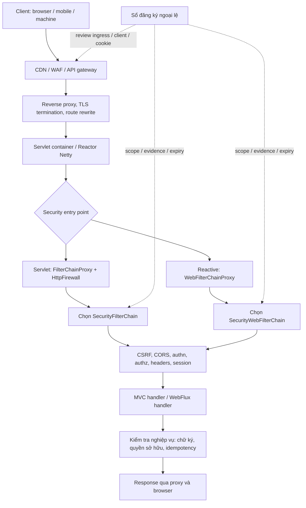
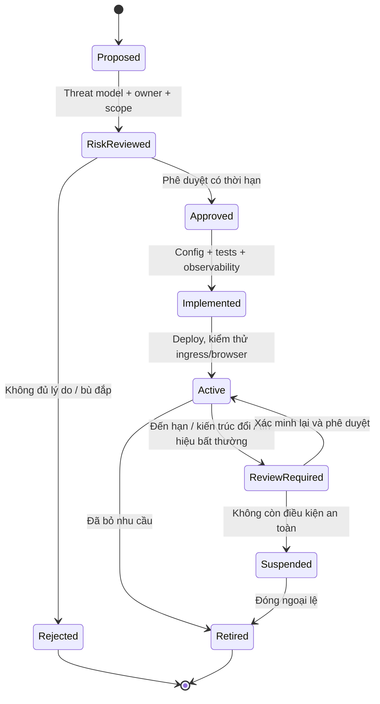
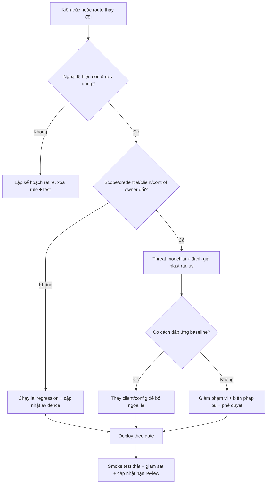
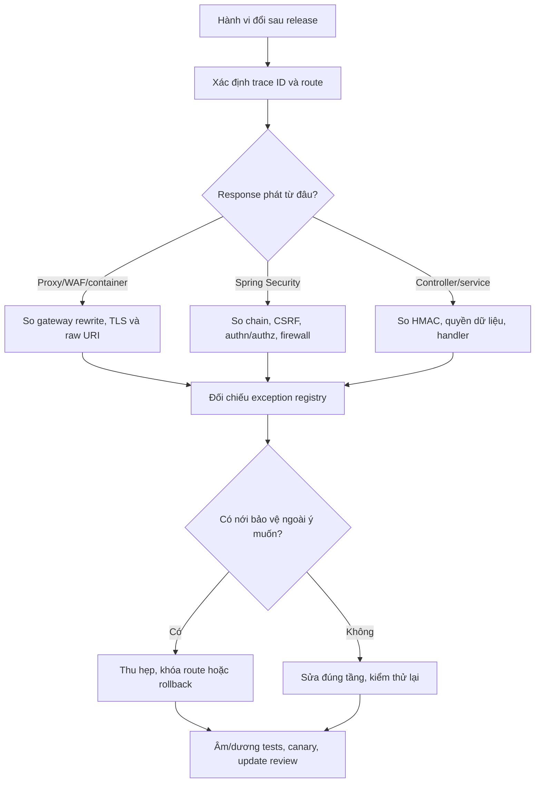

# Quản lý ngoại lệ theo endpoint và rà lại khi kiến trúc thay đổi

## 1. Mục tiêu bài học và tình huống vận hành

Trong hệ thống dùng **Spring Security HTTP Protection**, một số endpoint có thể có yêu cầu khác chính sách bảo mật mặc định: webhook bên thứ ba không gửi CSRF token, trang nhúng cần một nguồn `frame-ancestors` riêng, API được một frontend khác origin gọi, hoặc tuyến legacy phải tương thích với cách viết URL cũ. Các trường hợp này tạo ra **ngoại lệ chính sách**: một quyết định có chủ đích nhằm điều chỉnh đúng một phần bảo vệ trong một phạm vi đã được xác nhận.

Bài học thuộc chương **Vận hành và giám sát** của module `SPRING_SECURITY_HTTP_PROTECTION`. Mục tiêu là biến mỗi ngoại lệ từ một dòng cấu hình dễ bị quên thành một cam kết vận hành có **chủ sở hữu, lý do, giới hạn, biện pháp bù, bằng chứng kiểm thử, thời hạn và tín hiệu rà soát**. Phạm vi bao gồm Servlet và Reactive, từ CSRF, CORS, security headers, CSP, HSTS, HTTP firewall đến session, cookie và đường đi qua proxy/gateway.

Sau bài học, người học có thể:

1. Phân biệt **ngoại lệ chính sách** với `RequestRejectedException`, `AccessDeniedException` hay lỗi xử lý trong controller.
2. Viết một bản ghi ngoại lệ theo **endpoint + method + client/credential + control + điều kiện triển khai**; hiểu vì sao chỉ ghi “bỏ qua `/api/**`” là quá rộng.
3. Cấu hình ngoại lệ CSRF chính xác trong Spring Security Servlet và Reactive, đồng thời giữ xác thực, phân quyền và kiểm tra chữ ký webhook.
4. Xác định cơ chế nào có thể giới hạn ở endpoint, cơ chế nào có phạm vi **host, browser, proxy hoặc toàn `FilterChainProxy`** và không thể thu nhỏ bằng một `requestMatcher`.
5. Thiết kế kiểm thử dương/âm, giám sát sai lệch, xử lý ngoại lệ quá hạn và rà soát sau thay đổi kiến trúc.
6. Truy vết một endpoint qua ingress, TLS termination, route rewrite, filter chain, MVC/WebFlux handler và các trình duyệt thực để biết ngoại lệ còn đúng hay không.

Các ví dụ Java sử dụng **Java 17+, Spring Boot 3.x, Spring Security 6.x**, chủ yếu `jakarta.servlet` và các DSL lambda. Khi nâng lên Spring Security 7.x, cần kiểm tra lại matcher và các API đã được thay thế; quy tắc phân tích phạm vi và kiểm thử vẫn áp dụng. Địa chỉ `*.example` trong bài là tên minh họa.

## 2. “Ngoại lệ” ở đây có nghĩa gì?

Cùng một từ nhưng có ba khái niệm khác nhau:

| Khái niệm | Ví dụ | Người chịu trách nhiệm | Kết quả cần kiểm tra |
| --- | --- | --- | --- |
| **Ngoại lệ bảo mật được phê duyệt** | `POST /integrations/acme/events` bỏ yêu cầu CSRF vì dùng HMAC trên raw body | Chủ API, security owner, người vận hành | Chỉ đúng POST/path đó được miễn CSRF; chữ ký sai vẫn bị từ chối |
| **Ngoại lệ/exception khi thực thi** | `RequestRejectedException`, `AccessDeniedException`, thiếu/không hợp lệ CSRF token | Framework, filter, error handler | 400/401/403 theo cấu hình và telemetry đúng nguyên nhân |
| **Ngoại lệ sự cố khẩn cấp** | Tạm điều chỉnh CSP cho portal sau triển khai lỗi | On-call, người phê duyệt khẩn cấp | Có giới hạn thời gian, rollback, post-incident review |

Một ngoại lệ chính sách **không có nghĩa** là bỏ qua toàn bộ Spring Security và cũng không có nghĩa yêu cầu sẽ luôn được phép truy cập. Ví dụ `csrf.ignoringRequestMatchers(webhookMatcher)` chỉ bỏ kiểm tra CSRF ở các request khớp; request đó vẫn đi qua firewall, các filter khác, controller và cơ chế kiểm tra HMAC do ứng dụng chịu trách nhiệm. Ngược lại, `permitAll()` chỉ là quyết định về authorization, **không tự tắt CSRF**.

Vì exception thực thi thường đi qua các handler khác nhau, các trạng thái như HTTP 400, 401, 403 hoặc 404 không chứng minh một ngoại lệ chính sách đang hoạt động đúng. Vận hành cần dấu vết phân biệt **quy tắc match**, **cơ chế từ chối** và **đối tượng cuối cùng xử lý request**.

## 3. Đường đi quyết định chính sách thực tế

Để đánh giá một ngoại lệ, cần bắt đầu từ request mà ứng dụng thực sự nhận. URL mà client gửi có thể khác URL dùng để so khớp trong Spring Security.



Năm ranh giới dễ gây sai:

- **External URL và internal path:** gateway có thể biến `/v2/vendor/callback` ở Internet thành `/integrations/acme/events` trong ứng dụng. Nếu đơn vị sở hữu ngoại lệ chỉ ghi một trong hai, khi route thay đổi có thể không ai nhận ra quyền miễn trừ đã chuyển sang API khác.
- **Một route có nhiều HTTP method:** `GET /orders/123` đọc dữ liệu; `POST /orders/123` thay đổi dữ liệu. Trên Spring Security, nhiều matcher kết hợp method và path mới thể hiện đúng ngoại lệ.
- **Một path có nhiều loại client:** browser đăng nhập bằng cookie, mobile dùng bearer token, webhook dùng HMAC. Nguy cơ CSRF phụ thuộc **credential mà browser tự gửi**; không thể chỉ dựa vào tên đường dẫn `/api` hoặc chuỗi “stateless”.
- **Một application có nhiều security chain:** `FilterChainProxy` chọn chain phù hợp đầu tiên theo `@Order`; trong một chain, `requestMatchers` của authorization không thay đổi phạm vi `securityMatcher`. Nếu không chain nào khớp, request có thể không được Spring Security bảo vệ.
- **Một chính sách có thể có phạm vi lớn hơn endpoint:** HSTS được browser ghi nhớ theo host; `StrictHttpFirewall` xử lý request trước khi chọn servlet security chain; cấu hình cookie `Domain`/`Path` và policy của proxy cũng không tự thu hẹp theo controller.

Hệ quả thực tế: hồ sơ ngoại lệ phải lưu **cả tên endpoint nghiệp vụ và danh tính kỹ thuật của request** sau tất cả bước định tuyến.

## 4. Xác lập baseline trước khi cho ngoại lệ

Không thể kiểm chứng “ngoại lệ” nếu chưa biết chính sách mặc định. Hãy lập bảng baseline của ứng dụng theo từng lớp:

| Lớp | Baseline đề xuất | Ngoại lệ có thể cân nhắc | Điều không được suy diễn |
| --- | --- | --- | --- |
| Authentication và authorization | Chỉ cho phép khi có danh tính và quyền phù hợp; sở hữu tài nguyên được kiểm tra ở service | Public route có kiểm soát, webhook xác thực HMAC/mTLS | `permitAll` không tương đương đã xác thực |
| CSRF Servlet/Reactive | Bảo vệ unsafe requests sử dụng quyền định danh tự động gửi của browser | Webhook thật sự không dùng ambient browser credential, có chứng thực riêng | “REST”, “JSON” hoặc “JWT” không tự chứng minh an toàn nếu cookie vẫn được chấp nhận |
| CORS | Chỉ cho phép origins, methods, headers theo hợp đồng frontend | Thêm origin đã định danh cho đúng resource | CORS không chặn client không phải browser và không thay authorization |
| CSP / frame control | CSP hạn chế script, style, object và embedding; X-Frame-Options thích hợp | Báo cáo nhúng từ portal được tin cậy, nonce/hash cho script | CSP Report-Only không cưỡng chế; X-Frame-Options DENY vẫn gây xung đột với iframe |
| HSTS và TLS | HTTPS, HSTS trên HTTPS sau đánh giá host/subdomain | Thay đổi host/deployment policy theo kế hoạch | HSTS không có ngoại lệ riêng cho một URL path sau khi browser đã ghi nhớ |
| HTTP firewall | Giữ `StrictHttpFirewall` và quy tắc path/method chuẩn | Rất hiếm khi phải nới bộ quy tắc chung sau phân tích matcher/proxy | Chỉnh `StrictHttpFirewall` thường ảnh hưởng toàn `FilterChainProxy`, không phải một controller |
| Session/cookies | Session fixation protection, Secure/HttpOnly/SameSite phù hợp, logout/invalidation | Một loại client dùng stateless auth trên một vùng API | Stateless ở một chain không xóa session/cookie do application, proxy hoặc chain khác tạo |
| Monitoring | Có audit, error attribution, metric/cardinality hợp lý | Lấy mẫu hoặc điều chỉnh ngưỡng theo endpoint và độ nhạy | Lượng 403 giảm không tự chứng minh bảo mật được cải thiện |

“Baseline” phải được diễn giải theo **đường đi credential và dữ liệu**, không phải một bộ cấu hình cố định áp dụng bất chấp ngữ cảnh. Ví dụ, browser form nên giữ CSRF; máy chủ gọi máy chủ qua HMAC có thể không cần CSRF nhưng **cần chữ ký, timestamp, chống replay, quyền ở tầng nghiệp vụ**.

### Câu hỏi đánh giá trước khi nới một control

1. Request xuất phát từ browser, app mobile, batch job hay server-to-server? Những credential nào thực sự được phía nhận tin cậy?
2. Có thể sửa client để đáp ứng baseline thay vì tạo ngoại lệ? Ví dụ thêm CSRF token cho SPA cookie session, chỉnh lại route, thay script inline bằng nonce/hash.
3. Ngoại lệ có buộc phải mở **path, host, method, origin, credential hoặc filter chain** ngoài phạm vi ban đầu không?
4. Ai chịu trách nhiệm biện pháp bù, ví dụ chữ ký webhook, object-level authorization, rate limit, replay window, audit?
5. Có test chứng minh cả request chính đáng được phục vụ **và** các biến thể gần giống vẫn bị từ chối không?
6. Khi hệ thống chuyển ingress, thay SSO, thêm origin hoặc nâng framework, ai sẽ được kích hoạt rà soát?

## 5. Định danh endpoint đủ chặt để quản lý ngoại lệ

Một bản ghi chỉ chứa chuỗi `"/api/**"` thường thất bại khi triển khai. Hãy xem một ngoại lệ là tập điều kiện:

```text
ExceptionScope =
  service + environment + entrypoint/host
  + externalRoute + effectiveApplicationPath
  + HTTP method(s) + dispatcher/transport
  + client type + authentication mechanism
  + precise control + allowed deviation + compensating controls
```

Ví dụ, “miễn CSRF cho `POST https://hooks.example.com/v2/acme/events`” vẫn chưa nói rõ gateway map tới đâu, có nhận cookie ở host đó không, request có đi qua một web session chain không, đường dẫn sau rewrite có giữ nguyên hay không. Trong kiến trúc nhiều tenant, có thể cần thêm namespace, tenant-routing rule, application context path và nhận diện version.

Một endpoint **có thể** có nhiều ngoại lệ khác nhau, mỗi ngoại lệ nên có ID riêng: ngoại lệ CSRF cho webhook; whitelist CORS dành cho một route frontend; CSP frame-ancestors cho trang báo cáo. Đừng gộp chúng thành một công tắc `legacyMode=true`.

### Hồ sơ ngoại lệ mẫu (dữ liệu quản trị, không phải Spring configuration)

```yaml
id: SEC-EX-014
service: SPRING_SECURITY_HTTP_PROTECTION
state: approved
owner_team: payment-integrations
security_reviewer: appsec-owner
environment: production
endpoint:
  public_host: hooks.example.com
  external_path: /v2/acme/events
  effective_path: /integrations/acme/events
  methods: [POST]
  client: acme-webhook-sender
  credentials: "HMAC signature over raw request body"
control:
  name: csrf
  deviation: "Ignore CSRF only for exact POST effective_path"
  baseline: "CSRF required for unsafe browser requests"
reason: "Third-party webhook cannot provide the application's CSRF token"
threats:
  - "Unauthenticated forged callback"
  - "Replay of signed event"
  - "Route rewrite causing another endpoint to match"
compensating_controls:
  - "Verify timestamp and signature before every side effect"
  - "Deduplicate event ID and reject out-of-window events"
  - "Keep firewall, size limit, rate limit, and service-level authz"
evidence:
  positive_test: "WEBHOOK-001 valid signed callback is accepted"
  negative_tests:
    - "WEBHOOK-002 invalid signature is rejected"
    - "POLICY-003 nearby paths still require CSRF"
    - "POLICY-004 PUT on same path still requires CSRF"
  ingress_trace: "Route mapping reviewed in deployment PR"
review:
  approved_on: 2026-11-01
  review_due: 2027-02-01
  triggers:
    - "Gateway route rewrite or host change"
    - "Authentication or cookie/session behavior change"
    - "New API version, method, or client"
rollback:
  owner: payment-integrations
  action: "Remove only the webhook CSRF ignore matcher"
```

Ngày và ID trong YAML chỉ là **ví dụ minh họa**; không đại diện cho một ngoại lệ thực đã được phê duyệt. Bản ghi có thể lưu trong quy trình quản trị riêng, nhưng phải liên kết được tới commit cấu hình, test CI và tài liệu route. Hãy giữ ngoại lệ đủ cụ thể để audit được, tránh ghi credential/secret, khóa HMAC hay raw authorization token trong bản ghi.

## 6. Vòng đời của một ngoại lệ



**Ai làm gì?**

| Vai trò | Trách nhiệm tối thiểu |
| --- | --- |
| Endpoint owner | Nêu nhu cầu, chứng minh client/credential thật, giữ inventory và giải thích biện pháp bù |
| Security reviewer | Xác nhận threat model, mức độ tối thiểu, hạn review và tiêu chí chấp nhận |
| Người sửa cấu hình | Gắn rule vào đúng matcher/chain, giữ fallback, bổ sung test âm/dương và tài liệu thay đổi |
| Platform/ingress owner | Xác nhận external-to-internal route, header forwarding, host/TLS và cách normalize path |
| QA/SRE | Theo dõi metric/lỗi theo reason, kiểm tra production-like đường đi và readiness rollback |
| Incident commander/on-call | Tạm đình chỉ ngoại lệ hoặc rollback khi sai lệch; giao việc review sau sự cố |

**Quy tắc hết hạn:** hết hạn không có nghĩa nên tự động xoá một rule khỏi production ngay lập tức khi chưa có phương án xử lý client; nhưng cũng không có nghĩa được tiếp tục coi là đã phê duyệt. Hãy đánh dấu `review_required/expired`, chặn mở rộng phạm vi, lập hạn xử lý rõ ràng và quyết định giữ có thời hạn hay đóng. Với ngoại lệ nguy cơ cao, dùng cổng kiểm soát release và rollback theo quy trình sự cố.

Đánh giá lại khi có tín hiệu thay đổi là một phần bắt buộc của vòng đời, kể cả ngoại lệ chưa đến ngày review. “Đã được approve năm trước” không xác minh rằng đường đi của request năm nay còn giống lúc ký.

## 7. Phân loại ngoại lệ theo khả năng khoanh vùng

| Tình huống | Khả năng giới hạn | Phương án ưu tiên |
| --- | --- | --- |
| Bỏ CSRF cho đúng webhook | **Theo request** bằng `ignoringRequestMatchers` (Servlet) hoặc matcher yêu cầu CSRF (Reactive) | Ghép method + path chính xác; xác thực sender độc lập |
| CORS riêng cho frontend | **Theo đường dẫn/resource + origin/method/header** nếu có cấu hình CORS chi tiết | `CorsConfigurationSource`/WebFlux `CorsConfiguration`; test preflight và actual response |
| Authorization public endpoint | **Theo matcher trong chain** | `permitAll` đúng mục tiêu, kiểm tra mọi service action có yêu cầu quyền |
| CSP để nhúng trang báo cáo | **Theo response hoặc security chain**, với giới hạn browser | CSP `frame-ancestors` exact origin; xem xét X-Frame-Options và cookie |
| HSTS | **Theo host/subdomain**, browser ghi nhớ chính sách | Sắp xếp host/deployment, không giả thiết một path thoát HSTS |
| `StrictHttpFirewall` chấp nhận semicolon/encoded URL | **Toàn HTTP firewall instance** của `FilterChainProxy` trong ứng dụng tiêu chuẩn | Chuẩn hóa hợp đồng URL; chỉ cân nhắc nới với đánh giá rủi ro hệ thống |
| Cookie `Secure`/`HttpOnly`/`SameSite` | **Theo từng cookie và phạm vi Domain/Path**, không trực tiếp theo MVC matcher | Chọn strategy cookie/resolver và trách nhiệm bên phát cookie |
| Session stateless trên một API | **Có thể theo security chain**, nhưng app/container vẫn có thể phát cookie | Test `Set-Cookie`, session tạo bởi app, auth mode và cách logout/revoke |
| Header security cho các loại response | **Theo chain hoặc request-matched header writer**; proxy có thể ghi đè | Kiểm tra header thực trên 200, 3xx, 401, 403, 404, 5xx |

Có thể lập nhiều security chain để tách chính sách, nhưng đó **không phải bằng chứng** mọi control đã được thu hẹp: firewall nằm ngoài việc chọn chain; HSTS tác động lên host; browser có thể cache CSP/HTTP response theo chiến lược cache. Mọi ngoại lệ phải được đánh giá ở **tầng có quyền sở hữu control đó**.

## 8. Case study xuyên suốt: webhook HMAC cần miễn CSRF

Giả sử dịch vụ có ba nhóm request:

- Browser nhân viên dùng cookie session để cập nhật dữ liệu tại `POST /admin/settings`.
- Dịch vụ Acme gửi `POST /integrations/acme/events` từ server riêng bằng HMAC có timestamp trên **raw request body**; Acme không sở hữu CSRF token ứng dụng.
- API nội bộ nhận request tại `/api/**` và yêu cầu user/token bình thường.

Chính sách mục tiêu:

| Request | CSRF | Authorization | Kiểm tra khác |
| --- | --- | --- | --- |
| `POST /integrations/acme/events` | Miễn theo ID `SEC-EX-014` | Public ở lớp Spring authorization để webhook không cần user session | **Bắt buộc** HMAC/timestamp/replay/idempotency trước side effect |
| `PUT /integrations/acme/events` | Giữ mặc định | Phải xác thực; nếu đã tới MVC có thể 405 | Không được thừa hưởng ngoại lệ POST |
| `POST /integrations/acme/events/extra` | Giữ mặc định | Phải xác thực | Không được thừa hưởng ngoại lệ prefix |
| `POST /admin/settings` | Bắt buộc token | Chỉ role quản trị | Phân quyền nghiệp vụ sau Spring Security |
| `GET /admin/settings` | Không bắt buộc token theo method mặc định | Chỉ role quản trị | Request đọc dữ liệu; không làm thay đổi state |

### Cấu hình Servlet theo đúng method và path

Ví dụ sau dùng `MvcRequestMatcher` của **Spring Security 6.x**, với `HandlerMappingIntrospector` từ cùng Spring MVC application context. Với Security 7.x, xem hướng dẫn migration sang matcher tương ứng như `PathPatternRequestMatcher`; tránh copy một cấu hình 6.x chưa kiểm thử sang một version mới.

```java
import org.springframework.context.annotation.Bean;
import org.springframework.context.annotation.Configuration;
import org.springframework.http.HttpMethod;
import org.springframework.security.config.annotation.web.builders.HttpSecurity;
import org.springframework.security.config.annotation.web.configuration.EnableWebSecurity;
import org.springframework.security.web.SecurityFilterChain;
import org.springframework.security.web.servlet.util.matcher.MvcRequestMatcher;
import org.springframework.security.web.util.matcher.RequestMatcher;
import org.springframework.web.servlet.handler.HandlerMappingIntrospector;

import static org.springframework.security.config.Customizer.withDefaults;

@Configuration(proxyBeanMethods = false)
@EnableWebSecurity
public class EndpointSecurityConfig {

    @Bean
    SecurityFilterChain securityFilterChain(
        HttpSecurity http,
        HandlerMappingIntrospector introspector
    ) throws Exception {
        MvcRequestMatcher.Builder mvc =
            new MvcRequestMatcher.Builder(introspector);

        // SEC-EX-014: duy nhất POST /integrations/acme/events
        RequestMatcher signedWebhookPost =
            mvc.pattern(HttpMethod.POST, "/integrations/acme/events");

        http
            .csrf(csrf -> csrf
                .ignoringRequestMatchers(signedWebhookPost)
            )
            .authorizeHttpRequests(auth -> auth
                .requestMatchers(signedWebhookPost).permitAll()
                .requestMatchers("/admin/**").hasRole("ADMIN")
                .anyRequest().authenticated()
            )
            .httpBasic(withDefaults());

        return http.build();
    }
}
```

**Phạm vi của ví dụ:** ứng dụng Spring MVC có DispatcherServlet ở root mapping, không có servlet path đặc biệt; chỉ có một `SecurityFilterChain` bảo vệ toàn bộ request. Nếu triển khai nhiều servlet, context path khác biệt, forwarding hoặc nhiều security chain, cần xác nhận chính xác path mà matcher thấy. `MvcRequestMatcher` match theo ngữ nghĩa Spring MVC; không thay thế quy trình rà soát normalization/rewrites của container và ingress.

Điều đáng chú ý trong cấu hình:

1. `ignoringRequestMatchers(signedWebhookPost)` tác động **duy nhất CSRF**, không tắt filter hay token validation cho `POST /admin/settings`.
2. `requestMatchers(signedWebhookPost).permitAll()` tránh yêu cầu HTTP Basic user session cho máy gửi webhook; **bản thân webhook phải kiểm tra chữ ký**. Nếu quên HMAC, endpoint trở thành công khai có khả năng thay đổi dữ liệu.
3. `requestMatchers("/admin/**").hasRole("ADMIN")` vẫn phải đứng trước `anyRequest()`; service cũng phải kiểm tra quyền đối với object/tenant nếu có.
4. `httpBasic` chỉ minh họa cách xác thực các request khác; ứng dụng thực có thể dùng form login, OIDC hoặc OAuth2 resource server tùy kiến trúc.
5. Với các endpoint có state change bằng GET hoặc phương thức tùy biến, CSRF default không đủ: phải sửa hợp đồng HTTP/unsafe-method policy và thêm test; không được giả định “GET luôn an toàn” nếu code nghiệp vụ làm thay đổi state.

### Xác thực webhook trước khi xử lý sự kiện

Không có CSRF token **không có nghĩa** là không có xác thực. Dưới đây là ranh giới tối thiểu ở controller; `signatureVerifier` và `commands` phải có implementation thực:

```java
import org.springframework.http.HttpStatus;
import org.springframework.http.ResponseEntity;
import org.springframework.web.bind.annotation.PostMapping;
import org.springframework.web.bind.annotation.RequestBody;
import org.springframework.web.bind.annotation.RequestHeader;
import org.springframework.web.bind.annotation.RestController;

@RestController
class AcmeWebhookController {
    private final AcmeSignatureVerifier signatureVerifier;
    private final AcmeEventCommands commands;

    AcmeWebhookController(
        AcmeSignatureVerifier signatureVerifier,
        AcmeEventCommands commands
    ) {
        this.signatureVerifier = signatureVerifier;
        this.commands = commands;
    }

    @PostMapping(path = "/integrations/acme/events",
                 consumes = "application/json")
    ResponseEntity<Void> receive(
        @RequestHeader(name = "X-Acme-Timestamp", required = false)
        String timestamp,
        @RequestHeader(name = "X-Acme-Signature", required = false)
        String signature,
        @RequestBody byte[] rawBody
    ) {
        if (timestamp == null || signature == null
                || !signatureVerifier.verify(timestamp, signature, rawBody)) {
            return ResponseEntity.status(HttpStatus.UNAUTHORIZED).build();
        }
        commands.processOnce(rawBody);
        return ResponseEntity.noContent().build();
    }
}

interface AcmeSignatureVerifier {
    boolean verify(String timestamp, String signature, byte[] rawBody);
}

interface AcmeEventCommands {
    void processOnce(byte[] rawBody);
}
```

`verify` phải so chữ ký trên **raw bytes** bằng phép so sánh an toàn thời gian, kiểm tra timestamp trong cửa sổ ngắn, khóa theo đúng sender, không tin timestamp không ký và ngăn phát lại sự kiện. `processOnce` cần xử lý idempotency ở tầng lưu trữ theo event ID đã xác minh. Giới hạn kích thước body, thời gian chờ, rate limit và quyền truy cập dữ liệu sau khi giải mã vẫn bắt buộc. Việc đặt xác minh ở controller là ví dụ dễ đọc; với nhiều endpoint, nên gom enforcement vào filter/middleware hoặc thành phần chuyên trách có kiểm thử chống bỏ sót khi thêm handler.

**Đừng đưa secret hoặc raw body chứa dữ liệu nhạy cảm vào log** để chứng minh HMAC đã chạy. Chỉ ghi request ID, vendor ID đã chuẩn hóa, kết quả xác minh, mã lỗi tổng quát và chính sách được áp dụng.

## 9. Kiểm thử Servlet: ngoại lệ được khoanh đúng và baseline còn hiệu lực

Những assertion có giá trị nhất là:

- **Positive exception:** POST webhook không bị 403 do thiếu CSRF (nhưng vẫn phải qua signature verifier trong test nghiệp vụ riêng).
- **Adjacent negative:** đổi method/path hoặc dùng route admin vẫn bị CSRF chặn.
- **Protected positive:** request admin có principal đúng và CSRF token hợp lệ hoạt động bình thường.
- **Unauthorized negative:** không có quyền admin thì `csrf()` hợp lệ vẫn không vượt được authorization.
- **Controller assertion:** test webhook chữ ký sai không gọi service; test CSRF bị từ chối không chạm controller.

Ví dụ `@WebMvcTest` sau là **probe cho phạm vi CSRF/authorization**, dùng controller test trả 204. Controller probe không thay thế test xác minh HMAC của `AcmeWebhookController` trong ứng dụng thực.

```java
import org.junit.jupiter.api.Test;
import org.springframework.beans.factory.annotation.Autowired;
import org.springframework.boot.test.autoconfigure.web.servlet.AutoConfigureMockMvc;
import org.springframework.boot.test.autoconfigure.web.servlet.WebMvcTest;
import org.springframework.context.annotation.Import;
import org.springframework.http.HttpMethod;
import org.springframework.security.config.annotation.web.builders.HttpSecurity;
import org.springframework.security.web.SecurityFilterChain;
import org.springframework.security.web.servlet.util.matcher.MvcRequestMatcher;
import org.springframework.test.web.servlet.MockMvc;
import org.springframework.web.bind.annotation.PostMapping;
import org.springframework.web.bind.annotation.RestController;
import org.springframework.web.servlet.handler.HandlerMappingIntrospector;

import static org.springframework.security.config.Customizer.withDefaults;
import static org.springframework.security.test.web.servlet.request.SecurityMockMvcRequestPostProcessors.csrf;
import static org.springframework.security.test.web.servlet.request.SecurityMockMvcRequestPostProcessors.user;
import static org.springframework.test.web.servlet.request.MockMvcRequestBuilders.post;
import static org.springframework.test.web.servlet.request.MockMvcRequestBuilders.put;
import static org.springframework.test.web.servlet.result.MockMvcResultMatchers.status;

@WebMvcTest(controllers = EndpointExceptionMvcTest.ProbeController.class)
@AutoConfigureMockMvc(addFilters = true)
@Import(EndpointSecurityConfig.class)
class EndpointExceptionMvcTest {
    @Autowired MockMvc mvc;

    @Test
    void exactWebhookPostCanPassCsrfFilterWithoutToken() throws Exception {
        mvc.perform(post("/integrations/acme/events"))
            .andExpect(status().isNoContent());
    }

    @Test
    void nearbyPathStillNeedsCsrf() throws Exception {
        mvc.perform(post("/integrations/acme/events/extra")
                .with(user("alice").roles("ADMIN")))
            .andExpect(status().isForbidden());
    }

    @Test
    void putToWebhookPathStillNeedsCsrf() throws Exception {
        mvc.perform(put("/integrations/acme/events")
                .with(user("alice").roles("ADMIN")))
            .andExpect(status().isForbidden());
    }

    @Test
    void adminPostWithoutCsrfIsForbidden() throws Exception {
        mvc.perform(post("/admin/settings")
                .with(user("alice").roles("ADMIN")))
            .andExpect(status().isForbidden());
    }

    @Test
    void adminPostWithCsrfAndRoleIsAllowed() throws Exception {
        mvc.perform(post("/admin/settings")
                .with(user("alice").roles("ADMIN")).with(csrf()))
            .andExpect(status().isNoContent());
    }

    @Test
    void validCsrfDoesNotGrantAdminRole() throws Exception {
        mvc.perform(post("/admin/settings")
                .with(user("bob").roles("USER")).with(csrf()))
            .andExpect(status().isForbidden());
    }

    @RestController
    static class ProbeController {
        @PostMapping("/integrations/acme/events")
        org.springframework.http.ResponseEntity<Void> webhook() {
            return org.springframework.http.ResponseEntity.noContent().build();
        }

        @PostMapping("/admin/settings")
        org.springframework.http.ResponseEntity<Void> admin() {
            return org.springframework.http.ResponseEntity.noContent().build();
        }
    }
}
```

Dependencies kiểm thử cần `spring-boot-starter-test` và `spring-security-test` trong test scope, cùng `spring-boot-starter-web` và `spring-boot-starter-security` cho ứng dụng. Để test độc lập với code production khác, có thể đặt `EndpointSecurityConfig` vào `@TestConfiguration` trong test source hoặc import chính cấu hình production với các dependency thích hợp.

Không gắn `addFilters = false`, vì khi đó các assertion CSRF trở nên vô nghĩa. Test còn phải bổ sung riêng cho `AcmeWebhookController`: signature thiếu/sai/hết hạn → 401 và **không gọi `commands`**; hợp lệ → 204 và xử lý đúng một lần; gửi lại event đã xử lý → không tạo side effect thứ hai.

### Test ma trận matcher để chống mở rộng vô tình

| Test ID | Method + effective path | Principal | CSRF token | Kỳ vọng |
| --- | --- | --- | --- | --- |
| POLICY-001 | `POST /integrations/acme/events` | Anonymous | Không | Không bị `CsrfFilter` chặn; vào bước verify HMAC |
| POLICY-002 | `PUT /integrations/acme/events` | Authenticated | Không | 403 CSRF trước controller |
| POLICY-003 | `POST /integrations/acme/events/extra` | Authenticated | Không | 403 CSRF trước controller |
| POLICY-004 | `POST /integrations/acme/events-old` | Authenticated | Không | 403 CSRF trước controller |
| POLICY-005 | `POST /admin/settings` | Role ADMIN | Không | 403 CSRF |
| POLICY-006 | `POST /admin/settings` | Role ADMIN | Có | Được xử lý bởi controller |
| POLICY-007 | `POST /admin/settings` | Role USER | Có | 403 authorization |
| POLICY-008 | `POST /integrations/acme/events` | Anonymous | Không | HMAC sai → 401 từ verifier |
| POLICY-009 | `POST /integrations/acme/events` | Anonymous | Không | HMAC đúng nhưng replay → từ chối/không lặp side effect |
| POLICY-010 | `GET /integrations/acme/events` | Anonymous | Không | Không được miễn authorization vì rule chỉ cho POST |

Riêng các dạng `//`, `%2F`, `;`, dot segments và path case variations cần xác nhận container và `StrictHttpFirewall` đã xử lý ra sao trước khi đánh giá matcher. Không đặt kỳ vọng một mã 403 “đúng” nếu request chưa từng đến `CsrfFilter`.

## 10. Ngoại lệ CORS: giới hạn ở resource và origin, không biến thành “public API”

CORS là cơ chế mà **browser** kiểm tra dựa trên response headers để quyết định JavaScript ở origin khác có đọc được response hay không. Một server-to-server webhook **không cần CORS**; thêm `Access-Control-Allow-Origin: *` cho webhook không làm HMAC an toàn hơn. Ngược lại, endpoint browser API có thể cần một origin cụ thể, nhưng yêu cầu xác thực và phân quyền vẫn độc lập.

Giả sử frontend từ `https://reports.example.com` được phép gọi API `GET /api/reports/**`. Trên ứng dụng Servlet, có thể đăng ký `CorsConfigurationSource` và bật `http.cors(withDefaults())` trong chain tương ứng:

```java
import java.util.List;
import org.springframework.context.annotation.Bean;
import org.springframework.context.annotation.Configuration;
import org.springframework.web.cors.CorsConfiguration;
import org.springframework.web.cors.UrlBasedCorsConfigurationSource;

@Configuration(proxyBeanMethods = false)
class ReportsCorsConfig {
    @Bean
    UrlBasedCorsConfigurationSource corsConfigurationSource() {
        CorsConfiguration cors = new CorsConfiguration();
        cors.setAllowedOrigins(List.of("https://reports.example.com"));
        cors.setAllowedMethods(List.of("GET"));
        cors.setAllowedHeaders(List.of("Authorization", "Content-Type"));
        cors.setAllowCredentials(false);
        cors.setMaxAge(600L);

        UrlBasedCorsConfigurationSource source =
            new UrlBasedCorsConfigurationSource();
        source.registerCorsConfiguration("/api/reports/**", cors);
        return source;
    }
}

// Trong SecurityFilterChain của API cần CORS:
// http.cors(org.springframework.security.config.Customizer.withDefaults());
```

Đây là cấu hình **riêng cho browser report API**; không áp vào webhook ở mục trước. Khi có nhiều `CorsConfigurationSource`, nhiều filter chain hoặc MVC global CORS mappings, cần chỉ rõ nguồn được Spring Security sử dụng và kiểm tra đúng route. Ở môi trường proxy, phải test actual URI sau rewrite; nếu CORS do gateway phát header thì source-of-truth thuộc gateway, không phải cấu hình Java.

Đặt `allowCredentials(false)` cho ví dụ không dùng cookie cross-origin. Nếu trình duyệt thật sự cần credentials, chỉ được cho phép origins xác định, đánh giá `SameSite=None; Secure`, session/CSRF và không dùng wildcard origin tương thích với credentials. Browser JavaScript có thể gửi preflight trước request thật; preflight thường **không chứa cookie phiên đăng nhập**, nên CORS phải được xử lý trước bước authentication. Cấp phép preflight không đồng nghĩa cấp quyền vào API thật.

**Bộ test tối thiểu cho ngoại lệ CORS:**

```java
// Ứng dụng đã bật http.cors(withDefaults()) với source ở trên.
mvc.perform(options("/api/reports/summary")
        .header("Origin", "https://reports.example.com")
        .header("Access-Control-Request-Method", "GET"))
    .andExpect(status().isOk())
    .andExpect(header().string("Access-Control-Allow-Origin",
                               "https://reports.example.com"));

mvc.perform(options("/api/reports/summary")
        .header("Origin", "https://untrusted.example.com")
        .header("Access-Control-Request-Method", "GET"))
    .andExpect(status().isForbidden());

mvc.perform(options("/api/private/admin")
        .header("Origin", "https://reports.example.com")
        .header("Access-Control-Request-Method", "POST"))
    .andExpect(status().isForbidden());
```

Đoạn trên là **các assertion minh họa bên trong một test MockMvc có import `options`, `header` và `status`**. Kết quả 403 phụ thuộc việc CORS filter từ chối request chưa cấu hình, như thiết lập được mô tả; nếu ingress phản hồi `OPTIONS` thay ứng dụng, cần kiểm thử ở ingress. Bổ sung request GET thật có `Origin` + bearer/credentials và xác nhận authentication vẫn được thực thi. Test browser với `fetch` cũng quan trọng vì `MockMvc` không thực hiện chính sách chặn đọc response như trình duyệt.

Các tín hiệu cần review: bổ sung SPA domain, đổi port HTTPS, thay domain vanity, multi-tenant subdomain, BFF chuyển same-origin sang cross-origin, proxy thêm/ghi đè `Vary: Origin`, đổi credentials mode hoặc thêm cache/CDN. Bất kỳ thay đổi nào cũng có thể làm origin trước đây vô hại trở thành nơi nhận cookie hoặc dữ liệu nhạy cảm.

## 11. Ngoại lệ CSP, frame embedding và security headers

Một trường hợp thật: trang báo cáo `/embedded/reports/**` phải hiển thị trong iframe của portal `https://portal.example.com`, còn các trang khác cấm bị nhúng. Với Spring Security Servlet, có thể dùng **hai security chain** nếu các vùng khác nhau rõ ràng.

```java
import org.springframework.context.annotation.Bean;
import org.springframework.context.annotation.Configuration;
import org.springframework.core.annotation.Order;
import org.springframework.security.config.annotation.web.builders.HttpSecurity;
import org.springframework.security.web.SecurityFilterChain;

import static org.springframework.security.config.Customizer.withDefaults;

@Configuration(proxyBeanMethods = false)
class FramePolicyConfig {

    @Bean
    @Order(1)
    SecurityFilterChain embeddedReport(HttpSecurity http) throws Exception {
        http
            .securityMatcher("/embedded/reports/**")
            .authorizeHttpRequests(auth ->
                auth.anyRequest().hasRole("REPORT_VIEWER"))
            .headers(headers -> headers
                .frameOptions(frame -> frame.disable())
                .contentSecurityPolicy(csp -> csp
                    .policyDirectives(
                        "default-src 'self'; object-src 'none'; " +
                        "base-uri 'self'; " +
                        "frame-ancestors https://portal.example.com"
                    )
                )
            );
        return http.build();
    }

    @Bean
    @Order(2)
    SecurityFilterChain mainSite(HttpSecurity http) throws Exception {
        http
            .authorizeHttpRequests(auth ->
                auth.anyRequest().authenticated())
            .formLogin(withDefaults())
            .headers(headers -> headers
                .contentSecurityPolicy(csp -> csp
                    .policyDirectives(
                        "default-src 'self'; object-src 'none'; " +
                        "base-uri 'self'; frame-ancestors 'none'"
                    )
                )
            );
        return http.build();
    }
}
```

Đây là **một cấu hình thay thế cho trường hợp report embedding**, không ghép nguyên xi với `EndpointSecurityConfig` ở mục 8 vì sẽ có thêm chain cạnh tranh và khác chính sách đăng nhập. Khi tích hợp nhiều ví dụ vào cùng hệ thống, nhóm vận hành phải lập lại thứ tự `@Order` và bảng quyền cho **mọi** path.

Vì sao vẫn cần những kiểm tra khác ngoài `frame-ancestors`?

- Spring Security có thể gửi `X-Frame-Options: DENY` mặc định. Mục tiêu nhúng trên cross-origin đòi hỏi bỏ header này trong **đúng vùng nhúng** và dùng `Content-Security-Policy: frame-ancestors ...`. Browser cũ có mức hỗ trợ CSP khác nhau; cần kiểm thử thực tế theo yêu cầu hỗ trợ trình duyệt.
- `frame-ancestors` trên **response của trang được nhúng** khác với `frame-src` hoặc `child-src` trên trang cha. Trang cha cũng có thể có CSP cấm nhúng; phải kiểm tra cả hai phía.
- Người dùng phải đăng nhập vào báo cáo theo cách hợp lệ. Iframe cross-site với cookie có thể bị ràng buộc bởi SameSite hoặc third-party cookie blocking; thay đổi cookie để iframe chạy được cần rà soát CSRF, fixation và session expiration.
- Không nới `script-src` thành `'unsafe-inline'` hay `*` vì iframe lỗi. Với script legacy, cân nhắc nonce/hash và `Content-Security-Policy-Report-Only` để thu thập vi phạm trước khi cưỡng chế.
- Khối `headers()` chạy trong security chain. Error page, redirect, endpoint bị proxy trả về trước app hoặc static response đi vòng chain có thể mang header khác. Kiểm tra header trên **200, 302, 401, 403 và đường lỗi**.

Các biện pháp khác như `X-Content-Type-Options`, `Referrer-Policy`, `Cache-Control`, Permissions Policy cần được quản lý theo chủ sở hữu writer/response, tránh tình trạng proxy và ứng dụng gửi hai giá trị không nhất quán. Không tạo ngoại lệ bằng cách tắt **toàn bộ** `http.headers()` khi chỉ một trang cần thay `frame-ancestors`.

### HSTS: ví dụ phản chứng của “ngoại lệ theo endpoint”

Giả sử `https://app.example.com/private` cần HSTS nhưng `https://app.example.com/legacy` phải hoạt động HTTP. Khi browser đã nhận `Strict-Transport-Security` từ host đó, HSTS ảnh hưởng **cả host**; `/legacy` không thoát bằng rule MVC hay security matcher. Thay đổi `includeSubDomains` và preload có phạm vi còn rộng hơn. Giải pháp thường là chuyển legacy sang HTTPS, di chuyển sang host tách biệt đã đánh giá, hoặc điều chỉnh migration plan; “`hsts().disable()` cho `/legacy`” trong một chain không xóa trạng thái HSTS mà browser đã lưu từ host.

**Tín hiệu rà soát CSP/HSTS:** thay CDN/host, frontend build mới sử dụng script/styles khác, thay OIDC login redirect, thêm sandboxed iframe, bật preload, đổi chứng chỉ/TLS termination, thêm third-party portal, đổi cách phục vụ error page. Những thay đổi này có thể vượt ra khỏi phạm vi endpoint ban đầu.

## 12. HTTP firewall và các ngoại lệ không thể bó trong một request matcher

Với Servlet, `StrictHttpFirewall` được áp dụng bởi `FilterChainProxy` **trước** bước chọn `SecurityFilterChain`. Nó có thể từ chối method không cho phép, URL không được chuẩn hóa, dấu semicolon, encoded slash/backslash và một số header/parameter bất thường bằng `RequestRejectedException`.

Nếu legacy endpoint yêu cầu matrix variable `;`, dòng cấu hình `StrictHttpFirewall#setAllowSemicolon(true)` nới hành vi firewall ở mức **firewall instance**, thường là tất cả request đi qua `FilterChainProxy`. Đặt `securityMatcher("/legacy/**")` hoặc `csrf.ignoringRequestMatchers(...)` không giới hạn được tác động đó. Dưới đây là ví dụ **cần đánh giá trước khi quyết định**, không phải khuyến nghị bật mặc định:

```java
// Cấu hình sau có phạm vi toàn StrictHttpFirewall instance,
// KHÔNG chỉ cho /legacy/**:
StrictHttpFirewall firewall = new StrictHttpFirewall();
firewall.setAllowSemicolon(true);
web.httpFirewall(firewall);
```

Phương án an toàn hơn là sửa hợp đồng URL legacy, escape thông tin trong query/body có validation, hoặc chuyển tuyến sang một boundary tách biệt với firewall/ingress riêng sau threat modeling. Nếu buộc nới ở mức global, hồ sơ ngoại lệ phải ghi rõ **blast radius là toàn ứng dụng** và có regression test chứng minh không bypass authorization do cách matcher và container diễn giải path khác nhau.

`HttpStatusRequestRejectedHandler` có thể đổi cách trả lỗi của `RequestRejectedException` (ví dụ 400), nhưng nó **không cấp ngoại lệ** cho request bị firewall từ chối. `@ControllerAdvice` của MVC thông thường không bắt được exception trước `DispatcherServlet`; instrumentation/log cần ở đúng lớp xử lý.

Một lưu ý khác: `web.ignoring().requestMatchers(...)` có thể tạo chain rỗng để bỏ qua bảo vệ Spring Security; nó khiến ứng dụng mất các filter có tác dụng bảo vệ như authentication, CSRF và header writers trên tuyến đó. Firewall vẫn có thể được áp dụng nếu request đi qua `FilterChainProxy`, nhưng không nên sử dụng `web.ignoring` như cách đơn giản hóa whitelist public endpoint. Đối với public resource, thông thường dùng `permitAll` và kiểm tra các lớp protection còn lại.

## 13. Ngoại lệ session, cookie và credential

Thay đổi cách xác thực của client có thể khiến ngoại lệ CSRF trước đây hợp lý trở nên sai. Xét tuyến `POST /api/orders`:

| Thời điểm | Client/credential | Rủi ro và quyết định |
| --- | --- | --- |
| Ban đầu | Mobile app gửi bearer token trong `Authorization`; server không chấp nhận cookie/session cho route | Có thể đánh giá miễn CSRF sau khi kiểm chứng không có credential tự động gửi |
| Sau khi thêm SPA | Browser vẫn dùng bearer token trong header do JavaScript chủ động gắn, nhưng ứng dụng đồng thời có form login với cookie | Phải kiểm tra liệu route có chấp nhận cookie session hay không; nếu có thì cần đánh giá lại CSRF |
| Sau khi chuyển BFF | SPA dùng session cookie cùng origin; backend thực hiện thay đổi state | Mặc định cần CSRF, kể cả route vẫn tên `/api/orders` |
| Khi đổi OAuth/OIDC | Gateway chuyển ID token, session hoặc bearer thành principal trong app | Phải đánh giá trust boundary, session fixation, SameSite, logout/revocation và CSRF thực tế |

Những điểm không được đánh đồng:

- `SessionCreationPolicy.STATELESS` trong một Servlet security chain nghĩa là **Spring Security không dùng `HttpSession` để lấy hoặc lưu `SecurityContext` theo chính sách đó**; nó không đảm bảo mọi controller, filter, framework hoặc proxy đều không tạo session/cookie.
- `CookieCsrfTokenRepository` là nơi lưu CSRF token, không phải miễn CSRF. Với SPA, cần xét deferred token, XOR/BREACH masking, token refresh sau login/logout theo phiên bản Spring Security; không thêm bypass chỉ vì frontend chưa lấy token.
- `SameSite=Lax` hay `Strict` giảm một số khả năng gửi cookie cross-site, nhưng vẫn cần phân tích same-site subdomains, phương thức HTTP, OAuth redirects và các trường hợp yêu cầu CSRF. `SameSite=None; Secure` tăng khả năng gửi cookie cross-site và đòi hỏi review kỹ hơn.
- `Secure`, `HttpOnly`, `Domain`, `Path` thuộc cookie được bên phát cookie ghi; nhiều thành phần (Servlet container, Spring Session, custom response, remember-me, reverse proxy) có thể cùng tạo cookie.
- Từ chối CSRF không thay thế phân quyền theo object/tenant. Một principal có cookie hợp lệ vẫn không được sửa tài nguyên của tenant khác.

**Khi thêm cookie hoặc chuyển authentication flow:** đánh dấu mọi CSRF exception liên quan thành `review_required`, chạy lại test browser với login/logout, cross-site/cross-origin, session expiration và các biến thể header `Origin`/`Referer` theo chính sách áp dụng.

## 14. Reactive: giữ tương đương chính sách nhưng dùng API riêng

WebFlux dùng `ServerHttpSecurity`, `SecurityWebFilterChain` và `ServerWebExchangeMatcher`; không dùng trực tiếp `HttpSecurity`, `MvcRequestMatcher`, Servlet `CsrfFilter` hoặc `WebSecurityCustomizer`.

Trong Reactive, muốn miễn CSRF cho một webhook **mà giữ CSRF mặc định cho các unsafe method khác**, hãy kết hợp matcher mặc định với phủ định của webhook exact path/method:

```java
import org.springframework.context.annotation.Bean;
import org.springframework.context.annotation.Configuration;
import org.springframework.http.HttpMethod;
import org.springframework.security.config.annotation.web.reactive.EnableWebFluxSecurity;
import org.springframework.security.config.web.server.ServerHttpSecurity;
import org.springframework.security.web.server.SecurityWebFilterChain;
import org.springframework.security.web.server.csrf.CsrfWebFilter;
import org.springframework.security.web.server.util.matcher.AndServerWebExchangeMatcher;
import org.springframework.security.web.server.util.matcher.NegatedServerWebExchangeMatcher;
import org.springframework.security.web.server.util.matcher.PathPatternParserServerWebExchangeMatcher;
import org.springframework.security.web.server.util.matcher.ServerWebExchangeMatcher;

import static org.springframework.security.config.Customizer.withDefaults;

@Configuration(proxyBeanMethods = false)
@EnableWebFluxSecurity
class ReactiveEndpointSecurityConfig {
    @Bean
    SecurityWebFilterChain securityWebFilterChain(ServerHttpSecurity http) {
        ServerWebExchangeMatcher webhookPost =
            new PathPatternParserServerWebExchangeMatcher(
                "/integrations/acme/events", HttpMethod.POST);

        ServerWebExchangeMatcher csrfRequired =
            new AndServerWebExchangeMatcher(
                CsrfWebFilter.DEFAULT_CSRF_MATCHER,
                new NegatedServerWebExchangeMatcher(webhookPost)
            );

        return http
            .csrf(csrf -> csrf
                .requireCsrfProtectionMatcher(csrfRequired)
            )
            .authorizeExchange(auth -> auth
                .matchers(webhookPost).permitAll()
                .pathMatchers("/admin/**").hasRole("ADMIN")
                .anyExchange().authenticated()
            )
            .httpBasic(withDefaults())
            .build();
    }
}
```

**Vì sao dùng phép AND?** Nếu chỉ cấu hình matcher phủ định webhook, tất cả GET/HEAD/OPTIONS khác có thể vô tình bị yêu cầu CSRF token. `CsrfWebFilter.DEFAULT_CSRF_MATCHER` giữ logic bảo vệ unsafe method; `NegatedServerWebExchangeMatcher` loại đúng webhook được chấp thuận. Khi phiên bản Spring Security thay đổi, cần kiểm tra lại default matcher và hành vi OPTIONS/TRACE.

Trong WebFlux, controller webhook phải xác minh HMAC trước side effect tương tự Servlet; việc đọc raw body là một stream (`DataBuffer`) và cần xử lý an toàn, giới hạn kích thước, không subscribe/buffer lặp hoặc block event-loop bằng thao tác I/O không phù hợp. HMAC đúng không thay object-level authorization hoặc idempotency.

**Ví dụ assertions với `WebTestClient` đã bind vào WebFlux application và `spring-security-test`:**

```java
// Controller probe webhook: POST hợp lệ về routing và không đòi CSRF.
webTestClient.post().uri("/integrations/acme/events")
    .exchange()
    .expectStatus().isNoContent();

// Route admin vẫn cần CSRF dù principal có ROLE_ADMIN.
webTestClient.mutateWith(mockUser("alice").roles("ADMIN"))
    .post().uri("/admin/settings")
    .exchange()
    .expectStatus().isForbidden();

// Có token CSRF và đúng role thì controller admin được gọi.
webTestClient.mutateWith(mockUser("alice").roles("ADMIN"))
    .mutateWith(csrf())
    .post().uri("/admin/settings")
    .exchange()
    .expectStatus().isNoContent();
```

Các đoạn trên là test-body minh họa, cần import `SecurityMockServerConfigurers.mockUser`, `SecurityMockServerConfigurers.csrf`, cấu hình `WebTestClient` tích hợp Spring Security và controller probe tương ứng. Test thật cần thêm case method/path gần giống và kiểm chứng chữ ký. Cơ chế WebFlux không tự động sao chép ngoại lệ đã cấu hình trong Servlet; khi migrate, phải tạo inventory song song rồi test cùng bảng yêu cầu.

## 15. Khi chuyển từ một chain sang nhiều chain

Một refactor thường gặp là tách API và UI vào hai `SecurityFilterChain`. Lỗi có thể xảy ra dù matcher CSRF đơn lẻ vẫn đúng: chain đầu tiên bắt `/api/**` nhưng không chứa ngoại lệ webhook, hoặc catch-all chain không được khai báo, hoặc endpoint do Spring Security cung cấp (`/login`, `/logout`) không được tạo vì URL không nằm trong scope chain.

Ví dụ phân lớp:

```text
1. @Order(1): /integrations/**  => machine callbacks, HMAC, no user session
2. @Order(2): /api/**           => bearer authentication, object authorization
3. @Order(3): catch-all         => browser session, CSRF, form/OIDC login
```

Những hàng bắt buộc của review:

- Một request phù hợp **chain đầu tiên** được dùng; chain sau không tự áp bổ sung các filter. Mỗi chain phải khai báo đủ chính sách và provider cần thiết của nó.
- `securityMatcher(...)` quyết định **chain có áp dụng**, còn `requestMatchers(...)` trong authorization quyết định quyền **bên trong chain**. Không dùng cùng chữ “matcher” rồi suy luận hai hành vi là một.
- Khi thay chain ordering, cùng endpoint có thể đổi từ form login sang bearer auth hoặc mất CSRF/header. Test phải khẳng định chain được chọn bằng hành vi quan sát và khả năng trace trong môi trường test.
- Mỗi ingress path phải thuộc ít nhất một chain bảo vệ hoặc được loại trừ có chủ đích và có tài liệu; chain catch-all giúp tránh khoảng trống do route mới.
- Các endpoint do security filter tạo, như login/logout, cần được cung cấp trong chain có scope phù hợp. Một route được miễn CSRF không làm Spring tự tạo controller/handler.
- `ERROR`, `FORWARD`, `ASYNC` dispatch và các Servlet registrations đặc biệt cần được kiểm tra riêng khi có đổi servlet mapping hoặc filter dispatcher types.

Khi ứng dụng có cả Servlet và WebFlux ở các dịch vụ khác nhau, đừng sao chép `HttpSecurity` vào WebFlux hoặc ngược lại. Hãy chuyển **hợp đồng ngoại lệ** thành matcher/framework phù hợp rồi chứng minh bằng test tương đương.

## 16. Sự kiện nào bắt buộc rà lại ngoại lệ?

Một ngoại lệ đã được review theo “kiến trúc tại thời điểm phê duyệt”. Do đó cần hai loại trigger: **định kỳ theo thời hạn** và **ngay khi điều kiện nền thay đổi**. Chỉ sử dụng lịch 90 ngày mà bỏ qua việc đổi ingress ngày hôm qua là không đủ.

| Nhóm thay đổi | Ví dụ | Nguy cơ thay đổi ngoại lệ | Bằng chứng cần lấy lại |
| --- | --- | --- | --- |
| Public route/API version | `/v1/webhook` đổi thành `/v2/webhook`, thêm alias route | Matcher cũ không khớp hoặc rule rộng vô tình áp vào route mới | Mapping external → internal, method, version, route owner |
| Gateway, ingress, CDN | Strip prefix, rewrite path, thêm WAF, chuyển TLS termination | URL, Host, protocol và status/error/header tại app đổi | Gateway config, ingress traces, raw request test |
| Servlet/WebFlux migration | MVC → WebFlux hoặc chuyển endpoint giữa services | `RequestMatcher`/`ServerWebExchangeMatcher`, CSRF repository và order thay đổi | Security chain inventory và test tương đương cả hai stack |
| Security framework upgrade | Spring Security 6.x → 7.x, chuyển matcher implementation | Thay cách path/method matching, filter ordering, default headers/CSRF behavior | Migration guide, before/after test, dependency versions |
| Authentication/SSO/BFF | Thêm cookie session, form login, OIDC, resource server | Browser có thể tự gửi credential cho route trước đây chỉ machine | Browser flow, cookie jar, session creation test |
| CORS/client origin | SPA đổi domain/port/scheme, thêm embedded app | Origin allowlist không còn đúng; cross-origin credential đổi | Preflight, actual response, browser security console |
| Cookie strategy | Thêm Spring Session, SameSite=None, đổi Domain/Path | CSRF/session hoặc cookie scope rộng hơn | `Set-Cookie` trên login, refresh, logout, error |
| CSP, script, iframe | Portal iframe mới, thêm script CDN, CSP Report-Only → enforce | Frame lỗi, CSP bypass hoặc mở rộng trust sources | CSP response, violation report, browser E2E |
| TLS/HSTS | Thay host, includeSubDomains, preload, HTTPS redirect | HSTS có tác động host rộng; loop do forwarded scheme | HTTPS/HTTP thật, forwarded headers, test host/subdomain |
| HTTP routing/method | Thêm PATCH/DELETE, matrix variables, encoded URLs | CSRF/firewall rule không theo kịp method/path | Test request invalid/normalized, firewall rejection log |
| Caching/proxy headers | CDN cache 200/403 hoặc thay header writer | Header security, CORS `Vary` hoặc response cá nhân hóa bị sai | Kiểm tra response qua từng hop và cache key |
| Deployment topology | Monolith → microservices, mesh, canary/blue-green | Một phần traffic chạy policy khác, direct-to-origin bypass | Test từng version/route, service-to-service authorization |
| API ownership/tenant model | Chuyển team, thêm tenant wildcard host | Thay phạm vi tài nguyên hoặc mức độ truy cập | Ownership rule, tenant tests, approval mới |
| Detection/incident | Tăng đột biến 403, 400, signature failure, CSP violation | Có bot/attack hoặc false positive che dấu lỗi thật | Audit theo reason, sample an toàn, investigation |
| Endpoint lifecycle | Deprecated/removed, thay đối tác webhook | Ngoại lệ mồ côi tiếp tục tồn tại, bị tái sử dụng cho route mới | API catalog, route scans, quyết định retire |

**Bất biến quan trọng:** cùng một endpoint business name không đồng nghĩa cùng ranh giới bảo mật. Sau thay đổi kiến trúc, cần xác minh lại **ai gửi request, credential nào được tin, URL thực dùng để match, control nào áp dụng và response browser thấy**.

## 17. Phân tích tác động khi kiến trúc thay đổi: đối chiếu trước và sau

Giả sử hệ thống ban đầu nhận webhook Acme tại:

```text
Trước:
  Internet -> hooks.example.com/v2/acme/events
           -> gateway strip/rewrite
           -> payments-service: POST /integrations/acme/events
  Credential: HMAC only
  CSRF exception: exact POST effective path
  Owner: payment-integrations
```

Sau một đợt hợp nhất gateway, nhóm frontend đưa browser SPA lên cùng domain `app.example.com` và chuyển webhook sang một route mới trong chung ứng dụng:

```text
Sau (đề xuất):
  Internet -> app.example.com/api/external/acme/events
           -> gateway rewrite
           -> payments-service: POST /integrations/acme/events
  Có thêm app session cookie ở app.example.com
  Một route /api/external/** mới dùng chung ingress/auth filters
```

Không nên suy luận rằng ngoại lệ CSRF phải bật/tắt ngay chỉ từ việc đổi host. Nếu **HMAC vẫn là điều kiện bắt buộc**, cookie không thay thế được HMAC, việc bỏ CSRF có thể vẫn hợp lý. Nhưng phải kiểm tra xem code mới có đường tắt “đã có session thì bỏ kiểm tra chữ ký” hay không, gateway có bỏ signature header hay không, và route mới có ánh xạ tới handler/authorization khác không.

Hồ sơ đối chiếu:

| Hạng mục | Trước | Sau | Quyết định |
| --- | --- | --- | --- |
| Public host/path | `hooks.example.com/v2/acme/events` | `app.example.com/api/external/acme/events` | Cập nhật inventory; xác nhận không có alias ngoài dự kiến |
| Effective application path | `/integrations/acme/events` | Cần đo từ request thật | Giữ matcher chỉ khi path thực không đổi |
| HTTP methods | POST | Gateway có thể hỗ trợ OPTIONS/PUT | Reject methods ngoài hợp đồng; test cụ thể |
| Trusted credential | HMAC sender | HMAC + có thể xuất hiện session cookie | Bảo đảm bắt buộc HMAC; session không phải bypass |
| CSRF exception | Exact POST | Chưa có bằng chứng mới | Giữ ở `review_required` cho tới khi test pass |
| CORS | Không cần với machine sender | SPA có thể gọi endpoint | CORS không thay HMAC; nếu frontend cần gọi, phải đánh giá nghiệp vụ |
| Ingress / WAF / firewall | Route riêng | Shared ingress | Kiểm tra forwarding, path normalization, size limit, rule overlap |
| Metrics/alerts | Theo route cũ | Labels/route ID đổi | Cập nhật dashboard để không mất sự kiện |
| Rollback | Route/gateway cũ | Blue-green hoặc revert rewrite | Diễn tập rollback và đối chiếu policy hai phiên bản |

**Kết quả review hợp lệ** có thể là “giữ nguyên ngoại lệ sau khi cập nhật bằng chứng” hoặc “thu hẹp/xóa ngoại lệ”. Không nên coi việc giữ nguyên dòng code là không có thay đổi: ranh giới đã đổi dù matcher text giống nhau.

### Sơ đồ các câu hỏi ra quyết định



## 18. Quy trình review sau thay đổi, từ ticket tới production

Một quy trình đủ dùng trong sprint hoặc change request:

1. **Phát hiện đối tượng bị ảnh hưởng.** Lấy danh sách các ngoại lệ có route, host, security chain, control, cookie, session repository, trusted proxy hoặc client liên quan đến thay đổi. Không chỉ tìm chuỗi path trong file Java vì ngoại lệ có thể nằm ở Spring config, ingress, CDN, gateway hoặc Helm manifests.
2. **So sánh thực trạng với bản ghi.** Cập nhật external URL, effective route, method, auth mechanism, session cookie, dispatcher/stack, response headers và nguồn quyết định. Xác nhận chính xác filter chain được áp dụng.
3. **Đánh giá threat model lại.** Xem thay đổi credential tự gửi, preflight/CORS, CSRF, CSP framing, HSTS, normalized URL, role/tenant authorization, cache và side effect. Ước lượng ảnh hưởng ngoài phạm vi mong muốn.
4. **Chọn phương án nhỏ nhất.** Ưu tiên đưa client về baseline; nếu không khả thi, tạo matcher hẹp nhất và biện pháp bù kiểm chứng được. Không dùng global disable để sửa một route.
5. **Cập nhật bộ test cùng cấu hình.** Gồm test dương cho flow hợp lệ, test âm cho path/method/origin tương tự, test credentials sai, test browser/ingress và test không có filter chain rỗng ngoài ý muốn.
6. **Phê duyệt trên bằng chứng cụ thể.** Endpoint owner cùng reviewer xác nhận phạm vi và expiration; với thay đổi host/proxy cần platform owner xác nhận route thực. Security review nên xem diff rules **và** test diff.
7. **Rollout có thể quan sát.** Deploy canary nếu có, smoke test request hợp lệ và xấu, so sánh metric baseline trước/sau, ghi release ID và rollback procedure.
8. **Đóng vòng và duy trì.** Cập nhật exception registry, tài liệu API và calendar review; nếu rule cũ không còn cần, xóa và thêm regression test ngăn tái xuất hiện.

**Tiêu chí chấp nhận:** không phải chỉ “ứng dụng build xanh” mà là ngoại lệ vẫn ở phạm vi đã phê duyệt, các request ngoài phạm vi bị chặn đúng nơi, và request hợp lệ không bị phá vỡ bởi đổi hạ tầng.

### Các câu hỏi bắt buộc trong pull request

| Nhóm | Câu hỏi review |
| --- | --- |
| Scope | Matcher có giới hạn đúng method/path/chain? Bị ảnh hưởng bởi `contextPath`, servlet mapping, path rewrite, case hay trailing slash không? |
| Trust | Credential được ai cấp? Có session/cookie/remember-me không? Đã kiểm tra cửa sau qua gateway identity forwarding chưa? |
| Defense in depth | Những controls không được miễn có tiếp tục hoạt động? Có fallback chain? Có owner authorization phía service? |
| Error semantics | 400/401/403/404 được phân loại đúng lớp? Có body/error page làm lộ secret hoặc thiếu headers không? |
| Deployment | TLS/HSTS, CSP, CORS, cookie và cache có được test sau proxy không? Có ảnh hưởng đến host/tenant khác? |
| Governance | Link exception ID, lý do, owner, expiry, test evidence, rollout và rollback đã đầy đủ chưa? |

Nếu repository hỗ trợ rule “policy as code”, có thể tự động kiểm tra ngoại lệ không có ID/owner/hạn review, path wildcard quá rộng, hoặc sửa `csrf().disable()` mà thiếu review. Tránh biến việc lint thành cơ chế duyệt duy nhất: **CORS/CSRF có đúng hay không phụ thuộc client và credential thực**, thứ mà một linter Java không tự suy ra được.

## 19. Chiến lược kiểm thử hồi quy sau thay đổi kiến trúc

Đừng dùng chỉ một lớp test. Dưới đây là từng lớp gắn với loại bằng chứng cụ thể:

| Lớp | Kiểm tra | Giới hạn |
| --- | --- | --- |
| Unit test matcher/policy | Exact method/path, negative prefix/suffix, safe/unsafe method, enum of current exceptions | Không thấy ingress hoặc browser behavior |
| `MockMvc`/`WebTestClient` | Security filter chain, CSRF, authorization, CORS headers, CSP/security response headers, session behavior mô phỏng | Container/proxy/browser không được mô phỏng đầy đủ |
| HTTP embedded container | URL mã hóa, Host/context path, auth cookie, status + headers, body size, real `Set-Cookie` | Chưa phản ánh CDN/WAF/live ingress |
| Staging qua gateway | Rewrite, WAF, forwarded headers, TLS termination, error response, cache key | Có thể khác deployment production |
| Browser E2E | CORS enforcement, CSRF token lifecycle, iframe/CSP, SameSite/cookie restrictions, HSTS state | Browser cache/extension/phiên bản ảnh hưởng; cần môi trường sạch |
| Production canary/synthetic | Flow được phép, từ chối signature sai, metrics/alerts và rollback | Phải kiểm soát dữ liệu và tránh tạo side effect thật |

### Ma trận negative cases nên chuẩn hóa

Đối với ngoại lệ “POST webhook không dùng CSRF”, viết ít nhất:

1. Exact POST path, chữ ký hợp lệ, timestamp còn hạn → thành công một lần.
2. Exact POST path, thiếu/sai signature → 401/403 theo contract; **không có side effect**.
3. Exact POST path, timestamp hết hạn hoặc phát lại event → bị từ chối hoặc idempotently ignored theo contract; không lặp side effect.
4. PUT/PATCH/DELETE cùng path không CSRF → 403 khi request thực sự đi vào `CsrfFilter`.
5. POST trên path có tiền tố/hậu tố tương tự không CSRF → 403 khi có default chain.
6. POST admin với role đúng nhưng không CSRF → 403; thêm CSRF → qua filter, xử lý theo quyền.
7. POST admin với CSRF nhưng role sai → 403 authorization.
8. Request có semicolon/encoded slash/dot-segment → `StrictHttpFirewall` hoặc ingress chặn theo thiết kế; không tự biến thành route webhook.
9. Request qua path alias hay gateway rewrite → so khớp chính xác effective path; không rơi vào chain khác.
10. Request dùng cookie session trên host chia sẻ → không thể thay HMAC hoặc service permission.
11. CORS preflight từ origin ngoài whitelist → không trả header cấp quyền; actual request vẫn yêu cầu xác thực.
12. Error/redirect do webhook → response headers không vô tình mở CSP/CORS; không log raw body.

### Assertion quan trọng: mã lỗi không đủ

Để chứng minh một request không được phép không lẻn qua security chain, ưu tiên **kết hợp**:

- HTTP status và response headers theo contract.
- `MvcResult.getHandler()`/số lần controller chạy, hoặc mock service invocation.
- Nhật ký có request correlation ID và lý do từ chối do **đúng lớp** phát ra.
- Không có side effect trong database/message queue.
- Không có response cookie/token ngoài ý muốn; không rò dữ liệu cross-origin.

Ví dụ, một request thiếu CSRF nhưng vẫn trả 403 do business validation **không chứng minh `CsrfFilter` đã chặn**. Trước khi kết luận, kiểm tra chain được đăng ký, thử lại với user/role và `csrf()` thích hợp, và nhìn vào handler invocation.

## 20. Kiểm chứng qua HTTP thật, proxy và trình duyệt

Các ví dụ sau chỉ dùng ở môi trường local/staging được cấp quyền, trên endpoint kiểm thử. Tên host trong tài liệu phải được thay bằng môi trường thật của bạn; các command là mẫu kiểm tra đường đi và response, không mặc định mọi request sẽ có đúng mã trạng thái.

```bash
# Hợp đồng webhook: POST thô, không có CSRF token.
# Thiếu HMAC nên handler minh họa phải trả 401.
curl -i --request POST \
  'https://hooks.example.com/v2/acme/events' \
  --header 'Content-Type: application/json' \
  --data-binary '{"eventId":"e-001","type":"payment.captured"}'

# Thêm alias/prefix hoặc đổi HTTP method phải không kế thừa ngoại lệ.
curl -i --request PUT \
  'https://hooks.example.com/v2/acme/events' \
  --header 'Content-Type: application/json' \
  --data-binary '{}'

# Kiểm tra path mã hóa, yêu cầu không tự normalize ở client.
curl --path-as-is -i \
  'https://hooks.example.com/v2/acme%2Fevents'

# CORS preflight cho route browser riêng; xem status/ACAO/ACAM/Vary.
curl -i --request OPTIONS \
  'https://api.example.com/api/reports/summary' \
  --header 'Origin: https://reports.example.com' \
  --header 'Access-Control-Request-Method: GET'

# Phản chứng: origin lạ phải không nhận quyền đọc qua CORS.
curl -i --request OPTIONS \
  'https://api.example.com/api/reports/summary' \
  --header 'Origin: https://untrusted.example.com' \
  --header 'Access-Control-Request-Method: GET'
```

Lưu ý: tại staging khác cấu hình, request `PUT` có thể bị gateway trả 405 trước khi vào CSRF; encoded path có thể bị container trả 400 trước Spring. Khi đó **đúng nghĩa vụ bảo vệ ở ingress** nhưng chưa phải bằng chứng test về Spring CSRF. Phải so sánh nguồn rejection và effective routing; không điều chỉnh expected status một cách cơ học chỉ để test xanh.

**Đối với browser thực**, kiểm tra các luồng đặc biệt mà `curl` không chứng minh được: fetch cross-origin với `credentials: "include"` khi cần, cookie SameSite/third-party restrictions, CSP violation report, iframe từ origin cho phép và origin bị cấm, HSTS đã được browser ghi nhớ. Cần thử cả phiên mới sạch cache và phiên đã truy cập domain trước đó vì HSTS/cookie/cache có thể làm kết quả khác nhau.

### Các response cần đo ở từng hop

| Hop | Cần quan sát |
| --- | --- |
| Client → CDN/WAF | Scheme, Host, raw URI, method, Origin, Content-Type; request ID không chứa secret |
| CDN/WAF → gateway | Route ID, rewrite target, TLS termination, response do edge tự tạo |
| Gateway → app | Effective path, forwarded headers trusted, servletPath/contextPath, security chain |
| App security → handler | CSRF/authn/authz/filter decision, rejected reason, request matcher result |
| App → gateway → client | Status, `Set-Cookie`, `Content-Security-Policy`, `Strict-Transport-Security`, CORS headers, cache directives |

Không nên ghi nguyên Authorization/Cookie, chữ ký, CSRF token, request body hoặc query chứa dữ liệu người dùng trong trace. Với lỗi đặc thù có thể dùng mô phỏng không chứa dữ liệu nhạy cảm cùng correlation ID để tái hiện.

## 21. Telemetry: làm sao biết ngoại lệ vẫn hoạt động đúng?

Theo dõi **hai chiều**: request hợp lệ bị chặn nhầm và request không được phép đi qua. Chỉ dashboard theo tổng 4xx là chưa đủ. Khi ngoại lệ bị nới quá rộng, tỷ lệ 403 có thể giảm trong khi rủi ro tăng.

| Tín hiệu | Ý nghĩa | Hành động |
| --- | --- | --- |
| `exception_match_count` theo exception ID | Request chạm phạm vi ngoại lệ | Tăng bất thường → kiểm tra client, alias route và thay đổi traffic |
| `signature_invalid_count` / replay rejection | HMAC/timestamp/replay bị từ chối | Đối chiếu vendor rollout, clock skew, key rotation và dò quét |
| `csrf_denied_count` theo route template | Unsafe request bị CSRF từ chối | Phân biệt lỗi token lifecycle với tấn công |
| `cors_preflight_denied_count` | Browser cross-origin preflight bị từ chối | Đối chiếu origin, phương thức, header và gateway |
| `request_rejected_count` theo reason group | Firewall chặn URL/method bất thường | Kiểm tra parser/proxy thay đổi hay lưu lượng nghi vấn |
| `csp_violation_count` đã lấy mẫu | Browser báo vi phạm CSP | Đối chiếu frontend release, nguồn script và frame |
| `security_header_missing_count` từ synthetic probe | Response thiếu header bắt buộc | Kiểm tra chain, response owner, proxy và error page |
| `active_exception_aging` | Ngoại lệ quá hạn review/chưa có owner | Kích hoạt review, không coi expired là đã approve |
| `policy_route_mismatch_count` | Mapping external → internal khác hồ sơ | Ưu tiên kiểm tra đổi ranh giới bảo mật |

Tên metric chỉ là **đề xuất**, không phải các series do Spring Security mặc định tạo. Micrometer Observations hoặc security events có thể hỗ trợ một phần, nhưng việc gắn `exception_id` và kết quả HMAC cần instrumentation tại điểm quyết định đúng.

Ví dụ một event audit **không ghi dữ liệu nhạy cảm**:

```json
{
  "timestamp": "2026-11-26T08:25:00Z",
  "request_id": "trace-42",
  "service": "payments-service",
  "route_id": "acme-webhook-v2",
  "exception_id": "SEC-EX-014",
  "control": "csrf",
  "event": "webhook.signature_rejected",
  "decision": "deny",
  "reason_class": "invalid_signature",
  "deployment": "release-2026-11-26"
}
```

Đừng nhầm **matcher đã match** với **request đã được chấp nhận**. Một request khớp ngoại lệ CSRF vẫn có thể bị từ chối bởi HMAC hoặc authorization. Nếu instrument ngay bên trong `RequestMatcher.matches()`, cần tránh đếm nhiều lần vì matcher có thể được CSRF và authorization cùng gọi; tốt hơn là ghi sự kiện ở điểm quyết định rồi liên kết bằng trace ID.

Không dùng raw path chứa user/tenant ID, signature, cookie, token, query nhạy cảm hay event ID từ client làm metric label. Dùng route template và tập nhỏ các nhãn `exception_id`, `control`, `decision`, `reason_class` và version. CSP reports có thể thiếu, bị làm giả hoặc chứa thông tin nhạy cảm: giới hạn kích thước, rate-limit và lấy mẫu.

Một request đến endpoint bất ngờ sau rewrite và nhận HTTP 200 không hẳn là hoạt động bình thường. Để bắt trường hợp nới chính sách không tạo lỗi, cần synthetic probes an toàn kiểm tra origin lạ không được CORS allow, admin POST vẫn cần CSRF, URL bất thường bị firewall từ chối và trang không thuộc vùng nhúng vẫn có frame restrictions.

## 22. Xử lý sự cố và truy nguyên ngoại lệ theo endpoint

Trong incident, tìm lớp phát sinh hành vi trước khi đổi security config. Không tắt filter toàn ứng dụng để chữa một lỗi 403 chưa rõ nguyên nhân.



| Triệu chứng | Cần kiểm tra | Không nên làm ngay |
| --- | --- | --- |
| Webhook 204 → 403 | Gateway đổi effective path? Chain/matcher CSRF đổi? | Tắt CSRF toàn API |
| Webhook trả 401 | Raw body, timestamp, chữ ký, key rotation, clock skew | Bỏ xác minh HMAC |
| SPA POST trả 403 | CSRF token lifecycle, session cookie, authentication, Origin | Miễn `/api/**` vì muốn UI chạy |
| OPTIONS preflight bị 403 | CORS trước authentication, origin/method/header đúng chưa? | `permitAll("/**")` cho toàn bộ route |
| Iframe bị browser chặn | CSP `frame-ancestors`, XFO, parent policy, SameSite | Tắt CSP/XFO trên toàn site |
| Firewall rejection tăng | Encoding, semicolon, path normalization, container | Nới `StrictHttpFirewall` không đánh giá blast radius |
| 404/405 thay vì 403 | Route mapping, proxy response, servletPath, chain match | Đổi test expectation để “pass” |
| Lộ dữ liệu giữa tenant | Object authorization, trusted identity headers, cache | Tin CSRF/CORS sẽ thay authorization |

Khi nghi ngờ ngoại lệ mở rộng quá phạm vi, cân nhắc rollback rule, tạm khóa route ở ingress hoặc yêu cầu xác thực bổ sung theo quyền xử lý sự cố. Sau đó phải chứng minh request xấu không đi qua **và** client hợp lệ có đường phục hồi. Gỡ rule không sửa được side effects đã xảy ra; vẫn phải điều tra và xử lý dữ liệu bị tác động.

Runbook đầu tiên cần trả lời: endpoint và exception ID nào? Lớp nào trả response? Thay đổi nào vừa deploy (client, auth, route, proxy, framework, CSP/CORS)? Control có scope request, chain, host hay toàn firewall? Biện pháp sửa nhỏ nhất, rollback và kiểm thử xác nhận là gì? Ai chịu trách nhiệm cập nhật review?

## 23. Các phản ví dụ thường gây trượt bảo mật

### A. “Toàn REST API không cần CSRF”

```java
// Cấu hình quá rộng nếu /api/** còn dùng browser session cookie:
http.csrf(csrf -> csrf.ignoringRequestMatchers("/api/**"));
```

`/api/**` có thể từng chỉ nhận bearer token nhưng sau đó BFF/frontend bổ sung cookie. Cần xác nhận credential thực, có thể buộc token trong header riêng hoặc giữ CSRF. Wildcard không chứng minh phạm vi ngoại lệ.

### B. “Đã bỏ CSRF thì không cần HMAC”

Không có CSRF token chỉ là đặc tính của nhiều webhook machine-to-machine. Nếu `permitAll` và controller không có HMAC/mTLS, ai gửi request cũng gây side effect. Phải kiểm tra chữ ký, timestamp, replay và idempotency trước xử lý nghiệp vụ.

### C. “CORS allow origin đồng nghĩa cấp quyền”

CORS chỉ kiểm soát browser JavaScript có thể đọc response cross-origin hay không. User khác trên cùng origin vẫn cần authentication, authorization và object-level ownership; curl hay server-to-server không bị browser CORS enforcement ràng buộc.

### D. “Tắt HSTS trong chain legacy là đủ”

Browser đã lưu HSTS cho host thì mọi path trên host đó chịu ảnh hưởng; proxy/CDN cũng có thể phát HSTS. Cần thiết kế cấp host, TLS và chuyển đổi endpoint.

### E. “Đưa legacy vào security chain riêng thì firewall cũng riêng”

`HttpFirewall` của `FilterChainProxy` được xử lý trước khi chọn `SecurityFilterChain`. Bật `setAllowSemicolon(true)` trên firewall dùng chung thường nới toàn ứng dụng, không phải một path.

### F. “Response 403 chứng minh CSRF còn hiệu lực”

Một HTTP 403 có thể đến từ CORS, authorization, HMAC, WAF, proxy hoặc business validation. Test cần chứng minh nguồn rejection và endpoint/service không được gọi khi CSRF đáng lẽ phải chặn.

### G. “Đã approve thì không phải review cho tới ngày hết hạn”

Thêm API version, đổi ingress rewrite, thay SSO/cookie hoặc chuyển Servlet sang WebFlux làm đổi ranh giới. Phải review ngay vì điều kiện phê duyệt cũ không còn chắc chắn đúng.

### H. “Bỏ qua security filter để static/public endpoint nhanh hơn”

`web.ignoring` có thể làm mất header writer, authentication, CSRF và các filter security khác. Với public resource, thường dùng `permitAll` và kiểm chứng các lớp bảo vệ chung; với nội dung được CDN phục vụ, edge phải có baseline riêng.

## 24. Biên bản quyết định sau review

Một bản ghi nên ngắn, rõ sự thay đổi, bằng chứng và ai chịu trách nhiệm. Đây là mẫu **minh họa**, không phải biên bản phê duyệt thực:

```text
Exception ID: SEC-EX-014
Trigger: Gateway route rewrite, release ABC
Decision: RENEW_WITH_CHANGE
Owner: payment-integrations
Scope:
  Public  POST hooks.example.com/v3/acme/events
  Private POST /integrations/acme/events
Controls:
  CSRF: ignored only on exact private POST
  HMAC: required on every callback, raw body + timestamp verified
  Authentication: session cookie never substitutes HMAC
  Authorization: service permission checked before side effect
Evidence:
  policy-matcher tests: PASS
  signature/replay tests: PASS
  ingress mapping: VERIFIED
  browser cookie test: VERIFIED
  unauthorized negative probe: PASS
  rollback dry run: VERIFIED
Reviewer: appsec-owner
Next review: [date defined by exception policy]
```

Kết quả review có thể là `RENEW`, `RENEW_WITH_CHANGE`, `REDUCE_SCOPE`, `REJECT`, `SUSPEND` hoặc `RETIRE`. Ngoại lệ khẩn cấp vẫn cần người phê duyệt, bù đắp tạm thời, thời hạn ngắn và phương án rollback. Khi retire, phải xóa cả matcher và registry entry, đồng thời có regression test chứng minh endpoint không còn thừa hưởng bypass cũ.

## 25. Checklist trước và sau release

### Trước khi phê duyệt

- [ ] Có ID ngoại lệ, tên service, endpoint owner, reviewer và ngày review.
- [ ] Ghi external URL, effective path, method, loại client, credential và môi trường.
- [ ] Xác định **control được nới** và mọi control phải tiếp tục bảo vệ.
- [ ] Biện pháp bù có owner và test thất bại khi biện pháp bù bị bỏ.
- [ ] Scope không vượt qua chain, host hoặc firewall ngoài dự kiến.
- [ ] Đã kiểm tra ingress/TLS/forwarded headers, session/cookie, CORS/CSP/HSTS và route owner.
- [ ] Có cách sửa client để đáp ứng baseline hoặc lý do kỹ thuật cụ thể khiến điều đó chưa khả thi.

### Trong CI và staging

- [ ] Test request hợp lệ (positive) và biến thể xấu sát biên (negative).
- [ ] Test matcher theo method, path, trailing slash, case, alias và version.
- [ ] Security chain có đăng ký, thứ tự đúng và có fallback.
- [ ] 400/401/403/404 được phân loại đúng nguồn; không dùng status đơn độc để chứng minh.
- [ ] HMAC/mTLS, authorization, idempotency được xác minh trước side effect.
- [ ] Browser tests kiểm tra CORS, CSP/frame và SameSite/session khi liên quan.
- [ ] Real HTTP tests qua ingress xác nhận raw URI và effective application path.
- [ ] Header/cookie trên error/redirect, HTTPS/HSTS và cache vẫn đúng baseline.

### Trong vận hành production

- [ ] Monitoring và synthetic probes phân biệt đúng route, exception ID và outcome.
- [ ] Metric/log không rò secret, token, cookie hay dữ liệu người dùng.
- [ ] Canary không cho phép request ngoài phạm vi nhưng không làm hỏng client hợp lệ.
- [ ] Registry ghi version, evidence, reviewer, thời hạn và rollback.
- [ ] Mọi thay đổi route/client/auth/proxy/framework liên quan đều kích hoạt review.
- [ ] Ngoại lệ không còn cần thiết có kế hoạch retire và test ngăn tái xuất hiện.

## 26. Bài tập thực hành: chuyển ingress mà không làm trôi chính sách

**Bối cảnh:** ứng dụng Spring MVC dùng session cookie cho `/admin/**` và HMAC cho `POST /integrations/acme/events`. Nhóm platform sắp chuyển webhook public vào `https://app.example.com/api/partners/acme/events`. Cùng lúc frontend muốn nhúng `/embedded/reports/summary` vào iframe từ `https://portal.example.com`. Có ý kiến đề xuất bỏ CSP và CSRF toàn ứng dụng để “giảm 403”.

**Yêu cầu:**

1. Tạo hồ sơ `SEC-EX-014` cho webhook và `SEC-EX-015` cho frame embedding; ghi rõ mỗi ngoại lệ có phạm vi riêng và không dùng cùng một wildcard.
2. Chứng minh request webhook sau gateway rewrite có effective path như dự kiến. Viết test cho POST chính xác, POST suffix, PUT cùng path, thiếu/sai HMAC và replay.
3. Cấu hình `frame-ancestors https://portal.example.com` chỉ cho trang báo cáo được nhúng, giữ hạn chế framing ở mọi route còn lại.
4. Xác nhận cookie/session SameSite, Secure, CSRF và authentication khi báo cáo được nhúng cross-site; nêu rủi ro nếu đổi cookie sang `SameSite=None`.
5. Xác định HSTS do app hay gateway phát, scope theo host và cách kiểm tra trong browser.
6. Lập ma trận 10–15 request thử cả `MockMvc` và staging ingress, ghi nguồn phát 400/401/403/404 cho từng request.
7. Thiết kế telemetry cho chữ ký sai/replay, CSRF denial ngoài phạm vi, CSP violation và route mismatch; chỉ định owner và trigger review.
8. Thiết kế rollback độc lập cho gateway rewrite và CSP frame policy. Với mỗi rollback, nói rõ cách chứng minh baseline phục hồi.

**Tiêu chí đạt:** người reviewer có thể nhìn vào exception record và test evidence để xác nhận chỉ đúng vùng được phê duyệt được nới, HMAC/authorization không mất, browser còn được bảo vệ, và sau thay đổi ingress không xuất hiện route nằm ngoài security chain.

### Câu hỏi tự kiểm tra

1. **Vì sao `permitAll` không miễn CSRF?** Authorization và CSRF là những quyết định/filter khác nhau.
2. **Vì sao bỏ CSRF cho `/api/**` có thể sai?** API có thể nhận browser session cookie, nhất là sau khi bổ sung SPA/BFF.
3. **Có thể miễn HSTS riêng cho `/legacy` cùng host không?** Không theo cách browser ghi nhớ HSTS; cần điều chỉnh ở cấp host/TLS.
4. **Vì sao multi-chain không cô lập `StrictHttpFirewall`?** Vì firewall chạy trước chọn chain trong `FilterChainProxy`.
5. **Preflight 200 có chứng minh browser được quyền truy cập dữ liệu không?** Không; actual request vẫn phải qua authn/authz và kiểm tra quyền dữ liệu.
6. **Có cần review nếu chỉ proxy rewrite đổi, source Java không đổi?** Có; effective path, client, cookie và auth trust boundary có thể thay đổi.
7. **Test bắt buộc cho webhook ngoại lệ là gì?** POST chính xác + HMAC hợp lệ hoạt động; chữ ký sai/replay không có side effect; method/path khác vẫn chịu baseline.
8. **HTTP 403 chứng minh gì?** Chỉ chứng minh request bị từ chối; phải xác định lớp phát status.
9. **Khi nào retire ngoại lệ?** Khi endpoint ngừng dùng, client đáp ứng baseline hoặc kiến trúc mới không cần bypass.
10. **Ai xác nhận review hoàn thành?** Các owner/reviewer theo governance sau khi có risk assessment, evidence, hạn review và phương án rollback.

## 27. Tài liệu tham khảo

- [Spring Security – Java Configuration, multiple `HttpSecurity` và `securityMatcher`](https://docs.spring.io/spring-security/reference/servlet/configuration/java.html)
- [Spring Security – Servlet CSRF](https://docs.spring.io/spring-security/reference/servlet/exploits/csrf.html)
- [Spring Security – Servlet CORS](https://docs.spring.io/spring-security/reference/servlet/integrations/cors.html)
- [Spring Security – Servlet HTTP Security Headers](https://docs.spring.io/spring-security/reference/servlet/exploits/headers.html)
- [Spring Security – Servlet HttpFirewall](https://docs.spring.io/spring-security/reference/servlet/exploits/firewall.html)
- [Spring Security – WebFlux Security](https://docs.spring.io/spring-security/reference/reactive/configuration/webflux.html)
- [Spring Security – Reactive CSRF](https://docs.spring.io/spring-security/reference/reactive/exploits/csrf.html)
- [Spring Security – Reactive CORS](https://docs.spring.io/spring-security/reference/reactive/integrations/cors.html)
- [OWASP – CSRF Prevention Cheat Sheet](https://cheatsheetseries.owasp.org/cheatsheets/Cross-Site_Request_Forgery_Prevention_Cheat_Sheet.html)
- [OWASP – Content Security Policy Cheat Sheet](https://cheatsheetseries.owasp.org/cheatsheets/Content_Security_Policy_Cheat_Sheet.html)

Một ngoại lệ theo endpoint là **hợp đồng kiểm chứng được** giữa route, client, control, owner và môi trường. Hợp đồng đó có thể thay đổi mà code Java không đổi. Quản lý an toàn đòi xác định phạm vi ở đúng tầng, thử cả điều được phép và điều phải bị từ chối, quan sát production và rà soát lại ngay khi trust boundary thay đổi.


