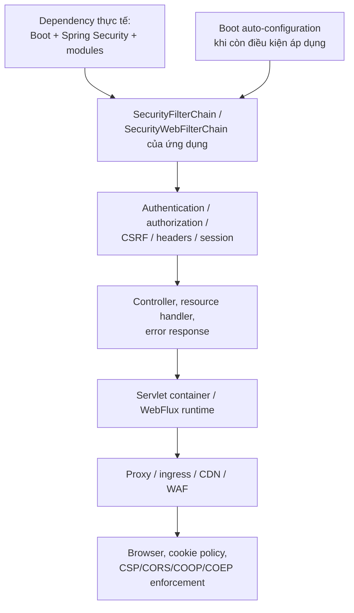

# Đối chiếu mặc định bảo vệ giữa các dòng Spring Security

## 1. Vì sao nâng cấp Spring Security phải kiểm tra lại *mặc định bảo vệ*?

Trong module **SPRING_SECURITY_HTTP_PROTECTION**, người học triển khai các lớp bảo vệ HTTP và trình duyệt như CSRF, CORS, security headers, CSP, HSTS, HTTP firewall và bảo vệ session. Bài **“Đối chiếu mặc định bảo vệ giữa các dòng Spring Security”** thuộc chương **Nâng cấp và tương thích** tập trung vào vấn đề quan trọng khi chuyển giữa Spring Security 4.x/5.x/6.x và các dòng mới hơn: **mã ứng dụng vẫn có thể chạy, nhưng điều kiện bảo vệ HTTP đã thay đổi**.

Một ứng dụng Spring MVC từng dùng `WebSecurityConfigurerAdapter` được chuyển sang `SecurityFilterChain`. Sau khi nâng cấp:

- Response đăng nhập hoặc static resource có bộ security headers khác môi trường cũ.
- Form POST không có CSRF token vẫn bị chặn, nhưng frontend SPA không còn lấy token theo cách cũ.
- Trang iframe trước đây chạy được vì đã nới `X-Frame-Options`, nay không hiển thị do cấu hình chain thay đổi.
- Một bộ lọc đăng nhập tự viết xác thực thành công nhưng không duy trì được trạng thái trong session như dự kiến.
- Một API không nhận preflight `OPTIONS` vì luồng xử lý CORS đi sau authentication.
- Mã build thành công nhưng `/assets/**` bị loại khỏi security chain nên **không nhận headers**.

Điều nguy hiểm nhất không phải lỗi compile dễ nhìn thấy, mà là **thay đổi hành vi bảo mật âm thầm**. Chẳng hạn cùng một đoạn `headers(...)` có thể không tương đương khi chain matcher, default writer, TLS termination hoặc phiên bản dependency khác nhau.

**Mục tiêu:** tạo một phương pháp đối chiếu có bằng chứng, thay vì thuộc lòng “Spring Security phiên bản N luôn có header X”.

Sau bài học, người học có thể:

1. Tách **mặc định Spring Security**, **mặc định Spring Boot** và **mặc định trình duyệt/container/proxy**.
2. Lập ma trận so sánh các dòng phiên bản về CSRF, security headers, session, HTTP firewall, authentication và CORS.
3. Nhận diện những thay đổi cấu hình từ `WebSecurityConfigurerAdapter` sang bean `SecurityFilterChain` và các khác biệt Servlet/Reactive.
4. Tạo **baseline kiểm thử trước nâng cấp** và chạy lại sau nâng cấp: MockMvc, WebTestClient, HTTP thực và trình duyệt.
5. Sửa sai lệch một cách có kiểm soát mà **không tắt hàng loạt các cơ chế bảo vệ**.

## 2. Định nghĩa “mặc định”: không chỉ có một nguồn

Trước khi so sánh phiên bản, phải xác định **đường chạy thực tế**. Cùng một ứng dụng Spring Boot có thể nhận security configuration từ nhiều tầng:



Một giá trị HTTP thấy trong DevTools **không nhất thiết do Spring Security phát**. Ví dụ:

- `SameSite` của cookie session có thể do **container hoặc cấu hình Spring Boot** phát.
- `Strict-Transport-Security` có thể do **Spring Security, reverse proxy hoặc CDN** phát.
- `Access-Control-Allow-Origin` có thể do Spring MVC/WebFlux CORS, gateway hoặc endpoint khác xử lý.
- `X-Frame-Options` có thể xuất phát từ mặc định security headers, một writer tùy biến hoặc proxy.
- Browser tự chọn chính sách `Referer` mặc định khi server **không** phát `Referrer-Policy`; đó không phải header mặc định của Spring Security.

Vì vậy, khi nói “mặc định phiên bản X”, phải chỉ rõ:

| Câu hỏi | Ví dụ thông tin cần ghi |
| --- | --- |
| Dòng framework nào? | Spring Security version **đã resolve**, Spring Boot version, Spring Framework version. |
| Stack nào? | Servlet/Spring MVC hay Reactive/WebFlux. |
| Ai định nghĩa chain? | Boot fallback chain, một `SecurityFilterChain` do ứng dụng khai báo, hay nhiều chain có `@Order`. |
| Request nào? | GET HTML, POST form, JSON API, static file, redirect, lỗi, HTTPS hay HTTP. |
| Có tầng sau ứng dụng không? | Nginx/ingress/CDN thay hoặc thêm header, kết thúc TLS, rewrite path. |
| Browser nào? | Engine và phiên bản, yêu cầu iframe/popup và mức hỗ trợ header. |

**Quy tắc vàng:** không so sánh hai file cấu hình nếu không so sánh **response nhận được từ cùng một kịch bản**.

## 3. Bức tranh các dòng phiên bản Spring Security

Không thể dùng một bảng tổng quát để khẳng định chính xác *từng* header writer được thêm hoặc đổi default ở *từng* patch release. Ma trận dưới đây giúp nhận diện **điểm chuyển đổi cấu trúc**; giá trị cuối phải đối chiếu tài liệu/Javadoc và baseline trên **phiên bản thực tế**.

| Nhóm phiên bản | Mô hình cấu hình thường gặp | Điểm nâng cấp cần chú ý |
| --- | --- | --- |
| **4.x và hệ thống lâu đời hơn** | Cấu hình XML, Java config cũ, adapter hoặc filter tùy biến. | Nhiều default và thuật toán token/header khác dòng mới; cần kiểm kê đầy đủ trước migration. |
| **5.0–5.6** | Phổ biến `WebSecurityConfigurerAdapter`, `authorizeRequests`, matcher kiểu cũ; hỗ trợ cấu hình component-based ở các mức độ khác nhau. | Security headers/CSRF có những hành vi lịch sử; đừng lấy cấu hình 6.x gắn nguyên vào 5.x. |
| **5.7–5.8** | Giai đoạn di trú sang **bean `SecurityFilterChain`**; adapter bị deprecate từ 5.7, có nhiều API hỗ trợ chuyển tiếp. | Chuẩn bị matcher, authorization, CSRF token handling, security context persistence trước 6.x. |
| **6.x** | Cấu hình component-based, lambda DSL và hệ sinh thái Jakarta tương ứng. `WebSecurityConfigurerAdapter` đã bị loại bỏ. | Cách khai báo chain, matcher, security context và token handling có thể khác hệ thống 5.x; kiểm tra auth/CSRF/headers sau chuyển đổi. |
| **7.x và các dòng về sau** | Tiếp tục xu hướng API nhất quán và loại các API deprecate cũ theo chính sách phiên bản. | **Tra migration guide đúng minor/patch release**: không suy một method/DSL hay default còn hoặc mất chỉ từ bảng này. |

### 3.1. Không nhầm phiên bản Boot với phiên bản Security

`spring-boot-starter-security` không phải bản thân thư viện `spring-security-web`/`spring-security-config`. Boot quản lý tập dependency tương thích; nếu dự án override riêng một module Security, có thể tạo bộ phiên bản không nhất quán.

Để xem dependency thực sự **trong dự án được phép kiểm tra**, có thể dùng:

```bash
# Maven
./mvnw dependency:tree -Dincludes=org.springframework.security

# Gradle: chọn configuration đúng với dự án
./gradlew dependencyInsight \
  --dependency spring-security-web \
  --configuration runtimeClasspath
```

Các lệnh là **ví dụ cho người học**, không phải kết quả kiểm thử của bài viết. Khi có nhiều module, phải xét **đúng module chạy production** và đúng cấu hình classpath.

### 3.2. Đừng ghi “Spring Security X mặc định...” khi thiếu điều kiện

Một tuyên bố tốt:

> “Trong cấu hình thử nghiệm Servlet dùng Spring Security phiên bản đã khóa, request HTTPS đi qua chain A nhận `X-Frame-Options: DENY` và `Strict-Transport-Security`; đã xác minh bằng MockMvc và response qua gateway.”

Một tuyên bố thiếu dữ kiện:

> “Mọi ứng dụng Spring Security đều luôn gửi HSTS.”

HSTS phụ thuộc ngữ cảnh HTTPS/secure request, việc headers writer còn bật, request có đi qua chain hay không và cả hạ tầng proxy. **Phải nêu điều kiện.**

## 4. Ma trận nhanh: cơ chế nào mặc định, cơ chế nào cần chọn?

Bảng dưới đây mô tả **xu hướng cấu hình bảo mật thông dụng** trên các dòng hiện đại, **không thay thế** tài liệu đúng version hoặc HTTP snapshot. “Mặc định khi có chain” nghĩa là **cấu hình security headers chuẩn vẫn được bật và request đi qua chain đó**.

| Cơ chế | Xu hướng mặc định thông dụng | Có gì cần kiểm tra khi nâng cấp? |
| --- | --- | --- |
| **CSRF** | Bảo vệ CSRF bật theo cấu hình web security thông thường. | Repo token, cách lấy token, các request unsafe, matcher bỏ qua, SPA/token masking/deferred loading. |
| **X-Content-Type-Options** | Thường gửi `nosniff`. | Có bị tắt headers hoặc proxy thay không? |
| **X-Frame-Options** | Thường gửi `DENY`. | Iframe cùng origin có cần `SAMEORIGIN`? CSP `frame-ancestors` có được cấu hình riêng? |
| **Cache-Control/Pragma/Expires** | Thường có writer ngăn cache mặc định cho response phù hợp, trừ khi app chỉ định khác. | Handler đã tự đặt cache headers chưa? Asset public có bị hạn chế cache sai? |
| **HSTS** | Thường có writer với giá trị bảo vệ mặc định trên **secure requests**. | TLS termination, `isSecure`, proxy forwarding, subdomain, preload, header trùng. |
| **X-XSS-Protection** | **Có thay đổi lịch sử** về giá trị/default; các tài liệu phiên bản cũ và mới có thể khác. | Xác minh response đúng version; không hồi sinh bộ lọc XSS cũ theo checklist lỗi thời. |
| **CSP** | **Không tự tạo** một CSP phù hợp cho mọi ứng dụng. | Phải chọn `script-src`, `img-src`, `frame-ancestors`, `connect-src` theo nghiệp vụ. |
| **Referrer-Policy** | Không nên giả định được phát mặc định. | Chọn giá trị chủ động, đo `Referer` của browser. |
| **Permissions-Policy** | Không nên giả định được phát mặc định. | Chọn feature/origin, iframe `allow`, browser support. |
| **COOP/COEP/CORP** | Không nên giả định có chính sách cô lập phù hợp mặc định. | Chọn đúng HTML/resource/route, kiểm thử popup/CDN/iframe. |
| **CORS** | Không có nghĩa mặc định cho phép mọi origin; cần cấu hình tích hợp đúng. | Preflight `OPTIONS`, credentials, allowlist, `Vary: Origin`, Spring MVC/WebFlux CORS. |
| **Authorization** | Phụ thuộc chain được khai báo và auto-configuration thực sự còn hiệu lực. | Không đánh đồng `permitAll`, `authenticated` và không có matching chain. |
| **Session/security context** | Có cơ chế lưu trạng thái theo stack và cấu hình, không đồng nghĩa stateless. | Context saving, session fixation, remember-me, cookie, logout và custom authentication. |
| **HTTP firewall** | Có tầng bảo vệ request trong Servlet filter infrastructure. | RequestTarget/matcher, URL encoding, dấu chấm phẩy, đường dẫn bị canonicalize. |

**Quan trọng:** bảng trên không tuyên bố “mọi bản 5.x” giống nhau hoặc “mọi bản 6.x” giống nhau. Khi cần so sánh exact value giữa hai bản, **đo thực tế và ghi version**, đặc biệt với `X-XSS-Protection`, CSRF token handling, HSTS và authentication flow.

## 5. Security headers mặc định: lập baseline trước khi đụng cấu hình

Một ứng dụng Spring Security hiện đại với cấu hình headers chuẩn thường có những response tương tự:

```http
Cache-Control: no-cache, no-store, max-age=0, must-revalidate
Pragma: no-cache
Expires: 0
X-Content-Type-Options: nosniff
X-Frame-Options: DENY
```

Trên response HTTPS phù hợp, có thể thấy:

```http
Strict-Transport-Security: max-age=31536000 ; includeSubDomains
```

Lưu ý thứ tự, khoảng trắng và các directive của HSTS có thể khác theo writer; **dòng trên chỉ minh họa ý định**, không phải một literal duy nhất để so sánh chuỗi. Trong test nên xác định yêu cầu về max-age/includeSubDomains chứ không phụ thuộc thứ tự tùy ý.

### 5.1. `X-Content-Type-Options: nosniff`

Header `nosniff` hạn chế MIME sniffing trong các tình huống áp dụng. Nếu một script CDN không chạy do `Content-Type` sai, **sửa MIME type** tại server/CDN thay vì tắt `nosniff` toàn ứng dụng.

Ca kiểm thử cần có:

- Script được phát với MIME type được browser chấp nhận.
- Response trong chain có `nosniff`.
- Static file đi thẳng CDN có chính sách tương ứng, nếu CDN là nguồn trả resource thực tế.

### 5.2. `X-Frame-Options`

```http
X-Frame-Options: DENY
```

Là một baseline thông dụng. Nếu ứng dụng cũ nhúng UI cùng origin:

```http
X-Frame-Options: SAMEORIGIN
```

có thể phù hợp với một số endpoint được duyệt, nhưng `SAMEORIGIN` không cho phép một portal **khác origin** nhúng trang. Trong các trình duyệt hiện đại, CSP `frame-ancestors` có khả năng diễn đạt phạm vi origin linh hoạt hơn. Đừng dùng `ALLOW-FROM` như giải pháp chung vì hỗ trợ browser rất hạn chế/lỗi thời.

**Phân biệt mục tiêu:** `X-Frame-Options`/`frame-ancestors` phòng clickjacking cho **tài liệu bị nhúng**; `CORP` liên quan sử dụng **resource response** trong những trường hợp `no-cors`. Không thay lẫn nhau.

### 5.3. Cache headers

Security headers mặc định có thể cố hạn chế cache cho response chưa được ứng dụng chỉ định chính sách cache. Nếu controller/resource handler đã phát `Cache-Control` riêng, cần đo cách writer đang xử lý thay vì đoán mặc định sẽ ghi đè.

Một public font/logo có thể cần:

```http
Cache-Control: public, max-age=3600
```

Trong khi dữ liệu theo user có thể cần:

```http
Cache-Control: private, no-store
```

**Đừng bật cache public cho response cá nhân hóa** chỉ để cải thiện hiệu năng sau nâng cấp. Trường hợp response có cookie/session hoặc phân quyền theo tenant phải phân tích cả CDN cache key.

## 6. HSTS: khác biệt thường đến từ HTTPS/proxy, không phải phiên bản

HTTP Strict Transport Security nhằm yêu cầu browser ưu tiên HTTPS theo chính sách nhận từ máy chủ:

```http
Strict-Transport-Security: max-age=31536000; includeSubDomains
```

Spring Security cung cấp cơ chế HSTS writer trong các dòng hiện đại, nhưng **browser chỉ chấp nhận HSTS qua kết nối HTTPS hợp lệ**. Khi test local bằng HTTP mà không thấy HSTS, không nên kết luận “Spring Security 6 đã bỏ HSTS”.

### 6.1. Các tình huống phải phân biệt

| Tình huống | Vì sao kết quả có thể khác? | Kiểm tra |
| --- | --- | --- |
| HTTP local `http://localhost` | Kết nối không phải HTTPS. | Đừng dùng HTTP response làm bằng chứng HSTS production bị tắt. |
| HTTPS trực tiếp tại ứng dụng | Request thường được nhận là secure. | Xác nhận writer, max-age, includeSubDomains và cert. |
| HTTPS ở ingress, HTTP giữa ingress và ứng dụng | Ứng dụng có thể nhìn thấy request không secure nếu không được cấu hình trusted forwarded headers. | Xem cấu hình gateway, forwarded headers và response cuối. |
| CDN cùng phát HSTS | Có thể có duplicate, value khác ở các host. | Chỉ định owner cho HSTS, test hostname thực. |
| Bật `includeSubDomains`/preload | Tác động cả subdomain và khả năng rollback khó hơn. | Inventory toàn bộ subdomain/HTTPS trước phê duyệt. |

### 6.2. Không “sửa” bằng static HSTS trên mọi HTTP response

Một `StaticHeadersWriter` ghi HSTS vô điều kiện có thể làm test pass sai ngữ cảnh. Ưu tiên DSL/writer HSTS đúng cho phiên bản và kiểm tra **HTTPS thật** qua proxy. Chỉ bật preload khi đáp ứng điều kiện triển khai/khả năng vận hành của toàn bộ host liên quan.

## 7. `X-XSS-Protection`: trường hợp điển hình của default lịch sử

Những tài liệu cũ từng giới thiệu:

```http
X-XSS-Protection: 1; mode=block
```

Trong các cấu hình hiện đại có thể gặp:

```http
X-XSS-Protection: 0
```

Lý do quan trọng: **bộ lọc XSS lịch sử của một số browser đã lỗi thời**, không phải cơ chế chống XSS đáng tin hiện nay và trong một số trường hợp từng tạo hành vi không mong muốn.

### Nguyên tắc đối chiếu

- Không khẳng định một mốc patch release chính xác chỉ bằng ký ức; tra tài liệu/Javadoc **đúng version** và đo response.
- Đừng xem thay từ `1; mode=block` sang `0` là “Spring Security đã bỏ chống XSS”: những lớp phòng XSS quan trọng vẫn là **output encoding theo context**, xử lý input an toàn, template rendering, CSP được thiết kế và kiểm thử.
- Nếu security scanner muốn “bật lại” `X-XSS-Protection: 1`, đánh giá browser mục tiêu và rủi ro trước khi làm theo một checklist cũ.
- Không dùng header này để thay `Content-Security-Policy` hoặc xử lý dữ liệu không tin cậy đúng cách.

Đây là lý do cần **so sánh mục đích bảo vệ**, không chỉ so sánh giá trị chuỗi header cũ/mới.

## 8. CSP, Referrer, Permissions và COOP/COEP/CORP không thể chọn mặc định chung

Spring Security có thể cung cấp header writers hoặc DSL, nhưng **giá trị chính sách phải đi theo nhu cầu ứng dụng**.

### 8.1. CSP không có một allowlist an toàn cho mọi app

Ví dụ:

```http
Content-Security-Policy: default-src 'self'; object-src 'none'; base-uri 'self'; frame-ancestors 'none'
```

Có thể là điểm khởi đầu cho một trang phù hợp, nhưng một ứng dụng dùng OAuth popup, inline scripts, worker, CDN hoặc iframe bên thứ ba cần phân tích thêm `script-src`, `connect-src`, `img-src`, `frame-src` và các directive liên quan.

**Không mặc định rằng cứ nâng cấp Spring Security là CSP đã được tạo cho ứng dụng.**

### 8.2. Referrer-Policy

```http
Referrer-Policy: strict-origin-when-cross-origin
```

Giới hạn mức thông tin URL gửi trong `Referer` theo ngữ cảnh. Việc một browser tự có default referrer policy không có nghĩa Spring Security đã phát header đó. Nếu URL chứa token hoặc bí mật, **sửa thiết kế URL** trước, không đặt toàn bộ trách nhiệm vào header.

### 8.3. Permissions-Policy

```http
Permissions-Policy: camera=(), microphone=(), geolocation=()
```

Phù hợp với trang không cần ba tính năng đó, nhưng **làm hỏng chức năng lớp học video** nếu áp trên ancestor cần nhúng iframe dùng camera/microphone. Với iframe được phép, phải xét origin allowlist, thuộc tính `allow`, HTTPS và user consent.

### 8.4. COOP, COEP, CORP

Một trang cần cross-origin isolation có thể sử dụng:

```http
Cross-Origin-Opener-Policy: same-origin
Cross-Origin-Embedder-Policy: require-corp
```

Tài nguyên CDN dùng cross-origin `no-cors` có thể cần **trên response resource**:

```http
Cross-Origin-Resource-Policy: cross-origin
```

Không bật `require-corp` toàn site chỉ vì một route mô phỏng cần `SharedArrayBuffer`: các SDK cũ, ảnh, script, worker, iframe có thể không tương thích. `COOP: same-origin` còn có thể phá callback OAuth popup phụ thuộc `window.opener`. Vì vậy **các header này là quyết định theo trang và resource**, không phải “mặc định bảo vệ mới càng nhiều càng tốt”.

## 9. CSRF qua các dòng: bật bảo vệ không có nghĩa token flow không đổi

Trong cấu hình web security điển hình, Spring Security **bật CSRF protection** cho những HTTP methods thay đổi trạng thái. Người học thường thấy:

| HTTP method | Ý nghĩa an toàn dự kiến | CSRF thường kiểm tra? |
| --- | --- | --- |
| `GET`, `HEAD`, `OPTIONS`, `TRACE` | Được xem là safe về ngữ nghĩa HTTP; **không được thay đổi trạng thái** | Thông thường không yêu cầu CSRF token. |
| `POST`, `PUT`, `PATCH`, `DELETE` | Có thể thay đổi trạng thái | Thông thường cần CSRF token khi CSRF enabled. |

**Một GET làm thay đổi trạng thái là lỗi thiết kế**; việc CSRF matcher mặc định bỏ qua GET không làm endpoint kiểu đó an toàn.

### 9.1. Những điều có thể đổi khi di trú

1. **Nơi lưu token:** Servlet có các `CsrfTokenRepository` như session hoặc cookie; Reactive có cơ chế token repository tương ứng với WebSession/cookie.
2. **Khi token được tạo/đọc:** một số dòng hiện đại dùng **deferred CSRF token loading**, làm thay đổi thời điểm token hiện diện trong session.
3. **Token masking/BREACH mitigation:** dòng mới có thể sử dụng request handler che/mask token khi render ra HTML, dẫn đến cách SPA gửi token phải tương thích.
4. **Logout:** với CSRF enabled, logout thường yêu cầu request phù hợp (ví dụ POST với token), không được giả định một GET logout cũ còn hoạt động.
5. **Matcher bỏ qua:** `ignoringRequestMatchers` hoặc cấu hình tương ứng cần được rà soát, tránh vô tình bỏ kiểm tra toàn `/api/**`.
6. **Multiple security chains:** CSRF phải được kiểm tra ở chain khớp request thực tế; một chain riêng cho API có thể có cấu hình khác.

### 9.2. Ví dụ form và SPA

Form server-rendered có thể chứa token:

```html
<form action="/profile/email" method="post">
  <input type="hidden" name="_csrf" value="TOKEN_FROM_SERVER">
  <input name="email" type="email">
  <button type="submit">Lưu</button>
</form>
```

`TOKEN_FROM_SERVER` chỉ là placeholder, **không phải token có thể dùng thật**. Ứng dụng phải lấy token qua cơ chế CSRF repository/request handler và trình bày an toàn.

SPA sử dụng cookie token thường gửi header, nhưng phải xét **trường hợp token cookie ở dạng raw còn request handler kỳ vọng masked value**, cơ chế refresh sau login/logout và cách đọc token từ cookie. Khi nâng cấp các dòng hiện đại, hãy kiểm tra **hướng dẫn SPA CSRF chính thức đúng version**, không chỉ đổi tên class rồi coi migration hoàn tất.

### 9.3. Khi nào có thể bỏ CSRF?

Không quyết định bằng câu “đây là REST API”. Cần xét:

- Browser có tự gửi credentials/cookie/Basic Auth/session cho request không?
- API chỉ chấp nhận bearer token ở `Authorization` do JavaScript chủ động gắn, hay còn cơ chế ambient credentials khác?
- Có các endpoint bị gọi từ form hoặc cross-site request không?
- Có tác động login/logout/refresh token không?

Nếu kiến trúc xác thực thật sự **không dựa vào credentials browser tự gửi**, có thể đánh giá loại trừ CSRF cho các request/chain phù hợp. Nhưng đó là **quyết định threat model**, không phải mặc định an toàn chỉ vì API trả JSON.

## 10. Security context và session: thay đổi quan trọng nhưng khó thấy

Spring Security bảo đảm cơ chế xác thực được nối với một `SecurityContext`. Tuy nhiên, cách lưu/khôi phục context giữa các request **phụ thuộc stack, version và cấu hình**.

### 10.1. Servlet: migration cần kiểm tra việc lưu context

Một số ứng dụng Spring Security cũ dựa vào hành vi **tự lưu security context** của filter cơ sở sau khi xác thực. Ở các dòng mới, cơ chế `SecurityContextHolderFilter` và hướng **explicit save** có thể yêu cầu code xác thực tùy biến **tự lưu context qua `SecurityContextRepository`**.

Ý nghĩa thực tế:

- Custom login filter/endpoint có thể xác thực thành công **trong request hiện tại**.
- Request kế tiếp lại trở thành anonymous vì context chưa được lưu theo contract mới.
- UI tưởng cookie/CSRF lỗi, trong khi nguyên nhân là **security context persistence**.

**Không sao chép nguyên một hướng dẫn 5.x về `SecurityContextPersistenceFilter` sang 6.x/7.x mà không đọc migration guide chính xác.**

Nếu dự án dùng `formLogin`/`oauth2Login` chuẩn, Spring Security có thể xử lý các bước cần thiết; nếu là custom authentication, phải kiểm tra điểm lưu context, session creation policy và repository được chọn.

### 10.2. Session fixation và session concurrency

Phòng vệ **session fixation** có thể được Spring Security hỗ trợ theo phương thức mặc định phù hợp với Servlet/runtime. Tuy vậy, mức độ kiểm soát **số session đồng thời**, thời gian sống, cookie flags, remember-me hay invalid-session redirect **không nên mặc định coi là đã được cấu hình theo yêu cầu doanh nghiệp**.

Checklist kiểm tra:

- Sau login, session ID có được xử lý chống fixation theo thiết kế?
- Logout có xóa security context và invalidate session/cookie phù hợp?
- Concurrent sessions có giới hạn theo policy không?
- Có dùng `SessionCreationPolicy.STATELESS` trên chain cần API token không, và liệu chain khác vẫn dùng session?
- Cookie `Secure`, `HttpOnly`, `SameSite` đến từ tầng nào?
- CSRF token/session có được cập nhật đúng sau login/logout?

**`SessionCreationPolicy.STATELESS` không phải mặc định của mọi API Spring Security.** CORS và CORP cũng không biến một API dùng session thành stateless.

### 10.3. WebFlux: WebSession và Reactive security context

Reactive dùng `SecurityWebFilterChain` và các thành phần tương ứng với `ServerWebExchange`/`WebSession`, không phải `HttpServletRequest` hay `HttpSession`. Nếu có cấu hình stateless hoặc custom `ServerSecurityContextRepository`, hãy kiểm tra cách tái xác thực sau request và nơi lưu thông tin phiên.

Không chuyển các hướng dẫn lưu context Servlet sang Reactive bằng cách chỉ đổi tên bean. Hai stack có **vòng đời, kiểu API và cách lưu context khác nhau**.

## 11. Authorization defaults và sự khác nhau giữa Boot fallback với custom chain

Một nguồn nhầm lẫn phổ biến:

> “Tôi đã thêm bean `SecurityFilterChain` chỉ để cấu hình một header, tại sao những URL trước đây được Boot bảo vệ lại thay đổi?”

Trong các thiết lập Spring Boot thông dụng, Boot cung cấp một fallback web security configuration khi **chưa có cấu hình phù hợp do ứng dụng cung cấp**. Khi developer tự khai báo `SecurityFilterChain`, auto-configuration tương ứng có thể **back off**; khi đó trách nhiệm authorization thuộc về chain do ứng dụng định nghĩa.

### 11.1. Mẫu sai về mặt ý định

```java
@Bean
SecurityFilterChain headersOnly(HttpSecurity http) throws Exception {
    return http
        .headers(headers -> headers
            .addHeaderWriter(new StaticHeadersWriter(
                "Referrer-Policy", "no-referrer")))
        .build();
}
```

Đoạn code chỉ minh họa một lỗi **thiếu yêu cầu authorization rõ ràng**. Không thể suy rằng Boot sẽ tự cộng dồn nguyên bộ luật `anyRequest().authenticated()` từ fallback chain cũ với bean tự khai báo này.

### 11.2. Mẫu chủ động khai báo quyền

```java
@Bean
SecurityFilterChain appSecurity(HttpSecurity http) throws Exception {
    return http
        .authorizeHttpRequests(auth -> auth
            .requestMatchers("/assets/public/**", "/health").permitAll()
            .anyRequest().authenticated())
        .headers(headers -> headers
            .addHeaderWriter(new StaticHeadersWriter(
                "Referrer-Policy", "strict-origin-when-cross-origin")))
        .build();
}
```

Đây là cấu hình Servlet cho một ứng dụng mẫu, chưa định nghĩa toàn bộ login/role/CORS/CSRF và nghiệp vụ. Nếu có authentication riêng, cần thêm cấu hình tương ứng. Luôn kiểm thử:

- Anonymous vào `/account` bị từ chối.
- User hợp lệ vào route theo quyền được phép.
- Public resource được đọc nhưng vẫn qua security chain để nhận headers.
- Request không có **matching chain** không vô tình bỏ qua an ninh.

### 11.3. `permitAll` không giống `web.ignoring`

Với Servlet, `permitAll()` cho phép một URL trong chain nhưng các security filters (bao gồm headers, tùy cấu hình) vẫn có thể chạy. Bỏ qua đường dẫn bằng `web.ignoring()` thường khiến request **không đi qua Spring Security filter chain**, dẫn tới mất header writers và những cơ chế khác.

Vì vậy với static assets công khai, thường nên **permitAll qua chain** thay vì loại toàn bộ khỏi security infrastructure, trừ khi có lý do và tầng bảo vệ thay thế được xác minh.

## 12. HTTP firewall và matcher: thay đổi có thể mở hoặc khóa nhầm URL

`StrictHttpFirewall` là một thành phần quan trọng trong hệ sinh thái Servlet Spring Security. Nó kiểm soát những dạng request target có thể nguy hiểm hoặc dễ bị diễn giải mâu thuẫn bởi proxy/container/framework.

Các điểm thường phải kiểm tra khi nâng cấp:

- URL có **semicolon/matrix variable**.
- Encoded slash/backslash, double slash, path traversal encoding.
- HTTP method bất thường, method không được hỗ trợ.
- Header name/value hoặc hostname không phù hợp theo rules hiện hành.
- Path normalization ở proxy so với matcher trong Spring Security.
- URL canonicalization trước khi chọn authorization rule.

**Không tắt `StrictHttpFirewall` hoặc nới allowlist rộng chỉ để route cũ chạy lại.** Trước tiên xem:

1. Client có đang tạo URL bất thường không?
2. Proxy/gateway có rewrite khiến path đổi nghĩa không?
3. Có thể thiết kế route bình thường hóa an toàn không?
4. Firewall và matcher có cùng hiểu đường dẫn được bảo vệ không?

### Sự chuyển đổi matcher khi di trú

Trong code cũ:

```java
// Ví dụ phong cách lịch sử, không dùng nguyên xi cho codebase 6+/7+.
.antMatchers("/admin/**").hasRole("ADMIN")
```

Trong phong cách hiện đại:

```java
.authorizeHttpRequests(auth -> auth
    .requestMatchers("/admin/**").hasRole("ADMIN")
    .anyRequest().authenticated())
```

`requestMatchers` có thể chọn implementation tùy stack/version/classpath/cấu hình. **Không giả định mọi pattern có ngữ nghĩa y hệt Ant matcher cũ**, nhất là với URL encoded, servlet path, trailing slash và những thay đổi trong path matching framework.

Phải có test **positive và negative**:

| Request | Kỳ vọng |
| --- | --- |
| `GET /admin/users` với role ADMIN | Được phép theo quyền, nếu resource tồn tại. |
| `GET /admin/users` với user thường | Bị từ chối. |
| `GET /administrator` với user thường | Không vô tình khớp rule public rộng. |
| URL encoded/semicolon bất thường | Bị firewall chặn hoặc xử lý rõ ràng theo policy. |
| Path qua gateway rewrite | Matcher đúng route Spring thật sự nhận. |

## 13. CORS: không có “mặc định mở hết origin” để phục hồi sau nâng cấp

**CORS là kiểm soát trình duyệt đối với request cross-origin**, không phải tính năng bật tự động theo tên “REST API”. Spring Security tích hợp CORS với các cấu hình MVC/WebFlux hoặc source được chỉ định, nhưng không nên suy ra mọi origin được phép.

Ví dụ request preflight:

```http
OPTIONS /api/public/catalog HTTP/1.1
Origin: https://dashboard.partner.example
Access-Control-Request-Method: GET
Access-Control-Request-Headers: x-client-version
```

Response hợp lệ tùy chính sách có thể cho origin và method/header đó. Nếu request `OPTIONS` bị challenge đăng nhập trước khi CORS xử lý, browser có thể chặn request thực tế.

### 13.1. CORS configuration phải đúng stack

**Servlet** thường dùng:

```java
org.springframework.web.cors.UrlBasedCorsConfigurationSource
org.springframework.web.cors.CorsConfigurationSource
```

**Reactive/WebFlux** dùng:

```java
org.springframework.web.cors.reactive.UrlBasedCorsConfigurationSource
org.springframework.web.cors.reactive.CorsConfigurationSource
```

Không chuyển bean Servlet CORS source sang reactive code rồi kỳ vọng cùng hoạt động.

### 13.2. Không sửa bằng ACAO wildcard cho API có session

```http
Access-Control-Allow-Origin: *
Access-Control-Allow-Credentials: true
```

Không phải response chấp nhận được cho credentialed CORS request theo quy tắc của browser. Nếu nghiệp vụ có credentials cross-origin, cần origin allowlist cụ thể, `Access-Control-Allow-Credentials` phù hợp, cookie `SameSite`/`Secure`, CSRF và authorization.

**CORS không thay xác thực**: một HTTP client trực tiếp vẫn có thể gửi request không theo giới hạn CORS của browser. Bảo vệ dữ liệu phải thực hiện ở server.

### 13.3. Test cả sự vắng mặt của ACAO

Đôi khi baseline đúng là `Access-Control-Allow-Origin` **không có** cho origin ngoài danh sách. Đừng chỉ assert rằng origin hợp lệ được phép; phải assert origin không được phép **không nhận quyền CORS** theo logic processor.

## 14. Phân biệt mặc định Servlet và Reactive

Cả hai stack đều thuộc Spring Security nhưng không có cùng mã cấu hình hoặc lớp runtime:

| Nội dung | Servlet / Spring MVC | Reactive / WebFlux |
| --- | --- | --- |
| HTTP security builder | `HttpSecurity` | `ServerHttpSecurity` |
| Security chain | `SecurityFilterChain` | `SecurityWebFilterChain` |
| Authorization DSL | `authorizeHttpRequests` | `authorizeExchange` |
| Header writer | `HeaderWriter`, `StaticHeadersWriter` | `ServerHttpHeadersWriter`, `StaticServerHttpHeadersWriter` |
| CSRF repository | `CsrfTokenRepository` | `ServerCsrfTokenRepository` |
| Authentication/security context | Servlet filters, `SecurityContextRepository` theo cấu hình | Reactive security web filters, `ServerSecurityContextRepository` |
| Session nền | `HttpSession` nếu ứng dụng dùng session | `WebSession` và cơ chế reactive tương ứng |
| CORS source | Servlet/MVC package | Reactive/WebFlux package |
| Test HTTP | `MockMvc` | `WebTestClient` |

**Không mặc định rằng vì Servlet có một DSL/header writer nào đó nên WebFlux có cùng tên và constructor trong phiên bản tương ứng.** Khi gặp compile error, đọc đúng Javadoc/version rồi chọn API hoặc writer tổng quát phù hợp.

### Reactive không tự đồng nghĩa stateless

WebFlux có thể sử dụng WebSession để duy trì security context. Muốn API hoàn toàn stateless phải thiết kế rõ authentication/security context repository, session behavior và CSRF threat model. Không gắn nhãn “Reactive” rồi suy cookie/session không còn tồn tại.

## 15. Phương pháp lập “security baseline snapshot” trước migration

Một migration đáng tin phải có **dữ liệu trước thay đổi**. Gợi ý chụp baseline trên staging/test cố định với request thực tế:

| ID | Kịch bản | Phản hồi cần lưu | Yêu cầu bảo vệ |
| --- | --- | --- | --- |
| H-01 | GET `/login` HTTP | Status/redirect và headers | Không suy HSTS từ HTTP. |
| H-02 | GET `/login` HTTPS | Header list và cookie | `nosniff`, XFO, HSTS theo policy. |
| H-03 | GET `/account` anonymous | Status + headers | Không nhận dữ liệu riêng. |
| H-04 | GET `/account` authenticated | Header + cache | Đúng role, cache riêng. |
| C-01 | POST `/profile/email` thiếu CSRF | Status, body, side effect | Bị từ chối, không thay đổi trạng thái. |
| C-02 | POST `/profile/email` có CSRF | Status, side effect | Thành công với user có quyền. |
| O-01 | OPTIONS `/api/public/catalog` từ origin hợp lệ | ACAO/preflight | CORS đúng origin. |
| O-02 | OPTIONS từ origin ngoài allowlist | Status/ACAO | Không cấp quyền CORS. |
| S-01 | Login → GET route private | Session/context | Duy trì xác thực đúng; không fixation. |
| S-02 | Logout → GET route private | Session/context | Không còn quyền sau logout. |
| F-01 | URL encoded/semicolon đáng ngờ | Firewall response | Không bypass matcher. |
| B-01 | Iframe cùng/khác origin | Browser XFO/CSP | Chỉ nhúng khi policy cho phép. |
| B-02 | Popup OAuth | Browser COOP/opener | Callback hoàn tất hoặc fallback an toàn. |
| B-03 | CDN resource dưới COEP | Browser CORP/CORS | Chỉ resource được chia sẻ mới dùng được. |

Ngoài HTTP status, lưu **exact resolved dependency version**, loại stack, active profile, security chain, URL thực, TLS/proxy path và browser engine/version. Không ghi session/token/password thật vào artifact baseline.

### Mẫu dữ liệu snapshot

```yaml
environment: staging
stack: servlet
springSecurityVersion: "<actual-resolved-version>"
springBootVersion: "<actual-resolved-version>"
request:
  method: GET
  path: /account
  scheme: https
  authenticated: true
response:
  status: 200
  xContentTypeOptions: nosniff
  xFrameOptions: DENY
  strictTransportSecurity: "<captured-from-response>"
  contentSecurityPolicy: "<captured-or-absent>"
notes:
  - "Xác minh response cuối qua proxy"
  - "Không lưu cookie/Authorization/token thật"
```

**Mẫu này là cấu trúc gợi ý**, không phải dữ liệu đã được đo từ hệ thống. Các trường phải được điền từ môi trường thực tế.

## 16. Servlet: cấu hình bảo vệ có chủ đích thay vì phụ thuộc vào suy đoán

Ví dụ sau dùng API `SecurityFilterChain` hiện đại. Nó **khai báo rõ quyền truy cập** và thêm `Referrer-Policy` cho ứng dụng. Những default headers khác vẫn được duy trì theo version/configuration, **không** bị tắt.

```java
import org.springframework.context.annotation.Bean;
import org.springframework.context.annotation.Configuration;
import org.springframework.http.HttpMethod;
import org.springframework.security.config.annotation.web.builders.HttpSecurity;
import org.springframework.security.config.annotation.web.configuration.EnableWebSecurity;
import org.springframework.security.web.SecurityFilterChain;
import org.springframework.security.web.header.writers.StaticHeadersWriter;

@Configuration
@EnableWebSecurity
public class ServletHttpProtectionConfig {

    @Bean
    SecurityFilterChain app(HttpSecurity http) throws Exception {
        return http
            .authorizeHttpRequests(auth -> auth
                .requestMatchers(HttpMethod.GET, "/assets/public/**")
                    .permitAll()
                .requestMatchers(HttpMethod.HEAD, "/assets/public/**")
                    .permitAll()
                .anyRequest().authenticated())
            .headers(headers -> headers
                .addHeaderWriter(new StaticHeadersWriter(
                    "Referrer-Policy",
                    "strict-origin-when-cross-origin")))
            .build();
    }
}
```

**Lưu ý về tính đầy đủ:** đoạn trên chỉ là *security baseline illustration*, chưa triển khai `formLogin`, `oauth2Login`, API token, role/tenant authorization, custom CORS, CSP hoặc session settings của sản phẩm. Nếu dự án tự khai báo chain, **không giả định Boot còn tạo fallback authorization khác**.

### 16.1. Không tắt default headers vì một lỗi cụ thể

```java
// Anti-pattern: tắt tất cả header writers chỉ để sửa một iframe/CDN.
http.headers(headers -> headers.disable());
```

Điều này có thể làm mất `nosniff`, XFO, HSTS và các phòng vệ khác. Thay vì vậy:

- Cần iframe cùng origin? Điều chỉnh **XFO/CSP đúng response của trang bị nhúng**.
- Cần CDN cross-origin? Kiểm tra **CORP/CORS ở chính response asset** và COEP/CSP của trang.
- Cần popup OAuth? Điều chỉnh **COOP ở đúng trang opener** hoặc thay flow.
- Cần CORS? Dùng **CORS processor**, không chỉ thêm ACAO tĩnh.

### 16.2. CSRF explicit nhưng không nhất thiết phải tự tắt/bật

Khi tạo chain, CSRF protection thường được cung cấp theo mặc định. Không bắt buộc phải thêm `.csrf(...)` chỉ để “bật lại” trong mọi ví dụ. Quan trọng hơn là **kiểm tra request matcher, token repository và cách SPA/HTML thực sự gửi token** sau migration.

## 17. Reactive/WebFlux: mẫu tương đương nhưng không phải bản sao API

```java
import org.springframework.context.annotation.Bean;
import org.springframework.context.annotation.Configuration;
import org.springframework.http.HttpMethod;
import org.springframework.security.config.annotation.web.reactive.EnableWebFluxSecurity;
import org.springframework.security.config.web.server.ServerHttpSecurity;
import org.springframework.security.web.server.SecurityWebFilterChain;
import org.springframework.security.web.server.header.StaticServerHttpHeadersWriter;

@Configuration
@EnableWebFluxSecurity
public class ReactiveHttpProtectionConfig {

    @Bean
    SecurityWebFilterChain app(ServerHttpSecurity http) {
        return http
            .authorizeExchange(auth -> auth
                .pathMatchers(HttpMethod.GET, "/assets/public/**")
                    .permitAll()
                .pathMatchers(HttpMethod.HEAD, "/assets/public/**")
                    .permitAll()
                .anyExchange().authenticated())
            .headers(headers -> headers
                .addWriter(new StaticServerHttpHeadersWriter(
                    "Referrer-Policy",
                    "strict-origin-when-cross-origin")))
            .build();
    }
}
```

Sự khác nhau:

1. `HttpSecurity`/`SecurityFilterChain` (Servlet) → `ServerHttpSecurity`/`SecurityWebFilterChain` (Reactive).
2. `StaticHeadersWriter` → `StaticServerHttpHeadersWriter`.
3. `authorizeHttpRequests` → `authorizeExchange`.
4. `requestMatchers` → `pathMatchers` theo reactive DSL phù hợp.
5. WebFlux có vòng đời WebSession và token repository riêng; không thể port nguyên custom servlet filters.

Khi dùng một phiên bản Spring Security khác, đối chiếu **chữ ký DSL trên version được resolve**, nhất là những method đã bị deprecate ở dòng trước. Không dùng đoạn này để kết luận WebFlux mặc định stateless.

## 18. MockMvc: kiểm tra response headers trước/sau migration

Tạo test chạy trên **cùng một fixture/endpoint** của phiên bản cũ và mới. Với Servlet, `MockMvc` có thể assert:

```java
mockMvc.perform(get("/account").with(user("learner")))
    .andExpect(status().isOk())
    .andExpect(header().string(
        "X-Content-Type-Options", "nosniff"))
    .andExpect(header().string(
        "X-Frame-Options", "DENY"))
    .andExpect(header().string(
        "Referrer-Policy",
        "strict-origin-when-cross-origin"));
```

Đây là **phần thân test minh họa**. Cần controller trả `200`, security test dependency, `MockMvc` fixture và static imports `get`, `user`, `status`, `header`. Nếu hệ thống cố ý dùng `SAMEORIGIN` thay `DENY` ở một route, assertion phải phản ánh **chính sách đã được phê duyệt**, không ép cùng một giá trị cho mọi trang.

### 18.1. HSTS trên secure request

```java
mockMvc.perform(
        get("/account")
            .secure(true)
            .with(user("learner")))
    .andExpect(status().isOk())
    .andExpect(header().exists(
        "Strict-Transport-Security"));
```

HSTS test trên request được đánh dấu secure chỉ cho thấy writer chạy trong **MockMvc context**; production còn phải kiểm tra HTTPS thực, proxy headers và hostname cuối.

### 18.2. Kiểm tra sự vắng mặt có chủ đích

Nếu ứng dụng chưa bật COEP toàn site:

```java
mockMvc.perform(get("/account").with(user("learner")))
    .andExpect(header().doesNotExist(
        "Cross-Origin-Embedder-Policy"));
```

Đây không phải yêu cầu an toàn phổ quát: nếu route **thật sự cần isolation**, COEP có thể phải tồn tại. Mục tiêu là bảo đảm **sau migration không có header chặt mới vô tình xuất hiện trên route không cần nó**.

### 18.3. Kiểm thử duplicate header

```java
MvcResult result = mockMvc.perform(
        get("/account").with(user("learner")))
    .andReturn();

List<String> values = result.getResponse()
    .getHeaders("X-Frame-Options");

assertThat(values).containsExactly("DENY");
```

Đoạn trên cần import `MvcResult`, `List` và assertion library. MockMvc **không nhìn thấy ingress/CDN**; nếu proxy ghi thêm XFO hoặc COOP khác, phải kiểm tra response qua domain staging/production.

## 19. Test CSRF, authorization và login thay vì chỉ test headers

Một migration có thể giữ nguyên mọi response headers nhưng làm thay đổi **quyền thực sự**.

### 19.1. Servlet: POST không CSRF token phải bị từ chối

Giả sử có endpoint POST cập nhật email, fixture test đã cấp quyền cho `learner`:

```java
mockMvc.perform(post("/profile/email")
        .with(user("learner"))
        .param("email", "new@example.test"))
    .andExpect(status().isForbidden());
```

Đây là kỳ vọng khi CSRF enabled và không có token, giả sử các security filters liên quan được áp dụng, route/handler phù hợp. Bên cạnh status cần assert **dữ liệu email chưa bị thay đổi**.

### 19.2. Servlet: có token thì đi qua CSRF, vẫn phải qua quyền

```java
mockMvc.perform(post("/profile/email")
        .with(user("learner"))
        .with(csrf())
        .param("email", "new@example.test"))
    .andExpect(status().is2xxSuccessful());
```

`csrf()` là helper của `spring-security-test`. Kết quả `2xx` chỉ đúng với controller fixture minh họa; ứng dụng thật có thể trả `302` hoặc một status thành công khác. **Có CSRF token không có nghĩa được phép cập nhật tài khoản của người khác**.

### 19.3. Kiểm tra authorization âm tính

```java
mockMvc.perform(get("/admin/users")
        .with(user("learner")))
    .andExpect(status().isForbidden());
```

Assertion này chỉ hợp lệ khi cấu hình security đã định nghĩa role/authority cho admin và fixture `learner` không có quyền. Nếu ứng dụng chưa đặt rule như vậy, **test sẽ phát hiện một khoảng trống cấu hình cần sửa**, thay vì tự động PASS vì URL chứa chữ “admin”.

### 19.4. Tại sao phải kiểm tra sau login/logout?

Với custom authentication:

- Login thành công trong request A.
- Request B tới tài nguyên private vẫn phải có principal phù hợp theo contract.
- Sau logout, request C không còn quyền.
- Session ID và CSRF token thay đổi/xử lý theo chính sách, không giữ state cũ vô thời hạn.

**SecurityContext persistence, session fixation và CSRF token lifecycle** là những vùng rất dễ bị ảnh hưởng khi nâng cấp framework dù header response không thay đổi.

## 20. WebTestClient: parity kiểm thử cho Reactive

Với `spring-security-test` và WebFlux:

```java
webTestClient.mutateWith(mockUser("learner"))
    .get().uri("/account")
    .exchange()
    .expectStatus().isOk()
    .expectHeader().valueEquals(
        "X-Content-Type-Options", "nosniff")
    .expectHeader().valueEquals(
        "X-Frame-Options", "DENY")
    .expectHeader().valueEquals(
        "Referrer-Policy",
        "strict-origin-when-cross-origin");
```

`mockUser` có thể import từ `SecurityMockServerConfigurers` của `spring-security-test`.

### 20.1. Reactive CSRF

```java
webTestClient.mutateWith(mockUser("learner"))
    .post().uri("/profile/email")
    .bodyValue("email=new@example.test")
    .exchange()
    .expectStatus().isForbidden();
```

Khi CSRF enabled, POST thiếu token có thể bị từ chối theo cấu hình; test fixture cần tồn tại endpoint và áp đúng chain.

```java
webTestClient.mutateWith(mockUser("learner"))
    .mutateWith(csrf())
    .post().uri("/profile/email")
    .bodyValue("email=new@example.test")
    .exchange()
    .expectStatus().is2xxSuccessful();
```

`csrf()` dành cho Reactive test có thể import từ `SecurityMockServerConfigurers`. Handler fixture có thể nhận form hoặc JSON theo định nghĩa riêng; ở ví dụ này **body và content type phải tương thích handler trong test project**. Mục đích là xác minh token flow, không định nghĩa một API update email production.

### 20.2. Kiểm tra WebSession

Sau login thật trong integration test, gửi request thứ hai với cookies/session của cùng client. Nếu authentication mất ở request sau, kiểm tra `ServerSecurityContextRepository`, WebSession và custom login web filter trước khi thay đổi CORS hay COEP.

## 21. Browser tests: khác biệt không thể đo bằng MockMvc/WebTestClient

Một bộ test HTTP có thể PASS nhưng browser vẫn có vấn đề do **policy phía client hoặc phụ thuộc ngoài origin**:

| Kịch bản | HTTP test cho biết | Browser test cần chứng minh |
| --- | --- | --- |
| `X-Frame-Options` và `frame-ancestors` | Header nằm trên response tài liệu bị nhúng. | Iframe cùng/khác origin hiển thị hay bị chặn đúng policy. |
| CORS API | ACAO/preflight response từ server. | `fetch` có đọc được JSON từ origin hợp lệ? Origin khác bị từ chối? |
| COOP popup | COOP ở opener/popup. | `window.opener` và callback OAuth thực sự hoạt động? |
| COEP/CORP CDN | Header trên HTML và asset. | Ảnh/script `no-cors` tải được hay bị chặn đúng nguyên nhân? |
| Referrer-Policy | Header trong HTML. | Header `Referer` khi điều hướng/tải tài nguyên có theo policy? |
| Session/cookie | `Set-Cookie` và context behavior trong test server. | Cookie theo `SameSite`/`Secure`/tracking rules có hoạt động qua redirect/iframe? |

### 21.1. Không dùng response 200 làm bằng chứng “resource được dùng”

Browser có thể nhận `HTTP 200` cho ảnh CDN nhưng chặn việc sử dụng vì COEP/CORP/CORS/CSP. Khi viết E2E:

1. Xác nhận URL trả **PNG/script/MIME hợp lệ**.
2. Ghi header response thực, cả sau redirect.
3. Xem Console/Network để xác định cơ chế chặn.
4. Có ca dương: cùng resource **được phép tải thành công** khi policy hợp lệ.
5. Có ca âm: origin hoặc policy sai bị chặn đúng cách.

Nếu ảnh không hiện vì `404`, đó không phải PASS của CORP.

### 21.2. Đừng đánh đồng Playwright WebKit với mọi Safari

Một ma trận phù hợp có thể gồm Chromium, Firefox, WebKit và kiểm thử Safari/thiết bị thật nếu sản phẩm cam kết hỗ trợ. Ghi exact browser binary/version. Khác biệt về COEP credentialless, permissions và third-party cookie có thể phụ thuộc engine/OS/context.

### 21.3. Không cho browser quyết định authorization

`Permissions-Policy`, `COOP`, `CORP` là defense in depth, không phải ACL. Với API riêng, dù browser từ chối cross-origin `fetch`, backend vẫn phải trả `401/403` cho actor không có quyền và không lộ dữ liệu qua URL trực tiếp.

## 22. Quy trình nâng cấp theo giai đoạn

Một kế hoạch migration có kiểm soát gồm các bước:

1. **Chốt dependency:** exact Spring Boot/Security/Framework version, Java, Servlet/Reactive stack và phiên bản các security modules.
2. **Chụp baseline cũ:** bộ header trên HTTP/HTTPS, GET/POST/OPTIONS, anonymous/authenticated, redirect/lỗi/static.
3. **Kiểm kê config cũ:** adapter/XML, matcher, `web.ignoring`, CSRF exclusions, headers customization, session repo, custom filters, proxy.
4. **Chuyển API từng phần:** cấu hình component-based, Jakarta migration khi cần, bỏ API deprecate/removed, giữ **hành vi bảo vệ tương đương**.
5. **Cập nhật token/login flow:** CSRF masking/deferred loading, SPA cookie token, SecurityContext explicit save, logout/session.
6. **Chạy unit/integration tests:** authorization, CSRF, CORS, headers, HSTS secure request, firewall và persistence.
7. **Chạy browser regression:** framing, popup, CDN, API, cookies, session và các trang isolated.
8. **So sánh snapshot:** khác biệt nào là intentional, khác biệt nào là regression, ai duyệt?
9. **Kiểm tra qua proxy/CDN:** TLS forwarding, rewrite path, duplicate headers, cache, status/redirect.
10. **Canary/rollout/rollback:** theo dõi metric theo route, có khả năng quay lại cấu hình an toàn ở đúng vùng chức năng.

### Bản đồ thay đổi nên có owner

```text
Change ID:
  oldVersion → newVersion:
  stack: Servlet | Reactive
  route/category:
  old behavior + evidence:
  new behavior + evidence:
  threat-model impact:
  reason intentional/regression:
  owner:
  required tests:
  rollback:
```

Không lấy việc test compile pass làm điều kiện duy nhất để triển khai các thay đổi security defaults.

## 23. Các anti-pattern khi so sánh mặc định

### “Nâng lên bản mới nghĩa là mọi cơ chế đều an toàn hơn tự động”

Không đúng. Dependency có thể mới nhưng custom chain đã bỏ authorization, `web.ignoring` làm mất headers hoặc proxy phát chính sách sai. **Đo behavior thực** thay vì tin vào số version.

### “Để giống bản cũ, bật lại `X-XSS-Protection: 1; mode=block`”

Không có căn cứ nếu không đánh giá browser và tài liệu hiện hành. Bộ lọc XSS lịch sử không thay output encoding/CSP, có thể không còn hữu ích.

### “Không thấy HSTS trong HTTP local nên Spring đã bỏ”

Sai ngữ cảnh. Phải đo HTTPS/secure request và response cuối qua proxy; HSTS không được xác nhận bằng GET HTTP thông thường.

### “Chuyển `antMatchers` sang `requestMatchers` là xong”

Phải test pattern semantics, firewall, servlet path và thứ tự matcher. Một đường dẫn ngoài ý muốn được `permitAll` là regression nghiêm trọng hơn compile error.

### “API là REST nên tắt toàn bộ CSRF”

Tên gọi REST không phản ánh credentials. Nếu browser tự gửi session cookie/Basic Auth, CSRF vẫn có thể liên quan. Chỉ bỏ theo threat model rõ và test.

### “Bật CORS wildcard để preflight hết lỗi”

Không phù hợp cho API riêng/credentialed. CORS phải có origin allowlist, preflight, credentials/`Vary` đúng và authorization.

### “Để tĩnh ngoài Spring Security cho hiệu năng”

`web.ignoring` có thể bỏ luôn header writers cho static content. Nếu CDN/proxy không bổ sung headers tương đương, tài nguyên không có bảo vệ mong đợi. Chọn `permitAll` qua chain khi phù hợp.

### “Custom login báo success nên session đã lưu”

Không nhất thiết ở các dòng dùng explicit security context saving. Phải test request tiếp theo và logout, không chỉ request xác thực đầu tiên.

### “Bật COEP/CORP trên mọi response để đạt điểm bảo mật cao”

Có thể phá iframe/OAuth/CDN hoặc mở nhúng dữ liệu riêng. Chọn COEP theo tài liệu cần isolation, CORP theo tài nguyên công khai/riêng và CORS theo API request mode.

## 24. Bài tập tình huống

**Bài A — So sánh default headers.** Một ứng dụng 5.x trả `X-Frame-Options: DENY`, `X-XSS-Protection: 1; mode=block`, `nosniff`; sau nâng cấp 6.x/7.x header XSS có giá trị khác. Bạn sẽ chứng minh điều này là thay đổi default có chủ đích hay regression như thế nào?

**Bài B — HTTPS/HSTS.** Trong MockMvc `GET /account` bằng HTTP không thấy HSTS. Gateway production chấm dứt TLS trước Spring. Hãy mô tả phép thử secure request và kiểm tra forwarded headers/proxy.

**Bài C — CSRF và SPA.** Form POST ở phiên bản cũ lấy token từ cookie, sau migration bị `403`. Hãy liệt kê những thay đổi về deferred token loading, masking, request handler và token lifecycle phải kiểm tra trước khi quyết định nới CSRF.

**Bài D — Boot fallback.** Ứng dụng Boot trước đây bảo vệ mọi request khi chưa khai báo chain. Một developer thêm `SecurityFilterChain` chỉ để set Referrer-Policy. Tại sao phải xem lại authorization, và sẽ test những route nào?

**Bài E — Custom login.** User đăng nhập thành công nhưng refresh trang thành anonymous. Hãy phân biệt lỗi session cookie với lỗi lưu `SecurityContext` khi di trú và đề xuất test hai request.

**Bài F — CORS preflight.** Một OPTIONS hợp lệ bị redirect đến `/login`. Bạn sẽ kiểm tra gì ở CORS processor, matcher, security chain, origin và cookies? Vì sao không nên chỉ thêm ACAO `*`?

**Bài G — Matcher.** Một route `/admin/**` từng dùng `antMatchers`. Sau nâng cấp, đường dẫn có semicolon/encoded slash được gateway xử lý khác. Nêu những ca âm tính cần test và vì sao không tắt firewall đại trà.

**Bài H — WebFlux.** Nhóm copy `StaticHeadersWriter`, `HttpSecurity` và `HttpSession` từ Servlet sang WebFlux. Hãy sửa sơ đồ thành phần và chỉ ra những test tương ứng.

**Bài I — CDN.** MockMvc PASS về `COEP: require-corp` trên HTML, nhưng ảnh CDN cross-origin vẫn bị chặn trong browser. Tại sao đây không hẳn là lỗi default Spring Security? Tầng nào cần sửa?

**Bài J — Chấp nhận thay đổi.** Bạn có hai bản snapshot có cùng response header list nhưng sau nâng cấp `/api/me` trả dữ liệu cho user không có quyền. Hãy xác định mức ưu tiên và lý do header parity không chứng minh security parity.

### Gợi ý lời giải

- **A:** chốt exact patch versions, đọc docs/default writers, snapshot cùng request, xem `X-XSS-Protection` là legacy và test output encoding/CSP.
- **B:** `secure(true)` trong MockMvc, HTTPS thật qua gateway, kiểm tra proxy forwarding và host cuối; không phát HSTS tĩnh trên HTTP để chữa test.
- **C:** kiểm tra cách token được xuất ra, masked/raw, cookie repository, request handler và sau login/logout; không bỏ CSRF tùy tiện.
- **D:** user-defined chain có thể làm Boot back off; khai báo `anyRequest().authenticated()` và test anonymous/private/public routes.
- **E:** test login → request tiếp theo → logout, security context repository và cookie/session policy; xem explicit saving nếu custom authentication.
- **F:** CORS phải xử lý preflight phù hợp trước authentication; origin/method/header allowlist, `Vary`, credentials và quyền server.
- **G:** test traversal/semicolon/encoding, matcher semantics và proxy rewrites; giữ `StrictHttpFirewall` trừ khi có ngoại lệ được kiểm soát.
- **H:** dùng `ServerHttpSecurity`, `SecurityWebFilterChain`, `ServerHttpHeadersWriter`, `ServerSecurityContextRepository` và `WebTestClient`.
- **I:** COEP ở **trang** khác CORP/CORS ở **response tài nguyên**; xem request mode và response cuối của CDN.
- **J:** đây là lỗi authorization nghiêm trọng, ưu tiên block release; kiểm tra rule/chain/controller, rollback nếu cần; headers không thay ACL.

## 25. Checklist nghiệm thu migration

| Nhóm | Tiêu chí PASS |
| --- | --- |
| **Dependency** | Đã ghi version Spring Security thực sự được resolve, stack, Boot/Framework tương ứng và API migration guide phù hợp. |
| **Authorization** | Không có route ngoài ý muốn `permitAll`; mọi request được bảo vệ bởi đúng chain và luật phù hợp. |
| **CSRF** | Unsafe requests cần token bị chặn nếu thiếu; request hợp lệ chạy được; SPA/forms/logout được kiểm tra. |
| **Security context** | Login, request tiếp theo, session fixation, logout và custom authentication hoạt động theo contract. |
| **Headers mặc định** | `nosniff`, XFO, cache headers và HSTS trong điều kiện phù hợp; X-XSS-Protection được đánh giá theo version/browser. |
| **CSP/COOP/COEP/CORP** | Chỉ áp đúng route/resource có nhu cầu; iframe, CDN, popup không bị mở/chặn sai. |
| **CORS** | Origin hợp lệ được phép, origin khác bị từ chối; preflight/credentials/cache đúng. |
| **Firewall & matcher** | Path encoding, semicolon, traversal, method và gateway rewrite không bypass authorization. |
| **Servlet/Reactive** | API writer/repository/test phù hợp stack, không dùng lẫn `HttpSession` và `WebSession`. |
| **HTTP & browser tests** | Có ca dương/âm, đo response cuối; không dùng `404` làm bằng chứng policy chặn. |
| **Proxy/CDN/TLS** | HSTS HTTPS, header trùng, cache, redirects, static resources đã được kiểm tra. |
| **Operational** | Có owner, changelog, canary, regression metrics và rollback hẹp. |

## 26. Tổng kết

**Đối chiếu mặc định bảo vệ giữa các dòng Spring Security phải dựa trên hành vi có thể kiểm chứng, không chỉ so sánh version hay tên class.** Nhiều cơ chế có định hướng mặc định ổn định như CSRF, `nosniff`, XFO, HSTS theo HTTPS và cache protection; nhưng **giá trị và chi tiết thực thi** thay đổi theo dòng/patch, stack và cấu hình. Một số cơ chế như CSP, Permissions-Policy, Referrer-Policy, COOP, COEP và CORP **đòi hỏi quyết định nghiệp vụ rõ ràng**, không thể tự động “siết” toàn hệ thống.

Các chuyển đổi cần chú ý đặc biệt gồm **`WebSecurityConfigurerAdapter` sang `SecurityFilterChain`**, matcher/authorization, **CSRF deferred token và masking** trên frontend, **security context persistence** trong custom authentication, CORS preflight và sự khác nhau giữa Servlet và WebFlux.

Quy trình thực hành hiệu quả: **khóa phiên bản thực tế → chụp baseline HTTP/browser → xác định default vs customization vs proxy → chuyển API mà giữ security contract → kiểm thử CSRF/authorization/session/headers → xác minh qua gateway/CDN → rollout và rollback có kiểm soát**.

Không đánh đổi xác thực, phân quyền, CSRF hoặc bảo vệ session chỉ để cố khôi phục một hành vi giao diện cũ.

### Tài liệu để đối chiếu theo đúng phiên bản

- [Spring Security — Servlet HTTP Response Headers](https://docs.spring.io/spring-security/reference/servlet/exploits/headers.html): danh sách default headers, HSTS và cách tùy chỉnh.
- [Spring Security — Reactive HTTP Response Headers](https://docs.spring.io/spring-security/reference/reactive/exploits/headers.html): cấu hình security headers trên WebFlux.
- [Spring Security — CSRF (Servlet)](https://docs.spring.io/spring-security/reference/servlet/exploits/csrf.html): token repository, request handler, SPA và cơ chế chống CSRF.
- [Spring Security — CSRF (Reactive)](https://docs.spring.io/spring-security/reference/reactive/exploits/csrf.html): CSRF cho `ServerWebExchange`.
- [Spring Security — Architecture](https://docs.spring.io/spring-security/reference/servlet/architecture.html): filter chain, security context và cơ chế xử lý request.
- [Spring Security — Migration](https://docs.spring.io/spring-security/reference/migration/index.html): hướng dẫn cập nhật giữa các dòng Spring Security; chọn đúng phiên bản đích.
- [Spring Security — CORS (Servlet)](https://docs.spring.io/spring-security/reference/servlet/integrations/cors.html): tích hợp CORS và preflight.
- [Spring Security — CORS (Reactive)](https://docs.spring.io/spring-security/reference/reactive/integrations/cors.html): tích hợp CORS trong WebFlux.
- [Spring Security — API docs](https://docs.spring.io/spring-security/site/docs/current/api/): đối chiếu `HeaderWriter`, `SecurityFilterChain` và DSL; chọn Javadoc theo exact version khi cần.
- [MDN — HTTP Strict Transport Security](https://developer.mozilla.org/en-US/docs/Web/HTTP/Reference/Headers/Strict-Transport-Security): điều kiện HTTPS và các directive HSTS.
- [MDN — Content Security Policy](https://developer.mozilla.org/en-US/docs/Web/HTTP/Guides/CSP): lựa chọn CSP theo loại tài nguyên/ngữ cảnh.
- [MDN — Cross-Origin Resource Sharing](https://developer.mozilla.org/en-US/docs/Web/HTTP/Guides/CORS): quy tắc browser, preflight và credentials.
