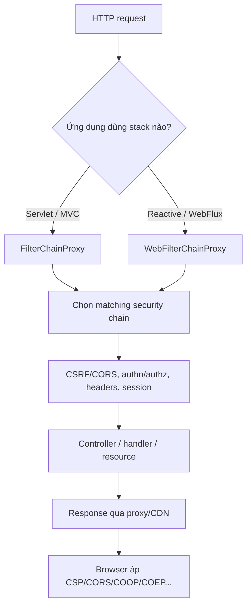
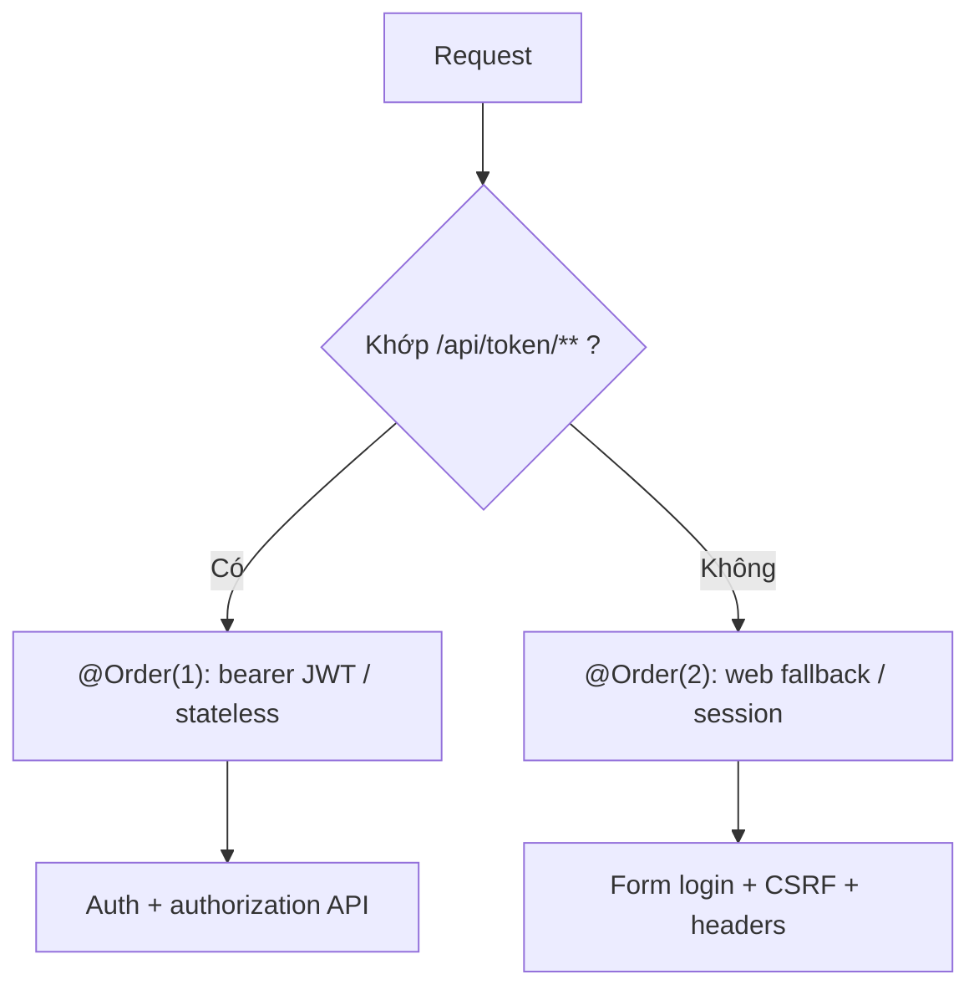

# Chuyển cấu hình kế thừa cũ sang security chain và Lambda DSL

## 1. Vì sao chuyển cấu hình Spring Security là một thay đổi bảo mật thực sự?

Trong module **SPRING_SECURITY_HTTP_PROTECTION**, người học áp dụng các lớp phòng vệ HTTP và trình duyệt của Spring Security từ **CSRF, CORS, security headers, CSP và HSTS** đến **HTTP firewall và bảo vệ session**, với cả **Servlet/Spring MVC** lẫn **Reactive/WebFlux**. Bài thuộc chương **Nâng cấp và tương thích** này hướng dẫn chuyển các cấu hình kế thừa cũ sang **security chain theo bean** và **Lambda DSL** mà không làm sai các cam kết bảo mật trước đó.

Một ứng dụng học trực tuyến có các endpoint:

- `/assets/public/**`: CSS, JavaScript và hình ảnh được phép truy cập công khai.
- `/login`, `/logout`: đăng nhập bằng form và cookie session.
- `/account/**`: hồ sơ người dùng, yêu cầu đăng nhập và CSRF protection trên thao tác ghi.
- `/admin/**`: chỉ người có role ADMIN được truy cập.
- `/api/public/catalog`: API công khai dùng từ một origin đối tác được phép bằng CORS.
- `/api/token/**`: API riêng dành cho bearer token, không phụ thuộc session cookie.
- `/isolated/**`: trang cần COOP/COEP cho tính năng cần cross-origin isolation.

Ứng dụng cũ dùng `WebSecurityConfigurerAdapter`, `authorizeRequests()`, `antMatchers()`, `and()` và `configure(AuthenticationManagerBuilder)`. Khi lên Spring Security 6.x hoặc dòng mới hơn, một số API cũ đã bị loại bỏ hoặc không còn là hướng cấu hình được khuyến nghị. Tuy nhiên, chỉ sửa cho code **biên dịch được** là chưa đủ: một chain không khớp có thể làm endpoint mất authorization; một `csrf.disable()` sai chỗ có thể mở mutation dùng session cho CSRF; một `web.ignoring` có thể làm static assets mất HTTP security headers.

**Mục tiêu của migration:** bảo toàn một **security contract đã được xác định và kiểm thử**, chứ không chỉ thay cú pháp Java.

Sau bài này, bạn có thể chuyển adapter cũ sang `SecurityFilterChain`, dùng Lambda DSL đúng chỗ, tách nhiều chain theo URL/mode xác thực, di trú CSRF/CORS/headers/session/authentication, nhận diện khác biệt Servlet–Reactive, và viết kiểm thử hồi quy trên HTTP lẫn browser.

## 2. Tư duy mới: một ứng dụng có thể có nhiều security chain

Trong Servlet, request đi qua `FilterChainProxy` để Spring Security chọn một **`SecurityFilterChain`** phù hợp. Trong WebFlux, tương ứng là `SecurityWebFilterChain` của Reactive security infrastructure.



Có hai cấp độ matcher **không được nhầm**:

1. **`securityMatcher`**: request có đi vào **chain này** hay không?
2. **`requestMatchers`** trong `authorizeHttpRequests`, hoặc `pathMatchers` trong `authorizeExchange`: với request **đã vào chain**, luật authorization nào được áp dụng?

Nếu một request không khớp **bất kỳ chain nào**, nó không được các security filters trong những chain đó bảo vệ. Nếu nhiều chain cùng có thể khớp, Spring Security dùng **chain phù hợp đầu tiên**, không hợp nhất tất cả thành một.

| Thành phần | Servlet | Reactive/WebFlux |
| --- | --- | --- |
| Builder | `HttpSecurity` | `ServerHttpSecurity` |
| Chain bean | `SecurityFilterChain` | `SecurityWebFilterChain` |
| URL scope | `securityMatcher(...)` | `securityMatcher(ServerWebExchangeMatcher)` |
| Authorization | `authorizeHttpRequests(...)` | `authorizeExchange(...)` |
| Static header writer | `StaticHeadersWriter` | `StaticServerHttpHeadersWriter` |
| CSRF repository | `CsrfTokenRepository` | `ServerCsrfTokenRepository` |
| CORS source | `org.springframework.web.cors` | `org.springframework.web.cors.reactive` |
| Session | `HttpSession` theo cấu hình | `WebSession` theo cấu hình |
| HTTP test | `MockMvc` | `WebTestClient` |

`WebSecurityConfigurerAdapter` là mô hình Servlet cũ: bị **deprecated từ Spring Security 5.7** và bị loại bỏ trong **6.0**. Mã thực tế của dòng 6.x/7.x phải được đối chiếu với Javadoc **đúng minor/patch version**; không suy rằng một DSL của 6.x luôn có cùng signature trên mọi phiên bản.

## 3. Pre-migration: ghi lại ý định thay vì sao chép cấu hình

Trước khi đổi một dòng Java, lập **inventory** những thứ cần được bảo vệ:

| Request | Authentication | Authorization | CSRF | Headers / CORS |
| --- | --- | --- | --- | --- |
| `GET /assets/public/app.js` | Không yêu cầu | GET/HEAD public | Không có mutation | `nosniff`, cache và CSP phù hợp. |
| `GET /account/profile` | Cookie session | User có quyền với profile | Không áp cho safe GET | Referrer/XFO/CSP, cache riêng. |
| `POST /account/email` | Cookie session | Owner hợp lệ | Có CSRF token | Không cache thông tin riêng. |
| `GET /admin/users` | Session/role | `ROLE_ADMIN` | Không cho GET thay đổi trạng thái | XFO/CSP và bảo mật session. |
| `OPTIONS /api/public/catalog` | Preflight | Origin/method/header hợp lệ | Không chặn preflight sai | CORS source trả policy đúng. |
| `GET /api/token/me` | Bearer token | Token/scope hợp lệ | Theo bearer-only threat model | Không redirect sang form login. |
| `GET /isolated/demo` | Session hoặc auth khác theo design | User được phép | Theo method | COOP/COEP theo route. |

Kiểm kê toàn bộ: `web.ignoring`, `antMatchers`, thứ tự luật, nhiều adapter/`@Order`, `UserDetailsService`, custom `AuthenticationProvider`, filter, session fixation, logout, CSRF ignore matchers, CORS bean, security headers, proxy rewrite và static CDN.

### 3.1. Bộ snapshot tối thiểu

```text
B-01 GET /account (anonymous)          → không nhận dữ liệu private
B-02 GET /account (user hợp lệ)       → truy cập thành công
B-03 GET /admin/users (user thường)  → 403
B-04 GET /admin/users (ADMIN)        → được phép
B-05 POST /account/email thiếu CSRF  → từ chối, không có side effect
B-06 POST /account/email có CSRF     → đi qua CSRF, vẫn kiểm tra owner
B-07 OPTIONS /api/public/catalog      → CORS origin hợp lệ được duyệt
B-08 OPTIONS origin ngoài allowlist   → không cấp ACAO
B-09 GET /api/token/me thiếu token   → 401
B-10 Login → GET /account            → session tiếp tục hợp lệ
B-11 Logout → GET /account           → không còn quyền
B-12 GET /assets/public/app.js       → public nhưng vẫn có nosniff
B-13 HTTPS GET /account              → HSTS theo policy
B-14 iframe/popup/CDN                 → browser behavior được kiểm tra
```

Ghi lại **Spring Security version đã resolve**, Boot/Framework, Servlet/Reactive, browser engine/version và proxy path. Không lưu mật khẩu, session token hoặc cookie thật trong baseline.

## 4. Đọc một cấu hình kế thừa trước khi di trú

Ví dụ sau chỉ dành cho **mã lịch sử**, không phù hợp với source của Spring Security 6+:

```java
// LEGACY — minh họa cú pháp của cấu hình kế thừa.
@EnableWebSecurity
public class LegacyConfig extends WebSecurityConfigurerAdapter {
    @Override
    protected void configure(HttpSecurity http) throws Exception {
        http.authorizeRequests()
            .antMatchers("/login", "/assets/public/**").permitAll()
            .antMatchers("/admin/**").hasRole("ADMIN")
            .anyRequest().authenticated()
            .and()
            .formLogin().loginPage("/login").permitAll()
            .and()
            .logout()
            .and()
            .headers().frameOptions().deny();
    }

    @Override
    public void configure(WebSecurity web) {
        web.ignoring().antMatchers("/assets/public/**");
    }
}
```

**Bẫy ở cấu hình này:** `/assets/public/**` được `permitAll` trong authorization **và** `web.ignoring` ở bên ngoài. Với ignore, request **không đi qua security chain**, nên `permitAll` và header writer trong chain không thể bảo vệ response đó.

| Cú pháp legacy | Ý định cần giữ | Rủi ro khi chuyển |
| --- | --- | --- |
| `authorizeRequests` + `antMatchers` | Cho/không cho truy cập theo path | Matcher engine/servlet path/encoding khác. |
| `formLogin().loginPage(...)` | Điểm vào đăng nhập | Quên phục vụ GET trang login tùy biến. |
| `logout()` | Đăng xuất và dọn session | GET logout cũ bị chặn khi CSRF hoạt động. |
| `headers().frameOptions().deny()` | Chống clickjacking | Iframe cũ có thể cần ngoại lệ hẹp, không tắt XFO toàn app. |
| `web.ignoring()` | Bỏ qua chain | Mất cả headers và kiểm soát filter. |
| `configure(AuthenticationManagerBuilder)` | Nguồn xác thực | Chưa tự chuyển persistence/session/password encoder. |

Đừng chuyển cấu hình cũ bằng tìm–thay tự động rồi kết luận hoàn tất. Mỗi rule cần một **test chứng minh ý định**.

## 5. Lambda DSL: rời chuỗi `.and()`, giữ một HttpSecurity builder

Cấu hình hiện đại diễn đạt theo các lambda:

```java
http
    .authorizeHttpRequests(auth -> auth
        .requestMatchers("/login", "/assets/public/**").permitAll()
        .requestMatchers("/admin/**").hasRole("ADMIN")
        .anyRequest().authenticated())
    .formLogin(form -> form
        .loginPage("/login").permitAll())
    .logout(logout -> logout
        .logoutUrl("/logout"))
    .headers(headers -> headers
        .frameOptions(frame -> frame.deny()));
```

Đây là **đoạn trích** trong phương thức cấu hình `HttpSecurity`. Mỗi lambda cấu hình một loại trách nhiệm và trả control về builder chính; cuối cùng gọi **`http.build()`** để tạo chain.

Có thể dùng:
 
```java
import org.springframework.security.config.Customizer;

.formLogin(Customizer.withDefaults())
.httpBasic(Customizer.withDefaults())
```

khi muốn giá trị mặc định của **configurer đó**. `Customizer.withDefaults()` không tự tạo user database, OAuth2 client registration hoặc chính sách authorization của sản phẩm.

**Sai về semantics:** một câu lệnh `.securityMatcher("/api/**")` giới hạn **mọi luật của chain đó** vào `/api/**`. Một câu lệnh `.requestMatchers("/admin/**")` chỉ điều kiện hóa **quy tắc quyền** bên trong chain đã được chọn.

## 6. Cấu hình Servlet cơ sở với một SecurityFilterChain

Đây là một phương án minh họa cho **web session login** (không phải ứng dụng production hoàn chỉnh):

```java
import org.springframework.context.annotation.Bean;
import org.springframework.context.annotation.Configuration;
import org.springframework.http.HttpMethod;
import org.springframework.security.config.annotation.web.builders.HttpSecurity;
import org.springframework.security.config.annotation.web.configuration.EnableWebSecurity;
import org.springframework.security.web.SecurityFilterChain;
import org.springframework.security.web.header.writers.StaticHeadersWriter;

@Configuration
@EnableWebSecurity
public class WebSecurityConfig {

    @Bean
    SecurityFilterChain web(HttpSecurity http) throws Exception {
        return http
            .authorizeHttpRequests(auth -> auth
                .requestMatchers("/login", "/error").permitAll()
                .requestMatchers(HttpMethod.GET,
                                 "/assets/public/**").permitAll()
                .requestMatchers(HttpMethod.HEAD,
                                 "/assets/public/**").permitAll()
                .requestMatchers("/admin/**").hasRole("ADMIN")
                .requestMatchers("/account/**").authenticated()
                .anyRequest().authenticated())
            .formLogin(form -> form
                .loginPage("/login")
                .permitAll())
            .logout(logout -> logout
                .logoutUrl("/logout"))
            .headers(headers -> headers
                .frameOptions(frame -> frame.deny())
                .addHeaderWriter(new StaticHeadersWriter(
                    "Referrer-Policy",
                    "strict-origin-when-cross-origin")))
            .build();
    }
}
```

Lợi ích: `/assets/public/**` **vẫn qua chain**, các default security header writers vẫn có cơ hội chạy; `/admin/**` được xét trước `anyRequest`; CSRF không bị tắt vô cớ.

**Lưu ý bắt buộc:** `loginPage("/login")` chỉ cấu hình URL, **không tạo controller/template** để render giao diện tùy biến. Nếu không có trang riêng, cân nhắc `formLogin(Customizer.withDefaults())` và kiểm tra luồng login mặc định. Cấu hình này chưa tạo user store, password encoder, quyền theo object/tenant, CSP đầy đủ, CORS và OAuth2 Login.

Với `hasRole("ADMIN")`, quyền thường cần authority `ROLE_ADMIN`. Nếu hệ thống quản lý một tên authority khác, sử dụng `hasAuthority(...)` và test chính xác, không chuyển ngầm chuỗi role.

## 7. Nhiều SecurityFilterChain: API bearer tách khỏi web session

Một hệ thống vừa dùng web form login vừa có API token có thể dùng **hai chain với chiến lược khác nhau**:



Mẫu sau là **phương án thay thế** cho bean `web` ở mục 6, không đăng ký hai mẫu fallback trong cùng ứng dụng.

```java
import org.springframework.context.annotation.Bean;
import org.springframework.context.annotation.Configuration;
import org.springframework.core.annotation.Order;
import org.springframework.http.HttpMethod;
import org.springframework.security.config.Customizer;
import org.springframework.security.config.annotation.web.builders.HttpSecurity;
import org.springframework.security.config.http.SessionCreationPolicy;
import org.springframework.security.web.SecurityFilterChain;

@Configuration
public class SeparateApiAndWebConfig {

    @Bean
    @Order(1)
    SecurityFilterChain bearerApi(HttpSecurity http)
            throws Exception {
        return http
            .securityMatcher("/api/token/**")
            .authorizeHttpRequests(auth -> auth
                .requestMatchers(HttpMethod.GET,
                                 "/api/token/public/**").permitAll()
                .anyRequest().authenticated())
            .oauth2ResourceServer(oauth -> oauth
                .jwt(Customizer.withDefaults()))
            .sessionManagement(session -> session
                .sessionCreationPolicy(SessionCreationPolicy.STATELESS))
            .csrf(csrf -> csrf.disable())
            .build();
    }

    @Bean
    @Order(2)
    SecurityFilterChain remainingWeb(HttpSecurity http)
            throws Exception {
        return http
            .authorizeHttpRequests(auth -> auth
                .requestMatchers("/login", "/error",
                                 "/assets/public/**").permitAll()
                .requestMatchers("/admin/**").hasRole("ADMIN")
                .anyRequest().authenticated())
            .formLogin(Customizer.withDefaults())
            .build();
    }
}
```

**Điều kiện để ví dụ API đúng:** dự án có OAuth2 Resource Server dependency, cấu hình JWT decoder/issuer hợp lệ và `/api/token/**` **chỉ** chấp nhận bearer tokens, không dựa vào cookie session/HTTP Basic/ambient credentials. Nếu điều kiện này không đúng, `csrf.disable()` trên API chain cần được đánh giá lại. Không copy theo tên “REST API”.

Thứ tự `@Order(1)` và `@Order(2)` rất quan trọng: fallback không có `securityMatcher` giới hạn sẽ khớp hầu hết request, phải đứng sau chain cụ thể. Không có chuyện nhiều chain cộng dồn policy cho cùng request.

## 8. `securityMatcher` khác `requestMatchers` và bẫy mở rộng phạm vi

Ví dụ:

```java
return http
    .securityMatcher("/api/**")
    .authorizeHttpRequests(auth -> auth
        .requestMatchers("/api/public/**").permitAll()
        .anyRequest().authenticated())
    .build();
```

- **Ngoài:** chỉ URL khớp `/api/**` đi vào chain này.
- **Trong:** `/api/public/**` được `permitAll`; các URL còn lại khớp chain cần authentication.
- **Ngoài chain:** `/account/**` phải được một chain khác bảo vệ.

Nếu thay `.securityMatcher("/api/**")` bằng `.requestMatchers("/api/**").permitAll()`, ý định đã **đảo ngược**: bạn có thể công khai toàn bộ API trong một chain rộng!

### Kiểm thử đường dẫn đặc biệt

| Đường đi | Câu hỏi kiểm thử |
| --- | --- |
| `/admin/users` | Có yêu cầu ADMIN? |
| `/administrator` | Có vô tình khớp wildcard rộng? |
| `/admin` và `/admin/` | Rule có bị bypass bởi slash? |
| `/api/token/me` | Có vào bearer chain thay vì web login? |
| `/assets/private/file.pdf` | Có bị mở cùng public asset? |
| Path chứa `%2F`, `%5C`, semicolon, double slash | Servlet container, proxy, firewall và matcher xử lý thế nào? |

Chuyển `antMatchers` sang `requestMatchers` không bảo đảm cùng engine path matching, servlet path và encoded URL. Với cấu hình nhiều servlet mapping, hãy chọn `RequestMatcher` tương thích **đúng phiên bản** và viết negative tests. Không nới `StrictHttpFirewall` chỉ vì URL legacy không hợp lệ.

## 9. `web.ignoring` không tương đương `permitAll`

Cấu hình cũ:

```java
// Legacy: bỏ hẳn request khỏi Spring Security filter chain.
web.ignoring().antMatchers("/assets/public/**");
```

Cấu hình ưu tiên khi tài nguyên công khai nhưng vẫn cần security headers:

```java
.authorizeHttpRequests(auth -> auth
    .requestMatchers(HttpMethod.GET,
                     "/assets/public/**").permitAll()
    .requestMatchers(HttpMethod.HEAD,
                     "/assets/public/**").permitAll()
    .anyRequest().authenticated())
```

| `web.ignoring` | `permitAll` |
| --- | --- |
| Bỏ qua security chain. | Request vẫn đi qua matching chain. |
| Spring header writers/filters không chạy cho request bị ignore. | Response còn nhận header writers theo cấu hình. |
| Cần lý do và tầng bảo vệ ngoài Spring rõ ràng. | Thường hợp lý với CSS/JS/ảnh công khai. |
| Một matcher quá rộng có thể vô hiệu hóa bảo vệ endpoint private. | Quyền và scope được thể hiện trong authorization DSL. |

Khi thật sự cần bỏ qua toàn bộ, `WebSecurityCustomizer` là cơ chế bean Servlet cần đối chiếu theo version; không mặc định nó là giải pháp cho mọi static file. Nếu asset do **CDN độc lập** phục vụ, Spring không nhìn thấy request; phải đặt header trên **response CDN**.

## 10. Authentication: tách user store khỏi HTTP security

Adapter cũ có thể ghi:

```java
// LEGACY — đọc ý định, không dùng trực tiếp trong codebase 6+.
@Override
protected void configure(AuthenticationManagerBuilder auth)
        throws Exception {
    auth.userDetailsService(myUserDetailsService)
        .passwordEncoder(myPasswordEncoder);
}
```

Trong mô hình component-based, tách các thành phần:

- `UserDetailsService` cung cấp thông tin user/authorities.
- `PasswordEncoder` so sánh password hashing an toàn.
- `AuthenticationProvider` hoặc `AuthenticationManager` thực hiện xác thực.
- `HttpSecurity` quyết định login entry point, authentication filter, quyền URL, CSRF và session.

### Ví dụ user store học tập

```java
import org.springframework.context.annotation.Bean;
import org.springframework.context.annotation.Configuration;
import org.springframework.security.core.userdetails.User;
import org.springframework.security.core.userdetails.UserDetails;
import org.springframework.security.core.userdetails.UserDetailsService;
import org.springframework.security.crypto.bcrypt.BCryptPasswordEncoder;
import org.springframework.security.crypto.password.PasswordEncoder;
import org.springframework.security.provisioning.InMemoryUserDetailsManager;

@Configuration
public class DemoUsers {
    @Bean
    PasswordEncoder passwordEncoder() {
        return new BCryptPasswordEncoder();
    }

    @Bean
    UserDetailsService users(PasswordEncoder encoder) {
        UserDetails student = User.withUsername("student")
            .password(encoder.encode("DEMO_CHANGE_THIS_PASSWORD"))
            .roles("USER")
            .build();
        return new InMemoryUserDetailsManager(student);
    }
}
```

Đây chỉ là minh họa, **không được hard-code mật khẩu thật trong production**. Tại hệ thống thật, kiểm tra password hash hiện tại, cơ chế đổi hash an toàn, quản lý secret và policies chống brute force. Không mang `{noop}` từ ví dụ cũ vào môi trường thực tế.

### AuthenticationManager cho custom flow

Khi cần manager riêng cho custom authentication, kiểm tra cách framework hỗ trợ trên **phiên bản đích**. Một API thường thấy là `AuthenticationConfiguration.getAuthenticationManager()`, nhưng không nên tự đăng ký thêm bean manager nếu cấu hình đã có manager phù hợp hoặc gây vòng phụ thuộc:

```java
@Bean
AuthenticationManager authenticationManager(
        AuthenticationConfiguration configuration) throws Exception {
    return configuration.getAuthenticationManager();
}
```

Đây là đoạn rút gọn; cần import `AuthenticationManager` và `AuthenticationConfiguration` phù hợp. Standard form login không luôn yêu cầu tự tạo bean này; hãy test behavior và tránh duplicate provider registration.

## 11. SecurityContext persistence: lỗi khó thấy sau custom login

Cấu hình mới không tự đảm bảo **custom authentication endpoint** lưu state. Với một số dòng Spring Security mới dùng hướng explicit saving, sau khi `authenticate(...)` thành công, custom code cần ghi `SecurityContext` thông qua repository phù hợp.

```java
Authentication authentication =
    authenticationManager.authenticate(authenticationRequest);

SecurityContext context =
    SecurityContextHolder.createEmptyContext();
context.setAuthentication(authentication);
SecurityContextHolder.setContext(context);

securityContextRepository.saveContext(context, request, response);
```

Đoạn là **minh họa Servlet**, không phải controller hoàn chỉnh. Các biến manager, repository, request/response và authentication request phải được cung cấp bởi ứng dụng; cần xử lý session fixation, CSRF token lifecycle, success/failure events và exception handling.

Tình huống hay gặp sau migration:

1. POST `/login` thành công, trong cùng request có principal.
2. GET `/account` tiếp theo lại bị redirect `/login`.
3. Developer tưởng cookie, CORS hay authorization sai, nhưng nguyên nhân có thể là **context chưa được lưu** hoặc chain bị `STATELESS` ngoài ý muốn.

**Cách xác minh:** integration test login → request tiếp theo bằng cùng session/cookie → logout → kiểm tra request tiếp theo không còn quyền. Với WebFlux, dùng `ServerSecurityContextRepository`/WebSession và Reactor context thay vì copy Servlet API.

## 12. CSRF khi chuyển sang Lambda DSL

Các request browser có thể tự gửi cookie session nên vẫn cần CSRF protection cho thao tác thay đổi trạng thái.

Legacy:

```java
// LEGACY: ngoại lệ cần review lại trước khi giữ.
http.csrf().ignoringAntMatchers("/webhook/**");
```

Lambda DSL tương ứng theo hướng hiện đại:

```java
.csrf(csrf -> csrf
    .ignoringRequestMatchers("/webhook/**"))
```

**Không mặc định giữ mọi ngoại lệ.** Nếu webhook nhận credentials từ cookie/Basic hoặc endpoint đã đổi công dụng, yêu cầu CSRF có thể khác. Nếu nhận chữ ký webhook, phải xác minh chữ ký, timestamp và anti-replay phía server; bỏ CSRF không tự chứng minh webhook đáng tin.

| Method | Ngữ nghĩa | Cần lưu ý |
| --- | --- | --- |
| `GET`, `HEAD`, `OPTIONS`, `TRACE` | Safe methods, không được đổi trạng thái | Nếu GET thay đổi dữ liệu là lỗi thiết kế. |
| `POST`, `PUT`, `PATCH`, `DELETE` | Unsafe methods | Với ambient credentials thường cần CSRF token hoặc biện pháp tương đương được chứng minh. |

### Deferred token và masking

Khi chuyển 5.x sang dòng mới hơn, phải kiểm tra:

1. `CsrfTokenRepository` đang dùng session hay cookie?
2. CSRF token có được load/generate **deferred** không?
3. Form HTML render token masked, còn SPA đọc token cookie raw?
4. `CsrfTokenRequestHandler` có xử lý đúng raw/masked token?
5. Token được thay sau login/logout hay session rotation không?
6. Có iframe/form từ origin ngoài hoặc request bị CSRF ignore quá rộng không?

Một SPA đọc `XSRF-TOKEN` rồi gửi `X-XSRF-TOKEN` có thể cần cấu hình riêng theo hướng dẫn **đúng phiên bản Spring Security**. Không chữa lỗi 403 bằng `csrf.disable()` cho toàn session-based UI.

**CORS không thay CSRF:** request cross-site có thể tạo side effect ngay cả khi browser không cho attacker đọc response vì CORS.

## 13. CORS và preflight cần đúng chain

Một preflight request có thể trông như:

```http
OPTIONS /api/public/catalog HTTP/1.1
Origin: https://dashboard.partner.example
Access-Control-Request-Method: GET
Access-Control-Request-Headers: x-client-version
```

Nếu chain mới trả `302 /login` hoặc `401` cho preflight, browser có thể từ chối gửi request thật. CORS processing cần tích hợp phù hợp **trước khi authentication cho preflight gây sai**.

### Servlet source cho một public catalog

```java
import java.util.List;
import org.springframework.context.annotation.Bean;
import org.springframework.web.cors.CorsConfiguration;
import org.springframework.web.cors.CorsConfigurationSource;
import org.springframework.web.cors.UrlBasedCorsConfigurationSource;

@Bean
CorsConfigurationSource publicCors() {
    CorsConfiguration config = new CorsConfiguration();
    config.setAllowedOrigins(List.of(
        "https://dashboard.partner.example"));
    config.setAllowedMethods(List.of("GET", "OPTIONS"));
    config.setAllowedHeaders(List.of("X-Client-Version", "Content-Type"));
    config.setAllowCredentials(false);
    config.setMaxAge(1800L);

    UrlBasedCorsConfigurationSource source =
        new UrlBasedCorsConfigurationSource();
    source.registerCorsConfiguration("/api/public/**", config);
    return source;
}
```

Trong đúng API chain:

```java
.cors(cors -> cors.configurationSource(publicCors))
```

Đoạn này chỉ là phần cấu hình, `publicCors` phải là bean/biến được inject đúng type. Nếu có `@CrossOrigin` hoặc CORS của gateway/MVC, xác định **một chủ sở hữu** tránh chồng chéo. Với WebFlux, dùng class `org.springframework.web.cors.reactive.UrlBasedCorsConfigurationSource`, **không copy Servlet CORS source**.

**Không làm:**

```http
Access-Control-Allow-Origin: *
Access-Control-Allow-Credentials: true
```

cho credentialed CORS requests. Khi cần cookies cross-origin, phải có origin cụ thể, `Access-Control-Allow-Credentials` phù hợp, cookie `SameSite`/`Secure`, authorization và CSRF theo threat model. API public không cần cookies thì không bật credentials chỉ để “cho chắc”.

## 14. Security headers trong Lambda DSL: tránh mất lớp bảo vệ mặc định

Một chain có header writers mặc định theo version/configuration có thể gửi `X-Content-Type-Options: nosniff`, `X-Frame-Options`, cache-related headers và HSTS trên **secure requests**. Các header như CSP, COOP, COEP, CORP, Permissions-Policy và Referrer-Policy phải được chọn theo từng ứng dụng/route.

```java
.headers(headers -> headers
    .frameOptions(frame -> frame.deny())
    .addHeaderWriter(new StaticHeadersWriter(
        "Referrer-Policy", "strict-origin-when-cross-origin")))
```

Đây là snippet Servlet. WebFlux phải dùng `StaticServerHttpHeadersWriter` và `headers(h -> h.addWriter(...))`.

### CSP không nên copy toàn site

```java
.headers(headers -> headers
    .contentSecurityPolicy(csp -> csp.policyDirectives(
        "default-src 'self'; object-src 'none'; " +
        "base-uri 'self'; frame-ancestors 'none'")))
```

Policy này có thể hợp lý cho một trang không nhúng bên ngoài, nhưng có thể chặn script CDN, inline code, worker, iframe hoặc kết nối WebSocket. Việc **chuyển DSL** không đồng nghĩa thời điểm phù hợp để tự thay toàn bộ CSP.

- `frame-src` là policy ở **trang cha tải iframe**.
- `frame-ancestors` và XFO nằm ở **response tài liệu bị nhúng**.
- `COOP: same-origin` trên trang làm opener có thể phá OAuth popup.
- `COEP: require-corp` có thể chặn tài nguyên CDN `no-cors` thiếu CORP.
- `CORP: cross-origin` phải ở **response tài nguyên public** nếu dùng cho phép nhúng.
- CORS cho API `fetch` vẫn độc lập với CORP.

### HSTS là trường hợp đặc biệt

```http
Strict-Transport-Security: max-age=31536000; includeSubDomains
```

HSTS chỉ được browser chấp nhận qua kết nối HTTPS hợp lệ. Khi TLS kết thúc ở proxy, phải kiểm tra trusted forwarded headers và **response cuối**. Không viết HSTS tĩnh vô điều kiện trên HTTP để làm một test local pass. `includeSubDomains`/preload có tác động lớn tới hạ tầng và rollback.

**Anti-pattern:**

```java
// Không tắt mọi security headers chỉ để chữa một iframe/CDN.
http.headers(headers -> headers.disable());
```

Lệnh này có thể bỏ `nosniff`, HSTS, XFO và những lớp bảo vệ khác. Sửa đúng header, đúng chain hoặc đúng response owner.

## 15. Session management: không để `STATELESS` lan sang form login

Cách viết session creation trong Lambda DSL Servlet:

```java
.sessionManagement(session -> session
    .sessionCreationPolicy(SessionCreationPolicy.IF_REQUIRED))
```

API bearer-only có thể dùng:

```java
.sessionManagement(session -> session
    .sessionCreationPolicy(SessionCreationPolicy.STATELESS))
```

Đây là **hai hợp đồng khác nhau**. Không đặt `STATELESS` lên chain web đang dùng session login và mong cookie có thể khôi phục principal.

Kiểm thử thêm:

- Session ID có được thay/điều chỉnh theo chính sách chống session fixation không?
- Cookie session `Secure`, `HttpOnly`, `SameSite` do Spring/Boot/container/proxy nào phát?
- Concurrent sessions có giới hạn theo nghiệp vụ không, hay chưa cấu hình?
- Logout có clear authentication, invalidate session và xử lý cookies/CSRF đúng không?
- Custom login lưu `SecurityContext` theo contract mới không?

**Reactive không tự mặc định stateless**; nó có thể dùng `WebSession`. Session/state phải được quyết định rõ, không dựa vào nhãn WebFlux.

## 16. Custom filters: chuyển vị trí và tránh đăng ký trùng

Legacy và modern Servlet đều có thể đặt một filter gần security authentication filter:

```java
.addFilterBefore(
    new RequestMethodAuditFilter(),
    UsernamePasswordAuthenticationFilter.class)
```

Nhưng **filter order mới phải được review**. Nếu filter cần principal đã xác thực, việc đặt trước `UsernamePasswordAuthenticationFilter` có thể không đáp ứng mục tiêu. Nếu nó được auto-register bởi Servlet container rồi lại được thêm qua Spring Security, nó có thể **chạy hai lần**.

### Filter audit giới hạn dữ liệu

```java
import jakarta.servlet.FilterChain;
import jakarta.servlet.ServletException;
import jakarta.servlet.http.HttpServletRequest;
import jakarta.servlet.http.HttpServletResponse;
import java.io.IOException;
import org.springframework.web.filter.OncePerRequestFilter;

public final class RequestMethodAuditFilter extends OncePerRequestFilter {
    @Override
    protected void doFilterInternal(
            HttpServletRequest request,
            HttpServletResponse response,
            FilterChain chain)
            throws ServletException, IOException {
        auditMethod(request.getMethod());
        chain.doFilter(request, response);
    }

    private void auditMethod(String method) {
        // Ghi sự kiện ở audit sink đã được phê duyệt.
        // Không ghi Authorization, Cookie, CSRF token hoặc body nhạy cảm.
    }
}
```

Các import `jakarta.servlet` phù hợp hệ sinh thái Spring Framework 6+/Spring Security 6+. Codebase cũ dùng `javax.servlet` cần di trú **toàn bộ bộ dependency/container**, không chỉ thay import. Với Reactive dùng `WebFilter`/`AuthenticationWebFilter` và Reactor context, không copy `OncePerRequestFilter`.

## 17. Entry point, callback OAuth và authorization phải theo đúng chain

Sau khi tách chain, cùng một `401` có thể được trình bày khác:

| Endpoint | Ý định |
| --- | --- |
| `/account/**` | Redirect login hoặc phản hồi phù hợp với trang HTML. |
| `/api/token/**` | Trả `401` cho bearer thiếu/sai, không render form login. |
| `/admin/**` | User đã login nhưng thiếu role → 403. |
| `/api/public/**` OPTIONS | CORS processor xử lý preflight trước khi login challenge. |
| `/oauth2/authorization/...` | Endpoint OAuth authorization vẫn do security infrastructure được cấu hình phù hợp xử lý. |
| `/login/oauth2/code/...` | Callback OAuth và state/PKCE tiếp tục hoạt động. |

Ví dụ thiết lập entry point tùy chỉnh cho một API Servlet khi sản phẩm muốn lỗi HTTP trống:

```java
.exceptionHandling(exceptions -> exceptions
    .authenticationEntryPoint(
        (request, response, error) ->
            response.sendError(HttpServletResponse.SC_UNAUTHORIZED)))
```

Cần import `HttpServletResponse` đúng version. Nếu API là OAuth2 Resource Server, thường nên giữ bearer entry point tiêu chuẩn và `WWW-Authenticate` thay vì ghi đè vô điều kiện.

**Cảnh báo:** đừng thêm một chain riêng cho callback OAuth chỉ để sửa security headers rồi vô tình loại bộ lọc `oauth2Login` khỏi callback. Nếu popup mất `window.opener`, phải xem **COOP trên trang thực sự làm opener**, policy của popup/redirect và thiết kế fallback.

## 18. Reactive/WebFlux: Lambda DSL với SecurityWebFilterChain

WebFlux không kế thừa `WebSecurityConfigurerAdapter` của Servlet. Mẫu Reactive hiện đại:

```java
import org.springframework.context.annotation.Bean;
import org.springframework.context.annotation.Configuration;
import org.springframework.http.HttpMethod;
import org.springframework.security.config.Customizer;
import org.springframework.security.config.annotation.web.reactive.EnableWebFluxSecurity;
import org.springframework.security.config.web.server.ServerHttpSecurity;
import org.springframework.security.web.server.SecurityWebFilterChain;
import org.springframework.security.web.server.header.StaticServerHttpHeadersWriter;

@Configuration
@EnableWebFluxSecurity
public class ReactiveWebConfig {

    @Bean
    SecurityWebFilterChain web(ServerHttpSecurity http) {
        return http
            .authorizeExchange(auth -> auth
                .pathMatchers("/login", "/error").permitAll()
                .pathMatchers(HttpMethod.GET,
                              "/assets/public/**").permitAll()
                .pathMatchers("/admin/**").hasRole("ADMIN")
                .anyExchange().authenticated())
            .formLogin(Customizer.withDefaults())
            .headers(headers -> headers
                .addWriter(new StaticServerHttpHeadersWriter(
                    "Referrer-Policy",
                    "strict-origin-when-cross-origin")))
            .build();
    }
}
```

Mẫu chỉ minh họa cấu hình web Reactive; chưa định nghĩa user store, role/object permissions, CSRF token repository tùy chỉnh hoặc CORS. Với application dùng frontend login riêng, cần đối chiếu entry point/form login flow thực tế.

### Hai Reactive chains

```java
@Bean
@Order(1)
SecurityWebFilterChain bearerApi(ServerHttpSecurity http) {
    return http
        .securityMatcher(
            new PathPatternParserServerWebExchangeMatcher("/api/token/**"))
        .authorizeExchange(auth -> auth
            .anyExchange().authenticated())
        .oauth2ResourceServer(oauth -> oauth
            .jwt(Customizer.withDefaults()))
        .csrf(ServerHttpSecurity.CsrfSpec::disable)
        .build();
}
```

Đây là snippet, yêu cầu imports cho `Order`, `PathPatternParserServerWebExchangeMatcher` và JWT configuration. Chỉ tắt CSRF khi API **thật sự bearer-only**. Đặt một web fallback `@Order(2)` sau chain đó.

**Không copy Servlet CORS source, `HttpSession` hoặc `StaticHeadersWriter` vào Reactive.** WebFlux dùng `org.springframework.web.cors.reactive.*`, `WebSession` và `StaticServerHttpHeadersWriter`.

## 19. Bản đồ chuyển đổi cú pháp nhanh

| Cú pháp cũ | Lambda DSL / component-based | Bẫy cần kiểm chứng |
| --- | --- | --- |
| `extends WebSecurityConfigurerAdapter` | Bean `SecurityFilterChain` | Adapter không còn ở 6+. |
| `configure(HttpSecurity)` | Bean nhận `HttpSecurity` rồi `build()` | Mỗi chain có matcher/order rõ. |
| `authorizeRequests()` | `authorizeHttpRequests(auth -> ...)` | Authorization không mất khi Boot fallback back off. |
| `antMatchers(...)` | `requestMatchers(...)` | Matcher semantics/servlet path không mặc định tương đương. |
| `.and().formLogin()` | `.formLogin(form -> ...)` | Login page/entry point còn hợp lệ. |
| `.and().logout()` | `.logout(logout -> ...)` | CSRF/session và logout method. |
| `httpBasic()` | `httpBasic(Customizer.withDefaults())` | Không vô tình bật Basic cho API ngoài ý định. |
| `csrf().disable()` | `csrf(csrf -> csrf.disable())` | Chỉ sau khi đánh giá credentials/threat model. |
| `csrf().ignoringAntMatchers(...)` | `csrf(csrf -> csrf.ignoringRequestMatchers(...))` | Ngoại lệ được giới hạn chính xác. |
| `headers().frameOptions().deny()` | `headers(h -> h.frameOptions(f -> f.deny()))` | Đúng response bị nhúng. |
| `web.ignoring()` | Thường ưu tiên `permitAll` trong chain | Static assets không mất headers. |
| `configure(AuthenticationManagerBuilder)` | Identity/auth provider/manager beans | Password hash và persistence. |
| Custom filter/adapter | Filter trên đúng chain | Vị trí, đăng ký trùng, context. |
| Servlet config sang WebFlux | `SecurityWebFilterChain`/`ServerHttpSecurity` | Khác API runtime, repository và test. |

Đây là bảng định hướng, **không phải cam kết signature của mọi patch version**. Khi một method không có hoặc deprecated, đối chiếu migration guide/Javadoc đúng version.

## 20. MockMvc: kiểm thử HTTP headers và authorization sau migration

Giả sử test fixture phục vụ `/account`, `/admin/users` và `/assets/public/app.js`; có `spring-security-test` và các static imports phù hợp.

```java
mockMvc.perform(get("/account").with(user("student")))
    .andExpect(status().isOk())
    .andExpect(header().string(
        "X-Content-Type-Options", "nosniff"))
    .andExpect(header().string(
        "X-Frame-Options", "DENY"))
    .andExpect(header().string(
        "Referrer-Policy", "strict-origin-when-cross-origin"));

mockMvc.perform(get("/admin/users").with(user("student")))
    .andExpect(status().isForbidden());

mockMvc.perform(get("/admin/users")
        .with(user("admin").roles("ADMIN")))
    .andExpect(status().isOk());

mockMvc.perform(get("/assets/public/app.js"))
    .andExpect(status().isOk())
    .andExpect(header().string(
        "X-Content-Type-Options", "nosniff"));
```

Mẫu là **thân test**, không phải file hoàn chỉnh. Kết quả 200 yêu cầu controller/resource fixture tồn tại và policy đúng. Nếu asset không được phục vụ qua Spring, MockMvc không thấy response cuối của CDN.

### Secure request và HSTS

```java
mockMvc.perform(get("/account")
        .secure(true)
        .with(user("student")))
    .andExpect(header().exists(
        "Strict-Transport-Security"));
```

Test này chỉ chứng minh writer khi MockMvc mô phỏng secure request; cần test HTTPS thực qua proxy/ingress trước rollout.

### Negative tests cho matcher

```text
/admin/users             user thường  → từ chối
/administrator           user thường  → không mở ngoài ý định
/api/token/me            thiếu token → 401
/api/token/public/info   public chỉ khi đã có rule
/assets/private/file.pdf anonymous  → từ chối
/admin/%2e%2e/other      xử lý theo firewall/matcher
```

Đừng coi một vài status 200 với user hợp lệ là bằng chứng toàn hệ thống an toàn.

## 21. MockMvc: CSRF và kiểm thử side effect

Giả định `POST /account/email` thay email của chính user:

```java
mockMvc.perform(post("/account/email")
        .with(user("student"))
        .param("email", "new@example.test"))
    .andExpect(status().isForbidden());

mockMvc.perform(post("/account/email")
        .with(user("student"))
        .with(csrf())
        .param("email", "new@example.test"))
    .andExpect(status().is2xxSuccessful());
```

`csrf()` là helper từ `spring-security-test`. Status 2xx là giả định cho fixture; controller thật có thể trả 302/204. **Quan trọng:** test không token phải xác minh email **không đổi**; test có token nhưng người dùng không sở hữu object vẫn phải bị từ chối. CSRF chỉ là một lớp, không thay authorization.

Với custom login, thêm test **hai request cùng cookie** và logout; giúp phát hiện lỗi `SecurityContextRepository` hoặc session policy sau nâng cấp.

## 22. WebTestClient: regression cho Reactive

```java
webTestClient.mutateWith(mockUser("student"))
    .get().uri("/account")
    .exchange()
    .expectStatus().isOk()
    .expectHeader().valueEquals(
        "X-Content-Type-Options", "nosniff")
    .expectHeader().valueEquals(
        "Referrer-Policy", "strict-origin-when-cross-origin");

webTestClient.mutateWith(mockUser("student"))
    .get().uri("/admin/users")
    .exchange()
    .expectStatus().isForbidden();

webTestClient.mutateWith(mockUser("admin").roles("ADMIN"))
    .get().uri("/admin/users")
    .exchange()
    .expectStatus().isOk();
```

`mockUser` thuộc `SecurityMockServerConfigurers` trong `spring-security-test`.

### Reactive CSRF

```java
webTestClient.mutateWith(mockUser("student"))
    .post().uri("/account/email")
    .bodyValue("email=new@example.test")
    .exchange()
    .expectStatus().isForbidden();

webTestClient.mutateWith(mockUser("student"))
    .mutateWith(csrf())
    .post().uri("/account/email")
    .bodyValue("email=new@example.test")
    .exchange()
    .expectStatus().is2xxSuccessful();
```

Test body/content type phải khớp handler thật. Với Reactive custom login, kiểm tra `ServerSecurityContextRepository` và `WebSession` bằng nhiều request của **cùng client**.

## 23. Browser, proxy và CDN: HTTP test đơn lẻ chưa đủ

| Chính sách / flow | MockMvc/WebTestClient cho biết | Browser/hạ tầng phải chứng minh |
| --- | --- | --- |
| XFO/CSP `frame-ancestors` | Header trên response bị nhúng | Iframe cùng/khác origin được phép/chặn đúng. |
| CORS API | ACAO/preflight response | `fetch` đọc được từ origin hợp lệ, bị từ chối từ origin lạ. |
| CSRF + cookie | Server từ chối POST thiếu token | SPA/form lấy token sau login/logout đúng. |
| COOP | Header của opener/popup | `window.opener` và callback OAuth hoạt động/fallback. |
| COEP/CORP | Header trên HTML/tài nguyên | Ảnh/script CDN `no-cors` dùng được hay bị chặn đúng. |
| HSTS | Header trên mock secure request | HTTPS thật qua gateway, host và subdomain đúng. |
| Security context | Session unit/integration test | Cookie flags và browser thực tế không làm mất state. |
| Firewall | Phản hồi với URL lạ | Rewrite/path normalization của gateway không bypass rule. |

Một response ảnh `200 OK` vẫn có thể bị browser chặn bởi COEP/CORP/CORS/CSP. Một ảnh `404` không hiện không chứng minh policy chặn đúng. Cần một **ca tải thành công** và một **ca bị từ chối** cùng resource với bằng chứng response và Console.

Playwright có thể giúp test Chromium, Firefox, WebKit nhưng không thay toàn bộ Safari/iOS thực khi sản phẩm yêu cầu. Header tests cũng không thay test dữ liệu private bằng direct HTTP client: CORS/COOP/CORP **không phải quyền server**.

## 24. Những lỗi migration thường gặp

| Triệu chứng | Lý do khả dĩ | Cách chẩn đoán |
| --- | --- | --- |
| Anonymous vào private route được 200 | Chain mới thiếu authorization hoặc permitAll rộng | Assert `anyRequest().authenticated()` và test role. |
| API trả HTML login thay vì 401 JSON | API chain không khớp, fallback đứng trước | Kiểm tra `securityMatcher`, `@Order`, entry point. |
| Login thành công nhưng request sau anonymous | Context chưa lưu, cookie/session sai, `STATELESS` áp nhầm | Test `saveContext`/repository, session. |
| POST form 403 sau nâng cấp | CSRF token repository/deferred/masking flow | Test token raw/masked, handler và SPA. |
| OPTIONS bị redirect `/login` | CORS processor chưa chạy đúng thứ tự | Kiểm tra CORS source và preflight. |
| Static JS thiếu `nosniff` | `web.ignoring` hoặc CDN bypass chain | `permitAll` qua chain hoặc CDN writer. |
| HSTS không xuất hiện trên HTTP local | Request không secure | Test HTTPS/forwarded headers, không tắt HSTS. |
| Admin path bị mở ngoài ý định | Matcher semantics/rewrite khác | Test slash, encoded path, servletPath, firewall. |
| Iframe hỏng | XFO/CSP/COEP không đúng response | Kiểm tra trang bị nhúng và request mode. |
| OAuth popup mất opener | COOP opener/popup không tương thích | Đánh giá flow và ngoại lệ hẹp. |
| Filter audit chạy hai lần | Auto-register container + Spring chain | Chọn một owner và test order. |
| Class javax.servlet không tồn tại | Migration Jakarta chưa đồng bộ | Đồng bộ Boot/Framework/container/dependencies. |

Đừng mặc định “Lambda DSL gây ra mọi lỗi”: cần phân biệt thay đổi cú pháp, thay đổi policy, thay đổi framework defaults và hành vi proxy/browser.

## 25. Kế hoạch triển khai migration an toàn

1. **Khóa version chính xác:** Spring Boot/Security/Framework, Java, servlet container và dependencies.
2. **Chụp baseline:** HTTP headers, CSRF, CORS, URL authorization, session, logout, browser framing/popup/CDN.
3. **Phân rã adapter:** xác định nguồn user, rule path, ignored URLs, custom filters và headers.
4. **Chuyển cú pháp trước, thay policy sau:** tránh nâng cấp cùng lúc với bật CSP/COEP mới toàn site nếu không cần.
5. **Tạo chains rõ ràng:** matcher hẹp trước, fallback cuối, authorization trong từng chain.
6. **Chuyển identity thành beans:** kiểm tra password hashing, providers, custom auth managers.
7. **Kiểm tra CSRF/session:** token lifecycle, SecurityContext explicit saving, logout/fixation/cookies.
8. **Tích hợp CORS và security headers:** ownership rõ giữa Spring, MVC/WebFlux, proxy/CDN.
9. **Chạy positive và negative tests:** không chỉ compile; xác minh side effects, dữ liệu user/tenant.
10. **Browser regression và canary:** OAuth popup, iframe, cross-origin asset, cookie trên browser mục tiêu.
11. **Theo dõi:** 401/403 bất thường, 302 login loops, CSRF failures, CORS preflight, session errors.
12. **Rollback hẹp:** khôi phục chain/policy an toàn theo route; không tắt mọi CSRF/headers/firewall.

Mẫu hồ sơ thay đổi:

```text
Old Spring Security version: <resolved version>
New Spring Security version: <resolved version>
Stack: Servlet | Reactive
Chain list, matchers, order: <đã review>
Auth method per chain: session | bearer | OAuth2
CSRF decision: <threat model>
CORS & headers owner: Spring | gateway | CDN
SecurityContext repository: <lựa chọn>
Baseline test IDs: <danh sách>
Approved behavior deviations: <lý do và người duyệt>
Canary and rollback: <cách triển khai>
```

## 26. Bài tập tình huống

**Bài A — Adapter cũ.** Có `WebSecurityConfigurerAdapter` chứa `antMatchers("/admin/**").hasRole("ADMIN")`, `formLogin()` và `web.ignoring("/static/**")`. Hãy chuyển thành bean `SecurityFilterChain`, giữ `nosniff` ở static resource và tạo test âm cho user thường.

**Bài B — Chain ordering.** Chain token ở `@Order(2)` còn fallback `anyRequest()` ở `@Order(1)`. Vì sao API chỉ hiển thị trang login? Thay thứ tự và chứng minh một request thiếu token nhận 401.

**Bài C — CSRF.** Một team dùng `csrf.disable()` cho mọi `/api/**` mặc dù `/api/profile` nhận cookie session. Chỉ ra threat model sai, tách request/chain an toàn và test side effect.

**Bài D — Context persistence.** Custom login thành công nhưng GET private tiếp theo bị anonymous. Bạn sẽ kiểm tra `SecurityContextRepository.saveContext`, session ID và request sequence như thế nào?

**Bài E — CORS.** Preflight từ `https://dashboard.partner.example` bị redirect login, còn từ origin bất kỳ lại được ACAO `*`. Hãy đề xuất CORS source, matcher và hai test.

**Bài F — Matcher.** `/admin/**` khi chuyển sang `requestMatchers` gặp URL encoded/slash/semicolon khác qua gateway. Lập bảng test dương/âm và giải thích vì sao không được tắt `StrictHttpFirewall` đại trà.

**Bài G — Filter.** Custom `OncePerRequestFilter` chạy hai lần và đôi khi log `Authorization`. Xác định nguyên nhân đăng ký trùng, vị trí filter và chính sách audit an toàn.

**Bài H — WebFlux.** Hãy di trú ý định web session + Referrer-Policy sang `SecurityWebFilterChain`. Nêu các API khác với Servlet, viết hai assertion WebTestClient.

**Bài I — CDN.** Sau khi chuyển chain, trang isolated có `COEP: require-corp` nhưng ảnh CDN `no-cors` thiếu CORP. Vì sao chỉnh `StaticHeadersWriter` của HTML chưa đủ? Nêu nơi phát header đúng.

**Bài J — Điều kiện phát hành.** Mã compile và HTTP headers giống cũ nhưng `/account/export` bỗng được `permitAll`. Bạn nên chặn release thế nào, và bổ sung test nào để bắt lỗi tương tự?

### Gợi ý đáp án

- **A:** `SecurityFilterChain`/Lambda DSL và `permitAll` qua chain, kiểm tra `nosniff`.
- **B:** matcher hẹp trước fallback; API dùng bearer entry point.
- **C:** session/ambient credentials vẫn cần CSRF; không dựa tên REST.
- **D:** test login → request sau → logout với cùng cookie; review repository và explicit save.
- **E:** origin allowlist và CORS processor, preflight trước auth challenge.
- **F:** kiểm tra path sau proxy, matcher semantics, giữ firewall.
- **G:** tránh container auto-register và Spring addFilter trùng; không log secrets.
- **H:** dùng `ServerHttpSecurity`, `SecurityWebFilterChain`, `StaticServerHttpHeadersWriter`, `WebTestClient`.
- **I:** CORP nằm trên **response tài nguyên CDN**, không trên HTML yêu cầu.
- **J:** regression authorization nghiêm trọng, block rollout; negative test theo URL/object/tenant.

## 27. Checklist nghiệm thu trước khi merge

| Nhóm | Tiêu chí |
| --- | --- |
| **Version** | Dependency đã resolve đúng; code không còn dựa adapter bị loại trong 6+. |
| **Chain** | Matcher và `@Order` đúng, fallback tồn tại, không có route nhạy cảm ngoài chain. |
| **Authorization** | Anonymous/user/ADMIN và quyền theo object/tenant có positive & negative tests. |
| **Authentication** | Login/form/bearer/OAuth2 entry point đúng, không trộn cơ chế ngoài ý muốn. |
| **CSRF** | Session mutation không token bị chặn; SPA/logout/token lifecycle kiểm thử. |
| **SecurityContext** | Login → request sau → logout hoạt động, custom auth lưu context khi cần. |
| **Session** | Stateless chỉ nơi đúng; session fixation/cookies/concurrency theo yêu cầu. |
| **CORS** | Preflight và origin allowlist đúng; origin lạ không nhận quyền. |
| **Headers** | `nosniff`, XFO, HSTS HTTPS, CSP và policy riêng đúng response; không disable all. |
| **Static** | Public assets qua chain hoặc có headers tương đương tại CDN. |
| **Custom filters** | Không đăng ký trùng, order hợp lý, không log credentials. |
| **Firewall** | Encoded path/slash/semicolon và proxy rewrite không bypass rule. |
| **Reactive parity** | Dùng đúng API, repositories, WebSession và WebTestClient. |
| **Browser** | OAuth, iframe, CDN, cookies và cross-origin behavior được kiểm tra. |
| **Rollout** | Có snapshot trước–sau, owner, canary và rollback khả dụng. |

## 28. Kết luận

**Chuyển cấu hình kế thừa cũ sang security chain và Lambda DSL là thay đổi mô hình tổ chức bảo mật, không chỉ là đổi tên method.** Một adapter có thể gom authentication, authorization, CSRF, CORS, headers, session và filter; cấu hình mới tách chúng thành các bean và chain có scope rõ ràng hơn. Lợi ích chỉ thực sự có khi **matcher, thứ tự chain và hợp đồng bảo vệ** được kiểm chứng.

Trong **SPRING_SECURITY_HTTP_PROTECTION**, cần bảo toàn lớp phòng vệ HTTP và browser: **CSRF cho session, CORS đúng origin, HSTS trên HTTPS, XFO/CSP phù hợp iframe, COOP/COEP/CORP đúng tài liệu/resource, HTTP firewall và session persistence**. Không tắt những cơ chế này chỉ để ứng dụng cũ hết báo lỗi.

Quy trình bền vững: **đọc ý định cũ → chụp baseline → cấu hình security chains + Lambda DSL → chuyển identity và repositories → kiểm thử quyền/CSRF/session/headers → kiểm thử browser/proxy → rollout có rollback**.

### Tài liệu tham khảo để đối chiếu phiên bản

- [Spring Security — Migration](https://docs.spring.io/spring-security/reference/migration/index.html): lộ trình nâng cấp giữa các dòng.
- [Spring Security — Servlet Java Configuration](https://docs.spring.io/spring-security/reference/servlet/configuration/java.html): security chain và Java configuration.
- [Spring Security — Authorize HTTP Requests](https://docs.spring.io/spring-security/reference/servlet/authorization/authorize-http-requests.html): URL authorization, matchers và rule ordering.
- [Spring Security — Servlet CSRF](https://docs.spring.io/spring-security/reference/servlet/exploits/csrf.html): token repo, SPA và các thay đổi token handling.
- [Spring Security — Servlet HTTP Headers](https://docs.spring.io/spring-security/reference/servlet/exploits/headers.html): header writers, XFO, HSTS và CSP.
- [Spring Security — Servlet CORS](https://docs.spring.io/spring-security/reference/servlet/integrations/cors.html): tích hợp CORS và preflight.
- [Spring Security — Authentication Persistence](https://docs.spring.io/spring-security/reference/servlet/authentication/persistence.html): security context và lưu trạng thái.
- [Spring Security — Reactive WebFlux Configuration](https://docs.spring.io/spring-security/reference/reactive/configuration/webflux.html): `SecurityWebFilterChain`.
- [Spring Security — Reactive CSRF](https://docs.spring.io/spring-security/reference/reactive/exploits/csrf.html): CSRF trong WebFlux.
- [Spring Security — Reactive HTTP Headers](https://docs.spring.io/spring-security/reference/reactive/exploits/headers.html): reactive header writers.
- [MDN — CORS](https://developer.mozilla.org/en-US/docs/Web/HTTP/Guides/CORS): preflight, request mode và credentials.
- [MDN — CSP](https://developer.mozilla.org/en-US/docs/Web/HTTP/Guides/CSP): CSP và browser enforcement.
