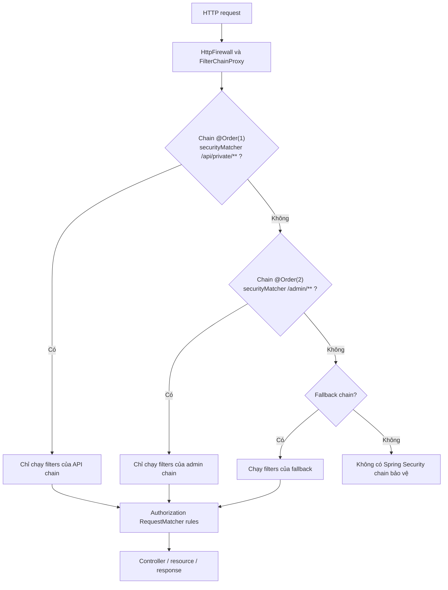

# Thay đổi request matcher và ngữ nghĩa đường dẫn

## 1. Bài toán: thay một matcher có thể thay đổi ranh giới truy cập

Trong module **SPRING_SECURITY_HTTP_PROTECTION**, người học áp dụng các lớp bảo vệ HTTP và trình duyệt của Spring Security: **CSRF, CORS, security headers, CSP, HSTS, HTTP firewall và bảo vệ session**, trên cả **Servlet** lẫn **Reactive/WebFlux**. Ở chương **Nâng cấp và tương thích**, bài **“Thay đổi request matcher và ngữ nghĩa đường dẫn”** tập trung vào một nguy cơ khó thấy trong quá trình nâng cấp: **mã cấu hình vẫn biên dịch nhưng tập request được bảo vệ có thể không còn giống trước**.

Hãy xét nền tảng học tập có các đường dẫn:

- `/assets/public/**` chứa JavaScript, CSS và ảnh **thật sự công khai**.
- `/account/**` chứa tài liệu cá nhân và thao tác cập nhật thông tin.
- `/admin/**` dành riêng cho quản trị viên.
- `/api/public/catalog` là catalog công khai cho một số origin đối tác.
- `/api/private/**` là API theo bearer token hoặc session tùy kiến trúc.
- `/isolated/**` phục vụ trang cần COOP/COEP; `/auth/popup-launcher` phục vụ popup OAuth.

Một developer chuyển cấu hình kế thừa:

```java
// CÚ PHÁP LEGACY: chỉ để đối chiếu.
http.authorizeRequests()
    .antMatchers("/admin/**").hasRole("ADMIN")
    .anyRequest().authenticated();
```

thành:

```java
// Cú pháp Servlet component-based hiện đại.
http.authorizeHttpRequests(auth -> auth
    .requestMatchers("/admin/**").hasRole("ADMIN")
    .anyRequest().authenticated());
```

Đây là hướng di trú phổ biến, nhưng **không đủ để chứng minh cùng ngữ nghĩa**, bởi matcher được chọn, cách nhìn đường dẫn và điều kiện request có thể thay đổi theo **Spring Security version, Spring MVC, Servlet mapping, path parser, proxy và HTTP firewall**.

Một lỗ hổng có thể chỉ xuất hiện tại `/admin` (không có dấu gạch chéo cuối), `/portal/admin/users` (qua reverse proxy), đường dẫn mã hóa bất thường, phương thức `POST` dùng chung prefix với file public, hoặc request được chuyển tiếp bằng `FORWARD`. Chúng đều là **request khác nhau về ngữ nghĩa bảo mật**.

### Mục tiêu học tập

Sau bài này, bạn có thể:

1. Phân biệt **matcher để chọn security chain** với **matcher để quyết định quyền trong chain**.
2. Hiểu và đối chiếu các họ matcher Servlet: Ant-style, Spring MVC, PathPattern, regex và custom RequestMatcher theo đúng version.
3. Phân tích ảnh hưởng của `contextPath`, `servletPath`, path-info, trailing slash, phương thức, percent-encoding và proxy rewrite.
4. Đánh giá ranh giới giữa **StrictHttpFirewall**, path matching và quyền truy cập nghiệp vụ.
5. Thiết kế matcher đúng cho Servlet/Reactive, CSRF, CORS, security headers và session mà không mở rộng `permitAll`.
6. Viết ma trận hồi quy **dương/âm** bằng MockMvc, WebTestClient và HTTP/browser thực trước khi phê duyệt nâng cấp.

## 2. Từ ngữ cần phân biệt trước khi sửa mã

| Thuật ngữ | Ý nghĩa trong thiết kế bảo vệ | Ví dụ |
| --- | --- | --- |
| **Origin** | Scheme + host + port của browser | `https://learn.example.com:443` |
| **Site** | Khái niệm khác origin, thường xét schemeful registrable domain | Hai subdomain cùng site nhưng khác origin |
| **Context path** | Phần đường dẫn nơi web application được mount | Ứng dụng chạy dưới `/learning` |
| **Servlet path** | Phần URL ánh xạ đến Servlet trong Servlet request | DispatcherServlet map dưới `/portal/*` |
| **Path info** | Phần còn lại tùy Servlet mapping | Phân biệt với servlet path khi matcher xét path |
| **Security chain matcher** | Quyết định chain có xử lý request không | `securityMatcher("/api/**")` |
| **Authorization request matcher** | Trong chain, quyết định rule quyền nào được áp dụng | `requestMatchers("/admin/**").hasRole("ADMIN")` |
| **Method matcher** | Giới hạn rule theo method HTTP | `requestMatchers(HttpMethod.GET, "/public/**")` |
| **HTTP firewall** | Kiểm soát một số request target bất thường trước/mở đường cho matcher | `StrictHttpFirewall` trong Servlet |
| **Handler mapping** | Cách MVC/WebFlux ánh xạ request đến controller | `@GetMapping("/admin/users")` |

Không đồng nhất các thành phần này. Ví dụ **CORS Origin** là header nguồn request phía browser; nó **không** phải path matcher dùng để phân quyền URL. `Cross-Origin-Resource-Policy` lại nằm trên response tài nguyên, không làm `securityMatcher` khớp hay không khớp.

### Ranh giới kiểm soát server vẫn là số một

Ngay cả khi matcher chặn `/admin/**` thành công, ứng dụng còn cần **authorization theo đối tượng và tenant**. `authenticated()` không đủ để bảo vệ `GET /account/files/{fileId}` nếu user A có thể thay ID để đọc file của user B.

## 3. Hai tầng chọn request: chain và rule

Có thể hình dung Servlet security:



**Một request được xử lý bởi chain khớp đầu tiên**, không cộng dồn CSRF, headers, authentication, session hay rules từ tất cả chain có thể khớp.

Trong cùng một authorization DSL, **thứ tự các rule cũng quan trọng**: rule match sớm hơn sẽ quyết định quyền. Do đó:

```java
.authorizeHttpRequests(auth -> auth
    .requestMatchers("/admin/**").hasRole("ADMIN")
    .anyRequest().authenticated())
```

khác với:

```java
// SAI VỀ Ý ĐỊNH: một rule rộng đã nhận mọi request trước rule admin.
.authorizeHttpRequests(auth -> auth
    .anyRequest().authenticated()
    .requestMatchers("/admin/**").hasRole("ADMIN"))
```

Cấu hình thứ hai có thể **bị API từ chối vì đặt rule sau `anyRequest`**, nhưng dù framework phát hiện lỗi hay không, không bao giờ được xem đây là tương đương thứ nhất.

### Một thay đổi dễ gây lỗ hổng

```java
// Ý định: chỉ bảo vệ các API /api/** bằng chain này.
.securityMatcher("/api/**")
.authorizeHttpRequests(auth -> auth
    .anyRequest().authenticated())
```

**Không thể đổi thành**:

```java
// KHÁC HOÀN TOÀN: nếu ở chain rộng, có thể cho mọi API vào permitAll.
.authorizeHttpRequests(auth -> auth
    .requestMatchers("/api/**").permitAll()
    .anyRequest().authenticated())
```

Matcher ở cấp chain giới hạn **phạm vi của tất cả filters** trong chain; matcher trong authorization chỉ tạo **một điều kiện quyết định quyền**.

## 4. Những API matcher thay đổi khi nâng cấp

Trong cấu hình Servlet cũ có thể gặp:

```java
// CÚ PHÁP LEGACY, không dành cho source của Spring Security 6+.
.antMatchers("/admin/**")
.mvcMatchers("/courses/**")
.regexMatchers("/api/v[0-9]+/.*")
```

Với các dòng component-based:

```java
.authorizeHttpRequests(auth -> auth
    .requestMatchers("/admin/**").hasRole("ADMIN")
    .requestMatchers(HttpMethod.GET, "/courses/**").authenticated()
    .anyRequest().denyAll())
```

### 4.1. Mốc kiến trúc quan trọng

| Dòng phiên bản | Điều cần hiểu |
| --- | --- |
| **5.x** | Có thể dùng `WebSecurityConfigurerAdapter`, `authorizeRequests` và các matcher builder lịch sử; dự án có thể phụ thuộc Ant/MVC semantics. |
| **5.7–5.8** | Adapter bị deprecated từ 5.7; giai đoạn chuẩn bị các bean `SecurityFilterChain` và DSL mới. |
| **6.x** | Adapter bị loại bỏ; `authorizeHttpRequests` và `requestMatchers` là đường cấu hình thông dụng; cách chọn matcher tùy version và môi trường MVC. |
| **7.x hoặc dòng mới hơn** | Các API deprecate tiếp tục có thể bị loại; việc dùng PathPattern và tên constructor/builder phải được đối chiếu **Javadoc/migration guide đúng release**. |

**Không gán một mốc phiên bản cho từng loại matcher nếu chưa xác minh patch/minor thật.** Tên `requestMatchers` không đảm bảo nó dùng cùng implementation ở tất cả các bản Spring Security; mã legacy đôi khi dùng Ant trong khi cấu hình mới chọn matcher phù hợp môi trường MVC hoặc PathPattern.

### 4.2. Phải kiểm tra dependency đã resolve

Ví dụ lệnh cho dự án Maven/Gradle do người học quản lý:

```bash
./mvnw dependency:tree -Dincludes=org.springframework.security

./gradlew dependencyInsight \
  --dependency spring-security-web \
  --configuration runtimeClasspath
```

Kiểm tra thêm Spring Framework, Spring MVC/WebFlux, Boot và Servlet container. Không dựa vào mỗi dòng `spring-boot-starter-security` trong build file để suy ra API runtime.

## 5. Ant-style, MVC, PathPattern, regex: khác nhau ở đâu?

Các họ matcher có thể khác nhau ở **nguồn path, pattern syntax, dấu phân cách, biến đường dẫn, trailing slash, parser và cách kết hợp request method**.

| Họ matcher | Mục đích phổ biến | Điểm cần thử |
| --- | --- | --- |
| **Ant-style** | Pattern với `*`, `**` theo Ant semantics | Một/đa segment, slash cuối, servlet path và bản deprecate. |
| **MVC-aware** | Ghép ngữ nghĩa request mapping của Spring MVC | `HandlerMappingIntrospector`, servlet mapping, context và parser MVC. |
| **PathPattern** | Kiểu parse đường dẫn theo segment của framework hiện đại | `**`, `{variable}`, path normalization, trailing separators. |
| **Regex** | Trường hợp cần pattern chính quy cụ thể | Anchor, metacharacters, query/path và method; đừng dùng regex quá rộng. |
| **Custom RequestMatcher** | Điều kiện tùy chỉnh đã được duyệt | Luôn xét method/path/tenant đúng nghĩa; tránh tin header người dùng kiểm soát. |

**Chú ý:** sự hiện diện của Spring MVC trên classpath có thể ảnh hưởng tới việc `requestMatchers(String...)` chọn matcher bên dưới ở một số dòng Spring Security. Ở những dòng khác, cấu hình PathPattern có thể là hướng ưu tiên hoặc bắt buộc. Vì thế hãy xác minh **implementation thật** trong phiên bản được resolve, không suy từ tên DSL.

### 5.1. Ant pattern thông dụng

```text
/admin/*       → thường diễn đạt một mức segment sau /admin
/admin/**      → thường diễn đạt một hoặc nhiều mức đường dẫn
/admin/{id}    → biến đường dẫn chỉ có nghĩa như parser hỗ trợ
```

Đây là **mô tả ý định**, không phải khẳng định mọi implementation đều xử lý `/admin`, `/admin/` và slash mã hóa hệt nhau. Hãy test path cụ thể bằng engine/version thật.

### 5.2. PathPattern có quy tắc riêng

Ở path parser theo segment, `**` thường có điều kiện vị trí và ngữ nghĩa khác Ant ở những tình huống nhất định. Một pattern được chấp nhận bởi Ant có thể không hợp lệ khi biên dịch sang PathPattern.

Ví dụ một cấu hình dùng wildcard ở giữa pattern:

```text
/files/**/download
```

cần được kiểm tra lại thay vì mặc định cả hai parser đều cho phép và match giống nhau. Với PathPattern theo quy tắc phổ biến, `**` dành cho phần cuối của pattern; nếu định tuyến có độ sâu bất kỳ ở giữa, nên thiết kế route khác hoặc matcher rõ ràng hơn.

### 5.3. Regex không phải đường tắt an toàn

Một regex thiếu anchor hoặc quá rộng có thể khớp URL ngoài ý định. Một mẫu `.*admin.*` không có nghĩa “chỉ phân quyền `/admin/**`”. Regex còn phải xử lý literal dấu chấm, percent-encoding và nguồn request path mà implementation đọc.

Nếu phải dùng regex, ghi rõ:
- Chuỗi đầu vào được match là gì.
- Regex match toàn chuỗi hay một phần theo API đó.
- Method nào được tính.
- Kịch bản dương/âm nào chứng minh không mở rộng URL.
- Vị trí matcher trong chain và lý do Ant/MVC/PathPattern không đủ.

## 6. Context path, servlet path và path info

Cấu hình proxy và Servlet có thể biến request URL thành nhiều đoạn khác nhau:

```text
Public URL:
https://learn.example.com/learning/portal/admin/users

Reverse proxy:
  public prefix /learning → ứng dụng ở context path /learning
  hoặc rewrite /learning → /

Servlet mapping:
  DispatcherServlet có thể map /, hoặc /portal/*

Request fields có thể liên quan:
  contextPath = /learning
  servletPath = /portal
  pathInfo    = /admin/users
```

Các giá trị trên là **kịch bản giả định**, không phải kết quả của mọi servlet mapping. Matcher phải được đặt theo **thực tế request mà Spring Security nhìn thấy**, không mặc định string URL người dùng nhập ngoài browser giống hệt path cần match.

### 6.1. Sự khác biệt giữa URL hiển thị và URL được match

Nếu gateway nhận `/learning/admin/users` rồi rewrite thành `/admin/users` cho app, đặt matcher ở `/learning/admin/**` trong ứng dụng có thể khiến rule **không bao giờ khớp**. Ngược lại, app mount dưới servlet mapping riêng có thể cần matcher nhận biết `servletPath`.

Một thay đổi hạ tầng cũng có thể làm rule chưa sửa code nhưng **đổi hiệu lực**. Vì vậy mỗi lần thay path prefix, ingress, servlet mapping hoặc gateway cần được kiểm thử cùng với security matchers.

### 6.2. MVC-aware matcher trong codebase phù hợp

Ở những dòng Spring Security hỗ trợ `MvcRequestMatcher`, ví dụ cấu hình một Servlet mapping rõ ràng:

```java
// Ví dụ dành cho version còn hỗ trợ MvcRequestMatcher.
MvcRequestMatcher.Builder mvc =
    new MvcRequestMatcher.Builder(handlerMappingIntrospector)
        .servletPath("/portal");

RequestMatcher adminRule = mvc.pattern("/admin/**");
```

Biến `handlerMappingIntrospector` là bean `HandlerMappingIntrospector` thuộc **đúng MVC ApplicationContext**; cần import các lớp matcher của version. **Đừng copy snippet này vào 7.x nếu lớp đã bị loại trong bản đang dùng**: chọn matcher PathPattern hoặc API tương ứng từ migration guide của version đích.

### 6.3. Khi servlet path có nhiều giá trị

Nếu ứng dụng có nhiều DispatcherServlet hoặc Servlet khác nhau, `requestMatchers(String...)` có thể không đủ rõ để Spring chọn semantics bạn muốn; một số phiên bản còn yêu cầu matcher cụ thể để tránh mơ hồ. Hãy:
1. Liệt kê Servlet registrations.
2. Xác định mọi `servletPath` và URL mapping.
3. Chọn matcher tường minh theo API có sẵn.
4. Test cả URL thuộc servlet chính lẫn servlet phụ.
5. Xác minh **fallback deny/authorization** khi request rơi ngoài mapping dự kiến.

Không giải quyết bằng rule `"/**".permitAll()` để “đỡ lỗi” các servlet không rõ path.

## 7. Trailing slash: một ký tự có thể đổi quyền

Cần phân biệt ít nhất:

```text
/admin
/admin/
/admin/users
/admin/users/
/admin//users
```

Một số phiên bản Spring Framework/Spring MVC đã thay đổi lựa chọn mặc định về **optional trailing separator matching**, vì xem `/x` và `/x/` là tương đương đôi khi làm phát sinh **authorization mismatch** giữa handler mapping và security matcher.

Không khẳng định một pattern `/admin/**` trong mọi engine/version chắc chắn khớp `/admin`. Hãy test:

| URL | Điều kỳ vọng phải quyết định trước | Test |
| --- | --- | --- |
| `/admin` | Trang quản trị gốc có được bảo vệ không? | Anonymous/non-ADMIN bị chặn. |
| `/admin/` | Route có redirect/404/handler? | Không được mở vượt rule. |
| `/admin/users` | ADMIN-only. | User thường 403. |
| `/admin/users/` | Có handler hay redirect? | Không bypass admin policy. |
| `/admin//users` | Firewall/proxy xử lý ra sao? | Không bypass, ghi kết quả thực. |

### 7.1. Cách sửa tốt hơn “cho slash tùy ý”

- Chọn một canonical URL hoặc redirect có kiểm soát trước khi xử lý nghiệp vụ.
- Viết route controller và security rule cùng contract.
- Khi cần chấp nhận cả `/admin` lẫn `/admin/`, đặt cả hai rule nếu matcher/version yêu cầu.
- Đặt authorization theo object/service ở backend cho dữ liệu quan trọng.
- Test end-to-end qua gateway để tránh app và proxy diễn giải path khác nhau.

Không thêm `"/**".permitAll()` để cứu các URL bị redirect ngoài dự kiến.

## 8. Request method cũng là một phần của matcher

Rule này:

```java
.requestMatchers("/assets/public/**").permitAll()
```

thường mở **mọi method** phù hợp đường dẫn, không chỉ GET. Nếu cùng prefix có upload/delete handler, đây là lỗ hổng phạm vi.

Nên nêu method tường minh:

```java
.authorizeHttpRequests(auth -> auth
    .requestMatchers(HttpMethod.GET, "/assets/public/**").permitAll()
    .requestMatchers(HttpMethod.HEAD, "/assets/public/**").permitAll()
    .requestMatchers("/assets/public/**").denyAll()
    .anyRequest().authenticated())
```

**Quy tắc deny** phải đến sau GET/HEAD cho phép trong cùng chain. Dù controller không hiện có POST, không nên dựa vào việc `404/405` tình cờ của handler như ranh giới authorization; các endpoint tương lai có thể xuất hiện dưới cùng prefix.

### 8.1. HEAD và OPTIONS

- `HEAD` có semantics liên quan GET ở HTTP/Servlet MVC; kiểm tra cả route handler và matcher thực tế.
- `OPTIONS` cho preflight CORS cần xử lý **theo CORS processor**, không phải `permitAll()` mọi OPTIONS toàn site.
- `TRACE` là safe method theo định nghĩa HTTP nhưng có thể bị firewall/container chặn; không dùng TRACE để thay GET/POST.
- Method bị proxy thay đổi/override phải được đánh giá riêng, không mặc định security matcher nhìn cùng method mà backend sử dụng.

### 8.2. Safe methods không được tạo side effect

Nếu `GET /account/delete?id=123` thay đổi dữ liệu, việc matcher/CSRF coi GET là safe không làm nó an toàn. Sửa ngữ nghĩa endpoint thành mutation đúng method và thêm CSRF/session authorization.

## 9. URL encoding, normalization và HTTP firewall

Một URL có thể được biểu diễn theo nhiều cách:

```text
/admin/users
/admin/%75sers
/admin/%2e%2e/account
/admin/%2Fusers
/admin%5Cusers
/admin;mode=read/users
/admin//users
/admin/./users
```

Các dạng trên **không được mặc định xem là tương đương hoặc hợp lệ**. Servlet container, reverse proxy, Spring Security firewall và Spring MVC path parser có thể xử lý chúng khác nhau, hoặc từ chối trước khi vào controller.

### 9.1. Vì sao có rủi ro security bypass?

Giả sử:
- Proxy decode hoặc normalize một lần.
- Security matcher so sánh một representation.
- Controller/router sử dụng representation khác sau lần decode nữa.

Nếu matcher nghĩ request là `/public/**` nhưng handler cuối thực hiện `/admin/delete`, đã xuất hiện **mismatch giữa ranh giới quyền và route nghiệp vụ**. Đó là lý do **canonicalization, HTTP firewall và handler mapping phải nhất quán**.

### 9.2. Vai trò của StrictHttpFirewall

Trong Servlet Spring Security, `StrictHttpFirewall` thường chặn các loại request target hoặc HTTP method/header bất thường mà việc diễn giải mâu thuẫn có thể nguy hiểm, như một số encoded slash/backslash, semicolon và path không bình thường. **Tập quy tắc chính xác phải đối chiếu version/cấu hình**.

Không nên:
- Tắt hoàn toàn firewall chỉ để một URL legacy chạy.
- Cho phép encoded slash hoặc semicolon đại trà mà không rõ route.
- Dùng dấu wildcard rộng để “bù” cho normalization.
- Coi một mã lỗi cụ thể từ firewall là bất biến trên mọi deployment.

### 9.3. Quy trình xử lý lỗi RequestRejectedException

1. Thu thập URL mẫu **đã ẩn dữ liệu nhạy cảm**, method và endpoint mong đợi.
2. Xác định request bị proxy, container, firewall hay MVC router từ chối.
3. Kiểm tra có phải client tạo URL sai hay không.
4. Sửa URL/route chuẩn trước khi xét ngoại lệ firewall.
5. Nếu buộc phải nới một rule, định nghĩa phạm vi và nguy cơ rõ ràng, kiểm tra path không trở thành lối vượt quyền.
6. Test lại qua hạ tầng cuối, không chỉ MockMvc.

**Không suy mã `400`, `403` hay `500` cố định** cho mọi `RequestRejectedException`; cách chuyển exception thành HTTP response phụ thuộc handler/phiên bản/hạ tầng.

## 10. Matrix variables, dấu chấm phẩy và URI parameters

Spring MVC có thể hỗ trợ **matrix variables** như:

```text
/products;color=red;size=M/42
```

Nhưng các ứng dụng Spring Security Servlet có thể dùng firewall mặc định chặn `;` tùy cấu hình. Không được mặc định `@MatrixVariable` sẽ hoạt động chỉ vì MVC routing cho phép cú pháp.

Nếu sản phẩm thật sự cần matrix parameters:
- Xác định rõ business requirement.
- Đối chiếu HTTP firewall và MVC path parsing.
- Xem request từ reverse proxy có giữ dấu `;` không.
- Kiểm tra mọi route bảo vệ theo owner/role trên URL có matrix segments.
- Chỉ cho phép hành vi đã được duyệt với tests dương/âm.

Ví dụ một tài nguyên `/admin;mode=print/users` **không** được vượt `/admin/**` policy nhờ sự khác biệt cách một tầng loại semicolon và một tầng giữ nó.

## 11. Phân biệt match theo đường dẫn với match theo quyền dữ liệu

Một URL `/tenants/{tenantId}/reports/{reportId}` có thể được match đúng:

```java
.authorizeHttpRequests(auth -> auth
    .requestMatchers("/tenants/**").authenticated()
    .anyRequest().denyAll())
```

Nhưng **authenticated** chỉ xác nhận có user, không chứng minh user thuộc tenant trong URL.

Ví dụ thiết kế service-level:

```java
public ReportDto getReport(UUID tenantId, UUID reportId,
                           Authentication currentUser) {
    permissionService.requireReportRead(
        currentUser, tenantId, reportId);
    return reportService.load(tenantId, reportId);
}
```

Đoạn là **minh họa yêu cầu quyền**, các interface/class phải được ứng dụng triển khai. Khi nâng cấp path matcher, test cùng:
1. User thuộc tenant A đọc report của A được phép.
2. User thuộc tenant B cố đọc report A bị từ chối.
3. User tự sửa `tenantId` trên URL không bỏ qua kiểm tra backend.
4. URL encoded hoặc trailing slash không làm hệ thống lấy nhầm tenant.
5. API không rò thông tin report qua cache/CDN.

Không lấy `/tenants/**.authenticated()` làm bằng chứng đã kiểm tra multi-tenant isolation.

## 12. Custom RequestMatcher: khi nào nên dùng, khi nào không?

Một matcher tùy chỉnh có thể xét method, path hoặc thuộc tính đã xác thực từ server. Tuy nhiên, viết custom matcher tăng khả năng **bất nhất với handler mapping**.

Ví dụ interface Servlet:

```java
import jakarta.servlet.http.HttpServletRequest;
import org.springframework.security.web.util.matcher.RequestMatcher;

public final class GetOnlyPublicPathMatcher
        implements RequestMatcher {

    @Override
    public boolean matches(HttpServletRequest request) {
        return "GET".equals(request.getMethod())
            && "/api/public/catalog".equals(
                request.getServletPath());
    }
}
```

Đây là mẫu học tập dùng để chỉ ra **nơi developer quyết định semantics**; nó **không xử lý** context/servlet mapping phức tạp, `pathInfo`, path normalization hay URL rewrite. Không nên dùng nguyên lớp này trong ứng dụng có DispatcherServlet không map tại `/`.

### Một custom matcher an toàn cần gì?

- Đọc request attributes có nguồn gốc rõ và phù hợp servlet mapping.
- Kết hợp method trước khi cho public.
- Không tin `X-Forwarded-*` từ client ngoài nếu proxy không được tin cậy.
- Không lấy `tenantId` do client khai để quyết định quyền mà thiếu xác minh.
- Có tests với encoded/slash/semicolon/headers để chứng minh không lộ route.
- Ưu tiên matcher tiêu chuẩn của version khi đáp ứng nhu cầu.

**Một custom matcher trả `true` có thể chỉ dẫn đến một rule `permitAll`; lỗi ở đây là lỗi kiểm soát truy cập, không đơn thuần lỗi routing.**

## 13. Mẫu Servlet một chain: luật công khai hẹp, quản trị chặt

Ví dụ component-based Servlet sau giả định ứng dụng dùng form login và các handler đã tồn tại:

```java
import org.springframework.context.annotation.Bean;
import org.springframework.context.annotation.Configuration;
import org.springframework.http.HttpMethod;
import org.springframework.security.config.annotation.web.builders.HttpSecurity;
import org.springframework.security.config.annotation.web.configuration.EnableWebSecurity;
import org.springframework.security.web.SecurityFilterChain;
import org.springframework.security.web.header.writers.StaticHeadersWriter;

@Configuration
@EnableWebSecurity
public class MatcherAwareWebSecurityConfig {

    @Bean
    SecurityFilterChain web(HttpSecurity http) throws Exception {
        return http
            .authorizeHttpRequests(auth -> auth
                .requestMatchers("/login", "/error").permitAll()
                .requestMatchers(HttpMethod.GET,
                                 "/assets/public/**").permitAll()
                .requestMatchers(HttpMethod.HEAD,
                                 "/assets/public/**").permitAll()
                .requestMatchers("/assets/public/**").denyAll()
                .requestMatchers("/admin", "/admin/**").hasRole("ADMIN")
                .requestMatchers("/account", "/account/**")
                    .authenticated()
                .anyRequest().authenticated())
            .formLogin(form -> form
                .loginPage("/login").permitAll())
            .headers(headers -> headers
                .frameOptions(frame -> frame.deny())
                .addHeaderWriter(new StaticHeadersWriter(
                    "Referrer-Policy",
                    "strict-origin-when-cross-origin")))
            .build();
    }
}
```

**Tính chất:**
- Rule `GET/HEAD` public được xét trước rule `/assets/public/**.denyAll()` cho các method khác.
- Root `/admin` được khai báo riêng để giảm lệ thuộc vào giả định wildcard.
- `/account` và `/account/**` đều yêu cầu authentication.
- Fallback `anyRequest().authenticated()` bảo vệ các URL chưa được nhóm cụ thể.
- Security headers mặc định **không bị vô hiệu hóa**.
- Form login dùng trang riêng `/login` nên ứng dụng phải phục vụ GET route đó.

**Điều còn thiếu:** user database, PasswordEncoder, tenant/object authorization, role/permission model, CSP đầy đủ, CORS, OAuth2 Login và cache/private asset policy. Mã chỉ cho thấy cách đặt matcher; không phải cấu hình bảo mật production đầy đủ.

### Tại sao chưa dùng `anyRequest().denyAll()`?

`denyAll` có thể là lựa chọn fail-closed tốt trong một API có danh sách route được quản lý chặt, nhưng ví dụ web này có nhiều trang nghiệp vụ; dùng `authenticated` cho fallback là một policy minh họa. Khi hệ thống yêu cầu default deny, hãy chọn `denyAll` rồi **liệt kê các route được phép** và kiểm tra login/health/error handling.

## 14. Nhiều Servlet chains: thứ tự và vùng phủ

Nếu có API bearer-only độc lập với web session, nên tránh một chain khổng lồ với nhiều `csrf.disable` và `permitAll` khó kiểm soát.

```java
import org.springframework.context.annotation.Bean;
import org.springframework.context.annotation.Configuration;
import org.springframework.core.annotation.Order;
import org.springframework.security.config.Customizer;
import org.springframework.security.config.annotation.web.builders.HttpSecurity;
import org.springframework.security.config.http.SessionCreationPolicy;
import org.springframework.security.web.SecurityFilterChain;

@Configuration
public class SeparateChainsConfig {

    @Bean
    @Order(1)
    SecurityFilterChain bearerApi(HttpSecurity http)
            throws Exception {
        return http
            .securityMatcher("/api/private/**")
            .authorizeHttpRequests(auth -> auth
                .anyRequest().authenticated())
            .oauth2ResourceServer(oauth -> oauth
                .jwt(Customizer.withDefaults()))
            .sessionManagement(session -> session
                .sessionCreationPolicy(SessionCreationPolicy.STATELESS))
            .csrf(csrf -> csrf.disable())
            .build();
    }

    @Bean
    @Order(2)
    SecurityFilterChain remainingWeb(HttpSecurity http)
            throws Exception {
        return http
            .authorizeHttpRequests(auth -> auth
                .requestMatchers("/login", "/error").permitAll()
                .requestMatchers("/admin", "/admin/**").hasRole("ADMIN")
                .anyRequest().authenticated())
            .formLogin(Customizer.withDefaults())
            .build();
    }
}
```

**Đây là phương án thay thế mục 13**, không đăng ký cả hai fallback config trong cùng ứng dụng.

**Điều kiện nghiêm ngặt:** chain `/api/private/**` giả định **chỉ chấp nhận bearer token**, có resource-server module và JWT decoder được cấu hình; không sử dụng session cookie hoặc ambient credentials trên các endpoint đó. Chỉ khi threat model chứng minh phù hợp mới tắt CSRF **ở chain hẹp này**. Nếu API dùng session, không copy dòng `csrf.disable()`.

### 14.1. Cẩn thận tại URL gốc và đường dẫn “gần giống”

Một matcher `/api/private/**` có thể không bắt chính xác những URL:
- `/api/private` không slash.
- `/api/private/`.
- `/api/private-legacy`.
- `/api/private%2Fme` nếu request được container chấp nhận và decode khác.

Nếu một URL không vào bearer chain mà vào fallback web, người dùng có cookie session **có thể truy cập theo cơ chế không mong muốn**. Giải pháp thường là **bao phủ chính xác route root + descendants**, xây rõ path contract, và test fallback phải từ chối khi không đúng auth mode. Đừng dựa vào tên prefix để coi mọi biến thể đã được khóa.

### 14.2. Chain không hợp nhất

Không có chuyện request `/api/private/me` nhận `oauth2ResourceServer` của chain 1 nhưng `CSRF` và `headers` tùy chỉnh của chain 2. Chỉ chain đầu khớp được dùng. Nếu muốn một header baseline cho cả hai, đặt vào từng chain hoặc lớp response khác đã được xác minh, không dựa vào “kế thừa” từ fallback.

## 15. WebFlux: PathPatternParserServerWebExchangeMatcher và authorizeExchange

Reactive dùng `ServerHttpSecurity` và matcher cho `ServerWebExchange`; không copy `HttpSecurity` hoặc `RequestMatcher` Servlet sang WebFlux.

### 15.1. Một chain Reactive có authorization theo method và path

```java
import org.springframework.context.annotation.Bean;
import org.springframework.context.annotation.Configuration;
import org.springframework.http.HttpMethod;
import org.springframework.security.config.annotation.web.reactive.EnableWebFluxSecurity;
import org.springframework.security.config.web.server.ServerHttpSecurity;
import org.springframework.security.web.server.SecurityWebFilterChain;
import org.springframework.security.web.server.header.StaticServerHttpHeadersWriter;

@Configuration
@EnableWebFluxSecurity
public class ReactiveMatcherSecurityConfig {

    @Bean
    SecurityWebFilterChain web(ServerHttpSecurity http) {
        return http
            .authorizeExchange(auth -> auth
                .pathMatchers("/login", "/error").permitAll()
                .pathMatchers(HttpMethod.GET,
                              "/assets/public/**").permitAll()
                .pathMatchers(HttpMethod.HEAD,
                              "/assets/public/**").permitAll()
                .pathMatchers("/assets/public/**").denyAll()
                .pathMatchers("/admin", "/admin/**").hasRole("ADMIN")
                .anyExchange().authenticated())
            .headers(headers -> headers
                .addWriter(new StaticServerHttpHeadersWriter(
                    "Referrer-Policy",
                    "strict-origin-when-cross-origin")))
            .build();
    }
}
```

Đây là cấu hình Reactive minh họa. Cần tích hợp **authentication** (form login, OAuth2/JWT hoặc custom) theo nghiệp vụ; nếu không, `authenticated()` không tự đăng nhập cho người dùng.

### 15.2. Nhiều chains Reactive

```java
@Bean
@Order(1)
SecurityWebFilterChain bearerApi(ServerHttpSecurity http) {
    return http
        .securityMatcher(
            new PathPatternParserServerWebExchangeMatcher(
                "/api/private/**"))
        .authorizeExchange(auth -> auth
            .anyExchange().authenticated())
        .oauth2ResourceServer(oauth -> oauth
            .jwt(Customizer.withDefaults()))
        .csrf(ServerHttpSecurity.CsrfSpec::disable)
        .build();
}
```

Đây là **snippet**, cần `Order`, `PathPatternParserServerWebExchangeMatcher`, `Customizer` và JWT configuration tương ứng. Điều kiện bearer-only/threat model của việc tắt CSRF **vẫn áp dụng** như Servlet. Đặt fallback `SecurityWebFilterChain` sau chain cụ thể.

### 15.3. Reactive path parsing cũng cần tests

Một `pathMatchers("/admin/**")` không được mặc định có cùng slash/matrix/encoded behavior với Servlet Ant matcher của dự án cũ. Server HTTP/WebFlux path parser và router có thể khác. Test mọi path thực tế trên **server Reactive thật** khi có reverse proxy.

## 16. CSRF matcher: một đổi scope có thể vô hiệu hóa phòng vệ

CSRF protection thường bật cho request thay đổi trạng thái khi cấu hình security web thông dụng còn nguyên. Matcher CSRF cũng sử dụng ngữ nghĩa request path/method:

```java
// Servlet: ví dụ ngoại lệ cho webhook được kiểm tra bằng chữ ký.
.csrf(csrf -> csrf
    .ignoringRequestMatchers("/webhooks/signed/**"))
```

Nếu `/webhooks/signed/**` bị mở rộng bởi parser mới hoặc wildcard bất ngờ, **nhiều mutation khác có thể mất CSRF protection**. Nếu thu hẹp quá mức, webhook hợp lệ lại nhận `403`.

Không copy exception cũ từ:
 
```java
// Legacy, chỉ để đối chiếu.
.csrf().ignoringAntMatchers("/api/**")
```

sang mọi API mới mà không phân biệt **cookie session** và **bearer-only**. CORS không thay CSRF; một cross-site request có thể gây side effect dù attacker không được đọc response.

### 16.1. Ma trận CSRF phải có cả method và path

| Request | CSRF kỳ vọng nếu session/cookie |
| --- | --- |
| `GET /account` | Không yêu cầu token vì GET không được gây mutation. |
| `POST /account/email` | Token hợp lệ và quyền owner. |
| `DELETE /account/photo` | Token hợp lệ và quyền owner. |
| `POST /webhooks/signed/event` | Nếu bỏ CSRF phải có signature/timestamp/replay defense thật. |
| `POST /api/private/update` | Không được bỏ nếu endpoint vẫn chấp nhận ambient session credentials. |
| `OPTIONS /api/public/catalog` | Preflight xử lý qua CORS, không bị auth/CSRF chặn sai. |

### 16.2. Token handling sau migration

Một SPA dùng `XSRF-TOKEN`/`X-XSRF-TOKEN` có thể bị `403` khi chuyển Spring Security 5.x→6.x vì token deferred/masking/request handler thay đổi. Đó **không nhất thiết là matcher sai**. Phải phân biệt:
- CSRF matcher có áp dụng cho request không?
- Token có được tạo và phân phối không?
- Token raw/masked đang được dùng đúng handler không?
- Session/login/logout làm token rotate ra sao?

Chỉ sau khi xác định lớp lỗi mới sửa cấu hình. Không xóa CSRF rule để “sửa” một lỗi token lifecycle.

## 17. CORS preflight: matcher theo URL và method không được tạo login loop

Một request:

```http
OPTIONS /api/public/catalog HTTP/1.1
Origin: https://dashboard.partner.example
Access-Control-Request-Method: GET
Access-Control-Request-Headers: x-client-version
```

thường không có session cookie, nên nếu authorization xử lý nó như request cần login trước CORS, response có thể là `302`/`401` thay vì preflight hợp lệ.

**Đúng hướng:** dùng CORS processor/source cấu hình trên đúng route/chain, trước khâu authentication có thể cản preflight; không cấp `permitAll` vô điều kiện cho mọi OPTIONS rồi coi CORS đã đủ.

### Ví dụ CORS source cho Servlet

```java
import java.util.List;
import org.springframework.web.cors.CorsConfiguration;
import org.springframework.web.cors.CorsConfigurationSource;
import org.springframework.web.cors.UrlBasedCorsConfigurationSource;

CorsConfigurationSource publicCatalogCors() {
    CorsConfiguration c = new CorsConfiguration();
    c.setAllowedOrigins(List.of(
        "https://dashboard.partner.example"));
    c.setAllowedMethods(List.of("GET", "OPTIONS"));
    c.setAllowedHeaders(List.of("X-Client-Version"));
    c.setAllowCredentials(false);

    UrlBasedCorsConfigurationSource source =
        new UrlBasedCorsConfigurationSource();
    source.registerCorsConfiguration("/api/public/**", c);
    return source;
}
```

Gắn source vào phù hợp:

```java
.cors(cors -> cors.configurationSource(publicCatalogCors()))
```

Đây là **đoạn trích**, ứng dụng thật cần bean và injection phù hợp, cùng rule authorization GET-only. Với Reactive dùng `org.springframework.web.cors.reactive.UrlBasedCorsConfigurationSource`, không copy source Servlet.

### CORS và quyền dữ liệu là hai việc riêng

`Access-Control-Allow-Origin` cho phép browser **đọc response** trong request CORS; nó không thay authentication/authorization, không làm CSRF biến mất, không quyết định URL có khớp `requestMatchers` không. Không bật wildcard cùng credentials cho API private.

## 18. Security headers theo chain: matcher sai có thể làm mất HSTS/XFO/CSP

Khi request rơi vào chain khác, **header writers cũng khác**. Ví dụ:
- Chain `/isolated/**` phát `Cross-Origin-Opener-Policy: same-origin` và `Cross-Origin-Embedder-Policy: require-corp`.
- Chain `/auth/popup-launcher` có thể cần `same-origin-allow-popups` nếu flow OAuth còn phụ thuộc opener.
- Chain `/account/**` phát `Referrer-Policy` phù hợp, XFO/CSP và cache private.
- Chain public asset cho phép CORP `cross-origin` **chỉ** khi resource thực sự public.

Nếu matcher `/isolated/**` vô tình khớp `/isolated-legacy/**` hoặc không khớp root `/isolated`, kết quả browser có thể đổi đáng kể.

### 18.1. Ví dụ Servlet theo route

```java
@Bean
@Order(1)
SecurityFilterChain isolated(HttpSecurity http) throws Exception {
    return http
        .securityMatcher("/isolated/**")
        .authorizeHttpRequests(auth -> auth
            .anyRequest().authenticated())
        .headers(headers -> headers
            .addHeaderWriter(new StaticHeadersWriter(
                "Cross-Origin-Opener-Policy", "same-origin"))
            .addHeaderWriter(new StaticHeadersWriter(
                "Cross-Origin-Embedder-Policy", "require-corp")))
        .build();
}
```

Đây chỉ là một **chain bổ sung minh họa**, phải có fallback chain khác nếu muốn bảo vệ các route khác. Với route root, thêm matcher rõ nếu version/pattern yêu cầu.

### 18.2. HSTS không phụ thuộc path đơn thuần

HSTS được browser chấp nhận từ kết nối HTTPS hợp lệ. Việc một test HTTP không thấy `Strict-Transport-Security` không chứng minh matcher đã sai. Kiểm tra:
- Request có thực sự đi qua chain chưa?
- Header writer còn bật không?
- MockMvc có `secure(true)` hoặc production đi qua HTTPS hợp lệ không?
- Reverse proxy đã cấu hình trusted forwarded headers chưa?
- Proxy/CDN có thêm header trùng hay sai giá trị không?

Không dùng `headers(headers -> headers.disable())` để sửa một path mismatch, vì sẽ làm mất nhiều phòng vệ.

### 18.3. Header đúng response mới có hiệu lực

`Cross-Origin-Resource-Policy` thuộc **response tài nguyên**; CSP `frame-ancestors`/XFO thuộc **response trang bị nhúng**; COOP/COEP thường nằm trên **document response**. Một matcher header ở HTML không tự sửa response ảnh do CDN phục vụ.

## 19. `web.ignoring`, `permitAll` và public asset

Trong Servlet:

```java
// Legacy: bỏ qua security chain.
web.ignoring().antMatchers("/assets/public/**");
```

không tương đương:

```java
// Public trong chain, headers vẫn có cơ hội được phát.
.authorizeHttpRequests(auth -> auth
    .requestMatchers(HttpMethod.GET,
                     "/assets/public/**").permitAll()
    .anyRequest().authenticated())
```

Một đường dẫn bị ignore có thể **không nhận `nosniff`/HSTS/XFO do Spring Security phát**, ngay cả khi Spring MVC vẫn phục vụ nó.

Một số static assets được CDN phục vụ bên ngoài Spring; trong trường hợp đó điều chỉnh matcher Java **không có tác dụng** với response CDN. Kiểm tra upstream response owner trước khi sửa.

### Không dùng `permitAll` như mã lỗi sửa authorization

Nếu `/public/**` vô tình bao gồm `/public/user-export`, một `permitAll` rộng có thể làm lộ dữ liệu. Trước khi thêm prefix public:
1. Chứng minh tất cả route/handler trong prefix là public.
2. Giới hạn method.
3. Có test cho file riêng và đường dẫn gần giống.
4. Ghi rõ owner và policy cache.
5. Kiểm tra future routes không tự thừa hưởng `permitAll`.

## 20. DispatcherType: FORWARD và ERROR có thể thay đổi luồng kiểm tra

Servlet request có thể đến hoặc được chuyển tiếp dưới các dispatcher types như `REQUEST`, `FORWARD`, `ERROR` và `ASYNC`. Khi migration, **authorization hoặc filter chain có thể được áp dụng ở dispatch khác** tùy cấu hình/security registration.

Ví dụ:
- Controller xử lý `/account` rồi forward tới view.
- Request vào một URL gây lỗi được dispatch đến `/error`.
- Framework tạo async dispatch để hoàn tất response.

Một số ví dụ tài liệu cho phép cấu hình dispatcher type với `dispatcherTypeMatchers`, nhưng **không nên copy một rule `FORWARD/ERROR.permitAll()` rộng mà không xem trust model**. Bảo vệ đối tượng vẫn phải được kiểm tra trước khi trả nội dung nhạy cảm.

### Kiểm thử cần có

- Trang login không gây redirect loop.
- Error handler không lộ stack trace, thông tin user/tenant hoặc nội dung private.
- FORWARD đến view nội bộ không mở `/admin/**` vô ý.
- Async response không bỏ qua headers/session context theo cách sai.
- Security chain được cấu hình cho dispatcher types phù hợp theo version/container.

Nếu một bản nâng cấp làm request đến `/error` bị 403, cần phân tích **dispatch type và entry point** chứ không vội mở `"/**".permitAll()`.

## 21. Reverse proxy, URL rewrite và trusted forwarded headers

Cùng đường dẫn bên ngoài có thể khác hẳn bên trong:

```text
Client:
  GET https://learn.example.com/academy/admin/users

Nginx/Ingress:
  nhận /academy/admin/users
  rewrite thành /admin/users
  chuyển tới Spring trên HTTP nội bộ

Spring Security:
  matcher kiểm tra path mà app thực sự nhìn thấy
```

Nếu một nhóm deploy thay rewrite từ `/academy` sang `/learning`, **authorization mapping phải được kiểm tra lại** ngay cả khi Java code không đổi.

### 21.1. Đừng dùng X-Forwarded-Prefix như sự thật từ internet

Các header `Forwarded`, `X-Forwarded-*` chỉ nên được tin khi được **trusted proxy kiểm soát** và backend không nhận trực tiếp giá trị giả từ internet. Mọi nguồn untrusted có thể cố giả host, proto hoặc prefix để tác động redirect, cookie hoặc URL generation.

### 21.2. CORS origin không giải quyết path mismatch

CORS cho `https://dashboard.partner.example` không xác nhận một `GET /admin/export` được phép. Origin và path là **hai trục bảo mật độc lập**. Không dùng CORS để thay authorization, không dùng CSRF để thay permission theo object.

### 21.3. Kiểm tra cả response cuối

MockMvc có thể PASS trên path nội bộ nhưng production qua gateway vẫn sai vì:
- Proxy rewrite/normalize path.
- Servlet app mount dưới context khác.
- Một prefix bị CDN cache/bypass application.
- HSTS/security headers được proxy ghi sau Spring.
- Redirect tới URL canonical khác policy.
- Một route tồn tại trên gateway nhưng không qua Spring Security.

Do đó regression phải bao gồm HTTP tests **đến domain staging thực** bằng client/browser do nhóm kiểm soát.

## 22. Mẫu bảng test dương/âm dùng trong migration

Lập một ma trận mà mỗi dòng ghi **request path, method, identity, chain kỳ vọng, rule kỳ vọng và output**.

| ID | Method và URL | Actor | Chain/rule kỳ vọng | Kết quả bảo mật mong đợi |
| --- | --- | --- | --- | --- |
| M-01 | GET `/admin/users` | Anonymous | Web/admin | Không nhận dữ liệu. |
| M-02 | GET `/admin/users` | User thường | Web/admin | 403. |
| M-03 | GET `/admin/users` | ADMIN | Web/admin | Được phép nếu handler tồn tại. |
| M-04 | GET `/admin` | User thường | Web/admin root | Không vượt quyền. |
| M-05 | GET `/admin/` | User thường | Web/admin / canonical | Không vượt quyền dù redirect. |
| M-06 | GET `/administrator` | User thường | Fallback | Không trở thành public. |
| M-07 | GET `/assets/public/app.js` | Anonymous | Web public GET | 200, `nosniff`. |
| M-08 | POST `/assets/public/app.js` | Anonymous | Web method deny | Bị từ chối. |
| M-09 | GET `/assets/private/me.pdf` | Anonymous | Web private | Không đọc được file. |
| M-10 | GET `/api/private/me` | No bearer | API bearer | 401, không redirect HTML login. |
| M-11 | GET `/api/private` | Session user | Theo hợp đồng root API | Không rơi vào mode auth sai. |
| M-12 | OPTIONS `/api/public/catalog` | Origin hợp lệ | CORS route | ACAO/preflight đúng. |
| M-13 | OPTIONS cùng URL | Origin lạ | CORS route | Không cấp quyền CORS. |
| M-14 | POST `/account/email` | User, thiếu CSRF | Web session | Không có side effect. |
| M-15 | GET `/admin//users` | User thường | Firewall/proxy | Không vượt quyền, ghi status thực. |
| M-16 | GET `/admin;%3Bmode=x/users` | User thường | Firewall/proxy | Không vượt quyền, ghi lý do. |
| M-17 | GET `/learning/admin/users` qua proxy | User thường | Rewritten web/admin | Không vượt quyền. |
| M-18 | GET `/isolated/demo` | Authorized | Isolated route | Đúng COOP/COEP. |

**Không mặc định mỗi request sai phải trả cùng status.** 401, 302, 403, 404 hoặc firewall reject có thể đúng tùy entry point và handler; điều kiện không đổi là **không lộ dữ liệu hoặc tạo side effect trái phép**.

## 23. MockMvc: test Servlet authorization và method scope

Giả sử fixture có `GET /admin/users`, `GET /assets/public/app.js`, user `learner` không có `ROLE_ADMIN`:

```java
mockMvc.perform(get("/admin/users").with(user("learner")))
    .andExpect(status().isForbidden());

mockMvc.perform(get("/admin/users")
        .with(user("admin").roles("ADMIN")))
    .andExpect(status().isOk());

mockMvc.perform(get("/assets/public/app.js"))
    .andExpect(status().isOk())
    .andExpect(header().string(
        "X-Content-Type-Options", "nosniff"));
```

Đây là **thân test**, không phải class độc lập. Cần `MockMvc`, `spring-security-test`, controller/resource fixture, imports `get`/`user`/`status`/`header`.

### 23.1. Test URL root và method không công khai

```java
mockMvc.perform(get("/admin").with(user("learner")))
    .andExpect(status().isForbidden());

mockMvc.perform(post("/assets/public/app.js")
        .with(user("learner"))
        .with(csrf()))
    .andExpect(status().isForbidden());
```

Thêm `with(csrf())` vào POST để tránh việc **403 vì thiếu CSRF che mất lỗi method authorization**; khi test method deny, cần xác nhận đúng lý do từ security response hoặc kiểm thử đối chứng. Nếu controller trả 404/405 trước khi rule được kiểm tra, test có thể cần chỉnh fixture/chain.

### 23.2. Test rule không bị bypass bằng slash và encoded path

Với đường dẫn không chuẩn, response phụ thuộc firewall/container. Viết kiểm thử tích hợp kiểm tra **không lộ dữ liệu** và log lý do từ chối, không ép mọi version phải trả status `403`:

```text
GET /admin/        learner → không đọc được admin data
GET /admin//users  learner → firewall/route không bypass
GET /admin/%2e%2e/account learner → không được mở tài nguyên admin
GET /admin;foo=bar/users  learner → không bypass nếu được xử lý
```

Một số HTTP test builders có thể normalize/encode URL trước khi nó tới Spring. Vì vậy cần thêm kiểm thử **trên HTTP client/server thật** để nhìn request target chính xác, không chỉ dùng MockMvc.
 
## 24. MockMvc: CSRF matcher phải bảo vệ mutation

Giả sử `POST /account/email` cập nhật email theo session và handler fixture được dựng đầy đủ:

```java
mockMvc.perform(post("/account/email")
        .with(user("learner"))
        .param("email", "new@example.test"))
    .andExpect(status().isForbidden());

mockMvc.perform(post("/account/email")
        .with(user("learner"))
        .with(csrf())
        .param("email", "new@example.test"))
    .andExpect(status().is2xxSuccessful());
```

**Không dừng ở status**:
- Thiếu token → email không đổi.
- Đủ token nhưng user khác owner → vẫn từ chối.
- Có quyền và token → thay đúng dữ liệu.
- CSRF ignore matcher chỉ áp vào webhook thật sự có signature/anti-replay.
- Trường hợp URL encoded/matrix không làm matcher bỏ qua CSRF sai ý định.

Khi nâng cấp, nếu POST bất ngờ `403` cần phân biệt **path matcher không khớp**, **token raw/masked**, **deferred loading**, **authentication** và **quyền nghiệp vụ**. Không chữa mọi 403 bằng `csrf.disable()`.

## 25. WebTestClient: test đường dẫn tương đương trên Reactive

Với `spring-security-test` và fixture WebFlux:

```java
webTestClient.mutateWith(mockUser("learner"))
    .get().uri("/admin/users")
    .exchange()
    .expectStatus().isForbidden();

webTestClient.mutateWith(mockUser("admin").roles("ADMIN"))
    .get().uri("/admin/users")
    .exchange()
    .expectStatus().isOk();

webTestClient.get()
    .uri("/assets/public/app.js")
    .exchange()
    .expectStatus().isOk()
    .expectHeader().valueEquals(
        "X-Content-Type-Options", "nosniff");
```

`mockUser` thuộc `SecurityMockServerConfigurers`, cần handler fixture đúng. Thêm ca:

```java
webTestClient.mutateWith(mockUser("learner"))
    .post().uri("/account/email")
    .bodyValue("email=new@example.test")
    .exchange()
    .expectStatus().isForbidden();

webTestClient.mutateWith(mockUser("learner"))
    .mutateWith(csrf())
    .post().uri("/account/email")
    .bodyValue("email=new@example.test")
    .exchange()
    .expectStatus().is2xxSuccessful();
```

`csrf()` ở đây là reactive test configurer; body format/content type phải phù hợp handler. Với WebFlux, test **`/admin`, `/admin/`, `/admin//users` và prefix rewrite** trong môi trường server thực, không suy kết quả từ Servlet.

## 26. Browser E2E và HTTP thực: kiểm tra security contract cuối

Matcher là logic server; browser còn áp những chính sách:
- **CORS**: request từ origin khác có đọc được response API hay không.
- **CSRF**: server có ngăn mutation dùng ambient cookies dù browser không đọc response.
- **CSP/XFO**: iframe có được nhúng đúng theo response của trang bị nhúng.
- **COOP**: popup OAuth còn opener/callback khi cần.
- **COEP/CORP**: tài nguyên CDN `no-cors` có được tải trong trang isolated.
- **HSTS**: browser nhận header qua HTTPS hợp lệ.

Một change matcher có thể khiến trang rơi sang chain không phát CSP/COOP/COEP, làm frontend hỏng hoặc nới an ninh mà Java unit tests không phát hiện.

### Kịch bản có đối chứng

Trang `/isolated/demo` và CDN ở hai origin test:

```text
Origin A: https://learn.example.test/isolated/demo
Origin B: https://cdn.example.test/assets/chart.png

Case 1: HTML A có COEP require-corp, B thiếu CORP
Case 2: HTML A có COEP require-corp, B có CORP cross-origin
Case 3: HTML A bị match nhầm chain fallback, thiếu COEP
```

Trình duyệt ở case 1 có thể chặn ảnh `no-cors`; case 2 có thể tải; case 3 có thể tải nhưng **không còn isolation như thiết kế**. **Chỉ kiểm tra “ảnh hiện” có thể kết luận sai**. Phải kiểm tra header HTML, header ảnh, `crossOriginIsolated`, status/Console và hiệu lực thực tế.

## 27. Quan sát matcher: dùng logs nhưng không để lộ credentials

Trong môi trường debug được kiểm soát, cấu hình logging cho `org.springframework.security.web.FilterChainProxy` và các thành phần authorization có thể giúp biết chain nào xử lý request, tùy Spring Security version.

Không log:
- `Authorization`, cookies, session ID, CSRF token.
- OAuth authorization code/PKCE verifier.
- Full query strings chứa thông tin cá nhân.
- Nội dung body hoặc dữ liệu tenant không cần cho chẩn đoán.

Log có ích ở mức tối thiểu:

```text
requestMethod=GET
routeGroup=/admin/**
selectedChain=admin
authorizationOutcome=DENIED
ruleId=ADMIN_REQUIRED
httpStatus=403
```

Đây là **định dạng log gợi ý**, không phải schema do Spring Security tự phát mặc định. Nếu ghi `selectedChain`, cần instrument đúng nguồn thay vì đoán từ path. Production nên giới hạn thời gian logging chi tiết và redaction phù hợp.

## 28. Chẩn đoán nhanh khi matcher mới không tương đương

| Triệu chứng | Nguyên nhân thường gặp | Cách xác minh |
| --- | --- | --- |
| `/admin` không bị kiểm soát như `/admin/**` | Root không nằm trong pattern theo version | Test và khai báo root cụ thể. |
| `/admin/` có behavior khác `/admin` | Trailing slash/router khác | So sánh handler mapping, matcher và redirect. |
| `/portal/admin/**` public vào API sai | `servletPath`/contextPath/proxy rewrite | Xem path thực Spring thấy. |
| Một regex matcher mở nhiều URL | Regex quá rộng hoặc nguồn path khác | Test anchor, method và URL “gần giống”. |
| API bearer trả `302 /login` | API chain không khớp, fallback đứng trước | Xem `@Order`, `securityMatcher`, entry point. |
| Static file mất `nosniff` | Ignore hoặc CDN bypass security chain | `permitAll` qua chain hoặc sửa CDN. |
| POST public asset trả thành công | `permitAll` không giới hạn method | GET/HEAD cho phép, method khác deny. |
| CORS OPTIONS bị 401 | CORS source không gắn đúng route/chain | Preflight dương/âm, auth filter order. |
| Một webhook 403 CSRF | CSRF ignore matcher quá hẹp, token thiếu | Chẩn đoán matcher, signature và token lifecycle. |
| Web session POST bỏ qua CSRF | Ignore matcher quá rộng hoặc chain tắt CSRF | Test side effects và client credentials. |
| URL `;%2F` bị từ chối | Firewall/parser chính đáng | Sửa client/route, không tắt firewall rộng. |
| Proxy cho URL không tương đương backend | Decode/rewrite hai tầng | Test request target qua gateway. |
| Browser iframe/popup lỗi sau migration | Header writer nằm ở chain khác | So sánh response thực và browser behavior. |

**Chẩn đoán bằng dữ liệu:** URL/method → matching chain → authorization rule → handler → response header → browser outcome. Không được thay hết security configs khi chưa xác định tầng sai.

## 29. Lộ trình nâng cấp 5.x → 6.x → các dòng mới

1. **Ghi exact dependency versions**, Spring MVC/WebFlux, servlet container, proxy route và active profiles.
2. **Đọc cấu hình cũ như security contract**, không chỉ sưu tập tên method.
3. **Liệt kê mọi `antMatchers`/`mvcMatchers`/`regexMatchers`, `securityMatcher`, `web.ignoring` và CSRF ignore matchers**. Ghi method, scope, order, owner.
4. **Chuyển component-based và Lambda DSL** với `SecurityFilterChain`/`SecurityWebFilterChain`.
5. **Xác minh parser/matcher được chọn** ở phiên bản đích, đặc biệt khi Spring MVC có mặt hoặc Servlet mappings phức tạp.
6. **Định nghĩa canonical path và fallback**, đảm bảo không có request nhạy cảm nằm ngoài chain.
7. **Kiểm thử slash, encoding, semicolon, proxy rewrite, method, dispatcher type** và authorization theo đối tượng.
8. **Kiểm tra CSRF/CORS/session/authentication** trên cùng đường dẫn; tránh tắt protection vì một matcher lỗi.
9. **Kiểm tra security headers** trên GET/POST/redirect/error/static/HTTPS.
10. **Kiểm thử browser** cho iframe, popup OAuth, CDN resource, cookies và COOP/COEP nếu có.
11. **Chạy canary/telemetry**, xem 401/403, CORS preflight, login loops và firewall rejection.
12. **Rollback hẹp** bằng cách sửa matcher, route hay chain cụ thể; không disable authentication/CSRF/HTTP firewall toàn hệ thống.

Mẫu hồ sơ migration:

```text
Old version: <Spring Security đã resolve>
New version: <Spring Security đã resolve>
Stack: Servlet | Reactive
Request target: <URL/method/dispatcher type>
Old matcher/chain: <định nghĩa>
New matcher/chain: <định nghĩa>
Servlet mapping/context path: <thực tế>
Proxy rewrite: <có/không, chi tiết>
Expected principal/roles: <contract>
Expected behavior: <allowed/denied + side effect>
Header policy: <từ app/proxy/CDN>
Tests: <positive, negative, integration>
Owner and rollback: <người chịu trách nhiệm>
```

Không lưu thông tin xác thực thật vào hồ sơ test.

## 30. Bài tập tình huống

**Bài A — Đổi matcher khác nghĩa.** Ứng dụng cũ dùng `antMatchers("/admin/**")`, bản mới dùng `requestMatchers("/admin/**")`. Hãy liệt kê ít nhất sáu URL/method cần test, gồm `/admin`, trailing slash, encoded path và path gần giống.

**Bài B — Chain API.** `/api/private/**` có bearer-only chain `@Order(2)`, fallback web `@Order(1)`. Vì sao request API bị redirect tới form login? Sửa thứ tự và đề xuất test bearer 401.

**Bài C — Root path.** `/api/private` không vào bearer chain nhưng `/api/private/me` vào. Vì sao đây không chỉ là lỗi 404? Khi fallback chấp nhận cookie session, hậu quả có thể là gì?

**Bài D — Servlet path.** Ứng dụng mount dưới `/learning` và có DispatcherServlet `/portal/*`; proxy còn rewrite prefix. Hãy chỉ ra các bước xác nhận giá trị path được matcher và MVC handler xử lý.

**Bài E — Public asset method.** Rule `requestMatchers("/assets/public/**").permitAll()` cho phép POST đến handler tương lai. Hãy sửa để chỉ mở GET/HEAD, và bổ sung assertion method khác bị từ chối.

**Bài F — Semicolon.** MVC có `@MatrixVariable` nhưng StrictHttpFirewall từ chối `/products;color=red`. Có nên tắt firewall? Hãy đề xuất cách đánh giá và test authorization.

**Bài G — CSRF.** `ignoringRequestMatchers("/api/**")` khiến POST `/api/profile` dùng cookie session không cần token. Hãy phân tích mối nguy và cách thu hẹp.

**Bài H — CORS.** Preflight `OPTIONS /api/public/catalog` từ origin hợp lệ bị 302 login; `GET` bình thường hoạt động. Hãy phân biệt CORS processing với `permitAll` authorization.

**Bài I — WebFlux.** Chuyển một matcher Servlet sang `pathMatchers`/`PathPatternParserServerWebExchangeMatcher`. Nêu ít nhất ba khác biệt và viết ba test WebTestClient.

**Bài J — Header mismatch.** Trang `/isolated/demo` mất COEP sau khi đổi matcher nhưng ảnh CDN lại tải được. Vì sao “ảnh tải được” không chứng minh migration an toàn? Cần đo gì thêm?

**Bài K — Tenant.** Tất cả `/tenants/**` đều `authenticated`, nhưng người dùng tenant A đọc được report tenant B. Phân biệt lỗi matcher với lỗi authorization theo object và thiết kế test để chặn regression.

**Bài L — Rollback.** Production phát hiện `/admin/export` không được role ADMIN sau đổi servlet mapping. Hãy trình bày thứ tự xử lý khẩn cấp, phạm vi rollback và test bắt buộc trước deploy lại.

### Gợi ý đáp án

- **A:** root, slash, descendants, encoded/semicolon, near-prefix, method và proxy path; so sánh matcher thực và handler.
- **B:** chain cụ thể phải đứng trước fallback, test thiếu/sai bearer token 401.
- **C:** đường gốc có thể chọn auth mode khác; khai báo contract root và test không có quyền.
- **D:** xem `contextPath`, `servletPath`, `pathInfo`, proxy rewrite và matcher implementation thật.
- **E:** GET/HEAD permitAll, các method còn lại denyAll, test thêm CSRF token để không che lỗi authorization.
- **F:** ưu tiên route chuẩn; chỉ nới firewall hẹp có phân tích và kiểm thử.
- **G:** session mutation cần CSRF; chỉ ignore webhook/bearer-only thật sự.
- **H:** CORS processor xử lý origin/method/headers trước auth, không wildcard credentials.
- **I:** API Reactive, path parser, WebSession/CSRF/CORS source, test đúng stack.
- **J:** COEP ở HTML, CORP/CORS ở resource, `crossOriginIsolated` và feature behavior.
- **K:** `authenticated()` chưa xác minh tenant/owner; thêm kiểm tra service và negative tests.
- **L:** chặn release/giới hạn route, xác minh matcher/proxy, rollback hẹp và test authorization.

## 31. Checklist nghiệm thu

| Hạng mục | Tiêu chí |
| --- | --- |
| **Version và stack** | Đã xác nhận Spring Security/Framework, Servlet/Reactive, API matcher thực. |
| **Chain selection** | `@Order` đúng, matcher đủ scope, có fallback; không có private URL nằm ngoài chain. |
| **Authorization** | Rule cụ thể trước rule rộng, không mở `permitAll` ngoài ý định, object/tenant ACL được test. |
| **Path semantics** | Root/trailing slash/path variables/near-prefix/method đều có test dương-âm. |
| **Servlet mapping** | `contextPath`, `servletPath`, `pathInfo` và MVC matcher phù hợp. |
| **Firewall** | Encoded slash/backslash, semicolon, path traversal và normalization không bypass. |
| **Proxy** | Rewrite, TLS forwarding, redirect và path ở gateway được kiểm chứng. |
| **Dispatcher** | FORWARD/ERROR/ASYNC không mở route nhạy cảm hoặc làm lỗi UI. |
| **CSRF** | Các mutation dùng session không bị ignore quá rộng; token handling đúng. |
| **CORS** | Preflight đúng route và origin, không wildcard credentials. |
| **Headers** | XFO, CSP, HSTS, nosniff, COOP/COEP/CORP ở đúng chain/response. |
| **Session** | Login, logout, persistence và stateless chain không bị chọn nhầm. |
| **Reactive** | WebFlux matcher và WebTestClient coverage độc lập với Servlet. |
| **Browser** | Iframe, OAuth popup, CDN và cookie behavior có E2E phù hợp. |
| **Operational** | Baseline, diff, owner, canary, rollback và báo cáo không chứa secrets. |

## 32. Kết luận

**Thay đổi request matcher và ngữ nghĩa đường dẫn là một thay đổi security boundary**, không chỉ là sửa `antMatchers` thành `requestMatchers`. Một request phải được đánh giá đúng **chain, method, path parser, servlet mapping, firewall, proxy rewrite và authorization rule** trước khi đến controller. Sự lệch pha giữa bất kỳ hai tầng nào có thể khiến tài nguyên nhạy cảm bị mở nhầm hoặc một tính năng hợp lệ bị chặn.

Trong **SPRING_SECURITY_HTTP_PROTECTION**, tác động không dừng ở quyền URL: matcher sai còn làm CSRF, CORS, security headers, HSTS, session và browser isolation hoạt động khác với thiết kế. Vì vậy cách nâng cấp an toàn là **chụp baseline → chọn matcher đúng API/version → phân định rõ chain/rule → kiểm thử URL dương và âm → xác minh HTTP firewall/proxy → kiểm thử browser → theo dõi/rollback hẹp**.

**Không hạ authorization, CSRF hoặc HTTP firewall chỉ để một đường dẫn kế thừa tiếp tục chạy.** Nếu phải thay ngữ nghĩa URL, hãy thay với hợp đồng rõ ràng và bằng chứng hồi quy.

### Tài liệu tham khảo

- [Spring Security — Authorize HTTP Requests (Servlet)](https://docs.spring.io/spring-security/reference/servlet/authorization/authorize-http-requests.html): request matchers, rule order, authorization context.
- [Spring Security — Java Configuration (Servlet)](https://docs.spring.io/spring-security/reference/servlet/configuration/java.html): `SecurityFilterChain`, `securityMatcher` và nhiều chains.
- [Spring Security — Servlet Architecture](https://docs.spring.io/spring-security/reference/servlet/architecture.html): `FilterChainProxy` và `HttpFirewall`.
- [Spring Security — StrictHttpFirewall Javadoc](https://docs.spring.io/spring-security/site/docs/current/api/org/springframework/security/web/firewall/StrictHttpFirewall.html): các điều kiện request bị từ chối, đối chiếu exact version.
- [Spring Security — Migration](https://docs.spring.io/spring-security/reference/migration/index.html): thay đổi API/matcher theo version đích.
- [Spring Security — Servlet CSRF](https://docs.spring.io/spring-security/reference/servlet/exploits/csrf.html): CSRF matchers và token request handlers.
- [Spring Security — Servlet CORS](https://docs.spring.io/spring-security/reference/servlet/integrations/cors.html): CORS processor và preflight.
- [Spring Security — Reactive Authorization](https://docs.spring.io/spring-security/reference/reactive/authorization/authorize-http-requests.html): `authorizeExchange` và các matcher Reactive.
- [Spring Security — Reactive WebFlux Configuration](https://docs.spring.io/spring-security/reference/reactive/configuration/webflux.html): `SecurityWebFilterChain` và `ServerHttpSecurity`.
- [Spring Framework — Web MVC Path Matching](https://docs.spring.io/spring-framework/reference/web/webmvc/mvc-controller/ann-requestmapping.html): đường dẫn, `PathPattern` và handler mappings.
- [Spring Framework — WebFlux Path Matching](https://docs.spring.io/spring-framework/reference/web/webflux/controller/ann-requestmapping.html): cấu trúc route Reactive.
- [MDN — URL](https://developer.mozilla.org/en-US/docs/Web/API/URL): cách browser biểu diễn URL; không thay phép đo request target ở server.
