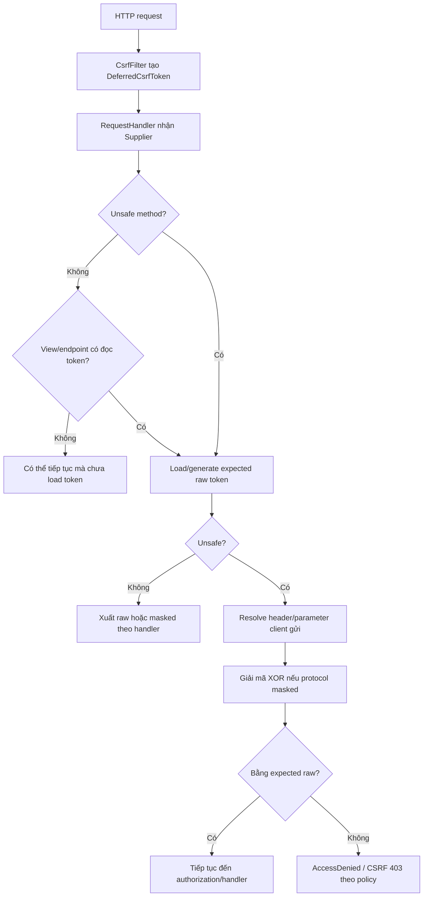
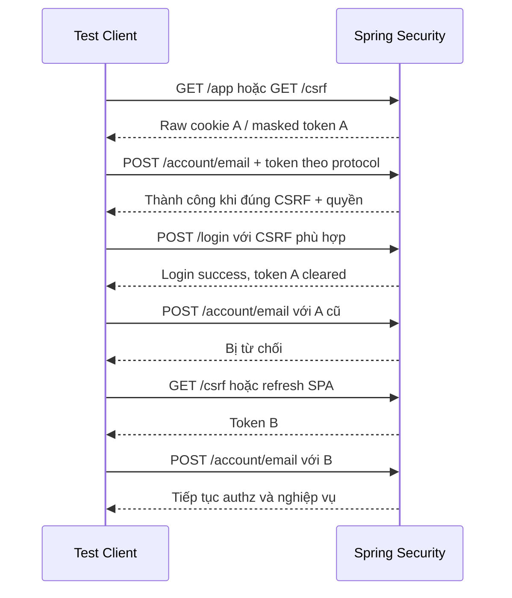

# Deferred token cùng cơ chế XOR trong các dòng hiện hành

## 1. Tại sao sau nâng cấp Spring Security, CSRF token bỗng “mất” hoặc “đổi”?

Trong module **SPRING_SECURITY_HTTP_PROTECTION**, người học triển khai các lớp bảo vệ HTTP và trình duyệt như **CSRF, CORS, security headers, CSP, HSTS, HTTP firewall và session protection**, trên cả **Servlet** và **Reactive/WebFlux**. Chủ đề **“Deferred token cùng cơ chế XOR trong các dòng hiện hành”** thuộc chương **Nâng cấp và tương thích**, tập trung vào hai khía cạnh quan trọng khi chuyển Spring Security 5.x sang 6.x và các dòng mới:

- **Deferred CSRF token loading:** chỉ tải hoặc tạo CSRF token khi thật sự cần, thay vì mặc định chạm vào repository/session ở mọi request.
- **XOR/BREACH protection:** khi xuất CSRF token vào HTML/view, handler tạo biểu diễn được che bằng phần ngẫu nhiên mới, thay vì phản chiếu nguyên raw token theo cùng một chuỗi.

Hai cơ chế trên **độc lập**: deferred nói về **thời điểm** token được tải; XOR nói về **cách trình bày và xử lý** token.

Ví dụ, nền tảng `https://learn.example.com` có:
1. `GET /account/edit`: Thymeleaf render form `POST /account/email` sử dụng session cookie.
2. `GET /app`: frontend SPA JavaScript đọc `XSRF-TOKEN` cookie rồi gửi header `X-XSRF-TOKEN` khi cập nhật.
3. `GET /api/public/catalog`: endpoint public không cần đọc CSRF token.
4. `POST /login` và `POST /logout`: thay đổi trạng thái đăng nhập và vòng đời token.
5. `/api/bearer/**`: API bearer-only có threat model riêng, không tự động chia sẻ CSRF policy với session web.

Sau nâng cấp, các hiện tượng thường gặp:
- GET đầu trang SPA chưa tạo cookie token → POST đầu tiên `403`.
- Hidden input `_csrf` ở hai lần reload khác nhau dù session không đổi.
- Raw cookie `XSRF-TOKEN` trùng với header SPA gửi nhưng request vẫn `403`.
- Login thành công xóa CSRF cookie cũ; SPA tiếp tục gửi token stale.
- Team chữa bằng `csrf.disable()` và vô tình mất bảo vệ CSRF cho API dùng session.

**Mục tiêu:** hiểu vòng đời token và chọn protocol raw/masked chính xác, thay vì xem mọi `403` là một lý do để bỏ CSRF.

### Kết quả học tập

Người học có thể:
- Phân biệt repository, deferred loading, request handler và CSRF filter.
- Mô tả chính xác raw token so với masked token do XOR tạo.
- Đối chiếu mặc định 5.8, 6.x và những API thuận tiện có ở một số bản 7.x.
- Cấu hình Servlet form truyền thống và SPA dùng cookie, có token refresh sau login/logout.
- Cấu hình/kiểm thử WebFlux với `CsrfWebFilter` và `Mono<CsrfToken>`.
- Thiết kế kiểm thử bảo vệ unsafe methods, token representation, deferred behavior và authorization.

## 2. Threat model: vì sao session cần CSRF token?

Một request giả mạo có thể được gửi từ website ngoài khi browser của nạn nhân đang đăng nhập và **tự gắn cookie session**. Nếu endpoint thay đổi trạng thái chỉ kiểm tra session mà không xác nhận ý định hợp lệ, attacker có thể khiến server cập nhật hồ sơ, thay email hoặc gửi lệnh không mong muốn.

Cơ chế **synchronizer token pattern**:
1. Server tạo token khó đoán, gắn với ngữ cảnh phiên/repository.
2. Trang hợp lệ có cách lấy token theo quyền và chính sách cùng origin.
3. Với request **unsafe** như POST/PUT/PATCH/DELETE, client chủ động thêm token qua header hoặc parameter.
4. Server resolve token client gửi, so với expected token của repository và từ chối khi thiếu/sai.

| Lớp bảo vệ | Trách nhiệm | Có thay CSRF không? |
| --- | --- | --- |
| Authentication | Ai gửi request? | Không: browser attacker có thể khiến cookie của nạn nhân được tự gửi. |
| Authorization | User được phép làm gì với object/tenant? | Không: nạn nhân có thể có quyền nhưng không chủ định thao tác. |
| CSRF token | Có dấu hiệu request được khởi tạo bởi client hợp lệ? | Đây là cơ chế chính cần kiểm thử. |
| SameSite cookie | Hạn chế một số trường hợp cookie cross-site | Phòng vệ bổ sung; same-site khác same-origin. |
| CORS | Origin nào được JS đọc response? | Không: không đọc được response vẫn có thể gây side effect. |
| CSP/XSS defense | Hạn chế script không tin cậy | Không: XSS cùng origin có thể đọc token lộ cho JS. |
| COOP/COEP/CORP | Quan hệ cửa sổ và cô lập tài nguyên | Không liên quan trực tiếp tới validation CSRF. |

Một API trả JSON hoặc dùng SPA **không đương nhiên stateless**. Nếu browser tự gửi session cookies, vẫn phải bảo vệ mutation theo threat model.

## 3. Thành phần Servlet: repository, deferred token, handler và filter

Một Spring Security Servlet request có những thành phần sau:

| Thành phần | Vai trò |
| --- | --- |
| `CsrfFilter` | Điều phối xử lý CSRF trong security filter chain. |
| `CsrfTokenRepository` | Sinh, lưu và tải expected/raw token. |
| `HttpSessionCsrfTokenRepository` | Repository Servlet mặc định thông dụng, lưu token trong session. |
| `CookieCsrfTokenRepository` | Repository có thể lưu raw token trong cookie, thường tên `XSRF-TOKEN`. |
| `DeferredCsrfToken` | Tham chiếu lazy tới token từ repository; chưa buộc tải khi tạo. |
| `CsrfTokenRequestHandler` | Expose token thành request attribute và resolve token do client cung cấp. |
| `XorCsrfTokenRequestAttributeHandler` | Mask token khi expose, decode masked value khi resolve. |
| `CsrfTokenRequestAttributeHandler` | Cơ chế plain (không XOR masking) cho request attribute/resolve. |
| `AccessDeniedHandler` | Xử lý từ chối khi token thiếu/sai hoặc quyền bị từ chối. |

### Luồng tổng quát



**Token vẫn có thể được load trên GET** nếu controller/view cần render nó. Deferred chỉ có nghĩa việc load được trì hoãn đến lúc có nhu cầu, không phải “chỉ load ở POST”.

## 4. Raw token, masked token và token rotation là ba việc khác nhau

**Raw token** là giá trị repository dùng để validate. **Masked token** là biểu diễn ngẫu nhiên được XOR handler tạo cho presentation; **rotation** là hành động vô hiệu hóa/thay raw token (ví dụ quanh authentication/logout).

```text
Session và repository đang giữ raw token R.

GET /account/edit lần 1:
  random mask M1 → masked token V1

GET /account/edit lần 2:
  random mask M2 → masked token V2

V1 != V2 (nếu dùng XOR)
decode(V1) = decode(V2) = R

Login/logout:
  repo clear R → token R không còn hợp lệ
  khi client load lại → raw token mới R2
```

Như vậy:
- **Hai hidden values khác nhau không chứng minh raw token đổi.**
- **Hai hidden values giống nhau không tự chứng minh CSRF bị tắt**, vì handler plain có thể được chọn.
- **Token mới sau login/logout** là chuyện lifecycle repository, không phải “XOR thêm randomness” đơn thuần.

Không lấy raw value từ cookie để so trực tiếp với hidden token masked; phải đi qua handler giải mã.

## 5. Deferred loading: lợi ích và cái giá của việc ép tải token

Trong các cấu hình hiện đại, Spring Security trì hoãn việc truy cập repository cho đến khi token cần thiết. Với `HttpSessionCsrfTokenRepository`, điều này có thể tránh load session không cần thiết trên các request GET không render token.

| Request | Token có nhất thiết phải load? | Lý do |
| --- | --- | --- |
| GET `/api/public/catalog` | Không, nếu handler không chạm token | Không có mutation hoặc form. |
| GET `/assets/public/app.js` | Không, nếu đi qua chain nhưng không chạm token | Static resource không tự cần CSRF. |
| GET `/account/edit` | Có khi view render hidden `_csrf` | Cần xuất token cho POST tương lai. |
| GET `/csrf` | Có nếu endpoint trả token | Client chủ động bootstrap token. |
| POST `/account/email` | Có | Cần validate client token. |
| POST `/logout` | Có khi CSRF enabled trên logout | Cần token và có thể clear token sau logout. |

**Không suy rằng deferred đảm bảo request không tạo session.** Authentication, saved requests, controller và các filters khác có thể chạm session độc lập với CSRF.

### Mô hình hai trục độc lập

| Loading | Representation | Kết quả |
| --- | --- | --- |
| Eager + plain | Raw | Dễ hiểu theo mã legacy, nhưng không có XOR/BREACH protection. |
| Deferred + plain | Raw khi cần | Tối ưu lazy nhưng vẫn phơi raw trong response nếu view sử dụng. |
| Eager + XOR | Masked | View an toàn hơn trước compression side channel; có thể load repository mỗi GET. |
| Deferred + XOR | Masked khi cần | Hướng mặc định Servlet hiện đại, SPA cookie cần xử lý đúng protocol. |

Đừng chữa việc cookie SPA chưa xuất hiện bằng cách tắt deferred trên toàn ứng dụng khi có thể chủ động bootstrap qua endpoint.

## 6. XOR và BREACH: nó bảo vệ điều gì, không bảo vệ điều gì?

Tấn công **BREACH** có thể tận dụng thông tin về kích thước response đã nén trong những bối cảnh attacker ảnh hưởng được dữ liệu gần secret lặp lại. Nếu server liên tục phản chiếu một **raw CSRF token cố định** trong HTML nén, dữ liệu phản hồi có thể tạo điều kiện cho side channel.

`XorCsrfTokenRequestAttributeHandler` dùng phần ngẫu nhiên mới mỗi lần xuất token; cùng raw expected token sẽ tạo masked representation khác nhau, giúp giảm nguy cơ token bị suy đoán nhờ compression oracle.

Mô hình minh họa (không phải đặc tả dây/byte chính xác):

```text
R = raw token
M = random mask
V = encode(M || (M XOR R))

V1 != V2 với M1 != M2
decode(V) = R
```

**XOR masking không phải encryption hay HMAC bảo mật token.** Nó tạo biểu diễn có thể được request handler giải mã. Bảo vệ CSRF còn đòi hỏi raw token khó đoán, phiên/repository đúng, server validation và ranh giới cùng origin.

### Những giới hạn phải hiểu

- Không chống **XSS**. Nếu script trái phép chạy trong origin, nó có thể đọc hidden input, meta tag hoặc `XSRF-TOKEN` cookie không HttpOnly.
- Không thay HTTPS/HSTS, CSP, output encoding, authentication/authorization.
- Không làm raw token tự đổi sau mỗi GET; mask đổi, raw có thể không.
- Không đảm bảo CSRF token không bị ghi vào log; instrumentation phải redaction.
- Không sửa CORS, SameSite cookie hoặc popup/iframe policy.

## 7. Lịch sử các dòng 5.x → 6.x → 7.x: mốc nào quan trọng?

| Dòng | Deferred token | Handler/XOR | Điều cần làm |
| --- | --- | --- | --- |
| Spring Security 5.x đời cũ | Nhiều ứng dụng quen token được load sớm | Plain handler/token flow quen thuộc | Chụp baseline trước migration. |
| **5.8** | Có cơ chế và API cho quá trình chuyển tiếp | XOR handlers được bổ sung; Reactive default 5.8 là `ServerCsrfTokenRequestAttributeHandler` | Có thể opt-in và thử trên staging. |
| **6.0/6.x** | **Deferred loading mặc định** theo tài liệu Servlet | `XorCsrfTokenRequestAttributeHandler` ở Servlet và `XorServerCsrfTokenRequestAttributeHandler` ở WebFlux là defaults | Kiểm thử form masked, SPA raw cookie, refresh sau login/logout. |
| **7.x** | Tiếp tục xem lazy token lifecycle | Cấu hình theo API của version hiện tại | Javadoc ghi `csrf.spa()` có từ **7.0**; tài liệu 7.1 minh họa, nhưng phải kiểm tra exact dependency. |

**Không coi bảng là khẳng định từng patch release giống nhau.** Khóa exact Spring Security/Boot/Framework versions, tra migration guide/Javadoc đúng phiên bản và đo HTTP behavior thật. Một code sample của 7.1 có thể không biên dịch ở 6.5.

### Servlet và WebFlux không dùng chung class

Servlet dùng `Supplier<CsrfToken>`, `HttpServletRequest`, `CsrfTokenRequestHandler`. WebFlux dùng `Mono<CsrfToken>`, `ServerWebExchange`, `ServerCsrfTokenRequestHandler`. Chúng cùng nguyên tắc nhưng khác runtime.

## 8. Form server-rendered: masked parameter, không phải raw cookie

Với Spring MVC/Thymeleaf/JSP, view có thể lấy token được expose vào request attribute `_csrf`. XOR handler tạo masked presentation value; browser gửi value đó trở lại qua request parameter.

```html
<form action="/account/email" method="post">
  <input type="email" name="email">
  <input type="hidden" name="_csrf"
         value="MASKED_TOKEN_FROM_SERVER">
  <button type="submit">Lưu</button>
</form>
```

`MASKED_TOKEN_FROM_SERVER` là placeholder, không được hard-code. Với Thymeleaf, ứng dụng có thể dùng tích hợp `RequestDataValueProcessor` tự thêm token; nếu tự viết hidden input:

```html
<form th:action="@{/account/email}" method="post">
  <input type="email" name="email">
  <input type="hidden"
         th:name="${_csrf.parameterName}"
         th:value="${_csrf.token}">
  <button type="submit">Lưu</button>
</form>
```

**Không thêm hai trường `_csrf` trùng** nếu template engine đã tự tạo một trường. Đo HTML thực tế.

### Vì sao POST masked form hoạt động?

1. GET render `_csrf.token` → token được load (nếu đang deferred).
2. XOR handler sinh mask ngẫu nhiên; form xuất masked token.
3. Browser gửi masked token qua `_csrf` parameter.
4. `CsrfTokenRequestHandler` giải mã thành raw token.
5. `CsrfFilter` so với expected raw từ repository, rồi mới cho nghiệp vụ chạy.

Nếu form lưu token từ nhiều tab trước khi login/logout, token cũ có thể hết hiệu lực sau khi lifecycle thay đổi; ứng dụng nên hiển thị thông báo/token refresh hợp lý.

## 9. Cookie-based SPA: vì sao raw cookie có thể không hợp XOR?

Một SPA đọc cookie `XSRF-TOKEN` và chủ động gửi header:

```http
POST /account/email HTTP/1.1
Cookie: JSESSIONID=<session>; XSRF-TOKEN=<raw>
X-XSRF-TOKEN: <raw>
Content-Type: application/json

{"email":"user@example.test"}
```

Các chuỗi `<raw>` chỉ là placeholder.

- `CookieCsrfTokenRepository` lưu **raw token** vào cookie.
- `XorCsrfTokenRequestAttributeHandler` mặc định có khả năng resolve masked token từ parameter/header.
- Nếu SPA gửi raw cookie value như masked token, việc resolve có thể không phù hợp → `403`.

### Hợp đồng cần chọn

| Client | Token nhận được | Protocol gửi | Resolver phù hợp |
| --- | --- | --- | --- |
| Server-rendered form | Masked token từ view | `_csrf` form parameter | XOR. |
| Meta tag server-rendered bằng XOR | Masked token | Header được cấu hình để chấp nhận masked | XOR. |
| SPA đọc raw `XSRF-TOKEN` cookie | Raw token | `X-XSRF-TOKEN` | Plain request handler **cho nhánh raw header**. |
| SPA gọi endpoint trả masked token | Masked token | Header/parameter theo hợp đồng masked | XOR. |

**Đừng dùng cùng một header lẫn raw và masked mà không có contract.** Nếu ứng dụng dùng handler “header nghĩa là raw”, endpoint trả masked token phải dùng protocol khác hoặc thay resolver có điều kiện được định nghĩa rõ.

## 10. Servlet form thuần: giữ defaults khi chưa cần custom

Ví dụ component-based Servlet cho một ứng dụng dùng session form login:

```java
import org.springframework.context.annotation.Bean;
import org.springframework.context.annotation.Configuration;
import org.springframework.security.config.annotation.web.builders.HttpSecurity;
import org.springframework.security.config.annotation.web.configuration.EnableWebSecurity;
import org.springframework.security.web.SecurityFilterChain;

@Configuration
@EnableWebSecurity
public class FormSecurityConfig {

    @Bean
    SecurityFilterChain web(HttpSecurity http) throws Exception {
        return http
            .authorizeHttpRequests(auth -> auth
                .requestMatchers("/login", "/assets/public/**")
                    .permitAll()
                .anyRequest().authenticated())
            .formLogin(form -> form.permitAll())
            .build();
    }
}
```

Khi chưa override CSRF, các defaults Spring Security 6.x bao gồm CSRF protection cho unsafe methods, deferred loading và XOR request handler. Mẫu chưa định nghĩa user store/authorization theo object/tenant; Spring Security `formLogin` là authentication mechanism, không thay yêu cầu quyền nghiệp vụ.

**Không thêm `csrf.disable()` chỉ để form POST bớt lỗi.**

## 11. Servlet SPA hỗn hợp: custom handler phân biệt header raw và form masked

Trên những phiên bản 6.x có `CsrfTokenRequestHandler` và các implementation này, một chiến lược phổ biến:

- **Expose trong view** bằng `XorCsrfTokenRequestAttributeHandler`.
- **Nếu request có header token từ SPA raw cookie**, resolve bằng `CsrfTokenRequestAttributeHandler` plain.
- **Nếu request có parameter từ form masked**, resolve bằng XOR.
- **Buộc token load** trong handler để cookie `XSRF-TOKEN` được phát khi cần (đổi lại giảm lợi ích deferred).

```java
import java.util.function.Supplier;

import jakarta.servlet.http.HttpServletRequest;
import jakarta.servlet.http.HttpServletResponse;

import org.springframework.security.web.csrf.CsrfToken;
import org.springframework.security.web.csrf.CsrfTokenRequestAttributeHandler;
import org.springframework.security.web.csrf.CsrfTokenRequestHandler;
import org.springframework.security.web.csrf.XorCsrfTokenRequestAttributeHandler;
import org.springframework.util.StringUtils;

public final class SpaCsrfTokenRequestHandler
        implements CsrfTokenRequestHandler {

    private final CsrfTokenRequestHandler plain =
        new CsrfTokenRequestAttributeHandler();

    private final CsrfTokenRequestHandler xor =
        new XorCsrfTokenRequestAttributeHandler();

    @Override
    public void handle(
            HttpServletRequest request,
            HttpServletResponse response,
            Supplier<CsrfToken> deferredToken) {

        xor.handle(request, response, deferredToken);
        deferredToken.get(); // Chủ động load cho cookie-based SPA.
    }

    @Override
    public String resolveCsrfTokenValue(
            HttpServletRequest request,
            CsrfToken expectedToken) {

        String submitted =
            request.getHeader(expectedToken.getHeaderName());

        CsrfTokenRequestHandler chosen =
            StringUtils.hasText(submitted) ? plain : xor;

        return chosen.resolveCsrfTokenValue(
            request, expectedToken);
    }
}
```

### Giải thích lựa chọn

- Code trên bảo toàn **XOR masking cho form**.
- Gửi raw `X-XSRF-TOKEN` cookie từ SPA được plain resolver xử lý.
- Điều kiện chọn nhánh là **header có text**; ứng dụng phải quy định rõ header dùng raw, còn form parameter dùng masked.
- `deferredToken.get()` chạy trên các request đi qua handler/chain, **không giữ trọn lợi ích lazy loading**. Nếu ứng dụng nhiều GET không cần token, cân nhắc bootstrap endpoint thay thế.
- Đừng tự kết luận client gửi masked header sẽ đúng với handler trên; nó được đưa tới **plain** resolver.

### Cấu hình cookie repository

```java
import org.springframework.context.annotation.Bean;
import org.springframework.context.annotation.Configuration;
import org.springframework.security.config.annotation.web.builders.HttpSecurity;
import org.springframework.security.config.annotation.web.configuration.EnableWebSecurity;
import org.springframework.security.web.SecurityFilterChain;
import org.springframework.security.web.csrf.CookieCsrfTokenRepository;

@Configuration
@EnableWebSecurity
public class SpaSecurityConfig {

    @Bean
    SecurityFilterChain web(HttpSecurity http) throws Exception {
        return http
            .authorizeHttpRequests(auth -> auth
                .requestMatchers("/login", "/app", "/assets/public/**")
                    .permitAll()
                .anyRequest().authenticated())
            .csrf(csrf -> csrf
                .csrfTokenRepository(
                    CookieCsrfTokenRepository.withHttpOnlyFalse())
                .csrfTokenRequestHandler(
                    new SpaCsrfTokenRequestHandler()))
            .formLogin(form -> form.permitAll())
            .build();
    }
}
```

**Chỉ dùng `withHttpOnlyFalse()` nếu frontend thực sự phải đọc cookie CSRF.** Nó làm cookie CSRF truy cập được bởi JavaScript; session cookie vẫn phải có các attributes bảo vệ riêng. Code ở mục 10 và 11 là **hai phương án thay thế**, không đăng ký nhiều fallback chains trùng nhau.

## 12. SPA DSL trên dòng có hỗ trợ: `csrf.spa()`

Javadoc Spring Security ghi API dành cho SPA `csrf.spa()` có từ **7.0**, và tài liệu **7.1.x** minh họa cách dùng:

```java
@Bean
SecurityFilterChain web(HttpSecurity http) throws Exception {
    return http
        .authorizeHttpRequests(auth -> auth
            .anyRequest().authenticated())
        .csrf(csrf -> csrf.spa())
        .build();
}
```

**Chỉ dùng khi Javadoc/dependency phiên bản đích có `spa()`.** Tránh copy method này từ 7.1 vào ứng dụng 6.x hay phiên bản chưa hỗ trợ. API này diễn đạt ý định SPA nhưng các thuộc tính cookie, chính sách token lifecycle và cấu hình bảo mật bên ngoài vẫn phải kiểm thử thực tế.

| Bối cảnh | Lựa chọn |
| --- | --- |
| Form server-rendered thuần | XOR default, masked form token. |
| SPA raw cookie ở 6.x | Custom mixed raw-header/XOR-form handler theo contract. |
| SPA ở bản có `csrf.spa()` | Dùng API chính thức nếu đáp ứng nhu cầu, không chồng custom handler tùy tiện. |
| SPA muốn giữ lazy benefit | Endpoint token bootstrap rõ, chỉ load khi cần. |
| Bearer-only API riêng | Đánh giá CSRF bằng threat model; không để rule `csrf.disable` ảnh hưởng session web. |

## 13. Opt-out deferred loading: không đồng nghĩa tắt XOR

Trong Servlet, tài liệu Spring Security đưa ra cách buộc token được load trên mọi request:

```java
XorCsrfTokenRequestAttributeHandler handler =
    new XorCsrfTokenRequestAttributeHandler();

handler.setCsrfRequestAttributeName(null);

http.csrf(csrf -> csrf
    .csrfTokenRequestHandler(handler));
```

Đây là đoạn trích trong builder `HttpSecurity`; cần import đúng class.

`setCsrfRequestAttributeName(null)` khiến handler cần truy cập token để xác định attribute name, dẫn tới **eager loading**. Tuy nhiên, vẫn dùng **Xor** handler nên masking không bị tắt.

**Giá phải trả:** tăng số request load repository/session, có thể tăng tài nguyên sử dụng. Trước khi bật toàn site, kiểm tra có thể chỉ gọi endpoint `/csrf` hoặc một bootstrap route hay không.

Ngược lại, chuyển sang plain handler:

```java
http.csrf(csrf -> csrf
    .csrfTokenRequestHandler(
        new CsrfTokenRequestAttributeHandler()));
```

là **opt-out XOR/BREACH masking**, không phải tự động opt-out deferred loading. Chỉ làm vậy sau review rủi ro, không phải phản xạ sửa mọi `403`.

## 14. Endpoint bootstrap token theo nhu cầu

Nếu muốn giữ deferred loading trên GET không cần token, một endpoint GET chủ động có thể expose token khi SPA khởi tạo hoặc sau login/logout.

### Controller Servlet minh họa

```java
import org.springframework.security.web.csrf.CsrfToken;
import org.springframework.web.bind.annotation.GetMapping;
import org.springframework.web.bind.annotation.RestController;

@RestController
public class CsrfBootstrapController {

    @GetMapping("/csrf")
    public CsrfToken csrf(CsrfToken token) {
        return token;
    }
}
```

Khi endpoint được gọi qua đúng Spring Security chain, tham số `CsrfToken` có thể khiến token deferred được load; value trả về phải được hiểu theo handler đã cấu hình (**raw hoặc masked**).

**Bắt buộc cùng endpoint:**
- `Cache-Control: no-store` trên response và không cache tại CDN/proxy.
- Không cấp CORS wildcard để website lạ đọc token; giữ same-origin trừ hợp đồng đối tác có kiểm soát.
- Nếu token cần được cấp trước login, `requestMatchers(HttpMethod.GET, "/csrf").permitAll()` trong **đúng chain**.
- Sau login/logout, SPA gọi lại bootstrap, không dùng token cũ.
- Response chỉ chứa token metadata cần thiết, không chứa session ID/password/OAuth codes.
- Không log token values trong app, gateway hoặc test traces.

### Protocol endpoint masked

Một SPA có thể gửi token endpoint trả về qua header:

```javascript
let csrf = null;

async function refreshCsrf() {
  const res = await fetch("/csrf", {
    credentials: "same-origin",
    cache: "no-store"
  });
  if (!res.ok) throw new Error("Không có CSRF token");
  csrf = await res.json();
}

async function updateEmail(email) {
  if (!csrf) await refreshCsrf();

  const res = await fetch("/account/email", {
    method: "POST",
    credentials: "same-origin",
    headers: {
      "Content-Type": "application/json",
      [csrf.headerName]: csrf.token
    },
    body: JSON.stringify({ email })
  });
  if (!res.ok) throw new Error("Không thể cập nhật");
}
```

**Đây là protocol masked-token qua endpoint**, giả định `csrf.token` được XOR handler expose và **handler nhận masked header**. Không ghép nguyên đoạn này với handler của mục 11 vì handler đó mặc định coi **header có text là raw**. Phải chọn một protocol end-to-end và kiểm thử.

Khi một POST thất bại, không tự retry vô hạn hoặc thực hiện lại side effect khi không chắc request trước đã thành công.


## 15. Login và logout: token cũ có thể bị xóa sau authentication success

Token lifecycle là phần dễ bị bỏ qua nhất khi triển khai SPA theo cookie.

Trong Spring Security, các thành phần như `CsrfAuthenticationStrategy` và `CsrfLogoutHandler` xử lý việc xóa token ở những điểm thay đổi trạng thái xác thực. Mục tiêu là tránh tái sử dụng token thuộc trạng thái phiên trước đó. Với deferred loading, **token mới không nhất thiết được phát ngay** sau khi token cũ bị xóa nếu response không truy cập token.

```mermaid
sequenceDiagram
  participant SPA as Browser SPA
  participant SEC as Spring Security
  participant REPO as CSRF Repository
  SPA->>SEC: GET /app hoặc GET /csrf
  SEC->>REPO: Load/generate khi cần
  REPO-->>SEC: Raw A
  SEC-->>SPA: A ở dạng cookie hoặc masked response
  SPA->>SEC: POST /login có CSRF hợp lệ
  SEC->>SEC: Authentication success
  SEC->>REPO: Clear token A
  SEC-->>SPA: Login thành công; A không còn tin cậy
  SPA->>SEC: GET /csrf hoặc SPA token refresh
  SEC->>REPO: Load/generate token B
  SEC-->>SPA: Token B theo protocol
  SPA->>SEC: POST /account/email với B
  SEC->>REPO: Resolve và validate B
  SEC-->>SPA: Kết quả sau authorization
  SPA->>SEC: POST /logout có token hợp lệ
  SEC->>REPO: Clear token B
  SEC-->>SPA: Logout hoàn tất
```

### Trường hợp gây 403

1. Trang SPA khởi tạo và lấy token A.
2. Login/OAuth2 success đổi authentication/session và invalidates token A.
3. Client chưa có token B vì deferred loading chưa bị kích hoạt.
4. Lần POST kế tiếp dùng A → CSRF thất bại.

**Sửa đúng tầng:** refresh CSRF token **sau** khi trạng thái đăng nhập mới có hiệu lực. Không giữ raw cookie/token trong store JavaScript cũ rồi dùng tiếp vô thời hạn; không vô hiệu hóa `CsrfAuthenticationStrategy`/logout handling chỉ để chống 403.

### Khi logout

Với CSRF enabled, `POST /logout` thường cần token hợp lệ. Sau logout:
- Token cũ bị xóa.
- Session/security context cũ không nên tiếp tục cấp quyền.
- Nếu UI vẫn cho phép anonymous form có CSRF, cần token mới cho trạng thái mới.
- Redirect sau logout phải có logic bootstrap phù hợp, không yêu cầu user reload vô hạn.

### Test nghiệp vụ cần có

| Bước | Kết quả mong đợi |
| --- | --- |
| Form/SPA trước login | Có token phù hợp để submit. |
| Đăng nhập thành công | Security context đúng; token cũ bị xử lý theo lifecycle. |
| Gửi token trước login sau khi đã login | Bị từ chối nếu token đã invalidated. |
| Refresh token sau login | POST hợp lệ được xét tiếp authorization. |
| Logout với token đúng | Không còn session/principal được phép. |
| Dùng token trước logout | Không được phép tiếp tục mutation. |
| Mở nhiều tab với token cũ | Hiển thị thông báo/reload token rõ ràng, không tự bỏ bảo mật. |

Một số login flows có redirect hoặc CSRF token rotation ở thời điểm khác; test **request sequence thực tế** của ứng dụng và phiên bản, không chỉ assert status ở một request riêng lẻ.

## 16. Cookie CSRF và session cookie: cùng browser, khác trách nhiệm

Với `CookieCsrfTokenRepository.withHttpOnlyFalse()`, frontend đọc `XSRF-TOKEN`. Nhưng cookie này **không phải session authentication cookie**.

| Cookie | Nội dung và mục đích | Lưu ý |
| --- | --- | --- |
| `JSESSIONID`/session cookie theo container | Duy trì ngữ cảnh đăng nhập. | HttpOnly/Secure/SameSite/Path/Domain phải được kiểm soát theo chính sách. |
| `XSRF-TOKEN` | Raw CSRF token để frontend đưa vào header nếu protocol yêu cầu. | Có thể HttpOnly=false chỉ khi JavaScript cần đọc; phải tránh XSS/log. |
| Remember-me cookie | Hỗ trợ xác thực ghi nhớ người dùng | Không thay CSRF token; có rủi ro riêng. |
| OAuth2 state/nonce cookies (nếu có) | Bảo vệ luồng OAuth/OIDC theo triển khai | Không phải `XSRF-TOKEN` dùng cho mọi mutation. |

### 16.1. Cookie path cũng có thể gây lỗi

Ví dụ SPA ở `/app` được set `XSRF-TOKEN` với `Path=/app` nhưng gửi request `POST /account/email`. Nếu browser không gửi cookie cùng request đó hoặc JavaScript chỉ tìm cookie ở một path, frontend/back-end có thể bất nhất.

Cần kiểm tra:
- URL path nội bộ so với public path qua proxy.
- `Path` và `Domain` của session/CSRF cookies.
- Cookie có `Secure` phù hợp HTTPS không.
- `SameSite` và third-party-cookie policies có ảnh hưởng không.
- Cookie bị clear sau login/logout rồi refresh chưa.

**Không sửa bằng `SameSite=None` cho mọi cookie** nếu không có business requirement cross-site rõ ràng; không cho JavaScript đọc session cookie để “dễ làm CSRF”.

### 16.2. Đừng dùng CSRF cookie như ACL

Nếu JavaScript cùng origin có token hợp lệ, server vẫn phải kiểm tra user có quyền với `/account/files/{id}` không. CSRF token hợp lệ không làm user được phép sửa tài khoản khác.

## 17. Reactive/WebFlux: CsrfWebFilter, Mono và XOR mặc định

Trong WebFlux, CSRF protection được thực hiện bởi `CsrfWebFilter` và `ServerCsrfTokenRepository`, mặc định thông dụng là `WebSessionServerCsrfTokenRepository`.

Các điểm khác Servlet:
- Không có `HttpServletRequest`/`HttpSession`.
- Token được expose như **`Mono<CsrfToken>`** qua `ServerWebExchange`.
- View hoặc controller phải **subscribe/compose** Mono mới thực sự sử dụng token.
- Tên handler là `ServerCsrfTokenRequestHandler`.
- Dòng **5.8** dùng `ServerCsrfTokenRequestAttributeHandler` làm default theo tài liệu.
- Từ **6.0**, `XorServerCsrfTokenRequestAttributeHandler` là handler mặc định bảo vệ BREACH.

### Cấu hình Reactive cơ bản

```java
import org.springframework.context.annotation.Bean;
import org.springframework.context.annotation.Configuration;
import org.springframework.security.config.annotation.web.reactive.EnableWebFluxSecurity;
import org.springframework.security.config.web.server.ServerHttpSecurity;
import org.springframework.security.web.server.SecurityWebFilterChain;

@Configuration
@EnableWebFluxSecurity
public class ReactiveSecurityConfig {

    @Bean
    SecurityWebFilterChain security(ServerHttpSecurity http) {
        return http
            .authorizeExchange(auth -> auth
                .pathMatchers("/login", "/csrf").permitAll()
                .anyExchange().authenticated())
            .formLogin(form -> {})
            .build();
    }
}
```

Mẫu chỉ nêu CSRF default và security chain; còn cần user store, route `/csrf` và authentication/authorization phù hợp. Không gắn `csrf.disable()` khi API dùng WebSession cookie.

### Explicit XOR trên WebFlux nếu muốn kiểm tra cấu hình

```java
import org.springframework.security.web.server.csrf.XorServerCsrfTokenRequestAttributeHandler;

// Phần thân ServerHttpSecurity builder:
.csrf(csrf -> csrf
    .csrfTokenRequestHandler(
        new XorServerCsrfTokenRequestAttributeHandler()))
```

Đây chỉ là **snippet**, không phải file Java hoàn chỉnh. Nếu XOR đã là default của version đang chạy thì không bắt buộc cấu hình lại.

### Plain handler trên WebFlux

```java
import org.springframework.security.web.server.csrf.ServerCsrfTokenRequestAttributeHandler;

.csrf(csrf -> csrf
    .csrfTokenRequestHandler(
        new ServerCsrfTokenRequestAttributeHandler()))
```

Giá trị plain handler **bỏ lớp XOR/BREACH masking**, không phải lựa chọn mặc định nên dùng để “chữa” SPA 403.

## 18. WebFlux: chủ động subscribe Mono để bootstrap token

`CsrfWebFilter` có thể đặt `Mono<CsrfToken>` trong exchange attributes. Một endpoint bootstrap có thể trả giá trị sau khi subscribe:

```java
import org.springframework.http.CacheControl;
import org.springframework.http.ResponseEntity;
import org.springframework.security.web.server.csrf.CsrfToken;
import org.springframework.web.bind.annotation.GetMapping;
import org.springframework.web.bind.annotation.RestController;
import org.springframework.web.server.ServerWebExchange;
import reactor.core.publisher.Mono;

@RestController
public class ReactiveCsrfController {

    @GetMapping("/csrf")
    public Mono<ResponseEntity<CsrfToken>> csrf(
            ServerWebExchange exchange) {

        Mono<CsrfToken> token =
            exchange.getAttribute(CsrfToken.class.getName());

        if (token == null) {
            return Mono.error(
                new IllegalStateException("CSRF filter unavailable"));
        }

        return token.map(value ->
            ResponseEntity.ok()
                .cacheControl(CacheControl.noStore())
                .body(value));
    }
}
```

**Giải thích:**
- Exchange attribute key `CsrfToken.class.getName()` được dùng theo tài liệu WebFlux về CSRF; xác minh contract trên version đích.
- Dùng `Mono.map(...)` thay `block()` để không block event loop.
- Subscription xảy ra khi WebFlux gửi response cho subscriber.
- Representation `token` trả ra phụ thuộc `ServerCsrfTokenRequestHandler` (raw/masked theo design).
- Cần same-origin/CORS policy, `no-store` và không log token.

Với Thymeleaf/WebFlux, framework có integration tự động trong nhiều trường hợp; với template khác phải bảo đảm Mono được subscribe và expose đúng tên `_csrf`. Không lấy `Mono.toString()` làm giá trị hidden input.

## 19. Reactive SPA cookie: repository không tự làm raw header hợp XOR

`CookieServerCsrfTokenRepository` có thể được cấu hình trong WebFlux:

```java
import org.springframework.security.web.server.csrf.CookieServerCsrfTokenRepository;

// Phần thân ServerHttpSecurity builder:
.csrf(csrf -> csrf
    .csrfTokenRepository(
        CookieServerCsrfTokenRepository.withHttpOnlyFalse()))
```

Nhưng **đổi repository không có nghĩa đã đổi request handler**. Trong một phiên bản sử dụng XOR handler, SPA đọc raw cookie `XSRF-TOKEN` gửi `X-XSRF-TOKEN` vẫn phải tuân theo cách resolver của handler.

Có hai hướng:
1. **Chọn protocol masked token endpoint**: frontend nhận token từ `Mono<CsrfToken>` đã được handler chuẩn bị và gửi theo contract XOR, không tự suy cookie raw tương đương masked.
2. **Thiết kế handler Reactive riêng** khi thật sự cần header raw + form masked, sử dụng `ServerCsrfTokenRequestHandler` và các resolver/API tương ứng đúng phiên bản.

**Không copy `SpaCsrfTokenRequestHandler` của Servlet sang WebFlux:** chữ ký `HttpServletRequest`, `Supplier<CsrfToken>` và repository Servlet không có cùng vòng đời với `ServerWebExchange`/`Mono`.

### Tối thiểu phải test

- GET bootstrap token có Mono được consume.
- Form WebFlux được render masked token nếu dùng XOR.
- POST với token đúng → qua CSRF, vẫn cần quyền nghiệp vụ.
- POST token sai hoặc thuộc WebSession khác → bị từ chối.
- SPA cookie raw/header resolution không bị mismatch.
- Login/logout refresh token đúng, không còn chấp nhận stale token.
- Không dùng `CookieServerCsrfTokenRepository.withHttpOnlyFalse()` trừ khi JavaScript thật sự cần đọc cookie.

## 20. MockMvc: test thiếu/sai/đúng token và side effects

`spring-security-test` cung cấp `csrf()` để tạo request token hợp lệ/không hợp lệ trong test Servlet:

```java
mockMvc.perform(post("/account/email")
        .with(user("learner"))
        .param("email", "new@example.test"))
    .andExpect(status().isForbidden());

mockMvc.perform(post("/account/email")
        .with(user("learner"))
        .with(csrf().useInvalidToken())
        .param("email", "new@example.test"))
    .andExpect(status().isForbidden());

mockMvc.perform(post("/account/email")
        .with(user("learner"))
        .with(csrf())
        .param("email", "new@example.test"))
    .andExpect(status().is2xxSuccessful());
```

Đây là **phần thân test**; cần `MockMvc`, spring-security-test, controller fixture, các static imports và đúng chain. Controller có thể trả 204/302 thay vì 200; dùng expectation theo contract thật.

**Quan trọng hơn status:** 
- Thiếu/sai token không được thay email.
- Token đúng nhưng user không sở hữu object vẫn bị từ chối.
- Đủ CSRF và authorization thì side effect mới được thực hiện.
- Test cùng `POST` và session để tránh sai số từ authentication.

### Limitations của test helper

`with(csrf())` có thể tạo token phù hợp cho MockMvc mà **không chứng minh** wire protocol của một SPA cookie raw, cách masked token render trong HTML, hoặc token đã refresh sau authentication.

Cần **integration tests HTTP thật** hoặc kiểm thử đầy đủ filter chain, session cookie jar và template rendering.

## 21. Kiểm thử XOR: cùng raw token, masked values khác nhau

Một test tốt cho form có XOR enabled:

1. Tạo một session/login context xác định.
2. GET `/account/edit` → đọc hidden parameter `_csrf` thành `maskedA`.
3. GET `/account/edit` lần hai **cùng session** → `maskedB`.
4. Kiểm tra `maskedA` và `maskedB` **khác nhau** khi handler thật sự dùng XOR randomness.
5. Submit `maskedA` vào POST hợp lệ cùng session → không bị từ chối vì CSRF.
6. Submit `maskedB` vào POST tương đương cùng session → cũng có thể hợp lệ nếu repository token chưa rotate.
7. Sau login/logout invalidate raw token, submit masked token cũ → bị từ chối.

| Kết quả quan sát | Cách hiểu |
| --- | --- |
| Hidden token khác qua hai GET | Phù hợp XOR; **chưa chứng minh** raw rotate. |
| Raw token cookie ổn định trong phiên | Phù hợp token persistence nếu chưa clear. |
| Raw token không bằng masked form value | Bình thường với XOR enabled. |
| Token cũ không hợp lệ sau login/logout | Phù hợp lifecycle invalidation. |
| Token thuộc session khác bị từ chối | Phù hợp repository/session binding. |

Tránh test bằng fixture HTML hard-code token giả: nó không đi qua XOR handler. Nếu handler plain được cấu hình, **không ép assertion maskedA ≠ maskedB**.

## 22. Kiểm thử deferred: đo repository calls thay vì đoán từ cookie

Cần tách **lợi ích deferred loading** khỏi side effects của authentication/session.

### Test có instrumented repository

Trong môi trường test-only, một `CsrfTokenRepository` instrumented có thể ghi nhận `loadToken`, `generateToken`, `saveToken` mà không log token value.

```text
GET /api/public/catalog, handler không đọc CsrfToken:
  Deferred config → có thể không load/generate.

GET /account/edit, view đọc _csrf.token:
  Deferred config → phải load/generate khi render.

POST /account/email, cần validation:
  Deferred config → phải load expected token.

GET public khi handler ép deferredToken.get() mỗi request:
  Repo calls có thể tăng so với deferred default.
```

**Không lấy dấu hiệu “không có Set-Cookie” làm bằng chứng tuyệt đối CSRF còn/không còn**: token có thể ở session, authentication có thể tạo session, proxy có thể thay cookie.

### Kiểm thử performance

Một test benchmark có thể so:
- Số lần truy cập CSRF repository trên GET public.
- Số session mới tạo trong cùng workload.
- Độ trễ response và tải hệ thống khi dùng eager custom handler.
- Tỷ lệ request SPA cần bootstrap token.

Đo trong môi trường có cấu hình auth/session tương đương. Không so một cấu hình local thiếu security filters với staging đầy đủ rồi quy chênh lệch cho deferred.

## 23. Test SPA raw cookie/header và login/logout rotation

Dùng HTTP client/integration framework **giữ cookie jar** thay vì tạo các request độc lập mất session:



Các assertion cần có:

| Trường hợp | Kỳ vọng |
| --- | --- |
| SPA raw header với mixed request handler | Token raw được resolve đúng. |
| Raw header với XOR-only handler | Có test thể hiện mismatch, không “auto pass”. |
| Form masked parameter với XOR handler | Được giải mã, đúng trong phiên. |
| Masked token gửi qua header mà handler quy định raw | Bị từ chối hoặc protocol được sửa rõ ràng. |
| Token từ phiên user khác | Bị từ chối. |
| Token stale sau login/logout | Không còn dùng được. |
| Sau refresh token mới | Request được xét tiếp quyền và nghiệp vụ. |
| Origin ngoài không được phép đọc token bootstrap | Không có CORS quyền đọc phản hồi. |

**Không log token thật** trong test report, request traces, CI artifact hoặc browser console. Chỉ ghi presence/absence, loại format, status và side effect.

## 24. WebTestClient: kiểm thử CSRF Reactive

Với `spring-security-test` dành cho Reactive:

```java
webTestClient.mutateWith(mockUser("learner"))
    .post().uri("/account/email")
    .bodyValue("email=new@example.test")
    .exchange()
    .expectStatus().isForbidden();

webTestClient.mutateWith(mockUser("learner"))
    .mutateWith(csrf())
    .post().uri("/account/email")
    .bodyValue("email=new@example.test")
    .exchange()
    .expectStatus().is2xxSuccessful();
```

`mockUser` và `csrf()` thuộc Reactive `SecurityMockServerConfigurers`. Test cần endpoint và body/content-type phù hợp; `2xx` là expectation minh họa.

### Kiểm tra Reactive token flow thật

- GET `/csrf` và subscribe Mono để token được load.
- Ghi kiểm tra `Cache-Control: no-store` và response chỉ cho client phù hợp.
- POST với token masked theo request handler; không chỉ dùng `csrf()` helper.
- POST với sai token/khác WebSession → từ chối và không side effect.
- Login/logout thay trạng thái và refresh token đúng thời điểm.
- Test cookie server-side path/SameSite/HttpOnly khi dùng `CookieServerCsrfTokenRepository`.

Không dùng `MockMvcRequestPostProcessors.csrf()` cho WebFlux; đó là helper Servlet.

## 25. Browser E2E: các yếu tố ngoài CSRF request handler

Spring có thể phát token hợp lệ nhưng browser không gửi cookie/header theo dự kiến vì:
- `Secure` cookie trên HTTP không phù hợp.
- `SameSite` và third-party-cookie restrictions.
- Cookie `Path`/`Domain` không khớp route hoặc host.
- `fetch` với `credentials` không đúng ngữ cảnh.
- Redirect sau login/logout làm token store của SPA stale.
- Reverse proxy thay prefix/hostname/HTTPS forwarding.
- Browser CSP `connect-src` chặn request hoặc CORS preflight bị từ chối.

### Kịch bản E2E tối thiểu

1. Vào `https://learn.example.com/app`.
2. Đọc token qua giao thức đã thiết kế (cookie raw hoặc endpoint masked).
3. Đăng nhập đúng flow và refresh token sau login.
4. POST cập nhật dữ liệu: token đúng và user có quyền → thành công.
5. Thử thiếu CSRF token → bị từ chối, không có side effect.
6. Tải lại trang/mở tab khác, xem token/session còn hợp lệ không.
7. Logout qua method đúng có token hợp lệ.
8. Thử dùng token cũ hoặc session đã logout → không được truy cập.
9. Kiểm tra một browser thuộc tập hỗ trợ khác để bắt cookie-policy khác biệt.

Playwright/Chromium–Firefox–WebKit là một nhóm kiểm thử hữu ích, nhưng **không thay toàn bộ Safari/iOS thật** nếu sản phẩm cam kết hỗ trợ chúng.

Không lưu cookie, CSRF token hoặc OAuth codes vào trace/log không được redaction. Có thể assert **token/header tồn tại** mà không in giá trị.

## 26. Ma trận chẩn đoán lỗi 403

| Triệu chứng | Nguyên nhân tiềm năng | Bước kiểm tra |
| --- | --- | --- |
| GET SPA OK, POST đầu tiên 403 | Deferred token chưa được expose/bootstrap | Kiểm tra endpoint/bootstrap/cookie creation. |
| Hidden `_csrf` thay đổi qua mỗi GET | XOR masking bình thường | So raw expected value và test POST, không so trực tiếp hidden. |
| SPA cookie và header raw giống nhau nhưng 403 | XOR-only resolver chờ masked value | Cấu hình mixed/plain-header handler hoặc protocol masked. |
| POST lỗi ngay sau login | Token trước login đã bị clear | Refresh token sau authentication. |
| Logout POST 403 | Client chưa gửi CSRF đúng | Dùng form/SPA token hợp lệ, không chuyển sang GET logout vô bảo vệ. |
| GET `/csrf` trả no token | Handler không load, wrong chain, route thiếu, Mono chưa subscribe | Kiểm tra matcher, endpoint, repository/handler. |
| POST token đúng nhưng vẫn 403 | User thiếu quyền, phiên sai hoặc token bị invalidate | Phân biệt AccessDenied/CSRF/authz bằng diagnostics không lộ token. |
| POST redirect login | Session/security context mất | Kiểm tra persistence, cookie và entry point. |
| OPTIONS trả 401/302 | CORS processor chưa chạy đúng | Preflight/allowed origin/method/header và security chain. |
| Public GET chạm session quá nhiều | Handler/advice ép load token hoặc auth filters | Đo repository calls, không suy theo response body. |
| `with(csrf())` PASS nhưng SPA thật FAIL | Test helper không mô phỏng raw/masked wire protocol | Integration/browser test thực tế. |
| SPA không đọc được cookie | HttpOnly/path/domain/secure policy không như mong đợi | Kiểm tra cookie attributes và frontend same-origin. |
| POST từ origin ngoài có side effect | CSRF ignore/disable sai hoặc endpoint đổi trạng thái bằng GET | Test bảo mật server; CORS không thay CSRF. |

**Một mã `403` không tự chứng minh lỗi XOR.** Trong Servlet, `MissingCsrfTokenException`/`InvalidCsrfTokenException` giúp phân loại token thiếu/sai (phụ thuộc state và framework). Authorization cũng có thể trả 403; cần quan sát nguyên nhân ở tầng phù hợp mà không log giá trị token.

## 27. Quan hệ với CORS, headers, HTTP firewall và session

Bài về XOR/deferred vẫn phải giữ đúng phạm vi module HTTP protection:

**CORS:** điều khiển khả năng frontend cross-origin đọc response, không tự bảo vệ CSRF. Không phát `Access-Control-Allow-Origin: *` trên token bootstrap endpoint với ý định chia sẻ bừa bãi. Credentialed CORS cần exact origin policy, cookie rules, authorization và CSRF threat model.

**CSP và XSS:** XOR masking giảm rủi ro từ compression side channel khi token được phản chiếu; nó **không** ngăn JS độc hại cùng origin đọc cookie không HttpOnly. CSP, output encoding và supply-chain hygiene vẫn cần.

**HSTS/TLS:** HTTPS/HSTS giúp bảo vệ kênh và tránh downgrade theo điều kiện browser; không thay CSRF. Reverse proxy kết thúc TLS phải có trusted forwarding và cookie Secure phù hợp.

**HTTP firewall/matcher:** `securityMatcher` quyết định chain xử lý request. Nếu session-based `/account/**` rơi vào chain `csrf.disable()` do matcher sai, nguy cơ nghiêm trọng hơn token mismatch. `ignoringRequestMatchers` phải thật sự giới hạn webhook/API đã được threat model.

**Session/authentication:** nếu custom login không lưu `SecurityContext` hoặc cookie session bị sai, request tiếp theo redirect login dù CSRF token hợp lệ. Authorization theo user/tenant/object vẫn bắt buộc khi token đúng.

Không dùng `headers(headers -> headers.disable())`, `csrf.disable()` hoặc nới `StrictHttpFirewall` để chữa một lỗi token chưa được chẩn đoán.

## 28. Những anti-pattern cần tránh

1. **Tắt CSRF cho toàn SPA/session web** để POST bớt `403`; làm mất lớp bảo vệ quan trọng.
2. **Tắt XOR global chỉ vì cookie raw**; form HTML mất BREACH masking không cần thiết.
3. **So masked token với raw cookie** rồi kết luận bug; hai representation khác nhau đúng thiết kế.
4. **Giả định raw token đổi ở mọi GET**; XOR mask đổi khác token rotation.
5. **Giả định GET luôn tạo XSRF-TOKEN cookie** dù deferred loading chưa kích hoạt.
6. **Dùng `CsrfTokenRequestAttributeHandler` plain để “bật lại deferred”**; plain handler nói về masking, không tự chọn load strategy.
7. **Ép load token mọi request rồi quảng cáo tối ưu lazy**; đo repo/session calls thay vì đoán.
8. **Đưa `/csrf` ra CDN/cache public hoặc wildcard CORS**; token phải giữ đúng origin/session context.
9. **Ghi token giá trị thật vào log/CI/browser trace**, gây lộ dữ liệu bảo mật.
10. **Copy `csrf.spa()` của dòng 7.x vào Spring Security 6.x** mà không kiểm tra API.
11. **Copy Servlet `Supplier<CsrfToken>` handler sang Reactive `Mono<CsrfToken>`**; khác runtime.
12. **Cho bearer chain bỏ CSRF nhưng vẫn chấp nhận ambient cookie credentials**; cần threat model thật.
13. **Dùng token đúng thay cho quyền nghiệp vụ**: CSRF không phải ACL user/tenant.
14. **Tự retry mutation vô hạn khi gặp 403**; có thể gây side effect trùng nếu lỗi không phải CSRF.
15. **Bỏ CSRF cho logout bằng GET** để tránh rotation; thay UI/flow đúng cách.

## 29. Quy trình migration có bằng chứng

1. **Khóa version:** Spring Security/Boot/Framework, Servlet hoặc Reactive, Java, dependencies test.
2. **Inventory token protocol:** form masked, cookie raw, meta tag, endpoint bootstrap; xác định headers/params.
3. **Inventory state store:** HttpSession/Cookie/WebSession/custom repository, cookie attributes.
4. **Chụp baseline cũ:** GET/POST, 403/side effects, login/logout rotation, handler/repository defaults.
5. **Phân biệt hai trục:** deferred loading và XOR masking; không sửa một trục để giải quyết vấn đề trục khác.
6. **Chọn cấu hình đúng version:** defaults form, mixed handler SPA 6.x, `csrf.spa()` khi có API, hoặc bootstrap endpoint.
7. **Giữ CSRF enabled trên session flows** và giữ authorization theo object/tenant.
8. **Chọn refresh flow:** sau login/logout và khi session/token rotate; không dùng stale token.
9. **Kiểm tra CORS, CSP, cookie flags và reverse proxy** cho bootstrap + POST endpoints.
10. **Chạy MockMvc/WebTestClient** thiếu/sai/đúng token, side effects và authz.
11. **Chạy wire-format test thật**: masked form, raw cookie header, deferred load, token rotation.
12. **Chạy browser tests** trên các engine được hỗ trợ.
13. **Canary + telemetry tối thiểu**: tỷ lệ CSRF validation failures, lỗi token bootstrap, login loops; không log token.
14. **Rollback hẹp:** sửa handler/protocol theo version, không bỏ CSRF hoặc session protection.

### Mẫu change record

```text
Old Spring Security version: <resolved>
New Spring Security version: <resolved>
Stack: Servlet | Reactive
CSRF repository: HttpSession | Cookie | WebSession | Custom
Loading: deferred | eager
Handler: XOR | plain | custom | SPA DSL
Token transport: masked form | raw cookie header | masked endpoint
Bootstrap: <route and method>
Login/logout refresh: <strategy>
Security chain and matcher: <scope>
CORS/session/cookie owners: <teams>
Positive/negative test IDs: <IDs>
Approved deviations and rollback: <owners>
```

Không ghi raw/masked token value trong hồ sơ.

## 30. Bài tập tình huống

**A — Raw/masked.** Hai GET cùng session tạo hidden `_csrf` khác nhau nhưng repository vẫn giữ một raw token. Giải thích tính đúng và đề xuất test xác minh.

**B — SPA 5.x sang 6.x.** Cookie `XSRF-TOKEN` và header `X-XSRF-TOKEN` giống nhau nhưng POST 403. Nêu handler mặc định, đường sửa giữ XOR cho form, plain cho raw cookie.

**C — Lazy bootstrap.** GET `/app` không phát cookie CSRF, POST đầu tiên 403. Thiết kế một `GET /csrf` hợp lý mà không ép load token trên mọi GET public.

**D — Login rotation.** Sau `POST /login`, token A bị xóa và token B chưa được load. Client phải refresh vào lúc nào và kiểm thử stale A thế nào?

**E — Mục tiêu của XOR.** So sánh BREACH masking và token rotation, nêu rõ XOR không bảo vệ khỏi XSS, cũng không thay authorization.

**F — Opt-out deferred.** Team dùng `setCsrfRequestAttributeName(null)` và nghĩ đã tắt XOR. Hãy giải thích tác dụng thật và trade-off.

**G — API bearer.** Một chain `/api/**` tắt CSRF nhưng `/api/profile` vẫn chấp nhận cookie session. Phân tích tại sao tên API không đủ để bỏ token check.

**H — WebFlux.** `Mono<CsrfToken>` được gắn lên exchange, nhưng view không có token. Nêu cách subscribe/compose, nơi đặt endpoint/bootstrap và những class khác Servlet.

**I — Test false positive.** `MockMvc.with(csrf())` PASS nhưng SPA thật FAIL. Hãy đề xuất tests qua cookie jar và browser, bao gồm token raw/masked, login/logout.

**J — CORS token endpoint.** Một nhóm đặt `Access-Control-Allow-Origin: *` và cache public cho `GET /csrf`. Tìm rủi ro và điều kiện an toàn cần thay.

**K — Multi-tenant.** Một user có CSRF token đúng nhưng sửa `/tenants/B/report/42` của tenant khác. Thêm kiểm soát và test nào?

**L — Version drift.** Tài liệu cho thấy `csrf.spa()` nhưng IDE Spring Security 6.x báo không có. Bạn xử lý thế nào mà không disable CSRF?

### Gợi ý đáp án

- **A:** XOR mask thay đổi representation, raw có thể ổn định; test hai GET/POST cùng session.
- **B:** plain-header/XOR-form request handler hoặc SPI có sẵn đúng version.
- **C:** endpoint chủ động consume token, `no-store`, same-origin, bootstrap sau login/logout.
- **D:** refresh sau auth success, reject token cũ, test cùng cookie/session.
- **E:** masking chống một phần compression side channel, không phải encryption/ACL.
- **F:** buộc load mỗi request nhưng vẫn XOR nếu dùng Xor handler; tăng repository/session cost.
- **G:** cookie là ambient credential; session mutation vẫn cần CSRF theo threat model.
- **H:** WebFlux `CsrfWebFilter`, `ServerWebExchange`, `Mono<CsrfToken>` và reactive handlers.
- **I:** test wire protocol thật và side effects, không chỉ mock helper.
- **J:** không cho token public cross-origin/cache, giữ CORS và cache controls đúng.
- **K:** owner/tenant authorization server độc lập với CSRF.
- **L:** xem exact dependency/Javadoc; dùng custom handler tương thích hoặc endpoint bootstrap.

## 31. Checklist nghiệm thu

| Nhóm | Tiêu chí đạt |
| --- | --- |
| **Version** | Exact Spring Security/Boot/Framework được xác định; API sample hợp phiên bản. |
| **CSRF threat model** | Session/ambient-credential mutations được bảo vệ, bearer-only exceptions có lý do. |
| **Repository** | HttpSession/Cookie/WebSession đúng; không đổi storage vô ý. |
| **Deferred** | GET không cần token không ép load; form/bootstrap token được tải khi cần. |
| **XOR** | Form xuất masked token; handler decode đúng và không so trực tiếp với raw cookie. |
| **SPA protocol** | Raw header hoặc masked token có resolver rõ, không trộn protocol. |
| **Cookie flags** | HttpOnly/Secure/SameSite/Path/Domain phù hợp; session cookie không lộ cho JS. |
| **Token lifecycle** | Authentication/logout refresh token, reject stale token. |
| **HTTP tests** | Missing/invalid/valid CSRF được kiểm tra với side effects. |
| **Authorization** | Token đúng không làm user vượt object/tenant ACL. |
| **Reactive** | Dùng Mono/WebSession, không copy Servlet classes. |
| **CORS/CSP/headers** | Token endpoint không public tùy tiện; không disable các headers bảo vệ. |
| **Browser** | Form/SPA/login/logout/cookie đều qua test thực. |
| **Observability** | Không ghi token thật, có baseline, canary và rollback hẹp. |

## 32. Kết luận

**Deferred token và XOR masking là hai đặc điểm phối hợp nhưng độc lập của Spring Security hiện đại.** Deferred giúp trì hoãn việc load/generate CSRF token cho đến khi cần, có thể giảm truy cập session/repository trên những GET không sử dụng token. XOR làm token được trình bày trong response với **mask ngẫu nhiên mới**, giảm rủi ro BREACH trên nội dung nén; nó không biến raw token thành một giá trị mới ở mỗi GET và không thay CSRF validation.

Với **Servlet**, form render server thường submit masked token, còn **SPA đọc `XSRF-TOKEN` cookie nhận raw token**, nên cần handler/protocol phù hợp hoặc SPA DSL được phiên bản hỗ trợ. Sau login/logout, token cũ có thể bị xóa; frontend cần làm mới token đúng lifecycle. Với **WebFlux**, cùng nguyên tắc được triển khai qua `CsrfWebFilter`, `Mono<CsrfToken>`, `ServerCsrfTokenRequestHandler` và `XorServerCsrfTokenRequestAttributeHandler`.

**Quy trình migration an toàn:** xác định version/repository → phân biệt deferred và XOR → chọn token transport có kiểm thử → giữ CSRF và authorization trên session mutations → xác minh login/logout refresh → kiểm thử Servlet/Reactive và browser → rollout có giám sát. Không tắt CSRF, CORS, HSTS hoặc những phòng vệ khác chỉ để một SPA không còn báo 403.

### Tài liệu đối chiếu chính thức

- [Spring Security — CSRF Servlet](https://docs.spring.io/spring-security/reference/servlet/exploits/csrf.html): `CsrfFilter`, deferred tokens, XOR, SPA và token lifecycle.
- [Spring Security 6.5 — CSRF Servlet](https://docs.spring.io/spring-security/reference/6.5/servlet/exploits/csrf.html): mã custom `SpaCsrfTokenRequestHandler` cho dòng 6.x.
- [Spring Security 7.1 — CSRF Servlet](https://docs.spring.io/spring-security/reference/7.1/servlet/exploits/csrf.html): ví dụ `csrf.spa()` trên phiên bản hỗ trợ.
- [Spring Security — CsrfConfigurer Javadoc](https://docs.spring.io/spring-security/reference/api/java/org/springframework/security/config/annotation/web/configurers/CsrfConfigurer.html): xác nhận `spa()` được giới thiệu từ 7.0.
- [Spring Security — CSRF Reactive](https://docs.spring.io/spring-security/reference/reactive/exploits/csrf.html): WebSession, `Mono<CsrfToken>` và XOR handler.
- [Spring Security — Exploit Protection Migration](https://docs.spring.io/spring-security/reference/6.5/migration/servlet/exploits.html): thay đổi mặc định 5.8→6.x.
- [Spring Security — CsrfTokenRequestHandler API](https://docs.spring.io/spring-security/reference/api/java/org/springframework/security/web/csrf/CsrfTokenRequestHandler.html): Servlet SPI.
- [Spring Security — XorServerCsrfTokenRequestAttributeHandler API](https://docs.spring.io/spring-security/reference/api/java/org/springframework/security/web/server/csrf/XorServerCsrfTokenRequestAttributeHandler.html): masking trên WebFlux.
- [Spring Security — MockMvc CSRF testing](https://docs.spring.io/spring-security/reference/servlet/test/mockmvc/csrf.html): test helper và negative tests.
- [Spring Security — Reactive testing](https://docs.spring.io/spring-security/reference/reactive/test/index.html): WebTestClient và Reactive security test.
- [Spring Security — Servlet CORS](https://docs.spring.io/spring-security/reference/servlet/integrations/cors.html): CORS khác CSRF.
- [MDN — CSRF](https://developer.mozilla.org/en-US/docs/Web/Security/Attacks/CSRF): threat model và phòng vệ ở browser.

