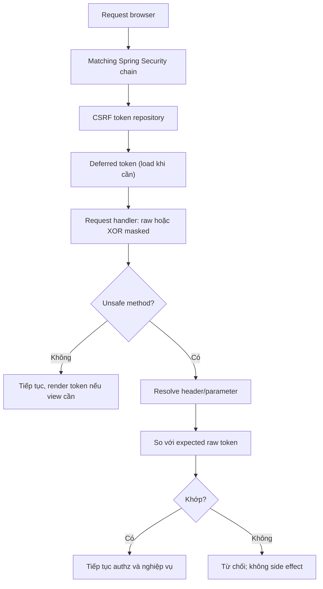
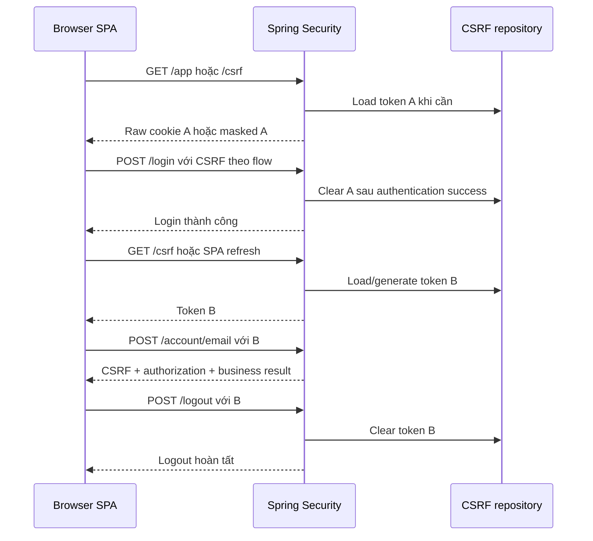
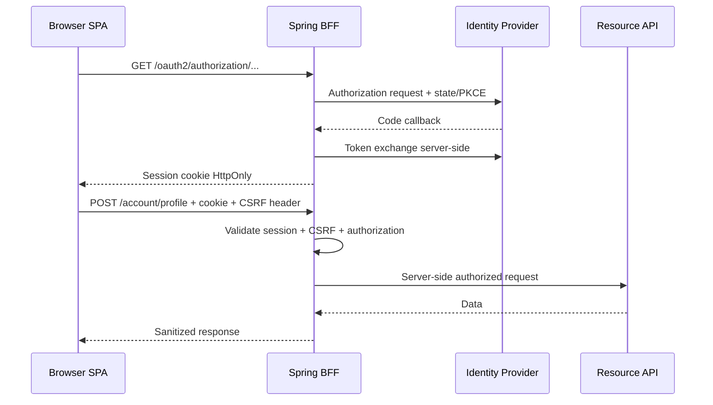

# Nâng cấu hình SPA theo API có trong phiên bản đích

## 1. Vấn đề và mục tiêu của bài học

Trong module **SPRING_SECURITY_HTTP_PROTECTION**, người học áp dụng các lớp phòng vệ HTTP và trình duyệt bằng Spring Security: **CSRF, CORS, security headers, CSP, HSTS, HTTP firewall và session protection**, trên cả **Servlet/Spring MVC** lẫn **Reactive/WebFlux**. Bài thuộc chương **Nâng cấp và tương thích** giải quyết một nguyên tắc quan trọng: **chọn cấu hình Single-Page Application (SPA) theo API thật sự được phiên bản Spring Security đích hỗ trợ**, không sao chép nhầm DSL và không tắt phòng vệ chỉ để sửa lỗi compile hoặc HTTP 403.

Một SPA có thể có nhiều hình thức xác thực:
- Backend dùng session cookie; frontend JavaScript gửi request bằng `fetch`.
- Frontend/backend khác origin, request vẫn dựa vào session cookie và CORS.
- BFF (Backend-for-Frontend) giữ OAuth tokens phía server; browser chỉ có session.
- API bearer-only nhận `Authorization: Bearer ...` do client chủ động gắn, không chấp nhận session/Basic/ambient credentials.
- Ứng dụng hỗn hợp có form render server, SPA, OAuth2 Login và public API.

**SPA là kiểu giao diện, không phải một bảo đảm stateless hoặc một lý do mặc định để `csrf.disable()`.** Đặc biệt, khi browser tự gửi cookie, các unsafe requests vẫn phải được bảo vệ chống CSRF theo threat model.

Sau bài, người học có thể:

1. Khóa exact Spring Security/Boot/Framework version và xác định các API SPA/CSRF có sẵn.
2. Phân biệt deferred CSRF loading, raw token, XOR masked token, repository và request handler.
3. Cấu hình session-based SPA ở Servlet bằng mixed raw-cookie header/XOR-form hoặc tiện ích built-in nếu phiên bản hỗ trợ.
4. Thiết kế phương án bootstrap token giữ deferred loading và an toàn sau login/logout.
5. Cấu hình WebFlux đúng SPI và lifecycle Reactive thay vì port mã Servlet.
6. Tích hợp CORS, cookie attributes, CSP/HSTS/COOP và HTTP firewall mà không làm rò dữ liệu.
7. Kiểm thử hành vi thực của SPA trước–sau nâng cấp, cả dương tính lẫn âm tính.

## 2. Kiến trúc SPA quyết định CSRF policy

CSRF xuất hiện khi attacker khiến browser của nạn nhân gửi request gây thay đổi trạng thái với **credentials được browser tự mang theo**, như session cookie. Dù browser không cho attacker đọc response do CORS/SOP, server vẫn có thể đã thực hiện lệnh.

| Kiến trúc | Credentials | CSRF quyết định ra sao? |
| --- | --- | --- |
| SPA + session cookie | Cookie phiên do browser tự gửi | Giữ CSRF cho POST/PUT/PATCH/DELETE theo threat model. |
| SPA cross-origin + session cookie | Cookie theo SameSite/Secure/credentials | CSRF + exact CORS origins + cookie policy + authorization. |
| BFF với OAuth2 Login | OAuth token server-side; browser dùng cookie BFF | Bảo vệ CSRF trên endpoint BFF và bảo vệ OAuth state/PKCE. |
| Bearer-only resource server | JS chủ động gửi Authorization, không ambient credentials | Có thể tách chain và cân nhắc bỏ CSRF nếu đã xác minh điều kiện. |
| Form server-rendered + SPA cùng ứng dụng | Cookie + hidden form token + header SPA | Cần protocol hỗ trợ cả masked form và raw header hoặc một format thống nhất. |
| Public GET catalog | Không có mutation | GET không được đổi trạng thái; vẫn cần CORS/headers thích hợp. |

**Không dựa vào tên `/api/**` hay từ “REST” để bỏ CSRF.** Kiểm tra endpoint có còn chấp nhận session cookie, HTTP Basic, remember-me hay authentication fallback không.

CSRF token cũng **không phải authorization**: user A có token đúng không được phép cập nhật tài khoản user B nếu backend kiểm tra owner/tenant đúng.

## 3. Khóa phiên bản đích trước khi chọn đoạn mã

Spring Boot thường quản lý phiên bản Spring Security qua dependency management. Nếu chỉ nhìn tên starter trong build file, có thể bỏ sót phiên bản được resolve thực tế hoặc override không đồng bộ.

Một hồ sơ nâng cấp tối thiểu phải có:

| Thành phần | Cần ghi |
| --- | --- |
| Spring Security | Exact version của `spring-security-web`, `spring-security-config` và `spring-security-test`. |
| Spring Boot/Framework | Exact versions tương thích với Security. |
| Java và container | Java runtime, Servlet API/container hoặc Reactor Netty/WebFlux. |
| Stack | Servlet/Spring MVC hay Reactive/WebFlux. |
| CSRF repository | Session, cookie, WebSession hoặc custom repository. |
| CSRF request handler | Plain, XOR, SPA built-in hoặc custom handler. |
| Authentication | Form session, BFF, OAuth2 Login, bearer-only hoặc hỗn hợp. |
| Các chain | Matcher, `@Order`, CSRF/CORS/headers/session settings của từng chain. |

Ví dụ lệnh **cho người học chạy trong dự án của mình**:

```bash
./mvnw dependency:tree -Dincludes=org.springframework.security

./gradlew dependencyInsight \
  --dependency spring-security-config \
  --configuration runtimeClasspath
```

Không xem lệnh ví dụ là kết quả đã thực thi của bài. Khi dự án nhiều module, phải xét runtimeClasspath của module triển khai thật.

### Bảng chọn hướng nâng cấp

| Target | Khả năng đáng chú ý | Hướng cấu hình |
| --- | --- | --- |
| 5.x trước 5.8 | Nhiều hệ thống dùng token flow cũ, chưa có đủ API hiện đại. | Baseline, chuẩn bị migration theo đúng guide. |
| 5.8 | Giai đoạn chuẩn bị API deferred/XOR cho 6.x. | Thử opt-in theo tài liệu phiên bản; test token wire format. |
| **6.x** | Deferred CSRF loading và XOR request handler mặc định trong Servlet theo tài liệu. | Mixed `SpaCsrfTokenRequestHandler` cho cookie raw hoặc bootstrap masked token. |
| **7.x với `CsrfConfigurer.spa()`** | Servlet API có tiện ích SPA; Javadoc ghi `spa()` từ 7.0. | Dùng built-in nếu đúng contract, không copy vào 6.x. |
| WebFlux ở mọi target | `ServerHttpSecurity`, `Mono<CsrfToken>` và Reactive CSRF SPI. | Kiểm tra API `CsrfSpec` **thực tế**, không suy nó giống Servlet `CsrfConfigurer`. |

**Nếu IDE không nhận ra `csrf.spa()`, đó là tín hiệu kiểm tra dependency và API, không phải chỉ thị bỏ CSRF.** Không tự ép một module Security mới vào Spring Boot cũ nếu chưa xác minh compatibility.

## 4. CSRF repository, deferred token và request handler làm gì?



| Servlet component | Trách nhiệm |
| --- | --- |
| `CsrfTokenRepository` | Sinh, lưu, tải **expected raw token**. |
| `HttpSessionCsrfTokenRepository` | Lưu token trong HttpSession, default thông dụng. |
| `CookieCsrfTokenRepository` | Lưu raw token ở cookie, thường `XSRF-TOKEN`. |
| `DeferredCsrfToken` | Tạo tham chiếu lazy, chưa cần load ngay trên mọi GET. |
| `CsrfTokenRequestHandler` | Expose token cho view và resolve token client gửi. |
| `XorCsrfTokenRequestAttributeHandler` | Mask token cho view và resolve masked token. |
| `CsrfTokenRequestAttributeHandler` | Handler plain, không thêm XOR masking. |
| `CsrfFilter` | Validate unsafe requests và xử lý CSRF errors. |

Reactive tương ứng dùng `CsrfWebFilter`, `ServerCsrfTokenRepository`, `ServerCsrfTokenRequestHandler` và `Mono<CsrfToken>`.

### Deferred token không đồng nghĩa không có session

Một GET không hiển thị token có thể không làm token được tạo, nhưng `SecurityContext`, saved request, controller hoặc handler khác vẫn có thể tạo session. Không suy từ `Set-Cookie` vắng hoặc có để khẳng định CSRF được bật/tắt.

## 5. XOR masking và raw cookie không cùng biểu diễn

Trong các cấu hình Spring Security hiện đại, XOR handler giúp giảm rủi ro từ **compression side channel kiểu BREACH** khi một CSRF token raw được lặp lại trong response nén.

```text
Repository có expected raw token R.

GET form lần 1:
  random M1 → maskedA = encode(M1 || (M1 XOR R))

GET form lần 2:
  random M2 → maskedB = encode(M2 || (M2 XOR R))

maskedA khác maskedB
decode(maskedA) = decode(maskedB) = R
```

Đây là mô hình nguyên lý, **không phải đặc tả byte/encoding thực tế**.

**Phân biệt ba sự kiện**:
- Repository giữ raw token R.
- View render masked token khác nhau theo request.
- Authentication/logout có thể clear R rồi tạo token mới R2.

XOR **không** tự rotate raw token và không phải mã hóa bảo vệ chống XSS. Nếu script độc hại chạy cùng origin, nó có thể đọc token được hiển thị cho script hoặc cookie không HttpOnly.

### Ma trận client protocol

| Nguồn token | Giá trị | Client gửi lại | Resolver phù hợp |
| --- | --- | --- | --- |
| Form render server | Masked | `_csrf` parameter | XOR handler. |
| Meta tag từ XOR view | Masked | Header theo masked protocol | XOR handler. |
| Cookie `XSRF-TOKEN` từ cookie repo | Raw | `X-XSRF-TOKEN` | Plain header handler. |
| `GET /csrf` trả masked token | Masked | Header theo masked protocol | XOR handler. |

**Không dùng mixed handler quy ước “header luôn raw” rồi gửi masked token endpoint trong cùng header.** Chọn một protocol nhất quán hoặc một handler có contract rõ hỗ trợ cả hai.

## 6. Deferred loading: vì sao SPA GET không tạo token?

Từ Spring Security 6.x, CSRF token loading được trì hoãn trong cấu hình thông dụng:
- GET `/api/public/catalog` không truy cập token → có thể không load repository.
- GET `/account/edit` render `_csrf.token` → token được load.
- GET `/csrf` trả token → token được load.
- POST `/account/email` → phải load expected token để validate.

Vì vậy **GET SPA shell trả 200 không đảm bảo cookie `XSRF-TOKEN` đã tồn tại**. Nếu frontend mong cookie ngay lập tức, phải thiết kế bootstrap hoặc chọn handler làm token được load.

| Phương án | Ưu điểm | Nhược điểm |
| --- | --- | --- |
| Built-in SPA config trên target có API | Ít custom code, theo framework. | Vẫn phải hiểu defaults và refresh lifecycle. |
| Mixed handler gọi `deferredToken.get()` | Cookie raw được phát/cập nhật khi cần theo flow. | Có thể mất lợi ích lazy trên nhiều GET. |
| Bootstrap `GET /csrf` | Chủ động khi cần, dễ giữ deferred cho public GET. | Frontend có request và protocol riêng. |
| Tắt deferred global | Giống một số flow legacy. | Repository/session load cao hơn, không sửa raw/masked mismatch. |

**Không xem việc ép load token mọi request là tối ưu**. Khi traffic GET lớn, nên đo repository calls/session access trước khi quyết định.

## 7. Cấu hình Servlet 6.x: mixed raw header và XOR form

Một SPA session-based đọc raw cookie rồi gửi header có thể dùng **request handler tùy biến** trên 6.x, giữ XOR cho HTML form nhưng resolve raw header bằng plain handler.

### 7.1. Request handler đầy đủ

```java
import java.util.function.Supplier;

import jakarta.servlet.http.HttpServletRequest;
import jakarta.servlet.http.HttpServletResponse;

import org.springframework.security.web.csrf.CsrfToken;
import org.springframework.security.web.csrf.CsrfTokenRequestAttributeHandler;
import org.springframework.security.web.csrf.CsrfTokenRequestHandler;
import org.springframework.security.web.csrf.XorCsrfTokenRequestAttributeHandler;
import org.springframework.util.StringUtils;

public final class SpaCsrfTokenRequestHandler
        implements CsrfTokenRequestHandler {

    private final CsrfTokenRequestHandler plain =
        new CsrfTokenRequestAttributeHandler();

    private final CsrfTokenRequestHandler xor =
        new XorCsrfTokenRequestAttributeHandler();

    @Override
    public void handle(
            HttpServletRequest request,
            HttpServletResponse response,
            Supplier<CsrfToken> deferredToken) {

        // Mask token khi đưa ra view/form.
        xor.handle(request, response, deferredToken);

        // Đảm bảo token được load để cookie repository có thể phát cookie.
        deferredToken.get();
    }

    @Override
    public String resolveCsrfTokenValue(
            HttpServletRequest request,
            CsrfToken expectedToken) {

        String suppliedHeader =
            request.getHeader(expectedToken.getHeaderName());

        // Header có nội dung: raw cookie token.
        // Không có header: masked form parameter.
        CsrfTokenRequestHandler resolver =
            StringUtils.hasText(suppliedHeader) ? plain : xor;

        return resolver.resolveCsrfTokenValue(
            request, expectedToken);
    }
}
```

**Đánh đổi kỹ thuật**: gọi `deferredToken.get()` trên mọi request đi qua handler làm giảm lợi ích deferred loading. Không sử dụng đoạn này khi app chỉ có server-rendered forms; các forms đó có thể dùng XOR default mà không cần mixed handler.

### 7.2. SecurityFilterChain

```java
import org.springframework.context.annotation.Bean;
import org.springframework.context.annotation.Configuration;
import org.springframework.security.config.annotation.web.builders.HttpSecurity;
import org.springframework.security.config.annotation.web.configuration.EnableWebSecurity;
import org.springframework.security.web.SecurityFilterChain;
import org.springframework.security.web.csrf.CookieCsrfTokenRepository;

@Configuration
@EnableWebSecurity
public class SpaSessionSecurityConfig {

    @Bean
    SecurityFilterChain web(HttpSecurity http) throws Exception {
        return http
            .authorizeHttpRequests(auth -> auth
                .requestMatchers("/app", "/login",
                                 "/assets/public/**").permitAll()
                .requestMatchers("/account/**").authenticated()
                .anyRequest().authenticated())
            .csrf(csrf -> csrf
                .csrfTokenRepository(
                    CookieCsrfTokenRepository.withHttpOnlyFalse())
                .csrfTokenRequestHandler(
                    new SpaCsrfTokenRequestHandler()))
            .formLogin(form -> form.permitAll())
            .build();
    }
}
```

Lưu ý:
- `/app` và `/login` phải có page/handler hợp lệ hoặc dùng login mặc định phù hợp.
- Ví dụ chưa định nghĩa user database/PasswordEncoder/tenant ACL và cookie/CORS/CSP business policy.
- `withHttpOnlyFalse()` cho JavaScript đọc **CSRF cookie**, không cho đọc session cookie.
- Phải kiểm tra cookie `Path`/`Domain`, `Secure`/`SameSite`, login/logout token lifecycle.
- Mã này dành cho **Servlet**, không phải WebFlux.
- Không đăng ký đồng thời hai fallback `SecurityFilterChain` nếu chưa thiết kế matcher và `@Order`.

## 8. Chọn built-in SPA API khi target thực sự hỗ trợ

Trong những bản Spring Security Servlet có `CsrfConfigurer.spa()`, Javadoc ghi API được giới thiệu từ **7.0**. Với các bản 7.x có method này, có thể thử:

```java
@Bean
SecurityFilterChain spaWeb(HttpSecurity http) throws Exception {
    return http
        .authorizeHttpRequests(auth -> auth
            .requestMatchers("/app", "/login",
                             "/assets/public/**").permitAll()
            .anyRequest().authenticated())
        .csrf(csrf -> csrf.spa())
        .build();
}
```

Đây là **phương án thay thế** cấu hình custom ở mục 7, không sử dụng cả hai đồng thời theo cách chồng chéo.

Trước khi dùng, kiểm tra:
1. Classpath và Javadoc **đúng minor/patch** có method `spa()`?
2. Method đó chọn repository và request handler ra sao?
3. Token cookie/raw header thực tế có đúng frontend contract không?
4. Form server-rendered cùng ứng dụng có còn dùng masked token hợp lệ không?
5. Token sau authentication/logout có được clear và cấp lại đúng không?
6. Có nhiều chains làm SPA request đi nhầm chain không?
7. Cookie Path/HttpOnly/SameSite/Secure có phù hợp môi trường thật không?

**Không copy `csrf.spa()` vào 6.x rồi khi compiler báo lỗi lại tắt `csrf` toàn site**. Dùng handler 6.x hoặc token bootstrap trong version chưa có API này.

## 9. Token bootstrap endpoint: giữ lazy behavior khi cần

Thay vì ép cookie raw được phát trên mọi GET, có thể cho SPA gọi `GET /csrf` chủ động khi khởi tạo hoặc sau login/logout, nhận token theo **masked protocol**.

### Servlet controller minh họa

```java
import org.springframework.http.CacheControl;
import org.springframework.http.ResponseEntity;
import org.springframework.security.web.csrf.CsrfToken;
import org.springframework.web.bind.annotation.GetMapping;
import org.springframework.web.bind.annotation.RestController;

@RestController
public class CsrfBootstrapController {

    @GetMapping("/csrf")
    public ResponseEntity<CsrfToken> csrf(CsrfToken token) {
        return ResponseEntity.ok()
            .cacheControl(CacheControl.noStore())
            .body(token);
    }
}
```

Trong ứng dụng MVC/Security đã cấu hình đúng, đọc `CsrfToken` có thể kích hoạt deferred loading. `token` được expose theo request handler; nếu XOR active, token trả cho frontend có thể là **masked representation**.

Rule minh họa:

```java
.authorizeHttpRequests(auth -> auth
    .requestMatchers(HttpMethod.GET, "/csrf").permitAll()
    .requestMatchers("/app", "/login").permitAll()
    .anyRequest().authenticated())
```

**Bắt buộc thêm**:
- Response `Cache-Control: no-store` qua proxy/CDN.
- Không mở CORS wildcard đọc token; giữ same-origin hoặc policy được duyệt.
- Nếu cần trước login, cho phép **GET /csrf** hẹp, không permitAll cả private API.
- Không trả session ID/OAuth code hoặc dữ liệu riêng khác cùng token.
- Không log token/cookie trong report, gateway, CI traces.
- Frontend refresh token sau login/logout.

### Không trộn masked bootstrap với raw-header resolver

Mixed handler ở mục 7 **coi header có text là raw**; gửi token masked từ endpoint trong header đó sẽ sai protocol. Nếu chọn masked bootstrap, phải giữ **XOR resolver** cho header này hoặc định nghĩa rõ cơ chế phân biệt hai kiểu token. Tốt nhất chọn **một phương án end-to-end** thay vì chắp vá nhiều snippets khác nhau.

## 10. Frontend ví dụ: masked token bootstrap

Đoạn JavaScript sau giả định `GET /csrf` trả JSON `{token, headerName, parameterName}` theo **masked protocol** và server chấp nhận masked token ở header:

```javascript
let csrf = null;

async function refreshCsrf() {
  const response = await fetch("/csrf", {
    method: "GET",
    credentials: "same-origin",
    cache: "no-store"
  });

  if (!response.ok) throw new Error("Không lấy được CSRF token");
  csrf = await response.json();
}

async function changeEmail(email) {
  if (!csrf) await refreshCsrf();

  const response = await fetch("/account/email", {
    method: "POST",
    credentials: "same-origin",
    headers: {
      "Content-Type": "application/json",
      [csrf.headerName]: csrf.token
    },
    body: JSON.stringify({ email })
  });

  if (!response.ok) throw new Error("Không cập nhật được email");
}
```

Không hard-code token trong JS build. Không tự retry mutation vô hạn khi HTTP 403: đó có thể là lỗi **authorization**, session đã hết hạn hoặc token stale. Nếu request trước đã có side effect, retry không kiểm soát còn có thể gây duplicate changes.

## 11. Frontend ví dụ: raw cookie/header với mixed handler

Với cấu hình Servlet mục 7, SPA đọc raw `XSRF-TOKEN` cookie rồi đặt trong `X-XSRF-TOKEN`.

```javascript
function readCookie(name) {
  const key = encodeURIComponent(name) + "=";
  const part = document.cookie
    .split("; ")
    .find(value => value.startsWith(key));
  return part ? decodeURIComponent(part.slice(key.length)) : null;
}

async function saveProfile(profile) {
  const token = readCookie("XSRF-TOKEN");
  if (!token) throw new Error("Thiếu CSRF cookie; cần refresh");

  const response = await fetch("/account/profile", {
    method: "PATCH",
    credentials: "same-origin",
    headers: {
      "Content-Type": "application/json",
      "X-XSRF-TOKEN": token
    },
    body: JSON.stringify(profile)
  });

  if (!response.ok) throw new Error("Không lưu được hồ sơ");
}
```

**Các giả định của snippet**:
- Frontend/backend same-origin; cross-origin cần `credentials: "include"` và CORS/cookie setup phù hợp.
- Cookie được set với Path/Domain cho phép JS tại SPA route đọc.
- `CookieCsrfTokenRepository.withHttpOnlyFalse()` đã được lựa chọn có chủ đích.
- Session cookie vẫn nên HttpOnly; CSRF cookie không thay session cookie.
- Frontend phải refresh token sau login/logout và không dùng giá trị stale.
- Cookie parser chỉ là ví dụ; dùng utility phù hợp nếu app hỗ trợ nhiều encoding/path phức tạp.

## 12. Login/logout và vòng đời CSRF token

Các thành phần Spring Security như `CsrfAuthenticationStrategy` và `CsrfLogoutHandler` có thể **xóa token cũ** khi authentication thành công và logout. Deferred loading nghĩa là token mới có thể **chưa được load và phát** ngay trên response vừa clear token.



### Kịch bản lỗi

1. SPA nhận A trước login.
2. Login thành công và repository clear A.
3. SPA vẫn gửi A vào POST đầu tiên vì chưa refresh.
4. Request bị từ chối; team nghĩ `csrf.spa()` hoặc XOR hỏng.

**Cách xử lý đúng**: refresh sau trạng thái authentication mới đã có hiệu lực. Với OAuth2/OIDC login, refresh sau callback/redirect/success workflow thực tế, không chỉ sau click nút login. Khi logout, token mới cho anonymous flow có thể cần được cấp nếu UI vẫn có form.

**Phân biệt lỗi session**: nếu GET private sau login lại thành anonymous, kiểm tra `SecurityContextRepository`/WebSession, session cookie, `STATELESS` chain và login handler. Không quy mọi 302 login loop cho XOR/CSRF.

## 13. Cookie attributes và session security

`CookieCsrfTokenRepository.withHttpOnlyFalse()` là **trade-off**, không phải default an toàn tuyệt đối. Khi JavaScript đọc CSRF cookie, XSS cùng origin cũng có thể đọc nó.

| Thuộc tính | Session cookie | CSRF cookie SPA |
| --- | --- | --- |
| `HttpOnly` | Thường true. | Có thể false nếu JavaScript cần raw token. |
| `Secure` | Bật trong HTTPS production. | Tương tự HTTPS. |
| `SameSite` | Theo chính sách session/OAuth/cross-site. | Cần phù hợp API và bootstrap. |
| `Path` | Phải bao phủ endpoint cần session. | Phải cho SPA đọc token và request relevant. |
| `Domain` | Hạn chế host/subdomain được chia sẻ. | Không chia sẻ rộng ngoài nhu cầu. |
| Rotation | Login/logout/session fixation policies. | CSRF clear/new token lifecycle. |

`https://app.example.com` và `https://api.example.com` **khác origin** dù có thể **cùng site**; CORS cho `fetch` vẫn cần, và `SameSite` không thay `Origin` policy. Ngược lại `SameSite=None` không tự khiến request an toàn khỏi CSRF.

Khi qua reverse proxy có prefix `/learning`, kiểm tra Path/Domain thực trong browser cùng `contextPath`/`servletPath`/`securityMatcher` phía server. Không mở cookie Domain quá rộng hoặc tắt HttpOnly session cookie chỉ để giải quyết lỗi frontend.

## 14. Tách API bearer-only và session SPA bằng chain

Với Servlet, có thể dùng nhiều `SecurityFilterChain` để tránh một `csrf.disable()` toàn web. Ví dụ minh họa này là **phương án thay thế** cấu hình single-chain ở mục 7:

```java
import org.springframework.context.annotation.Bean;
import org.springframework.context.annotation.Configuration;
import org.springframework.core.annotation.Order;
import org.springframework.security.config.Customizer;
import org.springframework.security.config.annotation.web.builders.HttpSecurity;
import org.springframework.security.config.http.SessionCreationPolicy;
import org.springframework.security.web.SecurityFilterChain;

@Configuration
public class SplitApiAndWebConfig {

    @Bean
    @Order(1)
    SecurityFilterChain bearer(HttpSecurity http) throws Exception {
        return http
            .securityMatcher("/api/bearer/**")
            .authorizeHttpRequests(auth -> auth
                .anyRequest().authenticated())
            .oauth2ResourceServer(oauth -> oauth
                .jwt(Customizer.withDefaults()))
            .sessionManagement(session -> session
                .sessionCreationPolicy(SessionCreationPolicy.STATELESS))
            .csrf(csrf -> csrf.disable())
            .build();
    }

    @Bean
    @Order(2)
    SecurityFilterChain sessionWeb(HttpSecurity http)
            throws Exception {
        return http
            .authorizeHttpRequests(auth -> auth
                .requestMatchers("/app", "/login").permitAll()
                .requestMatchers("/account/**").authenticated()
                .anyRequest().authenticated())
            .formLogin(Customizer.withDefaults())
            .build();
    }
}
```

**Điều kiện**: `/api/bearer/**` thật sự chỉ nhận bearer JWT do client chủ động gửi, có decoder phù hợp, không chấp nhận session cookie/HTTP Basic/remember-me authentication. Nếu điều kiện này không đúng, **không copy `csrf.disable()`**.

Các lưu ý:
- Matcher hẹp đứng trước fallback, vì Spring Security chọn **chain khớp đầu tiên**, không cộng dồn chính sách.
- `/api/bearer` root có thể không match `/api/bearer/**` trong mọi parser/version; test riêng.
- Chain web mặc định giữ CSRF, nhưng cần bổ sung **SPA token protocol** phù hợp vào chính chain web.
- Không dùng `permitAll` thay CSRF/authorization.
- JWT scope/tenant/object authorization vẫn phải thực hiện tại API, không chỉ kiểm tra signature.

## 15. CORS: SPA khác origin + session credentials

Nếu frontend ở `https://app.example.com` và backend ở `https://api.example.com`, request JavaScript là cross-origin. Khi dùng cookie session, phải cấu hình **CORS và CSRF độc lập**.

```http
OPTIONS /account/email HTTP/1.1
Origin: https://app.example.com
Access-Control-Request-Method: PATCH
Access-Control-Request-Headers: content-type,x-xsrf-token
```

Cấu hình Servlet minh họa:

```java
import java.util.List;
import org.springframework.context.annotation.Bean;
import org.springframework.web.cors.CorsConfiguration;
import org.springframework.web.cors.CorsConfigurationSource;
import org.springframework.web.cors.UrlBasedCorsConfigurationSource;

@Bean
CorsConfigurationSource spaCors() {
    CorsConfiguration cors = new CorsConfiguration();
    cors.setAllowedOrigins(List.of("https://app.example.com"));
    cors.setAllowedMethods(List.of(
        "GET", "HEAD", "POST", "PATCH", "DELETE", "OPTIONS"));
    cors.setAllowedHeaders(List.of(
        "Content-Type", "X-XSRF-TOKEN"));
    cors.setAllowCredentials(true);

    UrlBasedCorsConfigurationSource source =
        new UrlBasedCorsConfigurationSource();
    source.registerCorsConfiguration("/account/**", cors);
    return source;
}
```

Tích hợp vào **matching chain**:

```java
.cors(cors -> cors.configurationSource(spaCors()))
```

Đây là các snippet; đưa bean vào cấu hình đúng cách, không để MVC/Security/gateway phát hai CORS policies mâu thuẫn. Preflight thường **không có session cookie**, nên CORS phải được xử lý trước khi authentication gây `401`/`302` sai.

**Không trả kết hợp** `Access-Control-Allow-Origin: *` và `Access-Control-Allow-Credentials: true` cho credentialed browser requests. Khi origin được chọn động, xét `Vary: Origin` và cache key đúng. `Access-Control-Allow-Origin` không phải ACL backend: HTTP client không chịu CORS browser.

### Đừng nhầm CORS với CSRF

Một cross-origin form có thể gửi mutation dựa vào cookie và gây side effect **ngay cả khi attacker không đọc response**. Chính vì vậy CORS allowlist không thay CSRF token. Nếu SPA dùng `credentials: "include"`, phải đánh giá `SameSite`/`Secure` và chính sách browser thật, không chỉ status HTTP.

## 16. Security headers và browser isolation: nâng SPA không chỉ là CSRF

Một SPA còn phụ thuộc vào:
- `X-Content-Type-Options: nosniff` và MIME type đúng cho JavaScript/CSS.
- `Content-Security-Policy` kiểm soát scripts, connections, workers, iframes và inline code.
- `Referrer-Policy` hạn chế dữ liệu URL đi theo navigation/request.
- `X-Frame-Options` hoặc CSP `frame-ancestors` để ngăn framing không mong muốn.
- `Strict-Transport-Security` cho HTTPS.
- `Cross-Origin-Opener-Policy`, `Cross-Origin-Embedder-Policy` và `Cross-Origin-Resource-Policy` khi cần cô lập cửa sổ/tài nguyên.

Một migration đổi `SecurityFilterChain` có thể khiến SPA HTML đi sang **chain khác**, mất headers hoặc được áp một CSP quá chặt. Đừng nhầm lỗi `fetch` do CSP `connect-src` với lỗi CSRF token, hoặc lỗi ảnh do COEP/CORP với CORS API.

### Ví dụ CSP điểm khởi đầu, không phải cấu hình phổ quát

```java
// Đoạn trích Servlet HttpSecurity:
.headers(headers -> headers
    .contentSecurityPolicy(csp -> csp
        .policyDirectives(
            "default-src 'self'; object-src 'none'; " +
            "base-uri 'self'; frame-ancestors 'none'; " +
            "script-src 'self'; connect-src 'self'")))
```

Policy này **có thể phá** SPA dùng CDN, websocket, inline scripts, worker, OAuth iframe hoặc API khác origin. Khi cấu hình theo sản phẩm, xây resource inventory và cân nhắc nonce/hash/report-only rollout. Không thêm `'unsafe-inline'` vô hạn chỉ để sửa frontend.

### COOP/COEP và OAuth popup

```http
Cross-Origin-Opener-Policy: same-origin
Cross-Origin-Embedder-Policy: require-corp
```

Có thể cần cho trang sử dụng cross-origin isolation, nhưng áp toàn SPA có thể phá `window.opener` trong OAuth popup hoặc chặn tài nguyên CDN thiếu CORP/CORS. Chọn policy theo **đúng trang opener/isolated** và test browser. Không kết luận `fetch` bị CORS khi Console thực ra chỉ ra COEP hoặc CSP.

### HSTS và proxy

```http
Strict-Transport-Security: max-age=31536000; includeSubDomains
```

HSTS có hiệu lực khi browser nhận qua HTTPS hợp lệ. Nếu TLS kết thúc ở ingress rồi HTTP nội bộ tới Spring, kiểm tra trusted forwarded headers và **response cuối qua hostname thật**. Không viết HSTS tĩnh trên HTTP chỉ để test pass. `includeSubDomains`/preload yêu cầu đánh giá toàn bộ hệ thống.

### Không tắt toàn bộ header writers

```java
// Anti-pattern: vô hiệu hóa mọi security headers để chữa một SDK.
http.headers(headers -> headers.disable());
```

Việc này có thể làm mất HSTS, `nosniff` và XFO. Nếu lỗi nằm ở CSP/COOP/CORP, sửa đúng route/response owner; nếu lỗi là CSRF raw/masked mismatch, sửa request handler/token protocol.

## 17. BFF/OAuth2 Login: browser dùng session, token OAuth ở server

Mô hình Backend-for-Frontend giúp browser tránh phải giữ OAuth access/refresh tokens dài hạn:



Với BFF:
- OAuth2 state/PKCE bảo vệ **luồng OAuth**, không thay CSRF cho các `POST /account/**` sau login.
- Browser chỉ cần session cookie HttpOnly; không cần đưa OAuth token vào `localStorage` để thực hiện request BFF.
- BFF vẫn cần CSRF token/protocol, session fixation protection, logout policy và object/tenant authorization.
- Sau callback OAuth2 thành công, CSRF token cũ có thể bị clear; SPA phải bootstrap/refresh theo session mới.
- Nếu dùng popup, COOP và quan hệ `window.opener`/`postMessage` phải được test riêng. Verify `event.origin`, `event.source` và state; không đưa access token nhạy cảm qua `postMessage` nếu có thể tránh.

**BFF không đồng nghĩa endpoint nào cũng được `permitAll`**. Chỉ mở login start/callback/public routes theo đúng framework, giữ `/account/**` theo authentication/authorization.

### So sánh BFF và bearer SPA

| Vấn đề | BFF + session | SPA trực tiếp bearer |
| --- | --- | --- |
| Nơi giữ OAuth tokens | Server | Client theo thiết kế có kiểm soát. |
| Browser tự gắn credentials tới app backend | Có session cookie. | Thường không với API bearer-only. |
| CSRF cho mutation của app | Cần theo session threat model. | Xem threat model bearer-only, không mặc định. |
| XSS | Có thể điều khiển request cùng origin dù token OAuth không lộ. | Có thể đánh cắp token nếu lưu trong JS-accessible storage. |
| CORS | Có thể tránh trên browser → BFF same-origin. | Có thể cần CORS tới resource API. |
| Logout/token lifecycle | Session và CSRF refresh + OAuth logout nếu cần. | Access/refresh token revocation/expiry theo design. |

Chọn kiến trúc từ mục tiêu sản phẩm, không quyết định bằng việc API Spring Security nào viết ngắn hơn.

## 18. WebFlux: CSRF stack và version-aware configuration

Reactive Spring Security không dùng `HttpServletRequest` hay `HttpSession`. Thay vào đó:
- `ServerHttpSecurity` và `SecurityWebFilterChain`.
- `CsrfWebFilter`, `ServerCsrfTokenRepository`.
- Token được expose qua `Mono<CsrfToken>` trong `ServerWebExchange`.
- `ServerCsrfTokenRequestHandler` và, trên dòng hiện đại, `XorServerCsrfTokenRequestAttributeHandler`.

### Mẫu WebFlux giữ CSRF mặc định

```java
import org.springframework.context.annotation.Bean;
import org.springframework.context.annotation.Configuration;
import org.springframework.security.config.annotation.web.reactive.EnableWebFluxSecurity;
import org.springframework.security.config.web.server.ServerHttpSecurity;
import org.springframework.security.web.server.SecurityWebFilterChain;

@Configuration
@EnableWebFluxSecurity
public class ReactiveSessionSpaConfig {

    @Bean
    SecurityWebFilterChain web(ServerHttpSecurity http) {
        return http
            .authorizeExchange(auth -> auth
                .pathMatchers("/app", "/login", "/csrf")
                    .permitAll()
                .anyExchange().authenticated())
            .formLogin(form -> {})
            .build();
    }
}
```

Đây là cấu hình minh họa, không có user store hoặc `GET /csrf` handler. Nó **không** tự biến mọi response thành stateless. `WebSession` vẫn có thể được sử dụng.

### Explicit XOR nếu target hỗ trợ

```java
import org.springframework.security.web.server.csrf.XorServerCsrfTokenRequestAttributeHandler;

// Đoạn trích ServerHttpSecurity:
.csrf(csrf -> csrf
    .csrfTokenRequestHandler(
        new XorServerCsrfTokenRequestAttributeHandler()))
```

Dòng Spring Security 6.x WebFlux dùng XOR handler mặc định theo tài liệu; không cần cấu hình lại chỉ để “bật XOR” nếu default không bị override. Với target khác, kiểm tra Javadoc.

### Tại sao không copy Servlet handler?

Lớp Servlet mixed handler dùng:
 
```java
Supplier<CsrfToken>
HttpServletRequest
HttpServletResponse
```

Trong Reactive, token là `Mono<CsrfToken>`, request là `ServerWebExchange`. Copy code với đổi import cơ học không phù hợp reactive lifecycle hoặc có thể block event loop.

## 19. WebFlux bootstrap token qua Mono: một phương án rõ ràng

Nếu muốn SPA gửi masked token từ `GET /csrf`, WebFlux có thể expose `Mono<CsrfToken>` theo contract của `CsrfWebFilter`.

```java
import org.springframework.http.CacheControl;
import org.springframework.http.ResponseEntity;
import org.springframework.security.web.server.csrf.CsrfToken;
import org.springframework.web.bind.annotation.GetMapping;
import org.springframework.web.bind.annotation.RestController;
import org.springframework.web.server.ServerWebExchange;
import reactor.core.publisher.Mono;

@RestController
public class ReactiveCsrfController {

    @GetMapping("/csrf")
    public Mono<ResponseEntity<CsrfToken>> csrf(
            ServerWebExchange exchange) {

        Mono<CsrfToken> token =
            exchange.getAttribute(CsrfToken.class.getName());

        if (token == null) {
            return Mono.error(
                new IllegalStateException("CSRF filter unavailable"));
        }

        return token.map(value ->
            ResponseEntity.ok()
                .cacheControl(CacheControl.noStore())
                .body(value));
    }
}
```

**Điều kiện**:
- Request thật sự đi qua Reactive security chain có `CsrfWebFilter`.
- Exchange attribute `CsrfToken.class.getName()` được cung cấp bởi version đang dùng.
- Mono được **subscribe** khi WebFlux thực thi response; không dùng `block()` trong event loop.
- Handler xác định token trả về là masked/plain; frontend gửi đúng representation.
- Endpoint không được cache hoặc public cross-origin tùy tiện.

### Form WebFlux

Nếu dùng Thymeleaf/WebFlux form, phải bảo đảm token Mono được xử lý/expose đúng cho view, tránh in `Mono.toString()` vào hidden input. Tùy integration template, Spring có thể hỗ trợ `_csrf` tự động; đo HTML thật để tránh hai hidden fields trùng.

## 20. WebFlux cookie raw và request handler không tự khớp

Một repository Reactive có thể lưu raw token trong cookie:

```java
import org.springframework.security.web.server.csrf.CookieServerCsrfTokenRepository;

// Trong ServerHttpSecurity builder:
.csrf(csrf -> csrf
    .csrfTokenRepository(
        CookieServerCsrfTokenRepository.withHttpOnlyFalse()))
```

Nhưng `CookieServerCsrfTokenRepository` **chỉ giải quyết storage**; nó không bảo đảm XOR resolver mặc định trong mọi bản nhận raw header từ SPA.

Nếu dùng raw-cookie-header protocol trên WebFlux, phải:
1. Kiểm tra `ServerCsrfTokenRequestHandler`/resolver hỗ trợ trên exact version.
2. Nếu cần mixed raw-header/XOR-form, viết/test **Reactive implementation** theo SPI có sẵn, không copy Servlet.
3. Hoặc chọn `GET /csrf` trả masked token và giữ XOR resolver nhất quán.
4. Test `Mono<CsrfToken>` được tiêu thụ và token refresh sau login/logout.
5. Đảm bảo cookie Path/SameSite/HttpOnly/Secure và authorization phù hợp.

**Không suy `csrf.spa()` của Servlet chắc chắn có method tương đương trong WebFlux `CsrfSpec`**. Nếu API chưa có, chọn phương án Reactive được tài liệu phiên bản hỗ trợ.

## 21. Kiểm thử Servlet: authorization, CSRF và security headers

Với `spring-security-test` và MockMvc, xác minh request unsafe bị từ chối khi thiếu/sai token và được xét tiếp khi có token:

```java
mockMvc.perform(post("/account/email")
        .with(user("learner"))
        .param("email", "new@example.test"))
    .andExpect(status().isForbidden());

mockMvc.perform(post("/account/email")
        .with(user("learner"))
        .with(csrf().useInvalidToken())
        .param("email", "new@example.test"))
    .andExpect(status().isForbidden());

mockMvc.perform(post("/account/email")
        .with(user("learner"))
        .with(csrf())
        .param("email", "new@example.test"))
    .andExpect(status().is2xxSuccessful());
```

Đây là **thân test**, cần `MockMvc`, test dependency, controller/fixture và static imports. Success response có thể `200/204/302` tùy nghiệp vụ; assertion phải dựa contract thật.

**Đừng chỉ test HTTP status**:
- Thiếu/sai CSRF token → dữ liệu không đổi.
- Token hợp lệ nhưng user A cố sửa tài khoản user B → vẫn bị từ chối.
- Token và quyền đều đúng → update đúng object.
- Anonymous vào route private → không nhận dữ liệu.

### Kiểm thử headers

```java
mockMvc.perform(get("/account").with(user("learner")))
    .andExpect(header().string(
        "X-Content-Type-Options", "nosniff"))
    .andExpect(header().string(
        "X-Frame-Options", "DENY"));
```

Nếu product đã cố ý dùng `SAMEORIGIN`/CSP `frame-ancestors` trên một route, test phải theo policy đã duyệt. Một response MockMvc **không gồm CDN/gateway headers**.

### HSTS trên HTTPS

```java
mockMvc.perform(get("/account")
        .secure(true)
        .with(user("learner")))
    .andExpect(header().exists("Strict-Transport-Security"));
```

Không kết luận HSTS production đúng chỉ vì MockMvc `secure(true)` pass; cần HTTPS thực qua reverse proxy.

## 22. Kiểm thử raw cookie vs masked token trên Servlet

`with(csrf())` của `spring-security-test` giúp kiểm tra CSRF enforcement, nhưng có thể **không mô phỏng đúng cookie/header wire-format** mà SPA dùng.

Một integration test cần chạy qua filter chain/template thực với **cùng cookie jar**:

1. GET `/account/edit` hai lần trong cùng session → trích `maskedA`, `maskedB`.
2. Với XOR enabled, masked values có thể khác nhau dù expected raw token chưa rotate.
3. Submit form với masked token đúng → qua CSRF check.
4. Đọc `XSRF-TOKEN` cookie raw; xác nhận nó **khác biểu diễn** với hidden form token.
5. Gửi `X-XSRF-TOKEN: raw` với mixed handler → qua CSRF check.
6. Gửi masked token vào header mà handler quy định raw → test mismatch.
7. Gửi token của session khác → bị từ chối.
8. Login/logout làm clear token → token cũ không còn hợp lệ, token mới được refresh.

### Bảng kết quả cần ghi

| Case | Protocol | Kết quả bảo mật |
| --- | --- | --- |
| Form masked + XOR | `_csrf` parameter | Token hợp lệ được resolve; authz vẫn hoạt động. |
| SPA raw cookie + mixed handler | `X-XSRF-TOKEN` header | Token hợp lệ được resolve. |
| Masked header + raw-only header resolver | Sai contract | Từ chối hoặc sửa client contract. |
| Thiếu header/parameter | Không có token | Từ chối unsafe request. |
| Invalid token | Giá trị không khớp repo | Từ chối, không side effect. |
| Token trước login sau successful login | Stale | Từ chối nếu lifecycle đã invalidate. |
| Token đã refresh sau login | Đúng session | Được xét tiếp authentication và authorization. |

Không chụp/log giá trị token thật trong báo cáo test. Chỉ ghi loại representation, token present/absent, status và side effect.

## 23. Kiểm thử deferred loading bằng repository instrumentation

Khi nâng cấp từ eager sang deferred, test bằng **repository spy** hoặc instrumentation test-only để đếm `loadToken`, `generateToken` và `saveToken`, không lưu giá trị token.

```text
Scenario A — GET /api/public/catalog
  Controller không chạm CsrfToken.
  Deferred implementation: tránh load/generate nếu không cần.

Scenario B — GET /account/edit
  View render hidden _csrf.
  Token phải được load/expose.

Scenario C — GET /csrf
  Bootstrap endpoint trả token.
  Token phải được load theo contract.

Scenario D — POST /account/email
  Unsafe request.
  Expected token phải được kiểm tra.

Scenario E — Mixed handler gọi deferredToken.get()
  GET không dùng token cũng có thể load repository.
```

**Không dùng `request.getSession(false) == null` hay vắng `Set-Cookie` như bằng chứng duy nhất**. Authentication, saved request hoặc controller khác có thể tạo session.

### Kiểm thử hiệu năng thực

Đo số repository calls, session creations, latency và workload GET tại cùng cấu hình filters, không so một app mock ít security filters với staging có toàn bộ chain. Nếu ép load mọi GET làm tăng tải, cân nhắc bootstrap token thay thế.

## 24. WebTestClient: kiểm thử Reactive CSRF và WebSession

Dùng `spring-security-test` cho WebFlux:

```java
webTestClient.mutateWith(mockUser("learner"))
    .post().uri("/account/email")
    .bodyValue("email=new@example.test")
    .exchange()
    .expectStatus().isForbidden();

webTestClient.mutateWith(mockUser("learner"))
    .mutateWith(csrf())
    .post().uri("/account/email")
    .bodyValue("email=new@example.test")
    .exchange()
    .expectStatus().is2xxSuccessful();
```

`mockUser` và `csrf()` là các Reactive test configurers, không phải helpers Servlet. Body/content-type phải phù hợp controller fixture, và status success phụ thuộc handler.

Bổ sung:
- GET `/csrf` được subscribe và trả masked token theo protocol.
- POST với token đúng trên cùng WebSession → được xét tiếp authz.
- Token của WebSession khác/sai/stale → bị từ chối.
- Login→request sau→logout với cùng cookie context, xác minh principal/state.
- CORS origin hợp lệ/không hợp lệ và CSRF lifecycle độc lập.
- Không gọi blocking `Mono.block()` trong request filter/controller.

`WebTestClient.mutateWith(csrf())` vẫn là helper; cần thêm test wire-format thật nếu SPA dùng raw cookie và custom resolver.

## 25. Kiểm thử CORS preflight và cookies

Giả sử `https://app.example.com` được phép đọc API `https://api.example.com` dùng session:

```http
OPTIONS /account/email HTTP/1.1
Origin: https://app.example.com
Access-Control-Request-Method: PATCH
Access-Control-Request-Headers: content-type,x-xsrf-token
```

Test:
1. Origin hợp lệ → preflight trả policy đúng method/headers/credentials.
2. Origin lạ → không nhận `Access-Control-Allow-Origin` cho phép.
3. Same origin → không gây CORS challenge ngoài ý muốn.
4. API `GET` công khai không tự mở CORS cho toàn bộ `/account/**`.
5. Session cookie có `SameSite`/`Secure`/`Path`/`Domain` đúng để browser gửi khi được phép.
6. `OPTIONS` không bị redirect `/login` hoặc `401` trước CORS processing theo design.
7. Khi origin được phản chiếu động, `Vary: Origin` và cache key đúng.

**CORS response không phải authentication**. Test thêm direct HTTP client không có quyền, bất kể origin header, vẫn không đọc dữ liệu private.

### Cookie không đọc được từ origin khác

JavaScript chạy ở `app.example.com` **không mặc định đọc được cookie host-only của `api.example.com`**. Chỉ vì chúng cùng site không có nghĩa `document.cookie` thấy cùng cookie.

Giải pháp cân nhắc:
- Dùng BFF same-origin để đơn giản hóa browser credentials.
- Thiết kế endpoint token bootstrap có CORS origin cụ thể và no-store (nếu được phê duyệt).
- Cân nhắc Domain cookie chia sẻ chỉ sau review security: subdomain khác cũng có thể truy cập/ghi trong phạm vi cho phép.
- Không tạo cookie Domain rộng tùy tiện hoặc bật JavaScript đọc session cookie.

## 26. Browser E2E: SPA sau nâng cấp phải chạy đúng chức năng

Một bộ kiểm thử HTTP có thể pass trong khi browser thật vẫn lỗi bởi CSP, COOP/COEP, SameSite, third-party cookies, redirect và token stale.

### Ma trận E2E

| Chức năng | Kiểm tra tại browser |
| --- | --- |
| Mở SPA | HTML/CSS/JS tải đúng MIME, `nosniff` không chặn script hợp lệ. |
| Bootstrap token | Token cookie/endpoint hiện diện theo protocol, không lộ vào log. |
| Login/session | Redirect/iframe/popup phù hợp, principal đúng sau login. |
| POST/PATCH | Token đúng thành công, thiếu token bị từ chối và không side effect. |
| Logout | Cũ session/token không còn dùng để thay dữ liệu. |
| Reload/multi-tab | Token không bị stale ngoài thiết kế, có thông báo/refresh rõ. |
| Cross-origin API | Origin hợp lệ làm `fetch` đúng, origin khác bị từ chối. |
| CSP/connect-src | API/worker/websocket chỉ hoạt động khi policy cho phép. |
| COOP/OAuth popup | `window.opener` và callback hoạt động hoặc có fallback. |
| COEP/CORP CDN | Ảnh/script resource ngoài origin được dùng đúng policy. |
| HSTS/cookies | HTTPS và browser cookie flags đáp ứng contract. |

### Playwright smoke test minh họa

```typescript
import { test, expect } from "@playwright/test";

test("SPA được phát với baseline headers", async ({ page }) => {
  // Trước test, cung cấp login storage state qua fixture hợp lệ.
  const response = await page.goto(
    "https://learn.example.test/app"
  );

  expect(response).not.toBeNull();
  const headers = response!.headers();
  expect(headers["x-content-type-options"]).toBe("nosniff");
});

test("token bootstrap không bị cache công khai", async ({ page }) => {
  const response = await page.request.get(
    "https://learn.example.test/csrf"
  );

  expect(response.ok()).toBeTruthy();
  expect(response.headers()["cache-control"]).toContain("no-store");
  // Không in token trong CI logs.
});
```

Đây chỉ là smoke tests; cần thêm browser tests cho request thiếu token, đúng token, login/logout, cross-origin denial và side effect. Không dùng fixture cookie đoán được trong production. **Playwright WebKit không thay tất cả Safari/iOS thực** khi sản phẩm hỗ trợ các nền tảng đó.

## 27. Lỗi thường gặp và cách chẩn đoán theo tầng

| Triệu chứng | Nguyên nhân có thể | Kiểm tra trước khi sửa |
| --- | --- | --- |
| `csrf.spa()` không compile | Version/stack không có API | Resolved dependency, Javadoc đúng version, Servlet vs Reactive. |
| GET `/app` OK, POST đầu tiên 403 | Deferred token chưa bootstrap | Kiểm tra raw cookie/endpoint, token loading. |
| Hidden `_csrf` đổi mỗi GET | XOR masking đúng | So expected raw trong repo và form submit thực. |
| Cookie raw và header raw giống nhưng 403 | Handler XOR kỳ vọng masked | Mixed raw-header handler hoặc protocol masked. |
| POST lỗi ngay sau login | Token trước login bị clear | Refresh token sau auth success. |
| POST logout 403 | Thiếu token hoặc sai method | Logout POST với token hợp lệ. |
| GET `/csrf` trả thiếu dữ liệu | Endpoint sai chain/request attribute | CSRF filter, handler, Controller/Reactive Mono. |
| OPTIONS bị 302/401 | CORS processor chưa ở đúng chain | Preflight, CorsConfigurationSource, filter order. |
| SPA cookie không đọc được | HttpOnly/Path/Domain khác origin | Browser cookie attributes, same-site vs same-origin. |
| API `fetch` bị browser chặn | CSP, CORS, COEP hoặc network | Console/Network, response/header owner. |
| Login thành công nhưng GET private anonymous | SecurityContext/session persistence | Repository, cookie, `STATELESS` matcher. |
| File CDN bị chặn trên isolated page | COEP/CORP/CORS response asset | Kiểm tra CDN resource và request mode. |
| Static asset mất `nosniff` | `web.ignoring` hoặc CDN bypass chain | Prefer `permitAll` qua chain, hoặc headers ở CDN. |
| CSRF token đúng nhưng vẫn 403 | Owner/tenant/role authorization | Tách CSRF exception với AccessDenied nghiệp vụ. |
| `with(csrf())` pass, browser fail | Mock không mô phỏng raw/masked wire format | Integration HTTP thật, form/SPA cookie jar. |
| GET public tạo session quá nhiều | Handler ép deferred load | Đếm repo calls, tối ưu bootstrap/chain. |

**Không tắt CSRF, CORS, HTTP firewall hoặc toàn bộ security headers chỉ để chữa một lỗi chưa xác định nguyên nhân.** Ghi route, method, matching chain, handler/repository, session state, token representation type và outcome mà không lộ token.

## 28. Observability và canary khi chuyển sang SPA API mới

Một migration an toàn nên theo dõi:
- `403` do CSRF thiếu/sai/stale (phân loại bằng cơ chế đã được version hỗ trợ).
- `401/302` và login redirect loops.
- CORS preflight rejections theo route và origin **đã chuẩn hóa**, không lưu dữ liệu nhạy cảm.
- CSRF bootstrap failures và số lần retry frontend.
- Số repository calls/session creations trên GET trước và sau deferred/handler changes.
- Header policy errors trong browser Console (CSP violations, COEP/CORP, mixed content).
- 5xx của custom token handler, authentication filter, resource server.

### Giới hạn dữ liệu log

Được ghi: method, route group, actor category (không định danh cá nhân), chain identifier nếu được instrument đúng, status, CSRF error type, latency.

Không ghi: raw/masked CSRF token, session IDs, `Authorization`, cookies, OAuth authorization code, PKCE verifier, password hoặc request body cá nhân.

### Canary/rollback

Triển khai theo môi trường và nhóm user có rollback:
1. Staging dùng session/token flows thật.
2. Canary cho tập nhỏ, quan sát lỗi CSRF/login/CORS/cookies.
3. Phát hành tiếp khi functional tests và security negatives đều pass.
4. Nếu regression, rollback **token handler/protocol/chain cụ thể**, không bỏ CSRF toàn app.

## 29. Playbook migration theo giai đoạn

1. **Khóa exact version**: Spring Security/Boot/Framework, Java, stack, security modules.
2. **Kiểm kê SPA architecture**: same-origin, cross-origin cookie, BFF, bearer-only, form hỗn hợp.
3. **Kiểm kê CSRF**: repository, request handler, deferred, XOR, token transport, cookie attributes.
4. **Chụp baseline**: HTTP GET/POST, raw/masked form, login/logout, CORS, session, headers, browser.
5. **Chọn API theo target**: custom 6.x, built-in `spa()` nếu target hỗ trợ, hoặc bootstrap.
6. **Chốt token protocol**: form masked và SPA raw-header hoặc cùng masked bootstrap; không trộn.
7. **Tách chains** nếu cần: bearer-only vs session SPA, matcher/order/fallback chính xác.
8. **Giữ authz và CSRF** cho session unsafe methods; đừng mở `permitAll` ngoài phạm vi.
9. **Thiết kế token refresh** sau authentication/logout, session rotation và multi-tab.
10. **Kiểm tra cookies/CORS/CSP/HSTS** qua proxy/domain cuối, không chỉ local MockMvc.
11. **Chạy tests**: MockMvc/WebTestClient, token wire-format, deferred, browser E2E, cross-origin negatives.
12. **Canary và quan sát**: 401/403, token errors, cookie availability, performance.
13. **Rollback hẹp** trên handler/token protocol hoặc chain được xác định; không tắt bảo vệ global.
14. **Lưu change record** với owner và differences được phê duyệt.

Mẫu hồ sơ thay đổi:

```text
Old Security version: <resolved>
Target Security version: <resolved>
Stack: Servlet | Reactive
SPA architecture: session | BFF | bearer-only | hybrid
CSRF repository: session | cookie | WebSession | custom
Loading: deferred | eager
Handler: XOR | plain | mixed | built-in SPA
Token transport: raw cookie header | masked bootstrap | form
Login/logout token refresh: <contract>
CORS origins/credentials: <allowlist and owner>
Security chains: <matchers and order>
Cookie Path/Domain/SameSite/Secure/HttpOnly: <policy>
Regression tests: <IDs + evidence>
Canary/rollback: <team and plan>
```

Không đưa token thật hoặc session cookies vào change record.

## 30. Bài tập tình huống

**Bài A — Version mismatch.** Một dự án Spring Security 6.x dùng `csrf.spa()` theo ví dụ 7.x và compile fail. Bạn sẽ xác minh dependency nào, chọn API nào thay thế và giữ CSRF thế nào?

**Bài B — Frontend mới dùng cookie.** React SPA đọc `XSRF-TOKEN` raw và gửi header `X-XSRF-TOKEN`, nhưng Servlet XOR handler chỉ nhận masked; POST bị 403. Viết contract plain-header/XOR-form và test thực.

**Bài C — Deferred bootstrap.** GET `/app` không có CSRF cookie, POST đầu tiên fail. Đề xuất `GET /csrf` với `no-store` và luồng refresh chỉ khi cần.

**Bài D — Login rotation.** Token A dùng trước login bị clear sau login, SPA không có token B. Chỉ ra thứ tự refresh và test token A stale.

**Bài E — BFF.** Browser dùng HttpOnly session cookie và OAuth tokens ở server. Vì sao vẫn cần CSRF ở BFF? State/PKCE của OAuth có thay CSRF cho API sau login không?

**Bài F — Bearer chain.** `/api/bearer/**` tắt CSRF nhưng vẫn nhận session cookie fallback. Chỉ ra threat model sai và cách tách authentication.

**Bài G — Cross-origin cookie.** SPA ở `app.example.com` không đọc được host-only CSRF cookie của `api.example.com`. So sánh BFF, bootstrap CORS hẹp và Domain cookie review.

**Bài H — CORS preflight.** OPTIONS bị redirect login; origin khác được ACAO wildcard. Lập CORS source đúng và hai negative tests.

**Bài I — WebFlux.** Một nhóm đưa `SpaCsrfTokenRequestHandler` Servlet vào WebFlux. Nêu khác biệt `HttpServletRequest`/`Mono<CsrfToken>` và thiết kế bootstrap Reactive.

**Bài J — Token helper false positive.** MockMvc `with(csrf())` pass nhưng browser SPA fail. Cần thêm tests nào để chứng minh raw/masked protocol và cookie lifecycle?

**Bài K — CSP/COEP.** SPA `fetch` bị chặn sau khi migration trong khi CSRF test pass. Nêu cách phân biệt `connect-src` CSP, CORS, COEP/CORP và network.

**Bài L — Multi-tenant.** User có token đúng nhưng sửa dữ liệu tenant khác. Vì sao CSRF không đủ? Viết negative business authorization test.

### Gợi ý đáp án

- **A:** xác định exact `spring-security-config` version; dùng custom handler/endpoint trên 6.x, không disable.
- **B:** plain resolver khi header raw, XOR khi form parameter masked; test cookie jar/session thật.
- **C:** expose token chỉ khi SPA cần, `no-store`, same-origin, refresh sau auth/logout.
- **D:** invalidation do authentication strategy; reject stale token và tải token mới.
- **E:** session cookie tự được browser gửi; OAuth state/PKCE là phòng vệ riêng.
- **F:** loại session fallback khỏi bearer chain hoặc giữ CSRF theo threat model.
- **G:** same-site khác same-origin; đọc cookie phụ thuộc Domain/Path; thiết kế BFF/bootstrap hẹp.
- **H:** exact Origin allowlist, credentials/cookie policy, CORS trước authentication.
- **I:** dùng `ServerHttpSecurity`, `ServerWebExchange`, `Mono<CsrfToken>` và WebTestClient.
- **J:** test raw/header vs masked/form, login/logout, token refresh, session và side effects.
- **K:** xác định layer qua DevTools/response; không sửa CSRF khi nguyên nhân nằm ở CSP/COEP.
- **L:** kiểm tra object/tenant ACL độc lập token.

## 31. Checklist nghiệm thu

| Nhóm | Tiêu chí PASS |
| --- | --- |
| **Version/capability** | Exact Security version và API `spa()`/handler được xác nhận trên stack đang dùng. |
| **Architecture** | Session/BFF/cross-origin/bearer-only phân loại đúng credentials. |
| **CSRF threat model** | Session mutation không bị tắt CSRF vô cớ; bearer-only exception có đánh giá. |
| **Token repository** | Session/Cookie/WebSession/custom được chọn rõ, có test. |
| **Deferred** | GET không cần token không bị ép load ngoài ý muốn; bootstrap hoạt động. |
| **XOR** | Masked form/token được resolve đúng; không so raw cookie trực tiếp. |
| **SPA protocol** | Raw header hoặc masked header thống nhất với handler. |
| **Login/logout** | Token refresh sau auth change, reject stale, session persistence đúng. |
| **Cookie** | Secure/HttpOnly/SameSite/Path/Domain phù hợp, không lộ session cookie cho JS. |
| **CORS** | Preflight/Origin allowlist/credentials đúng; token endpoint không public bừa bãi. |
| **Authorization** | User/role/object/tenant negative tests có đầy đủ. |
| **Servlet/Reactive** | Không trộn request handler/repository, đúng test library. |
| **Security headers** | `nosniff`, XFO/CSP, HSTS HTTPS và browser isolation không mất sau migration. |
| **Browser E2E** | SPA login, form, token, logout, reload, iframe/CDN hoạt động đúng. |
| **Operations** | Logging không có secrets, baseline/canary/rollback có owner. |

## 32. Kết luận

**Nâng cấu hình SPA theo API của phiên bản đích là bài toán tương thích về security contract, không chỉ là thay cú pháp DSL.** Trong Spring Security 6.x, deferred CSRF loading cùng XOR masking làm cho form nhận **masked token**, còn SPA đọc `XSRF-TOKEN` cookie thường có **raw token**; request handler phải biết protocol nào đang được dùng. Ở các target Servlet hỗ trợ `csrf.spa()` (Javadoc ghi từ 7.0), built-in DSL có thể giảm custom code nhưng vẫn cần test token lifecycle, cookie flags và authorization.

Cùng lúc, **WebFlux dùng CsrfWebFilter, Mono và Reactive handlers**, không copy Java Servlet. Một ứng dụng BFF/session vẫn cần CSRF; chỉ một API thật sự bearer-only mới có thể đánh giá loại trừ CSRF trong chain hẹp theo threat model. CORS, CSP, HSTS, COOP/COEP, cookie/session protection và HTTP firewall vẫn bảo vệ các khía cạnh riêng.

Quy trình vững chắc: **đo hiện trạng → khóa version → chọn SPA CSRF API đúng → chốt raw/masked protocol → xử lý token refresh login/logout → test HTTP/Reactive/browser → kiểm chứng proxy/CDN → canary/rollback**. Không tắt CSRF và các phòng vệ khác để che lỗi tích hợp.

### Tài liệu tham khảo theo phiên bản

- [Spring Security — Servlet CSRF](https://docs.spring.io/spring-security/reference/servlet/exploits/csrf.html): deferred token, XOR, SPA và login/logout lifecycle.
- [Spring Security 6.5 — Servlet CSRF](https://docs.spring.io/spring-security/reference/6.5/servlet/exploits/csrf.html): ví dụ mixed handler phù hợp 6.x.
- [Spring Security 7.1 — Servlet CSRF](https://docs.spring.io/spring-security/reference/7.1/servlet/exploits/csrf.html): SPA API trên phiên bản hỗ trợ.
- [Spring Security — CsrfConfigurer Javadoc](https://docs.spring.io/spring-security/reference/api/java/org/springframework/security/config/annotation/web/configurers/CsrfConfigurer.html): kiểm tra chữ ký và mốc `spa()`.
- [Spring Security — Reactive CSRF](https://docs.spring.io/spring-security/reference/reactive/exploits/csrf.html): `CsrfWebFilter`, WebSession, XOR và token Mono.
- [Spring Security — Servlet CORS](https://docs.spring.io/spring-security/reference/servlet/integrations/cors.html): preflight và origin allowlist.
- [Spring Security — Reactive CORS](https://docs.spring.io/spring-security/reference/reactive/integrations/cors.html): CORS trên WebFlux.
- [Spring Security — Servlet HTTP Headers](https://docs.spring.io/spring-security/reference/servlet/exploits/headers.html): CSP/XFO/HSTS/headers writers.
- [Spring Security — Reactive HTTP Headers](https://docs.spring.io/spring-security/reference/reactive/exploits/headers.html): response headers Reactive.
- [Spring Security — Migration](https://docs.spring.io/spring-security/reference/migration/index.html): nâng cấp giữa các dòng và API changes.
- [Spring Security — MockMvc CSRF](https://docs.spring.io/spring-security/reference/servlet/test/mockmvc/csrf.html): test missing/invalid/valid CSRF.
- [Spring Security — Reactive testing](https://docs.spring.io/spring-security/reference/reactive/test/index.html): WebTestClient security test configurers.
- [MDN — Cross-Site Request Forgery](https://developer.mozilla.org/en-US/docs/Web/Security/Attacks/CSRF): threat model.
- [MDN — Cross-Origin Resource Sharing](https://developer.mozilla.org/en-US/docs/Web/HTTP/Guides/CORS): browser preflight/credentials.
- [MDN — Content Security Policy](https://developer.mozilla.org/en-US/docs/Web/HTTP/Guides/CSP): CSP và browser enforcement.

