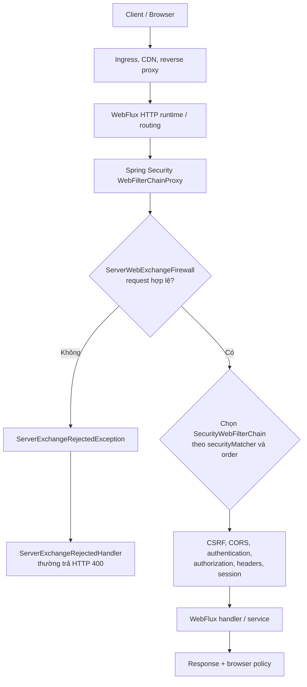
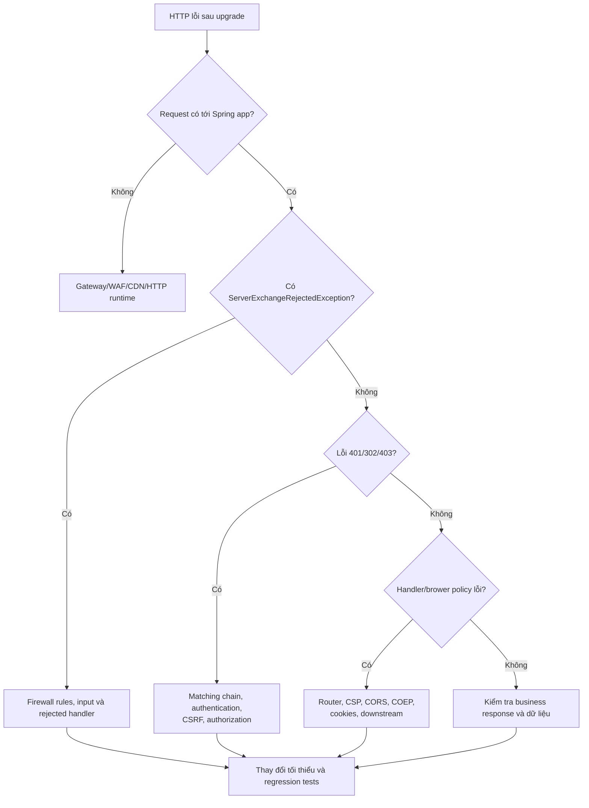

# Rà lại firewall Reactive và các tùy chọn mới

## 1. Tại sao Reactive HTTP firewall phải được rà lại khi nâng cấp?

Trong module **SPRING_SECURITY_HTTP_PROTECTION**, người học áp dụng nhiều lớp phòng vệ HTTP và trình duyệt bằng Spring Security: **CSRF, CORS, security headers, CSP, HSTS, HTTP firewall và bảo vệ session** cho cả **Servlet** lẫn **Reactive/WebFlux**. Bài **“Rà lại firewall Reactive và các tùy chọn mới”** thuộc chương **Nâng cấp và tương thích** tập trung vào một thay đổi có thể ảnh hưởng trực tiếp đến **đường biên bảo vệ request** khi chuyển phiên bản Spring Security.

Hãy xét nền tảng đào tạo có các route:

- `GET /courses/**` và `GET /assets/public/**`: nội dung công khai.
- `GET /account/**`: thông tin học viên, yêu cầu authentication và authorization theo owner.
- `POST /account/email`: mutation dùng cookie session, cần CSRF protection.
- `/admin/**`: role ADMIN mới được phép.
- `/api/private/**`: API bearer token dành cho client riêng.
- `/legacy/items;lang=vi/42`: client cũ từng dùng matrix parameter.
- `OPTIONS /api/public/catalog`: CORS preflight từ frontend khác origin.
- `/isolated/**`: trang có các browser security headers riêng.

Sau nâng cấp, các request từng tới controller nay có thể nhận **400 Bad Request trước authorization**, ví dụ request có dấu `;`, chuỗi path không normalized, encoded slash `%2F` hoặc HTTP method lạ. Đây có thể là **hành vi bảo vệ đúng**, không phải lỗi cần giải quyết bằng cách tắt firewall.

Ngược lại, nếu firewall bị vô hiệu hóa để khôi phục một client legacy, các tầng **reverse proxy → parser → matcher → handler** có thể diễn giải cùng URL khác nhau, tạo **path traversal, HTTP verb tampering hoặc bypass authorization**.

**Mục tiêu không phải cho mọi URL đi qua.** Mục tiêu là xác định request contract hợp lệ, giữ firewall mặc định nếu có thể, chỉ mở ngoại lệ nhỏ đã được đánh giá, và chứng minh **không có đường đi vượt quyền** trước khi nâng cấp production.

### Kết quả học tập

Sau bài này, bạn có thể:

1. Nêu điểm khác biệt giữa Servlet `HttpFirewall` và Reactive `ServerWebExchangeFirewall`.
2. Xác định các API và tùy chọn Reactive firewall **theo phiên bản thực tế**.
3. Giải thích `StrictServerWebExchangeFirewall` kiểm soát path, HTTP methods, host, headers và parameters như thế nào.
4. Cấu hình firewall bằng bean và dùng `ServerExchangeRejectedHandler` khi cần, không tắt kiểm tra global.
5. Đánh giá matrix variables, percent encoding, URL normalization, proxy rewrite và path matching.
6. Phân biệt request bị firewall từ chối với **401/403 authorization**, CSRF, CORS hoặc handler errors.
7. Kiểm thử cả `WebTestClient`/unit Reactive lẫn HTTP qua **server/gateway thật**, có negative cases và kiểm tra dữ liệu không bị lộ.

## 2. Mốc phiên bản: tính năng mới không có nghĩa mọi bản 6.x đều giống nhau

**Điểm quan trọng đã được Javadoc Spring Security xác định:** interface `ServerWebExchangeFirewall` và lớp `StrictServerWebExchangeFirewall` có mốc **Since: 6.4**. Vì vậy, một cấu hình bean hoặc `ServerExchangeRejectedHandler` dựa trên API này **không thể được mặc định sao chép vào Spring Security 6.0–6.3**.

| Dòng Spring Security | Điều cần xác minh | Hành động khi migration |
| --- | --- | --- |
| **5.x và 6.0–6.3** | Các API `ServerWebExchangeFirewall`/`StrictServerWebExchangeFirewall` được giới thiệu ở 6.4 chưa thuộc contract của những bản trước. | Không chép code firewall 6.4+ vào; kiểm tra hỗ trợ runtime, proxy và định tuyến đang có; lập kế hoạch nâng version phù hợp. |
| **6.4.x** | Reactive firewall API được giới thiệu theo Javadoc. | Kiểm tra exact patch, bean discovery, default rejection và các setter trong Javadoc đúng bản. |
| **6.5.x** | Có Reactive `ServerWebExchangeFirewall`, `StrictServerWebExchangeFirewall` và rejection handler được tài liệu chính thức mô tả. | Dùng bean cấu hình hẹp, test default rules và compatibility. |
| **7.x** | API tiếp tục hiện diện; method signatures phải đối chiếu theo release, như `Collection<HttpMethod>` ở Javadoc hiện hành. | Không dựa vào ví dụ cũ truyền chuỗi HTTP methods nếu compiler đòi `HttpMethod` objects. |
| **Bản tương lai/patch khác** | Mặc định, tên method và cách tích hợp có thể được bổ sung. | Dựa vào dependency resolved, migration notes và kiểm thử behavior; không khẳng định chỉ theo tên major. |

**Không suy rằng WebFlux trước 6.4 hoàn toàn không có tầng bảo vệ nào.** WebFlux server, proxy và Spring Security ở các bản đó vẫn có các lớp xử lý riêng; bảng chỉ nói **API Reactive firewall cụ thể này** xuất hiện từ 6.4.

### Kiểm tra version thật, không chỉ xem starter

Ví dụ thao tác tại dự án do người học quản lý:

```bash
# Maven
./mvnw dependency:tree -Dincludes=org.springframework.security

# Gradle
./gradlew dependencyInsight \
  --dependency spring-security-web \
  --configuration runtimeClasspath
```

Cần ghi lại Spring Boot, Spring Framework, Spring Security config/web, Reactor Netty/Tomcat Reactive, Java, HTTP reverse proxy và active profiles. **Đừng nâng riêng một module Security lên version không tương thích với BOM** chỉ để có method mới.

### Phân biệt hai firewall API

| Servlet / Spring MVC | Reactive / WebFlux |
| --- | --- |
| `HttpFirewall` | `ServerWebExchangeFirewall` |
| `StrictHttpFirewall` | `StrictServerWebExchangeFirewall` |
| `RequestRejectedException` | `ServerExchangeRejectedException` |
| Servlet `FilterChainProxy` | Reactive `WebFilterChainProxy` |
| `HttpServletRequest` wrapper | `ServerWebExchange` và `Mono<ServerWebExchange>` |
| Servlet rejection handling APIs | `ServerExchangeRejectedHandler` / `HttpStatusExchangeRejectedHandler` |

**Không dùng `StrictHttpFirewall` hoặc `WebSecurityCustomizer` của Servlet để cấu hình firewall Reactive.** Các class có tên gần giống nhưng interface, filter chain và lifecycle hoàn toàn khác.

## 3. Vị trí Reactive firewall trong request pipeline

Spring WebFlux có một chuỗi WebFilters và HTTP handler, còn Spring Security quản lý nhiều `SecurityWebFilterChain`. Firewall nằm ở tầng của `WebFilterChainProxy` để kiểm tra request target và bảo vệ sự nhất quán trước khi thực thi các rules bên trong chain.



Các kết luận quan trọng:

- Firewall và `authorizeExchange` giải quyết **hai câu hỏi khác nhau**. Firewall hỏi: **request có biểu diễn nguy hiểm/không hợp lệ không?** Authorization hỏi: **principal có quyền truy cập resource/operation không?**
- Một URL bị firewall từ chối không cần đi đến controller hoặc thực hiện business side effect.
- Khi request được chấp nhận, nó **vẫn phải qua authentication, authorization và CSRF** theo chain đã chọn.
- Một đường dẫn bị gateway rewrite hoặc normalize **trước** khi tới Spring có thể không còn representation gốc để firewall kiểm tra. Vì vậy test qua ingress là bắt buộc.
- Không được tạo một chain fallback `permitAll` chỉ để khắc phục `400`: authorization rule không sửa request target nguy hiểm.

### Một số request đáng quan tâm

```text
GET /admin/users
GET /admin/../account
GET /admin//users
GET /admin/%2Fusers
GET /admin;%20mode=read/users
GET /assets/public/%2E%2E/admin/users
TRACE /account
OPTIONS /api/public/catalog
```

Đây là **case input để test**, không phải lời khẳng định tất cả trường hợp luôn đi đến cùng mã HTTP status. Proxy, server runtime và Spring Security version có thể từ chối ở các lớp khác nhau.

## 4. Threat model: request canonicalization mismatch nguy hiểm ở đâu?

Giả sử một request được diễn giải ở ba tầng:

1. **Gateway** nhận `/public/%252e%252e/admin/export` và decode/normalize một lần.
2. **Security matcher** kiểm tra một dạng path và cho rằng route thuộc `/public/**`.
3. **Handler** hoặc downstream service decode/normalize tiếp và thực hiện operation của `/admin/**`.

Nếu ba tầng không dùng cùng quy tắc về slash, percent-encoding, semicolon hoặc dot segments, có thể xảy ra **authorization mismatch**.

**Firewall không phải một bộ sửa URL tùy ý.** Một firewall nghiêm ngặt thường **từ chối request không normalized**, thay vì “đoán” URL chuẩn rồi cho đi tiếp; chuẩn hóa sai có thể tạo bypass mới.

### Phân biệt các vấn đề

| Vấn đề | Biểu hiện | Lớp cần kiểm tra |
| --- | --- | --- |
| Path traversal | `/../`, encoded dot hoặc segment lạ có thể thay route. | Proxy → WebFlux runtime → firewall → router. |
| Double slash | `//` có thể được một tầng coi là một slash, tầng khác không. | Proxy rewrite và path matcher. |
| Encoded slash | `%2F` có thể được decode trước/sau khi security matcher áp dụng. | HTTP server, firewall, PathPattern parser. |
| Semicolon/matrix | `;` làm route hoặc matcher khác nhau. | Firewall và WebFlux path variables. |
| Verb tampering | TRACE hoặc method ngoài allowlist đi vào route chưa đánh giá. | Firewall method list, method routing. |
| Malformed header/parameter | Control/undefined characters gây header injection hoặc khác biệt parser. | HTTP parser và firewall predicate. |
| Host header poisoning | Host/forwarded host không hợp lệ tác động redirect, domain, link generation. | Trusted proxy, host allowlist, firewall. |
| Session/CSRF mismatch | Request accepted nhưng mutation dùng ambient credentials thiếu CSRF token. | Matching security chain, CSRF repository. |

Không coi firewall là giải pháp duy nhất chống tấn công; bảo vệ theo **method/service/tenant authorization** phải tiếp tục được thực hiện ở backend.

## 5. Các giá trị mặc định của StrictServerWebExchangeFirewall

Theo tài liệu Reactive firewall Spring Security hiện hành, `StrictServerWebExchangeFirewall` là implementation mặc định. Nó kiểm tra một số nhóm input thường có nguy cơ cao:

- **HTTP method allowlist:** mặc định `DELETE`, `GET`, `HEAD`, `OPTIONS`, `PATCH`, `POST`, `PUT`.
- **URL không normalized:** từ chối path có cấu trúc mơ hồ có thể khiến matcher/handler khác nhau.
- **Semicolon/matrix:** mặc định không cho ký tự `;`.
- **Encoded slash/backslash, percent, null và các ký tự đặc biệt khác:** có các cờ allow nhưng nhiều cờ mặc định `false`.
- **Header names/values và parameter names:** chặn một số ký tự điều khiển hoặc code point không được định nghĩa.
- **Hostnames:** hỗ trợ `setAllowedHostnames(Predicate)`; mặc định không phải một allowlist nghiệp vụ cụ thể.
- **Parameter values:** có setter `setAllowedParameterValues(Predicate)`; theo Javadoc, mặc định cho phép mọi giá trị parameter, nên **không được viết rằng mặc định chặn mọi control character trong parameter value**.

**Không suy chắc mỗi request bất thường bị từ chối bởi một setter cụ thể.** HTTP server/proxy có thể chặn từ trước; log và test phải chỉ ra tầng từ chối thực.

### Bảng chính sách bảo vệ điển hình

| Đầu vào | Chính sách mặc định hoặc hướng hành vi | Lý do |
| --- | --- | --- |
| `GET /account` | Method thường được cho phép; URL hợp lệ | Tiếp tục authentication/authorization. |
| `TRACE /account` | Không thuộc allowlist mặc định | Giảm rủi ro Cross-Site Tracing / verb tampering. |
| `GET /a//b` | Request chưa normalized có thể bị từ chối | Tránh matcher/router diễn giải khác. |
| `GET /items;lang=vi/42` | Semicolon mặc định bị từ chối | Matrix params tạo ambiguities. |
| `GET /files/%2Fsecret` | Encoded slash thường bị từ chối | Tránh bypass path-based constraints. |
| `GET /files/%252Fsecret` | Encoded percent có thể bị từ chối | Tránh nhiều lớp URL decoding. |
| Header chứa ISO control | Thường không hợp lệ | Nguy cơ injection/parser inconsistency. |
| Tên parameter có code point không được định nghĩa | Bị kiểm tra bởi predicate mặc định | Giảm input ambiguity. |
| Host do client tự khai | Chỉ kiểm soát theo allowlist nếu được cấu hình | Firewall không tự biết hostname business. |

**Các trường hợp malformed không nên được yêu cầu trả status `403`**: chúng là request rejection, thường khác authz failure. Giữ contract **“không side effect/không rò dữ liệu”** là quan trọng hơn ép một status duy nhất cho mọi tầng.

## 6. Những cờ URL mới cần xem xét riêng

Javadoc của `StrictServerWebExchangeFirewall` liệt kê các tùy chọn kiểm soát request path. **Tên method được dùng dưới đây thuộc API 6.4+ và phải được đối chiếu với patch version đích.**

| Tùy chọn | Điều có thể cho phép | Rủi ro nếu bật |
| --- | --- | --- |
| `setAllowSemicolon(boolean)` | Dấu `;`, ví dụ matrix variables. | Khác biệt khi parse/strip path parameters, bypass URL rules. |
| `setAllowUrlEncodedSlash(boolean)` | `%2F` đại diện slash. | Một path segment biến thành nhiều segment sau decode. |
| `setAllowUrlEncodedDoubleSlash(boolean)` | `%2F%2F`. | Double separators/normalization inconsistencies. |
| `setAllowBackSlash(boolean)` | Backslash hoặc `%5C`. | Hệ điều hành/proxy/parser có thể coi backslash như separator. |
| `setAllowUrlEncodedPercent(boolean)` | `%25` đại diện ký tự percent. | Double decoding và bypass encoded payload filters. |
| `setAllowUrlEncodedPeriod(boolean)` | `%2E` đại diện dấu chấm. | Encoded dot segments/path traversal ambiguities. |
| `setAllowNull(boolean)` | Null byte hoặc `%00`. | Truncation/parser inconsistency. |
| `setAllowUrlEncodedCarriageReturn(boolean)` | `%0D`. | Header splitting / parser inconsistencies. |
| `setAllowUrlEncodedLineFeed(boolean)` | `%0A`. | Header splitting / parser inconsistencies. |
| `setAllowUrlEncodedLineSeparator(boolean)` | Ký tự line separator được encode. | Các tầng xử lý ký tự Unicode khác nhau. |
| `setAllowUrlEncodedParagraphSeparator(boolean)` | Ký tự paragraph separator được encode. | Ký tự đặc biệt dẫn đến parsing ambiguity. |

**Không bật một nhóm cờ `true` chỉ để “hỗ trợ client cũ”.** Mỗi cờ mở rộng ngôn ngữ URL được phép; khi server nhận input mơ hồ hơn, phải chứng minh `securityMatcher`, `pathMatchers`, handler, proxy và downstream vẫn thống nhất.

### 6.1. Điều không có công tắc an toàn để tắt

Javadoc ghi rõ các giới hạn như **non-normalized URL** và **path có ký tự không phải printable ASCII** là những ràng buộc rất quan trọng, không có setter thông thường để vô hiệu hóa toàn bộ. Điều đó là chủ ý, không phải thiếu tính linh hoạt.

**Đừng thay toàn firewall bằng bản không kiểm tra** để vượt giới hạn. Nếu client gửi URL sai, ưu tiên sửa client/route hoặc chuẩn hóa ở một trust boundary đã được kiểm soát rồi test end-to-end. Chuẩn hóa quá sớm hay sai cách cũng có rủi ro.

### 6.2. Tại sao không sửa bằng `INSECURE_NOOP`?

Interface `ServerWebExchangeFirewall` có hằng `INSECURE_NOOP`, nhưng chính Javadoc mô tả đây là implementation **không kiểm tra**, **không an toàn và không được khuyến nghị**. Sử dụng nó trên production để vượt `400` tạo nguy cơ biến mọi URL bất thường thành request được matcher xử lý.

## 7. HTTP method allowlist và preflight CORS

Mặc định firewall cho phép bảy HTTP methods phổ biến:

```text
GET HEAD POST PUT PATCH DELETE OPTIONS
```

TRACE không nằm trong danh sách đó. Việc method **được firewall chấp nhận** không có nghĩa endpoint được phép thực hiện mutation: authorization và CSRF còn tiếp tục kiểm tra.

### 7.1. Giới hạn method theo nhu cầu ứng dụng

Ví dụ nếu application chỉ có `GET`, `HEAD`, `POST` và preflight `OPTIONS`, có thể cấu hình trên đúng API version:

```java
import java.util.List;

import org.springframework.context.annotation.Bean;
import org.springframework.context.annotation.Configuration;
import org.springframework.http.HttpMethod;
import org.springframework.security.web.server.firewall.StrictServerWebExchangeFirewall;

@Configuration
public class ReactiveFirewallMethodConfig {

    @Bean
    StrictServerWebExchangeFirewall reactiveFirewall() {
        StrictServerWebExchangeFirewall firewall =
            new StrictServerWebExchangeFirewall();

        // Javadoc của bản đích nhận Collection<HttpMethod>.
        firewall.setAllowedHttpMethods(List.of(
            HttpMethod.GET,
            HttpMethod.HEAD,
            HttpMethod.POST,
            HttpMethod.OPTIONS));

        return firewall;
    }
}
```

**Điều kiện:** ứng dụng **không** phục vụ `PUT/PATCH/DELETE` thật. Nếu SPA dùng PATCH hoặc WebDAV có method khác, cấu hình trên sẽ phá chức năng. Kiểm kê controller/router, HTTP gateway và client trước khi giới hạn.

### 7.2. Tại sao phải giữ OPTIONS?

Một CORS preflight thường là:

```http
OPTIONS /api/public/catalog HTTP/1.1
Origin: https://dashboard.partner.example
Access-Control-Request-Method: GET
Access-Control-Request-Headers: x-client-version
```

Nếu firewall chặn `OPTIONS`, CORS processor không có cơ hội trả `Access-Control-Allow-Origin`/`Access-Control-Allow-Methods`; browser sẽ báo lỗi dù policy CORS đúng.

Ngược lại, **cho OPTIONS qua firewall không đồng nghĩa cho mọi origin qua CORS**. Firewall chỉ xác nhận method hợp lệ; CORS vẫn phải xét origin/method/header và không cấp credentials ngoài ý muốn.

### 7.3. Không dùng `setUnsafeAllowAnyHttpMethod(true)`

API có `setUnsafeAllowAnyHttpMethod(boolean)` nhưng tên có chữ **Unsafe** vì bật `true` loại bỏ kiểm tra method. Đây không phải một giải pháp phù hợp để sửa `405` hoặc CORS preflight bị chặn.

Nếu method lạ là yêu cầu có thật, trước hết hãy điều chỉnh allowlist **có tên method cụ thể**, kiểm tra `HttpMethod` API target và test end-to-end. Một method không có handler cũng không phải lý do mở tất cả method.

## 8. Semicolon và matrix variables trong WebFlux

Một client legacy có thể gọi:

```http
GET /catalog/books;lang=vi/42 HTTP/1.1
```

Spring WebFlux path parsing có khả năng làm việc với path parameters trong một số cấu hình. Nhưng **firewall mặc định có thể chặn semicolon** trước khi handler sử dụng matrix variables.

Spring Security đưa ra lựa chọn:

```java
import org.springframework.context.annotation.Bean;
import org.springframework.context.annotation.Configuration;
import org.springframework.security.web.server.firewall.StrictServerWebExchangeFirewall;

@Configuration
public class ReactiveMatrixFirewallConfig {

    @Bean
    StrictServerWebExchangeFirewall reactiveFirewall() {
        StrictServerWebExchangeFirewall firewall =
            new StrictServerWebExchangeFirewall();
        firewall.setAllowSemicolon(true);
        return firewall;
    }
}
```

Đây là **phương án thay thế** bean firewall ở mục 7, không đăng ký cả hai bean cùng mục đích rồi hy vọng framework tự chọn đúng.

### Phải có những điều kiện trước khi bật

1. Nghiệp vụ có yêu cầu thật về matrix parameters, không phải một client dùng URL sai.
2. Có danh sách route sử dụng `;`, và dữ liệu không chứa secrets/session ID trong URL.
3. Proxy và WebFlux router thống nhất cách parse/strip path parameters.
4. Security matchers cho `/admin/**` và `/account/**` không bị bypass bằng `;`.
5. HTTP firewall vẫn chặn các biểu diễn URL nguy hiểm khác.
6. Có tests **cùng request** qua gateway và backend để so side effects.

### Không đưa JSESSIONID vào URL

Một URL như `/catalog;jsessionid=...` có nguy cơ lộ session ID qua history, Referer, logs và analytics. **Không dùng `setAllowSemicolon(true)` để tái tạo session tracking bằng URL**; chuyển sang cookie/session management phù hợp.

### Phương án thay thế ít rủi ro hơn

Chuyển matrix variable:

```text
/catalog/books;lang=vi/42
```

thành query parameter hoặc resource route rõ ràng:

```text
/catalog/books/42?lang=vi
```

Khi chuyển, test `/catalog/books/42` với quyền owner/tenant và method. Query parameter vẫn phải được validate theo nghiệp vụ nhưng không làm thay đổi số path segments.

## 9. Hostname, headers và parameter predicates

Ngoài path/method, `StrictServerWebExchangeFirewall` cung cấp predicates:

- `setAllowedHostnames(Predicate<String>)`.
- `setAllowedHeaderNames(Predicate<String>)`.
- `setAllowedHeaderValues(Predicate<String>)`.
- `setAllowedParameterNames(Predicate<String>)`.
- `setAllowedParameterValues(Predicate<String>)`.

**Các defaults không hoàn toàn giống nhau**: Javadoc ghi header name/value và parameter name được kiểm tra các control/undefined code points, trong khi `setAllowedHostnames` mặc định không giới hạn hostname theo một danh sách sản phẩm và `setAllowedParameterValues` mặc định cho phép các parameter values.

### 9.1. Hostname allowlist chặt hơn

Nếu hệ thống chỉ phục vụ đúng một hostname production, bạn có thể cân nhắc:

```java
import java.util.Locale;
import java.util.Set;

import org.springframework.context.annotation.Bean;
import org.springframework.security.web.server.firewall.StrictServerWebExchangeFirewall;

@Bean
StrictServerWebExchangeFirewall restrictiveFirewall() {
    StrictServerWebExchangeFirewall firewall =
        new StrictServerWebExchangeFirewall();

    Set<String> hosts = Set.of(
        "learn.example.com", "localhost");

    firewall.setAllowedHostnames(host ->
        host != null &&
        hosts.contains(host.toLowerCase(Locale.ROOT)));

    return firewall;
}
```

Đây là snippet cho một bean **thay thế**, không dùng đồng thời với các ví dụ tạo firewall bean khác. Giá trị `host` được framework parse phải được kiểm chứng qua HTTP thực; test trường hợp port, IDN, trailing dot, upper/lower case và proxy.

**Host allowlist không thay trusted forwarded headers.** Nếu backend tin `X-Forwarded-Host` do client internet tự gửi, attacker có thể ảnh hưởng redirect/link generation dù firewall cho phép một Host header khác. Chỉ chấp nhận forwarding từ proxy được kiểm soát.

### 9.2. Tránh thay predicate bằng `value -> true`

Ví dụ anti-pattern:

```java
// Không làm như một cách sửa lỗi Unicode tổng quát:
firewall.setAllowedHeaderNames(name -> true);
firewall.setAllowedHeaderValues(value -> true);
firewall.setAllowedParameterNames(name -> true);
```

Điều này làm mất các kiểm tra đầu vào mà default cố cung cấp. Nếu có client thực sự gửi header legacy đặc biệt, xác định **chính xác ký tự không tương thích**, rủi ro, source đáng tin và ngoại lệ tối thiểu; ưu tiên sửa client/HTTP gateway trước.

### 9.3. Dùng predicate mặc định làm baseline

Với code tùy chỉnh, các predicate mặc định được API công khai dưới dạng:

```java
StrictServerWebExchangeFirewall.ALLOWED_HEADER_NAMES
StrictServerWebExchangeFirewall.ALLOWED_HEADER_VALUES
StrictServerWebExchangeFirewall.ALLOWED_PARAMETER_NAMES
StrictServerWebExchangeFirewall.ALLOWED_PARAMETER_VALUES
```

Đây là **danh sách tên API**, không phải các câu lệnh Java độc lập. Khi tạo predicate nâng cao, nên giữ baseline tương ứng rồi **siết thêm** thay vì làm rộng tất cả. Test các giá trị control char, whitespace bất thường, multi-byte/Unicode và request thực, vì server/container có thể parse header trước khi firewall nhìn thấy.

### 9.4. Parameter name khác parameter value

Một parameter tên `q` với value là chuỗi Unicode tiếng Việt có thể hợp lệ về nghiệp vụ. Không viết một rule “chỉ ASCII cho mọi parameter value” khi ứng dụng cần Unicode, hoặc vô tình gây lỗi tìm kiếm, tên học viên và nội dung do người dùng nhập.

**Firewall là lớp kiểm soát request syntax, không thay application-level validation**: length, schema, encoding, SQL safety, HTML escaping và domain rules vẫn cần ở handler/service.

## 10. Một cấu hình mặc định nghiêm ngặt, không mở ngoại lệ

Nếu ứng dụng vừa nâng từ bản trước khi có Reactive firewall API, bước đầu **không cần bật mọi tùy chọn**. Có thể bắt đầu bằng bean mặc định tường minh để test behavior:

```java
import org.springframework.context.annotation.Bean;
import org.springframework.context.annotation.Configuration;
import org.springframework.security.web.server.firewall.StrictServerWebExchangeFirewall;

@Configuration
public class ReactiveStrictFirewallConfig {

    @Bean
    StrictServerWebExchangeFirewall strictServerFirewall() {
        return new StrictServerWebExchangeFirewall();
    }
}
```

Tuy nhiên trên phiên bản có default Strict implementation và auto discovery, bean này có thể **không cần**. Tạo nó có ý nghĩa khi bạn cần tùy chỉnh hoặc muốn làm rõ policy tại cấu hình được review. Đừng thêm bean cạnh các bean mẫu khác trong cùng bài.

### Phân biệt bean firewall với security chain

Một bean `StrictServerWebExchangeFirewall` điều chỉnh firewall của `WebFilterChainProxy`; nó **không tự tạo**:
- `SecurityWebFilterChain`.
- Authentication provider/user store.
- Authorization rules.
- CSRF token repository.
- CORS configuration.
- Security headers.
- Session fixation/timeout policy.

Những thứ đó phải được cấu hình và kiểm thử riêng.

## 11. Chỉnh mã phản hồi khi request bị firewall từ chối

Reactive firewall có exception riêng `ServerExchangeRejectedException`. Tài liệu Spring Security cho biết **mặc định** `HttpStatusExchangeRejectedHandler` trả HTTP **400** cho trường hợp rejected. Một ứng dụng có thể muốn dùng **404** để giảm khác biệt giữa các URL ngoài contract hoặc phù hợp API gateway policy.

```java
import org.springframework.context.annotation.Bean;
import org.springframework.context.annotation.Configuration;
import org.springframework.http.HttpStatus;
import org.springframework.security.web.server.firewall.HttpStatusExchangeRejectedHandler;
import org.springframework.security.web.server.firewall.ServerExchangeRejectedHandler;

@Configuration
public class ReactiveFirewallRejectionConfig {

    @Bean
    ServerExchangeRejectedHandler rejectedHandler() {
        // Chỉ đổi mã trả về, KHÔNG làm request được phép đi tiếp.
        return new HttpStatusExchangeRejectedHandler(
            HttpStatus.NOT_FOUND);
    }
}
```

**Lưu ý**:
- Đổi `400` thành `404` không làm request hợp lệ, không thay authorization.
- `ServerExchangeRejectedHandler` không phải `ServerAccessDeniedHandler` hoặc `ServerAuthenticationEntryPoint`.
- Không trả body chứa raw URL, token, cookie, header hoặc exception stack trace cho client.
- Nếu có API error envelope/trace ID, custom handler phải giữ **không tạo side effect** và fail-closed.
- Đừng bỏ qua sự kiện rejected trong observability; chỉ cần ghi loại lỗi, không log input nhạy cảm.

### Bảng phân biệt mã lỗi

| Trạng thái | Có thể do đâu? | Cách điều tra |
| --- | --- | --- |
| **400** | Firewall mặc định, malformed HTTP hoặc validation khác. | Phân biệt HTTP server/proxy vs `ServerExchangeRejectedHandler`. |
| **404** | Route không tồn tại, firewall custom 404 hoặc gateway. | Kiểm tra firewall error classification. |
| **401** | Thiếu/sai authentication trên API, bearer challenge. | Authorization entry point, token decoding. |
| **403** | Authenticated nhưng không đủ quyền, hoặc CSRF invalid/missing. | Authorization/CSRF handler, không mặc định là firewall. |
| **302** | Redirect login form hoặc proxy redirect. | Session/login entry point, không phải default firewall. |
| **405** | Handler không hỗ trợ method, hoặc router; khác với firewall method rejection. | Xác minh method đã qua firewall chưa. |

**Không assert tất cả URL malformed phải luôn trả `400`** nếu một upstream proxy hoặc custom rejection handler có quyền trả mã khác; điều bất biến là không đi tới nhánh nghiệp vụ nhạy cảm.

## 12. Firewall không thay securityMatcher và authorizeExchange

Trong Reactive, bean `SecurityWebFilterChain` được cấu hình riêng:

```java
import org.springframework.context.annotation.Bean;
import org.springframework.context.annotation.Configuration;
import org.springframework.security.config.annotation.web.reactive.EnableWebFluxSecurity;
import org.springframework.security.config.web.server.ServerHttpSecurity;
import org.springframework.security.web.server.SecurityWebFilterChain;

@Configuration
@EnableWebFluxSecurity
public class ReactiveAppSecurityConfig {

    @Bean
    SecurityWebFilterChain app(ServerHttpSecurity http) {
        return http
            .authorizeExchange(auth -> auth
                .pathMatchers("/assets/public/**").permitAll()
                .pathMatchers("/admin", "/admin/**").hasRole("ADMIN")
                .pathMatchers("/account/**").authenticated()
                .anyExchange().authenticated())
            .build();
    }
}
```

Đây là một **security chain demo**: cần authentication source, CSRF/CORS/header/session policy theo nhu cầu sản phẩm. Vì không tắt CSRF, web session mutation vẫn chịu CSRF policy mặc định của version khi được cấu hình đúng.

**Hai loại matcher**:
1. `securityMatcher(...)` giới hạn request thuộc **chain nào**.
2. `authorizeExchange(... pathMatchers...)` quyết định **permission bên trong chain đã chọn**.

Một firewall bean giúp chặn malformed request trước security processing, nhưng không tự tạo rule `/admin/**.hasRole("ADMIN")` hoặc quyền theo object/tenant.

### Bẫy `permitAll` và static resources

Dùng `permitAll` trong matching chain cho public assets thường cho phép security headers tiếp tục được ghi. Không dùng cấu hình bypass toàn bộ security filters để sửa lỗi static resource, vì có thể mất `nosniff`, cache headers và các lớp bảo vệ khác.

### Deny-by-default khi phù hợp

Với API có danh sách routes đầy đủ, cân nhắc `anyExchange().denyAll()` và cấp phép cụ thể. Với web nhiều routes, `anyExchange().authenticated()` là fallback minh họa nhưng **không thay object ACL**. Chỉ chọn chính sách mặc định sau khi rà toàn bộ URLs và side effects.

## 13. Reactive multi-chain và sai lệch auth mode sau nâng cấp

Giả sử có API bearer-only và UI web session. Một cấu hình nhiều chain:

```java
import org.springframework.context.annotation.Bean;
import org.springframework.context.annotation.Configuration;
import org.springframework.core.annotation.Order;
import org.springframework.security.config.Customizer;
import org.springframework.security.config.annotation.web.reactive.EnableWebFluxSecurity;
import org.springframework.security.config.web.server.ServerHttpSecurity;
import org.springframework.security.web.server.SecurityWebFilterChain;
import org.springframework.security.web.server.util.matcher.PathPatternParserServerWebExchangeMatcher;

@Configuration
@EnableWebFluxSecurity
public class ReactiveMultiChainConfig {

    @Bean
    @Order(1)
    SecurityWebFilterChain bearer(ServerHttpSecurity http) {
        return http
            .securityMatcher(
                new PathPatternParserServerWebExchangeMatcher(
                    "/api/private/**"))
            .authorizeExchange(auth -> auth
                .anyExchange().authenticated())
            .oauth2ResourceServer(oauth -> oauth
                .jwt(Customizer.withDefaults()))
            .csrf(ServerHttpSecurity.CsrfSpec::disable)
            .build();
    }

    @Bean
    @Order(2)
    SecurityWebFilterChain web(ServerHttpSecurity http) {
        return http
            .authorizeExchange(auth -> auth
                .pathMatchers("/login", "/error").permitAll()
                .pathMatchers("/admin", "/admin/**")
                    .hasRole("ADMIN")
                .anyExchange().authenticated())
            .formLogin(Customizer.withDefaults())
            .build();
    }
}
```

**Cảnh báo:** chỉ tắt CSRF trên `/api/private/**` khi API **thật sự bearer-only** và không dùng cookie session/HTTP Basic/ambient credentials. Cần module OAuth2 Resource Server và JWT decoder hợp lệ, không phải chỉ một dòng cấu hình.

**Tại sao ví dụ có ý nghĩa đối với firewall?** Một request encoded hoặc dấu slash khác có thể bị firewall từ chối **hoặc rơi vào chain fallback** nếu không còn khớp API matcher như tưởng. Nếu fallback dùng session cookie, cùng resource có thể bị kiểm tra bằng auth mode khác.

Test `/api/private`, `/api/private/`, `/api/private/me` và các path gần giống bằng client/server thật. Chỉ **chain đầu tiên match** được dùng, không cộng dồn CSRF/header writers giữa các chain.

## 14. Firewall và CORS: điều gì xảy ra với preflight?

Một yêu cầu CORS từ frontend khác origin:

```http
OPTIONS /api/public/catalog HTTP/1.1
Origin: https://dashboard.partner.example
Access-Control-Request-Method: GET
Access-Control-Request-Headers: x-client-version
```

Đi qua các bước:
1. HTTP server và Reactive firewall phải chấp nhận **method OPTIONS** và URL hợp lệ.
2. CORS configuration kiểm tra origin/method/headers và có thể phản hồi preflight.
3. Request thực được xét authentication/authorization/CSRF tương ứng.
4. Browser quyết định có cho JavaScript đọc response hay không.

Nếu `setAllowedHttpMethods` bỏ `OPTIONS`, preflight sẽ bị chặn **trước khi CORS policy xét origin**. Nhưng khi `OPTIONS` được cho phép, một origin lạ **vẫn không được nhận CORS access** nếu không nằm trong allowlist.

### CORS source đúng stack

Trong WebFlux, source/processor ở `org.springframework.web.cors.reactive`; không copy Servlet `org.springframework.web.cors.UrlBasedCorsConfigurationSource`. Tùy configurer/version, dùng `ServerHttpSecurity.cors(...)` hoặc WebFlux CORS integration chính thức.

### Tài liệu/threat model

- `Access-Control-Allow-Origin` không phải server authorization.
- CORS không bảo vệ khỏi CSRF mutation dùng cookie.
- Khi CORS cho phép credentials, không dùng wildcard `*` làm origin.
- Nếu preflight bị `302 /login`, kiểm tra CORS integration và matching chain, không tắt firewall/CSRF global.

## 15. Firewall, CSRF và session: các lớp kiểm tra khác nhau

Ví dụ `POST /account/email` dùng cookie session:

| Lớp | Câu hỏi |
| --- | --- |
| Firewall | Method/path/header có cấu trúc được chấp nhận không? |
| Security chain matcher | Request thuộc chain session web nào? |
| CSRF | Unsafe request có valid token hay không? |
| Authentication | Principal/session có hợp lệ? |
| Authorization | Principal có quyền cập nhật email của object này? |
| Application validation | Email và dữ liệu nghiệp vụ có hợp lệ? |

**Không được hiểu `POST` nằm trong firewall allowlist là POST đã an toàn.** Nó chỉ vượt kiểm tra cú pháp của firewall. Mutation bằng ambient cookies vẫn cần CSRF theo threat model.

### Cẩn thận với mã lỗi 403

Nếu `POST` trả 403, có thể do CSRF token thiếu/sai hoặc permission thiếu, **không phải `ServerExchangeRejectedException` mặc định**. Cần biết response được tạo bởi handler nào trước khi sửa.

### Không tắt CSRF để khắc phục URL rejection

Một request `POST /account;mode=edit/email` bị firewall từ chối do `;` sẽ không được “chữa” bằng `csrf.disable()`. Sửa client URL/path contract hoặc tạo ngoại lệ firewall hẹp sau đánh giá rủi ro; giữ CSRF check trên mutation sau khi URL hợp lệ.

## 16. Servlet firewall và Reactive firewall: cú pháp giống nhau không phải component giống nhau

Một ứng dụng migration từ Spring MVC sang WebFlux dễ mắc lỗi đem `StrictHttpFirewall` vào cấu hình Reactive vì có các setter tương tự như `setAllowSemicolon`.

| Câu hỏi | Servlet | Reactive |
| --- | --- | --- |
| Request abstraction | `HttpServletRequest` | `ServerWebExchange` |
| Security pipeline | `FilterChainProxy` | `WebFilterChainProxy` |
| Firewall interface | `HttpFirewall` | `ServerWebExchangeFirewall` |
| Strict implementation | `StrictHttpFirewall` | `StrictServerWebExchangeFirewall` |
| Rejection exception | `RequestRejectedException` | `ServerExchangeRejectedException` |
| Rejected handler | Servlet mechanism/phù hợp version | `ServerExchangeRejectedHandler` |
| Return type của firewall | Servlet request/response wrappers | `Mono<ServerWebExchange>` |
| Test framework | `MockMvc` hoặc HTTP server | `WebTestClient`, Reactor `StepVerifier`, HTTP server |
| Matcher | `RequestMatcher`/`authorizeHttpRequests` | `ServerWebExchangeMatcher`/`authorizeExchange` |

Không port cơ học:

```java
// Đây là Servlet, không dùng để cấu hình WebFlux:
@Bean
StrictHttpFirewall servletFirewall() {
    return new StrictHttpFirewall();
}
```

sang một ứng dụng chỉ sử dụng `ServerHttpSecurity`. Nó có thể biên dịch nếu class nằm trong dependency, nhưng **không có nghĩa Reactive WebFilterChainProxy đã sử dụng bean đó**.

**Hướng phù hợp**: định nghĩa bean `StrictServerWebExchangeFirewall`/`ServerWebExchangeFirewall` ở phiên bản Reactive API hỗ trợ, kiểm tra qua integration test để chắc firewall thật sự được áp dụng. Nếu có nhiều Spring ApplicationContext hoặc security filter chains, xác minh bean được discovery trong context phù hợp.

### Bẫy “phạm vi per-chain”

Theo tài liệu chính thức, Reactive firewall được cấu hình bằng **bean ở tầng WebFilterChainProxy**. Không nên giả định có thể gắn `setAllowSemicolon(true)` chỉ vào một `SecurityWebFilterChain` bằng `securityMatcher`. Một bean firewall chung có thể thay đổi hành vi của **nhiều routes/chains**.

Nếu chỉ một client legacy cần semicolon, cần cân nhắc:
- Đổi URL của client/route.
- Tách hạ tầng/ứng dụng nếu yêu cầu khác nhau thực sự.
- Chứng minh semicolon không bypass những chains còn lại.
- Không thiết kế “một rule per path” bằng custom firewall ngây thơ mà không kiểm chứng canonicalization.

## 17. Reverse proxy và request target: trước khi đổi firewall hãy nhìn đúng bytes

Ví dụ browser gửi URL:

```text
https://learn.example.com/academy/admin/users
```

Gateway có thể:
1. Bỏ prefix `/academy` và chuyển `/admin/users` cho WebFlux.
2. Normalize `//` trước khi chuyển.
3. Decode `%2F` hoặc giữ nguyên đến Reactor Netty.
4. Chặn encoded dot, header lạ hoặc ký tự control ở edge.
5. Thêm `Forwarded`/`X-Forwarded-*` dùng để tạo URL redirect và cookie policies.

Firewall trong app **chỉ có thể kiểm tra request mà nó nhận được**, không thể nhìn lại raw request target đã bị đổi hoặc chặn ở upstream.

### 17.1. Kiểm tra ba dạng đường dẫn

```text
Public client URL:
  /academy/admin/users

Gateway upstream path:
  /admin/users

Path Spring WebFlux handler sees:
  /admin/users  (giả định; xác minh tại runtime)
```

Test `securityMatcher("/academy/admin/**")` trong app có thể vô dụng nếu gateway đã strip `/academy`. Một request bị 400 do proxy không có nghĩa `StrictServerWebExchangeFirewall` tạo 400; một `404` từ gateway cũng không nhất thiết là `ServerExchangeRejectedHandler`.

### 17.2. Trusted forwarded headers

`Forwarded`, `X-Forwarded-Proto` và `X-Forwarded-Host` chỉ nên được tin khi chúng được **trusted proxy kiểm soát**; backend không nên nhận các giá trị client ngoài tự chèn. Nếu một host parser thấy tên khác với gateway, bảo vệ Host allowlist và absolute redirects có thể trở nên mâu thuẫn.

Các kiểm tra tối thiểu:
- Host/port/scheme thật mà Spring nhìn thấy.
- `X-Forwarded-Proto` do proxy set chứ không do client giả.
- HSTS chỉ gửi qua HTTPS hợp lệ theo policy.
- Cookie `Secure`/`SameSite`/`Domain` hợp lý cho domain public.
- Redirect login/OAuth callback không bị host poisoning.
- Gateway normalization không tạo đường đi mới vào `/admin/**`.

### 17.3. Không chuẩn hóa bừa bãi trong custom WebFilter

Nếu thêm `WebFilter` để replace `//` thành `/` trước security, có thể thay đổi nghĩa URL, làm attacker vượt một matcher mà handler thấy khác. Một normalization layer muốn an toàn phải:
1. Có canonical form rõ ràng.
2. Được áp **một lần, nhất quán** tại trust boundary.
3. Không làm security matcher và router nhìn hai path khác.
4. Không vô tình decode lần hai.
5. Có negative tests cho traversal và tài nguyên riêng.

Giải pháp ưu tiên vẫn là **từ chối URL sai và sửa client**, không tự đoán sửa mọi request target.

## 18. Ma trận URL/method để so sánh trước–sau nâng cấp

Không kết luận firewall mới “tốt hơn” hay “phá sản phẩm” chỉ từ một ca 400. Mỗi testcase cần: **method, raw request target, proxy path, expected chain, principal và side effect**.

| ID | Method/path | Mục tiêu kiểm tra | Security contract |
| --- | --- | --- | --- |
| F-01 | `GET /courses/intro` | Đường dẫn chuẩn public | Được phép nếu handler public, headers đúng. |
| F-02 | `GET /account/profile` | Web session route | Anonymous không nhận thông tin; user owner hợp lệ mới truy cập. |
| F-03 | `POST /account/email` | Unsafe method hợp lệ | Thiếu/sai CSRF bị chặn, không side effect. |
| F-04 | `GET /admin/users` | Role-protected endpoint | User thường 403, ADMIN được phép. |
| F-05 | `TRACE /account` | Method ngoài allowlist mặc định | Rejected trước side effect; xác định tầng. |
| F-06 | `OPTIONS /api/public/catalog` | Preflight | Không bị firewall chặn nếu method list cho OPTIONS; CORS xét origin. |
| F-07 | `GET /admin/../account` | Dot segment traversal | Không được phục vụ admin data; tầng reject được xác định. |
| F-08 | `GET /admin//users` | Non-normalized separator | Reject hoặc xử lý an toàn theo contract, không vượt rule. |
| F-09 | `GET /admin/%2Fusers` | Encoded slash | Không bypass path matcher. |
| F-10 | `GET /admin/%252Fusers` | Double encoding/percent | Không lách normalization. |
| F-11 | `GET /items;lang=vi/42` | Matrix parameter legacy | Mặc định có thể reject; chỉ mở khi có phê duyệt và tests. |
| F-12 | `GET /admin;role=user/users` | Semicolon ngay vùng quản trị | Không vượt role restrictions kể cả khi semicolon được phép. |
| F-13 | `GET /admin%5Cusers` | Backslash | Không bypass. |
| F-14 | `GET /admin%00/users` | Encoded null | Không được sử dụng làm route hợp lệ. |
| F-15 | `GET /%0D%0Aadmin` | Encoded CR/LF | Không gây header/path injection. |
| F-16 | `GET /api/private/me` | Bearer chain | Thiếu bearer → 401, không redirect HTML login. |
| F-17 | `GET /api/private` | Path root | Không rơi sai sang session fallback. |
| F-18 | `GET /assets/public/a.js` | Public static | Truy cập hợp lệ, `nosniff` còn đúng. |
| F-19 | `POST /assets/public/a.js` | Method public quá rộng | Không được phát sinh mutation chỉ nhờ permitAll. |
| F-20 | Header chứa control characters | Header predicate và HTTP parser | Rejected trước khi app sử dụng. |
| F-21 | Host `attacker.example` | Host allowlist nếu bật | Không tạo absolute redirect độc hại. |
| F-22 | URL qua proxy `/academy/admin/users` | Rewrite | Sau rewrite vẫn thuộc admin policy. |
| F-23 | `GET /isolated/demo` | Browser headers | COOP/COEP/CSP đúng response. |
| F-24 | `GET /account/file/other-tenant` | Object-level authorization | User không được đọc file tenant khác. |

**Kết quả test cần ghi cả dữ liệu/side effect**, không chỉ một status code. Ví dụ `GET /admin//users` trả `404` có thể chấp nhận nếu không lộ thông tin, trong khi trả `200` chứa dữ liệu admin là regression nghiêm trọng.

### Chú ý với các chuỗi encoded trong test

Mock HTTP builders, WebFlux server và gateway có thể normalize hoặc từ chối URL **trước khi** firewall. Một testcase `%2F` chỉ hữu ích nếu kiểm tra request target thực tế ở tầng mong muốn; không lấy kết quả URI builder đã canonicalize làm bằng chứng firewall xử lý encoded slash.

## 19. Unit test Reactive firewall độc lập với controller

Khi dùng API 6.4+ và Reactor Test, có thể kiểm tra trực tiếp `getFirewalledExchange` bằng `MockServerWebExchange` và `StepVerifier`, tách firewall khỏi authentication và handler.

### 19.1. Test chấp nhận request chuẩn

```java
import org.junit.jupiter.api.Test;
import org.springframework.mock.http.server.reactive.MockServerHttpRequest;
import org.springframework.mock.web.server.MockServerWebExchange;
import org.springframework.security.web.server.firewall.StrictServerWebExchangeFirewall;
import reactor.test.StepVerifier;

final class ReactiveFirewallUnitTest {

    @Test
    void acceptsNormalGet() {
        var request = MockServerHttpRequest
            .get("https://learn.example.test/courses/intro")
            .build();
        var exchange = MockServerWebExchange.from(request);

        var firewall = new StrictServerWebExchangeFirewall();

        StepVerifier.create(
                firewall.getFirewalledExchange(exchange))
            .expectNextCount(1)
            .verifyComplete();
    }
}
```

Đây là **một file test độc lập** về firewall, không có route/controller. Nếu test này PASS, nó chỉ chứng minh request có cú pháp hợp lệ, **không chứng minh /courses/intro public hoặc authorization đúng**.

### 19.2. Test chặn HTTP method ngoài allowlist

```java
import org.junit.jupiter.api.Test;
import org.springframework.http.HttpMethod;
import org.springframework.mock.http.server.reactive.MockServerHttpRequest;
import org.springframework.mock.web.server.MockServerWebExchange;
import org.springframework.security.web.server.firewall.ServerExchangeRejectedException;
import org.springframework.security.web.server.firewall.StrictServerWebExchangeFirewall;
import reactor.test.StepVerifier;

final class ReactiveMethodFirewallTest {

    @Test
    void rejectsTraceMethod() {
        var request = MockServerHttpRequest
            .method(HttpMethod.TRACE,
                    "https://learn.example.test/account")
            .build();

        var exchange = MockServerWebExchange.from(request);

        StepVerifier.create(
                new StrictServerWebExchangeFirewall()
                    .getFirewalledExchange(exchange))
            .expectError(ServerExchangeRejectedException.class)
            .verify();
    }
}
```

**Cần kiểm chứng chữ ký `MockServerHttpRequest.method` trên Spring Framework version thực tế**. Nếu bản test API khác, dùng builder/method overload tương ứng; không bỏ validation chỉ vì test helper đổi signature.

### 19.3. Test semicolon — cần xác minh URI builder

```java
@Test
void rejectsSemicolonByDefault() {
    var request = MockServerHttpRequest
        .get("https://learn.example.test/catalog;lang=vi/42")
        .build();
    var exchange = MockServerWebExchange.from(request);

    StepVerifier.create(
            new StrictServerWebExchangeFirewall()
                .getFirewalledExchange(exchange))
        .expectError(ServerExchangeRejectedException.class)
        .verify();
}
```

Đây là **thân test bổ sung** trong class đã import. Builder có thể parse URL theo Spring Framework; trước khi tin test, xác minh exchange path/raw path còn dấu `;` như testcase. Nếu không, dùng integration HTTP request target đúng hoặc fixture mock cấp thấp tương thích với framework.

### 19.4. Test ngoại lệ phải có ca âm đi kèm

Nếu policy được duyệt `setAllowSemicolon(true)` cho legacy:
- `GET /catalog;lang=vi/42` có thể được chấp nhận **về syntax**.
- `GET /admin;lang=vi/users` vẫn không được vượt quyền ADMIN.
- `POST /account;mode=edit/email` vẫn phải chịu CSRF và owner authz.
- `GET /catalog;jsessionid=...` không được biến URL session tracking thành tính năng được khuyến nghị.
- Các dạng encoded slash, double slash, encoded percent vẫn giữ chính sách chặn.

**Không dừng ở test `getFirewalledExchange`** cho ngoại lệ: authorization và handler có thể diễn giải semicolon khác nhau.

## 20. Tích hợp test: WebTestClient không mô phỏng mọi thứ của HTTP server

Với Spring Boot WebFlux, bạn có thể dùng `WebTestClient` và `spring-security-test` để kiểm tra permission và CSRF. Ví dụ **phần thân test** với handler fixtures đã phục vụ `/account` và `/admin/users`:

```java
webTestClient.mutateWith(mockUser("learner"))
    .get().uri("/admin/users")
    .exchange()
    .expectStatus().isForbidden();

webTestClient.mutateWith(mockUser("admin").roles("ADMIN"))
    .get().uri("/admin/users")
    .exchange()
    .expectStatus().isOk();
```

`mockUser` thuộc `SecurityMockServerConfigurers`. Test này kiểm tra authorization, **không trực tiếp chứng minh firewall sẽ từ chối malformed URI**.

### 20.1. CSRF trên WebFlux

```java
webTestClient.mutateWith(mockUser("learner"))
    .post().uri("/account/email")
    .bodyValue("email=new@example.test")
    .exchange()
    .expectStatus().isForbidden();

webTestClient.mutateWith(mockUser("learner"))
    .mutateWith(csrf())
    .post().uri("/account/email")
    .bodyValue("email=new@example.test")
    .exchange()
    .expectStatus().is2xxSuccessful();
```

`csrf()` ở đây là Reactive security test configurer. Cần body/content-type và handler fixture phù hợp, có thể trả `200`/`204`/`302` theo contract. **Kiểm tra side effect**: thiếu CSRF token không thay dữ liệu, có token nhưng thiếu quyền owner vẫn bị từ chối.

### 20.2. Firewall integration với WebTestClient

Đối với URL đơn giản, có thể kiểm tra:

```java
webTestClient.get()
    .uri("/courses/intro")
    .exchange()
    .expectStatus().isOk();
```

Với `TRACE`, encoded slash, `//` hoặc non-normalized URL, WebTestClient sử dụng URI builders/HTTP connectors có thể đổi representation hoặc từ chối trước firewall. **Không dựa vào WebTestClient mock một mình** để kết luận request target bytes đã được kiểm tra.

### 20.3. Kiểm tra custom rejected handler

Nếu đã cấu hình bean `HttpStatusExchangeRejectedHandler(HttpStatus.NOT_FOUND)`, test phải có:
- Một request thực sự bị `ServerWebExchangeFirewall` reject.
- Response từ Spring là `404`.
- Controller không chạy; không có side effect.
- Observability ghi loại firewall rejection, không log token.
- Route hợp lệ vẫn chạy bình thường.

Nếu HTTP gateway trả 404 trước WebFlux, test **không** chứng minh custom `ServerExchangeRejectedHandler` hoạt động. Dùng unit test tầng framework hoặc instrumentation được duyệt.

## 21. Kiểm thử HTTP server thật: URL encoded và path normalization

Khi vấn đề liên quan URL trên dây (wire), cần kiểm tra ở **cổng staging do nhóm kiểm soát** thay vì chỉ dùng builder.

Ví dụ dùng `curl` để quan sát response:

```bash
# Request bình thường
curl -i 'https://staging.example.test/admin/users'

# Giữ dot segments trong request path để không bị curl tự chuẩn hóa
curl -i --path-as-is \
  'https://staging.example.test/admin/../account'

# Encoded slash: quan sát gateway và backend nhận gì
curl -i --path-as-is \
  'https://staging.example.test/admin/%2Fusers'

# Double slash
curl -i --path-as-is \
  'https://staging.example.test/admin//users'

# Semicolon/matrix
curl -i --path-as-is \
  'https://staging.example.test/catalog;lang=vi/42'

# Method nằm ngoài allowlist
curl -i -X TRACE \
  'https://staging.example.test/account'
```

**Chỉ dùng môi trường đã được cho phép kiểm thử**, không quét website bên thứ ba. Các ví dụ dùng host placeholder `staging.example.test`.

### Ghi lại tầng xử lý

Với mỗi request:
- HTTP client đã gửi URI nào?
- CDN/WAF/ingress có normalize, redirect hoặc từ chối không?
- Spring Reactive firewall có nhận request đó không?
- Nếu có, selected chain và authorization outcome?
- Response status/body/headers do tầng nào phát?
- Có dữ liệu hay side effect không?
- Có khác baseline trước upgrade không?

**`curl --path-as-is` không buộc proxy/Netty giữ nguyên mọi encoding**, nó chỉ giúp tránh một phần chuẩn hóa ở client; kết luận cuối cùng phải dựa vào request target được quan sát tại các trust boundaries.

### Tránh thổi phồng độ tin cậy test

Nếu gateway từ chối `%2F` với 400, không kết luận Spring Strict firewall đã reject encoded slash. Cần test trực tiếp trong ứng dụng ở môi trường kiểm soát hoặc có telemetry cho từng tầng.

## 22. Object-level authorization vẫn phải độc lập với URL path

Ngay cả khi `StrictServerWebExchangeFirewall` từ chối mọi URL đáng ngờ, một user hợp lệ có thể gửi URL hoàn toàn chuẩn để đọc object khác nếu controller không kiểm tra quyền.

Ví dụ `GET /tenants/{tenantId}/reports/{reportId}`:

```java
// Service method minh họa, cần triển khai domain classes và policy.
public Mono<ReportDto> getReport(
        UUID tenantId,
        UUID reportId,
        Authentication principal) {

    return authorizationService
        .requireCanReadReport(principal, tenantId, reportId)
        .then(reportService.findById(tenantId, reportId));
}
```

**Không dùng nguyên snippet như code hoàn chỉnh**: service dependencies và `Mono`/domain types cần được ứng dụng định nghĩa. Nếu báo 403 qua WebFlux service authorization, nó là **permission failure**, khác `ServerExchangeRejectedException` của firewall.

### Các test nghiệp vụ

1. User tenant A đọc report của A → được phép.
2. User tenant B đọc report của A → bị từ chối.
3. Role ADMIN theo policy được duyệt vẫn cần tenant context và audit nếu có.
4. Thay `reportId` trong URL không lộ object ngoài quyền.
5. Encoded/path variants không bypass service checks.
6. Cache không trộn dữ liệu user/tenant.

**Một HTTP 200 cho URL chuẩn có thể là regression an ninh nghiêm trọng** ngay cả khi tất cả firewall tests PASS.

## 23. Ảnh hưởng đến CSP, COOP, COEP, CORP và static responses

Một thay đổi firewall/chain matcher có thể làm SPA HTML hoặc static asset đi theo route/chain khác, dẫn tới thiếu security headers hoặc bị áp policy không phù hợp.

| Phòng vệ | Nằm trên response nào? | Liên hệ đến firewall/matcher |
| --- | --- | --- |
| `X-Content-Type-Options: nosniff` | JS/CSS/resource response thích hợp | Nếu resource bypass chain/CDN không có writer, header có thể mất. |
| `X-Frame-Options` | HTML document bị nhúng | Matcher sai có thể khiến trang thiếu XFO hoặc chặn iframe cần thiết. |
| CSP `frame-ancestors` | Trang bị nhúng | Không phải phép kiểm tra request URL của firewall. |
| CSP `connect-src` | Trang SPA thực hiện `fetch`/WebSocket | API có thể bị browser chặn dù firewall server cho request hợp lệ. |
| `Cross-Origin-Opener-Policy` | Document mở popup/cửa sổ | Có thể ảnh hưởng OAuth popup, không liên quan semicolon URL. |
| `Cross-Origin-Embedder-Policy` | Document cần cross-origin isolation | CDN `no-cors` asset có thể cần CORP/CORS. |
| `Cross-Origin-Resource-Policy` | Resource response/CDN | Header do server **phát resource** cung cấp. |
| HSTS | HTTPS document/response theo host policy | Browser chỉ chấp nhận qua HTTPS hợp lệ, phụ thuộc proxy/TLS. |

**Đừng sửa lỗi popup OAuth bằng `setAllowSemicolon(true)` hoặc `INSECURE_NOOP`.** Browser enforcement là lớp khác; phân tích headers và Console/Network.

### Static resource qua filter chain

Nếu `/assets/public/**` bị bypass Spring Security hoàn toàn, response có thể không nhận `nosniff`/HSTS từ Spring. Prefer `permitAll` **bên trong chain** cho public resources hoặc đặt policy tương đương tại CDN. Không dùng một ngoại lệ firewall toàn ứng dụng để chữa resource URL legacy.

## 24. Logging: biết request bị từ chối mà không in payload nguy hiểm

Khi chẩn đoán `ServerExchangeRejectedException`, có thể cần log:
- Thời điểm, service/release, route group.
- Loại rejection hoặc category đã chuẩn hóa.
- Request method (được lọc), approximate request class.
- Response code từ handler.
- Correlation/trace ID do server tạo.

**Không log nguyên URL raw/query** nếu có session ID/token, hoặc header `Authorization`, `Cookie`, `X-XSRF-TOKEN`, OAuth code/PKCE verifier, body dữ liệu cá nhân. Request target bị reject có thể chứa control characters phục vụ log injection; cần sanitize và giới hạn độ dài trước khi đưa vào audit.

### Sample log schema (do ứng dụng tự thiết kế)

```text
event=reactive_firewall_rejected
service=SPRING_SECURITY_HTTP_PROTECTION
method=GET
routeGroup=/admin/**
category=INVALID_PATH_ENCODING
status=400
traceId=<server-generated-id>
```

Đây **không phải schema Spring Security tự phát mặc định**. Nếu không biết `routeGroup` vì firewall từ chối trước matcher, ghi `unclassified` thay vì tự đoán.

### Những tín hiệu release đáng theo dõi

| Metric | Giải thích |
| --- | --- |
| Firewall rejection count by category | Tăng đột biến có thể là bot traffic hoặc client legacy bị ảnh hưởng. |
| CORS preflight failure count | Kiểm tra method allowlist và origin/source sau nâng. |
| 401/403 rates | Phân biệt authz, CSRF với firewall; tránh gộp vào 400. |
| Encoded URL invalid rate | Phát hiện ingress rewrite/client URL errors. |
| Login loops/session failures | Kiểm tra session cookie và SecurityContext persistence riêng. |
| Browser CSP/COEP violations | Không quy thành lỗi firewall; cần response diagnostics. |

Nếu bật thêm logging chi tiết trên production, giới hạn thời gian, sampling, retention và redaction.

## 25. Hiệu năng và khả năng tương thích với Reactor event loop

Firewall Reactive hoạt động trên request pipeline không đồng bộ; **custom validation không nên block** event loop hoặc truy cập dữ liệu ngoài không cần thiết chỉ để quyết định URL syntax.

### Những điều nên tránh

- Gọi database blocking trong `setAllowedHeaderValues(Predicate)` hay hostname predicate.
- Dùng network call đồng bộ để kiểm tra từng request host/header.
- Dùng regex có nguy cơ catastrophic backtracking trên header dài do attacker kiểm soát.
- Allocating nhiều object lớn hoặc log full request mỗi lần reject.
- Tạo custom firewall bằng `Mono.block()` trong Reactor pipeline.

### Hướng thiết kế tốt

- Các predicates rẻ, deterministic, có giới hạn input.
- Host/method allowlist rõ; tập route canonical được quản lý.
- Kiểm tra business authorization ở service layer không block event loop.
- Nếu cần I/O reactive để quyết định authentication/authorization, dùng các cơ chế tương ứng **sau firewall**, không nhồi vào string predicate.
- Có benchmark/telemetry cho tỷ lệ reject cao; tránh để exception logging gây áp lực I/O và ảnh hưởng dịch vụ hợp lệ.

**Đừng bỏ firewall vì hiệu năng khi chưa đo.** Chi phí mất security boundary thường lớn hơn lợi ích nhỏ từ việc bỏ validation; tối ưu controller, proxy và logging trước.

## 26. Bảng chẩn đoán khi upgrade lên firewall Reactive mới

Khi thấy một đường dẫn “đột nhiên không chạy”, ưu tiên xác định **tầng gây ra lỗi** rồi mới cân nhắc cấu hình ngoại lệ.

| Triệu chứng | Nguyên nhân khả dĩ | Điều nên kiểm tra |
| --- | --- | --- |
| `GET /items;lang=vi/42` trả 400 sau upgrade | Strict firewall mặc định reject semicolon. | Client có thật sự cần matrix vars không; proxy/parser/route hợp đồng nào đang dùng? |
| `GET /admin//users` trả 400 | Non-normalized URL. | Sửa client URL, không bật bypass/no-op firewall. |
| `%2F` trong path bị từ chối | Encoded slash rule hoặc proxy/container block. | Phân biệt tầng, ưu tiên route canonical. |
| `GET /file/%252F` bị lỗi | Encoded percent/double decoding. | Kiểm tra raw URI ở từng trust boundary; không nới toàn URL. |
| `TRACE /account` bị reject | Method không nằm trong default allowlist. | Đây thường là hành vi đúng; không bật `setUnsafeAllowAnyHttpMethod(true)`. |
| CORS OPTIONS mới trả 400 | Custom allowed-method list bỏ `OPTIONS`. | Rà method list; vẫn giữ CORS Origin allowlist. |
| CORS OPTIONS trả 302 login | Preflight không được xử lý đúng chain/CORS layer. | Reactive CORS integration, không quy ngay cho firewall. |
| API bearer trả 302 thay vì 401 | Request vào fallback form-login chain. | `securityMatcher`, `@Order`, path parser/root URL. |
| User có token nhưng POST 403 | CSRF thiếu/stale hoặc owner/tenant authorization. | CSRF repository/handler và business permission. |
| Host hợp lệ bị reject trên staging | Host allowlist thiếu staging domain/port convention. | Giá trị hostname framework thấy và trusted proxy. |
| Header User-Agent legacy bị reject | Predicate default không chấp nhận một code point. | Sửa client/parser, chỉ ngoại lệ rất hẹp nếu cần. |
| Parameter có Unicode bị reject | Predicate tùy biến quá chặt trên value/name. | Phân biệt name vs value và domain data. |
| Path đi qua proxy khác test local | Ingress rewrite/decode/normalize. | So request target ở client, proxy, Netty, WebFlux. |
| API trả 404 thay vì 400 | Custom `ServerExchangeRejectedHandler` hoặc route/gateway 404. | Có phải firewall exception được handler nhận thật không? |
| CSP chặn SPA `fetch` | `connect-src` thiếu origin API. | DevTools CSP violation, không nới firewall. |
| CDN ảnh không hiện | COEP/CORP/CORS, MIME hoặc 404 asset. | Header response của HTML lẫn resource, request mode. |
| Headers mất trên static | Asset không qua chain hoặc CDN owner khác. | `permitAll` qua chain hoặc cấu hình CDN headers. |
| Login thành công nhưng mất session | Security context persistence/cookie/repository khác. | Kiểm tra chain session, WebSession và cookie flags. |
| Error logs bùng nổ khi bot gửi URL lạ | Exception logging không có sampling/redaction. | Rate-limit/observability, không tắt firewall để giảm log. |

### Chẩn đoán theo thứ tự



**Không dùng mã status để đoán loại exception** khi request có thể bị chặn ở proxy, firewall, CORS, authentication và handler khác nhau.

## 27. Chính sách ngoại lệ có thể kiểm toán

Nếu một đội yêu cầu bật một cờ `setAllow...`, hãy ghi quyết định rõ:

| Câu hỏi review | Ví dụ câu trả lời đủ rõ |
| --- | --- |
| Tại sao URL legacy phải được hỗ trợ? | Client A hiện gửi `/catalog/items;lang=vi/42`, cần duy trì đến mốc chuyển đổi. |
| Có cách thay URL an toàn hơn không? | Chuyển `lang` thành query parameter; thời điểm chuyển được phê duyệt. |
| Đổi flag tác động routes nào? | Bean firewall chạy chung nhiều chains; phải rà `/admin/**` và `/account/**`. |
| Bằng chứng parser/matcher nhất quán? | Positive/negative HTTP tests qua cùng gateway và WebFlux handler. |
| CSRF/session có bị ảnh hưởng không? | Unsafe methods vẫn cần CSRF, authz và owner checks. |
| Dữ liệu/side effect có thể xảy ra? | Test admin/tenant private data không lộ, mutation không xảy ra trái phép. |
| Observability? | Log category và trace ID đã sanitize, không có secrets. |
| Thời hạn ngoại lệ? | Có mốc xóa sau khi client A đã nâng cấp. |
| Phương án rollback? | Khôi phục strict policy, chuyển client sang URL chuẩn. |

### Phân loại lựa chọn

**Ưu tiên 1 — Sửa request/route:** client gửi URL canonical, tránh semicolon/encoded slash nếu không thực sự cần.

**Ưu tiên 2 — Cấu hình strict firewall có mở một ngoại lệ nhỏ:** chỉ khi có bằng chứng tương thích trên toàn bộ security paths và threat model.

**Ưu tiên 3 — Tách boundary/ứng dụng:** khi một client legacy có yêu cầu path parsing không thể hòa hợp với phần admin/session nhạy cảm.

**Không chấp nhận — `ServerWebExchangeFirewall.INSECURE_NOOP` để chạy production:** bỏ lớp bảo vệ request syntax và làm tăng nguy cơ parsing mismatch.

### Tại sao không viết custom “allow nếu startsWith('/legacy')” tùy tiện?

Một custom firewall thực hiện:

```java
// Anti-pattern về ý định; không phải implementation hoàn chỉnh.
if (rawPath.startsWith("/legacy")) {
    // Bỏ mọi kiểm tra.
}
```

có thể sai nếu `rawPath`, decoded path và handler mapping khác nhau. Nếu phải thực hiện logic tùy biến phức tạp, cần review thiết kế, test raw/decoded URI và không loại toàn bộ validation. Một URL dạng `/legacy/../admin` có thể là phản ví dụ quan trọng.

## 28. Quy trình migration từng bước

1. **Xác nhận service và stack:** `SPRING_SECURITY_HTTP_PROTECTION` trên WebFlux thực, không phải một MVC app chỉ mang thêm WebFlux dependency.
2. **Chốt exact versions:** Spring Security/Framework/Boot, Java, Reactor Netty/HTTP server, reverse proxy.
3. **Xác định mốc API:** `ServerWebExchangeFirewall`/`StrictServerWebExchangeFirewall` từ 6.4; xem method signatures trên Javadoc của bản đích.
4. **Liệt kê routes/methods:** public, user/account, admin, API bearer, OAuth2 Login/callback, assets, webhook, CORS preflight.
5. **Liệt kê input đặc biệt:** semicolon/matrix, double slash, encoded slash/percent/dot, backslash, host, header/parameter legacy.
6. **Chụp baseline từ bản cũ:** request raw, response status, business side effect, selected chain, security headers, session/cookies, proxy behavior.
7. **Thử strict default trên staging trước:** chưa bật `setAllow...` hoặc đổi rejection handler chỉ vì một `400`.
8. **Phân loại failures:** proxy/server/firewall/authorization/CSRF/CORS/controller/browser.
9. **Sửa client/route canonical nếu có thể:** ưu tiên chuẩn hóa ở nguồn hơn là giảm kiểm tra.
10. **Nếu bắt buộc nới:** chọn một setter cụ thể, review impact toàn app, có ngày hết hạn và negative tests.
11. **Cấu hình rejection behavior:** mặc định 400 hoặc 404 được duyệt; không trả stack trace/payload độc hại.
12. **Giữ bảo vệ application:** `authorizeExchange`, CSRF session mutation, CORS allowlist, headers, HSTS, WebSession.
13. **Viết unit tests:** `StepVerifier` cho `getFirewalledExchange`, method/path và exception.
14. **Viết WebFlux integration tests:** WebTestClient authorization/CSRF, handler side effects, `ServerExchangeRejectedHandler` thực.
15. **Viết HTTP server/gateway tests:** encoded URI, proxy rewrite, semicolon, Host/forwarding, OPTIONS.
16. **Kiểm thử browser:** CSP, COOP/COEP/CORP, cookie, OAuth popup, API preflight.
17. **Canary với telemetry:** so rejection rate, `401/403`, session errors, CSP violations, performance.
18. **Rollback hẹp khi cần:** quay về firewall/route policy đã duyệt, không tắt authentication/CSRF/headers.

### Mẫu hồ sơ nâng cấp

```text
Old Spring Security version: <resolved>
Target Spring Security version: <resolved>
Stack: Reactive / WebFlux
HTTP server and reverse proxy: <versions and owners>
Firewall API available: ServerWebExchangeFirewall since 6.4
Firewall bean: <default strict / customized>
Enabled exceptions: <each setter, reason and expiry>
HTTP allowed methods: <explicit list>
Host/header/parameter predicates: <reviewed values>
Rejection status/handler: <400/404/custom>
Security chains: <matchers, @Order, auth modes>
CSRF/CORS/session/header owners: <reviewed>
Positive/negative tests: <IDs and artifacts>
Threat model & approval: <owner>
Canary/rollback: <plan>
```

Hồ sơ này chỉ ghi metadata, **không ghi nguyên bearer tokens, cookies, session IDs hoặc thông tin cá nhân**.

## 29. Bài tập tình huống để tự luyện

**Bài A — Mốc phiên bản.** Dự án Spring Security 6.2 báo không tìm thấy `StrictServerWebExchangeFirewall`. Hãy giải thích vì sao và chọn cách kiểm tra dependency/migration hợp lệ mà không tự nâng một module riêng lẻ tùy tiện.

**Bài B — Matrix variable.** Client gọi `/catalog;lang=vi/items` và bị 400. Bạn có nên bật `setAllowSemicolon(true)` ngay không? Lập các bước kiểm tra proxy, WebFlux router, URL ACL và replacement route.

**Bài C — Encoded slash.** Request `/assets/public/%2F../admin/users` bị từ chối. Team đề xuất `setAllowUrlEncodedSlash(true)`. Hãy xác định rủi ro security matcher/handler không nhất quán và ba negative tests phải có.

**Bài D — HTTP method.** Team chỉ cho `GET`/`POST` qua firewall, nhưng SPA gọi PATCH và CORS preflight OPTIONS. Hãy giải thích lỗi có thể xảy ra và thiết kế allowlist phù hợp với API thật.

**Bài E — Error status.** Product yêu cầu trả 404 thay vì 400 cho request malformed. Viết bean `ServerExchangeRejectedHandler` phù hợp và giải thích vì sao response 404 không biến URL thành hợp lệ.

**Bài F — Server boundary.** Local `WebTestClient` cho phép URL mà production ingress từ chối. Bạn cần thu thập gì để phân biệt URI builder, Netty, reverse proxy và firewall?

**Bài G — Header Unicode.** Một iOS client gửi User-Agent có code point mà default predicate reject. Vì sao `setAllowedHeaderValues(v -> true)` là phương án rủi ro? Đề xuất ngoại lệ/normalization được đánh giá.

**Bài H — Host allowlist.** App dùng nhiều tên miền staging/prod; `setAllowedHostnames` khiến staging lỗi nhưng prod PASS. Lập ma trận Host/port/case/forwarded headers và chính sách trust.

**Bài I — API bearer.** URL `/api/private` không vào chain bearer, fallback dùng session cookie. Vì sao đây là lỗi an ninh dù firewall không reject? Nêu test chọn chain/auth mode.

**Bài J — CSRF.** `POST /account/email` trả 403 trong khi `getFirewalledExchange` PASS. Hãy phân biệt các tầng và viết test CSRF negative/positive cùng side effects.

**Bài K — Headers.** Ảnh CDN bị COEP chặn sau migration; một developer tắt firewall. Nêu nơi đặt CORP/CORS và vì sao firewall không phải nguyên nhân.

**Bài L — Logging.** Request raw chứa `%0A` làm log mất cấu trúc khi bị reject. Đề xuất schema log an toàn và cách giới hạn nội dung.

**Bài M — Shared bean.** Một ngoại lệ semicolon được thêm vì catalog legacy; admin URLs cũng bắt đầu được chấp nhận với semicolon. Tại sao `securityMatcher` không giới hạn phạm vi của bean firewall chung? Test/mitigation nào cần thiết?

**Bài N — User/tenant.** Strict firewall chặn mọi path traversal, nhưng user A vẫn đọc report B qua URL bình thường. Vì sao cần authorization theo object tại service layer?

**Bài O — Rollback.** Sau canary, tỷ lệ `400` tăng nhưng số `401/403` không đổi. Hãy thiết kế kế hoạch xác định client legacy thật, phân loại request bị chặn và rollback có kiểm soát.

### Gợi ý hướng giải

- **A:** API Reactive firewall có mốc 6.4; kiểm tra BOM và migration target, không ép module.
- **B:** sửa URL về query parameter nếu được; chỉ bật semicolon với proof và negative tests.
- **C:** encoded slash dễ gây mismatch sau decode; giữ strict hoặc route canonical.
- **D:** method list phải gồm methods thật và OPTIONS preflight; không bật any method.
- **E:** `HttpStatusExchangeRejectedHandler(HttpStatus.NOT_FOUND)`, không bypass rejection.
- **F:** quan sát request target qua các trust boundaries, test server thật và WebFlux unit.
- **G:** giữ default predicate, sửa encoding ở client/gateway hoặc ngoại lệ hẹp.
- **H:** hostname parsing và forwarded header trust; test staging/prod.
- **I:** authentication mode/chain selection là tầng khác firewall; không cho cookie fallback vô tình.
- **J:** firewall accepted không đồng nghĩa CSRF/authz accepted; test thiếu/sai/đúng token.
- **K:** COEP ở HTML, CORP/CORS ở resource, sửa đúng response owner.
- **L:** sanitize raw data, giới hạn length, không log credentials.
- **M:** bean firewall có thể dùng chung các chains; đánh giá toàn app.
- **N:** authorization theo object/tenant độc lập URL syntax.
- **O:** theo dõi method/path category, version client, legitimate traffic và fail-closed.

## 30. Checklist nghiệm thu trước khi merge

| Nhóm | Tiêu chí PASS |
| --- | --- |
| **Phiên bản** | Exact Spring Security 6.4+/7.x và API Reactive firewall đã xác minh theo Javadoc. |
| **Phạm vi** | Đang cấu hình WebFlux, không vô tình dùng Servlet `StrictHttpFirewall`. |
| **Default strict** | Normalization, semicolon, encoded slash/percent, null/backslash kiểm thử theo bản đích. |
| **Methods** | Chỉ methods cần thiết; OPTIONS preflight được xử lý, TRACE không mở ngoài ý định. |
| **URL exceptions** | Mỗi `setAllow...` có lý do, owner, ngày hết hạn và negative tests. |
| **No-op** | Không dùng `INSECURE_NOOP` trên production. |
| **Host/header/parameters** | Predicates được siết có chủ ý, không trả `true` mọi input. |
| **Rejection handling** | 400/default hoặc 404/custom đúng, không side effect/stack trace. |
| **Chain selection** | Matching chain/`@Order` đúng, không lọt từ bearer sang session fallback. |
| **Authorization** | Role, owner, tenant, method-level permission có test. |
| **CSRF** | Cookie/session mutation thiếu token không được phép; bearer-only exception có threat model. |
| **CORS** | Preflight OPTIONS và origin allowlist đúng, không wildcard credentials. |
| **Headers** | HSTS HTTPS, nosniff, CSP/XFO, COOP/COEP/CORP ở đúng response. |
| **Session** | Login/logout/WebSession và cookie flags không bị ảnh hưởng bất ngờ. |
| **Proxy/HTTP** | Raw/encoded paths, slash, semicolon, Host/forwarded headers test qua gateway. |
| **Reactive tests** | `StepVerifier`, `WebTestClient` và real HTTP tests đều có case phù hợp. |
| **Operational** | Logs không có secrets; có baseline, canary, owner, rollback. |

## 31. Những nguyên tắc cần nhớ

1. **Reactive firewall không phải Servlet firewall**: dùng đúng `ServerWebExchangeFirewall` và SPI Reactive.
2. **6.4 là mốc API**: không giả định bean mới có trong mọi bản Spring Security 6.x.
3. **Strict rejection là phòng vệ có chủ đích**: 400 cho URL malformed thường có thể đúng, không phải lý do disable firewall.
4. **Chỉ mở chính xác ngoại lệ cần thiết**: matrix semicolon hoặc các `setAllow...` khác phải có bằng chứng và threat model.
5. **HTTP methods có ý nghĩa security**: không mở TRACE/unknown methods chỉ để tránh 405; giữ OPTIONS khi có preflight.
6. **Header/hostname predicates cần an toàn**: không đổi sang `v -> true` như một cách chữa lỗi Unicode toàn cục.
7. **Security chain và firewall khác nhau**: firewall accepted vẫn phải qua CSRF, authentication, authorization và service ACL.
8. **Không tin URI chỉ từ một tầng**: proxy, server và parser có thể diễn giải path khác nhau.
9. **404 không có nghĩa đã bypass firewall**: rejection handler chỉ thay HTTP status.
10. **Test side effect và dữ liệu**: không chỉ status; một 200 lộ report tenant khác là lỗi lớn dù request syntax hợp lệ.
11. **Quan sát không lộ token**: logs phải sanitize raw URL/header/cookie.
12. **Giữ rollout có rollback**: nới firewall là thay đổi security boundary, không chỉ thay cấu hình tiện ích.

## 32. Kết luận

**Rà lại firewall Reactive là một bước bắt buộc khi nâng Spring Security đến các dòng có `ServerWebExchangeFirewall` (API từ 6.4).** `StrictServerWebExchangeFirewall` giúp chặn request target có thể gây chênh lệch interpretation giữa proxy, router và authorization matcher: path không normalized, semicolon/matrix parameters, encoded slash/percent/backslash/null, HTTP methods bất thường cùng các header/parameter inputs không phù hợp.

Các **tùy chọn mới** như `setAllowSemicolon`, `setAllowedHttpMethods`, `setAllowedHostnames`, `setAllowedHeaderNames/Values`, `setAllowedParameterNames/Values` và `ServerExchangeRejectedHandler` mang lại khả năng điều chỉnh, nhưng **mỗi ngoại lệ đều có thể mở rộng bề mặt tấn công**. Mặc định nghiêm ngặt thường là lựa chọn đúng. Nếu cần hỗ trợ client legacy, hãy ưu tiên sửa URL hoặc mở một ngoại lệ hẹp có kiểm thử âm/dương trên **tất cả security chains**.

Trong **SPRING_SECURITY_HTTP_PROTECTION**, firewall là **lớp bảo vệ cú pháp request**, không thay CSRF cho session mutation, CORS allowlist, HTTP security headers, HSTS, session persistence, authorization theo object/tenant hay browser isolation. Chỉ khi tất cả những lớp này phối hợp qua **WebFlux, reverse proxy và browser thật** mới có thể đánh giá migration an toàn.

Quy trình đề xuất: **khóa exact version → đo baseline request/response → bật strict firewall → xác định từng lỗi ở đúng tầng → sửa client/route trước → xem xét ngoại lệ nhỏ khi buộc phải có → kiểm thử Unit/WebTestClient/HTTP server/gateway → canary, giám sát và rollback**.

### Tài liệu tham khảo chính thức và bổ sung

- [Spring Security — Reactive ServerWebExchangeFirewall](https://docs.spring.io/spring-security/reference/reactive/exploits/firewall.html): chính sách mặc định, `@Bean` tùy chỉnh và `ServerExchangeRejectedHandler`.
- [Spring Security — StrictServerWebExchangeFirewall API](https://docs.spring.io/spring-security/reference/api/java/org/springframework/security/web/server/firewall/StrictServerWebExchangeFirewall.html): danh sách setters, signatures, giá trị mặc định và mốc Since 6.4.
- [Spring Security 6.5 — ServerWebExchangeFirewall API](https://docs.spring.io/spring-security/reference/6.5/api/java/org/springframework/security/web/server/firewall/ServerWebExchangeFirewall.html): xác nhận mốc Since 6.4, `getFirewalledExchange` và `INSECURE_NOOP`.
- [Spring Security — Reactive WebFlux Configuration](https://docs.spring.io/spring-security/reference/reactive/configuration/webflux.html): `SecurityWebFilterChain` và `ServerHttpSecurity`.
- [Spring Security — Reactive Authorization](https://docs.spring.io/spring-security/reference/reactive/authorization/authorize-http-requests.html): `authorizeExchange` và matcher.
- [Spring Security — Reactive CSRF](https://docs.spring.io/spring-security/reference/reactive/exploits/csrf.html): CSRF repository, token handling, WebSession.
- [Spring Security — Reactive CORS](https://docs.spring.io/spring-security/reference/reactive/integrations/cors.html): tích hợp CORS trên WebFlux.
- [Spring Security — Reactive HTTP Headers](https://docs.spring.io/spring-security/reference/reactive/exploits/headers.html): các header writers.
- [Spring Security — Servlet HTTP Firewall](https://docs.spring.io/spring-security/reference/servlet/exploits/firewall.html): so sánh với `HttpFirewall`/`StrictHttpFirewall`; không copy trực tiếp sang Reactive.
- [Spring Security — Migration](https://docs.spring.io/spring-security/reference/migration/index.html): kiểm tra thay đổi theo version đích.
- [Spring Framework — WebFlux URI Patterns](https://docs.spring.io/spring-framework/reference/web/webflux/controller/ann-requestmapping.html): path pattern, matrix variables và routing.
- [OWASP — Path Traversal](https://owasp.org/www-community/attacks/Path_Traversal): nguy cơ canonicalization và traversal.
- [OWASP — HTTP Verb Tampering](https://owasp.org/www-project-web-security-testing-guide/latest/4-Web_Application_Security_Testing/07-Input_Validation_Testing/02-Testing_for_HTTP_Verb_Tampering): phương thức HTTP và kiểm thử.


