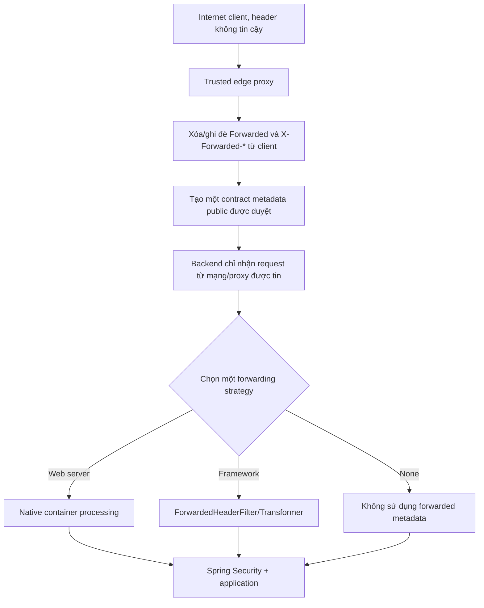
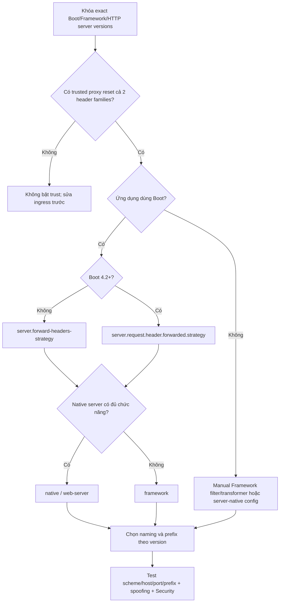
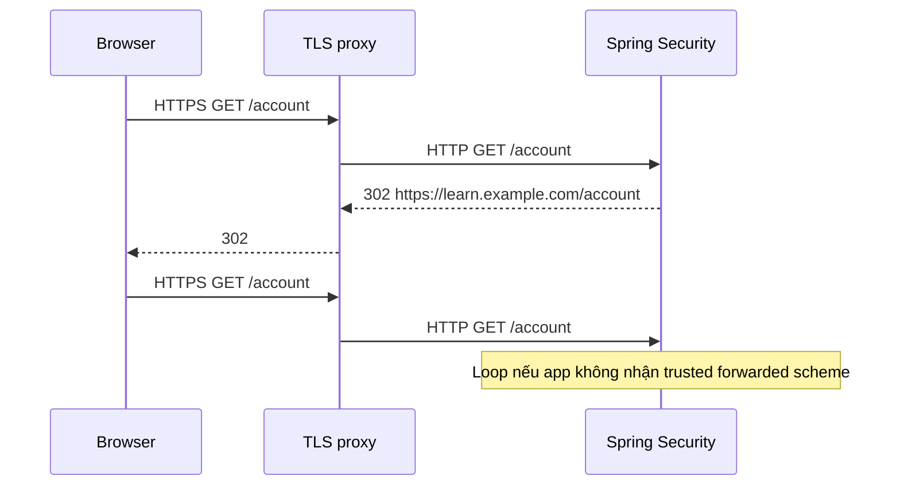
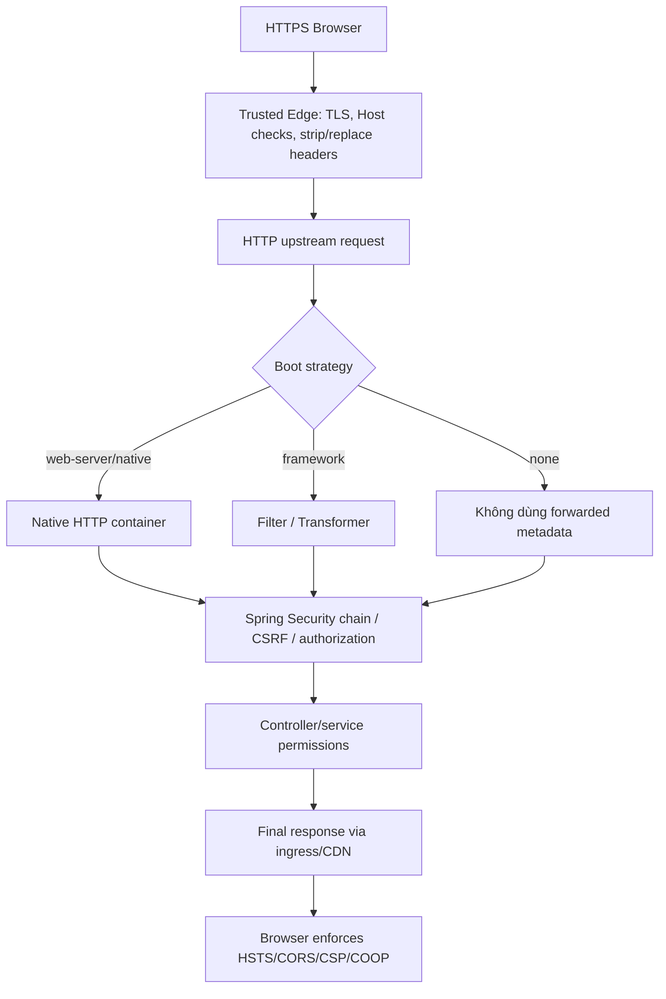
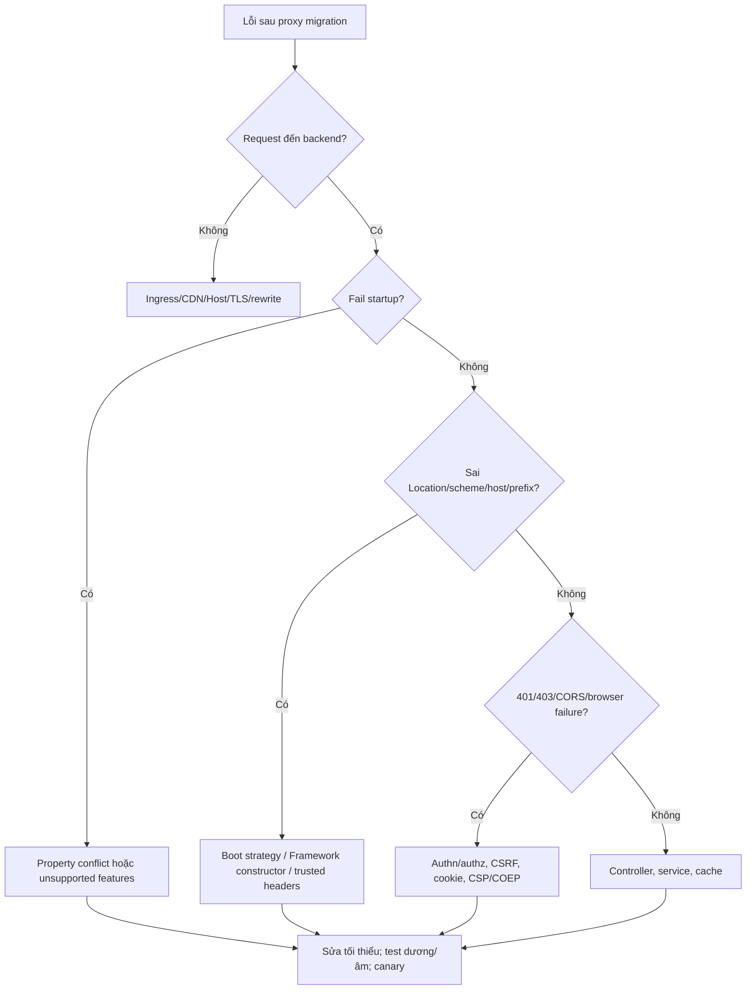

# Đối chiếu API xử lý proxy của Spring Boot và Spring Framework

## 1. Vì sao xử lý forwarded headers là một thay đổi bảo mật khi nâng cấp?

Trong module **SPRING_SECURITY_HTTP_PROTECTION**, người học áp dụng các lớp phòng vệ HTTP và trình duyệt bằng Spring Security: **CSRF, CORS, security headers, CSP, HSTS, HTTP firewall và bảo vệ session**, trên cả **Servlet/Spring MVC** và **Reactive/WebFlux**. Bài **“Đối chiếu API xử lý proxy của Spring Boot và Spring Framework”** thuộc chương **Nâng cấp và tương thích**, tập trung vào cách phục hồi thông tin **scheme, host, port, prefix và client address** sau khi request đi qua reverse proxy, ingress hoặc load balancer.

Ví dụ hệ thống học tập được công bố ở:

```text
Browser: https://learn.example.com/academy/account/profile
             │ HTTPS :443
             ▼
Ingress/TLS terminator
             │ HTTP :8080, nội bộ
             ▼
Spring Boot app: http://10.0.0.12:8080/account/profile
```

Ứng dụng cần phân biệt:

- **Kênh client → proxy:** thực sự sử dụng HTTPS, public hostname `learn.example.com` và public prefix `/academy`.
- **Kênh proxy → backend:** có thể là HTTP nội bộ, hostname private và path đã bỏ prefix.
- **Metadata forwarded:** do proxy được tin cậy bổ sung để backend sinh URL, redirect và đánh giá scheme/host theo thông tin public.
- **Trust boundary:** client internet có thể gửi giả `Forwarded` hoặc `X-Forwarded-*`, nên proxy phải **xóa hoặc thay thế những header không tin cậy** trước khi tạo header hợp lệ.

Nếu migration chọn sai API/strategy:
- `Location` redirect có thể thành `http://10.0.0.12:8080/login` hoặc `https://attacker.example/login`.
- OAuth2 Login callback có thể thành `http://internal:8080/login/oauth2/code/...`, không khớp redirect URI đã đăng ký.
- HSTS hoặc `requiresChannel`/HTTPS redirects có thể thiếu hiệu lực hoặc tạo vòng lặp redirect.
- Cookie `Secure`/`SameSite`, absolute URL, CORS origin validation hoặc CSRF bootstrap có thể lệch mô hình public.
- Prefix `/academy` bị **thiếu hoặc nhân đôi** trong redirect, static asset và callback.
- `securityMatcher`/`pathMatchers` có thể bị đặt theo public URL sai với path router thực sự nhận.

**Điểm mấu chốt:** forwarded headers mô tả request từ góc nhìn bên ngoài. Chúng **không phải dữ liệu đủ tin cậy chỉ vì có tên bắt đầu bằng `X-Forwarded-`**, không tự xác thực user, không thay CSRF/CORS và không thay quyền theo object/tenant.

### Kết quả học tập

Sau bài này, bạn có thể:
1. Đọc và phân biệt RFC 7239 `Forwarded` và các header `X-Forwarded-*`.
2. Chọn đúng cấu hình Spring Boot **3.x/4.0–4.1** so với **4.2+**, bao gồm thay tên property và lựa chọn header naming.
3. Phân biệt **container-native** (Tomcat/Jetty/Reactor Netty) và **Spring Framework-level** xử lý forwarded headers.
4. Cấu hình `ForwardedHeaderFilter` cho Servlet và `ForwardedHeaderTransformer` cho WebFlux đúng phiên bản.
5. Giải thích thay đổi Spring Framework **7.1**, constructor boolean chọn header family và `X-Forwarded-Prefix` phải bật rõ ràng.
6. Xây trust boundary và test chống **Host/proto/prefix spoofing**, redirect poisoning và thông tin client IP giả.
7. Kiểm tra tác động tới Spring Security **HSTS, HTTPS redirect, OAuth2 callback, session/cookies, CSRF, CORS, CSP, HTTP firewall** và nhiều security chains.
8. Viết ma trận hồi quy trước–sau nâng cấp với MockMvc, WebTestClient và HTTP qua ingress thật.

## 2. Forwarded header mô tả gì?

Một request HTTPS thực từ browser:

```http
GET /academy/account/profile HTTP/1.1
Host: learn.example.com
```

sau proxy có thể được chuyển cho backend:

```http
GET /account/profile HTTP/1.1
Host: 10.0.0.12:8080
X-Forwarded-Proto: https
X-Forwarded-Host: learn.example.com
X-Forwarded-Port: 443
X-Forwarded-Prefix: /academy
X-Forwarded-For: 203.0.113.10
```

Địa chỉ và hostname trong ví dụ là **minh họa**. `203.0.113.10` thuộc dải địa chỉ dành cho tài liệu, không xác định một người dùng thật.

Các trường thường gặp:

| Trường | Ý nghĩa mong muốn | Điểm cần tránh |
| --- | --- | --- |
| `Host` | Host hiện tại của HTTP request, có thể là upstream host. | Không tự suy là public host. |
| `Forwarded` | Header chuẩn RFC 7239, kết hợp `for`, `proto`, `host` và có thể nhiều hop. | Có thể do client giả nếu proxy không sanitize. |
| `X-Forwarded-For` | Thông tin client/hops được proxy cung cấp. | Không tin phần tử đầu tiên hoặc cuối cùng vô điều kiện. |
| `X-Forwarded-Proto` | Scheme client đến proxy, thường `https`/`http`. | Fake `https` có thể làm app tưởng request secure. |
| `X-Forwarded-Host` | Host public ban đầu. | Fake host có thể tạo absolute redirect poisoning. |
| `X-Forwarded-Port` | Port public, ví dụ 443. | Port không khớp host/scheme làm sai redirect. |
| `X-Forwarded-Prefix` | Prefix public bị rewrite trước khi backend nhận. | Có thể bị nhân đôi, sai context path hoặc spoof. |
| `X-Forwarded-Ssl` | Một convention legacy, có thể báo `on`. | Không phải mọi server/strategy đều hiểu giống nhau. |

### RFC 7239 so với X-Forwarded-*

Dạng chuẩn RFC 7239:

```http
Forwarded: for=203.0.113.10;proto=https;host=learn.example.com
```

Dạng de-facto phổ biến:

```http
X-Forwarded-For: 203.0.113.10
X-Forwarded-Proto: https
X-Forwarded-Host: learn.example.com
X-Forwarded-Port: 443
```

Các deployment có thể gửi một trong hai dạng, hoặc vô tình gửi **cả hai**. Với các phiên bản mới hơn, việc chọn loại nào được tiêu thụ là **một quyết định cấu hình**, không nên để framework đoán khi hai nguồn mâu thuẫn.

**RFC 7239 không có tham số chuẩn dành riêng cho `X-Forwarded-Prefix`**. Prefix là phần mở rộng qua header riêng, thường phải bật rõ nếu thật sự cần.

## 3. Trust boundary: điều kiện trước khi bật bất kỳ forwarded-header strategy nào

Một kẻ gửi HTTP request trực tiếp có thể tự đặt:

```http
GET /login HTTP/1.1
Host: learn.example.com
Forwarded: proto=https;host=attacker.example
X-Forwarded-Proto: https
X-Forwarded-Host: attacker.example
X-Forwarded-Prefix: /malicious
```

Nếu backend trực tiếp tin các header này, nó có thể:
- Sinh `Location: https://attacker.example/...` khi redirect.
- Tạo password-reset/login links hoặc OAuth redirect_uri dựa vào host sai.
- Ghi nhận `isSecure()`/scheme sai trong security decisions.
- Làm prefix phía client bị thay đổi ngoài ý muốn.
- Ghi sai client IP, từ đó hỏng rate limiting hoặc audit.

### Nguyên tắc bắt buộc

**Proxy tại ranh giới tin cậy phải xóa hoặc ghi đè cả `Forwarded` lẫn `X-Forwarded-*` đến từ client trước khi thêm metadata đáng tin cậy.** Chỉ xóa một nhóm rồi để nguyên nhóm còn lại vẫn có thể bị spoof.



**Framework không thể tự biết chắc header do proxy đáng tin hay client xấu tạo.** Bật `framework` hoặc `native` chỉ giải quyết **cách dùng header**, không chứng minh nguồn header đáng tin.

### Checklist ingress/network

- Backend không trực tiếp mở internet nếu chưa có ranh giới bảo vệ tương đương.
- Edge reset cả hai header families; không chỉ append vào giá trị attacker cung cấp.
- Chốt danh sách proxy/hop được tin cho container native và hệ thống ingress.
- Có chính sách `Host` allowlist, `Forwarded`/`X-Forwarded-Host` normalization và redirect URI đã đăng ký.
- Nếu có nhiều proxy, xác định **hop nào ghi giá trị nguyên bản, thứ tự chain và ưu tiên**.
- Không log token/session/cookie/OAuth code trong URL hoặc headers để debug.
- Kiểm thử các request có header giả qua **public ingress** và **direct backend path** được kiểm soát.

## 4. Spring Boot và Spring Framework xử lý ở hai tầng khác nhau

Spring Boot cung cấp cấu hình **lựa chọn strategy** dựa trên container, auto-configuration và environment; Spring Framework cung cấp các **component xử lý HTTP request cụ thể**.

| Câu hỏi | Spring Boot | Spring Framework |
| --- | --- | --- |
| Bật cách xử lý forwarded headers ở app Boot | Property `server.forward-headers-strategy` trên dòng cũ hoặc `server.request.header.forwarded.strategy` ở 4.2. | Bản thân Framework không áp property Boot. |
| Chọn container-native | `native` (cũ), `web-server` (4.2+). | Do Tomcat/Jetty/Reactor Netty xử lý, không phải `ForwardedHeaderFilter`. |
| Chọn Framework-level | `framework`. | `ForwardedHeaderFilter` (Servlet) / `ForwardedHeaderTransformer` (Reactive). |
| Không tin forwarded data | `none` hoặc remove-only policy được thiết kế rõ. | `setRemoveOnly(true)` để xóa mà không sử dụng header. |
| Chọn header family mới | 4.2 `server.request.header.forwarded.naming`. | Framework 7.1 `ForwardedHeaderFilter(boolean)`, `ForwardedHeaderTransformer(boolean)`. |
| Chọn `X-Forwarded-Prefix` mới | 4.2 `server.request.header.forwarded.use-prefix`. | Framework 7.1 `setUseForwardedPrefix(boolean)`. |
| Quyết định trust boundary | Không thể thay thế ingress sanitization. | Không thể thay thế ingress sanitization. |

**Không tạo hai tầng parsing forwarded headers vô tình.** Ví dụ bật native container *và* đăng ký thêm một ForwardedHeaderFilter xử lý lại những header cùng mục đích có thể làm logic host/proto/prefix hoặc redirect khó kiểm soát. Chọn **một owner** rồi kiểm thử HTTP thực.

## 5. Spring Boot 3.x và 4.0–4.1: property kế thừa

Các dòng này sử dụng property:

```properties
server.forward-headers-strategy=native
```

Các giá trị quan trọng:

| Giá trị | Ý nghĩa |
| --- | --- |
| `none` | Không tự tin và dùng forwarded headers theo strategy này. |
| `native` | Giao cho container/web server xử lý. |
| `framework` | Sử dụng Spring Framework filter/transformer. |

Ví dụ Boot 3.5 với Servlet hoặc WebFlux:

```yaml
# Spring Boot 3.x/4.0–4.1
server:
  forward-headers-strategy: framework
```

Khi cần container-native và proxy đã cung cấp đúng header:

```yaml
# Spring Boot 3.x/4.0–4.1
server:
  forward-headers-strategy: native
```

**Không coi default đồng nhất trên mọi deployment**: tài liệu Spring Boot cho biết trên một số cloud platform được hỗ trợ, strategy có thể mặc định `native`; môi trường khác mặc định `none`. Vì vậy phải chụp **effective configuration** khi migration, không chỉ xem file YAML.

### Một số khác biệt theo container

- **Tomcat:** native qua `RemoteIpValve` với việc tin proxy/IP và tên forwarded headers theo cấu hình.
- **Jetty:** native qua `ForwardedRequestCustomizer` và cấu hình Jetty tương ứng.
- **Reactor Netty:** hỗ trợ forwarded metadata theo capabilities của server và Boot integration.
- **Không phải container nào cũng xử lý `X-Forwarded-Prefix` như nhau**, nhất là ở các bản cũ.

### Tomcat TLS termination và redirect context root trên Boot cũ

Với Tomcat nhận HTTP nội bộ từ một TLS proxy, tài liệu Spring Boot 3.x khuyến nghị cân nhắc:

```properties
# Spring Boot 3.x / 4.0–4.1:
server.tomcat.redirect-context-root=false
```

Điều này giúp thông tin `X-Forwarded-Proto` được xét trước redirect liên quan context root, tránh HTTP redirect sai. Trên Boot **4.2**, property Servlet-specific này đã đổi namespace; xem phần sau.

### Giới hạn

`server.forward-headers-strategy` là **Boot property**, không phải API Spring Security `HttpSecurity` hoặc `ServerHttpSecurity`. Nó không trực tiếp cho phép CORS origins, không cấp quyền API và không bật/tắt CSRF.

## 6. Spring Boot 4.2: property mới và mốc migration thực sự

Theo **Spring Boot 4.2 Release Notes (20/11/2026)**, nhóm forwarded configuration đã được thống nhất dưới:

```text
server.request.header.forwarded.*
```

Thay đổi chính:

| Trước Boot 4.2 | Boot 4.2+ | Ghi chú |
| --- | --- | --- |
| `server.forward-headers-strategy` | `server.request.header.forwarded.strategy` | Property cũ **deprecated từ 4.2**; không khai báo đồng thời hai property. |
| `native` | `web-server` | Đổi tên giá trị container-native. |
| `framework` | `framework` | Giữ ý định dùng Spring Framework components. |
| `none` | `none` | Không áp metadata forwarded qua strategy. |
| Không có cùng nhóm cấu hình `naming` | `server.request.header.forwarded.naming` | Chọn `x-forwarded` (default) hoặc `rfc-7239`. |
| Prefix behavior cũ tùy stack | `server.request.header.forwarded.use-prefix` | Mặc định `false`: **bỏ qua X-Forwarded-Prefix** trừ khi bật rõ. |
| `server.tomcat.redirect-context-root` | `server.tomcat.servlet.redirect-context-root` | Property cũ deprecated; Boot 4.2 đổi nhóm Servlet-specific. |
| `server.tomcat.use-relative-redirects` | `server.tomcat.servlet.use-relative-redirects` | Cùng đợt di trú Tomcat properties. |

**Cảnh báo quan trọng:** Spring Boot 4.2 tài liệu nêu **nếu cùng cấu hình property cũ và mới, app có thể fail startup**. Đừng để biến môi trường legacy vẫn còn trong deployment trong khi YAML đã chuyển sang key mới.

### 6.1. Cấu hình container native trên Boot 4.2

```yaml
server:
  request:
    header:
      forwarded:
        strategy: web-server
        naming: x-forwarded
        use-prefix: false
```

Ý nghĩa: web server xử lý `X-Forwarded-*`, chưa dùng `X-Forwarded-Prefix`. Phải đảm bảo native server thực sự hỗ trợ lựa chọn này và đã cấu hình trust boundary.

### 6.2. Cấu hình Framework-level trên Boot 4.2

```yaml
server:
  request:
    header:
      forwarded:
        strategy: framework
        naming: x-forwarded
        use-prefix: true
```

Đây là một **phương án minh họa** khi proxy được tin gửi `X-Forwarded-*` và public prefix thật sự bị strip. Nếu proxy không strip prefix, `use-prefix: true` có thể làm URL bị nhân đôi; nếu không có nhu cầu prefix thì giữ `false`.

### 6.3. Chọn header chuẩn RFC 7239

```yaml
server:
  request:
    header:
      forwarded:
        strategy: framework
        naming: rfc-7239
        use-prefix: false
```

Với `naming: rfc-7239`, framework ưu tiên một **header family đã chọn**, thay vì dựa vào cả hai cùng lúc. Không coi RFC 7239 được hỗ trợ native trên mọi web server: tài liệu Boot 4.2 ghi **Tomcat không hỗ trợ rfc-7239 trong web-server strategy**, cần dùng `framework`. Nếu một proxy vẫn dùng `X-Forwarded-Prefix` ngoài header `Forwarded`, xem giới hạn host/prefix; chỉ bật `use-prefix` trên strategy/framework hỗ trợ.

### 6.4. Giới hạn khi chọn web-server strategy

Release Notes Boot 4.2 mô tả constraints:
- Tomcat native **không hỗ trợ** `rfc-7239` hoặc `use-prefix` trong cấu hình này.
- Jetty native **không hỗ trợ** `use-prefix`.
- Nếu web server không đáp ứng yêu cầu, có thể **fail startup**; chọn `framework` khi cần các tính năng đó.
- `web-server` thường được khuyến nghị nếu đủ tính năng, vì có lợi thế hiệu năng hơn generic Framework-level filter.

**Không tự đổi `web-server` thành `framework` chỉ vì nghe “Framework bảo mật hơn”**. Cả hai cần trusted proxy và test. Chọn theo feature support và operational contract.

## 7. Spring Framework 7.1: buộc chọn rõ header family

Một thay đổi đáng chú ý ở Spring Framework **7.1**: `ForwardedHeaderFilter` (Servlet) và `ForwardedHeaderTransformer` (Reactive) khuyến nghị **constructor boolean** để chỉ chọn **một** loại header family:

```text
useStandardHeader = true  → dùng RFC 7239 Forwarded
useStandardHeader = false → dùng X-Forwarded-*
```

Javadoc ghi:
- `new ForwardedHeaderFilter()` và `new ForwardedHeaderTransformer()` **deprecated từ 7.1**; dùng constructor `(boolean)`.
- Các constructor `(boolean)` được giới thiệu theo Javadoc với mốc **Since 6.1.29** của Spring Framework, nhưng **không** thể suy API này có trong mọi bản 6.1.x trước patch đó.
- Constructor legacy `()` giữ hành vi cũ: kiểm tra cả `Forwarded` và `X-Forwarded-*` (ưu tiên `Forwarded`), với prefix từng được bật mặc định.
- Constructor mới `(boolean)` **không bật `X-Forwarded-Prefix` theo mặc định**; phải chọn `setUseForwardedPrefix(true)` nếu cần.
- `setRemoveOnly(true)` cho phép **loại bỏ headers mà không sử dụng**.

### 7.1. Vì sao cách cũ nguy hiểm hơn?

Giả sử gateway chỉ sanitize `X-Forwarded-*` nhưng để client tự gửi `Forwarded: host=attacker.example`. Một handler legacy đọc cả hai và ưu tiên `Forwarded` có thể dùng host giả. Việc yêu cầu chọn một family mới làm **hợp đồng proxy rõ hơn**, nhưng **không thay edge sanitization**: phải xóa cả hai nhóm trước khi cho request vào hệ thống, kể cả khi ứng dụng chỉ dùng một nhóm.

### 7.2. Tương thích migration

| Spring Framework | Cách cấu hình |
| --- | --- |
| 6.0 và các bản trước khi có constructor boolean | Dùng API đúng patch, ví dụ `ForwardedHeaderFilter()`/`ForwardedHeaderTransformer()` nếu có; **proxy phải sanitize cả hai header families**. |
| 6.1.29 trở lên, 7.0 tùy patch | Constructor `(boolean)`/`setUseForwardedPrefix` có thể có; xác minh Javadoc/classpath. |
| **7.1** | Ưu tiên `(true)` hoặc `(false)`; `()` deprecated, prefix cần bật tường minh khi dùng constructor mới. |

Không suy Framework 7.1 đồng nghĩa Boot 4.2 trong mọi deployment nếu dependency management bị override. **Chốt cả hai version** rồi mới chọn code.

## 8. Chọn chiến lược qua sơ đồ quyết định



Bốn quyết định cần tách:

1. **Header đáng tin từ đâu?** Edge/ingress kiểm soát.
2. **Ai parse?** Web server native hay Spring Framework.
3. **Header format nào?** RFC 7239 hoặc `X-Forwarded-*`.
4. **Có cần public prefix không?** Public path được strip/replace tại ingress hay backend giữ nguyên.

Đừng “bật tất cả cho chắc”. Cấu hình thừa làm tăng khả năng khác biệt giữa môi trường, nhất là khi Boot 4.2 thay defaults.

## 9. Container-native: Tomcat RemoteIpValve

Tomcat có cơ chế `RemoteIpValve` để dùng thông tin của proxy theo các điều kiện về nguồn trusted/internal proxy và forwarded headers. Trên Boot 3.x, các property thông dụng:

```properties
server.forward-headers-strategy=native
server.tomcat.remoteip.remote-ip-header=x-forwarded-for
server.tomcat.remoteip.protocol-header=x-forwarded-proto
# Cẩn thận: internal-proxies ảnh hưởng trust boundary.
```

**Không đặt `server.tomcat.remoteip.internal-proxies` rỗng trên production chỉ để tin mọi proxy**. Tài liệu Boot cảnh báo cấu hình này có thể khiến ứng dụng tin headers từ các nguồn không đáng tin.

### 9.1. Boot 4.2 Tomcat

```properties
server.request.header.forwarded.strategy=web-server
server.request.header.forwarded.naming=x-forwarded
server.tomcat.servlet.redirect-context-root=false
```

Tomcat 4.2 Boot integration **không hỗ trợ** tùy chọn `naming=rfc-7239` hoặc `use-prefix=true` trong native mode theo release notes; khi cần hai thứ đó, dùng `framework`.

### 9.2. Tại sao redirect-context-root quan trọng?

Nếu browser gọi `https://learn.example.com/academy` còn backend nhận `http://10.0.0.12:8080/academy`, container có thể redirect slash/context-root trước khi scheme `https` từ forwarded header được áp dụng. Kết quả có thể chứa `http` và internal host/port. `redirect-context-root=false` giúp hệ thống có cơ hội xử lý forwarded scheme trước khi redirect theo tài liệu Boot.

**Không mặc định setting này giải quyết mọi redirect.** Quan sát `Location` cuối qua proxy, login/callback, query/path và browser.

## 10. Container-native: Jetty và Reactor Netty

### Jetty

Jetty có `ForwardedRequestCustomizer`; khả năng xử lý host/proto/client info phụ thuộc version và Boot integration. Với Boot 4.2, dùng:

```properties
server.request.header.forwarded.strategy=web-server
server.request.header.forwarded.naming=x-forwarded
```

Nếu cần `X-Forwarded-Prefix` mà Jetty native không hỗ trợ, Boot 4.2 khuyến nghị chọn `framework` thay vì đặt `use-prefix=true` và hy vọng bị bỏ qua.

### Reactor Netty

WebFlux thường chạy Reactor Netty. Boot có thể bật xử lý forwarded information tại native HTTP server; tuy nhiên hành vi path prefix, RFC 7239 và trust boundary cần đối chiếu đúng Reactor Netty/Boot version.

```properties
# Boot 3.5:
server.forward-headers-strategy=native

# Boot 4.2 equivalent:
# server.request.header.forwarded.strategy=web-server
```

Đừng cấu hình bean `ForwardedHeaderTransformer` cùng native processing rồi mong cả hai áp vào request mà không có xung đột. Kiểm tra thực tế với `ServerHttpRequest.getURI()`, `getPath()` và response `Location`.

### Tránh nhầm native và TLS termination

Backend chạy HTTP nội bộ không nhất thiết là vấn đề nếu TLS termination và network trust được thiết kế đúng. Điều nguy hiểm là backend **tin header giả**, tạo redirect/cookie/authorization dựa trên scheme sai hoặc chấp nhận traffic không đi qua trusted edge.

## 11. Servlet Framework-level: ForwardedHeaderFilter

Với Spring MVC/Servlet, `ForwardedHeaderFilter` là `jakarta.servlet.Filter` wrapper; nó dùng forwarded metadata để khiến request/response downstream phản ánh scheme/host/port/prefix từ phía client và loại các header đã xử lý.

**Phương án ưu tiên khi dùng Spring Boot:** chỉ cấu hình `server.forward-headers-strategy=framework` trên dòng cũ hoặc `server.request.header.forwarded.strategy=framework` trên Boot 4.2, **không tự đăng ký filter thứ hai** nếu Boot đã auto-configure.

### 11.1. Manual bean trên Spring Framework 7.1, không dùng Boot auto-registration chồng

```java
import org.springframework.context.annotation.Bean;
import org.springframework.context.annotation.Configuration;
import org.springframework.web.filter.ForwardedHeaderFilter;

@Configuration
public class ForwardedFilterConfig {

    @Bean
    ForwardedHeaderFilter forwardedHeaderFilter() {
        // false: chọn X-Forwarded-* do trusted proxy phát.
        ForwardedHeaderFilter filter =
            new ForwardedHeaderFilter(false);
        filter.setUseForwardedPrefix(true); // Chỉ khi proxy strip prefix.
        return filter;
    }
}
```

Đây là **một phương án manual** khi application tự quản lý filter registration và framework version hỗ trợ constructor. Không sử dụng nó **đồng thời** với Boot strategy `framework` nếu auto-config đã tạo filter tương đương. Việc đăng ký trùng hoặc order sai có thể gây hành vi không nhất quán.

### 11.2. Nếu proxy dùng RFC 7239

```java
ForwardedHeaderFilter filter =
    new ForwardedHeaderFilter(true);  // true: RFC 7239 Forwarded
filter.setUseForwardedPrefix(false);  // Không cần prefix
```

Đây là **snippet**; không dùng đồng thời với `new ForwardedHeaderFilter(false)` trên cùng request path. Nếu `Forwarded` được dùng nhưng prefix vẫn được truyền bằng `X-Forwarded-Prefix`, chỉ bật `setUseForwardedPrefix(true)` sau khi xác minh trust boundary và yêu cầu URL.

### 11.3. removeOnly

```java
ForwardedHeaderFilter filter =
    new ForwardedHeaderFilter(false);
filter.setRemoveOnly(true);
```

`removeOnly` làm header bị **loại khỏi request downstream nhưng không áp** thông tin scheme/host/port trong chúng. Hữu ích khi app **không nằm sau trusted proxy** và muốn tránh các filter/controllers vô tình đọc dữ liệu giả. Tuy nhiên **nếu container-native đã áp header trước filter**, `removeOnly` ở tầng Framework có thể không hoàn tác scheme/host đã thay đổi. Muốn bỏ trust, cấu hình cả container/edge đúng.

### 11.4. Order và dispatch types

`ForwardedHeaderFilter` cần chạy đủ sớm để request/redirect được nhìn theo cùng metadata. Spring Framework khuyến nghị nó đứng trước những filters như `RequestContextFilter`; với manual registration, kiểm tra `REQUEST`/`ASYNC`/`ERROR` dispatch types, đặc biệt nếu có async/error pages. Kiểm tra thứ tự với Spring Security filter chain để `isSecure()`/host/redirect decision phản ánh intended forwarded context.

**Không viết một custom filter order theo số đoán rồi kết luận an toàn.** Với Boot, ưu tiên auto-configuration version-aware thay manual order nếu có thể.

## 12. WebFlux Framework-level: ForwardedHeaderTransformer

WebFlux không có Servlet `ForwardedHeaderFilter`. Nó dùng `ForwardedHeaderTransformer` (Spring Framework) để biến đổi `ServerHttpRequest` trước các WebFlux handlers.

### 12.1. Manual bean trên Framework 7.1

```java
import org.springframework.context.annotation.Bean;
import org.springframework.context.annotation.Configuration;
import org.springframework.web.server.adapter.ForwardedHeaderTransformer;

@Configuration
public class ForwardedTransformerConfig {

    @Bean("forwardedHeaderTransformer")
    ForwardedHeaderTransformer forwardedHeaderTransformer() {
        ForwardedHeaderTransformer transformer =
            new ForwardedHeaderTransformer(false);
        transformer.setUseForwardedPrefix(true); // Chỉ khi cần.
        return transformer;
    }
}
```

Bean name `forwardedHeaderTransformer` được `WebHttpHandlerBuilder` nhận diện theo contract của Spring Framework. Đây là **phương án manual**, không thêm vào Boot application đã tạo transformer tương đương từ strategy `framework`.

### 12.2. Chọn RFC 7239 hoặc bỏ trust

```java
// RFC 7239:
ForwardedHeaderTransformer rfc =
    new ForwardedHeaderTransformer(true);

// Chỉ xóa forwarded headers, không áp giá trị:
ForwardedHeaderTransformer strip =
    new ForwardedHeaderTransformer(false);
strip.setRemoveOnly(true);
```

Các dòng là **snippets**, minh họa lựa chọn thay thế, không phải tạo hai transformer beans để chạy nối tiếp.

### 12.3. Khác biệt đáng kể so với Servlet

| Servlet | Reactive |
| --- | --- |
| `ForwardedHeaderFilter` implements Servlet `Filter`. | `ForwardedHeaderTransformer` transforms `ServerHttpRequest`. |
| Có `HttpServletRequest.getScheme()`/`isSecure()`. | `ServerHttpRequest.getURI()` và `getPath()`. |
| `HttpServletResponse.sendRedirect` wrapping. | Redirect/absolute URL dựa trên ServerWebExchange/request URI đã transformed. |
| Servlet filter registration và dispatcher types quan trọng. | `WebHttpHandlerBuilder` và reactive lifecycle/handler order quan trọng. |
| Test với `MockMvc`, Servlet integration và HTTP thực. | Test với `WebTestClient`, WebFlux integration và HTTP thực. |

**Không dùng `ForwardedHeaderFilter` trong một application chỉ có WebFlux rồi khẳng định nó bảo vệ WebFlux request**. Có thể dependency chứa cả class Servlet nhưng request pipeline hoàn toàn khác.

## 13. X-Forwarded-Prefix: đúng URL public nhưng không đổi bừa security matcher

Ví dụ ingress:
 
```text
Public:  /academy/account/profile
Backend: /account/profile
Header:  X-Forwarded-Prefix: /academy
```

Mục tiêu: khi Spring tạo link cho browser, nó biết public prefix `/academy`. Trên Boot 4.2 và Framework 7.1 config mới, prefix **bị bỏ qua mặc định** trừ khi bật `use-prefix`/`setUseForwardedPrefix(true)`.

### Ba dạng prefix phải phân biệt

| Trường hợp | Public URL | Backend URL | Cách xử lý |
| --- | --- | --- | --- |
| Ingress strip prefix | `/academy/account` | `/account` | Có thể cần dùng forwarded prefix để sinh absolute links/redirects. |
| Ingress giữ nguyên prefix | `/academy/account` | `/academy/account` | **Không** tự áp prefix lần hai. |
| Backend mount context path | `/academy/account` | App context `/academy` | Cần tránh áp `X-Forwarded-Prefix` khi đã khớp public path. |
| App dùng WebFlux base path | `/academy/account` | `spring.webflux.base-path=/academy` | Kiểm tra handler mappings và transformer riêng. |

**Forwarded prefix không tự thay định nghĩa security matcher hoặc route authorization**. Dù request URI được transformed để phản ánh client, path mà `securityMatcher`/`requestMatchers`/`pathMatchers` so phải được **kiểm tra trong version và stack thực tế**. Đừng suy từ URL trên thanh địa chỉ browser.

### Tình huống nhân đôi prefix

```text
Sai:
Location: https://learn.example.com/academy/academy/login

Đúng cho kịch bản strip prefix:
Location: https://learn.example.com/academy/login
```

Chữa bằng cách chọn **một nơi làm chủ public prefix** (ingress rewrite, app context/base path, forwarded metadata), không thêm rewrite filter tùy ý rồi cho qua.

### Dấu slash và path normalization

`/academy`, `/academy/`, `/academy//account`, percent-encoded slash và semicolon có thể được proxy/framework/parser xử lý khác. Không tắt `StrictHttpFirewall`/Reactive firewall để “sửa” prefix mismatch; hãy chuẩn hóa route và test cả URL âm tính.
## 14. HTTPS termination, request scheme và HSTS trong Spring Security

Một deployment phổ biến:

```text
Client  -- HTTPS -->  Ingress  -- HTTP -->  Spring app
```

Backend thực sự nhận HTTP nội bộ; tuy nhiên browser đã dùng HTTPS. Spring cần một **request scheme đúng** khi sinh URL, redirect và khi một số security components đánh giá request là secure.

Ví dụ nếu proxy đáng tin gửi:

```http
X-Forwarded-Proto: https
X-Forwarded-Host: learn.example.com
X-Forwarded-Port: 443
```

và strategy được cấu hình đúng, request wrapper/transformer có thể báo `https`, host public và port public.

**Nguy cơ khi strategy không bật:**
- URL generated từ backend có thể là `http://10.0.0.12:8080/...`.
- HTTPS redirect có thể quay vòng qua ingress.
- HSTS writer có thể bỏ qua request được xem là không secure tùy cấu hình.
- OAuth2 redirect URI sai scheme/host.
- Absolute link trong email API/callback sai.

### 14.1. HSTS là header do browser thực thi

```http
Strict-Transport-Security: max-age=31536000; includeSubDomains
```

Browser chỉ chấp nhận HSTS qua kết nối HTTPS hợp lệ. Spring Security có HSTS support trong cả Servlet/Reactive và thường phát trên request được xác định là secure. Tuy nhiên:
- HSTS gửi từ backend qua HTTP nội bộ **không tự bảo đảm** browser nhận HTTPS hợp lệ ở public edge.
- Có thể để edge CDN/ingress sở hữu HSTS thay cho Spring, nhưng phải có **một chủ sở hữu rõ**.
- `includeSubDomains`/preload cần đánh giá toàn bộ subdomains, không copy vô điều kiện.
- Không dùng `X-Forwarded-Proto: https` từ client giả để “khiến HSTS xuất hiện”.

### 14.2. Tại sao forwarded scheme có thể gây vòng lặp redirect?

Nếu app yêu cầu HTTPS mà chỉ thấy HTTP upstream, nó có thể trả redirect tới HTTPS; ingress lại nhận HTTPS từ browser rồi chuyển HTTP về backend; app tiếp tục redirect.



Khi proxy sanitizes header và strategy xử lý đúng, ứng dụng thấy **client-originated scheme**; không tự redirect một request vốn đã dùng HTTPS.

**Chỉ sửa scheme khi có trust boundary đúng**, không thêm redirect hack bỏ qua tất cả security filters.

## 15. Spring Security HTTPS redirects trong Servlet và Reactive

Spring Security có API yêu cầu HTTPS theo version và stack. Tùy bản, mẫu Servlet hiện đại có thể là:

```java
// Một phần của HttpSecurity builder; dùng khi target hỗ trợ:
http.redirectToHttps(https -> https
    .requestMatchers(request -> true));
```

Trên các bản khác, cấu hình HTTPS redirect có DSL `requiresChannel`/Lambda tương ứng. **Không copy nguyên method nếu Javadoc target không có nó**. Với WebFlux, dùng API `ServerHttpSecurity` đúng version; không dùng Servlet `HttpServletRequest` trong Reactive.

### Vì sao proxy config phải được xác nhận trước redirect policy?

- Redirect policy cần biết scheme/host/port mà **browser thực sự truy cập**.
- Nếu app được phép tin header giả, attacker có thể làm request HTTP trông như HTTPS.
- Nếu backend không tin header hợp lệ từ ingress, có thể tạo redirect loop hoặc internal Location.
- Nếu reverse proxy đã enforce HTTPS ở public edge, tránh cấu hình hai tầng redirect đối nghịch.
- Nếu HSTS được gửi, cần chắc chắn host và TLS policy đúng, không trả trên origin không mong muốn.

### Kiểm thử cần có

| Scenario | Kỳ vọng |
| --- | --- |
| Public HTTPS → backend HTTP với metadata tin cậy | Không redirect lặp, URL cuối đúng HTTPS public host. |
| Public HTTP (nếu còn mở) → HTTPS | Redirect một cách có kiểm soát và không mất query/path. |
| Request giả `X-Forwarded-Proto: https` từ client trực tiếp | Không bypass HTTPS policy nhờ header giả. |
| Backend không thuộc network trusted proxy | Không được để client điều khiển scheme. |
| OAuth callback qua HTTPS | `redirect_uri` khớp exact provider registration. |
| HSTS qua public HTTPS | Header có policy đã duyệt, không lặp/xung đột. |

**HTTP redirect khác CSP `upgrade-insecure-requests`**: browser policy không thay kiểm tra nguồn scheme của backend.

## 16. OAuth2 Login, OIDC redirect URI và popup

Trong một SPA/BFF dùng OAuth2 Login, Spring Security có thể sinh redirect URI dựa vào **base URL** của request đang xử lý. Nếu forwarded host/proto/prefix sai, identity provider có thể từ chối `redirect_uri` hoặc redirect tới host sai.

Ví dụ cấu hình mẫu với callback template phổ biến:

```yaml
spring:
  security:
    oauth2:
      client:
        registration:
          sso:
            client-id: "DEMO_CLIENT_ID"
            client-secret: "LOAD_FROM_SECRET_STORE"
            redirect-uri: "{baseUrl}/login/oauth2/code/{registrationId}"
```

Đây là **chỉ dẫn minh họa**, không hard-code production secrets. Khi public app ở `https://learn.example.com/academy`, callback dự kiến thường là:

```text
https://learn.example.com/academy/login/oauth2/code/sso
```

Tuy nhiên callback thực phụ thuộc config `baseUrl`/path/servlet mapping/ingress rewrite và provider registration. Phải lấy **exact redirect_uri thực đã gửi** ở staging, không đoán.

### Những lỗi thường gặp

| Triệu chứng | Nguyên nhân nghi vấn | Cách xác minh |
| --- | --- | --- |
| Identity provider báo redirect_uri mismatch | App gửi `http` hoặc internal host/port. | Network trace/IdP logs được redaction, forwarded strategy. |
| Callback thiếu `/academy` | Prefix bị bỏ qua sau Boot 4.2/Framework 7.1. | `use-prefix` và ingress rewrite contract. |
| Callback bị `/academy/academy` | Prefix được áp hai lần. | App context/base path và header. |
| Callback bị attacker-host trong URL | Host spoofing qua untrusted header. | Edge sanitization, host allowlist, direct backend test. |
| Login thành công nhưng session mất | Cookies `Secure`/`SameSite`/`Path`, session persistence. | Browser cookie jar, Session/Context repository. |
| Popup OAuth mất `window.opener` | COOP policy không tương thích popup. | Response COOP của opener/popup, browser E2E. |
| `state` mismatch | Session/cookie/state lưu không đúng hoặc flow bị thay. | OAuth state validation riêng, không tắt nó. |

**Forwarded headers không thay OAuth `state`, PKCE, OIDC nonce, token validation hoặc authorization**. Chúng chỉ giúp ứng dụng biết URL client-originated để sinh links/callback đúng khi dữ liệu đến từ proxy đáng tin.

### Không mở wildcard redirect URI để sửa lỗi proxy

Nếu provider báo callback sai, hãy sửa `server.request.header.forwarded.*`, ingress hoặc registration chính xác. Không đăng ký redirect URIs wildcard rộng hoặc bỏ kiểm tra state để “cho login chạy”.

## 17. Session cookie, Secure, SameSite, Domain và Path

Khi request thực từ browser là HTTPS nhưng backend thấy HTTP, `Secure` cookie flag có thể sai **nếu ứng dụng dựa vào trạng thái secure của request để quyết định flag**. Spring Boot/container có các cấu hình cookie độc lập; cần đánh giá nguồn điều khiển thực tế.

| Cookie thuộc tính | Ảnh hưởng và điểm cần kiểm tra |
| --- | --- |
| `Secure` | Chỉ được gửi qua HTTPS; kiểm tra browser-facing TLS, proxy và config container. |
| `HttpOnly` | Session cookie nên được ngăn JavaScript đọc; không phải forwarded header concern trực tiếp. |
| `SameSite` | Quy định cookie cross-site; tác động OAuth callback/cross-origin SPA. |
| `Domain` | Host-only vs shared subdomain, tránh share rộng. |
| `Path` | Có thể bị ảnh hưởng bởi public prefix/context path, cần kiểm tra trên browser. |
| Expires/Max-Age | Hành vi logout/expiry; không dựa vào forwarded scheme một mình. |

### Ví dụ Boot 3.x/4.x session cookie properties (đối chiếu version)

```properties
server.servlet.session.cookie.http-only=true
server.servlet.session.cookie.secure=true
server.servlet.session.cookie.same-site=lax
```

Đây là cấu hình ví dụ **Servlet**, chỉ phù hợp khi policy sản phẩm dùng HTTPS và Lax đáp ứng login/cross-site nhu cầu. WebFlux có WebSession cookie configuration khác; không copy toàn bộ `server.servlet.session.*` vào app WebFlux.

### Vì sao prefix khiến cookie “biến mất”?

Giả sử backend phục vụ `/account` nhưng browser thấy `/academy/account`. Nếu cookie `Path` được set `/account`, browser sẽ **không gửi nó** khi request `/academy/account`. Có thể mất session sau login mặc dù URL/callback đúng. Ngược lại đặt `Path=/` không nên là giải pháp mặc định nếu có nhiều ứng dụng nhạy cảm chia sẻ host.

Khi thay Boot 4.2 `use-prefix`, phải kiểm tra:
- `Set-Cookie` thực trên response public qua proxy.
- Cookie `Path`/`Domain` trong DevTools.
- `GET /account` sau login với cùng cookie jar.
- Logout có clear đúng cookie name/path/domain.
- Session fixation protection và HTTP firewall không bị vô hiệu hóa.

## 18. CSRF cookie/SPA và CORS không phụ thuộc mỗi forwarded host

Spring Security CSRF bảo vệ mutation dùng ambient credentials như session cookies. Một SPA có thể bootstrap token bằng `GET /csrf` hoặc đọc raw `XSRF-TOKEN` cookie; browser gửi `X-XSRF-TOKEN` theo application protocol.

Nếu backend dùng forwarded host/proto sai:
- Cookie `Domain`/`Path` hoặc redirect khởi tạo token có thể không phù hợp public URL.
- SPA nhận login redirect tới internal HTTP, token hoặc cookie lifecycle sai.
- Request CORS đến API khác origin có thể bị mất credentials do URL khác.
- Authorization exception có thể bị nhầm với CSRF 403.

**Không tắt `csrf.disable()` chỉ để “sửa” một lỗi callback/prefix**. Cần xác định đúng request đi tới chain nào, cookie có mặt không và token raw/masked có được xử lý theo contract hay không.

### CORS xét Origin, không dùng X-Forwarded-Host như một ACL

Request preflight:

```http
OPTIONS /account/email HTTP/1.1
Origin: https://app.example.com
Access-Control-Request-Method: PATCH
Access-Control-Request-Headers: content-type,x-xsrf-token
```

CORS `Origin` là metadata do browser cung cấp để bảo vệ khả năng JS đọc response. Forwarded host/proto mô tả public URL của backend. Chúng **khác trách nhiệm**:
- Không thay `Origin` bằng `X-Forwarded-Host` để quyết định allowlist.
- Không trả wildcard `Access-Control-Allow-Origin: *` với `Access-Control-Allow-Credentials: true`.
- Không dùng CORS làm authentication hoặc authorization server.
- CORS không ngăn tất cả CSRF side effects khi cookie tự được gửi.

### Khi SPA ở origin khác

`https://app.example.com` gọi `https://api.example.com` là cross-origin, dù có thể same-site. Cookie `SameSite` và `fetch` credentials đều phải đúng. `Forwarded` headers chỉ trợ giúp backend biết public host/scheme, **không cho browser quyền đọc cookie host-only của origin khác**.
## 19. HTTP firewall, path matching và proxy rewrite

Proxy thường thay path trước Spring:

```text
Public URL:   /academy/admin/users
Upstream URL: /admin/users
```

Nếu developer viết `requestMatchers("/academy/admin/**")` nhưng matcher thực nhận `/admin/users`, rule ADMIN có thể không khớp. Một app có fallback `authenticated()` có thể cho user thường truy cập mà thiếu `ROLE_ADMIN` nếu object authorization không đủ.

### Hai matcher cần phân biệt

1. `securityMatcher` chọn **security chain** (Servlet `SecurityFilterChain` hoặc Reactive `SecurityWebFilterChain`).
2. `requestMatchers` / `pathMatchers` chọn rule **trong chain**.

Forwarded-prefix processing ảnh hưởng request attributes và URL generation, nhưng **không nên giả định** nó thay nghĩa matcher theo một cách cố định trên mọi framework version/servlet mapping. Test path mà security và MVC/WebFlux handler **thật sự** nhìn thấy.

```text
/academy/admin
/academy/admin/
/academy/admin/users
/admin/users
/academy//admin/users
/academy/admin/%2Fusers
/academy/../admin/users
```

Không nhất thiết mọi URL phải trả status giống nhau; mục tiêu là **user thiếu quyền không nhận dữ liệu admin và mutation không xảy ra**.

**Không tắt HTTP firewall vì redirect sai**. `StrictHttpFirewall` (Servlet) và `StrictServerWebExchangeFirewall` (Reactive, theo version) có nhiệm vụ từ chối URL không normalized. Sai prefix không phải lý do mở encoded slash, semicolon, backslash hay `INSECURE_NOOP`. Sửa gateway và route contract trước.

## 20. Host validation và client IP: tránh spoofing qua Forwarded/X-Forwarded-For

Một header `X-Forwarded-For` có thể là danh sách hops:

```http
X-Forwarded-For: 203.0.113.10, 198.51.100.24
```

**Không thể chọn “phần tử đầu tiên luôn là client IP thật” nếu edge không sanitize**. Attacker có thể gửi `X-Forwarded-For: 127.0.0.1` rồi proxy append thêm IP; app tin phần tử không xác minh sẽ làm hỏng rate limiter hoặc IP allowlist.

### Host spoofing nguy hiểm hơn lỗi redirect thẩm mỹ

Nếu app dùng host từ forwarded metadata để xây email reset-password links, absolute `Location` redirects, OAuth `redirect_uri`, HATEOAS links, cookie domain hoặc logic CORS, host giả có thể gây **open redirect, callback mismatch hoặc poisoning của link bảo mật**.

Defense in depth:

1. Edge proxy strip/reset cả hai forwarded families, giới hạn backend ingress chỉ từ trusted networks.
2. Có host/domain allowlist ở gateway/application khi phù hợp.
3. Không lấy `X-Forwarded-For` trực tiếp từ user input làm chứng cứ identity/IP trust.
4. Chọn native trust proxy config chính xác; Tomcat `RemoteIpValve` có `internalProxies`/`trustedProxies`.
5. Rate limiting dùng client identity được chuẩn hóa từ trust chain đã kiểm chứng.
6. Test `Forwarded`/`X-Forwarded-Host` giả qua ingress; response không phản chiếu attacker origin.

## 21. Bản đồ trách nhiệm qua các tầng

| Tầng | Điều nó biết/chịu trách nhiệm | Không nên làm |
| --- | --- | --- |
| Browser | Public URL, cookie, CSP/CORS/SOP, HSTS. | Tin header server-only như proof user permissions. |
| Edge ingress | TLS termination, sanitize headers, host allowlist, public path rewrite. | Để client điều khiển forwarded metadata không kiểm soát. |
| HTTP server native | Khôi phục scheme/host/port theo proxy contract. | Tin tất cả proxies hoặc dùng nhiều chiến lược cùng lúc. |
| Spring Framework filter/transformer | Expose client-originated metadata tới MVC/WebFlux. | Được xem là cơ chế xác thực proxy source. |
| Spring Security | Authn/authz, CSRF, CORS integration, headers, firewall, session. | Dùng `Forwarded` như token phân quyền. |
| Service layer | Owner/tenant/object permission và validation. | Dựa vào URL matcher làm ACL dữ liệu duy nhất. |
| CDN/response proxy | Cache/security headers cho response nó phát. | Cache `Set-Cookie`/private data công khai. |



## 22. Mẫu edge proxy: minh họa trust boundary, không phải production copy/paste

Nginx hoặc ingress khác có thể **ghi đè toàn bộ** forwarded headers nhận từ internet trước khi chuyển backend. Hình thái logic:

```nginx
# PSEUDOCONFIG — cần rà lại theo ingress và từng hop thực tế.
location /academy/ {
    proxy_pass http://spring_upstream/;

    # Không chuyển nguyên header RFC Forwarded do client gửi.
    proxy_set_header Forwarded "";

    # Header family X-Forwarded-* do trusted proxy tạo.
    proxy_set_header X-Forwarded-Proto $scheme;
    proxy_set_header X-Forwarded-Host $host;
    proxy_set_header X-Forwarded-Port $server_port;
    proxy_set_header X-Forwarded-For $remote_addr;
    proxy_set_header X-Forwarded-Prefix /academy;
}
```

**Đây là pseudoconfig, không phải cấu hình production hoàn chỉnh.** Nó chưa bao gồm `server_name`/host allowlist, TLS, upstream restrictions, multi-hop, timeout, rate limiting, IPv6 hay cookies. `$scheme`/`$server_port` chỉ đúng nếu Nginx thấy **public TLS edge**; nếu nó đứng sau một TLS terminator khác, các giá trị này có thể là HTTP/internal port và cần một thiết kế trusted-hop riêng. `proxy_pass` cũng phải thực sự strip prefix như giả định, nếu không `X-Forwarded-Prefix` có thể gây URL nhân đôi.

Nếu dùng nhiều proxy, xác định rõ **hop nào ghi source of truth**, không copy `$remote_addr` rồi mất thông tin client hợp lệ; đồng thời không giữ `X-Forwarded-For` do attacker chèn.

## 23. Khi có cả Forwarded và X-Forwarded-*: test xung đột

Một request cố ý mâu thuẫn:

```http
GET /account HTTP/1.1
Host: learn.example.com
Forwarded: proto=http;host=attacker.example
X-Forwarded-Proto: https
X-Forwarded-Host: learn.example.com
```

Trong legacy Framework filter, cả hai families có thể được đọc với ưu tiên một loại. Với Framework 7.1 constructor mới hoặc Boot 4.2 `naming`, ứng dụng chọn **một family**. Nhưng nếu edge chỉ sanitize `X-Forwarded-*` mà bỏ nguyên `Forwarded`, vẫn có nguy cơ khi thành phần khác hoặc code tương lai đọc nguồn bỏ sót.

| Test | Contract mong muốn |
| --- | --- |
| Client gửi `Forwarded: host=attacker.example` | Backend không sinh `Location` attacker-host. |
| Client gửi `X-Forwarded-Host: attacker.example` | Không dùng host giả cho link/reset/OAuth. |
| Client gửi cả hai mâu thuẫn | Proxy reset cả hai, backend chỉ thấy hợp đồng được tin. |
| Direct backend với fake header | Bị chặn hoặc chạy `none`/removeOnly theo trust policy. |
| Hai hop proxy | Client/public scheme đúng theo chuỗi proxy đã kiểm chứng. |
| `X-Forwarded-Prefix: /evil` | Không thay link/callback theo prefix giả. |
| Header malformed hoặc multi-value | Reject/normalize đúng parser, không đoán tùy tiện. |

**Không kết luận chống spoof chỉ vì `new ForwardedHeaderFilter(false)` bỏ qua `Forwarded`**. Edge phải xử lý cả hai families để bảo vệ những thành phần hiện tại và sau này.
## 24. Case study: nâng Spring Boot 3.5 lên 4.2 sau reverse proxy

Giả sử ứng dụng Spring Boot 3.5 Servlet được public tại:

```text
https://learn.example.com/academy
```

Ingress strip `/academy`, chuyển HTTP tới Tomcat; proxy gửi:
- `X-Forwarded-Proto: https`.
- `X-Forwarded-Host: learn.example.com`.
- `X-Forwarded-Port: 443`.
- `X-Forwarded-Prefix: /academy`.

Cấu hình cũ:

```yaml
# Boot 3.5, ví dụ:
server:
  forward-headers-strategy: framework
```

Khi nâng tới Boot 4.2, **không chỉ đổi tên property**; phải quyết định prefix và header naming:

```yaml
# Boot 4.2, khi proxy dùng X-Forwarded-* và strip prefix:
server:
  request:
    header:
      forwarded:
        strategy: framework
        naming: x-forwarded
        use-prefix: true
```

### 24.1. Ma trận thay đổi mong đợi

| Thông tin | Trước upgrade | Sau upgrade phải chứng minh |
| --- | --- | --- |
| Scheme public | `https` | `https` trong URL/redirect cuối. |
| Host public | `learn.example.com` | Không lộ internal host, không dùng attacker-host. |
| Port | 443 | Không có `:8080` trong Location. |
| Prefix | `/academy` | Không mất và không bị thêm hai lần. |
| Login callback | `https://learn.example.com/academy/login/oauth2/code/sso` | Khớp provider registration. |
| Session cookie | Cookie đúng domain/path và HTTPS | Browser tiếp tục gửi sau login. |
| CSRF POST | Unsafe method bị chặn khi thiếu token | Không có side effect trái phép. |
| CORS | Origin hợp lệ được xét riêng | Không dùng forwarded Host thay CORS Origin. |
| HSTS | Header qua HTTPS public | Giữ policy, không sinh trên host ngoài ý định. |
| Redirect HTTP→HTTPS | Một bước hoặc theo policy | Không vòng lặp vô hạn. |

### 24.2. Bẫy startup

Nếu configuration file đã dùng key mới nhưng Docker/Kubernetes còn biến:

```text
SERVER_FORWARD_HEADERS_STRATEGY=FRAMEWORK
```

thì app có thể có cả key cũ và mới trong effective environment. Boot 4.2 release notes nêu **startup failure khi hai key được đặt đồng thời**. Kiểm tra config source và deployment manifests thuộc dự án ở quy trình thực tế; không chỉ xóa property trong một YAML rồi kết luận.

### 24.3. Trường hợp dùng Tomcat native trước đây

Nếu Boot 3.5 đang dùng `native` nhưng cần `X-Forwarded-Prefix`, việc đổi sang `web-server` và bật `use-prefix` trên Boot 4.2 **không tương thích native Tomcat** theo release notes. Phải chọn một thiết kế:
- Chuyển sang `framework` có support prefix khi trust boundary hợp lệ.
- Giữ prefix trong route/context nếu kiến trúc cho phép, không dùng header.
- Thay ingress rewrite strategy sau khi đánh giá ảnh hưởng tới security matchers.

**Không tạo custom filter chắp vá mà không xét path parser và authorization.**

## 25. Case study: nâng Framework 7.0 lên 7.1 với header family rõ ràng

Nếu ứng dụng tự đăng ký Framework-level filter/transformer:

```java
// Legacy constructor trên các bản cũ; deprecated ở Framework 7.1:
new ForwardedHeaderFilter();
new ForwardedHeaderTransformer();
```

Trong 7.1, nên chọn một header family:

```java
// Servlet: chỉ dùng X-Forwarded-*.
ForwardedHeaderFilter servletFilter =
    new ForwardedHeaderFilter(false);
servletFilter.setUseForwardedPrefix(true);

// Reactive: chỉ dùng RFC 7239 Forwarded.
ForwardedHeaderTransformer reactiveTransformer =
    new ForwardedHeaderTransformer(true);
reactiveTransformer.setUseForwardedPrefix(false);
```

Đây là **các snippet độc lập** để minh họa API; không đăng ký cả hai trong cùng một ứng dụng chỉ vì sử dụng Spring Security.

### So sánh ngữ nghĩa

| Cách tạo | Header chính | Prefix |
| --- | --- | --- |
| Legacy `new ForwardedHeaderFilter()` | Lịch sử: có thể xét cả `Forwarded` và `X-Forwarded-*`. | Hành vi legacy, cần đối chiếu version. |
| `new ForwardedHeaderFilter(false)` | `X-Forwarded-*`. | Mặc định bỏ qua, bật tường minh nếu cần. |
| `new ForwardedHeaderFilter(true)` | RFC 7239 `Forwarded`. | Prefix header riêng có thể bật tùy contract. |
| Legacy `new ForwardedHeaderTransformer()` | Lịch sử: xét cả hai families. | Hành vi legacy, cần đo trước migration. |
| `new ForwardedHeaderTransformer(false)` | `X-Forwarded-*`. | Mặc định bỏ qua, bật tường minh nếu cần. |
| `new ForwardedHeaderTransformer(true)` | RFC 7239. | Mặc định bỏ qua. |

Một cách chọn header rõ **không cứu được một edge proxy thiếu sanitation**. Cần xác nhận cả family bị bỏ qua không vô tình được tiêu thụ bởi code/module khác.

## 26. Test-only Servlet diagnostics: quan sát request mà Spring thực sự thấy

Để tránh đoán scheme/host/prefix, có thể dựng **một endpoint chỉ dùng trong test profile và không triển khai ra production**, trả những thuộc tính đã được framework xử lý.

```java
import java.util.Map;
import jakarta.servlet.http.HttpServletRequest;

import org.springframework.context.annotation.Profile;
import org.springframework.web.bind.annotation.GetMapping;
import org.springframework.web.bind.annotation.RestController;

@Profile("proxy-test")
@RestController
public class ServletRequestProbe {

    @GetMapping("/_test/request-context")
    Map<String, Object> requestContext(HttpServletRequest request) {
        return Map.of(
            "scheme", request.getScheme(),
            "secure", request.isSecure(),
            "host", request.getServerName(),
            "port", request.getServerPort(),
            "contextPath", request.getContextPath(),
            "requestUri", request.getRequestURI());
    }
}
```

**Rủi ro:** không bật `proxy-test` trên production; một endpoint request diagnostics có thể làm lộ kiến trúc mạng, paths hoặc thông tin host. Nếu cần endpoint vận hành thật, giới hạn quyền, dữ liệu, network và retention; không copy nguyên mẫu test này.

### Những gì endpoint có thể và không thể nói

- Có thể cho biết request thuộc tính `getScheme()`, `isSecure()`, `getServerName()`, `getServerPort()`, `getContextPath()` sau những wrappers mà controller nhận.
- Không chứng minh proxy đã sanitize headers: một test gửi fake `X-Forwarded-Host` thẳng tới backend có thể “thành công” nếu app đang tin nó.
- Không chứng minh OAuth callback, cookie hoặc HSTS cuối đã đúng; phải test response/browser.
- Không cho biết raw URI ở mọi network hop, vì proxy/container có thể đã normalize.

### Test phụ về redirect

Trong môi trường test có thể xây controller `GET /_test/redirect` trả redirect hoặc dùng `HttpServletResponse.sendRedirect`, sau đó assert `Location` theo config. Không tạo open redirect endpoint nhận arbitrary `url` parameter từ client; dùng một path cố định.

## 27. MockMvc: kiểm tra Framework-level forwarding trong Servlet

Với Spring MVC và Spring Security test, một test có thể yêu cầu:
- App có `ForwardedHeaderFilter` thực sự nằm trong MockMvc filter chain.
- Controller test profile `/_test/request-context` được enable.
- Thực hiện request với X headers mà **test cố ý xem là do trusted proxy cung cấp**.

```java
mockMvc.perform(get("/_test/request-context")
        .with(user("learner"))
        .header("X-Forwarded-Proto", "https")
        .header("X-Forwarded-Host", "learn.example.test")
        .header("X-Forwarded-Port", "443"))
    .andExpect(status().isOk())
    .andExpect(jsonPath("$.scheme").value("https"))
    .andExpect(jsonPath("$.secure").value(true))
    .andExpect(jsonPath("$.host").value("learn.example.test"))
    .andExpect(jsonPath("$.port").value(443));
```

**Đây là thân test minh họa, không phải Java test class độc lập.** Cần `MockMvc`, `spring-security-test`, `jsonPath`/`get`/`user` imports và test configuration đủ. Nếu dùng `native`/`web-server`, MockMvc không chạy Tomcat `RemoteIpValve` như HTTP server thật; test trên **embedded server real port** hoặc qua staging ingress.

### Kiểm tra removeOnly

Nếu bạn dùng `ForwardedHeaderFilter.setRemoveOnly(true)` thay vì applying forwarded metadata, mock request gửi `X-Forwarded-Host: attacker.example` **không được khiến controller đọc attacker host**. Tuy nhiên nếu test không chạy filter hoặc container-native đã xử lý trước, kết quả không chứng minh trust boundary; test configuration phải rõ.

### Test negative authorization

```java
mockMvc.perform(get("/admin/users")
        .with(user("learner"))
        .header("X-Forwarded-Prefix", "/public"))
    .andExpect(status().isForbidden());
```

Test này chỉ có giá trị nếu `/admin/users` và authorization rule được dựng đúng; một `404` vì handler không tồn tại không chứng minh ADMIN policy. Cần cả positive ADMIN case và negative ordinary-user case.

## 28. WebFlux diagnostics và WebTestClient

WebFlux nhận `ServerHttpRequest`; `ForwardedHeaderTransformer` điều chỉnh request theo contract trước khi controller xử lý.

### Reactive test-only controller

```java
import java.util.Map;

import org.springframework.context.annotation.Profile;
import org.springframework.http.server.reactive.ServerHttpRequest;
import org.springframework.web.bind.annotation.GetMapping;
import org.springframework.web.bind.annotation.RestController;
import reactor.core.publisher.Mono;

@Profile("proxy-test")
@RestController
public class ReactiveRequestProbe {

    @GetMapping("/_test/request-context")
    Mono<Map<String, Object>> requestContext(ServerHttpRequest request) {
        return Mono.just(Map.of(
            "scheme", request.getURI().getScheme(),
            "host", request.getURI().getHost(),
            "port", request.getURI().getPort(),
            "path", request.getPath().value()));
    }
}
```

**Lưu ý:** `getPort()` có thể trả `-1` khi URI không có port explicit. Khi test public HTTPS mặc định, không ép `443` nếu URI dùng implicit port; assert cùng contract thực. `Map.of` không nhận null, vì vậy test fixture phải dùng URI có scheme/host. Trong production, tuyệt đối không expose endpoint này công khai.

### WebTestClient kiểm tra transformed request

```java
webTestClient.mutateWith(mockUser("learner"))
    .get().uri("/_test/request-context")
    .header("X-Forwarded-Proto", "https")
    .header("X-Forwarded-Host", "learn.example.test")
    .exchange()
    .expectStatus().isOk()
    .expectBody()
    .jsonPath("$.scheme").isEqualTo("https")
    .jsonPath("$.host").isEqualTo("learn.example.test");
```

Đây là body test; cần Reactor/WebFlux test dependencies, handler và transformer thực sự được dùng trong `WebHttpHandlerBuilder`. `WebTestClient.bindToApplicationContext` thường không mô phỏng native Reactor Netty forwarding chính xác như server thực; để test `web-server` cần HTTP integration qua real port.

### Negative case

Cho request `X-Forwarded-Host: attacker.example` qua **public gateway**, response diagnostic (nếu chỉ bật trong staging với kiểm soát) phải cho host được trusted ingress xác định, không phản chiếu attacker. Thử token/host thật trong test environment riêng; không lưu secrets hoặc internal host trong logs rộng.

## 29. HTTP end-to-end: đo phản hồi cuối qua proxy

Một số thành phần không thể mô phỏng đầy đủ bằng MockMvc/WebTestClient:
- Nginx/Ingress path rewrite.
- TLS termination và browser-facing HTTPS.
- Tomcat/Jetty/Netty native forwarding.
- Cookie Secure/Path/Domain ở trình duyệt.
- OAuth2 Login redirect URI và session.
- HSTS/CSP/COEP/CORP ở CDN/proxy.

### Ví dụ curl trên staging có quyền kiểm thử

```bash
# Kiểm tra Location, HSTS và HTTPS public.
curl -I 'https://staging.example.test/academy/login'

# Kiểm tra redirect chains với giới hạn, tránh loop.
curl -IL --max-redirs 8 \
  'https://staging.example.test/academy/account'

# Thử spoof X-Forwarded-Host tại public edge.
curl -i \
  -H 'X-Forwarded-Host: attacker.example' \
  'https://staging.example.test/academy/login'

# Thử spoof RFC 7239 (không được thắng trusted edge).
curl -i \
  -H 'Forwarded: proto=http;host=attacker.example' \
  'https://staging.example.test/academy/login'

# Thử prefix giả.
curl -i \
  -H 'X-Forwarded-Prefix: /evil' \
  'https://staging.example.test/academy/login'
```

Chỉ kiểm thử hệ thống do mình sở hữu hoặc được phép. Một HTTP `200` trả trang login không đủ chứng minh an toàn; cần xem `Location`, absolute links, token/cookies, redirect history và dữ liệu không bị lộ.

### Thử giả Host phải có host allowlist

Nếu gửi `Host: attacker.example` trực tiếp, virtual hosting/SNI của edge có thể xử lý request khác trước Spring. Không suy host filtering Spring đã đúng chỉ vì Nginx trả 404. Ghi rõ **tầng nào tạo kết quả**.

### Test HSTS/cookie và kiểm tra không rò token

- Kiểm tra `Strict-Transport-Security` từ HTTPS response cuối và policy đã duyệt.
- Kiểm tra `Set-Cookie` có `Secure`/`HttpOnly`/`SameSite`/`Path` đúng cho từng cookie.
- Không đưa giá trị cookie session/CSRF raw vào CI logs.
- Kiểm tra OAuth callback dựa vào `Location` trước provider redirect, nhưng **xóa state, code, nonce** khỏi traces.
- Xác minh các resource static do CDN phục vụ vẫn có `nosniff` và CSP/CORP đúng response owner.
## 30. Ma trận hồi quy khi đổi strategy hoặc phiên bản

Đừng coi một `302` đúng host là đủ bằng chứng: phải kiểm tra **redirect, dữ liệu, cookie, authorization và browser response cuối**. Mỗi ca nên ghi raw public request, upstream path/header sau ingress, effective scheme/host/port/prefix, security chain, outcome và side effect.

| ID | Tình huống | Kết quả cần chứng minh |
| --- | --- | --- |
| P-01 | HTTPS `/academy/login`, proxy strip prefix | `Location` đúng public HTTPS và prefix một lần. |
| P-02 | Public HTTP → HTTPS | Không redirect loop; đường dẫn/query giữ đúng. |
| P-03 | HTTPS public → HTTP backend trusted | App thấy client-originated scheme khi strategy áp đúng. |
| P-04 | Host public khác default port | URL generator không lộ internal `:8080`. |
| P-05 | Trusted RFC 7239 `Forwarded` | Chỉ dùng khi naming `rfc-7239`/constructor `true`. |
| P-06 | Trusted `X-Forwarded-*` | Chỉ dùng khi naming `x-forwarded`/constructor `false`. |
| P-07 | `X-Forwarded-Prefix` + ingress strip path | Public prefix chính xác một lần. |
| P-08 | Ingress giữ nguyên path | Không nhân đôi `/academy`. |
| P-09 | OAuth2 Login start/callback | `redirect_uri` khớp provider; state/PKCE vẫn hoạt động. |
| P-10 | Session login → GET private → logout | Cookie Path/Domain/Secure và SecurityContext đúng. |
| P-11 | `POST /account/email` thiếu CSRF | Không có side effect, bị từ chối. |
| P-12 | `POST /account/email` đúng CSRF nhưng sai owner | Vẫn bị từ chối theo object ACL. |
| P-13 | CORS origin hợp lệ + credentials | Preflight và response policy đúng, không wildcard. |
| P-14 | CORS origin không hợp lệ | Không cấp quyền browser đọc response; backend vẫn cần authz. |
| P-15 | Admin URL qua public prefix | User thường 403; ADMIN được phép nếu có handler. |
| P-16 | Encoded slash/dot/semicolon | Không tạo bypass qua proxy/router/security matcher. |
| P-17 | Client giả `X-Forwarded-Host: attacker.example` | Không có redirect/link attacker-host. |
| P-18 | Client giả `Forwarded: host=attacker.example` | Không lấn át metadata trusted. |
| P-19 | Hai header families mâu thuẫn | Edge reset cả hai; chỉ dùng contract đã phê duyệt. |
| P-20 | Fake `X-Forwarded-Proto: https` trên public HTTP | Không vượt HTTPS policy. |
| P-21 | Fake `X-Forwarded-Prefix: /evil` | Không đưa prefix giả vào callback/link. |
| P-22 | Host khác allowlist hoặc SNI sai | Edge/app xử lý fail-closed, không poisoning. |
| P-23 | GET static JS/CSS/CDN | MIME, `nosniff`, CSP/cache đúng response. |
| P-24 | SPA `fetch` sau migration | CORS, CSP `connect-src`, CSRF khác nguyên nhân. |
| P-25 | HSTS trên public HTTPS | Header đạt policy, không mất do scheme sai. |
| P-26 | Boot 4.2 có cả key cũ và mới | Startup fail như release notes mô tả, dọn cấu hình. |
| P-27 | Boot 4.2 native Tomcat + RFC/prefix không hỗ trợ | Chuyển `framework`/thiết kế khác. |
| P-28 | Manual filter trùng native/framework auto | Một owner, không xử lý metadata hai lần. |
| P-29 | Servlet error/async dispatch | Scheme/host của error/redirect đúng. |
| P-30 | Rate limiting dùng client IP | Không tin `X-Forwarded-For` do attacker tự gửi. |
| P-31 | User tenant A đọc `/tenants/B/reports/42` | Bị từ chối dù URL/scheme hợp lệ. |
| P-32 | OAuth popup / isolated page | COOP/COEP/CORP không bị thay ngoài ý định. |

**Không ép mọi ca lỗi trả cùng HTTP status**. `400` có thể từ HTTP firewall, `401` do authentication, `403` do CSRF/permission, `302` do HTTPS/login, `404` do route hoặc gateway. Contract bảo mật là **không rò dữ liệu, không side effect trái phép, không tin forwarded input giả và không để browser đi sai origin**.

## 31. Bảng chẩn đoán lỗi migration

| Triệu chứng | Nguyên nhân khả dĩ | Hành động |
| --- | --- | --- |
| Boot 4.2 fail startup | Đặt cả `server.forward-headers-strategy` và key mới. | Rà effective env/manifests, giữ một key. |
| Boot 4.2 native Tomcat fail `use-prefix` | Native web-server không hỗ trợ. | Dùng `framework` hoặc sửa route contract. |
| Boot 4.2 native Tomcat fail `rfc-7239` | Header naming không được hỗ trợ. | Chọn `framework`. |
| Prefix mất | `use-prefix` mặc định false. | Bật chỉ khi proxy thật sự strip path. |
| Prefix nhân đôi | App context/base path đã chứa prefix. | Chọn một owner. |
| `Location: http://internal:8080/...` | Chưa áp forwarded scheme/host hoặc redirect quá sớm. | Strategy, Tomcat redirect timing, trusted headers. |
| `Location` có attacker hostname | Host spoofing hoặc thiếu edge sanitization. | Reset cả hai families, giới hạn backend/direct traffic. |
| HTTPS redirect loop | App thấy HTTP upstream, channel redirect lặp. | Kiểm tra effective scheme, `X-Forwarded-Proto` trusted. |
| HSTS thiếu | App không thấy secure hoặc edge không phát header. | Kiểm tra final HTTPS response và HSTS owner. |
| OAuth2 `redirect_uri` mismatch | Scheme/host/port/prefix sai. | So exact URI với IdP registration. |
| Cookie không đi theo redirect/login | `Secure`/`SameSite`/`Domain`/`Path` sai. | Browser cookie jar, prefix/host. |
| SPA POST 403 | CSRF stale/raw-masked mismatch hoặc quyền nghiệp vụ. | Token repository, request handler và authz. |
| CORS OPTIONS bị 302/401 | CORS processor/chain không đúng. | CORS origin/method/header trước authentication. |
| JSON links có internal host | URL builder chưa nhận metadata đúng. | Native/framework strategy. |
| Transformer WebFlux không hiệu lực | Bean name/context/auto-processing khác. | `forwardedHeaderTransformer` và WebHttpHandlerBuilder. |
| Servlet filter chạy hai lần | Manual + auto registration. | Chỉ một owner, kiểm tra filter order. |
| MockMvc PASS, deployed Tomcat FAIL | Mock không chạy RemoteIpValve. | Test embedded HTTP server/ingress. |
| WebTestClient PASS, Netty FAIL | Mock không mô phỏng native support. | HTTP real port + gateway. |
| Client IP rate limit sai | Tin X-Forwarded-For từ client/hop sai. | Trusted proxy chain. |
| User thường đọc admin vì public prefix | Security path matcher sai sau rewrite. | Selected chain, positive/negative tests. |
| Iframe/OAuth popup/CSP script lỗi | Browser policy khác proxy forwarding. | DevTools Console/Network, COOP/CSP. |

### Quy trình phân loại nguyên nhân



## 32. Playbook migration theo từng bước

1. **Ghi public contract:** scheme, hostname, port, prefix, OAuth callback, SPA API origins.
2. **Liệt kê proxy hops:** TLS terminator, WAF/CDN, ingress, mesh, upstream server; ai strip/rewrite path?
3. **Xác định trust boundary:** edge reset cả `Forwarded` và `X-Forwarded-*`, backend không mở internet ngoài ý định.
4. **Khóa exact versions:** Spring Boot/Framework/Security, Tomcat/Jetty/Reactor Netty và Java.
5. **Kiểm kê config cũ:** Boot property, native container options, manual filters/transformers, defaults của cloud.
6. **Chọn một processing owner:** `native/web-server`, `framework` hoặc `none`.
7. **Migrating Boot 4.2:** `server.request.header.forwarded.strategy`, `naming`, `use-prefix`; bỏ key cũ trong mọi config sources.
8. **Migrating Framework 7.1:** chọn `(true)/(false)` cho manual filter/transformer, explicit prefix khi cần.
9. **Check constraints:** Boot 4.2 Tomcat native không `rfc-7239`/`use-prefix`; Jetty native không `use-prefix`.
10. **Review path contract:** ingress rewrite, servlet context path, WebFlux base path, chain matcher và ACL.
11. **Chụp baseline:** `Location`, HSTS, `Set-Cookie`, OAuth redirect URI, CORS, CSRF, security headers.
12. **Test Framework-level:** MockMvc/WebTestClient có filter/transformer đúng.
13. **Test native/edge:** HTTP server thực, TLS, URI, Host/Forwarded spoof, direct backend.
14. **Test security:** CSRF negative/positive, role ADMIN, tenant/owner, session login/logout, CORS origins.
15. **Browser E2E:** SPA `fetch`, cookies, iframe, OAuth popup, CSP/COOP/COEP/CORP.
16. **Canary:** quan sát loop, callback mismatch, 401/403, cookie errors, HSTS/CSP regression.
17. **Rollback hẹp:** khôi phục config/ingress version đã được chứng minh, không disable CSRF/firewall/authz.
18. **Dọn code:** remove duplicate filters, deprecated config và test-only probes.

### Mẫu change record

```text
Old Spring Boot version: <resolved>
Target Spring Boot version: <resolved>
Spring Framework/Security versions: <resolved>
Stack: Servlet/Tomcat | Servlet/Jetty | Reactive/Netty
Public scheme/host/port/prefix: <contract>
Proxy hops and trusted edge: <owners>
Header family: rfc-7239 | x-forwarded
Strategy: none | native/web-server | framework
Prefix mode: disabled | enabled
Boot effective keys: <properties>
Framework constructor/beans: <if manual>
Security matcher routes: <reviewed>
OAuth callback and login/logout: <expected>
Session/CSRF/CORS/HSTS/CSP owners: <reviewed>
Tests and evidence: <IDs>
Canary/rollback: <owners>
```

Không lưu session cookies, CSRF tokens, OAuth authorization codes, bearer tokens hoặc thông tin cá nhân trong hồ sơ.

## 33. Bài tập tình huống

**A — Boot 3.5 sang 4.2.** Property `server.forward-headers-strategy=native` chuyển thành key/value gì? Vì sao không để cả key cũ và mới trong cùng deployment?

**B — Header family.** Ingress chỉ tạo `X-Forwarded-*`, client lại gửi `Forwarded: host=attacker.example`. Chọn Framework 7.1 constructor nào và phải sửa edge ra sao?

**C — Prefix.** Public `/academy/account`, backend `/account`. Redirect thiếu `/academy` sau upgrade. Property nào cần xét, và những ca test nào?

**D — Tomcat native.** Boot 4.2 `web-server` với `naming=rfc-7239` và `use-prefix=true` không start. Phân tích constraints và cách dùng `framework`.

**E — Redirect loop.** Browser HTTPS luôn redirect về cùng URL. Hãy so scheme mà browser/proxy/app thấy để phân tích.

**F — HSTS.** MockMvc `secure(true)` PASS nhưng staging HTTPS không có HSTS. Bạn kiểm tra tầng và response nào?

**G — OAuth2 redirect.** Provider báo callback mismatch khi public prefix thay đổi. Nêu scheme, host, port, path, cookies và state/PKCE tests.

**H — Session cookie.** `Path=/account` trong khi browser chỉ gọi `/academy/account`. Vì sao cookie mất, sửa sao không mở Domain/Path quá rộng?

**I — X-Forwarded-For.** Rate limiter tin phần tử đầu của danh sách chưa sanitize. Trình bày mối nguy giả IP.

**J — BFF/SPA.** Vì sao `X-Forwarded-Host` không phải CORS `Origin` và cùng site không đồng nghĩa cùng origin?

**K — Mock vs native.** Vì sao MockMvc PASS `X-Forwarded-Proto` không chứng minh Tomcat `RemoteIpValve` chạy trên deployment?

**L — WebFlux.** Nếu `ForwardedHeaderTransformer` không hiệu lực, kiểm tra bean name, context và strategy ownership thế nào?

**M — Spoofing.** Viết bộ request giả `Forwarded`, `X-Forwarded-Host` và `X-Forwarded-Prefix`, nêu expected safe outcome.

**N — Matcher.** Proxy strip `/academy`. User thường truy cập `/academy/admin/users`; cách kiểm tra chain và authorization route nội bộ?

**O — Host poisoning.** Reset-password link chứa attacker-host. Hãy sửa trust boundary và URL generation, tránh lấy header tùy ý từ client.

**P — OAuth popup.** Popup không còn `window.opener` sau release, mặc dù redirect URI đúng. Làm sao phân biệt COOP/CSP với forwarding?

### Gợi ý lời giải

- **A:** key mới `server.request.header.forwarded.strategy=web-server`; không đặt cùng key cũ.
- **B:** `new ForwardedHeaderFilter(false)` hoặc Transformer `false` và sanitize **cả hai** header families tại edge.
- **C:** `server.request.header.forwarded.use-prefix=true` khi đúng strip path; test redirect/link/login/cookie.
- **D:** native Tomcat thiếu features theo Boot 4.2 notes; dùng `framework` khi cần.
- **E:** trusted `X-Forwarded-Proto`/`isSecure()`, owner HTTPS redirects, kiểm tra upstream.
- **F:** response public HTTPS và scheme cuối, không chỉ mock.
- **G:** compare exact `redirect_uri`, IdP registration, session/state, cookie flags.
- **H:** cookie Path không match public URL, sửa theo application boundary.
- **I:** attacker tự chèn IP; chỉ dùng nguồn từ trusted hops.
- **J:** CORS Origin khác forwarded host, SOP và CSRF độc lập.
- **K:** MockMvc không chạy Tomcat native valve; cần real server/ingress tests.
- **L:** `forwardedHeaderTransformer`, `WebHttpHandlerBuilder`, manual/Boot native conflict.
- **M:** edge xóa/ghi đè cả hai families, response không chứa attacker host/prefix.
- **N:** kiểm tra matcher với path thực app thấy, test positive/negative ACL.
- **O:** Host allowlist, trusted proxy sanitization, không build link từ untrusted host.
- **P:** kiểm tra COOP trên opener/popup và browser Console/Network.

## 34. Checklist nghiệm thu

| Nhóm | Tiêu chí PASS |
| --- | --- |
| **Version** | Exact Boot/Framework/Security/container versions đã xác nhận. |
| **Boot 4.2** | Key mới, `web-server/framework/none`; không đồng thời key cũ. |
| **Header naming** | RFC 7239 hay X-Forwarded-* theo trusted proxy contract. |
| **Framework 7.1** | Constructor boolean, prefix opt-in; legacy deprecated được review. |
| **Native support** | Tomcat/Jetty constraints và startup behavior đã kiểm tra. |
| **Trusted edge** | Reset cả hai header families, backend không mở ngoài network policy. |
| **Host/IP** | Host allowlist và client IP từ trusted hop, không spoofable. |
| **Single owner** | Không double-parse native/framework. |
| **Scheme/port** | HTTPS public, Location đúng host/port, không lộ internal URL. |
| **Prefix** | Không thiếu/nhân đôi, matcher đúng route nội bộ. |
| **OAuth2** | Redirect URI/state/PKCE, callback, popup và cookies đúng. |
| **CSRF** | Unsafe request thiếu token bị từ chối, không side effect. |
| **CORS** | Origin/preflight/credentials đúng, không wildcard nguy hiểm. |
| **Session** | Secure/HttpOnly/SameSite/Path/Domain, login/logout ổn định. |
| **Headers** | HSTS, `nosniff`, XFO/CSP và COOP/COEP/CORP đúng response. |
| **Firewall** | Encoded/normalized path không bypass rules. |
| **Authorization** | Admin/owner/tenant negative tests đầy đủ. |
| **Integration** | MockMvc/WebTestClient và real HTTP ingress/browser đều test. |
| **Operations** | Redacted logs, canary, owner, rollback khả dụng. |

## 35. Kết luận

**Đối chiếu API proxy giữa Spring Boot và Spring Framework là migration về security contract, không chỉ là đổi tên property.** Spring Boot chọn `none`, `native/web-server` hoặc `framework`; Spring Framework cung cấp `ForwardedHeaderFilter` cho Servlet và `ForwardedHeaderTransformer` cho Reactive.

Hai mốc đáng nhớ:

- **Spring Boot 4.2:** dùng `server.request.header.forwarded.strategy`, `naming` và `use-prefix`. `native` đổi thành `web-server`, key cũ deprecated và không nên cấu hình đồng thời với key mới.
- **Spring Framework 7.1:** `ForwardedHeaderFilter(boolean)`/`ForwardedHeaderTransformer(boolean)` chọn RFC 7239 `Forwarded` hoặc `X-Forwarded-*`; constructor không tham số deprecated, `X-Forwarded-Prefix` không tự bật theo constructor mới.

Mọi cấu hình chỉ an toàn khi **trusted proxy xóa/thay cả hai header families do client cung cấp**, backend có giới hạn network phù hợp và được kiểm thử chống Host/proto/prefix spoofing. Trong **SPRING_SECURITY_HTTP_PROTECTION**, scheme/host/prefix ảnh hưởng **HTTPS redirect, HSTS, OAuth2 callback, session cookies, CSRF/CORS, security matchers và headers trình duyệt**.

Quy trình vững chắc: **chụp public URL contract → khóa exact versions → chọn header family và single owner → cấu hình trusted edge → kiểm thử scheme/redirect/cookie/security → triển khai canary có rollback hẹp**. Không tắt CSRF, firewall, authorization hoặc headers để che lỗi forwarded-header configuration.

### Tài liệu tham khảo theo phiên bản

- [Spring Boot 4.2 — Embedded Web Servers](https://docs.spring.io/spring-boot/how-to/webserver.html): forwarded strategy mới, naming/prefix, container-native vs Framework.
- [Spring Boot 4.2 Release Notes](https://github.com/spring-projects/spring-boot/wiki/Spring-Boot-4.2-Release-Notes): property deprecation, `native`→`web-server`, Tomcat/Jetty constraints.
- [Spring Boot 3.5 — Embedded Web Servers](https://docs.spring.io/spring-boot/3.5/how-to/webserver.html): `server.forward-headers-strategy` và Tomcat RemoteIpValve.
- [Spring Framework 7.1 — Servlet Forwarded Headers](https://docs.spring.io/spring-framework/reference/web/webmvc/filters.html): filter, trust boundary, dispatch types.
- [Spring Framework 7.1 — ForwardedHeaderFilter Javadoc](https://docs.spring.io/spring-framework/docs/current/javadoc-api/org/springframework/web/filter/ForwardedHeaderFilter.html): constructor, removeOnly, prefix.
- [Spring Framework 7.1 — ForwardedHeaderTransformer Javadoc](https://docs.spring.io/spring-framework/docs/current/javadoc-api/org/springframework/web/server/adapter/ForwardedHeaderTransformer.html): WebFlux API và bean name.
- [Spring Framework — Reactive Forwarded Headers](https://docs.spring.io/spring-framework/reference/web/webflux/reactive-spring.html): WebHttpHandlerBuilder/transformer.
- [Spring Security — HTTP proxy configuration](https://docs.spring.io/spring-security/reference/features/exploits/http.html): forwarded header trust, HTTPS và security.
- [Spring Security — Servlet HTTP Headers](https://docs.spring.io/spring-security/reference/servlet/exploits/headers.html): HSTS, CSP, XFO.
- [Spring Security — Reactive HTTP Headers](https://docs.spring.io/spring-security/reference/reactive/exploits/headers.html): WebFlux response headers.
- [Spring Security — Servlet Java Configuration](https://docs.spring.io/spring-security/reference/servlet/configuration/java.html): SecurityFilterChain.
- [Spring Security — Reactive WebFlux Configuration](https://docs.spring.io/spring-security/reference/reactive/configuration/webflux.html): SecurityWebFilterChain.
- [RFC 7239 — Forwarded HTTP Extension](https://www.rfc-editor.org/rfc/rfc7239): chuẩn RFC.
- [MDN — Strict-Transport-Security](https://developer.mozilla.org/en-US/docs/Web/HTTP/Reference/Headers/Strict-Transport-Security): browser HSTS.
- [OWASP — Unvalidated Redirects Cheat Sheet](https://cheatsheetseries.owasp.org/cheatsheets/Unvalidated_Redirects_and_Forwards_Cheat_Sheet.html): open redirects.
- [OWASP — CSRF Prevention Cheat Sheet](https://cheatsheetseries.owasp.org/cheatsheets/Cross-Site_Request_Forgery_Prevention_Cheat_Sheet.html): CSRF độc lập proxy/CORS.


