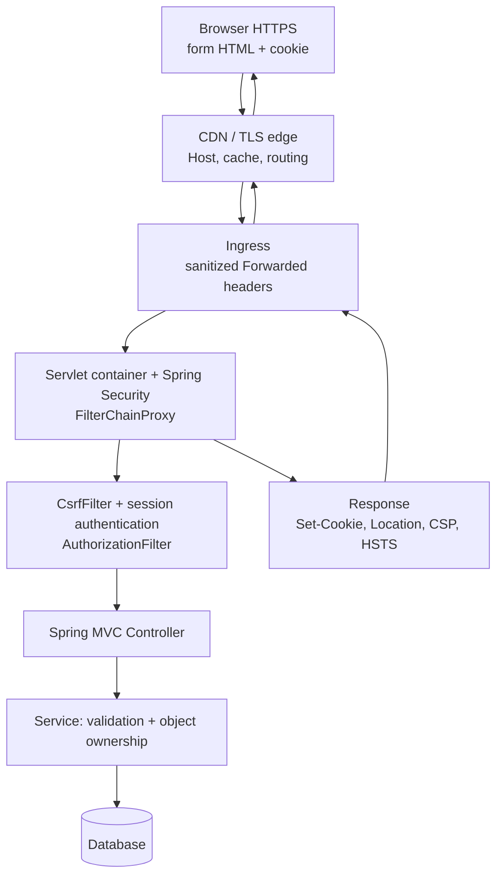

# Thiết kế bảo vệ cho ứng dụng MVC có form và cookie phiên

> **Chương:** Thực hành tổng hợp  
> **Module:** `SPRING_SECURITY_HTTP_PROTECTION` — áp dụng các lớp phòng vệ HTTP và trình duyệt bằng Spring Security: CSRF, CORS, security headers, CSP, HSTS, HTTP firewall và bảo vệ session trên Servlet lẫn Reactive.  
> **Bối cảnh:** Một ứng dụng **Spring MVC (Servlet), HTML server-rendered, form login và cookie phiên**. Đây là bài thực hành tích hợp thiết kế, cấu hình, thử lỗi và nghiệm thu; không nhầm API Servlet với WebFlux.

## 1. Đề bài và mục tiêu

Hãy bảo vệ ứng dụng quản lý tài khoản có:

- `GET /` và `GET /assets/**`: trang và tài nguyên công khai.
- `GET /login`: hiển thị form đăng nhập.
- `POST /login`: Spring Security kiểm password, tạo phiên và chuyển trang.
- `GET /account`: HTML riêng của user hiện tại.
- `POST /account/profile`: cập nhật tên hiển thị bằng form.
- `GET /orders/{id}`: xem đơn hàng mà user có quyền sở hữu.
- `GET /admin/reports`: chỉ dành cho `ROLE_ADMIN`.
- `POST /logout`: kết thúc session.
- Các route không khai báo: từ chối mặc định.

Browser truy cập `https://portal.example.test`. Backend có thể được triển khai sau CDN/ingress, nơi TLS kết thúc trước Spring.

Sau bài học, người học cần có khả năng:

1. Lập threat model, phân loại routes và chọn bảo vệ theo request.
2. Viết `SecurityFilterChain` dùng `formLogin`, `authorizeHttpRequests` và `logout`.
3. Bật/giữ CSRF cho **mọi unsafe browser form**; không nhầm `permitAll` với miễn token.
4. Tạo form Thymeleaf có CSRF token được tích hợp bởi Spring MVC.
5. Bảo vệ session ID khỏi fixation, đánh cờ cookie `Secure`, `HttpOnly`, `SameSite`.
6. Không chỉ kiểm `authenticated()` mà còn kiểm **owner** của dữ liệu.
7. Thiết lập CSP, HSTS, security headers và cache-control cho HTML riêng tư.
8. Hiểu khi nào CORS cần hoặc không cần và vì sao không thay CSRF.
9. Kiểm thử với MockMvc, browser và public reverse proxy; có bằng chứng dương/âm.
10. Chẩn đoán lỗi 403, cookie không gửi, redirect sai, HSTS thiếu và caching nhầm.

**Tiêu chí kết thúc:** Người dùng hợp lệ thao tác được; người khác hoặc request giả mạo không có tác dụng phụ; browser nhận đúng policy; proxy/CDN không làm yếu đi quyết định bảo mật.

## 2. Sơ đồ thành phần và ranh giới tin cậy



Có ba dạng dữ liệu từ browser:

| Dữ liệu | Nơi phát sinh | Mức tin cậy |
|---|---|---|
| Session ID cookie | Server tạo, browser tự gửi | Chỉ đáng tin sau session lookup và kiểm hợp lệ |
| CSRF token field | Server/render form hoặc repository | Phải xác minh theo request/session |
| Form field, URL path, ID | Client gửi | **Không tin** để quyết định quyền |
| `Origin`/`Referer` | Browser hoặc client tùy ý | Tín hiệu bổ sung, không thay CSRF |
| `X-Forwarded-*` | Proxy có thể tạo | Chỉ tin sau trusted edge sanitize |
| `Host`/`:authority` | Request tới edge | Edge phải kiểm soát vhost/allowlist |

**Trust boundary quan trọng nhất:** CSRF token không phải proof of identity; session cookie không phải proof of user intent; security matcher không phải object-level authorization.

### 2.1. Luồng đăng nhập và cập nhật

```text
GET  /login                 -> trang + CSRF token
POST /login                 -> cookie trước login + token + credentials
Spring Security            -> xác thực; rotate session ID
302  /account              -> Set-Cookie với flags phù hợp
GET  /account              -> cookie phiên được browser gửi
POST /account/profile      -> cookie phiên + CSRF token hợp lệ
Service                    -> update theo principal hiện tại
303/302 /account?updated   -> trang riêng không cache
POST /logout               -> cookie phiên + CSRF token
GET  /account sau logout   -> không còn authenticated
```

Các bước cụ thể (redirect status, thời điểm session được tạo, tên cookie) phụ thuộc version/config. Bộ test phải xác nhận contract của ứng dụng, không chỉ tin vào sơ đồ.

## 3. Threat model: tài sản, tấn công, kiểm soát

| Tài sản | Kịch bản tấn công | Kiểm soát |
|---|---|---|
| Username/password | Brute force, credential stuffing, log plaintext | Password hash, rate limiting, MFA tùy rủi ro, redact log |
| Cookie phiên | Session fixation, cookie theft, gửi qua HTTP | Session ID rotation, Secure/HttpOnly/SameSite, TLS |
| Form cập nhật | Cross-site POST dùng cookie | `CsrfFilter`, hidden token, kiểm method |
| Dữ liệu tài khoản | User A truy cập đơn của B | Kiểm ownership ở service/repository |
| Trang quản trị | User thường mở `/admin/**` | `hasRole("ADMIN")` và quyền nghiệp vụ |
| HTML người dùng nhập | XSS, script injection | Escape output, CSP, validation |
| Trang tài khoản | Clickjacking, iframe giả | `frame-ancestors`, frame headers |
| HTML riêng | CDN/shared cache trộn user | `no-store` + cache bypass |
| Redirect/OAuth URL | Header Host/forwarded giả | Trusted edge, canonical URL/allowlist |
| Ingress path | Encoded path bypass filter/matcher | StrictHttpFirewall, normalize/reject |

### 3.1. Ranh giới của bài

Cấu hình sẽ minh họa **Spring Boot 3.x, Spring Security 6.x, MVC/Servlet, Java 17+**. Các bản Spring Boot/Security khác cần đối chiếu API theo version; các đoạn mẫu phụ thuộc controller, templates, database và user store của dự án, không phải một ứng dụng hoàn chỉnh được build sẵn.

Với **WebFlux/Reactive**, các API khác là `ServerHttpSecurity`, `SecurityWebFilterChain`, `WebSession` và `CsrfWebFilter`. Không copy Servlet `HttpSecurity`/`HttpSession` sang WebFlux để thay thế.

## 4. Bảng hợp đồng route

| Method / path | Ai được gọi? | CSRF | Response/cache |
|---|---|---|---|
| `GET /` | Public | Không yêu cầu token | Public tùy nội dung |
| `GET /assets/**` | Public | Không | Có thể cache assets có hash |
| `GET /login` | Public | Không cho GET; HTML cần token cho POST | Tránh shared-cache nếu chứa token |
| `POST /login` | Anonymous đăng nhập | **Bắt buộc** trong thiết kế | `no-store` |
| `GET /account` | Authenticated | Không cho GET | `private, no-store` |
| `POST /account/profile` | Authenticated | **Bắt buộc** | `no-store` |
| `GET /orders/{id}` | Owner hoặc quyền đặc biệt | Không | `private, no-store` |
| `GET /admin/reports` | `ROLE_ADMIN` | Không | `no-store` |
| `POST /logout` | Session/browser flow | **Bắt buộc** | `no-store` |
| Route khác | Không định nghĩa | Tùy method, nhưng authorization deny | Không tự public |

Các nguyên tắc:

- `GET` không thay trạng thái quan trọng; POST/PUT/PATCH/DELETE là unsafe và cần CSRF khi browser dùng cookie.
- `permitAll` chỉ là quyết định **authorization**; không tắt `CsrfFilter`.
- Không dùng `GET /logout` để tiện gắn một link.
- Không mở `/**` rồi mong controller kiểm quyền thủ công trên mọi route.
- `authenticated()` chưa đủ cho tài nguyên có owner.

## 5. Các dependency cần thiết

Ví dụ một ứng dụng Maven quản lý version qua Spring Boot parent/BOM:

```xml
<dependency>
  <groupId>org.springframework.boot</groupId>
  <artifactId>spring-boot-starter-web</artifactId>
</dependency>
<dependency>
  <groupId>org.springframework.boot</groupId>
  <artifactId>spring-boot-starter-security</artifactId>
</dependency>
<dependency>
  <groupId>org.springframework.boot</groupId>
  <artifactId>spring-boot-starter-thymeleaf</artifactId>
</dependency>
<dependency>
  <groupId>org.springframework.boot</groupId>
  <artifactId>spring-boot-starter-validation</artifactId>
</dependency>
<dependency>
  <groupId>org.springframework.boot</groupId>
  <artifactId>spring-boot-starter-test</artifactId>
  <scope>test</scope>
</dependency>
<dependency>
  <groupId>org.springframework.security</groupId>
  <artifactId>spring-security-test</artifactId>
  <scope>test</scope>
</dependency>
```

Nếu cần session phân tán, cân nhắc Spring Session với repository tương ứng; điều đó thay nơi quản lý cookie/session lifecycle và cần test riêng. **Không thêm Spring Session chỉ vì muốn đặt cờ Secure.**

## 6. Cấu hình SecurityFilterChain cho MVC

```java
package example.security;

import org.springframework.context.annotation.Bean;
import org.springframework.context.annotation.Configuration;
import org.springframework.http.HttpMethod;
import org.springframework.security.config.Customizer;
import org.springframework.security.config.annotation.web.builders.HttpSecurity;
import org.springframework.security.crypto.factory.PasswordEncoderFactories;
import org.springframework.security.crypto.password.PasswordEncoder;
import org.springframework.security.web.SecurityFilterChain;

@Configuration
public class SecurityConfig {

    @Bean
    SecurityFilterChain browserChain(HttpSecurity http) throws Exception {
        http
            .authorizeHttpRequests(auth -> auth
                .requestMatchers(HttpMethod.GET,
                    "/", "/login", "/assets/**", "/error").permitAll()
                .requestMatchers("/admin/**").hasRole("ADMIN")
                .requestMatchers("/account/**", "/orders/**").authenticated()
                .anyRequest().denyAll())
            .formLogin(form -> form
                .loginPage("/login")
                .loginProcessingUrl("/login")
                .defaultSuccessUrl("/account", false)
                .failureUrl("/login?error")
                .permitAll())
            .logout(logout -> logout
                .logoutUrl("/logout")
                .logoutSuccessUrl("/login?logout")
                .invalidateHttpSession(true)
                .clearAuthentication(true)
                .permitAll())
            .sessionManagement(session -> session
                .sessionFixation(fixation -> fixation.changeSessionId()))
            .csrf(Customizer.withDefaults())
            .headers(headers -> headers
                .contentSecurityPolicy(csp -> csp.policyDirectives(
                    "default-src 'self'; " +
                    "script-src 'self'; style-src 'self'; " +
                    "img-src 'self' data:; " +
                    "object-src 'none'; base-uri 'self'; " +
                    "form-action 'self'; frame-ancestors 'none'"))
                .httpStrictTransportSecurity(hsts -> hsts
                    .includeSubDomains(false)
                    .preload(false)
                    .maxAgeInSeconds(86400)));

        return http.build();
    }

    @Bean
    PasswordEncoder passwordEncoder() {
        return PasswordEncoderFactories.createDelegatingPasswordEncoder();
    }
}
```

Đây là cấu hình Servlet Spring Security 6.x để làm bài; cần kết nối `UserDetailsService`/authentication provider, controllers và templates. **Đừng tự dùng một password cố định trong source production.**

### 6.1. Vì sao chọn như vậy?

| Quyết định | Lý do |
|---|---|
| Public GET có matcher rõ | Không vô tình cho mọi POST hoạt động |
| `/admin/**` trước `/account/**` | Áp role cần thiết trước fallback |
| `anyRequest().denyAll()` | Phát hiện route mới chưa được phân loại |
| `formLogin` | Spring Security xử lý authentication và security context |
| `logout` | Session invalidated và redirect theo contract |
| `sessionFixation.changeSessionId()` | Chống cố định session ID sau login |
| `csrf(defaults)` | Unsafe browser POST phải có token |
| CSP | Defense-in-depth chống XSS/clickjacking |
| HSTS | Giúp browser ghi nhớ HTTPS khi request được nhận diện an toàn |
| PasswordEncoder delegating | Chứa mã định danh thuật toán và hỗ trợ migration hash |

### 6.2. Những việc cấu hình này chưa giải quyết

- Nó chưa triển khai repository, user store, password policy và login rate limiting.
- `authenticated()` không tự kiểm owner của đơn hàng.
- HSTS không tự bật TLS trên public edge và không sửa trusted forwarding.
- CSP không sửa output HTML chưa escape.
- Security headers không bảo đảm CDN sẽ không cache HTML riêng.
- `logout` không chứng minh session cookie được xóa đúng Path/Domain khi có custom cookie serializer.

### 6.3. `permitAll` khác `web.ignoring()`

Public assets và login vẫn đi qua Spring Security chain nếu cấu hình `permitAll`. `web.ignoring()` bỏ toàn chain cho URL được ignore, có thể bỏ cả HTTP security headers và những kiểm soát khác. Không dùng ignoring rộng chỉ để static resources tải nhanh.

### 6.4. Thứ tự rules

Spring Security dùng matcher theo thứ tự trong `authorizeHttpRequests`. `hasRole("ADMIN")` cần mapping thành authority `ROLE_ADMIN` theo convention; nếu IAM cấp `SCOPE_admin` thì phải có adapter hoặc kiểm authority cụ thể.

### 6.5. Không tự tắt CSRF cho login

`formLogin(...permitAll())` cho phép xử lý route login trong authorization nhưng `POST /login` vẫn là unsafe request và cần CSRF token khi filter bật. **Không thêm `csrf.ignoringRequestMatchers("/login")` chỉ để tránh sửa form.**

## 7. User store và password

Ứng dụng thực cần authentication provider phù hợp. Những nguyên tắc chính:

- Password được hash qua BCrypt/Argon2 hoặc thuật toán thích hợp; không lưu plaintext, MD5 hoặc SHA không có key stretching.
- Mã hóa reversible không thay password hashing.
- Dùng password encoder nhất quán với hash lưu trong DB; nâng cấp cost theo khả năng phần cứng.
- Không log body form login, mật khẩu, reset token hoặc session ID.
- Có rate limit, giám sát credential stuffing, MFA/step-up cho thao tác nhạy cảm khi cần.
- Thông báo lỗi login tránh tiết lộ tài khoản tồn tại.

### 7.1. Test-only fixture

```java
import org.springframework.boot.test.context.TestConfiguration;
import org.springframework.context.annotation.Bean;
import org.springframework.security.core.userdetails.User;
import org.springframework.security.core.userdetails.UserDetailsService;
import org.springframework.security.crypto.password.PasswordEncoder;
import org.springframework.security.provisioning.InMemoryUserDetailsManager;

@TestConfiguration
class TestUsers {
    @Bean
    UserDetailsService testUsers(PasswordEncoder encoder) {
        return new InMemoryUserDetailsManager(
            User.withUsername("alice")
                .password(encoder.encode("fixture-password"))
                .roles("USER")
                .build(),
            User.withUsername("admin")
                .password(encoder.encode("fixture-admin-password"))
                .roles("USER", "ADMIN")
                .build());
    }
}
```

Những chuỗi password trên chỉ là **fixture không bí mật**. Test tích hợp sử dụng user store này trong test profile; production phải thay bằng nguồn danh tính thực. Không dùng in-memory fixture để quản lý account production.

## 8. Trang login Thymeleaf và CSRF

Controller:

```java
import org.springframework.stereotype.Controller;
import org.springframework.web.bind.annotation.GetMapping;

@Controller
class LoginPageController {
    @GetMapping("/login")
    String loginPage() {
        return "login";
    }
}
```

Template `templates/login.html`:

```html
<!doctype html>
<html lang="vi" xmlns:th="http://www.thymeleaf.org">
<head>
  <meta charset="UTF-8">
  <title>Đăng nhập</title>
  <link rel="stylesheet" th:href="@{/assets/app.css}">
</head>
<body>
  <main>
    <h1>Đăng nhập</h1>
    <p th:if="${param.error}">Tên đăng nhập hoặc mật khẩu không hợp lệ.</p>
    <p th:if="${param.logout}">Bạn đã đăng xuất.</p>
    <form method="post" th:action="@{/login}">
      <label for="username">Tên đăng nhập</label>
      <input id="username" name="username"
             autocomplete="username" required>
      <label for="password">Mật khẩu</label>
      <input id="password" type="password" name="password"
             autocomplete="current-password" required>
      <button type="submit">Đăng nhập</button>
    </form>
  </main>
</body>
</html>
```

### 8.1. Token CSRF xuất hiện bằng cách nào?

Khi Spring MVC + Thymeleaf được tích hợp chuẩn, `th:action` và `RequestDataValueProcessor` có thể tự đưa hidden CSRF input vào `POST` form. **Không hardcode giá trị token**.

Quy trình kiểm chứng:

1. Gọi `GET /login` bằng MVC context đầy đủ.
2. Xem **HTML sau render**, không chỉ template source.
3. Kiểm input hidden có tên đúng (`_csrf` trong cấu hình phổ biến).
4. Gửi `POST /login` có cùng cookie/session và hidden token; đăng nhập hợp lệ.
5. Bỏ token nhưng vẫn giữ credential/session hợp lệ; phải bị CSRF chặn.
6. Nếu template engine hoặc integration không tự inject field, hiển thị token thủ công đúng contract.
7. Không chèn cả auto field và manual field trùng tên không kiểm soát.

### 8.2. Render token thủ công chỉ khi cần

```html
<!-- CHỈ dùng nếu form engine KHÔNG tự thêm field.
     Không dùng cùng th:action nếu nó đã inject CSRF hidden input. -->
<input type="hidden"
       th:name="${_csrf.parameterName}"
       th:value="${_csrf.token}">
```

Trong Spring Security 6, request handler có thể mask token dành cho HTML để giảm rủi ro BREACH; không tự cố sao chép raw token vào cookie và so sánh string theo cách riêng.

### 8.3. Không gửi username/password bằng GET

Form đăng nhập phải dùng POST và HTTPS. Không đưa password vào URL query vì có thể rò qua browser history, proxy logs và referrer. Không dùng GET logout cũng vì tác dụng thay đổi session không nên được kích hoạt qua image/link đơn giản.

## 9. Form cập nhật tên hiển thị

### 9.1. DTO được validation

```java
import jakarta.validation.constraints.NotBlank;
import jakarta.validation.constraints.Size;

public class ProfileForm {
    @NotBlank
    @Size(max = 80)
    private String displayName;

    public String getDisplayName() {
        return displayName;
    }

    public void setDisplayName(String value) {
        this.displayName = value;
    }
}
```

Form DTO chỉ chứa thông tin người dùng được phép thay; **không** nhận `userId`/`ownerId` để quyết định tài khoản bị sửa.

### 9.2. Controller lấy principal từ Spring Security

```java
import jakarta.servlet.http.HttpServletResponse;
import jakarta.validation.Valid;
import org.springframework.security.core.Authentication;
import org.springframework.stereotype.Controller;
import org.springframework.ui.Model;
import org.springframework.validation.BindingResult;
import org.springframework.web.bind.annotation.*;

@Controller
class AccountController {
    private final AccountService accountService;

    AccountController(AccountService accountService) {
        this.accountService = accountService;
    }

    @GetMapping("/account")
    String account(Model model, HttpServletResponse response) {
        response.setHeader("Cache-Control", "private, no-store");
        model.addAttribute("profileForm", new ProfileForm());
        return "account";
    }

    @PostMapping("/account/profile")
    String update(@Valid @ModelAttribute("profileForm") ProfileForm form,
                  BindingResult errors,
                  Authentication authentication,
                  HttpServletResponse response) {
        response.setHeader("Cache-Control", "private, no-store");

        if (errors.hasErrors()) {
            return "account";
        }

        accountService.updateDisplayName(
            authentication.getName(), form.getDisplayName());

        return "redirect:/account?updated";
    }
}
```

**Giới hạn code mẫu:** `AccountService` cần được ứng dụng triển khai; template cần dữ liệu bổ sung nếu muốn hiển thị profile hiện tại/validation error đẹp hơn. Đây là skeleton về security contract, không phải app build hoàn chỉnh.

### 9.3. Template account

```html
<!doctype html>
<html lang="vi" xmlns:th="http://www.thymeleaf.org">
<head>
  <meta charset="UTF-8">
  <title>Tài khoản</title>
  <link rel="stylesheet" th:href="@{/assets/app.css}">
</head>
<body>
<main>
  <h1>Tài khoản</h1>
  <form method="post" th:action="@{/account/profile}"
        th:object="${profileForm}">
    <label for="displayName">Tên hiển thị</label>
    <input id="displayName" type="text"
           th:field="*{displayName}" maxlength="80">
    <p th:if="${#fields.hasErrors('displayName')}"
       th:errors="*{displayName}">Giá trị không hợp lệ</p>
    <button type="submit">Lưu</button>
  </form>
  <form method="post" th:action="@{/logout}">
    <button type="submit">Đăng xuất</button>
  </form>
</main>
</body>
</html>
```

Mỗi POST form cần token CSRF trong HTML cuối. `th:action` có thể tự inject qua Spring MVC integration. Form logout phải có token, không thay bằng `<a href="/logout">` rồi tắt CSRF.

### 9.4. Phòng chống ID tampering

Phản ví dụ không an toàn:

```java
// KHÔNG an toàn: client tự chọn owner bị sửa.
accountService.updateDisplayName(
    request.getParameter("accountId"),
    request.getParameter("displayName"));
```

Ở mẫu đúng, `authentication.getName()` là user hiện tại do Spring Security xác nhận. Service truy vấn tài khoản dựa principal hoặc stable account ID từ identity layer, không dùng user ID ẩn trong form làm bằng chứng quyền.

### 9.5. Validation không thay output encoding

`@Size` và `@NotBlank` giúp kiểm dữ liệu, nhưng để ngăn XSS phải escape khi render. Thymeleaf `th:text` escape text theo cách phù hợp; không đưa chuỗi user input vào `th:utext` nếu chưa có sanitization policy nghiêm ngặt.

```html
<!-- Ưu tiên xuất như văn bản, không như HTML do user nhập. -->
<span th:text="${displayName}"></span>
```

CSP bổ sung bảo vệ nhưng không thay output encoding.

## 10. Phân quyền theo owner: chống IDOR

`GET /orders/42` chỉ nên cho user có quyền trên đơn 42, không phải mọi user logged in.

### 10.1. Service layer truy vấn theo ID và owner

```java
import org.springframework.http.HttpStatus;
import org.springframework.stereotype.Service;
import org.springframework.transaction.annotation.Transactional;
import org.springframework.web.server.ResponseStatusException;

@Service
class OrderService {
    private final OrderRepository repo;

    OrderService(OrderRepository repo) {
        this.repo = repo;
    }

    @Transactional(readOnly = true)
    OrderView findForUser(long orderId, String username) {
        return repo.findViewByIdAndOwnerUsername(orderId, username)
            .orElseThrow(() ->
                new ResponseStatusException(HttpStatus.NOT_FOUND));
    }
}
```

`OrderRepository` và `OrderView` là abstractions của ứng dụng cần tự định nghĩa. Truy vấn có điều kiện owner giúp không vô tình trả dữ liệu người khác.

### 10.2. Controller không tin owner từ request

```java
import org.springframework.security.core.Authentication;
import org.springframework.stereotype.Controller;
import org.springframework.ui.Model;
import org.springframework.web.bind.annotation.*;

@Controller
class OrderController {
    private final OrderService orders;

    OrderController(OrderService orders) {
        this.orders = orders;
    }

    @GetMapping("/orders/{id}")
    String detail(@PathVariable long id,
                  Authentication authentication,
                  Model model) {
        model.addAttribute("order",
            orders.findForUser(id, authentication.getName()));
        return "order";
    }
}
```

Nếu quyền admin khác owner cần thiết, thiết kế service policy riêng có audit; không cho tham số `isAdmin=true` từ browser tự cấp quyền.

### 10.3. Ma trận test quyền

| Ai gọi | Resource | Kỳ vọng |
|---|---|---|
| Anonymous | `GET /orders/42` | Login redirect/401 theo contract |
| Alice | Đơn của Alice | Cho phép |
| Alice | Đơn Bob | 403/404 không lộ dữ liệu |
| Bob | Đơn Bob | Cho phép |
| User thường | `GET /admin/reports` | 403 |
| Admin thực | `GET /admin/reports` | Cho phép |
| User thiếu quyền đặc biệt | Tài nguyên nhạy cảm | Từ chối dù authenticated |

Không coi status 404 đơn độc là proof of ownership: verify service query và dữ liệu trả về không lộ qua cache/headers.

## 11. CSRF: phần quan trọng nhất của form-cookie app

Browser **tự gửi session cookie** khi request phù hợp. Một trang ngoài có thể tạo HTML form POST tới endpoint của chúng ta; nếu server chỉ kiểm cookie, request có thể được xem là user đã đăng nhập.

### 11.1. Ví dụ request giả mạo theo threat model

```html
<!-- Mô phỏng cấu trúc form từ site khác để hiểu CSRF.
     Không dùng để tấn công dịch vụ ngoài quyền. -->
<form method="post"
      action="https://portal.example.test/account/profile">
  <input name="displayName" value="Giá trị do bên khác chọn">
</form>
```

Nếu cookie được gửi theo browser policy, request mang authentication nhưng **không có CSRF token hợp lệ**. `CsrfFilter` phải từ chối trước khi update.

### 11.2. Tính chất cơ chế CSRF

- Servlet Spring Security dùng `CsrfFilter`.
- Safe methods như GET/HEAD/OPTIONS/TRACE thường không yêu cầu token; **không đặt side effect ở GET**.
- Unsafe methods POST/PUT/PATCH/DELETE cần token theo mặc định trong browser chain.
- Session-backed repository phù hợp form MVC server-rendered; không bắt buộc chuyển sang CSRF cookie.
- Spring Security có thể dùng deferred/masked tokens; kiểm định theo interface công khai, không so raw token tự chế.
- Token đúng không thay authenticated principal, role hoặc owner check.

### 11.3. `CookieCsrfTokenRepository` có bắt buộc không?

**Không.** Với Thymeleaf render form ở server, session-based CSRF token repository mặc định là lựa chọn thường dùng. Cookie repository có ích ở một số SPA cần JS đọc token, nhưng thêm hợp đồng cookie/HttpOnly/request handler/BREACH cần kiểm kỹ.

Đừng hạ `HttpOnly` của **session cookie** để JS lấy token CSRF.

### 11.4. Login và logout cũng cần CSRF

`POST /login` và `POST /logout` là unsafe browser requests. Khi CSRF enabled, cả hai cần token theo flow. Sau login/session rotation hoặc logout, token cũ có thể hết hiệu lực; frontend cần render lại token mới đúng phiên.

`permitAll("/login")` không miễn `POST /login` khỏi token. Một nút đăng xuất GET link không phải giải pháp.

### 11.5. Không dùng SameSite hoặc CORS thay CSRF

- `SameSite=Lax`/`Strict` làm giảm nhiều bối cảnh cross-site cookie, nhưng không thay proof-of-intent token.
- `HttpOnly` ngăn JS đọc cookie, nhưng browser vẫn có thể tự gửi.
- `Secure` yêu cầu HTTPS cho cookie, không bảo vệ logic update.
- CORS giới hạn JS đọc cross-origin responses; một HTML form có thể tạo request khi không đọc response.
- HSTS bảo vệ scheme/HTTPS, không cấp authorization hoặc xác thực token.

**Defense-in-depth:** HTTPS + cookie flags + CSRF + XSS defenses + authorization.

## 12. Session lifecycle và session fixation

### 12.1. Rotate session ID sau login

Session fixation là khả năng attacker khiến victim dùng session ID mà attacker biết trước khi victim login. Spring Security Servlet có cơ chế chống fixation; ví dụ đã bật `changeSessionId()`.

Test cần có **login/session thật**, không chỉ MockMvc `with(user())`. Kiểm session ID trước và sau login theo fixture, đồng thời xác nhận phiên trước login không được dùng làm session đã authenticated.

### 12.2. Cookie phiên và session timeout

Ví dụ Boot Servlet cho ứng dụng public ở root, chỉ qua HTTPS:

```yaml
server:
  servlet:
    session:
      timeout: 20m
      cookie:
        name: JSESSIONID
        secure: true
        http-only: true
        same-site: lax
        path: /
```

Đây là chính sách **session cookie của Servlet stack**. Nếu dùng Spring Session Redis/JDBC hoặc `DefaultCookieSerializer` tùy chỉnh, cần kiểm nơi thực sự phát cookie, tránh hai nguồn config mâu thuẫn.

### 12.3. Browser cookie không đồng nghĩa session server còn sống

- `Max-Age`/`Expires`: browser giữ cookie bao lâu.
- Server session timeout: server còn chấp nhận session hay không.
- Logout: server invalidates session, không chỉ đổi URL.
- Session cookie còn trong browser nhưng session đã hết hạn phải dẫn đến yêu cầu đăng nhập lại.
- Cần kiểm transaction/sessions khi chạy nhiều instances; sticky session hoặc shared session repository phải được thiết kế.

### 12.4. Logout phải thực sự vô hiệu session

Bộ test:

1. Đăng nhập qua POST + CSRF, nhận session.
2. GET account được phép.
3. POST logout + CSRF.
4. GET account lại không còn quyền.
5. Cookie clearing đúng name/path/domain.
6. Browser Back/refresh không nhận private data mới từ shared cache.
7. Cookie/token cũ không được tái sử dụng để update.

Nếu app dùng custom cookie name/path, việc chỉ gọi `deleteCookies("JSESSIONID")` không nhất thiết đủ. Phải khớp cookie scope và session infrastructure.

### 12.5. Concurrent session và step-up

Tùy rủi ro, có thể thêm giới hạn session đồng thời, logout tất cả thiết bị, MFA hoặc reauthentication khi đổi mật khẩu/email/thiết lập thanh toán. Những chức năng này cần session registry, persistent session store và kiểm thử đa instance; không giả định một DSL option đơn giản là đủ.

## 13. Cookie policy cần quan sát trên browser

```http
Set-Cookie: JSESSIONID=<opaque>; Path=/; Secure; HttpOnly; SameSite=Lax
```

| Thuộc tính | Mục đích | Không thay |
|---|---|---|
| `Secure` | Browser giới hạn gửi cookie qua HTTPS | CSRF/XSS |
| `HttpOnly` | Script không đọc session cookie trực tiếp | Browser auto-send |
| `SameSite=Lax` | Defense-in-depth chống nhiều cross-site requests | Token CSRF |
| `SameSite=Strict` | Cross-site hạn chế mạnh hơn | Có thể phá login federation |
| `SameSite=None` | Hỗ trợ một số cross-site contexts, yêu cầu Secure | Third-party-cookie rules |
| `Domain` | Chọn host/subdomain scope | Object authorization |
| `Path` | Chọn request path được browser gửi cookie | Security isolation |
| `Max-Age` | Lifetime ở browser | Server session expiry |

### 13.1. Ưu tiên host-only cookie khi được

Không khai báo `Domain=.example.test` chỉ để “mọi dịch vụ dùng chung session”. Một subdomain bị compromise có thể làm tăng rủi ro; host-only là lựa chọn nên xem xét nếu không có nhu cầu share.

### 13.2. Prefix `__Host-` không phải phép màu

Browser yêu cầu cookie `__Host-...` có `Secure`, không `Domain` và `Path=/`. Nếu app public dưới prefix `/app` và bắt buộc `Path=/app`, không thể thỏa điều kiện `__Host-` bằng cách đổi tên cookie mà không đổi scope.

### 13.3. Mỗi cookie có mục đích khác nhau

Session cookie có `HttpOnly=true`. Cookie CSRF cho SPA có thể cần JS đọc tùy repository, nhưng đó là cookie khác. Không hạ thuộc tính của session cookie để phục vụ frontend.

## 14. HTTPS, HSTS và TLS-terminating reverse proxy

Đường triển khai có thể là:

```text
Browser HTTPS → CDN/TLS edge → HTTP nội bộ :8080 → Spring MVC
```

Spring có thể nhìn thấy HTTP nội bộ, khiến redirect, cookie policy dựa secure-state hoặc HSTS writer hoạt động khác dự kiến. Cần trusted forwarding strategy hoặc canonical public URL.

### 14.1. Cấu hình theo Spring Boot version

Với Boot 2.2–4.1, một lựa chọn thông dụng:

```yaml
server:
  forward-headers-strategy: framework
```

Khi chọn framework cho Servlet, Spring dùng `ForwardedHeaderFilter`. Nếu chọn native, server như Tomcat xử lý bằng native forwarding mechanism.

Trong Spring Boot 4.2, namespace mới theo tài liệu version đó là `server.request.header.forwarded.strategy` với giá trị `framework`/`web-server`/`none`; khi cần forwarded prefix, kiểm tra `use-prefix`. Không giữ đồng thời property cũ và mới, cũng không mang cấu hình Tomcat sang Reactor Netty khi chuyển stack.

### 14.2. Không tin forwarded header từ Internet

Một client có thể gửi:

```http
X-Forwarded-Proto: https
X-Forwarded-Host: attacker.example
X-Forwarded-For: 127.0.0.1
X-Forwarded-Prefix: /admin
```

`ForwardedHeaderFilter` chỉ diễn giải metadata, **không xác thực người gửi**. Hạ tầng phải:

1. Xác minh TLS/Host/SNI tại edge.
2. Strip/overwrite raw `Forwarded`/`X-Forwarded-*` từ client.
3. Chặn direct-origin backend access.
4. Không lấy raw XFF để cấp quyền hay quyết định internal admin.
5. Có trusted-hop contract khi đi qua CDN/LB/ingress.
6. Test spoofing từ phía ngoài edge.

### 14.3. HSTS và redirect

`Strict-Transport-Security: max-age=86400` có ý nghĩa khi browser nhận **trên HTTPS hợp lệ**. HSTS theo hostname, không theo path, và không thay cookie `Secure`. `includeSubDomains`/`preload` cần rà soát domain và chính sách riêng trước khi bật.

Nếu HSTS được quản lý tại CDN/TLS edge, tránh để Spring phát một policy mâu thuẫn. Nếu Spring sở hữu, request phải được nhận diện HTTPS qua trusted forwarding và filter chain đúng.

### 14.4. Không tạo HTTPS redirect loop

Nếu public browser đã HTTPS nhưng Spring thấy HTTP nội bộ và lại chuyển sang HTTPS, có thể xảy ra loop giữa ingress và backend. Sửa nguồn scheme/forwarded metadata và owner HTTPS enforcement, không tắt HTTPS chỉ để test hết loop.

## 15. CSP và các security headers khác

Spring Security Servlet thường phát các header mặc định như `X-Content-Type-Options`, frame protection và cache control theo chain. CSP cần được chỉ định theo tính năng frontend.

### 15.1. CSP ví dụ

```text
default-src 'self';
script-src 'self';
style-src 'self';
img-src 'self' data:;
object-src 'none';
base-uri 'self';
form-action 'self';
frame-ancestors 'none'
```

Đây là **mẫu cơ bản cho trang Thymeleaf dùng assets cùng origin**. Nếu ứng dụng có CDN-hosted assets, payment provider, iframe được phép hoặc WebSocket, phải mở chính xác directive tương ứng; không tùy tiện bật `unsafe-inline`/`unsafe-eval`.

### 15.2. CSP không thay output escaping

Mọi chuỗi user input xuất HTML phải được escape. Tránh `th:utext` khi chưa có sanitization policy phù hợp. XSS có thể đọc dữ liệu trang/CSRF token dù session cookie là HttpOnly.

### 15.3. Frame protection

`frame-ancestors 'none'` phối hợp với `X-Frame-Options: DENY` khi app không cho embed. Nếu có use case iframe tin cậy, thay bằng policy cụ thể theo origin, không bỏ frame protection toàn site.

### 15.4. Referrer-Policy

Đặc biệt nếu URL có reset/verification token, cần ngăn token bị lộ qua `Referer` sang origin ngoài. Có thể cấu hình `Referrer-Policy` qua Spring Security DSL hoặc edge, đi kèm token one-time, TTL ngắn và log redaction.

### 15.5. Security headers phải đúng trên response cuối

CDN/WAF có thể thêm, bỏ, ghi đè headers, hoặc tự trả error/redirect không qua Spring. Test login, account, 302, 403, 404, CDN HIT/MISS để biết chính sách browser thật nhận.

## 16. Cache-Control: không cache chung trang có session

`GET /account` là safe method nhưng trả HTML cá nhân. Nó không được coi là public-cacheable.

```http
Cache-Control: private, no-store
```

- `no-store`: cache tuân chuẩn không lưu request/response.
- `private`: shared cache không được lưu.
- `no-cache`: có thể lưu nhưng phải revalidate, **không thay no-store**.
- `Set-Cookie` không tự bảo đảm CDN không cache body.
- `Vary: Cookie` không thay auth trên cache HIT và có thể làm cache key nổ cardinality.
- Response CDN HIT có thể **không chạy Spring Security**.

### 16.1. Route cache policy

| Route | CDN policy |
|---|---|
| `/assets/app.abc123.js` | Public TTL hợp lý nếu hashed và immutable |
| `/` public không cá nhân hóa | Cache theo contract |
| `/login`/`/logout` | Bypass nếu có state/token/session |
| `/account`/`/orders/**` | **Bypass + no-store** |
| `/csrf` hoặc HTML chứa token | Bypass + no-store |
| OAuth login/callback nếu có | Bypass |
| Private API/session/refresh | Bypass |
| Private 401/403/404 | Không cache nhầm giữa users |

### 16.2. Kiểm thử hai users

```text
Alice GET /account -> HTML Alice; CDN BYPASS
Bob   GET /account -> HTML Bob;   CDN BYPASS
Alice GET /account -> HTML Alice; CDN BYPASS
Anon  GET /account -> login, không có dữ liệu Alice/Bob
```

Nếu Bob thấy dữ liệu Alice trên cache HIT, cần **tắt shared caching, purge cached objects và điều tra incident**, không chỉ sửa header ở Spring rồi bỏ qua object cũ.

## 17. CORS không phải điều kiện cho form cùng origin

Form Thymeleaf submit tới cùng origin hoạt động không cần mở CORS. Nếu có SPA/frontend chạy khác origin:

- Chỉ allowlist chính xác origin/method/headers.
- Nếu dùng credentials, cấu hình allow-credentials và browser credentials đúng.
- Không dùng `Access-Control-Allow-Origin: *` cho credentialed response.
- Test OPTIONS preflight độc lập với POST.
- CDN cache responses phụ thuộc `Origin` phải có variant key/`Vary` phù hợp hoặc bypass.

**CORS không ngăn mọi cross-site HTML form submission**, vì browser có thể gửi request mà không cần script đọc response. CSRF token vẫn bắt buộc ở browser-session unsafe requests.

### 17.1. Nếu sau này bổ sung API bearer-only

Không tắt CSRF toàn bộ `/api/**`. Tách security chain theo path/credential contract và xác nhận bearer-only chain **không chấp nhận session cookie fallback**. Dùng session thật của một browser để test cookie-only request vẫn bị từ chối.

## 18. HTTP firewall và đường dẫn bất thường

Servlet Spring Security có `HttpFirewall`, thường `StrictHttpFirewall`, giúp từ chối một số encoded/ambiguous request paths trước matching.

Các trường hợp test trên staging thuộc quyền quản lý:

```text
/account/profile
//account/profile
/account/../admin
/account/%2e%2e/admin
/account%2fprofile
/account/profile;debug=true
```

Không bắt buộc mọi biến thể phải tới Spring handler; proxy/container có thể từ chối hợp lệ. Tiêu chí an toàn: không một cách encoding/normalization nào dẫn tới protected handler mà bypass CSRF/matcher/authorization. Đừng nới firewall chỉ để đi qua URL sai do proxy rewrite.

## 19. MockMvc: test authentication, CSRF và authorization

Để kiểm toàn security chain, dùng Spring Boot test context/MockMvc auto-configuration, không chỉ `standaloneSetup` khi cần chứng minh Spring Security.

### 19.1. Ví dụ test profile và CSRF

```java
import org.junit.jupiter.api.Test;
import org.springframework.beans.factory.annotation.Autowired;
import org.springframework.boot.test.autoconfigure.web.servlet.AutoConfigureMockMvc;
import org.springframework.boot.test.context.SpringBootTest;
import org.springframework.test.context.bean.override.mockito.MockitoBean;
import org.springframework.test.web.servlet.MockMvc;

import static org.mockito.Mockito.*;
import static org.springframework.security.test.web.servlet.request
    .SecurityMockMvcRequestPostProcessors.*;
import static org.springframework.test.web.servlet.request
    .MockMvcRequestBuilders.*;
import static org.springframework.test.web.servlet.result
    .MockMvcResultMatchers.*;

@SpringBootTest
@AutoConfigureMockMvc
class AccountSecurityIT {
    @Autowired MockMvc mvc;
    @MockitoBean AccountService accountService;

    @Test
    void anonymousCannotReadAccount() throws Exception {
        mvc.perform(get("/account"))
            .andExpect(status().is3xxRedirection())
            .andExpect(redirectedUrlPattern("**/login"));
    }

    @Test
    void authenticatedPostWithoutCsrfIsForbidden()
            throws Exception {
        mvc.perform(post("/account/profile")
                .with(user("alice").roles("USER"))
                .param("displayName", "Alice New"))
            .andExpect(status().isForbidden());
        verifyNoInteractions(accountService);
    }

    @Test
    void authenticatedPostWithCsrfUpdatesCurrentUser()
            throws Exception {
        mvc.perform(post("/account/profile")
                .with(user("alice").roles("USER"))
                .with(csrf())
                .param("displayName", "Alice New"))
            .andExpect(status().is3xxRedirection())
            .andExpect(redirectedUrl("/account?updated"));

        verify(accountService)
            .updateDisplayName("alice", "Alice New");
    }

    @Test
    void ordinaryUserCannotAccessAdmin() throws Exception {
        mvc.perform(get("/admin/reports")
                .with(user("alice").roles("USER")))
            .andExpect(status().isForbidden());
    }
}
```

**Chú ý version và fixture:** `@MockitoBean` của Spring Framework 6.2+; các Spring Boot cũ hơn dùng mechanism tương ứng. Các templates/controller/service giả định phải có trong test application. Đây là minh họa hợp đồng test, chưa chạy build tại bước viết bài.

### 19.2. Token sai và input sai

```java
@Test
void invalidCsrfTokenIsForbidden() throws Exception {
    mvc.perform(post("/account/profile")
            .with(user("alice").roles("USER"))
            .with(csrf().useInvalidToken())
            .param("displayName", "Tampered"))
        .andExpect(status().isForbidden());
}

@Test
void invalidFormDoesNotUpdate() throws Exception {
    mvc.perform(post("/account/profile")
            .with(user("alice").roles("USER"))
            .with(csrf())
            .param("displayName", ""))
        .andExpect(status().isOk());

    verifyNoInteractions(accountService);
}
```

Cặp test phân biệt **CSRF** và **Bean Validation**; cùng không có side effect nhưng ở tầng xử lý khác. Khi validation fails template account phải có dữ liệu render cần thiết, test fixture cần khớp.

### 19.3. Logout chỉ POST có token

```java
@Test
void logoutWithoutCsrfIsForbidden() throws Exception {
    mvc.perform(post("/logout")
            .with(user("alice").roles("USER")))
        .andExpect(status().isForbidden());
}
```

`with(user())` tạo test authentication trong MockMvc, **không chứng minh** real login/session fixation/logout cookie lifecycle. Cần integration test đăng nhập thật qua POST login + token.

### 19.4. Test session fixation thực

1. GET login và lấy session/token theo fixture.
2. POST login với credentials đúng và CSRF token.
3. Xác nhận authenticated redirect.
4. Xác nhận session ID sau login khác ID trước login theo `changeSessionId()`.
5. Gọi GET account với session mới được phép.
6. Session trước login không thể được dùng như session đã authenticated.

Không log full JSESSIONID trong test output hoặc CI artifacts.

### 19.5. Object ownership integration test

Dùng DB fixtures với đơn Alice và Bob; đăng nhập Alice rồi gọi `/orders/{aliceId}`/`/orders/{bobId}`. Verify Alice thấy đơn mình, không thấy nội dung Bob (403/404 theo policy). Test id enumeration, không suy `authenticated()` nghĩa là đúng quyền.

## 20. Browser E2E: cookie flags, form và CSP

MockMvc không mô phỏng toàn bộ browser SameSite/Secure/HSTS/CSP. Cần E2E từ **public staging URL**.

```typescript
import { test, expect } from '@playwright/test';

const base = process.env.STAGING_PUBLIC_BASE_URL ?? '';
const username = process.env.E2E_USERNAME ?? '';
const password = process.env.E2E_PASSWORD ?? '';

test('login qua form tạo session cookie an toàn', async ({ page }) => {
  if (!base || !username || !password) {
    throw new Error('Thiếu staging base URL hoặc credentials');
  }

  await page.goto(base + '/login');
  await page.getByLabel('Tên đăng nhập').fill(username);
  await page.getByLabel('Mật khẩu').fill(password);
  await page.getByRole('button', { name: 'Đăng nhập' }).click();

  await expect(page).toHaveURL(/\/account/);

  const cookies = await page.context().cookies(base);
  const session = cookies.find(
    c => c.name === 'JSESSIONID' || c.name === 'SESSION'
  );
  expect(session).toBeDefined();
  expect(session?.secure).toBe(true);
  expect(session?.httpOnly).toBe(true);

  await page.goto(base + '/account');
  await expect(page.getByRole('heading', { name: 'Tài khoản' }))
      .toBeVisible();
});
```

Đây là skeleton cần selectors, credentials synthetic, tên cookie và URL public của dự án. Không đẩy raw password/JSESSIONID vào browser trace được chia sẻ.

### 20.1. Browser POST thiếu CSRF

Dùng session thật sau login, gửi POST thiếu token nhưng vẫn có cookie phiên. Kỳ vọng từ chối **không cập nhật tên**. Nếu frontend tự gắn token, test negative phải bỏ token bằng một request kiểm soát, không xóa cookie (vì thiếu cookie sẽ dẫn đến lỗi authentication, không chứng minh CSRF).

### 20.2. Browser logout

Submit form POST logout từ HTML đã render, xác minh session không còn quyền vào `/account` sau logout. Browser Back có thể hiển thị snapshot cũ, nhưng request mới không được trả private data theo session cũ.

### 20.3. Browser CSP

Kiểm script/css đúng origin, không cần `unsafe-inline`; thử render tên hiển thị chứa ký tự HTML như văn bản bình thường; kiểm trang không thể embed từ trang không được phép. Không suy test `curl -I` chứng minh browser đã ghi nhớ HSTS.

## 21. Reverse proxy và cookie Path khi public có prefix

Giả sử:

```text
Public:  https://portal.example.test:9443/app/account
Ingress: /app/account -> /account
Backend: http://mvc.internal:8080/account
```

Một Nginx edge demo:

```nginx
server {
    listen 9443 ssl;
    server_name portal.example.test;

    # Chứng chỉ TLS, default vhost deny và network policy
    # được quản lý ở cấu hình production đầy đủ.

    location /app/ {
        proxy_pass http://mvc.internal:8080/;

        proxy_set_header Host portal.example.test:9443;
        proxy_set_header Forwarded "";
        proxy_set_header X-Forwarded-Proto https;
        proxy_set_header X-Forwarded-Host portal.example.test;
        proxy_set_header X-Forwarded-Port 9443;
        proxy_set_header X-Forwarded-Prefix /app;
        proxy_set_header X-Forwarded-For $remote_addr;
    }
}
```

Mẫu minh họa cho **Internet edge trực tiếp**; nếu có CDN đứng trước, `$remote_addr` không còn là end-user IP nếu thiếu trusted real-IP logic. `server_name` một mình không chặn host lạ; cần default vhost/host validation.

### 21.1. Bốn điều phải test qua edge

1. `GET /app/login` có HTML form action trỏ đúng `/app/login`.
2. `POST /app/account/profile` đi vào backend route đúng, CSRF vẫn hoạt động.
3. `Location` sau login/logout có scheme/host/port 9443 và prefix `/app` **một lần**.
4. Session cookie có `Path` được browser gửi lại với `/app/**`, không mất phiên.

Đừng tự vừa đặt Servlet context path `/app` vừa strip prefix ở proxy, trừ khi đã thiết kế rõ routing. Spring Boot 4.2 còn có quy tắc forwarded-prefix opt-in khi cần; test trên version thật.

### 21.2. Cookie Path không tự đổi theo forwarded prefix

Session serializer/container có thể dùng cấu hình path của nó, không tự khôi phục `/app` chỉ vì `X-Forwarded-Prefix` tồn tại. Cần quan sát browser `Set-Cookie` và cookie được gửi trở lại; `Path=/` có thể hoạt động nhưng phạm vi rộng hơn, cần review khi host có nhiều apps.

### 21.3. Header spoofing qua edge

```bash
curl -i \
  -H 'Forwarded: proto=http;host=attacker.example' \
  -H 'X-Forwarded-Proto: http' \
  -H 'X-Forwarded-Host: attacker.example' \
  -H 'X-Forwarded-Prefix: /admin' \
  'https://portal.example.test:9443/app/login'
```

Chỉ thử trên staging được ủy quyền. Edge phải từ chối hoặc overwrite các header giả; không để browser `Location` rơi sang attacker domain hoặc sai HTTPS/port/prefix.

### 21.4. Không cho direct-origin bypass

Một firewall/NetworkPolicy/mTLS phải chặn client không thuộc trusted proxy truy cập cổng backend. Nếu client bypass edge, nó có thể tự gửi `X-Forwarded-*` rồi khiến app tin metadata giả; filter framework không xác thực nguồn.

## 22. Ma trận kiểm thử nghiệm thu

| Lớp | Positive | Negative |
|---|---|---|
| TLS/Host | HTTPS đúng certificate | Host/SNI sai hoặc HTTP downgrade |
| Authentication | Login đúng credentials | Sai password, account disabled |
| Session | Session sau login truy cập account | Session expired/đã logout |
| Session fixation | ID đổi sau login | ID cố định qua login |
| CSRF | Form POST token đúng | Token thiếu/sai, không side effect |
| Login CSRF | POST login đúng token | POST login không token |
| Logout | POST đúng token invalidates | GET/no-token logout bị chặn theo policy |
| Authorization | User xem đơn mình | User xem đơn người khác |
| Role | Admin vào reports | User thường vào reports |
| Validation | Display name hợp lệ | Trống/quá dài |
| XSS | Thông tin hiển thị được escape | HTML-like input không được diễn giải |
| CSP | Assets same-origin tải đúng | Inline script/iframe bị chặn |
| HSTS | HTTPS public nhận policy | Metadata proto giả không điều khiển policy |
| Cookie | Secure/HttpOnly/SameSite/Path đúng | Browser không gửi cookie sai scope |
| CORS | Same-origin form hoạt động | Origin lạ không đọc credentialed API |
| Cache | Static được cache hợp lý | Alice/Bob không lộ private HTML |
| Proxy | Redirect public host/port/prefix | Spoofed forwarding headers |
| Firewall | Canonical path | Encoded path không bypass matcher |
| Observability | Có correlation ID kiểm soát | Log không chứa raw secrets |

Không đánh dấu test thành công chỉ vì status code 403; kiểm tra tầng từ chối và side effect. Với cache, cần test **HIT và MISS** cùng hai sessions thật.

## 23. Kịch bản thực hành tích hợp

Một nhóm triển khai:

```text
Public:  https://portal.example.test:9443/app
Backend: http://mvc.internal:8080
Form:    login, profile update, logout
Cookie:  JSESSIONID
CDN:     static assets và một số GET
```

Nhóm mắc lỗi:

1. Disable CSRF vì vài request POST bị 403.
2. Đặt cookie `secure=false` vì backend chạy HTTP.
3. Mở `Domain=.example.test` cho toàn công ty.
4. Cho mọi `/orders/**` chỉ cần authenticated, không owner check.
5. Cache mọi GET ở CDN với TTL 300 giây.
6. Chuyển tiếp `X-Forwarded-Host` từ request Internet như dữ liệu đáng tin.
7. CSP dùng `unsafe-inline` để “không chặn UI”.
8. Logout bằng GET link.

### 23.1. Nhiệm vụ nhóm học viên

Hãy đề xuất một thay đổi và ít nhất một test cho từng rủi ro: CSRF, cookie Secure/Domain, owner authorization, shared cache, forwarding spoof, CSP, logout.

### 23.2. Hướng giải

- Bật lại CSRF, đảm bảo hidden token xuất hiện trong HTML, test có session thật thiếu/sai/đúng token.
- Đặt `Secure=true` vì browser-facing HTTPS; backend hop nội bộ HTTP không phải lý do hạ bảo vệ cookie.
- Giữ host-only cookie trừ khi có contract chia sẻ hợp pháp, được review.
- Query đơn hàng theo `id + owner` trong service.
- CDN bypass HTML private/login/CSRF/OAuth, phát `no-store` và purge cached object cũ nếu đã lưu sai.
- Strip/overwrite forwarded headers tại trusted edge, chặn direct backend access.
- Thay inline JS bằng file same-origin hoặc áp nonce/hash CSP được review; không blanket `unsafe-inline`.
- POST logout có token, invalidate session và kiểm request sau logout.
- Kiểm redirect `https://portal.example.test:9443/app/...`, cookie Path và form action qua browser thật.

**Kết luận:** Một lỗi 403 sau proxy không được xử lý bằng cách bỏ `CsrfFilter`. Phải tìm xem browser có cookie, token, đúng URL, đúng chain và đúng trusted forwarding không.

## 24. Rubric chấm bài

| Hạng mục | Trọng số | Điều kiện đạt |
|---|---:|---|
| Threat model và route matrix | 10% | Phân loại đúng browser form, session, owner/admin |
| SecurityFilterChain | 15% | Login/logout, rules theo role, default deny |
| CSRF + form rendering | 15% | Token đúng trên form, thiếu/sai bị chặn |
| Session + cookie | 15% | Rotation, invalidation, Secure/HttpOnly/SameSite |
| Object authorization | 15% | Alice không đọc/sửa dữ liệu Bob |
| Headers/CSP/cache | 10% | CSP phù hợp, HSTS và no-store |
| Proxy/deployment trust | 10% | Public URL đúng, spoof/direct bypass bị chặn |
| Kiểm thử và bằng chứng | 10% | MockMvc/browser/edge positive-negative |
| **Tổng** | **100%** | Không có lỗ hổng critical còn mở |

Fail nghiêm trọng: tắt CSRF cho browser cookie endpoints, public session cookie không Secure trên HTTPS production, cache lộ dữ liệu giữa users, quyền owner bị bỏ qua, hoặc client spoof Host/proto khiến redirect bất thường.

## 25. Checklist trước khi merge

- [ ] Đã liệt kê các public, authenticated, admin và owner-bound routes.
- [ ] SecurityFilterChain sử dụng `denyAll` mặc định hoặc fallback được review.
- [ ] `permitAll` không bị nhầm với CSRF exemption.
- [ ] Form login POST đi qua Spring Security authentication manager.
- [ ] Password hash, log redaction và rate limiting phù hợp.
- [ ] Thymeleaf render CSRF field trong HTML cuối, không chỉ trong template source.
- [ ] POST login/profile/logout thiếu hoặc sai CSRF token bị từ chối.
- [ ] CSRF negative test có session hợp lệ và verify không side effect.
- [ ] Session ID đổi sau login theo fixation policy.
- [ ] Logout invalidates session; session cũ không còn quyền.
- [ ] Cookie auth có Secure/HttpOnly/SameSite/Domain/Path phù hợp public URL.
- [ ] Không hạ HttpOnly session cookie để đọc CSRF.
- [ ] Không dùng account ID từ client thay principal.
- [ ] Owner check được thực hiện ở service/repository.
- [ ] User thường không truy cập admin route.
- [ ] Validation và output escaping được kiểm bằng dữ liệu user nhập.
- [ ] CSP không chứa `unsafe-inline`/`unsafe-eval` thiếu review.
- [ ] Frame protections, nosniff và Referrer-Policy theo policy.
- [ ] HSTS có owner, chỉ browser HTTPS hợp lệ mới ghi nhớ.
- [ ] CORS chỉ mở khi có use case, không wildcard credentials.
- [ ] Private HTML/session/CSRF/OAuth responses no-store và CDN bypass.
- [ ] Static assets có cache/version hợp lý.
- [ ] Proxy strip/overwrite raw Forwarded/X-Forwarded-* từ Internet.
- [ ] Backend không có direct-origin bypass.
- [ ] Redirect/form action/cookie Path đúng với public prefix/port.
- [ ] HTTP firewall không bị nới chỉ để sửa rewrite sai.
- [ ] MockMvc test anonymous/role/owner/CSRF/session behavior.
- [ ] Browser E2E test login, cookie flags, form, logout.
- [ ] CDN test hai users/tenants với cache HIT/MISS.
- [ ] Log không chứa password, raw cookie/JSESSIONID, CSRF token hoặc JWT.
- [ ] Đổi Spring Boot/security, ingress, CDN, host/port/prefix kích hoạt regression suite.

## 26. Tài liệu đối chiếu

Cần đối chiếu đúng Spring Boot/Spring Security version đang sử dụng:

1. [Spring Security — Servlet Architecture](https://docs.spring.io/spring-security/reference/servlet/architecture.html): SecurityFilterChain, filters.
2. [Spring Security — Authorize HTTP Requests](https://docs.spring.io/spring-security/reference/servlet/authorization/authorize-http-requests.html): matcher/default-deny.
3. [Spring Security — Form Login](https://docs.spring.io/spring-security/reference/servlet/authentication/passwords/form.html): login flow.
4. [Spring Security — Logout](https://docs.spring.io/spring-security/reference/servlet/authentication/logout.html): logout/invalidation.
5. [Spring Security — CSRF Servlet](https://docs.spring.io/spring-security/reference/servlet/exploits/csrf.html): repository, token, rendering.
6. [Spring Security — Session Management](https://docs.spring.io/spring-security/reference/servlet/authentication/session-management.html): fixation, sessions.
7. [Spring Security — Security HTTP Response Headers](https://docs.spring.io/spring-security/reference/servlet/exploits/headers.html): CSP, HSTS, cache headers.
8. [Spring Security — MockMvc Testing](https://docs.spring.io/spring-security/reference/servlet/test/mockmvc/index.html): `csrf()`, `user()`.
9. [Spring Boot — Application Properties](https://docs.spring.io/spring-boot/appendix/application-properties/index.html): `server.servlet.session.cookie.*`.
10. [Thymeleaf + Spring](https://www.thymeleaf.org/doc/tutorials/3.1/thymeleafspring.html): form binding và `th:action`.
11. [OWASP — CSRF Prevention Cheat Sheet](https://cheatsheetseries.owasp.org/cheatsheets/Cross-Site_Request_Forgery_Prevention_Cheat_Sheet.html).
12. [OWASP — Session Management Cheat Sheet](https://cheatsheetseries.owasp.org/cheatsheets/Session_Management_Cheat_Sheet.html).
13. [OWASP — Authorization Cheat Sheet](https://cheatsheetseries.owasp.org/cheatsheets/Authorization_Cheat_Sheet.html).
14. [OWASP — HTTP Headers Cheat Sheet](https://cheatsheetseries.owasp.org/cheatsheets/HTTP_Headers_Cheat_Sheet.html).
15. [MDN — Set-Cookie](https://developer.mozilla.org/en-US/docs/Web/HTTP/Reference/Headers/Set-Cookie): browser cookie policy.
16. [RFC 9111 — HTTP Caching](https://www.rfc-editor.org/rfc/rfc9111.html): private, no-store, shared cache.
17. [Playwright — Browser Testing](https://playwright.dev/docs/intro): browser E2E.

**Ghi nhớ:** Với **ứng dụng MVC render form và dùng cookie phiên**, bảo mật cần nhiều lớp hoạt động cùng lúc: **form login, CSRF token, session fixation defense, cookie Secure/HttpOnly/SameSite, authorization theo user/owner, CSP/HSTS, cache bypass và trusted reverse proxy**. MockMvc kiểm filter/controller, browser kiểm cookie/HTML/CSP và E2E qua CDN kiểm tuyến triển khai. Nếu một lớp không được kiểm qua đường sử dụng thật, cấu hình Java đúng cũng chưa đủ để kết luận an toàn.
