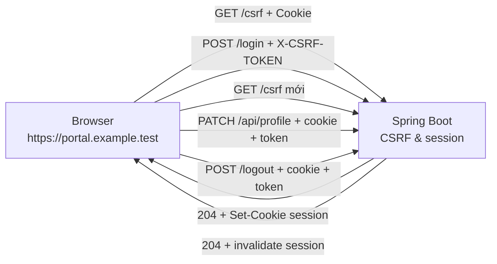
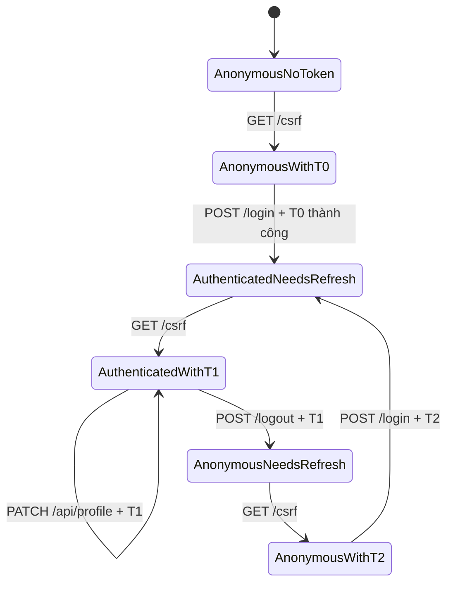

# Thiết kế CSRF cho SPA có bước đăng nhập và đăng xuất

> **Chương:** Thực hành tổng hợp  
> **Module:** `SPRING_SECURITY_HTTP_PROTECTION` — thực hành bảo vệ HTTP/trình duyệt trong Spring Security: CSRF, CORS, headers, CSP, HSTS, HTTP firewall và session cho Servlet lẫn Reactive.  
> **Trọng tâm:** SPA gửi các yêu cầu bất đồng bộ bằng JavaScript nhưng **vẫn dùng cookie phiên** để xác thực. Cần bảo vệ **POST đăng nhập, các thao tác nghiệp vụ và POST đăng xuất**, đồng thời lấy lại CSRF token đúng thời điểm khi session/authentication thay đổi.

## 1. Đề bài và kết quả cần đạt

Bạn đang thiết kế một ứng dụng quản lý hồ sơ gồm:

- Frontend SPA JavaScript tại `https://portal.example.test`.
- Spring Boot backend có `GET /csrf` để frontend lấy token.
- `POST /login` kiểm username/password và tạo authenticated session.
- `GET /api/session` xác nhận user đang đăng nhập.
- `GET /api/profile` trả dữ liệu riêng tư.
- `PATCH /api/profile` sửa thông tin người dùng.
- `POST /api/orders` tạo đơn hàng.
- `POST /logout` vô hiệu session.
- Static assets `/assets/**`, trang khởi chạy SPA `/` và health probe được phân loại riêng.

Ứng dụng dùng cookie `JSESSIONID` (Servlet) hoặc cookie phiên tương ứng của Reactive; JavaScript **không** giữ session ID như Bearer token. Browser tự gửi cookie theo host/path/SameSite/credentials policy.

**Yêu cầu bảo vệ:** Không có request unsafe nào dùng session cookie được phép thay đổi trạng thái nếu thiếu token CSRF hợp lệ. Login/logout cũng là unsafe request. Token cũ không được frontend dùng tiếp sau authentication success hoặc logout; ứng dụng phải kiểm tra cả phiên, CSRF, authorization và ownership.

### 1.1. Mục tiêu học tập

Sau bài, người học phải làm được:

1. Giải thích **vì sao một SPA vẫn bị CSRF** khi auth dựa trên cookie, kể cả API trả JSON.
2. Phân biệt session cookie, CSRF token, `SameSite`, `Origin`, CORS và bearer header.
3. Vẽ luồng **khởi tạo → lấy CSRF → login → lấy CSRF mới → thao tác → logout → lấy CSRF mới**.
4. Xây một hợp đồng `GET /csrf` dùng session-backed synchronizer token, bảo vệ bằng `no-store`.
5. Cấu hình Spring Security **Servlet/MVC** với CSRF mặc định, `formLogin` trả status dễ dùng cho SPA, `logout` và session fixation protection.
6. Viết frontend `fetch` có `credentials`/`X-CSRF-TOKEN` đúng, không đưa token vào URL hay log.
7. Hiểu lựa chọn `CookieCsrfTokenRepository`/`XSRF-TOKEN`, `X-XSRF-TOKEN`, deferred token và XOR/BREACH handling trên Spring Security 6/7.
8. Nêu những khác biệt **Reactive WebFlux**: `ServerHttpSecurity`, `CsrfWebFilter`, `WebSession` và repository tương ứng.
9. Cấu hình CORS credentials đúng khi SPA và API khác origin; phân biệt *same-site* và *same-origin*.
10. Kiểm tra login CSRF, logout CSRF, token mismatch, session expiry, cookie rotation, proxy/CDN và authorization âm/dương.
11. Viết regression matrix, checklist vận hành và xử lý lỗi 403 mà **không tắt CSRF**.

**Kết luận định hướng:** Không thể coi “SPA” đồng nghĩa “stateless API” rồi tắt CSRF. Câu hỏi chính là **browser có tự gửi credential hay không**.

## 2. Chọn mô hình xác thực trước khi chọn CSRF

| Mô hình | Credential tự động đi theo browser? | Mức cần CSRF |
|---|---|---|
| SPA + session cookie | **Có**, khi cookie policy cho phép | **Cần** CSRF cho unsafe requests |
| SPA + JWT/access token **trong cookie** | **Có** | **Vẫn cần đánh giá CSRF**, dù token có dạng JWT |
| SPA + Bearer header do JavaScript chủ động thêm, không cookie fallback | Không tự gửi Bearer header qua HTML form | CSRF thường không là rủi ro chính của bearer-only API; vẫn cần XSS/token safeguards |
| BFF dùng session cookie ở browser, server gọi downstream | Browser → BFF vẫn tự gửi cookie | **Cần CSRF ở BFF** cho unsafe requests |
| Webhook HMAC | Không browser session | Auth/signature + anti-replay; CSRF exemption có thể tách hẹp |
| Form MVC truyền thống | Session cookie tự gửi | CSRF token hidden form field |
| Cross-origin SPA dùng cookie API | Cookie có thể tự gửi khi `credentials: include` và policy cho phép | CSRF **và** CORS/Origin/cookie policy; CORS không thay CSRF |

**Không suy từ HTTP method GET/POST hoặc response JSON rằng API không cần CSRF.** Nếu route dùng cookie auth, nó có thể bị browser gửi request không mong muốn.

### 2.1. Kiến trúc mục tiêu: same-origin SPA + backend



Trong ví dụ chính, SPA assets và API dùng **cùng origin**. Browser `fetch` có thể dùng `credentials: "same-origin"`. Hệ thống có reverse proxy/CND nhưng browser thấy một origin nhất quán.

### 2.2. Thế nào là same-origin và same-site?

- `https://portal.example.test` và `https://portal.example.test/api`: **same-origin**, vì scheme/host/port giống nhau.
- `https://app.example.test` và `https://api.example.test`: **cross-origin** dù thông thường **same-site** khi scheme và registrable domain phù hợp.
- `https://portal.example.test:8443` và `https://portal.example.test`: **cross-origin** vì port khác.
- `https://app.example.test` và `https://unrelated.example.net`: cross-site và cross-origin.

`SameSite` cookie và CORS hoạt động trên những khái niệm khác nhau. Đừng đặt `SameSite=None` chỉ vì hai subdomain khác origin nếu hai request vẫn cùng site theo browser semantics.

### 2.3. Browser POST không phải lúc nào cũng là AJAX

Một trang do attacker kiểm soát có thể dựng HTML form `POST` đến ứng dụng mục tiêu. CORS có thể ngăn script đọc response, nhưng không phải lúc nào ngăn browser gửi request với cookie. Vì vậy một endpoint JSON/REST vẫn cần CSRF nếu chấp nhận session cookie.

## 3. Threat model cho SPA login/logout

Tài sản cần bảo vệ:

- Session cookie xác thực: không được lộ, không chấp nhận từ người khác.
- CSRF token: gắn với đúng repository/session hoặc security contract.
- Username/password: không lộ qua URL, logs, telemetry.
- Trang dữ liệu tài khoản, đơn hàng: authorization và object ownership.
- Login/session lifecycle: không để attacker cố định phiên hoặc chuyển user vào phiên của attacker.
- Logout: không để site ngoài ép logout theo request giả mạo.
- CORS/Host/forwarding: không cấp quyền đọc token cho origin ngoài allowlist.
- CDN cache: không cache token/session/user-specific responses.

### 3.1. Ba tình huống CSRF phân biệt

| Tình huống | Kịch bản | Hậu quả |
|---|---|---|
| **Login CSRF** | Bên thứ ba khiến browser gửi POST login bằng tài khoản do attacker kiểm soát | Victim có thể dùng ứng dụng trong tài khoản của attacker, tạo dữ liệu bị attacker quan sát |
| **Action CSRF** | Site ngoài gửi POST/PATCH tới API khi browser đang có session hợp lệ | Thay đổi hồ sơ/đơn hàng/trạng thái ngoài ý định |
| **Logout CSRF** | Site ngoài ép POST hoặc GET logout không được kiểm tra | Ép người dùng đăng xuất, phá luồng làm việc; có thể hỗ trợ chuỗi tấn công khác |

Login CSRF **không** chỉ là “chưa login nên không cần token”. Một anonymous session có thể có CSRF token để bảo vệ **POST đăng nhập**.

### 3.2. Những thứ CSRF token không ngăn

- XSS trong origin đáng tin: script độc hại có thể đọc CSRF token/khởi tạo request.
- Session hijack: attacker có cookie session thực có thể có quyền khác.
- IDOR: user A có token hợp lệ vẫn không được xem dữ liệu user B.
- Token bearer bị lộ: CSRF không thay token storage/scope/expiry.
- Broken object authorization và stored XSS.
- Proxy/CDN leak private response hoặc token.

Vì thế CSP, output encoding, session security, authorization và cache policy vẫn bắt buộc.

## 4. State machine: lúc nào SPA có token nào?

Đặt tên `T0` là token trước login, `T1` sau login và `T2` sau logout.



**Điểm then chốt trong Spring Security Servlet:** `CsrfAuthenticationStrategy` và `CsrfLogoutHandler` có thể xóa token cũ sau authentication success/logout success. Ở các phiên bản có **deferred loading**, hệ thống không nhất thiết lập tức phát token cookie mới trong response của login/logout. Frontend cần chủ động lấy token mới.

### 4.1. Bảng luồng hành vi

| Bước | Request | Session/CSRF | Kỳ vọng |
|---|---|---|---|
| 1 | `GET /csrf` | Anonymous session, token T0 | 200 JSON, `no-store` |
| 2 | `POST /login` + T0 | Credentials, cookie anonymous | Thành công 204; authentication được tạo |
| 3 | `GET /csrf` | Authenticated session | Token T1 mới/hợp lệ |
| 4 | `PATCH /api/profile` + T1 | Cookie session + token header | Chấp nhận nếu có quyền |
| 5 | `POST /logout` + T1 | Cookie session + token | Invalidated, 204 |
| 6 | `GET /csrf` | Phiên anonymous sau logout | Token T2 mới nếu SPA vẫn hoạt động |
| 7 | `POST /login` + T2 | Login lại | Không dùng lại T1 |

Đây là **mô hình hành vi** để test. Không hardcode rằng token luôn là UUID, luôn khác nhau sau mỗi GET, hoặc rằng ID session trong cookie luôn có một định dạng cố định. Một repository có thể trả cùng expected token giữa các GET trong cùng phiên.

### 4.2. Tại sao phải fetch trước login?

Nếu POST login bị CSRF bảo vệ nhưng SPA chưa có token, request sẽ bị từ chối trước khi password được kiểm tra. Frontend phải gọi endpoint bootstrap GET và nhận token/cookie/session theo repository.

### 4.3. Tại sao phải refresh ngay sau login?

Vì token trước login có thể bị clear trong quá trình xác thực. Nếu frontend giữ T0 rồi gửi PATCH, backend từ chối 403 dù user đã login đúng. Đây là nguyên nhân thường gặp của tình huống “login thành công nhưng thao tác đầu tiên luôn 403”.

### 4.4. Tại sao phải refresh sau logout?

Nếu SPA không reload trang và cho phép user đăng nhập lại, token dùng để POST logout có thể đã bị clear. Frontend phải xóa token cũ khỏi state và lấy T2 trước lần POST login sau.

### 4.5. Multi-tab, session timeout, reconnect

- Tab A logout có thể khiến Tab B giữ token phiên cũ và cookie hết hiệu lực.
- Session timeout có thể làm CSRF token không còn khớp hoặc request thiếu authentication.
- Login trong tab khác có thể rotate session ID và token.
- Refresh trang phải bootstrap lại token theo contract.
- Network retry có thể gửi lại request unsafe; không retry tự động một mutation chỉ vì 403/timeout.
- SPA cần UX: báo phiên hết hạn, refresh CSRF rồi yêu cầu user xác nhận thao tác lại.

## 5. Chọn repository CSRF: phương án mặc định cho bài lab

**Phương án chính được khuyến nghị ở đây:** `HttpSessionCsrfTokenRepository` (Servlet, mặc định) với **`GET /csrf` trả JSON**; client giữ token ở memory và gửi ở HTTP header `X-CSRF-TOKEN`.

Vì sao?

1. Không cần frontend đọc cookie CSRF qua `document.cookie`.
2. Token gắn với session-backed repository của Spring.
3. Dễ thiết kế login/logout token refresh.
4. Tránh xử lý thêm XOR/BREACH compatibility cho raw token đọc từ cookie.
5. Dễ test `GET /csrf`/header/CSRF lifecycle qua server.
6. Có thể dùng cùng frontend API khi backend chuyển sang WebFlux, nhưng server implementation sẽ khác.

**Điểm phải bảo vệ:** `GET /csrf` là endpoint có dữ liệu nhạy cảm theo session; đặt `no-store` và **CDN bypass**. Không cho CORS từ origin không tin cậy đọc token.

### 5.1. Các lựa chọn cần so

| Pattern | Server lưu kỳ vọng ở đâu? | JS lấy token thế nào? | Lưu ý |
|---|---|---|---|
| Synchronizer token + `/csrf` | Servlet `HttpSession` | JSON response `token` | Bài lab chính |
| Cookie CSRF repository | Cookie `XSRF-TOKEN` | JS đọc cookie, gửi `X-XSRF-TOKEN` | Không phải session auth cookie; XOR/BREACH và cookie scope |
| HTML/meta bootstrap | Session/request | Script đọc `meta` | Thích hợp HTML server-rendered cùng origin |
| Custom header response | Theo repository | Script đọc exposed header | Không cho CDN cache hoặc CORS exposure bừa bãi |
| HMAC signed double-submit | Cookie + server secret/identity binding theo thiết kế riêng | Cookie + header | Threat model/crypto implementation phải review |
| Bearer-only API | Không browser auto-cookie auth | Không cần CSRF token cho bearer-only flow | Không được có cookie fallback |

Không tự tạo repository bằng cách lưu một token global cho mọi user; mỗi request phải được đối chiếu theo token repository của session/security principal đúng.

## 6. Servlet: cấu hình một SPA session-based SecurityFilterChain

Bài lab chọn **Spring Boot 3.x + Spring Security 6.x + Spring MVC/Servlet + Java 17+**. Một SPA cùng origin sẽ gửi login form-encoded, còn các nghiệp vụ JSON qua AJAX. Với Spring Security 7.x hoặc Spring Boot 4.x, kiểm tra migration và package/API theo đúng version runtime.

### 6.1. Security configuration

```java
package example.spa;

import jakarta.servlet.http.HttpServletResponse;
import org.springframework.context.annotation.Bean;
import org.springframework.context.annotation.Configuration;
import org.springframework.http.HttpMethod;
import org.springframework.security.config.Customizer;
import org.springframework.security.config.annotation.web.builders.HttpSecurity;
import org.springframework.security.config.http.SessionCreationPolicy;
import org.springframework.security.web.SecurityFilterChain;

@Configuration
public class SpaSecurityConfig {

    @Bean
    SecurityFilterChain spaChain(HttpSecurity http) throws Exception {
        http
            .authorizeHttpRequests(auth -> auth
                .requestMatchers(HttpMethod.GET, "/", "/csrf",
                    "/assets/**", "/error").permitAll()
                .requestMatchers(HttpMethod.POST, "/login").permitAll()
                .requestMatchers("/api/**").authenticated()
                .anyRequest().denyAll())
            .csrf(Customizer.withDefaults())
            .formLogin(login -> login
                .loginProcessingUrl("/login")
                .successHandler((request, response, authentication) -> {
                    response.setHeader("Cache-Control", "no-store");
                    response.setStatus(
                        HttpServletResponse.SC_NO_CONTENT);
                })
                .failureHandler((request, response, exception) -> {
                    response.setHeader("Cache-Control", "no-store");
                    response.setStatus(
                        HttpServletResponse.SC_UNAUTHORIZED);
                }))
            .logout(logout -> logout
                .logoutUrl("/logout")
                .invalidateHttpSession(true)
                .clearAuthentication(true)
                .logoutSuccessHandler(
                    (request, response, authentication) -> {
                        response.setHeader("Cache-Control", "no-store");
                        response.setStatus(
                            HttpServletResponse.SC_NO_CONTENT);
                    }))
            .sessionManagement(session -> session
                .sessionCreationPolicy(SessionCreationPolicy.IF_REQUIRED)
                .sessionFixation(fixation -> fixation.changeSessionId()));

        return http.build();
    }
}
```

**Tại sao không disable CSRF?** Vì cả `POST /login`, `POST /logout` và `PATCH /api/profile` dùng session cookie. Cấu hình giữ `CsrfFilter` cho unsafe methods. `permitAll` chỉ là authorization policy, không bỏ qua CSRF.

**Ý nghĩa 204/401:** Tránh Spring form-login mặc định redirect HTML trong AJAX. SPA biết login thành công khi response 204, thất bại khi 401. Đây là authentication flow do Spring Security xử lý; frontend không tự viết controller so password rồi set session thủ công.

### 6.2. Những dependency/config còn thiếu trong skeleton

Cần bổ sung trong app thực:

- Authentication provider/`UserDetailsService` và `PasswordEncoder`.
- Controller `/csrf`, `/api/session` và nghiệp vụ.
- Frontend SPA build/asset routing.
- Bean Validation, authorization owner/role, observability.
- TLS/proxy/forwarding và session cookie policy.
- CSRF rate limiting/invalidation/UX.
- Test fixtures cho Alice/Bob và session server.

Cấu hình mẫu không phải source project hoàn chỉnh đã build; compile/test theo bản Spring Security mà dự án chọn.

### 6.3. Form login mặc định kỳ vọng form URL-encoded

`UsernamePasswordAuthenticationFilter` mặc định lấy `username`/`password` từ **request parameters**, thường gửi kiểu:

```http
POST /login HTTP/1.1
Content-Type: application/x-www-form-urlencoded
Cookie: JSESSIONID=<anonymous-session>
X-CSRF-TOKEN: <T0>

username=alice&password=<user-input>
```

**Không POST JSON** `{"username":"alice","password":"..."}` tới `/login` rồi mặc định Spring formLogin sẽ parse JSON. Nếu muốn login API thuần JSON, cần thiết kế authentication converter/filter riêng hoặc cơ chế phù hợp version, vẫn bảo vệ CSRF và session fixation; đó là bài mở rộng.

### 6.4. Authorization là lớp riêng

`/api/**.authenticated()` không chứng minh user A được sửa profile của B. Service phải lấy định danh từ `Authentication`/principal thay vì client tự gửi owner ID. Một admin endpoint cần role rule đặt rõ và test riêng; ví dụ lab chỉ mô tả session-based area.

### 6.5. Session fixation và logout

`changeSessionId()` giúp đổi session ID sau login với Servlet container thích hợp. Logout phải invalidate session trên server. Không coi thao tác frontend xóa `csrf` state hoặc redirect login là logout thật.

## 7. Servlet: triển khai GET /csrf

Spring Security Servlet có thể inject `CsrfToken` vào controller khi request đi qua security chain. Endpoint đơn giản:

```java
package example.spa;

import org.springframework.http.CacheControl;
import org.springframework.http.ResponseEntity;
import org.springframework.security.web.csrf.CsrfToken;
import org.springframework.web.bind.annotation.GetMapping;
import org.springframework.web.bind.annotation.RestController;

@RestController
public class CsrfBootstrapController {

    @GetMapping("/csrf")
    public ResponseEntity<CsrfToken> csrf(CsrfToken csrfToken) {
        return ResponseEntity.ok()
            .cacheControl(CacheControl.noStore())
            .body(csrfToken);
    }
}
```

Response minh họa:

```http
HTTP/1.1 200 OK
Content-Type: application/json
Cache-Control: no-store
Set-Cookie: JSESSIONID=<opaque>; Path=/; Secure; HttpOnly; SameSite=Lax

{
  "headerName": "X-CSRF-TOKEN",
  "parameterName": "_csrf",
  "token": "<server-issued-token>"
}
```

**Không bắt buộc mỗi GET /csrf đều trả Set-Cookie.** Với `HttpSessionCsrfTokenRepository`, token được lấy/tạo theo session; nếu session đã tồn tại, không nhất thiết có cookie mới. Giá trị body là minh họa, không phải định dạng token cố định.

### 7.1. Các yêu cầu an toàn của endpoint

- Cho anonymous `GET /csrf` để lấy token cho login.
- Chỉ hỗ trợ safe GET/HEAD; không tạo nghiệp vụ state-changing bằng GET.
- `Cache-Control: no-store` và **bypass CDN/shared cache**.
- Không có cross-origin read permission ngoài allowlist.
- Tránh cache key dựa trên `Cookie` để “chia sẻ an toàn”; cache phải bypass.
- Không log token trong app/proxy/WAF/CI artifacts.
- Nếu SPA ở khác origin, dùng CORS credentials chính xác, không dùng wildcard.
- Có thể áp rate limits theo threat model, nhưng không khóa token issuance chỉ vì chưa authenticated.

### 7.2. Token endpoint trước và sau login

`GET /csrf` phải hoạt động **trước login** và sau logout. Nếu chặn endpoint bằng `authenticated()`, frontend không có T0 để gửi `POST /login` đã được CSRF bảo vệ.

Sau login thành công, frontend phải fetch endpoint này lần nữa. Trường hợp token bị clear do authentication strategy, token mới được cấp cho session đã authenticated.

### 7.3. Tránh trả token ở mọi response

Một `@ControllerAdvice` tự gắn token vào mọi response làm token bị materialize trên mọi request và có nguy cơ lộ qua logging/cache. Endpoint `/csrf` rõ ràng, kiểm soát cache và test tốt là phương án dễ audit hơn cho SPA có thể fetch.

## 8. Frontend SPA: một client nhỏ dùng fetch

Ví dụ JavaScript chạy trên **cùng origin** với API; các API khác origin cần `credentials: "include"` và CORS credentials contract riêng.

```javascript
let csrf = null; // Chỉ giữ trong memory, không log hoặc lưu lâu dài.

async function refreshCsrf() {
  const response = await fetch("/csrf", {
    method: "GET",
    credentials: "same-origin",
    cache: "no-store",
    headers: { Accept: "application/json" }
  });

  if (!response.ok) {
    throw new Error("Không thể lấy CSRF token");
  }

  const data = await response.json();
  if (!data.token || !data.headerName) {
    throw new Error("CSRF contract không hợp lệ");
  }

  csrf = { token: data.token, headerName: data.headerName };
  return csrf;
}

async function login(username, password) {
  await refreshCsrf(); // T0 của anonymous session.

  const response = await fetch("/login", {
    method: "POST",
    credentials: "same-origin",
    cache: "no-store",
    headers: {
      "Content-Type": "application/x-www-form-urlencoded",
      [csrf.headerName]: csrf.token
    },
    body: new URLSearchParams({ username, password })
  });

  if (response.status !== 204) {
    // Không đưa username, password hoặc token vào lỗi/log.
    throw new Error("Đăng nhập không thành công");
  }

  // Spring Security có thể đã clear T0 sau auth success.
  csrf = null;
  await refreshCsrf(); // T1 dùng cho request unsafe tiếp theo.
}

async function updateProfile(displayName) {
  if (!csrf) await refreshCsrf();

  const response = await fetch("/api/profile", {
    method: "PATCH",
    credentials: "same-origin",
    cache: "no-store",
    headers: {
      "Content-Type": "application/json",
      [csrf.headerName]: csrf.token
    },
    body: JSON.stringify({ displayName })
  });

  if (!response.ok) {
    // 401/403 có thể do session hết hạn, CSRF hoặc thiếu quyền.
    // Không tự động replay mutation nhiều lần.
    throw new Error("Không thể cập nhật hồ sơ");
  }
}

async function logout() {
  if (!csrf) await refreshCsrf();

  const response = await fetch("/logout", {
    method: "POST",
    credentials: "same-origin",
    cache: "no-store",
    headers: { [csrf.headerName]: csrf.token }
  });

  if (response.status !== 204) {
    throw new Error("Đăng xuất chưa được xác nhận");
  }

  // Session đã bị invalidated; token của phiên cũ không còn dùng.
  csrf = null;
  await refreshCsrf(); // T2 nếu SPA vẫn hiển thị màn login.
}
```

**Tiền đề:** Spring Security cấu hình ở phần 6 trả login/logout success 204; `/api/profile` có handler PATCH và user authorization đúng. Không copy request API khác origin mà giữ `same-origin` rồi tự kết luận CORS fail.

### 8.1. Gọi theo thứ tự

Frontend bootstrap ban đầu:

```javascript
await refreshCsrf();
// Sau đó mới cho phép user submit form đăng nhập.
```

Sau login, frontend **không** dùng lại T0. Sau logout, frontend bỏ T1. Khi user refresh trang, gọi lại `GET /csrf`.

### 8.2. 401 khác 403

- `401` thường cho biết cần authentication (tùy entry point).
- `403` có thể là CSRF token không đúng hoặc authenticated user không đủ quyền.
- `302` có thể là form-login entry point chưa được customize cho API.
- CDN/WAF cũng có thể tạo 403 trước khi tới Spring.

Frontend không suy mọi 403 đều là CSRF và không tự động thử lại unsafe operation không giới hạn. Cần error contract, request correlation và kiểm tra side effects.

### 8.3. Tránh lưu CSRF token ở đâu?

- Không đưa token vào query string URL, bookmark hay analytics event.
- Không log token từ `response.json()`, Network traces công khai hoặc telemetry.
- Không dùng `localStorage` cho session credential; CSRF token nên ở memory khi có thể.
- Token gửi qua header được tạo từ response của origin đã tin.
- Không tự thêm token vào requests tới domains khác; wrapper cần scope URL rõ.
- Không gửi token trên GET chỉ để “an toàn hơn”; tránh leakage/extra behavior.

### 8.4. Nếu SPA có nhiều tabs

Mỗi tab có thể giữ token cũ sau logout/login ở tab khác. Khi request bị từ chối:

1. Xác định authentication/session status.
2. Lấy lại token qua `GET /csrf` khi hợp lý.
3. Báo UX cho người dùng; yêu cầu họ xác nhận gửi lại thao tác.
4. Không replay `POST /api/orders` hoặc `PATCH` mù quáng vì network retry có thể dẫn đến side effect trùng.
5. Cân nhắc `BroadcastChannel`/storage event chỉ để đồng bộ **trạng thái đăng nhập**, không phát tán raw CSRF token giữa origins.

## 9. Controller nghiệp vụ và quyền dữ liệu

Ví dụ một endpoint AJAX PATCH:

```java
import jakarta.validation.Valid;
import jakarta.validation.constraints.NotBlank;
import jakarta.validation.constraints.Size;
import org.springframework.http.CacheControl;
import org.springframework.http.ResponseEntity;
import org.springframework.security.core.Authentication;
import org.springframework.web.bind.annotation.*;

record ProfilePatch(
    @NotBlank @Size(max = 80) String displayName
) {}

@RestController
class ProfileApiController {

    private final ProfileService profiles;

    ProfileApiController(ProfileService profiles) {
        this.profiles = profiles;
    }

    @PatchMapping("/api/profile")
    ResponseEntity<Void> update(
            @Valid @RequestBody ProfilePatch patch,
            Authentication authentication) {

        profiles.updateDisplayName(
            authentication.getName(),
            patch.displayName());

        return ResponseEntity.noContent()
            .cacheControl(CacheControl.noStore())
            .build();
    }
}
```

`ProfileService` là service do dự án cung cấp, phải truy vấn account **theo principal/server identity**, không tin `userId` do frontend gửi.

### 9.1. Một CSRF token hợp lệ không cấp quyền

Nếu Alice có session và T1 hợp lệ nhưng cố gọi `PATCH /api/users/bob`, server vẫn phải từ chối vì object ownership. CSRF bảo vệ khỏi forgery, không thay authorization.

### 9.2. Tách input validation và XSS defense

`@Size` và `@NotBlank` hạn chế input; nếu sau này render `displayName` trên trang HTML phải escape output. CSP có thể hạn chế hậu quả XSS nhưng không thay escaping; XSS trong chính SPA origin có thể đánh cắp token đọc được từ `/csrf`.

## 10. Login CSRF: kiểm riêng đường vào trước authenticated session

Kịch bản attack:

```text
1. Attacker tạo tài khoản attackerAccount.
2. Attacker khiến victim browser gửi POST /login
   với credentials của attackerAccount.
3. Nếu không kiểm CSRF, victim có thể bị đăng nhập
   vào tài khoản do attacker kiểm soát.
4. Victim điền dữ liệu cá nhân vào account đó,
   attacker sau này có thể nhìn thấy dữ liệu.
```

Đó là lý do `POST /login` cần CSRF, dù requester chưa có authenticated session.

### 10.1. Kỳ vọng negative tests

| Request | Cookie | CSRF | Credentials | Kỳ vọng |
|---|---|---|---|---|
| `GET /csrf` | Chưa login | Không yêu cầu | Không | 200 token |
| `POST /login` | Anonymous session | **Thiếu** | Đúng | 403, **không authenticated** |
| `POST /login` | Anonymous session | **Sai** | Đúng | 403 |
| `POST /login` | Anonymous session | T0 đúng | Sai | 401 |
| `POST /login` | Anonymous session | T0 đúng | Đúng | 204, authenticated, rotate session |
| Sau login `PATCH` | Authenticated session | **T0 cũ** | N/A | 403 theo CSRF lifecycle |
| Sau login `PATCH` | Authenticated session | **T1 mới** | N/A | CSRF pass, còn authz/validation |

Nếu test login POST thiếu token và nhận 401/302 thay vì 403, điều tra xem request có đi qua CsrfFilter không, filter chain nào được chọn hoặc WAF/gateway đã thay response.

### 10.2. Token có thể được tạo cho anonymous session

Anonymous user vẫn có session dùng để giữ token; không phải tất cả sessions đều authenticated. Điều này hợp lệ và cần cho pre-login CSRF flow.

### 10.3. Session fixation protection

Sau login, Servlet Spring Security có chiến lược session fixation protection; session ID có thể rotate. Kiểm cả session ID **trước/sau** và token T0/T1, không chỉ status 204.

## 11. Logout CSRF: logout phải là unsafe method

`POST /logout` thay đổi trạng thái xác thực. Khi CSRF bật, Spring Security Servlet mặc định bảo vệ logout theo method và token.

### 11.1. Những cách triển khai sai

- `GET /logout` để dễ dùng nút link, cho phép bên ngoài ép logout qua link/image.
- `POST /logout` không gửi token vì “chỉ là logout”.
- Ở frontend chỉ xóa biến `csrf` mà không gọi server logout.
- Gọi `/logout` rồi không xác nhận session server đã invalidated.
- Sau logout vẫn giữ token T1 và dùng tiếp cho login.
- Đưa logout request vào shared CDN cache hoặc redirect có state bị cache.

### 11.2. Logout đúng luồng

```text
Authenticated session S1 + CSRF T1
    |
    | POST /logout
    | Cookie: JSESSIONID=S1
    | X-CSRF-TOKEN: T1
    v
Spring Security LogoutFilter
    -> invalidate session
    -> clear SecurityContext
    -> clear expected CSRF token
    -> response 204
    v
SPA drops local token/user state
    -> GET /csrf -> anonymous token T2
    -> GET /api/session -> unauthorized
```

**Xác minh:** Request với cookie/session S1 sau logout không còn quyền, dù browser có thể giữ cookie value cho đến khi cookie clear/expiry được xử lý. Kiểm `Set-Cookie` delete cùng name/path/domain với cookie gốc.

### 11.3. Nếu logout trả 403

Kiểm first:

- Browser còn gửi session cookie với `credentials` đúng không?
- CSRF header name/value có đúng token của session hiện tại?
- Session đã timeout/đổi do login tab khác chưa?
- Proxy có drop `X-CSRF-TOKEN` hoặc `Cookie` không?
- Request có tới `LogoutFilter` không hay bị `CsrfFilter` chặn trước?
- WAF/edge có trả 403 không?

Không tắt CSRF cho logout để “sửa nhanh”. Nếu session hết hạn và SPA muốn chuyển về màn login, xử lý trạng thái anonymous rõ ràng; đừng coi mọi 403 là logout thành công.

## 12. Lựa chọn thứ hai: XSRF-TOKEN cookie + AJAX header

Một SPA framework đôi khi kỳ vọng:

```http
Set-Cookie: XSRF-TOKEN=<token>; Path=/; Secure; SameSite=Lax
```

JavaScript đọc cookie đó, rồi gửi:

```http
X-XSRF-TOKEN: <token>
```

Trong Servlet Spring Security, `CookieCsrfTokenRepository` mặc định dùng tên `XSRF-TOKEN` và header `X-XSRF-TOKEN`. Cookie CSRF này **không phải auth cookie**; cookie auth vẫn phải `HttpOnly=true`.

### 12.1. Cấu hình cookie repository (Servlet)

Ví dụ Spring Security 6.1+ hỗ trợ `setCookieCustomizer`:

```java
import org.springframework.security.web.csrf.CookieCsrfTokenRepository;

CookieCsrfTokenRepository repo =
    CookieCsrfTokenRepository.withHttpOnlyFalse();

repo.setCookieCustomizer(cookie -> cookie
    .secure(true)
    .sameSite("Lax")
    .path("/")
);

// Đặt vào DSL csrf(...) trong SecurityFilterChain:
// csrf.csrfTokenRepository(repo);
```

**Chỉ chọn phương án cookie khi cần**. Với same-origin SPA, endpoint `/csrf` + session repository không yêu cầu mở token cookie cho JS. Với CSRF cookie, `HttpOnly=false` là lựa chọn có chủ đích để JavaScript đọc, trong khi `JSESSIONID` vẫn phải `HttpOnly=true`.

### 12.2. Deferred token và BREACH/XOR của Spring Security 6

Spring Security 6 mặc định dùng `XorCsrfTokenRequestAttributeHandler` để đưa token được mask ra request attribute, phòng BREACH. Nhưng JavaScript đọc `XSRF-TOKEN` cookie chỉ thấy **plain token**.

Nếu một server matcher kỳ vọng giá trị đã XOR-mask từ attribute mà AJAX gửi plain header, POST có thể bị 403. Không giải quyết bằng tắt CSRF hoặc gửi cookie auth vào JavaScript.

Tài liệu Spring Security hướng dẫn **custom `CsrfTokenRequestHandler`** nhận plain header, còn giữ XOR handling cho token trong form/attribute; đồng thời chủ động materialize deferred token nếu cần gửi cookie mới sau login/logout.

### 12.3. Mẫu request handler tương thích trong các dòng 6.x

```java
import java.util.function.Supplier;
import jakarta.servlet.http.HttpServletRequest;
import jakarta.servlet.http.HttpServletResponse;
import org.springframework.security.web.csrf.CsrfToken;
import org.springframework.security.web.csrf.CsrfTokenRequestAttributeHandler;
import org.springframework.security.web.csrf.CsrfTokenRequestHandler;
import org.springframework.security.web.csrf.XorCsrfTokenRequestAttributeHandler;
import org.springframework.util.StringUtils;

final class SpaCsrfTokenRequestHandler
        implements CsrfTokenRequestHandler {

    private final CsrfTokenRequestHandler plain =
        new CsrfTokenRequestAttributeHandler();
    private final CsrfTokenRequestHandler xor =
        new XorCsrfTokenRequestAttributeHandler();

    @Override
    public void handle(
            HttpServletRequest request,
            HttpServletResponse response,
            Supplier<CsrfToken> csrfToken) {
        // Vẫn cung cấp masked token trong request attribute.
        xor.handle(request, response, csrfToken);

        // Ép token được load nếu cookie cần được phát/cấp lại.
        csrfToken.get();
    }

    @Override
    public String resolveCsrfTokenValue(
            HttpServletRequest request, CsrfToken csrfToken) {

        // SPA gửi plain token từ cookie qua header X-XSRF-TOKEN.
        String value = request.getHeader(csrfToken.getHeaderName());

        CsrfTokenRequestHandler delegate =
            StringUtils.hasText(value) ? plain : xor;

        return delegate.resolveCsrfTokenValue(request, csrfToken);
    }
}
```

Tích hợp vào `http.csrf`:

```java
CookieCsrfTokenRepository repository =
    CookieCsrfTokenRepository.withHttpOnlyFalse();

repository.setCookieCustomizer(cookie -> cookie
    .secure(true).sameSite("Lax").path("/"));

http.csrf(csrf -> csrf
    .csrfTokenRepository(repository)
    .csrfTokenRequestHandler(
        new SpaCsrfTokenRequestHandler()));
```

**Giới hạn:** Đây là mẫu Servlet cho dòng Spring Security hỗ trợ các API trên. Nó là một **lựa chọn thay thế** cho session repository + `/csrf`, không gắn cả hai cấu hình trên cùng một chain rồi trông chờ framework trộn chúng. Phải thử trên version, filter ordering, cookie path và login/logout lifecycle thực.

### 12.4. Spring Security 7.x có DSL SPA mới ở một số version

Tài liệu Spring Security hiện hành có thể cung cấp cấu hình rút gọn:

```java
// Chỉ khi version Spring Security cụ thể có API spa():
http.csrf(csrf -> csrf.spa());
```

API hỗ trợ thay đổi theo bản phát hành. **Không copy `spa()` vào Spring Security 6.x mà chưa kiểm tra version**. Khi dùng shortcut, vẫn phải kiểm session cookie, XSRF-TOKEN cookie, raw header, login/logout rotation và cache/proxy.

### 12.5. Cookie injection và double-submit risk

Một thiết kế đơn giản “token trong cookie bằng token trong header” có thể bị ảnh hưởng nếu subdomain kém tin cậy có khả năng inject cookie theo Domain/Path. Đừng dùng JS-readable CSRF cookie như secret authentication, và không tự chế double-submit cookie mà không có session binding/HMAC design được review.

Ưu tiên host-only/domain scope hẹp, HTTPS, same-origin BFF và server-side session token nếu không có yêu cầu đặc biệt.

## 13. Cookie auth ≠ cookie CSRF

| Thuộc tính | Auth/session cookie | CSRF cookie (nếu chọn cookie repo) |
|---|---|---|
| Chức năng | Trỏ tới authenticated server session | Vật mang token để JS gửi header |
| Tên thường gặp | `JSESSIONID`/`SESSION` | `XSRF-TOKEN` |
| `HttpOnly` | **true** thông thường | Có thể **false** khi JS cần đọc |
| `Secure` | **true** trên HTTPS public | Cũng nên true trên HTTPS public |
| `SameSite` | Theo login/SPA contract | Theo host/path/flow riêng |
| `Domain` | Ưu tiên host-only | Không mở rộng vô cớ |
| `Path` | Phù hợp URL public | JS phải đọc được cookie và API path phù hợp |
| Sau login/logout | Session thay đổi/hủy | Token có thể được clear/tạo lại |

**Không giảm an toàn session cookie** chỉ để frontend đọc CSRF token. Nếu dùng `/csrf` JSON, session cookie vẫn HttpOnly và frontend nhận token từ một request cùng-origin được bảo vệ SOP/CORS.

### 13.1. Spring Boot Servlet cookie config

```yaml
server:
  servlet:
    session:
      timeout: 20m
      cookie:
        secure: true
        http-only: true
        same-site: lax
        path: /
```

Property này dành cho session cookie của **Servlet** trong Spring Boot version tương ứng. Spring Session/custom serializer có thể dùng config khác; test `Set-Cookie` thực để biết đâu là owner.

### 13.2. `SameSite=None` không phải giải pháp mặc định

Chỉ dùng `SameSite=None; Secure` nếu browser thật cần cookie trong cross-site context theo contract; một số browser còn hạn chế third-party cookies. Không đặt None để chữa CORS hoặc CSRF 403 khi hai subdomains thực ra same-site.

### 13.3. Cookie scope và frontend domain

Nếu SPA chạy `app.example.test` còn API chạy `api.example.test`:

- Session cookie host-only tại `api.example.test` có thể được browser gửi khi fetch credentials include và cookie policy cho phép.
- JavaScript ở `app.example.test` **không đọc được** cookie host-only `XSRF-TOKEN` của `api.example.test` qua `document.cookie`.
- Vì thế pattern `GET https://api.example.test/csrf` trả JSON với CORS allowlist thường rõ ràng hơn việc mở rộng cookie Domain sang `.example.test`.
- Không mở `Domain=.example.test` chỉ để “fix token access” nếu chưa đánh giá subdomain trust.
- Không gửi raw CSRF token tới bất kỳ origin không tin cậy nào.

## 14. WebFlux/Reactive: thiết kế tương đương, API khác

Ứng dụng WebFlux không dùng Servlet `HttpSecurity`/`HttpSession`/`HttpServletRequest`. Dùng:

- `ServerHttpSecurity` và `SecurityWebFilterChain`.
- `CsrfWebFilter`.
- `WebSession` và `WebSessionServerCsrfTokenRepository` theo mặc định.
- `ServerWebExchange`/`ServerHttpResponse` cho phản hồi.
- `CookieServerCsrfTokenRepository` nếu chọn token cookie.

### 14.1. Reactive chain nền tảng

```java
import org.springframework.context.annotation.Bean;
import org.springframework.http.HttpMethod;
import org.springframework.security.config.Customizer;
import org.springframework.security.config.web.server.ServerHttpSecurity;
import org.springframework.security.web.server.SecurityWebFilterChain;

@Bean
SecurityWebFilterChain reactiveSpa(ServerHttpSecurity http) {
    return http
        .authorizeExchange(auth -> auth
            .pathMatchers(HttpMethod.GET,
                "/", "/csrf", "/assets/**").permitAll()
            .pathMatchers(HttpMethod.POST, "/login").permitAll()
            .pathMatchers("/api/**").authenticated()
            .anyExchange().denyAll())
        .csrf(Customizer.withDefaults())
        .formLogin(Customizer.withDefaults())
        .logout(Customizer.withDefaults())
        .build();
}
```

**Điểm cần nhớ:** Default reactive formLogin có thể redirect (không trả 204 như Servlet sample đã custom); SPA muốn JSON/status-only success/failure phải bổ sung `ServerAuthenticationSuccessHandler`/`ServerAuthenticationFailureHandler` và `ServerLogoutSuccessHandler` phù hợp version. **Không copy JavaScript ở phần 8 mà kỳ vọng 204** nếu reactive chain này chưa customize.

### 14.2. Reactive GET /csrf lấy token từ exchange

`CsrfWebFilter` đặt một `Mono<CsrfToken>` trong exchange attributes theo class name. Một endpoint minh họa:

```java
import org.springframework.http.CacheControl;
import org.springframework.http.ResponseEntity;
import org.springframework.security.web.server.csrf.CsrfToken;
import org.springframework.web.bind.annotation.GetMapping;
import org.springframework.web.bind.annotation.RestController;
import org.springframework.web.server.ServerWebExchange;
import reactor.core.publisher.Mono;

@RestController
class ReactiveCsrfBootstrapController {

    @GetMapping("/csrf")
    Mono<ResponseEntity<CsrfToken>> csrf(ServerWebExchange exchange) {
        Mono<CsrfToken> token =
            exchange.getAttribute(CsrfToken.class.getName());

        if (token == null) {
            return Mono.error(new IllegalStateException(
                "CSRF token exchange attribute not configured"));
        }

        return token.map(value -> ResponseEntity.ok()
            .cacheControl(CacheControl.noStore())
            .body(value));
    }
}
```

Với WebFlux security context được cấu hình đúng, việc subscribe `Mono` materialize token theo repository. Phải test `GET /csrf` **qua full WebFlux pipeline**, không chỉ một unit test controller rời rạc. Với các Spring Security versions, có thể chọn pattern injection/model-attribute tương ứng.

### 14.3. Reactive cookie repository nếu cần

```java
import org.springframework.security.web.server.csrf.CookieServerCsrfTokenRepository;

http.csrf(csrf -> csrf.csrfTokenRepository(
    CookieServerCsrfTokenRepository.withHttpOnlyFalse()
));
```

Đoạn này là cấu hình **bên trong DSL của `ServerHttpSecurity`**, không gắn vào Servlet `HttpSecurity`. Reactive cũng có XOR request handler mặc định từ các bản 6.x; nếu JS đọc plain cookie token, cần xác minh handler/header/BREACH compatibility riêng theo version, không mặc định chỉ một dòng repository là đủ.

### 14.4. Lifecycle reactive cũng phải kiểm login/logout

Default reactive stack bảo vệ unsafe methods và mặc định logout POST. Khi sử dụng WebSession, CSRF token và session auth có lifecycle cần test: T0 trước login, token mới sau success, POST logout và token cho lần login tiếp. **Đừng tự giả định từng handler reactive giống hệt `CsrfAuthenticationStrategy` của Servlet**; verify bằng WebTestClient/browser.

### 14.5. Spring Boot Reactive cookie config

```yaml
server:
  reactive:
    session:
      cookie:
        secure: true
        http-only: true
        same-site: lax
        path: /
```

Không dùng `server.servlet.session.cookie.*` trong một ứng dụng WebFlux thuần rồi khẳng định session cookie đã Secure. Cấu hình thực còn tùy Spring Session/WebSession resolver.

## 15. CORS cho SPA và API khác origin

Giả sử:

```text
SPA: https://app.example.test
API: https://api.example.test
```

Đây là **cross-origin**, dù thường **same-site**. Browser `fetch` cần:

```javascript
const response = await fetch(
  "https://api.example.test/csrf", {
    credentials: "include",
    cache: "no-store"
  }
);
```

Server phải cấu hình CORS:

- `Access-Control-Allow-Origin: https://app.example.test` (không wildcard credentials).
- `Access-Control-Allow-Credentials: true` khi cho phép credentialed requests.
- Methods/headers đúng với `POST /login`, `PATCH /api/profile`, `POST /logout`, `X-CSRF-TOKEN`.
- `Vary: Origin`/preflight headers khi response thay theo origin; CDN cache key/edge CORS policy phải tương ứng.
- Preflight OPTIONS **không mang cookie auth** theo semantics; CORS cần được xử lý trước các quy tắc authentication khiến OPTIONS bị từ chối.
- Không cho một origin không tin cậy đọc JSON `/csrf`.

### 15.1. Servlet CORS config minh họa

```java
import java.util.List;
import org.springframework.context.annotation.Bean;
import org.springframework.web.cors.CorsConfiguration;
import org.springframework.web.cors.UrlBasedCorsConfigurationSource;

@Bean
UrlBasedCorsConfigurationSource corsConfigurationSource() {
    CorsConfiguration config = new CorsConfiguration();
    config.setAllowedOrigins(List.of("https://app.example.test"));
    config.setAllowedMethods(List.of(
        "GET", "POST", "PATCH", "OPTIONS"));
    config.setAllowedHeaders(List.of(
        "Content-Type", "X-CSRF-TOKEN", "X-XSRF-TOKEN"));
    config.setAllowCredentials(true);
    config.setMaxAge(600L);

    UrlBasedCorsConfigurationSource source =
        new UrlBasedCorsConfigurationSource();
    source.registerCorsConfiguration("/**", config);
    return source;
}
```

Bổ sung vào Servlet `SecurityFilterChain`:

```java
http.cors(Customizer.withDefaults());
```

Với một `UrlBasedCorsConfigurationSource` phù hợp, Spring Security tích hợp CORS. Nếu nhiều chains/beans hoặc stack khác, khai rõ `configurationSource` theo chain. Không đăng ký nhiều CorsFilters không kiểm soát thứ tự.

### 15.2. Same-origin ưu tiên khi có thể

Nếu SPA có thể được phục vụ qua BFF/cùng public origin, hệ thống thường dễ kiểm hơn: không cần CORS cho browser requests, cookie host-only, CSP và CSRF token endpoint cùng origin. Đây không phải yêu cầu cứng; cross-origin có thể làm an toàn khi cookie/CORS/CSRF/edge được thiết kế đầy đủ.

### 15.3. CORS là read permission, không phải proof of CSRF

Trang cross-origin có thể gửi một số request mà không được đọc response. Vì vậy nếu CSRF token không hợp lệ, backend phải chặn mutation **bất kể** frontend CORS đã allow/disallow.

### 15.4. Preflight mẫu

```http
OPTIONS /api/profile HTTP/1.1
Origin: https://app.example.test
Access-Control-Request-Method: PATCH
Access-Control-Request-Headers: content-type,x-csrf-token
```

Kỳ vọng response chỉ cho phép các origin/method/header được cấu hình. `OPTIONS` thành công không chứng minh `PATCH` đã qua authentication, CSRF hoặc authorization.

## 16. HTTPS, session cookie và HSTS

### 16.1. TLS public và hop nội bộ có thể khác

```text
Browser HTTPS
  → CDN/TLS terminator
  → HTTP nội bộ đến Spring Boot
```

Ứng dụng có thể nhận `scheme=http` nếu trusted forwarded headers chưa được áp. Điều này ảnh hưởng redirect, OAuth callback, HSTS hoặc cookie serializer dựa secure-state.

### 16.2. Cookie session phải Secure ở public HTTPS

Ví dụ:

```http
Set-Cookie: JSESSIONID=<opaque>; Path=/; Secure; HttpOnly; SameSite=Lax
```

Dù backend hop HTTP, **browser-facing connection HTTPS** yêu cầu xem xét `Secure=true` trên session cookie. Không đặt `secure=false` chỉ để thử curl gọi origin HTTP nội bộ.

### 16.3. Forwarded trust boundary

Edge phải strip/overwrite client `Forwarded`/`X-Forwarded-*`, xác minh public Host/TLS/SNI, chặn direct-origin bypass. `ForwardedHeaderFilter` Servlet hoặc `ForwardedHeaderTransformer` Reactive chỉ **diễn giải** header; không tự xác minh rằng Internet client không giả mạo.

### 16.4. Spring Boot forwarding strategy theo version

Các dòng Boot 2.2–4.1 thường dùng:

```yaml
server:
  forward-headers-strategy: framework
```

Từ Spring Boot 4.2 dùng namespace `server.request.header.forwarded.strategy` theo tài liệu version, với `framework`/`web-server`/`none`; xử lý `X-Forwarded-Prefix` cần opt-in theo contract. Không giữ đồng thời property cũ và mới.

### 16.5. HSTS/HTTPS policy không thay CSRF

HSTS buộc browser ưu tiên HTTPS cho host đã ghi nhớ khi nó nhận policy qua HTTPS hợp lệ. Nó không nói rằng cookie session được bảo vệ khỏi CSRF. `includeSubDomains`/`preload` cần rà soát domain trước triển khai và chọn một owner HSTS (edge hoặc Spring Security).

## 17. Cache-Control: bảo vệ token và authenticated responses

Những đường **không được shared-cache**:

| Route | Tại sao? |
|---|---|
| `GET /csrf` | Token theo session; phải trả cho đúng browser |
| `POST /login` | Authentication response/Set-Cookie |
| `POST /logout` | Session invalidation/Set-Cookie clearing |
| `GET /api/session` | Tên/trạng thái user hiện tại |
| `GET /api/profile` | Private profile |
| `PATCH /api/profile` | Mutation, auth/CSRF-dependent |
| `POST /api/orders` | Mutation, may contain user-private outcome |
| OAuth authorization/callback nếu có | State/nonce/session correlation |
| HTML chứa bootstrap token | Token/nonce theo browser session |

`Cache-Control: no-store` nên được phát bởi origin và CDN cache behavior phải **bypass**. Viewer response policy chỉ chèn `no-store` trước khi trả browser **không nhất thiết sửa cách CDN đã lưu object**.

### 17.1. Cache HIT có thể không vào Spring

Nếu CDN cache `GET /csrf` hoặc `GET /api/profile` theo key chung, Bob có thể nhận token/body của Alice trên HIT mà request không đi qua Spring Security. Bypass là bắt buộc đối với các route này.

### 17.2. `Set-Cookie` không tự chống caching

Không có quy tắc phổ quát rằng “response có `Set-Cookie` thì CDN không cache”. Hành vi phụ thuộc CDN policy/mode; cần kiểm configuration thật và test hai browser sessions.

### 17.3. Static assets cache riêng

Hashed JS/CSS như `/assets/app.a12b.js` có thể cache công khai với TTL phù hợp nếu body không khác theo session. Không reuse same policy cho `/csrf`, login HTML, OAuth redirects hoặc private APIs.

## 18. CORS, CSP và Fetch Metadata là defense-in-depth

### 18.1. CSP giảm rủi ro XSS

Ví dụ CSP dành cho SPA cùng origin:

```http
Content-Security-Policy: default-src 'self'; script-src 'self'; connect-src 'self'; object-src 'none'; base-uri 'self'; frame-ancestors 'none'
```

Cấu hình thực phải tính đến static assets, WebSocket, IdP redirects/forms và nonce/hash nếu cần. Không bật `unsafe-inline` bừa bãi để làm SPA chạy. XSS trong origin có thể đọc CSRF JSON và gửi request như user; token không thay CSP/output encoding.

### 18.2. Fetch Metadata/Origin checks

Các header `Sec-Fetch-Site`, `Origin` và `Referer` có thể giúp chặn cross-site browser requests theo threat model, nhưng chúng không thay CSRF token và có thể thiếu trong một số clients/proxies. Đừng dùng `X-Forwarded-Host` như danh sách origin được phép.

### 18.3. Clickjacking

SPA chứa form thao tác nhạy cảm cần `frame-ancestors`/frame policy phù hợp. Nếu nhúng iframe hợp pháp, allowlist origin riêng, không bỏ protection cho toàn site.

### 18.4. HTTP firewall và route normalization

Servlet `StrictHttpFirewall` có thể từ chối encoded/ambiguous paths trước security matcher. Proxy rewrite `/app/api/**` thành `/api/**` không được tạo bypass cho CSRF hoặc chọn nhầm chain bearer-only. Test URL encoded slash, dot segments, semicolon theo policy staging, không nới firewall chỉ vì proxy cấu hình sai.

## 19. Nhiều SecurityFilterChains: browser và bearer-only API

Một hệ thống có thể vừa có:

- `/api/web/**`: SPA session cookie + CSRF.
- `/api/m2m/**`: Bearer header-only, stateless, không session fallback.

**Chỉ tắt CSRF cho machine chain được match hẹp.** Không disable trên toàn `/api/**` vì web API còn dùng cookie.

### 19.1. Servlet chain mẫu cho bearer-only

```java
import org.springframework.context.annotation.Bean;
import org.springframework.core.annotation.Order;
import org.springframework.security.config.Customizer;
import org.springframework.security.config.annotation.web.builders.HttpSecurity;
import org.springframework.security.config.annotation.web.configurers.AbstractHttpConfigurer;
import org.springframework.security.config.http.SessionCreationPolicy;
import org.springframework.security.web.SecurityFilterChain;

@Bean
@Order(1)
SecurityFilterChain machineApi(HttpSecurity http) throws Exception {
    return http
        .securityMatcher("/api/m2m/**")
        .sessionManagement(session -> session
            .sessionCreationPolicy(SessionCreationPolicy.STATELESS))
        .csrf(AbstractHttpConfigurer::disable)
        .oauth2ResourceServer(oauth -> oauth.jwt(Customizer.withDefaults()))
        .authorizeHttpRequests(auth -> auth
            .anyRequest().authenticated())
        .build();
}
```

Browser chain phải có `@Order(2)` hoặc thứ tự rõ, giữ `csrf(defaults)`, và không match nhầm `/api/m2m/**`. Cấu hình tổng thể cần tránh hai chains dùng cùng matcher không mong muốn.

### 19.2. Negative test bắt buộc

Một browser session thật (user đã login), gửi `GET /api/m2m/orders` với **chỉ Cookie, không Authorization: Bearer**. Kỳ vọng bị từ chối. `STATELESS` không tự chứng minh một custom filter không có cookie fallback; test thực.

### 19.3. Webhook

Webhook có signature/HMAC và anti-replay có thể miễn CSRF **hẹp theo route/method**, nhưng phải xác minh chữ ký trên body đúng, có chống replay và không nhận session cookie như credential. Đừng biến `/api/**` thành wildcard CSRF exception.

## 20. MockMvc: kiểm thử token và login lifecycle trên Servlet

Các test dưới đây giả định Spring Boot test app có `SpaSecurityConfig`, `CsrfBootstrapController`, `ProfileApiController`, user store test và service fixtures. Dùng `spring-security-test`, không chỉ standalone controller test.

### 20.1. CSRF bootstrap trước login

```java
import org.junit.jupiter.api.Test;
import org.springframework.beans.factory.annotation.Autowired;
import org.springframework.boot.test.autoconfigure.web.servlet.AutoConfigureMockMvc;
import org.springframework.boot.test.context.SpringBootTest;
import org.springframework.mock.web.MockHttpSession;
import org.springframework.test.web.servlet.MockMvc;
import org.springframework.test.web.servlet.MvcResult;

import static org.junit.jupiter.api.Assertions.*;
import static org.springframework.test.web.servlet.request.MockMvcRequestBuilders.*;
import static org.springframework.test.web.servlet.result.MockMvcResultMatchers.*;

@SpringBootTest
@AutoConfigureMockMvc
class SpaCsrfIT {

    @Autowired MockMvc mvc;

    @Test
    void anonymousCanObtainCsrfBeforeLogin() throws Exception {
        MvcResult result = mvc.perform(get("/csrf"))
            .andExpect(status().isOk())
            .andExpect(header().string(
                "Cache-Control", org.hamcrest.Matchers.containsString(
                    "no-store")))
            .andExpect(jsonPath("$.token").isNotEmpty())
            .andExpect(jsonPath("$.headerName").value("X-CSRF-TOKEN"))
            .andReturn();

        MockHttpSession session =
            (MockHttpSession) result.getRequest().getSession(false);
        assertNotNull(session);
    }
}
```

**Tiền đề:** Token là session-backed, controller khiến token được tạo/materialize, test context chứa security filters và MVC. Không so token với chuỗi cố định.

### 20.2. Login thiếu CSRF phải bị từ chối

```java
@Test
void loginWithoutCsrfIsRejected() throws Exception {
    mvc.perform(post("/login")
            .contentType("application/x-www-form-urlencoded")
            .param("username", "alice")
            .param("password", "fixture-password"))
        .andExpect(status().isForbidden());
}
```

Test này chỉ kiểm absence token; cần một test riêng **login với session/token hợp lệ** để chứng minh đường positive.

### 20.3. Login thành công rồi token cũ bị vô hiệu

Đây là skeleton test có sử dụng JSON response từ `GET /csrf`:

```java
import com.fasterxml.jackson.databind.JsonNode;
import com.fasterxml.jackson.databind.ObjectMapper;

@Autowired ObjectMapper mapper;

@Test
void loginRequiresFreshCsrfTokenAfterSuccess() throws Exception {
    MvcResult bootstrap = mvc.perform(get("/csrf"))
        .andExpect(status().isOk())
        .andReturn();

    MockHttpSession session =
        (MockHttpSession) bootstrap.getRequest().getSession(false);
    assertNotNull(session);
    String oldId = session.getId();

    JsonNode pre = mapper.readTree(
        bootstrap.getResponse().getContentAsString());
    String t0 = pre.get("token").asText();

    mvc.perform(post("/login")
            .session(session)
            .header("X-CSRF-TOKEN", t0)
            .contentType("application/x-www-form-urlencoded")
            .param("username", "alice")
            .param("password", "fixture-password"))
        .andExpect(status().isNoContent());

    assertNotEquals(oldId, session.getId());

    MvcResult after = mvc.perform(get("/csrf").session(session))
        .andExpect(status().isOk())
        .andReturn();
    JsonNode post = mapper.readTree(
        after.getResponse().getContentAsString());
    String t1 = post.get("token").asText();

    assertNotEquals(t0, t1);
}
```

**Lưu ý quan trọng:** Test giả định session trong MockMvc được giữ/cập nhật theo fixture khi `changeSessionId()` chạy và authentication success đã clear token. Với session implementation khác hoặc sau khi đổi Spring Security version, cần quan sát cookie/session trong test và điều chỉnh cách giữ session. Không dùng một unit test đơn lẻ để suy production cookie rotation hoạt động.

### 20.4. Unsafe API thiếu/sai token bị từ chối trước side effect

Dùng authenticated test request để tách kiểm CSRF khỏi password/session setup:

```java
import static org.mockito.Mockito.*;
import static org.springframework.security.test.web.servlet.request
    .SecurityMockMvcRequestPostProcessors.*;

@Test
void profilePatchWithoutCsrfIsRejected() throws Exception {
    mvc.perform(patch("/api/profile")
            .with(user("alice").roles("USER"))
            .contentType("application/json")
            .content("{\"displayName\":\"Forged\"}"))
        .andExpect(status().isForbidden());

    verifyNoInteractions(profileService);
}

@Test
void profilePatchWithInvalidCsrfIsRejected() throws Exception {
    mvc.perform(patch("/api/profile")
            .with(user("alice").roles("USER"))
            .with(csrf().useInvalidToken())
            .contentType("application/json")
            .content("{\"displayName\":\"Forged\"}"))
        .andExpect(status().isForbidden());
}

@Test
void profilePatchWithValidCsrfCanProceed() throws Exception {
    mvc.perform(patch("/api/profile")
            .with(user("alice").roles("USER"))
            .with(csrf())
            .contentType("application/json")
            .content("{\"displayName\":\"Alice\"}"))
        .andExpect(status().isNoContent());
}
```

`profileService` là mocked fixture được inject ở test context bằng `@MockitoBean` (Spring Framework 6.2+) hoặc cơ chế tương ứng. Các assertions 204 và service interactions cần map với controller thực. `with(user())` **không** chứng minh cookie/session thật đã qua proxy; nó dùng để test riêng filter logic.

### 20.5. Logout thiếu token không kết thúc phiên

```java
@Test
void logoutWithoutCsrfIsRejected() throws Exception {
    mvc.perform(post("/logout")
            .with(user("alice").roles("USER")))
        .andExpect(status().isForbidden());
}
```

Test logout positive phải dùng **authenticated session thực** để chứng minh `invalidateHttpSession`. Một `with(user())` không phải login flow.

### 20.6. Object authorization ngoài CSRF

Alice có session và CSRF đúng **không** được sửa đơn Bob. Test `PATCH /api/orders/{bobId}` với token đúng phải bị từ chối theo owner permission; không lẫn một CSRF 403 với authz 403.

## 21. Reactive WebTestClient: âm/dương trên WebFlux

Đối với WebFlux test app có `SecurityWebFilterChain`/`CsrfWebFilter` và handler tương ứng:

```java
import org.junit.jupiter.api.Test;
import org.springframework.http.MediaType;
import static org.springframework.security.test.web.reactive.server
    .SecurityMockServerConfigurers.csrf;
import static org.springframework.security.test.web.reactive.server
    .SecurityMockServerConfigurers.mockUser;

@Test
void reactiveMutationWithoutCsrfIsForbidden() {
    webTestClient.mutateWith(mockUser("alice").roles("USER"))
        .patch().uri("/api/profile")
        .contentType(MediaType.APPLICATION_JSON)
        .bodyValue("{\"displayName\":\"Forged\"}")
        .exchange()
        .expectStatus().isForbidden();
}

@Test
void reactiveMutationWithCsrfCanProceed() {
    webTestClient.mutateWith(mockUser("alice").roles("USER"))
        .mutateWith(csrf())
        .patch().uri("/api/profile")
        .contentType(MediaType.APPLICATION_JSON)
        .bodyValue("{\"displayName\":\"Alice\"}")
        .exchange()
        .expectStatus().isNoContent();
}
```

**Tiền đề:** `webTestClient` được bind vào full reactive security application và có route PATCH tương ứng. `mockUser()/csrf()` không kiểm WebSession cookie thực, login/logout lifecycle hoặc CDN. Bổ sung integration test HTTP server và browser E2E.

### 21.1. Kiểm `/csrf` Reactive

- GET anonymous trả token, response no-store.
- GET token có thể materialize WebSession theo repo.
- POST login dùng đúng token trước login và session cookie.
- Sau login token mới dùng được cho unsafe request.
- POST logout đòi token, invalidates WebSession.
- Sau logout request private không còn authenticated.
- Nếu cookie repo, test plain header/XOR handling theo Spring Security version.

## 22. Browser E2E: xác thực cookie, token refresh và logout

MockMvc không mô phỏng đầy đủ `SameSite`, `Secure`, cross-origin CORS hoặc browser cookie jar. Hãy dùng Playwright/Cypress hoặc browser test harness trên **staging có HTTPS hợp lệ**.

### 22.1. Checklist một luồng thật

1. Browser profile sạch mở SPA.
2. SPA gọi `GET /csrf` thành công, không public-cache.
3. SPA POST login token đúng; response 204.
4. Session cookie được browser nhận với `Secure`, `HttpOnly`, `SameSite`, `Path` phù hợp.
5. SPA gọi lại `GET /csrf` và nhận token cho session authenticated.
6. SPA PATCH profile với token mới → thành công, DB đúng user.
7. Một request PATCH bỏ token nhưng giữ cookie → bị chặn, DB không đổi.
8. SPA logout POST token đúng → 204, session invalidated.
9. GET private API sau logout → 401/redirect theo API contract.
10. SPA gọi `GET /csrf` sau logout rồi login lại → thành công.
11. Tab khác token cũ → bị từ chối/UX refresh, không mutation trùng.

### 22.2. Playwright kiểm thuộc tính cookie

```typescript
import { test, expect } from '@playwright/test';

test('SPA login cookie + CSRF lifecycle', async ({ page }) => {
  const base = process.env.STAGING_PUBLIC_BASE_URL;
  if (!base) throw new Error('Thiếu staging public URL');

  await page.goto(base);
  await page.getByLabel('Tên đăng nhập').fill(
    process.env.E2E_USERNAME ?? '');
  await page.getByLabel('Mật khẩu').fill(
    process.env.E2E_PASSWORD ?? '');
  await page.getByRole('button', { name: 'Đăng nhập' }).click();

  await expect(page.getByTestId('signed-in-user')).toBeVisible();

  const cookies = await page.context().cookies(base);
  const session = cookies.find(
    c => c.name === 'JSESSIONID' || c.name === 'SESSION');

  expect(session).toBeDefined();
  expect(session?.secure).toBe(true);
  expect(session?.httpOnly).toBe(true);

  await page.getByRole('button', { name: 'Đăng xuất' }).click();
  await expect(page.getByTestId('signed-in-user'))
    .not.toBeVisible();
});
```

Đây là **bản phác test**, yêu cầu frontend UI/selectors và credentials synthetic. Để chứng minh token T0→T1→T2, test network requests/server state và không lưu token vào artifacts hoặc logs.

### 22.3. Không tự động replay mutation sau lỗi 403

Nếu PATCH trả 403, SPA có thể gọi lại GET `/csrf` để chuẩn bị token cho lần tiếp theo, nhưng **không tự retry PATCH vô điều kiện**. Lý do: 403 có thể do authorization, WAF hoặc business; một network failure có thể xảy ra sau khi side effect đã được thực hiện. UX cần cho user quyết định hành động tiếp.

### 22.4. Session expiry và login từ tab khác

Test hai tab:

- Tab A login, Tab B có token trong memory từ trước.
- Tab A logout; Tab B gửi mutation → không được thực thi.
- Tab B nhận yêu cầu re-login/refresh token theo UX.
- Không làm rò token hoặc session IDs sang cross-origin popup/message channel.

## 23. Kiểm thử qua reverse proxy/CDN

Public URL có thể khác backend:

```text
Browser: https://portal.example.test:9443/spa/api/profile
Ingress: /spa/api/profile -> /api/profile
Spring:  http://app.internal:8080/api/profile
```

### 23.1. Nginx minh họa

```nginx
server {
    listen 9443 ssl;
    server_name portal.example.test;

    # TLS/certificate, default vhost deny, network policy
    # được cấu hình riêng ở production.

    location /spa/ {
        proxy_pass http://app.internal:8080/;

        proxy_set_header Host portal.example.test:9443;
        proxy_set_header Forwarded "";
        proxy_set_header X-Forwarded-Proto https;
        proxy_set_header X-Forwarded-Host portal.example.test;
        proxy_set_header X-Forwarded-Port 9443;
        proxy_set_header X-Forwarded-Prefix /spa;
        proxy_set_header X-Forwarded-For $remote_addr;
    }
}
```

Nếu dùng Boot version cần opted forwarded prefix, cấu hình đúng strategy/`use-prefix`. **Đừng hardcode `/csrf` ở SPA nếu browser thực chỉ expose `/spa/csrf`**; dùng API base URL từ deployment config hoặc relative path builder nhất quán.

### 23.2. Các lỗi CSRF do đường triển khai

| Triệu chứng | Nguồn gốc có thể |
|---|---|
| `GET /csrf` 404 | Prefix/rewrite sai, route không đi tới Spring |
| GET token thành công, POST login 403 | Cookie không được browser gửi, thiếu header, token bị cache hoặc session sai |
| Login 204, PATCH đầu tiên 403 | T0 bị clear sau login, SPA chưa fetch T1 |
| POST logout 403 | Token cũ, session expired, cookie Path hoặc header bị drop |
| Cross-origin SPA lỗi OPTIONS | CORS/filter ordering, CDN cache preflight variants |
| Safari/third-party browser khác | SameSite/third-party-cookie policy, cross-site topology |
| HSTS có ở Spring nhưng mất tại edge | HTTPS detection hoặc CDN header rewrite |
| Alice token vào Bob | `GET /csrf` bị CDN cache chung hoặc session isolation sai |

### 23.3. Negative header spoof test

```bash
curl -i \
  -H 'Forwarded: proto=http;host=attacker.example' \
  -H 'X-Forwarded-Proto: http' \
  -H 'X-Forwarded-Host: attacker.example' \
  -H 'X-Forwarded-Prefix: /admin' \
  'https://portal.example.test:9443/spa/csrf'
```

Thực hiện chỉ trên staging được phép. Edge phải strip/overwrite hoặc reject headers giả; không để generated URL, cookie Path hay CORS policy bị điều khiển bởi client. Chặn direct-origin bypass vào `app.internal:8080`.

### 23.4. Test CDN Alice/Bob

Tạo hai phiên session thật:

```text
Alice GET /spa/csrf -> T_A (CDN BYPASS)
Bob   GET /spa/csrf -> T_B (CDN BYPASS)
Alice GET /spa/csrf -> token thuộc session Alice
Bob   GET /spa/csrf -> token thuộc session Bob
```

Không bắt buộc mọi GET của Alice trả byte token khác nhau; cần kiểm **session isolation và cache bypass**, không chỉ so chuỗi T_A/T_B. Cũng test `GET /api/profile` không trả body Alice cho Bob.

## 24. Sự khác biệt giữa các status lỗi

| Trạng thái | Có thể biểu thị | Cách phân tích |
|---|---|---|
| `200 /csrf` | Token endpoint hoạt động | Xác nhận no-store, session binding, CORS |
| `204 /login` | Custom login success | Xác nhận session rotation và T1 |
| `401 /login` | Bad credentials theo custom handler | Không tiết lộ username enumeration |
| `302 /login` | Default redirect hoặc auth entry point | Phân biệt HTML/form vs API contract |
| `403 PATCH` | CSRF, authorization, WAF | Truy nguồn chặn, kiểm side effect |
| `404 /csrf` | Ingress rewrite/router | Kiểm prefix/backend path |
| `204 /logout` | Custom logout success | Kiểm session invalidation thực |
| `401 private after logout` | Phiên không còn auth | Không nhận cached 200 |
| `OPTIONS 204/200` | Preflight được xử lý | Không chứng minh POST qua CSRF |

**Không dùng status đơn độc.** Với lỗi CSRF phải xác định token/session, selected chain, `CsrfFilter`/`CsrfWebFilter` và side effect; với lỗi proxy phải xem request IDs/tier logs.

## 25. Ma trận test hồi quy

| Case | Kỳ vọng |
|---|---|
| Anonymous `GET /csrf` | 200, no-store, token theo repo |
| Anonymous login thiếu token | 403, không authenticated |
| Anonymous login token sai | 403 |
| Anonymous login token đúng, password sai | 401 |
| Anonymous login token đúng, password đúng | 204, session authenticated |
| Login session fixation | Session ID rotate hoặc theo policy version đúng |
| Unsafe request dùng T0 sau login | Bị từ chối |
| Unsafe request dùng T1 sau login | Qua CSRF, tiếp tục authz/validation |
| Authenticated PATCH thiếu token | Bị từ chối, không side effect |
| Authenticated PATCH token sai | Bị từ chối, không side effect |
| Authenticated PATCH token đúng, quyền sai | Bị từ chối bởi authorization |
| Authenticated PATCH token đúng, quyền đúng | Nghiệp vụ xử lý đúng một lần |
| Logout POST thiếu token | Không invalidate session |
| Logout POST sai token | Không invalidate session |
| Logout POST T1 đúng | 204, invalidate session |
| GET private sau logout | Không authenticated |
| Login lại sau logout | Lấy T2; không dùng T1 |
| Tab khác giữ token cũ | Không mutation ngoài ý định |
| Session timeout | 401/403 theo contract, UX refresh/re-login |
| CSRF endpoint từ Origin lạ | Không cho đọc token qua CORS |
| Cross-origin SPA hợp lệ | CORS exact origin + credentials |
| OPTIONS preflight | Headers/methods/origin đúng, không bị auth redirect |
| SameSite/secure cookie | Browser gửi cookie theo public HTTPS topology |
| Cookie CSRF raw header (nếu chọn repo cookie) | Test XOR/BREACH handler đúng version |
| Cookie auth HttpOnly | JavaScript không đọc JSESSIONID |
| CDN cache HIT/MISS `/csrf` | Bypass; không trộn sessions |
| CDN cached private API | Không có cached 200 giữa users |
| CSRF + URL prefix | Path/backend matcher/header đúng |
| Forwarded spoof | Không đổi host/proto/path/CORS policy |
| Direct backend bypass | Bị network chặn |
| Bearer-only API cookie-only | Không cookie fallback |
| WebFlux/Servlet parity | CSRF lifecycle đúng ở stack triển khai |
| CSP/XSS | Không có script injection trên trusted origin |
| Logging | Không lộ token/cookie/password |
| Rollback | Config app + proxy/CDN synchronized |

## 26. Debugging theo triệu chứng

### 26.1. SPA load trang nhưng POST login 403

**Kiểm:** `GET /csrf` trước login? Token có được materialize? Browser có anonymous session cookie? `POST /login` gửi đúng `X-CSRF-TOKEN`? Content-Type có phải form-encoded? CDN có cache token? Có proxy drop cookie/header? Đừng disable CSRF.

### 26.2. Login 204 nhưng PATCH đầu tiên 403

**Khả năng điển hình:** `CsrfAuthenticationStrategy` đã clear T0, SPA chưa fetch T1. Gọi `GET /csrf` sau login, dùng token trả về cho PATCH, không dùng token cũ từ preload.

### 26.3. Logout xong không login lại được

Frontend đang dùng T1 đã bị clear. Reset token state và bootstrap T2. Kiểm cookie/session expiry và `/csrf` có được anonymous access.

### 26.4. Cookie XSRF-TOKEN có nhưng header vẫn 403

Với Spring Security 6, có thể do XOR/BREACH request handler đang đòi masked token, trong khi JS gửi plain cookie token. Xem cấu hình cookie repo + handler; dùng custom SPA handler hoặc version hỗ trợ SPA DSL. Không đụng auth session cookie HttpOnly để “fix”.

### 26.5. Local same-origin chạy, staging cross-origin không chạy

CORS allowlist/preflight/credentials, SameSite, cookie Domain/Path, third-party-cookie policy hoặc redirect đổi port. Dùng browser DevTools + ingress traces, đừng chỉ gọi curl không cookie rồi kết luận.

### 26.6. React app fetch `/csrf` trả HTML thay JSON

Có thể server redirect tới `/login` do `/csrf` bị chặn bằng authenticated, hoặc edge trả SPA index.html cho mọi route. Kiểm `Content-Type`, status, `Location` và order route mapping. `response.json()` thất bại chỉ là triệu chứng.

### 26.7. Logout trả 204 nhưng user vẫn vào private API

Kiểm session invalidation, session store phân tán, browser cookie, caching, authentication fallback/remember-me. Đừng coi 204 là đủ; phải GET private lại với session cũ.

### 26.8. Token có vẻ trùng giữa hai GET

Token repo có thể lưu expected token suốt session; việc token không rotate **trên mỗi GET** không tự là lỗi. Xác minh lifecycle **sau auth success/logout**, session separation và không cache, thay vì buộc refresh mỗi request.

### 26.9. MockMvc xanh nhưng browser nhận 403

MockMvc `with(csrf())` bơm token trực tiếp vào test và không chứng minh cookie/Origin/CORS/ingress. Chạy E2E với session thật và kiểm request headers/browser storage.

### 26.10. Response 403 không đến Spring

WAF/CDN/ingress có thể từ chối trước backend. Đối chiếu request ID, edge rule, origin logs và selected chain. Không sửa Spring Security khi 403 do WAF.

## 27. Tình huống capstone

Một dịch vụ WebFlux phục vụ API tại `https://api.example.test`; SPA ở `https://app.example.test`. Hai subdomains same-site nhưng cross-origin. Người dùng đăng nhập qua session cookie. Team cấu hình:

```text
GET /csrf       -> token JSON
POST /login     -> form-login
PATCH /api/me   -> WebSession + CSRF
POST /logout    -> logout
CDN              cache all GET /api/** theo URL
```

Sự cố:

1. Team disable CSRF cho `/login` vì anonymous login POST bị 403.
2. SPA lấy token T0 một lần khi bootstrap rồi dùng tiếp sau login/logout.
3. CORS để `Access-Control-Allow-Origin: *` và `Access-Control-Allow-Credentials: true`.
4. Frontend dùng `credentials: "same-origin"` khi gọi sang `api.example.test`.
5. API dùng cookie `XSRF-TOKEN` host-only ở `api.example.test`, frontend script `app.example.test` cố đọc bằng `document.cookie`.
6. CDN cache `GET /csrf` chung theo URL.
7. `POST /logout` được chuyển thành `GET /logout`.
8. Một filter custom tin `X-Forwarded-Host` của request Internet.

### 27.1. Câu hỏi

1. Vì sao phải có token trước `POST /login`?
2. Vì sao T0 không được tái dùng sau login/logout?
3. Khi SPA/API cross-origin, `credentials` và CORS cần thế nào?
4. Host-only cookie CSRF có đọc được từ script trên subdomain khác không?
5. Vì sao không cho CDN cache `GET /csrf`?
6. Tại sao GET logout không an toàn?
7. Có thể chuyển sang endpoint JSON token và giữ session cookie HttpOnly không?
8. Kế hoạch test âm/dương và rollback cần bao gồm gì?

### 27.2. Gợi ý lời giải

1. Login CSRF có thể khiến victim dùng tài khoản do attacker kiểm soát; phải bảo vệ POST login.
2. Token có thể bị clear khi authentication/logout; sau mỗi transition cần bootstrap lại token.
3. `credentials: "include"` với exact allowlisted Origin, allow-credentials đúng, methods/headers đúng, no wildcard và test browser; SameSite đánh giá riêng.
4. Không. Script `app.example.test` không đọc cookie host-only `api.example.test`. Dùng `GET /csrf` JSON có CORS allowlist hoặc thiết kế cookie scope được security review.
5. Token gắn với session; CDN HIT có thể trả token sai user và không chạy Spring Security.
6. GET side effect cho phép ép logout qua link/image; dùng POST + token.
7. Có. Session-based `/csrf` JSON là hướng chính bài lab, không cần JS đọc JSESSIONID.
8. Test login/rotate, PATCH missing/invalid/valid token, logout, 401 sau logout, CORS A/B, cookie flags, cache bypass, spoof headers, browser E2E; rollback cả app/ingress/CDN rules và purge cache nếu cần.

**Bài học:** Một 403 sau login có thể là **đúng hoạt động bảo mật** khi SPA dùng token cũ, không phải bằng chứng phải tắt CSRF. Điều tra lifecycle, credentials và deployment contract.

## 28. Rubric đánh giá thực hành

| Tiêu chí | Trọng số | Điều kiện đạt |
|---|---:|---|
| Threat model cookie SPA | 10% | Nêu login/action/logout CSRF và ranh giới bearer-only |
| Token lifecycle | 20% | T0/T1/T2, refresh sau login/logout, session expiry |
| Servlet/WebFlux config | 15% | CSRF bật, login/logout/route contract đúng stack |
| Frontend fetch | 15% | Correct credentials, header, no secrets in URL/log |
| Cookie/CORS/SameSite | 15% | Secure/HttpOnly, exact origins, preflight |
| Cache/proxy/headers | 10% | No-store + bypass, trusted forwarding, CSP/HSTS |
| Regression tests | 15% | Có âm/dương cho CSRF, auth, logout, cache, role |
| **Tổng** | **100%** | Không còn critical security gap |

**Fail nghiêm trọng:** Tắt CSRF trên cookie-session API; login không yêu cầu token; logout GET; wildcard CORS credentials; session auth cookie thiếu Secure trên public HTTPS; shared CDN cache token/private body giữa users; token từ client untrusted được xem là đã chứng minh quyền.

## 29. Checklist triển khai và nghiệm thu

- [ ] Đã xác định SPA auth bằng cookie hay bearer-only; không suy từ JSON/API route.
- [ ] Session cookie tự gửi → CSRF bật cho mọi unsafe browser requests.
- [ ] `GET /csrf` anonymous-accessible để bootstrap token cho login.
- [ ] CSRF endpoint trả token, headerName theo repository thực, có no-store và CDN bypass.
- [ ] Không đưa CSRF token vào URL, logs, analytics hoặc public cache.
- [ ] `POST /login` yêu cầu CSRF token và form encoding đúng.
- [ ] Login success 204/response contract rõ, server xác thực thật, session fixation protection hoạt động.
- [ ] Frontend refresh token ngay sau login; không dùng T0 cho mutation đầu tiên.
- [ ] Frontend dùng token header cho PATCH/POST/DELETE; credentials đúng origin topology.
- [ ] CSRF token sai/thiếu không gây bất kỳ side effect nào.
- [ ] Authorization/service ownership vẫn được test khi CSRF token hợp lệ.
- [ ] `POST /logout` yêu cầu token và invalidates session.
- [ ] Không mở `GET /logout` để tiện UI.
- [ ] Frontend xóa token cũ và bootstrap T2 nếu còn trên SPA sau logout.
- [ ] Session expiry, tab khác, refresh, failed login và logout lỗi có UX rõ.
- [ ] Không tự động retry mutation không an toàn sau 403/network ambiguity.
- [ ] Session cookie HttpOnly=true; Secure=true; SameSite/Path/Domain được review.
- [ ] CSRF cookie (nếu dùng) khác auth cookie; chỉ JS-readable khi thực cần.
- [ ] CookieCsrfTokenRepository + Xor handler/BREACH được test theo Spring Security version.
- [ ] Không copy `csrf.spa()` sang version không có API.
- [ ] WebFlux dùng `ServerHttpSecurity`/`CsrfWebFilter`/WebSession đúng stack.
- [ ] Spring Session/custom cookie resolver không mâu thuẫn với Boot cookie properties.
- [ ] Same-origin SPA không mở CORS không cần thiết.
- [ ] Cross-origin SPA dùng exact allowlist, allowCredentials và preflight đúng.
- [ ] CORS không dùng wildcard cho credentialed requests.
- [ ] `SameSite` được đánh giá theo same-site chứ không nhầm same-origin.
- [ ] Host-only XSRF cookie không bị frontend ở subdomain khác đọc nhầm.
- [ ] CSP/output escaping/XSS defenses vẫn đúng; CSRF token không thay XSS phòng vệ.
- [ ] TLS/HSTS có owner, redirect đúng public host/port/prefix.
- [ ] Edge strip/overwrite client Forwarded/X-Forwarded-* và chặn direct-origin bypass.
- [ ] CDN bypass login/logout/CSRF/session/private API; test Alice/Bob/anonymous.
- [ ] Không cache stale token và không phát Set-Cookie user A cho user B.
- [ ] Browser cookie/CSRF requests được test thực, không chỉ MockMvc `with(csrf())`.
- [ ] Servlet test login trước/sau, token missing/invalid/valid, logout và session rotation.
- [ ] Reactive test full WebFlux pipeline, WebSession CSRF và logout.
- [ ] Có thử cookie-only vào bearer-only machine API và kỳ vọng bị từ chối.
- [ ] Có negative test Host/proto/prefix spoofing, URI normalization và WAF 403 source.
- [ ] Logs/test reports không chứa session IDs, passwords, CSRF token hoặc JWT.
- [ ] Rollback bao gồm app versions, config, CDN/cache rules và purge khi cần.

## 30. Tài liệu chính thức và tài liệu đối chiếu

Chọn tài liệu **đúng Spring Security/Spring Boot version đang chạy**; API có thể đổi giữa 6.x và 7.x, đặc biệt SPA helper, handler và auto-configuration.

1. [Spring Security — Servlet CSRF](https://docs.spring.io/spring-security/reference/servlet/exploits/csrf.html): session repository, token endpoint, deferred token/XOR, login/logout lifecycle và SPA handling.
2. [Spring Security — WebFlux CSRF](https://docs.spring.io/spring-security/reference/reactive/exploits/csrf.html): `CsrfWebFilter`, WebSession repository, cookie repository và login/logout.
3. [Spring Security — Servlet Form Login](https://docs.spring.io/spring-security/reference/servlet/authentication/passwords/form.html): username/password filter, authentication success/failure.
4. [Spring Security — Logout](https://docs.spring.io/spring-security/reference/servlet/authentication/logout.html): CSRF và logout action.
5. [Spring Security — Session Management](https://docs.spring.io/spring-security/reference/servlet/authentication/session-management.html): session fixation, expired session và authentication sessions.
6. [Spring Security — Servlet CORS](https://docs.spring.io/spring-security/reference/servlet/integrations/cors.html): CORS phải đi trước security authorization của preflight.
7. [Spring Security — WebFlux CORS](https://docs.spring.io/spring-security/reference/reactive/integrations/cors.html): Reactive CORS integration.
8. [Spring Security — Servlet Testing](https://docs.spring.io/spring-security/reference/servlet/test/mockmvc/index.html): `MockMvc`, `csrf()`, `user()`.
9. [Spring Security — WebFlux Testing](https://docs.spring.io/spring-security/reference/reactive/test/web/csrf.html): `WebTestClient` và reactive CSRF testing.
10. [Spring Boot — Application Properties](https://docs.spring.io/spring-boot/appendix/application-properties/index.html): Servlet/Reactive session cookie config.
11. [OWASP — CSRF Prevention Cheat Sheet](https://cheatsheetseries.owasp.org/cheatsheets/Cross-Site_Request_Forgery_Prevention_Cheat_Sheet.html): synchronizer tokens, login CSRF, defense-in-depth.
12. [OWASP — Session Management Cheat Sheet](https://cheatsheetseries.owasp.org/cheatsheets/Session_Management_Cheat_Sheet.html): cookie/session lifecycle, fixation protection.
13. [OWASP — Cross-Site Scripting Prevention Cheat Sheet](https://cheatsheetseries.owasp.org/cheatsheets/Cross_Site_Scripting_Prevention_Cheat_Sheet.html): output encoding và XSS.
14. [MDN — Set-Cookie](https://developer.mozilla.org/en-US/docs/Web/HTTP/Reference/Headers/Set-Cookie): Secure, HttpOnly, SameSite, Domain, Path.
15. [MDN — CORS](https://developer.mozilla.org/en-US/docs/Web/HTTP/Guides/CORS): browser preflight và credentialed CORS.
16. [RFC 9111 — HTTP Caching](https://www.rfc-editor.org/rfc/rfc9111.html): no-store, private, shared cache và Vary.
17. [Playwright — Browser Testing](https://playwright.dev/docs/intro): browser E2E, cookies và network behavior.

**Ghi nhớ:** SPA sử dụng **session cookie** vẫn là ứng dụng browser có CSRF risk, dù request dùng JSON và `fetch`. Hãy bắt đầu bằng **GET /csrf** trước login, gửi T0 vào **POST /login**, làm mới token sau authentication success, dùng T1 cho các unsafe nghiệp vụ và **POST /logout**, rồi lấy T2 nếu SPA còn hoạt động sau logout. Với Spring Security 6+, lưu ý **deferred token và XOR/BREACH** khi chọn CSRF cookie repository. Bảo vệ bổ sung bằng cookie Secure/HttpOnly/SameSite, exact-origin CORS, CSP/XSS defenses, owner authorization, no-store/CDN bypass và trusted forwarding. Chỉ khi test âm/dương đạt trên **Servlet hoặc WebFlux thực**, cùng browser và public proxy, mới có thể kết luận luồng đăng nhập–đăng xuất đã được bảo vệ nhất quán.
