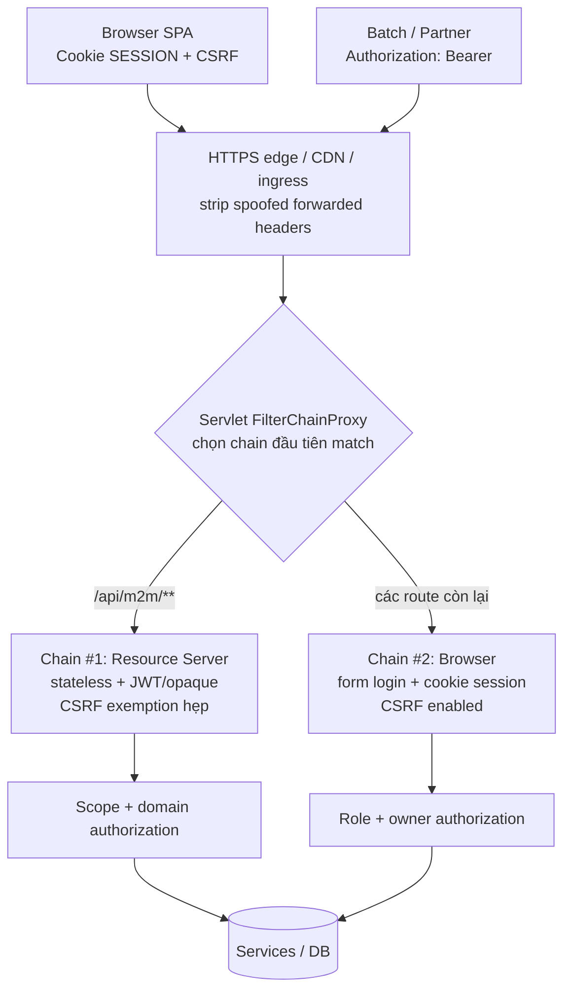

# Tách khu vực API bearer token khỏi khu vực dùng cookie

> **Chương:** Thực hành tổng hợp  
> **Module:** `SPRING_SECURITY_HTTP_PROTECTION` — bảo vệ HTTP và trình duyệt trong Spring Security từ CSRF, CORS, security headers, CSP, HSTS đến HTTP firewall và session; cấu hình/kiểm thử cả Servlet lẫn Reactive.  
> **Bài thực hành:** Thiết kế hai vùng bảo mật trên **cùng một Spring Boot application**: vùng **machine-to-machine chỉ nhận Bearer token**, và vùng **browser/SPA có session cookie và CSRF**. Trọng tâm không chỉ là viết hai cấu hình mà là **chứng minh không có đường xác thực dự phòng (fallback) giữa hai vùng**.

## 1. Bài toán cần giải quyết

Một hệ thống quản lý đơn hàng cung cấp hai kiểu client:

1. **Browser/SPA:** Người dùng mở `https://portal.example.test`, đăng nhập bằng form, nhận session cookie; gọi `/api/web/orders` và `/api/web/profile`. Browser tự gửi cookie theo chính sách của nó.
2. **Máy chủ đối tác hoặc batch job:** Gọi `/api/m2m/reports` và `/api/m2m/jobs`, đính kèm `Authorization: Bearer <access-token>` được cấp bởi identity provider. Machine API **không chấp nhận cookie session**.
3. **Tài nguyên chung:** `GET /`, `GET /login`, `GET /assets/**`, `GET /csrf` để hỗ trợ browser.
4. **Quản trị:** `/admin/**` chỉ dành cho người có quyền quản trị trong browser session; không nên tự trở thành machine API.
5. **Các đường dẫn không khai báo:** Không được mặc định truy cập chỉ vì authenticated bằng bất kỳ cơ chế nào.

Tình huống hay gặp: một kỹ sư đặt `http.csrf(csrf -> csrf.disable())` vì “các endpoint dưới `/api` đều là REST”, rồi thêm `oauth2ResourceServer().jwt()` cạnh `formLogin()` trong cùng filter chain. Kết quả có thể là **CSRF bị tắt cho browser**, hoặc machine endpoint vô tình chấp nhận session cookie từ browser.

### 1.1. Mục tiêu sau bài

Người học có thể:

- Vẽ hai trust boundaries, hai credential contracts và luồng request/response.
- Viết **nhiều `SecurityFilterChain` Servlet** với `@Order` và `securityMatcher` chính xác.
- Viết cấu hình tương đương với **`SecurityWebFilterChain` Reactive**, không trộn API Servlet và WebFlux.
- Giữ **CSRF-on** cho cookie session và chỉ miễn CSRF cho machine chain thật sự không sử dụng browser auto-credentials.
- Ép machine API dùng Bearer header, không dùng cookie fallback, Basic auth, form login hay remember-me.
- Phân biệt **stateless** ở machine chain với session lifecycle ở browser chain.
- Kiểm JWT issuer/audience/expiry/signature và map scope → authority; hoặc dùng opaque token introspection khi phù hợp.
- Thiết kế đúng HTTP 401/403 và `WWW-Authenticate` thay vì login redirect trong machine API.
- Đảm bảo CORS/CSRF/session cookies/headers/HTTPS/proxy/CDN không tạo bypass.
- Viết kiểm thử chứng minh **cookie-only bị từ chối**, invalid bearer + cookie không fallback, token đúng nhưng thiếu scope bị 403, web POST thiếu CSRF bị chặn.
- Đặt regression gates để những thay đổi routes/chains/framework không âm thầm phá ranh giới.

## 2. Hai loại credential và một ranh giới quan trọng

**Cookie session** và **Bearer token** khác nhau ở cách credential được gửi, không phải “có JSON” hay “có JWT”.

| Thuộc tính | Browser cookie zone | Machine Bearer zone |
|---|---|---|
| URL | `/api/web/**`, form login/logout | `/api/m2m/**` |
| Client chủ yếu | Browser, SPA hoặc BFF | Batch job, service, đối tác |
| Credential | Session cookie do browser tự gửi | `Authorization: Bearer ...` chủ động thêm |
| Server authentication | `HttpSession`/`WebSession` + security context | Resource Server JWT hoặc opaque access token |
| CSRF | **Giữ bật** trên unsafe requests | Có thể **miễn hẹp** nếu tuyệt đối không cookie fallback |
| Cookie-only | Được nếu session hợp lệ | **Phải bị từ chối** |
| Bearer-only | Không tự cấp browser session | Được nếu token hợp lệ, scope đủ |
| Response khi thiếu auth | Login redirect cho HTML; 401 nếu AJAX contract yêu cầu | **401**, không redirect login |
| Thiếu quyền | 403 | 403, thường challenge mô tả insufficient scope nếu hỗ trợ |
| State lưu server | Session và CSRF repository | Không phụ thuộc session browser |
| Cache riêng tư | `no-store` + CDN bypass | `no-store` + CDN bypass |
| Logout | Hủy session, CSRF token lifecycle | Không có `/logout` theo session; revoke/expire token theo IdP |
| Test quan trọng | Form POST token thiếu/đúng, session rotation | Valid/invalid/missing bearer, **cookie-only** |

**Tiêu chí fail nghiêm trọng:** Request `GET /api/m2m/reports` chỉ mang `JSESSIONID` của một người dùng đã login mà vẫn nhận 200. Điều đó cho thấy machine zone đã chấp nhận credential ngoài contract.

### 2.1. Vì sao cookie làm phát sinh CSRF?

Browser gửi cookie tự động khi request phù hợp host/path/SameSite, kể cả request do trang bên ngoài khởi tạo trong một số bối cảnh. Vì vậy khi một endpoint dùng cookie để xác thực state-changing request, nó cần phòng vệ CSRF.

Bearer header được client chủ động tạo thường không tự có mặt trong một HTML form cross-site. Do đó **bearer-only API không dùng cookie fallback** thường có thể miễn CSRF, nhưng vẫn cần xác thực token, kiểm scope/authorization, CORS, chống XSS và kiểm toán.

**Nếu access JWT nằm trong cookie** thay vì Authorization header, request đó thuộc **mô hình tự gửi credential** và rủi ro CSRF quay lại. Tên “JWT” không làm cookie trở thành bearer-only header API.

### 2.2. Quy tắc vàng

> Quyết định CSRF dựa trên **cách browser gửi credential**, không dựa trên path chứa chữ `api`, JSON hay tên công nghệ JWT.

## 3. Kiến trúc mục tiêu



Trong WebFlux, bộ chọn là các `SecurityWebFilterChain` dùng `securityMatcher` và thứ tự `@Order`; bản chất **first matching chain** tương đương nhưng filter/HTTP APIs khác.

### 3.1. Một request không “chạy qua cả hai chain”

Nếu `/api/m2m/reports` đã match chain #1:

- Không chạy chain #2 để bổ sung form login.
- Không được “thử lại cookie” khi Bearer thiếu/sai.
- Authentication filter/CSRF/authorization của chain #1 chịu trách nhiệm.
- Nếu chain #1 không match vì path rewrite/ordering sai, request có thể rơi vào browser chain — **phải có test phát hiện**, không chỉ tin nhận xét trong code.

**Chỉ định matcher của chain** quan trọng hơn việc đặt mọi thứ trong một danh sách `requestMatchers`. `securityMatcher` quyết định chain nào được chọn; `authorizeHttpRequests.requestMatchers` quyết định quyền **bên trong chain đã chọn**.

## 4. Threat model và tài sản

| Rủi ro | Kịch bản | Cơ chế phòng vệ |
|---|---|---|
| Cookie fallback | Cookie browser hợp lệ gọi machine endpoint | Machine chain không đọc cookie/session |
| Invalid bearer fallback | Bearer sai cùng cookie đúng | Không rơi về form/session auth |
| CSRF bị disable toàn site | Cross-site POST tới `/api/web/orders` | CSRF chỉ disable trong chain máy |
| Chain shadowing | Browser matcher/`@Order` match `/api/m2m/**` trước | Chain chuyên biệt đặt trước, regression test |
| Scope confusion | Machine có token `reports.read` tạo jobs | `SCOPE_jobs.write` cho POST jobs |
| Role/scope confusion | `ROLE_ADMIN` bị coi như `SCOPE_admin` | Chọn namespace/authority đúng |
| JWT giả hoặc hết hạn | Attacker tự ký token/chọn alg | Verify issuer, signature, alg, expiry/audience |
| Token từ query/cookie | Resource server chấp nhận token ở nguồn khác | Bearer header-only resolver contract |
| Host/forward spoof | Client tự đặt `X-Forwarded-Proto/Host` | Edge strip/overwrite, origin private |
| Session hijacking | Cookie lộ hoặc không Secure | TLS, cookie flags, fixation defense |
| Browser XSS | Script độc hại lấy CSRF/đọc data | CSP, output encoding, session HttpOnly |
| Cache lộ dữ liệu | CDN lưu private response, trả HIT cho user khác | `no-store` + route cache bypass |
| URL normalization | Encoded path vào chain khác | Firewall, ingress normalization, path tests |
| CORS wildcard | SPA khác origin đọc credentialed response | Exact allowlist, Vary/cache variants |
| Excessive privileges | Authenticated token nhưng không owner | Service/domain authorization |

### 4.1. Đừng nhầm “stateless” với “an toàn”

`SessionCreationPolicy.STATELESS` chủ yếu ngăn Spring Security dựa vào `HttpSession` để lưu/đọc SecurityContext theo cơ chế chuẩn. Nó **không tự chứng minh**:

- Custom filter không đọc cookie.
- Handler không đọc session qua code riêng.
- Gateway không inject `X-User` mà app tự tin.
- Request không có token trong query.
- JWT được verify đúng.
- Scope/owner authorization đúng.

Phải kiểm bằng request thực, nhất là **cookie-only với session hợp lệ**.

## 5. Hợp đồng đường dẫn và quyền

| Method/path | Chain phải match | Credential | Quyền | CSRF |
|---|---|---|---|---|
| `GET /` | Browser | Public | Public | Không cần token |
| `GET /login` | Browser | Public | Public | Không cho GET |
| `POST /login` | Browser | Anonymous + session CSRF | Authentication | **Bật** |
| `POST /logout` | Browser | Session + token | Logout | **Bật** |
| `GET /csrf` | Browser | Anonymous hoặc session | Token bootstrap | Không cho GET |
| `GET /api/web/profile` | Browser | Session cookie | Authenticated + owner | Không cho GET |
| `PATCH /api/web/profile` | Browser | Session cookie | Owner | **Bật** |
| `POST /api/web/orders` | Browser | Session cookie | Business authorization | **Bật** |
| `GET /admin/reports` | Browser | Session cookie | `ROLE_ADMIN` | Không cho GET |
| `GET /api/m2m/reports` | Machine | Bearer header | `SCOPE_reports.read` | Miễn hẹp |
| `POST /api/m2m/jobs` | Machine | Bearer header | `SCOPE_jobs.write` | Miễn hẹp |
| `GET /api/m2m/**` không khai báo | Machine | Bearer | **Deny by default** | Theo chain |
| `GET /assets/**` | Browser | Public | Public | Không |
| Bất kỳ route khác | Browser fallback | Không tự public | **Deny by default** | Theo method |

**Chủ động xử lý** `/api/m2m`, `/api/m2m/`, case variants, encoded slash, proxy prefixes và method override. Path matcher semantics phụ thuộc Servlet/WebFlux/Framework version và configuration, nên không suy một chuỗi `"/api/m2m/**"` đã kiểm đúng mọi biến thể.

## 6. Chuẩn bị dependencies cho bài lab

Ví dụ Maven khi version do Spring Boot BOM quản lý:

```xml
<dependency>
    <groupId>org.springframework.boot</groupId>
    <artifactId>spring-boot-starter-web</artifactId>
</dependency>
<dependency>
    <groupId>org.springframework.boot</groupId>
    <artifactId>spring-boot-starter-security</artifactId>
</dependency>
<dependency>
    <groupId>org.springframework.boot</groupId>
    <artifactId>spring-boot-starter-oauth2-resource-server</artifactId>
</dependency>
<dependency>
    <groupId>org.springframework.boot</groupId>
    <artifactId>spring-boot-starter-validation</artifactId>
</dependency>
<dependency>
    <groupId>org.springframework.boot</groupId>
    <artifactId>spring-boot-starter-test</artifactId>
    <scope>test</scope>
</dependency>
<dependency>
    <groupId>org.springframework.security</groupId>
    <artifactId>spring-security-test</artifactId>
    <scope>test</scope>
</dependency>
```

Nếu app render HTML form bằng Thymeleaf, thêm `spring-boot-starter-thymeleaf`. Nếu chọn WebFlux, thay `spring-boot-starter-web` bằng `spring-boot-starter-webflux` (không copy Servlet `Filter` API).

**Phạm vi ví dụ:** Spring Boot 3.x + Spring Security 6.x + Java 17+ cho Servlet; API và properties có thể đổi trên Spring Boot 4.x/Spring Security 7.x. Kiểm compile và runtime theo version dự án. Code là mẫu thiết kế, không phải một repo đầy đủ.

## 7. Servlet: SecurityFilterChain #1 — bearer-only API

```java
package example.security;

import org.springframework.context.annotation.Bean;
import org.springframework.context.annotation.Configuration;
import org.springframework.core.annotation.Order;
import org.springframework.http.HttpMethod;
import org.springframework.security.config.Customizer;
import org.springframework.security.config.annotation.web.builders.HttpSecurity;
import org.springframework.security.config.annotation.web.configurers.AbstractHttpConfigurer;
import org.springframework.security.config.http.SessionCreationPolicy;
import org.springframework.security.web.SecurityFilterChain;
import org.springframework.security.web.savedrequest.NullRequestCache;

@Configuration
public class HttpSecurityConfig {

    @Bean
    @Order(1)
    SecurityFilterChain machineApi(HttpSecurity http)
            throws Exception {

        return http
            .securityMatcher("/api/m2m/**")
            .authorizeHttpRequests(auth -> auth
                .requestMatchers(HttpMethod.GET,
                    "/api/m2m/reports")
                    .hasAuthority("SCOPE_reports.read")
                .requestMatchers(HttpMethod.POST,
                    "/api/m2m/jobs")
                    .hasAuthority("SCOPE_jobs.write")
                .anyRequest().denyAll())
            .sessionManagement(session -> session
                .sessionCreationPolicy(SessionCreationPolicy.STATELESS))
            .requestCache(cache -> cache
                .requestCache(new NullRequestCache()))
            .csrf(AbstractHttpConfigurer::disable)
            .formLogin(AbstractHttpConfigurer::disable)
            .httpBasic(AbstractHttpConfigurer::disable)
            .oauth2ResourceServer(oauth -> oauth
                .jwt(Customizer.withDefaults()))
            .build();
    }
}
```

### 7.1. Giải thích các ranh giới

| DSL | Vai trò |
|---|---|
| `@Order(1)` | Chain chuyên biệt chạy trước browser fallback |
| `securityMatcher("/api/m2m/**")` | Giới hạn **chain** vào machine URL family |
| `hasAuthority("SCOPE_reports.read")` | Chỉ token có scope tương ứng được đọc report |
| `hasAuthority("SCOPE_jobs.write")` | Chỉ token có quyền ghi được tạo job |
| `anyRequest().denyAll()` | Không tự mở machine endpoint mới |
| `STATELESS` | Không lưu/đọc SecurityContext qua session theo chuẩn |
| `NullRequestCache` | Không lưu saved request để redirect login |
| `csrf.disable` **trong chain này** | Miễn CSRF cho bearer-header-only client |
| `formLogin.disable` | Không nhận authentication form/session trong chain máy |
| `httpBasic.disable` | Không chấp nhận Basic do cấu hình ngoài ý định |
| `oauth2ResourceServer.jwt` | Xác thực Bearer JWT bằng decoder/validator |

Không chỉ dựa vào việc máy gọi API rồi có `Authorization`: phải kiểm **request không mang Bearer nhưng có cookie thật** vẫn bị 401, và `Authorization: Bearer invalid` + cookie thật cũng 401.

### 7.2. Tại sao cần cấu hình JWT Resource Server?

`oauth2ResourceServer().jwt()` không tự biến mọi string thành access token hợp lệ. Cần `JwtDecoder` với issuer/JWKS/signature/claim validation. Resource server phải xác minh token do issuer đáng tin cấp, còn hạn, đúng audience/mục đích và có quyền cần thiết.

Trong môi trường triển khai, thường khai báo issuer:

```yaml
spring:
  security:
    oauth2:
      resourceserver:
        jwt:
          issuer-uri: https://idp.example.test/realms/production
```

Đây là URL **minh họa**, phải dùng issuer/metadata endpoint thực, có TLS tin cậy. Đừng tự xây decoder bỏ kiểm chữ ký hoặc cho phép thuật toán tùy token. `issuer-uri` hỗ trợ xác minh issuer; **audience validation cần xác nhận/thiết lập theo contract API**, không giả định mọi version tự kiểm audience mong muốn.

### 7.3. Ủy quyền theo scope

Spring Security OAuth2 Resource Server thường map claim `scope` hoặc `scp` thành authorities có prefix `SCOPE_`. Ví dụ token có `scope="reports.read"` tạo authority `SCOPE_reports.read` theo mapping mặc định.

**Không tự nhầm**:

- `ROLE_ADMIN`: thường phục vụ `hasRole("ADMIN")` của browser user.
- `SCOPE_reports.read`: quyền từ OAuth2 access token.
- JWT claim `roles` hoặc nested `realm_access`: có thể cần converter riêng, không luôn auto-map thành `ROLE_*`.
- `aud`: audience token, không phải permission.
- `sub`: chủ thể/token subject, không tự cho quyền trên mọi resource.

### 7.4. Bảo vệ business layer

Token có `SCOPE_reports.read` không tự có quyền đọc report của mọi tenant. Nếu report có tenant ID, service phải đối chiếu trusted tenant claim/client identity, policy và repository query. Không tin `X-Tenant-ID` do client tự gửi như bằng chứng quyền.

### 7.5. Header-only: nguồn token nào được chấp nhận?

Theo mặc định, Bearer token resolver của Servlet Resource Server lấy `Authorization: Bearer ...`. Tránh bật đọc token từ query parameter, form field hoặc cookie mà không có threat model; URL có thể lộ vào logs, referrer và browser history. Nếu có custom `BearerTokenResolver`, test riêng nó không tạo cookie fallback.

### 7.6. Hành vi 401 và 403

- Không Bearer/invalid Bearer → **401 Unauthorized**, thường kèm `WWW-Authenticate: Bearer`.
- Bearer hợp lệ nhưng thiếu scope → **403 Forbidden**, có thể có thông tin `insufficient_scope` theo error-handling implementation.
- Không redirect `/login` và không phát session cookie do machine chain.
- Không biến lỗi xác thực thành 200 JSON {"success":false}, vì client/proxy/monitoring sẽ hiểu sai.

**Đừng khẳng định toàn bộ header string cố định giữa Spring Security versions**; kiểm status, challenge theo contract và không lộ chi tiết nhạy cảm của token.

## 8. Servlet: SecurityFilterChain #2 — cookie + CSRF

Một chain khác bao phủ browser routes và fallback:

```java
import org.springframework.context.annotation.Bean;
import org.springframework.core.annotation.Order;
import org.springframework.http.HttpMethod;
import org.springframework.security.config.Customizer;
import org.springframework.security.config.annotation.web.builders.HttpSecurity;
import org.springframework.security.web.SecurityFilterChain;

@Bean
@Order(2)
SecurityFilterChain browserZone(HttpSecurity http)
        throws Exception {

    return http
        .authorizeHttpRequests(auth -> auth
            .requestMatchers(HttpMethod.GET,
                "/", "/login", "/csrf", "/assets/**", "/error")
                .permitAll()
            .requestMatchers("/admin/**").hasRole("ADMIN")
            .requestMatchers("/api/web/**", "/account/**")
                .authenticated()
            .anyRequest().denyAll())
        .formLogin(login -> login
            .loginPage("/login")
            .loginProcessingUrl("/login")
            .defaultSuccessUrl("/account", false)
            .permitAll())
        .logout(logout -> logout
            .logoutUrl("/logout")
            .logoutSuccessUrl("/login?logout")
            .invalidateHttpSession(true)
            .clearAuthentication(true))
        .sessionManagement(session -> session
            .sessionFixation(fixation -> fixation.changeSessionId()))
        .csrf(Customizer.withDefaults())
        .headers(headers -> headers
            .contentSecurityPolicy(csp -> csp.policyDirectives(
                "default-src 'self'; " +
                "script-src 'self'; " +
                "style-src 'self'; " +
                "object-src 'none'; " +
                "base-uri 'self'; " +
                "frame-ancestors 'none'")))
        .build();
}
```

### 8.1. Vì sao chain browser không đặt `securityMatcher`?

Chain #2 ở đây là **fallback** cho mọi request chưa được chain #1 match. Bên trong, `anyRequest().denyAll()` đảm bảo route chưa được phân loại không trở nên công khai.

**Lưu ý:** Nếu chain #1 không match `/api/m2m` vì path/alias/encoding, request có thể rơi vào chain browser. Fallback `denyAll` sẽ ngăn truy cập nếu route không được allow, nhưng vẫn có thể xuất hiện login redirect hoặc response khác 401. Vì vậy regression tests phải kiểm alias/path variants, không coi fallback thay thế matcher correctness.

### 8.2. Browser chain giữ CSRF

`csrf(Customizer.withDefaults())` yêu cầu token cho unsafe methods theo mặc định của Servlet stack. Điều này áp dụng cho:

- `POST /login`, kể cả khi authorization `permitAll`.
- `POST /logout`.
- `PATCH /api/web/profile`.
- `POST /api/web/orders`.
- Những unsafe browser routes khác được bổ sung sau này.

Nếu một form thiếu token bị 403, sửa form/session repository/forwarding. **Không tắt CSRF trên browser chain để “giữ API thống nhất”.**

### 8.3. Nếu browser API muốn 401 thay vì login redirect

HTML page có thể cần 302 đến `/login`, trong khi AJAX `/api/web/**` muốn nhận 401 JSON/không redirect. Đây là **entry-point policy trong browser chain**, không phải lý do chuyển web API sang machine chain.

Có thể cấu hình `exceptionHandling` để dùng `HttpStatusEntryPoint(HttpStatus.UNAUTHORIZED)` cho một matcher cụ thể của `/api/web/**`, giữ form login entry point cho HTML pages. Test 401 trên unauthenticated API và 302 trên anonymous HTML page.

### 8.4. Route security khác business authorization

`/api/web/**.authenticated()` chỉ nói browser session phải hợp lệ. Khi sửa đơn hàng, service phải xác minh owner hoặc role; một CSRF token hợp lệ không cấp quyền trên đơn của user khác.

### 8.5. Một security chain không thay mọi chính sách HTTP

Session cookie `Secure/HttpOnly/SameSite`, HSTS và proxy forwarded metadata phụ thuộc runtime/edge; CSP cần phù hợp assets/frontend. Ứng dụng cũng phải phát `no-store` trên private outputs và CDN phải bypass.

## 9. Quan hệ giữa @Order, securityMatcher và authorization matcher

Có ba bước:

1. Servlet `FilterChainProxy` lần lượt thử các `SecurityFilterChain` theo order.
2. Chain **đầu tiên** match request sẽ được dùng; các chain sau không bổ sung filter.
3. Trong chain đó, `authorizeHttpRequests` đưa ra quyết định theo rules/matchers.

### 9.1. Phản ví dụ: browser chain bắt mọi request trước

```java
// PHẢN VÍ DỤ: browser chain ở @Order(1) không có
// securityMatcher (match-all).
@Bean
@Order(1)
SecurityFilterChain browserFirst(HttpSecurity http) throws Exception {
    // formLogin + session + CSRF...
    return http.build();
}

// @Order(2) bearer chain không bao giờ được chọn
// cho request đã bị browserFirst match.
```

Kết quả: machine API có thể redirect login, đọc session hoặc gặp CSRF 403 sai kỳ vọng.

### 9.2. Phản ví dụ: tắt CSRF bằng request matcher quá rộng

```java
// PHẢN VÍ DỤ nếu /api/web/** vẫn dùng cookie session.
http.csrf(csrf -> csrf
    .ignoringRequestMatchers("/api/**"));
```

Trong code trên, mọi browser JSON POST dưới `/api/web/**` được miễn CSRF. Thay bằng **machine chain** match hẹp, không dùng cấu hình bỏ qua tổng quát.

### 9.3. Phản ví dụ: cả hai cơ chế auth trong một chain

```java
// CẦN THREAT MODEL RIÊNG; không phải mô hình bearer-only.
http.formLogin(Customizer.withDefaults())
    .oauth2ResourceServer(oauth ->
        oauth.jwt(Customizer.withDefaults()));
```

Nếu một chain hỗ trợ session và bearer cùng lúc, cần xác định rõ credential precedence, auth storage, CSRF khi cookie hiện diện và failure behavior. Nếu yêu cầu là **bearer-only**, việc bật cả hai không tạo ra ranh giới an toàn như hai chain riêng.

### 9.4. Kiểm tra URI qua reverse proxy

Browser public `/platform/api/m2m/reports` có thể được ingress strip `/platform` trước khi Spring match. Nếu Servlet context path hoặc `X-Forwarded-Prefix` được xử lý khác nhau theo version, matcher có thể không thấy path mà engineer tưởng.

**Test effective path** trên web server thật và request công khai. Không gắn `/platform` vào security matcher chỉ vì URL public có prefix, trừ khi runtime contract thực sự cần.

## 10. Kiểm JWT: token hợp lệ không đồng nghĩa đúng API

Một machine token cần được kiểm:

| Kiểm tra | Mục tiêu |
|---|---|
| Signature và allowed algorithms | Ngăn token bị sửa/tự ký |
| Issuer (`iss`) | Token do authority đáng tin cấp |
| Audience (`aud`) | Token được phát cho API này, không phải API khác |
| Expiry (`exp`), not-before (`nbf`) | Không chấp nhận token hết hạn/chưa có hiệu lực |
| Clock skew | Chấp nhận độ lệch nhỏ, không nới vô hạn |
| Scope/authorities | Cho phép operation tương ứng |
| Client identity/subject | Audit và domain authorization |
| Tenant/organization | Không vượt quyền xuyên tenant |
| Key rotation/JWKS retrieval | Hoạt động khi IdP xoay signing key |
| Token revocation | Cân nhắc JWT TTL ngắn/introspection/event handling |

**Không tự xác nhận access token chỉ bằng cách Base64 decode claim**. Decoder phải verify chữ ký và validators.

### 10.1. Audience validation cần được thiết kế rõ

Có thể dùng Spring Security `JwtValidators.createDefaultWithIssuer` kết hợp validator riêng cho audience. Pseudocode:

```text
JwtDecoder:
    decode + verify signature/JWK
    validate issuer + exp/nbf
    validate expected aud contains api://orders
    map scope -> SCOPE_reports.read / SCOPE_jobs.write
```

Không coi một token của frontend/client khác là hợp lệ chỉ vì `iss` và signature đúng. Cần nguồn cấu hình `expected-audience` do server quản lý, không đọc audience từ request header do client tự khai.

### 10.2. JWT vs opaque access token

- **JWT:** Ứng dụng verify tại chỗ bằng JWK, lưu ý revocation/expiry.
- **Opaque token:** Ứng dụng có thể introspect với authorization server, theo cache/availability policy được review.
- Cả hai đều có thể dùng `Authorization: Bearer ...`.
- Chọn một scheme và cấu hình đúng trong machine chain; không bắt browser session cookie đi qua introspection chỉ để “thống nhất”.
- Không tự chuyển một JWT trong cookie thành Bearer header ở edge nếu chưa thiết kế threat model rõ, vì có thể phá CSRF boundary.

### 10.3. Token format không phải identity proof trên log

Không log raw token, đặc biệt trong reverse proxy, application access logs, APM traces, browser HAR hay CI artifacts. Khi cần debug, dùng request ID, client ID đã xác minh, issuer, audience, scope, status và error category đã redacted.

## 11. Session và cookie ở browser chain

Ví dụ cấu hình Spring Boot Servlet cho HTTPS public:

```yaml
server:
  servlet:
    session:
      timeout: 20m
      cookie:
        secure: true
        http-only: true
        same-site: lax
        path: /
```

Một response cookie có thể là:

```http
Set-Cookie: JSESSIONID=<opaque>; Path=/; Secure; HttpOnly; SameSite=Lax
```

**Cookie auth khác bearer token**:

- `Secure` hạn chế gửi session cookie qua HTTP; TLS public phải được kiểm đúng.
- `HttpOnly` ngăn JS đọc session ID, nhưng browser vẫn tự gửi cookie.
- `SameSite` hỗ trợ CSRF defense-in-depth nhưng không thay token.
- `Path`/`Domain` là browser sending scope, không phải authorization boundary.
- Session fixation protection đổi session ID sau login; logout invalidates server session.
- Với Spring Session/custom cookie serializer, xác nhận cấu hình thực phát `Set-Cookie`.

Không đặt `Domain=.example.test` chỉ vì nhiều apps cùng công ty, và không hạ `HttpOnly` để SPA đọc token CSRF: token CSRF có repository/cookie riêng nếu cần.

### 11.1. Cookie-only tới machine API

Một browser đang login có `JSESSIONID` hợp lệ. Nếu gọi:

```http
GET /api/m2m/reports HTTP/1.1
Cookie: JSESSIONID=<valid-browser-session>
```

**Kỳ vọng 401**. Lý do: machine chain không dùng cookie để xác thực, dù browser chain biết session đó. Nếu bạn thấy 200, phải điều tra chain selection, session repository, global filters và custom authentication.

### 11.2. Bearer sai + cookie hợp lệ

```http
GET /api/m2m/reports HTTP/1.1
Authorization: Bearer <invalid-token>
Cookie: JSESSIONID=<valid-browser-session>
```

**Kỳ vọng 401**, không fallback sang session. Việc mang đồng thời hai credential không cho phép client “chọn cái dễ hơn” khi token bị từ chối.

### 11.3. Bearer đúng + cookie thừa

Theo contract, machine chain phải dựa vào **Bearer token** để xác thực. Nếu một cookie ngẫu nhiên được gửi kèm, nó **không được làm đổi user/role/tenant**, cũng không được dùng để tạo session. Cân nhắc reject mọi request có cookie nếu muốn strict client contract; nhưng việc reject cần chính sách riêng và không phải yêu cầu bắt buộc để resource server an toàn.

## 12. CSRF: browser zone phải có kiểm thử âm/dương

Ví dụ browser dùng POST:

```http
POST /api/web/orders HTTP/1.1
Cookie: JSESSIONID=<valid-session>
Content-Type: application/json
X-CSRF-TOKEN: <session-csrf-token>

{"productId":42,"quantity":1}
```

Kiểm:

1. Session hợp lệ, **không** CSRF token → 403, không tạo đơn.
2. Session hợp lệ, CSRF token **sai** → 403, không tạo đơn.
3. Session hợp lệ, CSRF token đúng, quyền đủ → nghiệp vụ chạy.
4. Session hợp lệ, token đúng nhưng user không có quyền trên order → 403/404 theo domain authorization.
5. Anonymous request không token → không được tạo đơn, nhưng 401/302 đơn lẻ không chứng minh CSRF.
6. POST login/logout cũng qua CSRF nếu dùng browser cookie; test session lifecycle.

### 12.1. Lấy token bằng MVC form hoặc endpoint

Với server-rendered Thymeleaf, `th:action` có thể thêm CSRF hidden field thông qua Spring MVC `RequestDataValueProcessor`. Với SPA, có thể dùng `GET /csrf` JSON trước login và lấy token mới sau login/logout khi token lifecycle thay đổi.

**Không cache shared** trang HTML chứa token hoặc `GET /csrf`. Đặt `Cache-Control: no-store` và CDN bypass.

### 12.2. Token trong cookie không phải session cookie

Nếu SPA dùng `CookieCsrfTokenRepository`, cookie `XSRF-TOKEN` có thể được JS đọc để gửi `X-XSRF-TOKEN`, nhưng session `JSESSIONID` vẫn `HttpOnly=true`. Spring Security 6 có deferred token/XOR request handler; cần handler tương thích raw header và refresh token sau auth/logout. Không tắt CSRF để “sửa” 403 vì token cũ.

### 12.3. Bearer-only machine không cần CSRF token

Machine client gửi `Authorization: Bearer` và không dùng session cookie. Yêu cầu CSRF token cho Bearer-only calls làm rối client mà không giải quyết một rủi ro browser credential tự gửi. Tuy nhiên **scope/authorization, rate limit, replay/mTLS nếu cần** vẫn phải đúng.

## 13. Browser vs machine error contract

Một HTML client và một service client có cách xử lý lỗi khác nhau.

| Tình huống | Browser zone | Machine zone |
|---|---|---|
| Anonymous GET protected | Thường redirect `/login` | **401 + Bearer challenge** |
| API AJAX unauthenticated | Có thể chọn 401 theo config | 401 |
| Missing CSRF unsafe | **403**, không side effect | Không dùng CSRF trong bearer-only contract |
| Wrong CSRF | 403 | Không liên quan |
| Wrong password | Form login failure redirect/status tùy config | Không có password login |
| Missing bearer | Không tự coi bearer bắt buộc | 401 |
| Invalid bearer | Không tự dùng bearer (nếu không hỗ trợ) | 401, không cookie fallback |
| Valid bearer, missing scope | Không dùng token làm browser session | 403 |
| Valid credential, wrong tenant | 403/404 domain policy | 403/404 domain policy |
| Unknown route | 404/403 tùy routing/security | Deny by default |
| Error cached at CDN | Không chia auth-sensitive responses | Không chia auth-sensitive responses |

### 13.1. Vì sao 401 và 403 quan trọng?

- 401 giúp machine client biết token thiếu, hết hạn hoặc sai.
- 403 cho biết credential có thể hợp lệ nhưng quyền chưa đủ.
- 302 đến form login sẽ khiến machine client theo redirect, nhận HTML rồi parse nhầm JSON.
- 200 “error object” có thể bị CDN cache hoặc monitoring hiểu là thành công.

Test thêm `WWW-Authenticate` khi cần theo RFC 6750, nhưng đừng copy toàn chuỗi header cứng giữa phiên bản như một phép kiểm duy nhất.

## 14. CORS: đường browser và machine không như nhau

Một SPA ở `https://app.example.test` gọi API `https://api.example.test` là **cross-origin**, dù có thể same-site. Browser cookies chỉ được gửi nếu:

1. Frontend gọi `fetch` với `credentials: "include"`.
2. API trả CORS exact origin, `Access-Control-Allow-Credentials` phù hợp.
3. Cookie host/path/SameSite/Secure và browser policy cho phép.
4. Preflight OPTIONS được xử lý đúng thứ tự trước các authorization restrictions gây chặn.

### 14.1. Browser CORS policy

Ví dụ Servlet `CorsConfigurationSource`:

```java
import java.util.List;
import org.springframework.context.annotation.Bean;
import org.springframework.web.cors.CorsConfiguration;
import org.springframework.web.cors.UrlBasedCorsConfigurationSource;

@Bean
UrlBasedCorsConfigurationSource corsConfigurationSource() {
    CorsConfiguration cfg = new CorsConfiguration();
    cfg.setAllowedOrigins(List.of("https://app.example.test"));
    cfg.setAllowedMethods(List.of("GET", "POST", "PATCH", "OPTIONS"));
    cfg.setAllowedHeaders(List.of(
        "Content-Type", "X-CSRF-TOKEN", "X-XSRF-TOKEN"));
    cfg.setAllowCredentials(true);
    cfg.setMaxAge(600L);

    UrlBasedCorsConfigurationSource source =
        new UrlBasedCorsConfigurationSource();
    source.registerCorsConfiguration("/api/web/**", cfg);
    // Nếu login/logout/CSRF được gọi cross-origin, phải bổ sung
    // route CORS contract chính xác cho các endpoint đó.
    return source;
}
```

Trong browser chain, bật:

```java
// Bên trong browser SecurityFilterChain:
http.cors(Customizer.withDefaults());
```

**Đừng chỉ allowlist `/api/web/**` nếu SPA ở origin khác còn gọi `/login`, `/logout`, `/csrf`**. Các endpoints đó cũng cần CORS phù hợp, hoặc phục vụ qua same-origin BFF. Security policy phải chọn đúng URLs thật.

### 14.2. Machine API có cần CORS không?

CORS là **browser-side access control**; service-to-service HTTP clients không bị browser CORS enforcement. Theo mặc định, **không mở CORS cho `/api/m2m/**` chỉ vì batch client từ domain khác**. Nếu thực sự có browser client cần gọi bearer machine API, đó là một use case mới cần review token handling/XSS/origin policy; không tự thêm wildcard.

### 14.3. OPTIONS preflight và chains

Nếu SPA gửi JSON/CSRF headers cross-origin, preflight có thể là:

```http
OPTIONS /api/web/orders HTTP/1.1
Origin: https://app.example.test
Access-Control-Request-Method: POST
Access-Control-Request-Headers: content-type,x-csrf-token
```

Browser preflight thường không gửi cookie authentication, vì vậy CORS phải được xử lý **trước** auth-dependent rejection. Trong Servlet, `http.cors(...)` kết hợp `CorsConfigurationSource` là cơ chế thường dùng; trong WebFlux có integration riêng. Test preflight qua proxy/CDN thật, bao gồm Origin/method/request headers variants.

### 14.4. Đừng dùng CORS thay CSRF

Ngay cả khi script cross-origin không đọc được API response, browser có thể gửi một số request bằng form/navigation. CSRF token vẫn cần cho `/api/web/**` cookie auth. `SameSite` bổ sung defense-in-depth, không thay token.

### 14.5. `Vary: Origin` và CDN

Nếu CORS response thay đổi theo `Origin`, phải phát `Vary` phù hợp và kiểm **CDN cache key thực** hoặc bypass để không trả ACAO của origin A cho origin B. Không bật shared cache cho private web API chỉ vì CORS header “đúng”.

## 15. WebFlux: hai SecurityWebFilterChain tách biệt

Khi ứng dụng sử dụng **Reactive WebFlux**, thay `HttpSecurity`/`SecurityFilterChain` bằng `ServerHttpSecurity`/`SecurityWebFilterChain`; session là `WebSession`, CSRF là `CsrfWebFilter`.

### 15.1. Reactive machine chain

```java
import org.springframework.context.annotation.Bean;
import org.springframework.core.annotation.Order;
import org.springframework.http.HttpMethod;
import org.springframework.security.config.Customizer;
import org.springframework.security.config.web.server.ServerHttpSecurity;
import org.springframework.security.web.server.SecurityWebFilterChain;
import org.springframework.security.web.server.context.NoOpServerSecurityContextRepository;
import org.springframework.security.web.server.util.matcher.PathPatternParserServerWebExchangeMatcher;

@Bean
@Order(1)
SecurityWebFilterChain reactiveMachineApi(ServerHttpSecurity http) {
    return http
        .securityMatcher(
            new PathPatternParserServerWebExchangeMatcher("/api/m2m/**"))
        .securityContextRepository(
            NoOpServerSecurityContextRepository.getInstance())
        .authorizeExchange(auth -> auth
            .pathMatchers(HttpMethod.GET,
                "/api/m2m/reports")
                .hasAuthority("SCOPE_reports.read")
            .pathMatchers(HttpMethod.POST,
                "/api/m2m/jobs")
                .hasAuthority("SCOPE_jobs.write")
            .anyExchange().denyAll())
        .csrf(ServerHttpSecurity.CsrfSpec::disable)
        .formLogin(ServerHttpSecurity.FormLoginSpec::disable)
        .httpBasic(ServerHttpSecurity.HttpBasicSpec::disable)
        .oauth2ResourceServer(oauth ->
            oauth.jwt(Customizer.withDefaults()))
        .build();
}
```

### 15.2. Reactive browser chain

```java
@Bean
@Order(2)
SecurityWebFilterChain reactiveBrowser(ServerHttpSecurity http) {
    return http
        .authorizeExchange(auth -> auth
            .pathMatchers(HttpMethod.GET,
                "/", "/login", "/csrf", "/assets/**")
                .permitAll()
            .pathMatchers("/admin/**").hasRole("ADMIN")
            .pathMatchers("/api/web/**", "/account/**")
                .authenticated()
            .anyExchange().denyAll())
        .csrf(Customizer.withDefaults())
        .formLogin(Customizer.withDefaults())
        .logout(Customizer.withDefaults())
        .build();
}
```

**Reactive caveats:**

- WebFlux `securityMatcher` dùng `ServerWebExchangeMatcher`, không Servlet matcher.
- `NoOpServerSecurityContextRepository` giúp không dùng WebSession để lưu/đọc SecurityContext machine chain; không tự chứng minh custom WebFilter không đọc cookie.
- `oauth2ResourceServer.jwt` yêu cầu decoder/issuer/validators tương ứng.
- Browser `formLogin`/`logout` mặc định có flow và redirect riêng; nếu SPA cần 204/401 JSON phải cấu hình reactive authentication success/failure và logout handlers.
- `CsrfWebFilter` giữ bảo vệ cho browser unsafe methods. Đừng copy Servlet `CsrfTokenRepository` sang reactive cookie repository.
- Test chain selection với request thật và WebSession thật, không chỉ `mockUser()`.
- CORS integration của Reactive dùng API/filters phù hợp stack; không đăng ký Servlet `CorsFilter` vào ứng dụng WebFlux.

### 15.3. Reactive session cookie

Ví dụ Boot Reactive (nếu app dùng WebSession cookie mặc định):

```yaml
server:
  reactive:
    session:
      cookie:
        secure: true
        http-only: true
        same-site: lax
        path: /
```

Nếu dùng Spring Session hoặc custom `WebSessionIdResolver`, test response `Set-Cookie`. Không suy property Servlet tự áp dụng lên Reactive.

## 16. HTTP security headers cho cả hai chain

Tách chain không có nghĩa tắt các header browser/security defaults ở vùng máy. Mục tiêu phụ thuộc loại content:

| Header | Browser HTML/API | Machine JSON |
|---|---|---|
| `Cache-Control` | `no-store` trên private HTML/API | `no-store` trên private machine response |
| `Strict-Transport-Security` | HTTPS public, owner rõ | HTTPS host cũng có thể hưởng HSTS |
| `X-Content-Type-Options` | `nosniff` | `nosniff` |
| `Content-Security-Policy` | Quan trọng cho HTML/SPA scripts | Hầu như không tác động JSON body, nhưng không gây hại nếu policy phù hợp |
| `X-Frame-Options`/`frame-ancestors` | Chống clickjacking | Thường ít liên quan JSON |
| `Referrer-Policy` | Giảm lộ URL nhạy cảm | Theo public response policy |
| `WWW-Authenticate` | Thường không dùng Bearer challenge cho HTML | Rất quan trọng khi 401 |
| `Set-Cookie` | Có session và CSRF cookie tùy thiết kế | **Không** phát session cookie do resource server |

### 16.1. CSP không thay XSS protection

SPA browser có thể bị XSS, và XSS chạy cùng origin có thể đọc nội dung/CSRF token rồi thao tác như user. Dùng output encoding, strict CSP phù hợp resources, hạn chế inline scripts; không cho rằng `HttpOnly` session cookie ngăn mọi hành vi khi XSS đã xảy ra.

### 16.2. HSTS owner

Nếu Spring Security sinh HSTS khi nhận diện request HTTPS, reverse proxy TLS termination phải cung cấp metadata external HTTPS đáng tin. Hoặc edge/TLS terminator sở hữu HSTS cho toàn public host. Tránh Spring và CDN phát chính sách mâu thuẫn. HSTS không thay CSRF và không tự mã hóa hop nội bộ.

### 16.3. API error body cũng không được cache sai

Không cache 401/403/404 liên quan user/token trên shared CDN key chung. Với private responses, áp `Cache-Control: no-store` và bypass CDN route; một CDN HIT có thể bỏ qua Spring Security hoàn toàn.

## 17. Cache và proxy: tách route nhưng đừng bỏ qua edge

### 17.1. Cấu hình CDN theo route

| URL family | Cache behavior |
|---|---|
| `/assets/**` hashed | Public cache theo version/TTL |
| `/api/m2m/**` | **Bypass shared cache** mặc định |
| `/api/web/**` | **Bypass shared cache** cho private/session data |
| `/csrf`, `/login`, `/logout` | Bypass |
| `/account/**`, `/admin/**` | Bypass |
| OAuth2 login/callback nếu có | Bypass |
| Các public read-only catalog | Cache chỉ nếu data public thật và cache key đúng |

**Không đưa `Authorization` hoặc `Cookie` vào cache key rồi nghĩ vậy đã thực thi authorization trên HIT.** Đối với private responses, bypass giúp tránh một loại sai nghiêm trọng.

### 17.2. Forwarded trust boundary

```text
Browser / machine client (untrusted)
    -> CDN / TLS edge (validate hostname, strip spoofed metadata)
    -> LB / ingress (trusted hop normalization)
    -> Spring (chọn chain trên effective path)
```

CDN/ingress có thể thêm `X-Forwarded-Proto`, `X-Forwarded-Host`, `X-Forwarded-Port`, `X-Forwarded-For` và `X-Forwarded-Prefix`; Spring phải chỉ tin các header này từ trusted hop. Client có thể tự khai chúng nếu edge không sanitize.

Không sử dụng `X-Forwarded-For` từ client để quyết định user/admin hoặc token scope. Chặn direct-origin backend access để client không bỏ qua edge.

### 17.3. Spring Boot forwarded headers theo version

Với Spring Boot 2.2–4.1, cấu hình thường:

```yaml
server:
  forward-headers-strategy: framework
```

Spring Boot 4.2 giới thiệu namespace `server.request.header.forwarded.strategy` và cách xử lý forwarded prefix theo opt-in. Chỉ cấu hình property đúng phiên bản, không tự đăng ký hai cơ chế xử lý forwarded headers gây double interpretation. Servlet dùng `ForwardedHeaderFilter` nếu framework strategy; WebFlux dùng `ForwardedHeaderTransformer`.

### 17.4. Public prefix và machine path

Nếu browser gọi `https://portal.example.test/platform/api/m2m/reports` nhưng ingress strip `/platform` để origin thấy `/api/m2m/reports`, phải kiểm selected chain ở **backend effective path**. Đừng chỉ kiểm trực tiếp `/api/m2m/reports` trên localhost rồi tuyên bố public route an toàn.

### 17.5. Negative proxy-header test

Chỉ chạy trên staging được phép:

```bash
curl -i \
  -H 'Forwarded: proto=http;host=attacker.example;for=127.0.0.1' \
  -H 'X-Forwarded-Host: attacker.example' \
  -H 'X-Forwarded-Proto: http' \
  -H 'X-Forwarded-Prefix: /admin' \
  'https://portal.example.test/platform/login'
```

Edge cần reject hoặc overwrite; generated `Location`/cookie Path/HSTS không bị điều khiển bởi header giả. Không dùng lệnh này với hệ thống ngoài phạm vi ủy quyền.

## 18. HTTP firewall và path normalization

Spring Security Servlet có `StrictHttpFirewall` trong `FilterChainProxy`; WebFlux có routing/validation tương ứng nhưng khác API. Reverse proxy có thể decode, normalize hoặc rewrite path khác server.

Test trên staging:

```text
/api/m2m/reports
/api/m2m/
/api/m2m
/api/m2m//reports
/api/m2m/%2e%2e/web/orders
/api/m2m%2freports
/api/m2m/reports;role=ADMIN
/api/web/../m2m/reports
```

**Tiêu chí:** Request phải bị reject/canonicalize nhất quán hoặc vào chain đúng; không vào protected machine handler qua browser chain (hoặc ngược lại). Một số variant có thể bị edge/container từ chối 400, điều đó hợp lệ.

### 18.1. Không nới firewall để sửa path sai

Nếu một route hợp lệ gặp 400 do proxy encode/rewrite khác ý định, hãy sửa normalization contract hoặc route config; đừng bật encoded slash/semicolon chung mà không threat modeling.

### 18.2. Method override và matching

Nếu app dùng `HiddenHttpMethodFilter` hoặc `X-HTTP-Method-Override`, phải hiểu filter order; CSRF/method authorization ở chain nào, URL nào và method effective là gì. Với machine API, đừng để client dùng override header chuyển GET thành POST đi qua rule không đúng. Ưu tiên bỏ method override nếu không cần.

## 19. MockMvc: kiểm chain selection và Bearer resource server

Có hai nhóm test:

1. **Filter/authorization tests** dùng `spring-security-test`; giả token qua `jwt()` để kiểm scope.
2. **Header extraction/decoder/session fallback tests** dùng request thật (có `Authorization` và session) với test decoder hoặc integration IdP. Chỉ `with(jwt())` **không chứng minh** Bearer header được parse, signature/issuer được verify hay cookie bị bỏ qua.

### 19.1. Test helper JWT cho scope — đúng nhưng không đủ

```java
import org.junit.jupiter.api.Test;
import org.springframework.beans.factory.annotation.Autowired;
import org.springframework.boot.test.autoconfigure.web.servlet.AutoConfigureMockMvc;
import org.springframework.boot.test.context.SpringBootTest;
import org.springframework.test.web.servlet.MockMvc;

import static org.springframework.security.test.web.servlet.request
    .SecurityMockMvcRequestPostProcessors.jwt;
import static org.springframework.test.web.servlet.request
    .MockMvcRequestBuilders.get;
import static org.springframework.test.web.servlet.result
    .MockMvcResultMatchers.status;

@SpringBootTest
@AutoConfigureMockMvc
class MachineAuthorityIT {

    @Autowired MockMvc mvc;

    @Test
    void matchingScopeCanReadReports() throws Exception {
        mvc.perform(get("/api/m2m/reports")
                .with(jwt().authorities(
                    new org.springframework.security.core.authority
                        .SimpleGrantedAuthority("SCOPE_reports.read"))))
            .andExpect(status().isOk());
    }

    @Test
    void wrongScopeCannotReadReports() throws Exception {
        mvc.perform(get("/api/m2m/reports")
                .with(jwt().authorities(
                    new org.springframework.security.core.authority
                        .SimpleGrantedAuthority("SCOPE_jobs.write"))))
            .andExpect(status().isForbidden());
    }
}
```

**Fixture:** Controller `GET /api/m2m/reports` phải tồn tại và trả 200 cho authorized request. `jwt()` đi vòng việc decode JWT thực; nó phù hợp kiểm authority nhưng không kiểm `Authorization` header.

### 19.2. Test cookie-only với phiên login thật

Đây là **test quan trọng nhất của bài**. Tạo session bằng login thực trong cùng test context:

```java
import org.junit.jupiter.api.Test;
import org.springframework.mock.web.MockHttpSession;
import org.springframework.test.web.servlet.MvcResult;

import static org.junit.jupiter.api.Assertions.assertNotNull;
import static org.springframework.security.test.web.servlet.request
    .SecurityMockMvcRequestPostProcessors.csrf;
import static org.springframework.test.web.servlet.request
    .MockMvcRequestBuilders.*;
import static org.springframework.test.web.servlet.result
    .MockMvcResultMatchers.*;

@Test
void authenticatedBrowserSessionDoesNotAuthenticateMachineApi()
        throws Exception {

    // UserDetailsService test phải có alice + password hash đúng.
    MvcResult login = mvc.perform(post("/login")
            .with(csrf())
            .param("username", "alice")
            .param("password", "fixture-password"))
        .andExpect(status().is3xxRedirection())
        .andReturn();

    MockHttpSession session =
        (MockHttpSession) login.getRequest().getSession(false);
    assertNotNull(session);

    // Đây là request mang session hợp lệ nhưng KHÔNG Bearer.
    mvc.perform(get("/api/m2m/reports").session(session))
        .andExpect(status().isUnauthorized());

    // Cũng không được dùng browser session để tạo machine jobs.
    mvc.perform(post("/api/m2m/jobs").session(session))
        .andExpect(status().isUnauthorized());
}
```

**Lưu ý:** Fixture trong test dùng `with(csrf())` để chạy login dương; điều đó không phải test token giao diện thật. `MockMvc` mock session object thay vì gửi raw `Cookie: JSESSIONID=...` trên network. Bộ test này chứng minh selected chain không đọc `HttpSession` qua Spring Security; cần thêm public staging E2E để kiểm cookie thật qua ingress và custom filters.

### 19.3. Đừng dùng `with(user())` để chứng minh cookie-only denial

Đây là một lỗi kiểm thử tinh vi:

```java
// KHÔNG chứng minh machine API từ chối browser cookie:
mvc.perform(get("/api/m2m/reports")
    .with(user("alice").roles("USER")));
```

`with(user())` bơm principal vào **test security context**, không mô phỏng browser đưa session cookie qua `SecurityContextRepository`. Nó có thể vô tình làm test đi qua nhánh authentication không đại diện production. Hãy dùng **session tạo từ login thật** và request không có Bearer như phần trước.

### 19.4. Test Bearer header với decoder stub

Để kiểm HTTP header extraction trong integration test, có thể mock `JwtDecoder` bằng `@MockitoBean` (Spring Framework 6.2+) và trả `Jwt` xác định:

```java
import java.time.Instant;
import org.junit.jupiter.api.Test;
import org.springframework.beans.factory.annotation.Autowired;
import org.springframework.test.context.bean.override.mockito.MockitoBean;
import org.springframework.security.oauth2.jwt.Jwt;
import org.springframework.security.oauth2.jwt.JwtDecoder;
import org.springframework.security.oauth2.jwt.BadJwtException;
import org.springframework.http.HttpHeaders;

import static org.mockito.Mockito.*;
import static org.springframework.test.web.servlet.request
    .MockMvcRequestBuilders.get;
import static org.springframework.test.web.servlet.result
    .MockMvcResultMatchers.status;

@MockitoBean JwtDecoder jwtDecoder;

@Test
void bearerHeaderValidatesAndNoCookieIsRequired() throws Exception {
    Instant now = Instant.now();
    Jwt token = Jwt.withTokenValue("fixture-valid")
        .header("alg", "RS256")
        .subject("service-client")
        .claim("scope", "reports.read")
        .issuedAt(now)
        .expiresAt(now.plusSeconds(300))
        .build();

    when(jwtDecoder.decode("fixture-valid")).thenReturn(token);

    mvc.perform(get("/api/m2m/reports")
            .header(HttpHeaders.AUTHORIZATION,
                "Bearer fixture-valid"))
        .andExpect(status().isOk());
}

@Test
void invalidBearerIsNotAccepted() throws Exception {
    when(jwtDecoder.decode("fixture-bad"))
        .thenThrow(new BadJwtException("Invalid token"));

    mvc.perform(get("/api/m2m/reports")
            .header(HttpHeaders.AUTHORIZATION,
                "Bearer fixture-bad"))
        .andExpect(status().isUnauthorized());
}
```

**Đây là test parsing/auth chain với decoder giả.** Nó không kiểm chữ ký/issuer/audience; cần kiểm thêm decoder thật/IdP staging. `@MockitoBean` phụ thuộc phiên bản Spring; ứng dụng khác có thể cần `@MockBean` hoặc test config tương ứng.

### 19.5. Invalid Bearer + valid cookie

Kết hợp hai fixture:

```java
mvc.perform(get("/api/m2m/reports")
        .session(authenticatedBrowserSession)
        .header(HttpHeaders.AUTHORIZATION,
            "Bearer fixture-bad"))
    .andExpect(status().isUnauthorized());
```

`authenticatedBrowserSession` là session login thật từ phần 19.2, `JwtDecoder` stub phải trả lỗi cho `fixture-bad`. Test này phát hiện một authentication fallback nguy hiểm khi Bearer sai nhưng browser cookie có quyền.

### 19.6. Test chain path normalization

Request `/api/m2m/reports` phải dùng resource server chain; `/api/web/orders` phải dùng browser chain. Thêm test `/api/m2m` (không slash), encoded variants và reverse proxy prefix. Nếu framework route reject 400/404, đó có thể đúng; điều quan trọng là **không authentication bypass**.

## 20. Browser web-zone tests với MockMvc

### 20.1. POST thiếu CSRF

```java
import static org.springframework.security.test.web.servlet.request
    .SecurityMockMvcRequestPostProcessors.user;
import static org.springframework.test.web.servlet.request
    .MockMvcRequestBuilders.post;

@Test
void browserPostMissingCsrfIsRejected() throws Exception {
    mvc.perform(post("/api/web/orders")
            .with(user("alice").roles("USER"))
            .contentType("application/json")
            .content("{\"sku\":\"ABC\",\"quantity\":1}"))
        .andExpect(status().isForbidden());
}
```

Với controller/service mock, verify không có order được tạo. Kết quả 403 ở đây phải được xác định do `CsrfFilter`, không phải WAF/authorization.

### 20.2. POST token sai/đúng

```java
import static org.springframework.security.test.web.servlet.request
    .SecurityMockMvcRequestPostProcessors.csrf;

@Test
void browserPostInvalidCsrfIsRejected() throws Exception {
    mvc.perform(post("/api/web/orders")
            .with(user("alice"))
            .with(csrf().useInvalidToken())
            .contentType("application/json")
            .content("{\"sku\":\"ABC\",\"quantity\":1}"))
        .andExpect(status().isForbidden());
}

@Test
void browserPostValidCsrfCanReachHandler() throws Exception {
    mvc.perform(post("/api/web/orders")
            .with(user("alice"))
            .with(csrf())
            .contentType("application/json")
            .content("{\"sku\":\"ABC\",\"quantity\":1}"))
        .andExpect(status().isCreated());
}
```

`201 Created` là **nghiệp vụ giả định** cho endpoint tạo đơn; test fixture cần có handler, validation và authorization tương ứng. `with(user())` kiểm filter behavior chứ không chứng minh cookie/CSRF frontend thật đi qua proxy. Cần test session/browser E2E riêng.

### 20.3. Login và logout

- `POST /login` thiếu CSRF → 403.
- `POST /login` token đúng + credentials đúng → session authenticated; session fixation protection hoạt động.
- `POST /logout` thiếu CSRF → 403, session còn hợp lệ.
- `POST /logout` token đúng → invalidate session; request private sau đó không còn được authenticated.
- Browser API `/api/web/**` không được nhận machine Bearer token như “session” trừ use case có thiết kế riêng.

## 21. WebFlux WebTestClient: cả hai chains

Test reactive `SecurityWebFilterChain` qua application context có các security web filters:

```java
import org.springframework.http.MediaType;
import static org.springframework.security.test.web.reactive.server
    .SecurityMockServerConfigurers.mockJwt;
import static org.springframework.security.test.web.reactive.server
    .SecurityMockServerConfigurers.mockUser;
import static org.springframework.security.test.web.reactive.server
    .SecurityMockServerConfigurers.csrf;

// Các đoạn dưới minh họa trong một test class có webTestClient.
@Test
void reactiveMachineWrongScopeIsForbidden() {
    webTestClient.mutateWith(mockJwt()
            .authorities(new SimpleGrantedAuthority("SCOPE_jobs.write")))
        .get().uri("/api/m2m/reports")
        .exchange()
        .expectStatus().isForbidden();
}

@Test
void reactiveBrowserPostWithoutCsrfIsForbidden() {
    webTestClient.mutateWith(mockUser("alice"))
        .post().uri("/api/web/orders")
        .contentType(MediaType.APPLICATION_JSON)
        .bodyValue("{\"sku\":\"ABC\",\"quantity\":1}")
        .exchange()
        .expectStatus().isForbidden();
}

@Test
void reactiveBrowserPostWithCsrfCanProceed() {
    webTestClient.mutateWith(mockUser("alice"))
        .mutateWith(csrf())
        .post().uri("/api/web/orders")
        .contentType(MediaType.APPLICATION_JSON)
        .bodyValue("{\"sku\":\"ABC\",\"quantity\":1}")
        .exchange()
        .expectStatus().isCreated();
}
```

**Giới hạn:** `mockJwt()`/`mockUser()` bơm authentication cho test, không chứng minh HTTP header và WebSession isolation. **Phải thêm** request dùng WebSession cookie thật nhưng thiếu Bearer vào machine route, kiểm 401. Bộ test Reactive không sử dụng Servlet `MockHttpSession` hoặc `MockMvc`.

### 21.1. Nếu WebTestClient chỉ bind controller

Một `WebTestClient.bindToController(...)` không tự chạy toàn `SecurityWebFilterChain`. Muốn kiểm security chain, dùng full application context hoặc apply Spring Security test configurers phù hợp; test qua random port để kiểm runtime pipeline nếu cần.

### 21.2. Machine Bearer missing/invalid + WebSession

- Tạo WebSession authenticated bằng login thật.
- Gọi `GET /api/m2m/reports` chỉ với session cookie → 401.
- Gọi cùng URL có invalid Bearer và cookie → 401.
- Gọi valid Bearer scope đủ → 200 bất kể browser session tồn tại hay không, theo contract.
- Kiểm machine handler không đọc WebSession như identity fallback.

## 22. End-to-end qua browser, proxy và CDN

### 22.1. Hai user sessions và một machine token

Tạo dữ liệu synthetic:

- Alice: browser login hợp lệ; cookie session A.
- Bob: browser login hợp lệ; cookie session B.
- Machine client: JWT/opaque token có `reports.read`.
- Machine client thứ hai: token chỉ có `jobs.write`.
- Token lỗi/hết hạn.
- Một service credential thiếu audience phù hợp.

Kiểm:

```text
Alice -> GET /api/web/profile + cookie A       => Alice data
Bob   -> GET /api/web/profile + cookie B       => Bob data
Alice -> GET /api/m2m/reports + cookie A        => 401
Bob   -> GET /api/m2m/reports + cookie B        => 401
Machine valid reports.read -> GET /api/m2m/reports => 200
Machine jobs.write only -> GET /api/m2m/reports => 403
Machine invalid bearer + Cookie A              => 401
Browser POST /api/web/orders missing CSRF       => 403, no effect
Browser POST /api/web/orders valid CSRF         => business result
```

**Không in raw session cookie/JWT** vào CI log để chứng minh test. Dùng secret store, redacted traces và opaque fixture IDs.

### 22.2. Kiểm cross-origin browser

Với SPA `https://app.example.test`:

- CORS preflight cho `/api/web/**` có exact allowlist.
- `credentials: include` và SameSite policy phù hợp.
- CSRF header được phép qua preflight.
- Origin lạ không đọc credentialed response/token.
- Machine `/api/m2m/**` không tự mở credentialed CORS wildcard.
- Nếu cùng origin, không cấu hình CORS phức tạp khi không cần.

### 22.3. Kiểm TLS/HSTS/cookie

- Public HTTPS certificate hợp lệ, không dùng `curl -k` làm test.
- Cookie session `Secure`/`HttpOnly`/`SameSite` đúng.
- Spring hoặc edge phát HSTS theo owner và HTTPS state.
- Redirect không rò `http://internal:8080`.
- External prefix/port không bị mất trong login/logout/CSRF URL.

### 22.4. CDN cache

Test `/api/web/profile` và `/api/m2m/reports` qua CDN để chứng minh **BYPASS**, không chỉ xem `Cache-Control: no-store` trên browser response. Test HIT/MISS của assets public riêng; không cache token/session/private 401/403.

### 22.5. Browser session after logout

- POST logout có CSRF đúng.
- Session A bị invalidated.
- Machine token vẫn theo expiry/revocation policy riêng; **browser logout không tự revoke token của service account**.
- Không có machine endpoint nhận session A sau logout hay trước logout.

## 23. Kiểm thử với curl có kiểm soát

Các ví dụ dưới đây chỉ áp dụng cho **staging thuộc quyền kiểm thử**, dùng placeholder. Không paste bearer token hay cookie thật vào shell history/CI logs.

### 23.1. Missing Bearer

```bash
curl -i --max-time 15 \
  'https://api.example.test/api/m2m/reports'
```

Kỳ vọng 401 và Bearer challenge; **không** 302 đến login page.

### 23.2. Bearer header

```bash
# TOKEN được test harness đọc từ secret store.
# Tránh bật -v và tránh log command có credential.
curl -i \
  -H "Authorization: Bearer <access-token>" \
  'https://api.example.test/api/m2m/reports'
```

Mẫu chỉ để thấy request structure, không dùng literal `<access-token>` trong hệ thống thật. Một API scope đủ có thể trả 200; scope thiếu trả 403; token sai/hết hạn trả 401.

### 23.3. Cookie-only

```text
GET /api/m2m/reports
Cookie: JSESSIONID=<valid-session-from-real-login>
(no Authorization header)
Expected: 401, Bearer challenge, no login redirect
```

Sử dụng browser/test client credential jar được bảo vệ, không đưa cookie vào chat/logs. Đây là test phải có bằng chứng, không thể thay bằng cookie giả chuỗi `JSESSIONID=alice`.

### 23.4. Form POST thiếu CSRF

```text
POST /api/web/orders
Cookie: JSESSIONID=<valid-browser-session>
Content-Type: application/json
(no CSRF header/body)
Expected: 403 and no order created
```

Trường hợp **thiếu cookie** và nhận 401/redirect không chứng minh CSRF. Test phải thật sự có browser session hợp lệ.

## 24. Quan sát và tránh để lộ secrets

| Tầng | Cần quan sát | Tuyệt đối tránh |
|---|---|---|
| Browser | Cookie attributes, status, Origin/CSRF headers có mặt | Raw session ID, CSRF token trong screenshots |
| CDN/WAF | Route/cache status, request ID, edge rule | Log nguyên Authorization/Cookie |
| Ingress | Sanitized host/proto/path, upstream status | JWT, credentials trong access logs |
| Spring Security | Chain selected, auth mechanism, 401/403 reason category | Token string, user password |
| JWT decoder | Issuer/audience validation category | Full token/payload sensitive claims |
| Service | Owner/tenant authorization outcome | Dữ liệu PII không cần thiết |
| CI | Test result và fixture identifier | Secret store values/HAR có token |

Nếu một request 403, xác định nó do WAF, CSRF filter, authorization hoặc business. Không nói “Spring Security đã chặn” khi request không đến backend.

### 24.1. Cách đo chain selection

Ở staging/test, thêm logging được kiểm soát cho selected chain hoặc test-only instrumentation, kết hợp request ID. Không cần bật DEBUG/TRACE toàn bộ credential headers ở production. Kiểm **kết quả** theo route/method/credential cũng có thể chứng minh boundary khi instrumentation hạn chế.

### 24.2. Token expiry & clock skew

Một JWT fail do `exp` có thể bị log thành 401 chung. Để debug, ghi category “expired” hoặc “invalid audience” theo chính sách quan sát, không trả claim chi tiết cho client không tin cậy.

## 25. Ma trận hồi quy bắt buộc

| Nhóm test | Request | Kỳ vọng |
|---|---|---|
| Chain | `GET /api/m2m/reports` thiếu auth | 401 Bearer, không 302 |
| Chain | `GET /api/m2m/reports` + session cookie thật | 401 |
| Chain | `GET /api/m2m/reports` + invalid Bearer + cookie | 401 |
| Chain | `GET /api/m2m/reports` + valid Bearer | 200 nếu scope đủ |
| Scope | `reports.read` vào reports | Allow |
| Scope | `jobs.write` vào reports | 403 |
| Scope | `reports.read` gọi POST jobs | 403 |
| Scope | `jobs.write` gọi POST jobs | Business success khi hợp lệ |
| JWT | Sai issuer | 401 |
| JWT | Sai audience | 401 |
| JWT | Hết hạn/chưa hiệu lực | 401 |
| JWT | Signature/alg không hợp lệ | 401 |
| Browser | Anonymous HTML account | Login redirect hoặc 401 theo contract |
| Browser | Login POST thiếu CSRF | 403 |
| Browser | Login POST token hợp lệ | Session authenticated |
| Browser | Session fixation | ID rotate theo policy |
| Browser | POST logout thiếu token | 403 |
| Browser | POST logout token hợp lệ | Session invalidated |
| Browser | POST web order chỉ cookie | 403, no side effect |
| Browser | POST web order cookie + token đúng | Business result |
| Browser | Token đúng nhưng sai owner | 403/404 theo domain rule |
| Border | Cookie + Bearer hợp lệ vào machine | Quyền dựa trên Bearer, không cookie |
| Border | Bearer-only vào browser API | Không tự tạo session/browser identity |
| Route | `/api/m2m`/slash/encoded variants | Reject hoặc chain hợp đồng, không bypass |
| CORS | Browser Origin hợp lệ | Exact ACAO, credentials, preflight |
| CORS | Origin lạ | Không credentialed read permission |
| CORS | OPTIONS variants | Không bị CDN cache trộn |
| Proxy | Header forwarding spoof | Strip/overwrite/reject |
| Proxy | Direct backend | Bị network chặn |
| Proxy | Prefix rewrite | Selected chain đúng |
| Cache | Private API/header | No-store, CDN bypass |
| Cache | Alice/Bob sessions | Không lộ dữ liệu chéo |
| Cookies | Browser session | Secure/HttpOnly/SameSite đúng |
| Headers | HSTS/CSP/nosniff | Theo route/browser policy |
| Observability | 401/403/302 | Đúng tầng, không log secrets |

**Kết luận của test matrix:** Không thể chỉ test “Bearer hợp lệ có 200” và “browser login được”. Phải cố tình đưa **credential của vùng này vào vùng kia** để phát hiện fallback và selected-chain bugs.

## 26. Bài tập triển khai theo từng vòng

### Vòng A — Phân vùng security

1. Liệt kê routes machine/browser/public/unknown.
2. Đặt `@Order(1)` và `securityMatcher("/api/m2m/**")` cho machine chain.
3. Đặt browser chain `@Order(2)` và `anyRequest().denyAll()`.
4. Kiểm selected chain qua các URLs bình thường và path variants.
5. Test không có Bearer: machine trả 401, không login redirect.

**Đầu ra:** Routing của Spring Security theo credential contract, không còn đường machine rơi vào browser session.

### Vòng B — Token & scope

1. Cấu hình Resource Server decoder theo issuer/JWKS HTTPS.
2. Kiểm expected audience, signature, expiry, scope.
3. Dùng hai token fixtures: `reports.read` và `jobs.write`.
4. Test scope thiếu, issuer/audience sai, token hết hạn và Bearer sai.
5. Test valid bearer + wrong tenant tại service authorization.

**Đầu ra:** 401 cho token thiếu/sai; 403 cho token hợp lệ thiếu quyền; không có privileged read/write thiếu scope.

### Vòng C — Browser cookie/CSRF

1. Cấu hình form login/logout trong browser chain.
2. Giữ CSRF enabled, cung cấp token trong form hoặc `GET /csrf`.
3. Session fixation, session timeout, Secure/HttpOnly/SameSite cookie.
4. Test POST có session thật nhưng thiếu/sai token không side effect.
5. Test login/logout lifecycle và quyền object-level.

**Đầu ra:** Browser dùng session hợp lệ, không thể bỏ CSRF/authorization.

### Vòng D — Kiểm ranh giới

1. Dùng **session từ login thật** gọi machine API cookie-only.
2. Gửi Bearer sai + session cookie, phải 401.
3. Dùng Bearer đúng vào machine API, quyền phải theo scope/token.
4. Dùng Bearer header vào browser API không cookie, không được tự coi như browser session.
5. Chạy same test trên Servlet hoặc WebFlux stack tương ứng.
6. Nếu có custom filters/gateway auth, kiểm không can thiệp fallback.

**Đầu ra:** Chứng minh **không credential confusion** bằng kiểm thử âm.

### Vòng E — Deployment

1. Chạy qua staging TLS/CDN/LB/ingress, test public prefix/port.
2. Edge sanitize forwarded headers; chặn direct-origin access.
3. CDN bypass auth/session/private machine/browser routes.
4. Test CORS/preflight đúng origin/headers/methods.
5. Chạy browser E2E, webhook/m2m client integration và observability redaction.

**Đầu ra:** Các security invariants còn đúng sau proxy/edge, không chỉ trên localhost.

## 27. Những lỗi thường gặp và cách chẩn đoán

### 27.1. Machine API trả HTML login thay vì 401

**Khả năng:** Bearer chain không match, browser chain bắt request trước, hoặc authentication entry point bị dùng chung.

**Kiểm:** Order, `securityMatcher`, effective backend path sau ingress rewrite, selected chain logs/test. Không chỉ sửa client theo redirect.

### 27.2. Browser POST bị 403 dù login thành công

**Khả năng:** CSRF token thiếu/sai, session rotate sau login, cookie Path/SameSite sai, CDN cache CSRF bootstrap, proxy drop CSRF header, hoặc WAF chặn.

**Kiểm:** Session cookie thật + CSRF repository/lifecycle, chain selected và side effect; không disable CSRF.

### 27.3. Cookie-only vào machine API lại 200

**Nguyên nhân có thể:** Machine path rơi vào browser chain, custom session authentication filter chạy toàn cục, machine chain lưu SecurityContext trong session, gateway inject identity từ cookie.

**Khắc phục:** Sửa ranh giới matcher/authentication repository và filter scope; thêm regression test với browser session thật.

### 27.4. Bearer sai vẫn có 200 khi kèm cookie

**Nguyên nhân có thể:** Authentication fallback, custom filter tự phục hồi session auth hoặc precedence xử lý token sai.

**Khắc phục:** Bearer-only chain chỉ dùng resource server; invalid token phải kết thúc với 401. Test cả cookie+invalid header.

### 27.5. Bearer hợp lệ nhưng nhận 403

**Nguyên nhân có thể:** JWT có scope `reports.read` nhưng app check `ROLE_reports.read`, mapping `scp`/`scope` sai, tenant policy hoặc expected scope khác.

**Kiểm:** Verified JWT authorities (không log token), `JwtAuthenticationConverter`/granted authorities và business authorization.

### 27.6. JWT có chữ ký hợp lệ vẫn nhận 401

**Khả năng:** Sai issuer, audience, expiry/not-before, JWK rotation, clock skew, network IdP metadata, config môi trường hoặc algorithm restrictions.

**Không sửa** bằng cách tắt issuer/audience/signature validation.

### 27.7. Browser API có token Bearer vẫn không được dùng

**Đây có thể là hành vi đúng:** Browser zone yêu cầu session cookie. Không nên bật thêm bearer fallback chỉ để test trên Postman dễ hơn; định nghĩa riêng endpoint m2m nếu business cần.

### 27.8. OPTIONS preflight bị 401/302

**Khả năng:** CORS chưa chạy trước auth-dependent rejection, policy chỉ khai cho web API nhưng SPA còn gọi `/login`/`/csrf`, hoặc edge không forward Origin.

**Khắc phục:** CORS contract theo route + filter ordering, exact allowed headers/methods/origin. Không mở wildcard credentials.

### 27.9. Machine API đột nhiên có Set-Cookie

**Khả năng:** Custom filter/handler tạo HttpSession, global session repository, edge inject cookie hoặc route vào browser chain.

**Kiểm:** Trace origin/edge, session creation, selected chain, request-cache behavior. Nếu machine handler cố ý phát cookie phục vụ mục đích khác, cần security review riêng; không dùng cookie đó làm identity fallback.

### 27.10. Truy cập trực tiếp backend bypass ranh giới

**Nguyên nhân:** Public origin ẩn sau CDN nhưng backend vẫn reachable và tin forwarded metadata client.

**Khắc phục:** Network controls/mTLS + trusted hop sanitization. Chain security vẫn phải đúng kể cả khi metadata sai; không dùng raw IP header để cấp admin.

## 28. Tình huống tổng hợp: một chain tiện dụng làm mất CSRF

Một startup phát triển app:

```text
Browser:
  GET  /account
  POST /login
  POST /logout
  POST /api/web/orders

Partners:
  GET  /api/m2m/reports
  POST /api/m2m/jobs
```

Team hiện có một chain:

```java
// PHẢN VÍ DỤ: trộn browser session và bearer-only
// rồi disable CSRF cho cả hệ thống.
http
    .csrf(AbstractHttpConfigurer::disable)
    .formLogin(Customizer.withDefaults())
    .oauth2ResourceServer(oauth ->
        oauth.jwt(Customizer.withDefaults()))
    .authorizeHttpRequests(auth ->
        auth.anyRequest().authenticated());
```

Sau deploy:

1. Browser login được nhưng POST order không có CSRF token vẫn thành công.
2. Machine GET thiếu token chuyển đến trang login.
3. Cookie browser đã login gọi `/api/m2m/reports` vẫn có thể được coi authenticated tùy rules.
4. Access token có `reports.read` gọi POST jobs thành công vì chỉ check authenticated.
5. Proxy rewrite `/platform/api/m2m/**` sai khiến selected chain không như dự kiến.
6. CDN cache GET reports theo URL chung để tăng performance.

### 28.1. Câu hỏi

- Vì sao cách dùng một chain trên sai với hai credential contracts?
- Đặt `securityMatcher`, `@Order` và fallback thế nào?
- Vùng nào cần CSRF và vì sao?
- Làm sao để cookie-only không truy cập machine API?
- Token đúng nhưng thiếu scope phải trả gì?
- Làm sao kiểm chain selection sau proxy prefix rewrite?
- Những test âm nào bắt buộc trước production?
- Cần chỉnh CDN/cache rules ra sao?

### 28.2. Hướng đáp án

1. Tách **machine `@Order(1)`** với `securityMatcher("/api/m2m/**")`, stateless, JWT resource server, scope checks, no form/session fallback và CSRF exemption hẹp.
2. Tạo **browser `@Order(2)`** với form login/logout, cookie session, CSRF enabled và default deny.
3. Cookie-only vào machine → 401; valid bearer → theo scope/owner; invalid bearer + cookie → 401; token thiếu scope → 403.
4. Browser POST thiếu/sai CSRF → 403 không side effect; valid token + quyền đủ → xử lý nghiệp vụ.
5. Ingress strip public prefix đúng một lần; test effective path và chain selection qua public route.
6. Disable shared cache cho private API hai vùng, login/logout/CSRF/session; origin phát no-store và purge cached objects cũ nếu từng lưu sai.
7. CORS only cho browser clients cần, không dùng wildcard credentialed; service clients không cần browser CORS.
8. Xác minh issuer/audience/expiry/signature và scope; tách domain owner authorization ở service.

**Bài học:** Tách `SecurityFilterChain` không chỉ để code “gọn”. Nó là cách làm cho **một khu vực HTTP chỉ nhận credential, CSRF policy và lỗi xác thực đúng hợp đồng của khu vực đó**.

## 29. Rubric chấm bài

| Hạng mục | Trọng số | Điều kiện đạt |
|---|---:|---|
| Threat model và route/credential contract | 10% | Rõ cookie vs bearer-only, auto-credentials |
| Servlet/Reactive chain separation | 20% | `@Order`, `securityMatcher`, default deny đúng |
| CSRF isolation | 15% | Browser CSRF-on; machine exemption hẹp |
| JWT auth/scope/tenant | 15% | Verify token, 401/403 và domain authorization |
| No cookie fallback | 15% | Cookie-only và invalid bearer+cookie đều bị từ chối |
| CORS/cookies/headers/cache | 10% | CORS exact, cookie Secure, no-store/bypass |
| Testing/deployment | 15% | MockMvc/WebTestClient, real session, proxy E2E, negative tests |
| **Tổng** | **100%** | Không có critical boundary bug |

**Bài không đạt** nếu một trong các lỗi sau còn tồn tại: browser CSRF bị disable; machine nhận cookie-only; bearer invalid có cookie fallback; machine không kiểm scope; public proxy rewrite khiến machine URL rơi vào browser chain mà không bị phát hiện; private data cache HIT lộ giữa users.

## 30. Checklist trước khi merge

- [ ] Đã mô tả rõ client browser, machine, public routes và credential tương ứng.
- [ ] Machine `@Order(1)` có `securityMatcher` giới hạn chính xác.
- [ ] Browser `@Order(2)` có CSRF enabled và fallback deny.
- [ ] Không cho browser chain match machine route trước.
- [ ] Machine chain không bật form login, Basic hoặc session fallback.
- [ ] Machine chain dùng `STATELESS`/NoOp repository phù hợp stack.
- [ ] Không dựa vào `STATELESS` đơn lẻ để chứng minh custom filters không đọc cookie.
- [ ] Không disable CSRF trên toàn `/api/**` nếu web API dùng cookie.
- [ ] Browser POST login/logout/profile/order thiếu CSRF bị chặn không side effect.
- [ ] Browser POST token đúng và quyền đủ hoạt động.
- [ ] Session fixation, logout invalidation và session timeout được kiểm bằng phiên thật.
- [ ] Cookie `Secure`/`HttpOnly`/`SameSite`/`Path`/`Domain` đúng browser public URL.
- [ ] Machine chỉ nhận `Authorization: Bearer`, không token query/cookie fallback ngoài contract.
- [ ] Missing Bearer trả 401, không redirect login.
- [ ] Invalid Bearer trả 401 ngay cả khi có session cookie hợp lệ.
- [ ] Cookie-only từ **login thật** gọi machine trả 401.
- [ ] Valid Bearer scope thiếu trả 403.
- [ ] JWT verify signature/issuer/audience/expiry/not-before/algorithm và key rotation.
- [ ] Scope mapping `SCOPE_*` không nhầm `ROLE_*`.
- [ ] Service kiểm tenant/owner ngoài HTTP matcher.
- [ ] Bearer-only vào browser API không tự tạo browser identity nếu không có hợp đồng.
- [ ] Cross-origin SPA có exact CORS allowlist, credentials và preflight phù hợp.
- [ ] Machine API không mở browser CORS tùy tiện cho service-to-service clients.
- [ ] Không dùng CORS/SameSite/HSTS thay CSRF.
- [ ] CSP, XSS encoding, nosniff/frame headers được giữ trên HTML responses.
- [ ] API private phát no-store; CDN bypass auth/session/private route cả hai vùng.
- [ ] Proxy sanitize Forwarded/X-Forwarded-*, Host/port/prefix, chặn direct origin.
- [ ] Test effective path/chain selection sau ingress rewrite.
- [ ] StrictHttpFirewall/URI normalization không bị nới thiếu review.
- [ ] GET `/api/m2m`, trailing slash, encoded slash/method override được phân loại.
- [ ] MockMvc JWT helper chỉ được coi là authority test, không thay HTTP bearer parsing test.
- [ ] Có header-based JWT decoder integration test và test decoder thật/IdP staging.
- [ ] WebFlux test chạy qua full SecurityWebFilterChain, không chỉ bind controller.
- [ ] Browser E2E dùng session/cookie thật và CSRF token thật.
- [ ] Hai user/tenant tests phát hiện private cache/ownership leak.
- [ ] Logs/telemetry không chứa raw session cookies, bearer tokens, CSRF tokens hay passwords.
- [ ] CI kích hoạt regression khi security chains, routing, Spring Boot/Security, IdP hoặc CDN/proxy đổi.

## 31. Tài liệu tham khảo

Đối chiếu **Spring Boot/Spring Security version thực tế** trước khi áp code mẫu, nhất là package names, matchers, Resource Server và reactive DSL.

1. [Spring Security — Servlet Architecture](https://docs.spring.io/spring-security/reference/servlet/architecture.html): `FilterChainProxy` và first-match `SecurityFilterChain`.
2. [Spring Security — Authorize HTTP Requests](https://docs.spring.io/spring-security/reference/servlet/authorization/authorize-http-requests.html): matcher, role/authority, default deny.
3. [Spring Security — Servlet OAuth2 Resource Server JWT](https://docs.spring.io/spring-security/reference/servlet/oauth2/resource-server/jwt.html): JWT decode, issuer/JWKS, scope authorities.
4. [Spring Security — Servlet OAuth2 Resource Server Opaque](https://docs.spring.io/spring-security/reference/servlet/oauth2/resource-server/opaque-token.html): introspection.
5. [Spring Security — Servlet CSRF](https://docs.spring.io/spring-security/reference/servlet/exploits/csrf.html): browser cookie, form/token lifecycle.
6. [Spring Security — Servlet CORS](https://docs.spring.io/spring-security/reference/servlet/integrations/cors.html): preflight và filter ordering.
7. [Spring Security — Servlet Sessions](https://docs.spring.io/spring-security/reference/servlet/authentication/session-management.html): session fixation, stateless, logout.
8. [Spring Security — Servlet MockMvc](https://docs.spring.io/spring-security/reference/servlet/test/mockmvc/index.html): `jwt()`, `csrf()`, `user()` test helpers.
9. [Spring Security — WebFlux Configuration](https://docs.spring.io/spring-security/reference/reactive/configuration/webflux.html): `SecurityWebFilterChain`.
10. [Spring Security — WebFlux OAuth2 Resource Server](https://docs.spring.io/spring-security/reference/reactive/oauth2/resource-server/jwt.html): reactive JWT/authorities.
11. [Spring Security — WebFlux CSRF](https://docs.spring.io/spring-security/reference/reactive/exploits/csrf.html): `CsrfWebFilter`/WebSession.
12. [Spring Security — WebFlux Testing](https://docs.spring.io/spring-security/reference/reactive/test/index.html): `WebTestClient`, `mockJwt()` và `mockUser()`.
13. [RFC 6750 — OAuth 2.0 Bearer Token Usage](https://www.rfc-editor.org/rfc/rfc6750.html): Authorization header, 401/403 và Bearer challenge.
14. [RFC 7519 — JSON Web Token](https://www.rfc-editor.org/rfc/rfc7519.html): JWT claims.
15. [OWASP — CSRF Prevention Cheat Sheet](https://cheatsheetseries.owasp.org/cheatsheets/Cross-Site_Request_Forgery_Prevention_Cheat_Sheet.html): credential model và token protection.
16. [OWASP — Authorization Cheat Sheet](https://cheatsheetseries.owasp.org/cheatsheets/Authorization_Cheat_Sheet.html): object authorization và least privilege.
17. [OWASP — Session Management Cheat Sheet](https://cheatsheetseries.owasp.org/cheatsheets/Session_Management_Cheat_Sheet.html): cookie/session boundaries.
18. [OWASP — REST Security Cheat Sheet](https://cheatsheetseries.owasp.org/cheatsheets/REST_Security_Cheat_Sheet.html): token validation và API authorization.
19. [RFC 9111 — HTTP Caching](https://www.rfc-editor.org/rfc/rfc9111.html): no-store/private, shared caches.
20. [MDN — CORS](https://developer.mozilla.org/en-US/docs/Web/HTTP/Guides/CORS) và [Set-Cookie](https://developer.mozilla.org/en-US/docs/Web/HTTP/Reference/Headers/Set-Cookie): browser-enforced behavior.

**Ghi nhớ:** **Bearer-only zone** và **cookie-session zone** phải được phân tách theo **URL/chain, credential nguồn, CSRF policy, session state, entry point và authorization rules**. Với Servlet dùng `SecurityFilterChain`/`@Order`/`securityMatcher`; với WebFlux dùng `SecurityWebFilterChain`/`ServerWebExchangeMatcher`. Cho machine chain miễn CSRF **hẹp** vì chỉ nhận Bearer header, nhưng giữ CSRF trên browser chain. Và kiểm thử quan trọng nhất là **cookie phiên thật không xác thực được machine endpoint**, kể cả khi một Bearer token không hợp lệ được gửi kèm. Chỉ khi các kiểm thử âm/dương, scope/owner checks và kiểm thử qua public edge đều đạt thì ranh giới bảo vệ mới được xem là đúng.
