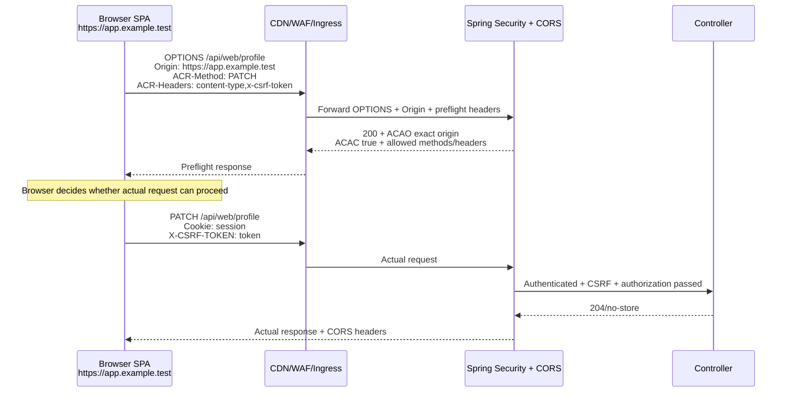
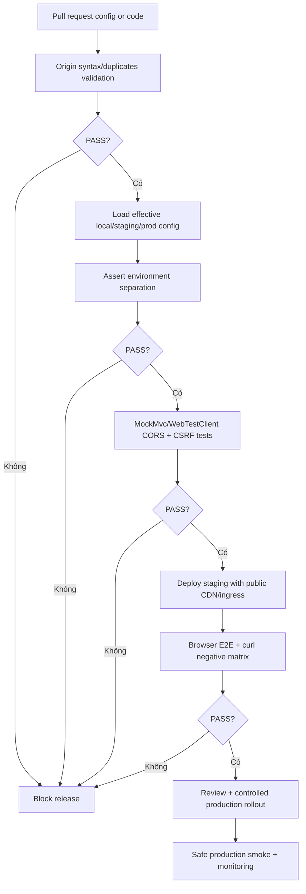

# Cấu hình CORS theo origin của từng môi trường

> **Chương:** Thực hành tổng hợp  
> **Module:** `SPRING_SECURITY_HTTP_PROTECTION` — áp dụng các lớp phòng vệ HTTP và trình duyệt trong Spring Security, từ CSRF, CORS, security headers, CSP, HSTS đến HTTP firewall và bảo vệ session; cấu hình/kiểm thử Servlet lẫn Reactive và chẩn đoán lỗi khi triển khai.  
> **Bài thực hành:** Một backend phục vụ SPA ở **local**, **staging** và **production**. Thiết kế cấu hình **CORS allowlist theo public origin của từng môi trường**, không để localhost lọt production, không phản chiếu `Origin` tùy ý, và chứng minh chính sách còn đúng sau CDN/ingress.

## 1. Tình huống thực tế

Nhóm phát triển triển khai hệ thống quản lý đơn hàng:

- Frontend SPA chạy Vite trên `http://localhost:5173` khi phát triển.
- Backend Spring Boot chạy `http://localhost:8080` trong local.
- Staging frontend chạy `https://app.staging.example.test`, API tại `https://api.staging.example.test`.
- Production frontend chạy `https://app.example.test`, API tại `https://api.example.test`.
- Một console quản trị production tại `https://admin.example.test` có API riêng, phải được cho phép theo route/role nếu có nghiệp vụ thực.
- Browser đăng nhập dùng session cookie, gọi `GET /csrf`, `POST /login`, `GET/PATCH /api/web/profile` và `POST /logout`.
- Backend còn có `/api/m2m/**` dành cho Bearer-only service clients: **không mở CORS cho vùng này chỉ vì máy chủ khác domain**.
- CDN/WAF/ingress đứng trước API ở staging và production.

Lỗi hiện tại: Developer cho phép `http://localhost:5173`, sau đó đưa vào production; browser ở staging gặp lỗi CORS nên cấu hình tạm `allowedOriginPatterns("*")` cùng `allowCredentials(true)`. Khi proxy cache response, frontend khác nhận nhầm `Access-Control-Allow-Origin`, còn các lệnh POST thiếu CSRF token bị hiểu nhầm thành “lỗi CORS”.

**Mục tiêu:** Tạo cấu hình theo môi trường, có ranh giới tin cậy, kiểm thử âm/dương, quy trình rollout và khả năng xác định lỗi ở đúng lớp.

### 1.1. Kết quả đầu ra người học phải hoàn thành

1. Bảng **public origin** của từng môi trường, phân biệt scheme/host/port.
2. Một `@ConfigurationProperties` chứa các origin được phép, có validation **fail-closed** khi rỗng, sai format hoặc mở rộng không mong muốn.
3. Ba cấu hình `application-local.yml`, `application-staging.yml`, `application-prod.yml` hoặc giá trị environment injection tương đương.
4. Một Servlet `CorsConfigurationSource` gắn với `HttpSecurity.cors(...)` và phạm vi URL browser.
5. Một phiên bản WebFlux dùng reactive `CorsConfigurationSource`/`ServerHttpSecurity.cors(...)`.
6. Ma trận preflight OPTIONS, actual request, cookies, CSRF và authorization trên cả hai stack.
7. Test browser thực: origin được phép truy cập API; origin không được phép không đọc được phản hồi credentialed.
8. Kiểm CDN `Vary: Origin`, cache key/HIT/MISS, response do edge tạo và forwarded trust.
9. Deployment checklist phát hiện production vô tình cho localhost/staging, wildcard, `Origin: null` hoặc preview domain không phê duyệt.
10. Quy trình xử lý sự cố và rollback **không** giảm CSRF, cookie security hoặc mở CORS toàn site.

**Quy tắc cốt lõi:** Chính sách CORS trả lời câu hỏi **“JavaScript từ origin nào được browser cho đọc response của API?”**. Nó **không** trả lời câu hỏi “ai đã authenticated?”, “ai được sửa đơn hàng?” hay “request có ý định của chủ tài khoản?”.

## 2. CORS hoạt động ở đâu?



Các viết tắt:

- **Origin**: bộ ba *scheme + host + port*. Path không thuộc origin.
- **SOP (Same-Origin Policy)**: cơ chế browser hạn chế JavaScript đọc response giữa origins.
- **CORS**: giao thức headers cho phép một số cross-origin reads theo quyết định của server và browser.
- **Preflight**: request `OPTIONS` hỏi trước về method/header được phép.
- **ACAO**: `Access-Control-Allow-Origin`.
- **ACAC**: `Access-Control-Allow-Credentials`.
- **ACR**: `Access-Control-Request-*` trong preflight.
- **CDN**: bộ nhớ đệm/proxy có thể trả response mà không gọi Spring.

### 2.1. Origin không chứa path

| URL | Origin được browser sử dụng |
|---|---|
| `https://app.example.test/home` | `https://app.example.test` |
| `https://app.example.test/settings?tab=profile` | `https://app.example.test` |
| `https://app.example.test:8443/login` | `https://app.example.test:8443` |
| `http://localhost:5173/account` | `http://localhost:5173` |
| `http://127.0.0.1:5173/account` | `http://127.0.0.1:5173` |
| `https://app.example.test` | `https://app.example.test` |

**Không cấu hình** `https://app.example.test/home` hoặc `https://app.example.test/` làm allowed origin; các chuỗi đó có path/trailing slash và không phải dạng origin browser gửi.

### 2.2. Scheme và port có ý nghĩa

- `http://localhost:5173` **khác** `https://localhost:5173`.
- `http://localhost:5173` **khác** `http://localhost:3000`.
- `localhost` **khác** `127.0.0.1` ở góc độ origin.
- `https://app.example.test` **khác** `https://app.example.test:8443`.
- Một origin với HTTPS port mặc định thường được serialize không ghi `:443`; kiểm thử bằng browser thực thay vì tự chế chuỗi kết quả.

Một localhost allowlist rộng như `http://localhost:*` có thể vô tình cho một ứng dụng khác trên máy developer đọc dữ liệu API. Chỉ mở port thực sự cần và chỉ trong local.

### 2.3. Same-site không đồng nghĩa same-origin

`https://app.example.test` và `https://api.example.test` là **cross-origin**. Chúng có thể **same-site** theo schemeful-site semantics (registrable domain và scheme), nhưng `fetch` vẫn cần CORS vì host khác.

`SameSite=Lax/Strict/None` quyết định cookie sending theo *site*; CORS quyết định JavaScript response access theo *origin*. Đây là hai cơ chế khác nhau.

### 2.4. Một request có thể không cần preflight

Một GET với headers thông dụng có thể là CORS “simple” request và gửi thẳng tới server; response vẫn cần ACAO phù hợp để JavaScript đọc.

Một PATCH JSON hoặc POST có `X-CSRF-TOKEN` thường phát preflight. **Không dùng kết quả một OPTIONS 200 để kết luận POST/PATCH đã qua authentication, CSRF và authorization.**

### 2.5. CORS không áp dụng cho server-to-server theo cách của browser

`curl`, Postman và batch service **không thực thi browser CORS policy**. Chúng có thể gửi `Origin` tùy ý, và vẫn nhận body dù ACAO thiếu. Vì vậy API bắt buộc phải tiếp tục xác thực, ủy quyền, CSRF theo credential model, giới hạn rate và kiểm input.

## 3. Deployment contract theo môi trường

Dùng domain `example.test` làm **tên minh họa**; thay bằng hostname thực thuộc hệ thống và đã cấp TLS khi chạy bài lab.

| Môi trường | Frontend/browser origin được phép | API public origin | Credential mode |
|---|---|---|---|
| Local | `http://localhost:5173` | `http://localhost:8080` | Session cookie + CSRF cho web API |
| Local tùy chọn | `http://127.0.0.1:5173` | `http://127.0.0.1:8080` | Chỉ mở nếu frontend thật sự dùng |
| Staging | `https://app.staging.example.test` | `https://api.staging.example.test` | Session cookie + CSRF |
| Production | `https://app.example.test` | `https://api.example.test` | Session cookie + CSRF |
| Production admin | `https://admin.example.test` | `https://api.example.test` hoặc admin API riêng | **Chỉ mở đúng routes cần**, role/permissions riêng |
| CI preview | Một **hostname preview được cấp phát và thu hồi có kiểm soát** | Staging/preview API phù hợp | Chỉ khi đã được phê duyệt |

**Một environment không nên mang nguyên allowlist của environment khác.** Production không cần cho localhost, staging hoặc mọi `*.example.test` chỉ vì có cùng tổ chức.

### 3.1. Ma trận route nhận CORS

| Backend route | Client | CORS? | Lưu ý |
|---|---|---|---|
| `/api/web/**` | SPA khác origin | Có, chính xác frontend origin | Browser session + CSRF |
| `GET /csrf` | SPA khác origin | Có | JSON token, no-store, CDN bypass |
| `POST /login` | SPA khác origin | Có | Có thể phát preflight vì CSRF header |
| `POST /logout` | SPA khác origin | Có | CSRF token + session |
| `/api/admin/**` | Admin SPA khác origin | Có nếu đã review, **origin/admin route riêng** | Không cho frontend thường chỉ vì cùng API |
| `/api/m2m/**` | Service clients | Thông thường **không cần** | Bearer-only, không cookie fallback |
| `/actuator/**` | Monitoring nội bộ | Thông thường **không** | Network/auth riêng |
| `/assets/**` cùng origin với SPA | Browser same-origin | Không cần riêng | CORS không phải cơ chế cache/static delivery |
| Paths chưa phân loại | Không có | **Không cấp CORS** | Vẫn default deny ở Security |

CORS allowlist còn phải phù hợp authorization: cho phép frontend đọc response **không** đồng nghĩa client có role admin hoặc quyền xem tài nguyên người khác.

## 4. Định nghĩa security invariants trước khi viết code

Các điều kiện phải luôn đúng:

1. Chỉ origins chính thức của environment hiện tại được trả ACAO trên credentialed routes.
2. ACAO không là `*` khi dùng `Access-Control-Allow-Credentials: true`.
3. Không phản chiếu raw `Origin` chỉ vì request có header đó.
4. Không cho `Origin: null` theo mặc định.
5. Production không chấp nhận localhost/staging/preview origin nếu chưa có exception được phê duyệt.
6. Thiếu CORS config hoặc cấu hình malformed → **khởi động thất bại**, không lặng lẽ fallback wildcard.
7. Không biến CORS thành xác thực: cookie/session hoặc Bearer vẫn phải kiểm.
8. Browser cookie unsafe methods vẫn qua CSRF.
9. Preflight phải được xử lý **trước authentication**, vì nó thường không mang cookie auth.
10. CDN không cache shared private/token response, và không trả ACAO của origin A cho origin B.
11. Headers do edge/WAF tạo không được mở rộng CORS ngoài Spring policy.
12. Một thay đổi preview/public origin phải được kiểm thử và thu hồi có thời hạn.

Bộ test sẽ biến các invariants này thành assertions có thể chặn release.

## 5. Cấu hình theo profile: tách local, staging, production

Một hướng dễ audit là giữ cùng Java code và truyền danh sách origins qua **Spring Boot Configuration Properties**.

### 5.1. Cấu trúc các file minh họa

```text
src/main/resources/
  application.yml
  application-local.yml
  application-staging.yml
  application-prod.yml
```

Trong ứng dụng thật, secret/endpoint config có thể được cấp bằng config server, Kubernetes ConfigMap, environment hoặc deployment parameters; nguyên tắc vẫn là **allowlist explicit theo deployment**, không đọc từ client `Origin` để tự đưa vào config.

### 5.2. application.yml — không có origin default

```yaml
# application.yml
spring:
  application:
    name: order-protection-demo

# Cố ý KHÔNG khai báo app.security.cors.allowed-origins ở đây.
# Nếu quên kích hoạt một environment có allowlist,
# @ConfigurationProperties validation sẽ fail startup.
```

**Không đặt**:

```yaml
# PHẢN VÍ DỤ: fallback nguy hiểm
app:
  security:
    cors:
      allowed-origins:
        - "*"
```

Với origin list tùy cấu hình, Spring có thể từ chối wildcard + credentials hoặc hệ thống bị “sửa” sang patterns cực rộng. Tốt hơn là **không có default origin**.

### 5.3. application-local.yml

```yaml
app:
  security:
    cors:
      allowed-origins:
        - "http://localhost:5173"
        # Chỉ bật khi thực sự dùng hostname thứ hai:
        # - "http://127.0.0.1:5173"
```

Không sử dụng origin `http://localhost:*`, `http://127.0.0.1:*` hoặc `*` để “đỡ đổi port” nếu không thật sự kiểm soát những ports đó.

### 5.4. application-staging.yml

```yaml
app:
  security:
    cors:
      allowed-origins:
        - "https://app.staging.example.test"
```

Nếu có staging admin frontend thực sự cần đọc API, bổ sung origin đó **ở route policy riêng** hoặc cấu hình nguồn riêng; không coi `allowed-origins` global này là cấp quyền admin.

### 5.5. application-prod.yml

```yaml
app:
  security:
    cors:
      allowed-origins:
        - "https://app.example.test"
```

Không copy `http://localhost:5173` hay `https://app.staging.example.test` sang production. Dấu `https` là điều kiện bắt buộc cho public production origin trong thiết kế minh họa.

### 5.6. Chọn profile từ deployment

Ví dụ khởi động local bằng profile được chọn rõ:

```bash
java -jar order-app.jar --spring.profiles.active=local
```

Staging/prod nên chọn profile qua deployment configuration được version-control/review, không để người dùng điều khiển profile qua request.

Trên Kubernetes hoặc môi trường có config injection, có thể khai:

```yaml
app:
  security:
    cors:
      allowed-origins:
        - "${SPA_PUBLIC_ORIGIN}"
```

Khi không có biến `SPA_PUBLIC_ORIGIN`, **không cho default** về `*` hoặc localhost. Nếu dùng placeholder không có default, Spring Boot phải thất bại khi không resolve được biến hoặc binding/validation không đạt.

### 5.7. Có thể dùng một file thay ba profile không?

Có thể, nếu triển khai có hệ thống config an toàn cấp **một danh sách origins đã review** cho đúng môi trường. Tuy nhiên phải có:

- Validation ngay khi startup.
- Ràng buộc HTTPS/host/port.
- Deployment provenance: cấu hình từ đâu, ai phê duyệt.
- CI kiểm diff giữa staging và production.
- Smoke test xác nhận ACAO thực sau edge.
- Không có wildcard fallback khi biến môi trường trống.

## 6. Binding + validation: fail closed ngay khi khởi động

Cấu hình mẫu dưới dùng **Spring Boot 3.x/Spring Security 6.x**, Java 17+ và `spring-boot-starter-validation`. Với phiên bản khác, kiểm package và API tương thích.

### 6.1. @ConfigurationProperties dạng record

```java
package example.security.cors;

import java.net.URI;
import java.util.HashSet;
import java.util.List;
import java.util.Locale;
import java.util.Set;

import jakarta.validation.constraints.NotBlank;
import jakarta.validation.constraints.NotEmpty;
import org.springframework.boot.context.properties.ConfigurationProperties;
import org.springframework.validation.annotation.Validated;

@Validated
@ConfigurationProperties(prefix = "app.security.cors")
public record CorsOriginProperties(
        @NotEmpty List<@NotBlank String> allowedOrigins) {

    public CorsOriginProperties {
        if (allowedOrigins == null || allowedOrigins.isEmpty()) {
            throw new IllegalArgumentException(
                "CORS allowed origins must be configured");
        }

        Set<String> unique = new HashSet<>();

        for (String value : allowedOrigins) {
            if (value == null || value.isBlank()) {
                throw new IllegalArgumentException(
                    "CORS origin must not be blank");
            }
            if (!unique.add(value)) {
                throw new IllegalArgumentException(
                    "Duplicate CORS origin: " + value);
            }
            if (value.contains("*")) {
                throw new IllegalArgumentException(
                    "Wildcard CORS origins are not allowed");
            }

            URI uri;
            try {
                uri = URI.create(value);
            } catch (IllegalArgumentException ex) {
                throw new IllegalArgumentException(
                    "Malformed CORS origin", ex);
            }

            String scheme = uri.getScheme();
            String host = uri.getHost();

            if (scheme == null || host == null
                    || uri.getRawUserInfo() != null
                    || uri.getRawQuery() != null
                    || uri.getRawFragment() != null
                    || (uri.getRawPath() != null
                        && !uri.getRawPath().isEmpty())) {
                throw new IllegalArgumentException(
                    "CORS requires scheme://host[:port] only");
            }

            boolean https = scheme.equalsIgnoreCase("https");
            boolean loopbackHttp =
                scheme.equalsIgnoreCase("http")
                && (host.equalsIgnoreCase("localhost")
                    || host.equals("127.0.0.1")
                    || host.equals("[::1]"));

            if (!https && !loopbackHttp) {
                throw new IllegalArgumentException(
                    "Non-HTTPS CORS origin is only allowed for loopback");
            }
        }

        allowedOrigins = List.copyOf(allowedOrigins);
    }
}
```

**Lưu ý mã mẫu:** Validation trên kiểm origin format và cấm wildcard, HTTP ngoại trừ localhost/loopback cho lab. Trong production còn cần **environment policy** không cho localhost, được thực thi bằng CI/deployment gate và staging smoke tests ở phần sau (hoặc thêm validator gắn environment). Validation này một mình **chưa** biết đang chạy profile `prod` nên không tự cấm mọi localhost nếu cấu hình production nhầm.

Một cấu hình khó đoán như `http://127.0.0.1:9999` hợp lệ về cú pháp nhưng vẫn không được vào production; điều đó được xác nhận bằng policy test riêng.

### 6.2. Vì sao không tự động trim origin?

Nếu cấu hình có dấu cách/đường dẫn hoặc sai scheme, **fail** để người vận hành sửa thay vì tự âm thầm normalize thành một origin khác. Không dùng `URI.create(...).getHost()` rồi chỉ so hostname, vì host bằng nhau chưa đủ khi scheme/port khác.

### 6.3. Sử dụng @EnableConfigurationProperties

```java
import org.springframework.boot.context.properties.EnableConfigurationProperties;
import org.springframework.context.annotation.Configuration;

@Configuration
@EnableConfigurationProperties(CorsOriginProperties.class)
class CorsPropertiesConfiguration {}
```

Nếu dự án đã dùng `@ConfigurationPropertiesScan`, có thể đăng ký record qua scanning thay vì `@EnableConfigurationProperties`; tránh tạo bean hai lần.

### 6.4. Fail startup thay vì “CORS disabled im lặng”

Với hồ sơ triển khai đã xác nhận **bắt buộc có cross-origin SPA**, thiếu config phải fail startup. Tuy nhiên, với một ứng dụng intentionally same-origin **không cần CORS**, thiết kế khác có thể cho allowlist rỗng có chủ đích và không đăng ký CORS; đừng áp bài lab này như luật chung cho mọi app.

## 7. Servlet Spring Security: tạo CorsConfigurationSource

Ví dụ Servlet + Spring MVC, CORS route dành cho browser:

```java
package example.security.cors;

import java.util.List;

import org.springframework.context.annotation.Bean;
import org.springframework.context.annotation.Configuration;
import org.springframework.web.cors.CorsConfiguration;
import org.springframework.web.cors.UrlBasedCorsConfigurationSource;

@Configuration
public class ServletCorsConfig {

    @Bean
    UrlBasedCorsConfigurationSource corsConfigurationSource(
            CorsOriginProperties properties) {

        UrlBasedCorsConfigurationSource source =
            new UrlBasedCorsConfigurationSource();

        CorsConfiguration browserApi = base(properties);
        browserApi.setAllowedMethods(List.of(
            "GET", "POST", "PATCH", "DELETE"));
        browserApi.setAllowedHeaders(List.of(
            "Content-Type", "X-CSRF-TOKEN", "X-XSRF-TOKEN"));
        browserApi.setExposedHeaders(List.of("X-Request-ID"));

        source.registerCorsConfiguration(
            "/api/web/**", browserApi);

        CorsConfiguration tokenEndpoint = base(properties);
        tokenEndpoint.setAllowedMethods(List.of("GET"));
        tokenEndpoint.setAllowedHeaders(List.of("Content-Type"));
        source.registerCorsConfiguration("/csrf", tokenEndpoint);

        CorsConfiguration login = base(properties);
        login.setAllowedMethods(List.of("POST"));
        login.setAllowedHeaders(List.of(
            "Content-Type", "X-CSRF-TOKEN", "X-XSRF-TOKEN"));
        source.registerCorsConfiguration("/login", login);

        CorsConfiguration logout = base(properties);
        logout.setAllowedMethods(List.of("POST"));
        logout.setAllowedHeaders(List.of(
            "Content-Type", "X-CSRF-TOKEN", "X-XSRF-TOKEN"));
        source.registerCorsConfiguration("/logout", logout);

        // Không có CORS registration cho /api/m2m/**,
        // /actuator/** hoặc các route không được phê duyệt.
        return source;
    }

    private static CorsConfiguration base(
            CorsOriginProperties properties) {
        CorsConfiguration c = new CorsConfiguration();
        c.setAllowedOrigins(properties.allowedOrigins());
        c.setAllowCredentials(true);
        c.setMaxAge(600L);
        return c;
    }
}
```

### 7.1. Giải thích từng option

| Cấu hình | Ý nghĩa | Rủi ro khi sai |
|---|---|---|
| `setAllowedOrigins` | Exact allowlist | Wildcard/pattern rộng làm lộ credentialed API |
| `setAllowCredentials(true)` | Browser có thể đọc credentialed response của allowed origin | Không dùng với `*` |
| `setAllowedMethods` | Methods được preflight cho phép | Mở methods không cần thiết tăng bề mặt gọi API |
| `setAllowedHeaders` | Custom request headers được cho phép | Thiếu CSRF header khiến preflight fail |
| `setExposedHeaders` | Headers response mà frontend JS cần đọc | Không phải cách cho phép CSRF request header |
| `setMaxAge(600)` | Browser preflight cache, tính bằng giây | Quyền origin vừa bị thu hồi có thể còn hiệu lực một thời gian |
| `registerCorsConfiguration("/api/web/**")` | Chỉ đăng ký browser-zone CORS | Đăng ký `/**` có thể mở cả admin/m2m |
| Không đăng ký route khác | Không cấp CORS read permission ngoài contract | Không đồng nghĩa endpoint không cần authentication |

**CORS route config không phải HTTP authorization.** Một `PATCH /api/web/profile` vẫn phải kiểm session, CSRF, principal và owner; Browser CORS “cho phép” chỉ nghĩa browser có thể thực hiện/đọc theo policy.

### 7.2. Phân tách admin CORS đúng cách

Nếu SPA admin ở `https://admin.example.test`:

- Không đơn giản thêm admin origin vào `allowedOrigins` global của `/api/web/**`.
- Tạo `AdminCorsProperties` riêng hoặc một policy map có allowlist cho `/api/admin/**`.
- Đăng ký `CorsConfiguration` chỉ cho paths admin.
- Vẫn áp `ROLE_ADMIN`/permission ở SecurityFilterChain và service.
- Kiểm origin `app.example.test` không có CORS quyền đọc admin response, còn admin session có role mới truy cập được.

CORS không thay RBAC; ngay cả admin origin hợp lệ, user không có role vẫn bị 403.

## 8. Tích hợp Servlet CORS vào HttpSecurity

Đăng ký source là chưa đủ nếu Spring Security không sử dụng đúng source/filter theo chain. Ví dụ một browser chain:

```java
import org.springframework.context.annotation.Bean;
import org.springframework.context.annotation.Configuration;
import org.springframework.http.HttpMethod;
import org.springframework.security.config.Customizer;
import org.springframework.security.config.annotation.web.builders.HttpSecurity;
import org.springframework.security.web.SecurityFilterChain;
import org.springframework.web.cors.UrlBasedCorsConfigurationSource;

@Configuration
class BrowserSecurityConfig {

    @Bean
    SecurityFilterChain browserSecurity(
            HttpSecurity http,
            UrlBasedCorsConfigurationSource corsSource)
            throws Exception {

        http
            .cors(cors -> cors.configurationSource(corsSource))
            .csrf(Customizer.withDefaults())
            .authorizeHttpRequests(auth -> auth
                .requestMatchers(HttpMethod.GET,
                    "/", "/csrf", "/assets/**").permitAll()
                .requestMatchers("/api/web/**").authenticated()
                .anyRequest().denyAll())
            .formLogin(Customizer.withDefaults())
            .logout(Customizer.withDefaults());

        return http.build();
    }
}
```

**Giả định:** Đây là cấu hình Servlet Spring Security 6.x, chưa bao gồm controllers, authentication provider, custom AJAX status handlers, password encoder và các business services. Dù `/login`/`/logout` là endpoint do Spring Security cung cấp, CORS source từ phần 7 vẫn cần biết đúng route frontend gọi.

### 8.1. CORS phải xử lý preflight trước authentication

Một request preflight thường **không mang cookie session**. Nếu authorization filter trả 401/302 trước CorsFilter, browser không gọi được API dù user đã login.

`HttpSecurity.cors(...)` giúp Spring Security tích hợp CORS đúng thứ tự cho security chain. **Không** giải quyết bằng blanket `permitAll()` cho mọi `OPTIONS /**` mà chưa cấu hình CORS rules: authorization public không tạo ACAO/ACAM/ACAH.

### 8.2. Nhiều SecurityFilterChains

Một hệ thống có:

- Machine chain `@Order(1)` với `securityMatcher("/api/m2m/**")`: bearer-only, không cần browser CORS trừ use case được review.
- Browser chain `@Order(2)`: cookie + CSRF, CORS nguồn browser allowlist.

Cần kiểm preflight đi qua chain nào. `securityMatcher` chọn security chain **trước** `authorizeHttpRequests`. Nếu machine chain bắt route web hoặc ngược lại, thêm `http.cors` vào “chain đúng trên giấy” cũng không cứu được.

Với những chains cần CORS, cấu hình source **tường minh** để tránh ambiguity khi có nhiều bean CORS. Không tạo nhiều `CorsFilter` do ứng dụng và gateway đăng ký không kiểm soát thứ tự.

### 8.3. SPA login/logout trả JSON/status hay redirect?

`formLogin` mặc định phù hợp HTML form flow và có thể trả 302; SPA dùng `fetch` có thể muốn status 204/401 tùy contract. Chọn `AuthenticationSuccessHandler`/`FailureHandler` và logout success handler nếu cần, **nhưng CORS không tự đổi authentication response format**.

Test không chỉ preflight mà cả actual `POST /login` có CSRF đúng và cookie được browser nhận; khi 302, kiểm redirect origin/cookie/response security headers và browser behavior.

### 8.4. Không mở `/api/m2m/**` khi backend service gửi Bearer

Server-to-server clients không bị CORS browser enforcement. Resource Server JWT vẫn verify signature/issuer/audience/scope. CORS cho machine API là policy riêng nếu thực sự có browser bearer client được phê duyệt, không là default.

## 9. WebFlux Reactive: cấu hình CORS theo cùng policy

WebFlux dùng `ServerHttpSecurity`/`SecurityWebFilterChain` và **reactive** `UrlBasedCorsConfigurationSource`. Không lấy Servlet `org.springframework.web.cors.UrlBasedCorsConfigurationSource` rồi ép vào Reactive.

### 9.1. Reactive CorsConfigurationSource

```java
package example.security.cors;

import java.util.List;

import org.springframework.context.annotation.Bean;
import org.springframework.context.annotation.Configuration;
import org.springframework.web.cors.CorsConfiguration;
import org.springframework.web.cors.reactive.UrlBasedCorsConfigurationSource;

@Configuration
class ReactiveCorsConfig {

    @Bean
    UrlBasedCorsConfigurationSource reactiveCorsSource(
            CorsOriginProperties properties) {

        UrlBasedCorsConfigurationSource source =
            new UrlBasedCorsConfigurationSource();

        CorsConfiguration web = new CorsConfiguration();
        web.setAllowedOrigins(properties.allowedOrigins());
        web.setAllowCredentials(true);
        web.setAllowedMethods(List.of(
            "GET", "POST", "PATCH", "DELETE"));
        web.setAllowedHeaders(List.of(
            "Content-Type", "X-CSRF-TOKEN", "X-XSRF-TOKEN"));
        web.setExposedHeaders(List.of("X-Request-ID"));
        web.setMaxAge(600L);

        source.registerCorsConfiguration("/api/web/**", web);

        CorsConfiguration csrf = new CorsConfiguration(web);
        csrf.setAllowedMethods(List.of("GET"));
        source.registerCorsConfiguration("/csrf", csrf);

        CorsConfiguration login = new CorsConfiguration(web);
        login.setAllowedMethods(List.of("POST"));
        source.registerCorsConfiguration("/login", login);
        source.registerCorsConfiguration("/logout", login);

        return source;
    }
}
```

**Đây là code cho ứng dụng WebFlux riêng**, không đăng ký đồng thời cả hai beans Servlet và Reactive trong cùng một application rồi để dependency resolution chọn may rủi.

### 9.2. Reactive SecurityWebFilterChain

```java
import org.springframework.context.annotation.Bean;
import org.springframework.http.HttpMethod;
import org.springframework.security.config.Customizer;
import org.springframework.security.config.web.server.ServerHttpSecurity;
import org.springframework.security.web.server.SecurityWebFilterChain;
import org.springframework.web.cors.reactive.UrlBasedCorsConfigurationSource;

@Bean
SecurityWebFilterChain reactiveWeb(
        ServerHttpSecurity http,
        UrlBasedCorsConfigurationSource reactiveCorsSource) {

    return http
        .cors(cors -> cors.configurationSource(reactiveCorsSource))
        .csrf(Customizer.withDefaults())
        .authorizeExchange(auth -> auth
            .pathMatchers(HttpMethod.GET,
                "/", "/csrf", "/assets/**").permitAll()
            .pathMatchers("/api/web/**").authenticated()
            .anyExchange().denyAll())
        .formLogin(Customizer.withDefaults())
        .logout(Customizer.withDefaults())
        .build();
}
```

### 9.3. Reactive CSRF và session

WebFlux sử dụng `CsrfWebFilter`, `WebSession` và token repository tương ứng; không dùng `HttpSessionCsrfTokenRepository` của Servlet. Preflight không mang authenticated WebSession, nên CORS phải được xử lý đúng ở `SecurityWebFilterChain`/reactive filter ordering.

Browser cookie session và CSRF token vẫn là **hai điều kiện riêng**. Một reactive API trả JSON không tự trở thành bearer-only stateless API.

### 9.4. Cần tránh double CORS processing

Nếu ứng dụng đồng thời có `CorsWebFilter` global, Spring Security CORS integration và gateway tự phát ACAO, phải quyết định **một owner**. Nhiều lớp chồng chéo có thể tạo:

- Hai `Access-Control-Allow-Origin` values.
- ACAO tại edge không khớp backend.
- Preflight bypass security route config.
- Một response ở CDN có header khác origin.
- Headers đúng trên 200 nhưng sai trên 401/403/redirect.

Không cho mỗi layer “tự thêm CORS cho chắc”.

## 10. Preflight: trình tự từ browser tới Spring

Ví dụ frontend `https://app.staging.example.test` gửi PATCH JSON tới staging API:

```http
OPTIONS /api/web/profile HTTP/1.1
Host: api.staging.example.test
Origin: https://app.staging.example.test
Access-Control-Request-Method: PATCH
Access-Control-Request-Headers: content-type,x-csrf-token
```

Response CORS hợp lệ có thể là:

```http
HTTP/1.1 200 OK
Access-Control-Allow-Origin: https://app.staging.example.test
Access-Control-Allow-Credentials: true
Access-Control-Allow-Methods: GET,POST,PATCH,DELETE
Access-Control-Allow-Headers: content-type,x-csrf-token
Access-Control-Max-Age: 600
Vary: Origin
Vary: Access-Control-Request-Method
Vary: Access-Control-Request-Headers
```

Tên header/cách gộp values/status cụ thể có thể khác theo Spring version, server/edge và policy. Kiểm **semantics** hơn là đòi y hệt thứ tự/viết hoa.

### 10.1. Những thứ preflight không làm

- Không chứng minh user đã login.
- Không gửi CSRF token hợp lệ thay cho actual PATCH.
- Không cấp quyền owner/tenant.
- Không gửi `Set-Cookie` để “đăng nhập”.
- Không bảo đảm browser sẽ gửi cookie ở actual request.
- Không thay TLS/HSTS/CSP.

### 10.2. Kết quả nếu origin không được phép

Nếu request Origin là `https://evil.example.test`:

- Không có ACAO cho evil origin.
- Browser không cấp quyền đọc credentialed response.
- Spring CORS processor có thể trả 403 “Invalid CORS request”.
- Đừng phụ thuộc chỉ vào status; assert **không cấp CORS headers** ngoài allowlist.

### 10.3. Preflight cache không đồng nghĩa CDN cache

`Access-Control-Max-Age` nói browser có thể cache kết quả preflight trong giới hạn browser policy. Đó là cache quyết định permission, **không phải** cache API body. CDN có cache key/TTL riêng, và có thể cache OPTIONS hoặc actual response theo edge rules.

Giảm Max-Age khi cần rollout nhạy cảm, nhưng **không** tin rằng thay đổi allowlist ở server sẽ tức thời thu hồi toàn bộ preflight decisions còn cached ở browser.

## 11. Actual request: cookie, CSRF và authorization

Sau preflight thành công, browser có thể gửi:

```http
PATCH /api/web/profile HTTP/1.1
Origin: https://app.staging.example.test
Cookie: JSESSIONID=<valid-session>
Content-Type: application/json
X-CSRF-TOKEN: <session-token>

{"displayName":"Người học"}
```

Tại Spring Security, request cần vượt:

1. CORS cho origin/method/header.
2. Authentication: cookie phiên có hợp lệ?
3. CSRF: token thuộc repository/session đúng không?
4. Authorization: principal có quyền vào route?
5. Service authorization: user có quyền trên object?
6. Validation/business rules.
7. Private cache/header policy.

Một actual request có thể đáp ứng CORS nhưng vẫn trả 401/403 do những tầng sau. Đây không phải lỗi để nới ACAO.

### 11.1. Các status thường thấy

| Status | Có thể do | Việc cần kiểm |
|---|---|---|
| 200/204 OPTIONS | Preflight được chấp nhận | Allowed origin/method/headers/credentials có khớp? |
| 403 OPTIONS | CORS origin/method/header bị chặn, WAF hoặc security ordering | CORS source, CDN/WAF, filter order |
| 200 GET | API trả dữ liệu | Authz đúng? Response có ACAO trên actual request? |
| 401 actual | Session không hợp lệ/expired hoặc API contract | Cookie có được gửi? |
| 403 actual | CSRF, thiếu role, owner mismatch, WAF | Xác định tầng từ chối và side effect |
| 302 actual | Entry point formLogin hoặc proxy redirect | Destination `Location`, cookies, cross-origin redirect |
| 404 | Ingress path/handler/route | Prefix rewrite và selected chain |
| Browser “CORS error” | Preflight fail, ACAO thiếu, network/TLS, redirect, 401 không gắn CORS, CDN | DevTools + edge logs + server traces |

**Không suy** tất cả browser “CORS errors” đều do `setAllowedOrigins`. Lỗi TLS, DNS, WAF, proxy redirect hoặc CSP `connect-src` cũng có thể biểu hiện gần giống từ phía frontend.

## 12. Frontend fetch: credentials đúng origin topology

### 12.1. SPA và API khác origin

```javascript
const API_BASE = "https://api.staging.example.test";

async function readProfile() {
  const response = await fetch(API_BASE + "/api/web/profile", {
    method: "GET",
    credentials: "include",
    headers: { Accept: "application/json" }
  });

  if (!response.ok) {
    throw new Error("Không thể tải hồ sơ");
  }
  return response.json();
}
```

Với cross-origin `fetch`, `credentials: "include"` nói browser có thể gửi cookie và xử lý credentialed response theo cookie/CORS rules. Nó **không** tự vượt SameSite restrictions, blocked third-party cookies hoặc origin allowlist.

### 12.2. POST login có CSRF

Một session-cookie SPA nên lấy token trước login:

```javascript
async function getCsrfToken() {
  const response = await fetch(API_BASE + "/csrf", {
    credentials: "include",
    cache: "no-store"
  });
  if (!response.ok) throw new Error("Không có CSRF token");
  return response.json(); // { token, headerName, parameterName }
}

async function signIn(username, password) {
  const csrf = await getCsrfToken();

  const response = await fetch(API_BASE + "/login", {
    method: "POST",
    credentials: "include",
    cache: "no-store",
    headers: {
      "Content-Type": "application/x-www-form-urlencoded",
      [csrf.headerName]: csrf.token
    },
    body: new URLSearchParams({ username, password })
  });

  if (!response.ok) throw new Error("Đăng nhập thất bại");

  // Spring Security có thể xóa CSRF token cũ khi auth success.
  return getCsrfToken();
}
```

**Điều kiện:** Backend đã có endpoint `GET /csrf` cho anonymous và login success response contract. `formLogin` mặc định nhận form parameters, không tự parse JSON credentials; nếu login redirect 302, frontend phải thiết kế status/redirect handling phù hợp. Không đưa password/CSRF token vào query string hay telemetry.

### 12.3. Không dùng `credentials: "same-origin"` khi API nằm ở subdomain khác

`same-origin` không gửi cookie cho `https://api.example.test` khi SPA chạy ở `https://app.example.test`. CORS server có thể đúng nhưng request vẫn anonymous. Phải dùng `include` nếu thiết kế dùng cookie cross-origin, và cookie policy thực sự cho phép browser gửi.

### 12.4. SameSite và path là ràng buộc độc lập

- `SameSite=Lax` có thể phù hợp hai subdomain **same-site** khi scheme thống nhất, nhưng cross-origin fetch vẫn cần CORS/credentials.
- Nếu SPA và API **cross-site thật**, cookie có thể cần `SameSite=None; Secure`; một số browser còn chặn third-party cookies.
- Cookie `Path` phải match URL mà browser gọi sau public prefix.
- `Secure` phù hợp HTTPS public dù backend hop nội bộ dùng HTTP.
- Cookie `HttpOnly` của session không cản browser gửi; chỉ cản JS đọc giá trị.

**Không tự đổi SameSite=None để giải quyết CORS** khi nguyên nhân thật là sai `credentials`, allowlist hoặc prefix.

## 13. CORS tuyệt đối không thay CSRF

Một attacker page có thể tạo HTML form tới API; script có thể không đọc được response nhưng browser vẫn có thể gửi request tùy cookie policy. Vì vậy ứng dụng cookie-session vẫn cần CSRF token với unsafe methods.

| Trường hợp | CORS | CSRF | Auth/authorization |
|---|---|---|---|
| GET public catalog từ allowed SPA | Đúng | Không cần cho safe GET | Theo route public |
| GET private profile từ allowed SPA | Đúng | Không cần cho safe GET | **Bắt buộc session/owner** |
| POST login cookie-session | Đúng nếu cross-origin | **Bắt buộc token** | Spring authentication |
| PATCH profile cookie-session | Đúng nếu cross-origin | **Bắt buộc token** | Session + owner |
| POST logout cookie-session | Đúng nếu cross-origin | **Bắt buộc token** | Session lifecycle |
| POST API bearer-only server-to-server | Không cần browser CORS | Có thể miễn nếu **không cookie fallback** | Bearer JWT/opaque, scope/tenant |
| HTTP webhook HMAC | Không cần browser CORS | Miễn hẹp nếu không browser session | Signature + anti-replay |

### 13.1. Vì sao login/logout cần đưa vào CORS config?

Nếu SPA chạy cross-origin và login/logout POST có custom CSRF header, browser có thể preflight hai route này. Chỉ register `/api/web/**` sẽ khiến API nghiệp vụ đúng CORS nhưng login/logout fail, dù csrf filter và authentication hoàn toàn đúng.

### 13.2. `Origin` có thể bị giả bởi clients không phải browser

Server-side tools có thể gửi `Origin: https://app.example.test` dù chúng không chạy tại origin đó. Do vậy không được dùng “allowed Origin” làm chứng minh authenticated user, role, tenant hoặc quyền sửa dữ liệu.

### 13.3. Fetch Metadata là lớp bổ sung

`Sec-Fetch-Site`/`Sec-Fetch-Mode`/`Origin`/`Referer` có thể hỗ trợ phát hiện cross-site requests nếu được dùng theo policy, nhưng không thay synchronizer CSRF token và không đáng tin như một auth factor.

## 14. Những anti-pattern CORS cần nhận diện

### 14.1. Phản chiếu Origin tùy ý

```java
// SAI: bất cứ Origin nào cũng được echo lại.
response.setHeader(
    "Access-Control-Allow-Origin",
    request.getHeader("Origin"));
response.setHeader(
    "Access-Control-Allow-Credentials",
    "true");
```

Nếu client là browser, cấu hình này có thể cấp quyền đọc credentialed response cho site ngoài ý định. Dù response vẫn cần authentication, attacker có thể lợi dụng browser session đang có.

### 14.2. `allowedOriginPatterns("*")` với credentials

Spring có thể trả lại origin đã match pattern thay vì ACAO `*`, nên syntax hợp lệ **không đồng nghĩa chính sách an toàn**. Mọi origin đều được phép nếu pattern là `*`.

**Cấm wildcard trong bài thực hành.** Nếu business cần nhiều origin động, dùng một cơ chế đăng ký/duyệt domain có lifecycle và giới hạn cụ thể.

### 14.3. `Access-Control-Allow-Origin: *` với credentials

Browser không cho JavaScript đọc credentialed response khi ACAO là `*`. Cách “fix” bằng chuyển sang pattern `*` có reflect origin chỉ làm mất khả năng kiểm soát. Dùng exact allowlist.

### 14.4. Mở `/**` cho mọi route

`source.registerCorsConfiguration("/**", config)` có thể vô tình cấp browser access cho:

- `/api/admin/**`.
- `/actuator/**`.
- `/api/m2m/**`.
- Routes nội bộ mới.
- Debug/test-only controllers.

CORS không tự cấp authorization, nhưng làm tăng bề mặt response đọc được bởi browser. Chỉ mở route đã có frontend use case.

### 14.5. Cho phép `Origin: null`

Browser gửi serialized `Origin: null` trong các ngữ cảnh opaque origin (file URL, sandbox iframe, data URL hoặc trường hợp đặc biệt). Chấp nhận literal `null` có thể mở một lớp origin không xác định, không đồng nghĩa “không có Origin”.

Chỉ cân nhắc nếu có use case đặc biệt được threat review và controls bổ sung. **Mặc định từ chối**.

### 14.6. Dùng Host hoặc X-Forwarded-Host như allowlist

`Host`/`Forwarded`/`X-Forwarded-Host` phản ánh target/public URL theo trust boundary, **không** là danh sách JavaScript origin được phép. Đừng viết:

```java
// SAI: coi Host/request metadata là nguồn CORS allowlist.
cors.setAllowedOrigins(
    List.of(request.getHeader("Origin")));
```

Allowlist phải đến từ deployment config đã review, không phải request headers.

### 14.7. Bật hết methods/headers để “chữa preflight”

`allowedMethods("*")`/`allowedHeaders("*")` không có nghĩa backend có authorization. Dùng methods/headers frontend thực gửi; thêm header mới qua review và test theo từng environment.

### 14.8. Trộn danh sách staging và production

Một origin staging có thể chạy code chưa review, host preview có thể do team khác kiểm soát hoặc tồn tại takeover risk. Production API không tự tin những origin đó. Mỗi môi trường cần owner, scope và cleanup policy.

## 15. CSP: frontend có thể chặn kết nối trước cả CORS

Một SPA ở `https://app.example.test` có thể nhận CSP:

```http
Content-Security-Policy: default-src 'self'; script-src 'self'; connect-src 'self' https://api.example.test; object-src 'none'; base-uri 'self'
```

Nếu `connect-src` không cho API origin, browser sẽ chặn request ngay ở frontend context; không có preflight hoặc backend log tương ứng. Không nới CORS để sửa một lỗi CSP.

### 15.1. CSP và CORS là hai phép kiểm khác nhau

- CSP `connect-src`: trang SPA được phép **kết nối ra** địa chỉ nào?
- CORS ACAO: API cho browser JavaScript ở origin đó **đọc response** không?
- CSRF: unsafe request có token hợp lệ?
- Authentication: cookie session hoặc Bearer đúng?
- Authorization: principal có quyền trên route/object?

Một request có thể fail ở bất kỳ lớp nào; cần logs/devtools để phân biệt.

### 15.2. HSTS/HTTPS và origin

`http://app.example.test` khác `https://app.example.test` ngay cả khi HSTS có thể nâng cấp kết nối trong browser. Production nên công bố origin **HTTPS rõ ràng** và TLS certificate hợp lệ; tránh allowlist HTTP chỉ vì legacy redirect.

### 15.3. Security headers không tự bảo vệ CORS

`X-Content-Type-Options: nosniff`, HSTS, frame protections, Referrer-Policy và CSP cần theo module security; nhưng không dùng chúng như thay thế allowlist origin, CSRF token hoặc RBAC.

## 16. CDN, Vary và caching: CORS đúng ở origin chưa đủ

Ví dụ:

```text
Request A: Origin https://app.staging.example.test
    → Spring trả ACAO A
    → CDN lưu response theo path, không include Origin

Request B: Origin https://other.example.test
    → CDN HIT trả ACAO A
    → Browser B nhận header không phù hợp

Hoặc edge “sửa” ACAO thành origin B bất kể Spring policy
    → Rủi ro mở quyền không mong muốn
```

### 16.1. `Vary: Origin` là yêu cầu cache semantics

Nếu response thay theo Origin, backend nên phát `Vary: Origin`. Với preflight, còn phụ thuộc `Access-Control-Request-Method` và `Access-Control-Request-Headers`.

Nhưng một CDN có custom cache key/cache policy **có thể không dùng `Vary` như bạn tưởng**. Cần test provider configuration và HIT/MISS, không chỉ nhìn header origin.

### 16.2. Private response phải bypass, không chỉ thêm Vary

Các routes:

- `GET /csrf`, login/logout/OAuth state.
- `GET /api/web/profile` hoặc data riêng.
- `PATCH /api/web/profile` và unsafe operations.
- Cookie-authenticated API responses.
- Bearer-authenticated private API responses.

Cần `Cache-Control: no-store` ở origin **và** CDN bypass shared caching. Không cache `GET /api/web/profile` chỉ vì đã đưa Cookie vào key.

### 16.3. Public cacheable resources cần variant-key tests

Nếu một public catalog thực sự cacheable và response CORS thay theo Origin:

1. Request từ Origin A → MISS, ACAO A.
2. Request từ Origin A → HIT, ACAO A.
3. Request từ Origin B hợp lệ → ACAO B (variant đúng) hoặc bypass.
4. Request từ Origin X không hợp lệ → không được ACAO cho X.
5. Đổi thứ tự B→A→X, xác minh không bleed.
6. Test GET và preflight nếu CDN cache OPTIONS.
7. Test 304/ETag revalidation/edge error theo policy.

### 16.4. Không ghi `Set-Cookie` chung vào cache object

Một CDN có thể có hành vi riêng khi response có `Set-Cookie`; không nên dựa vào giả định mọi CDN tự bỏ cache. Kiểm route policies và cache status thực tế. Một object cached sai có thể cần purge sau khi đổi policy.

### 16.5. Hành vi ở response do WAF/CDN tạo

403 của WAF, 404 edge, 301/302 từ ingress và 5xx proxy có thể không chạy Spring CORS filter. Nếu muốn frontend allowed origin đọc được status/body error theo contract, edge cần policy được phê duyệt và không wildcard; đồng thời không lộ internals/credentials.

Không đơn giản cho edge echo raw `Origin` trên mọi error response.

## 17. Reverse proxy: Origin và forwarded metadata khác vai trò

`Origin` nói **nguồn của JavaScript request**. `Host`/`X-Forwarded-Host` nói **đích public/backend authority** theo hop. Không nên dùng một header làm thay cái kia.

Ví dụ:

```text
Browser:
  Origin: https://app.staging.example.test
  URL:    https://api.staging.example.test/api/web/profile

CDN / LB / ingress:
  Host: api.staging.example.test
  X-Forwarded-Proto: https
  X-Forwarded-Host: api.staging.example.test

Spring:
  CORS so Origin với app.security.cors.allowed-origins
  URL building tin forwarded metadata CHỈ sau trusted edge
```

### 17.1. Nginx edge minh họa

```nginx
server {
    listen 443 ssl;
    server_name api.staging.example.test;

    # TLS certificate, default vhost deny, WAF/network policies
    # được cấu hình đầy đủ bên ngoài đoạn minh họa.

    location / {
        proxy_pass http://spring-internal:8080;

        proxy_set_header Host api.staging.example.test;
        proxy_set_header Forwarded "";
        proxy_set_header X-Forwarded-Proto https;
        proxy_set_header X-Forwarded-Host api.staging.example.test;
        proxy_set_header X-Forwarded-Port 443;
        proxy_set_header X-Forwarded-For $remote_addr;

        # Không tự thêm Access-Control-Allow-Origin ở edge.
        # Chuyển tiếp Origin đến Spring theo policy đã review.
    }
}
```

Đây không phải nginx production config hoàn chỉnh. Nếu Nginx đứng sau CDN, `$remote_addr` thường là IP CDN/LB; cần trusted real-IP chain để ghi nhận client IP đúng, nhưng **IP không được dùng làm CORS allowlist hay authentication factor**.

### 17.2. Chặn direct-origin bypass

Dù CORS source đúng, nếu backend reachable trực tiếp, client có thể bypass CDN/WAF hoặc tự gửi forwarded metadata. Dùng network ACL/security groups/NetworkPolicy/mTLS theo topology. CORS không phải firewall.

### 17.3. Đừng làm mất Origin khi proxying

Nếu proxy strip `Origin` hoặc sửa thành API Host, CORS filter có thể coi request không phải cross-origin hoặc không trả đúng headers. Debug **viewer request** và **origin request** để thấy header ở hop nào bị thay.

### 17.4. Public prefix và path matching

Nếu frontend gọi `https://api.example.test/platform/api/web/profile` và ingress strip `/platform`, Servlet/WebFlux CORS source phải match **effective backend path** đúng. CORS `registerCorsConfiguration("/api/web/**", ...)` có thể không match nếu path/context/prefix handling không như thiết kế.

Kiểm cả selected Spring Security chain và CORS mapping; test qua public entry point thật.

### 17.5. Header spoofing

```bash
# Chỉ kiểm thử trên staging thuộc quyền quản lý.
curl -i \
  -H 'Origin: https://app.staging.example.test' \
  -H 'X-Forwarded-Host: attacker.example' \
  -H 'X-Forwarded-Proto: http' \
  'https://api.staging.example.test/api/web/profile'
```

Edge phải strip/overwrite forwarded metadata client; CORS quyết định từ allowlist đã cấu hình, không từ `X-Forwarded-Host`. Request vẫn cần session/authorization, nên một 401 không đủ để chứng minh CORS mapping đúng; kiểm headers và logs theo tầng.

## 18. MockMvc: test preflight và actual CORS trên Servlet

Dùng `spring-boot-starter-test` + `spring-security-test`, test context có `CorsOriginProperties`/`ServletCorsConfig` và `SecurityFilterChain` được áp dụng đầy đủ.

### 18.1. Cho phép đúng origin

```java
import org.junit.jupiter.api.Test;
import org.springframework.beans.factory.annotation.Autowired;
import org.springframework.boot.test.autoconfigure.web.servlet.AutoConfigureMockMvc;
import org.springframework.boot.test.context.SpringBootTest;
import org.springframework.http.HttpHeaders;
import org.springframework.test.web.servlet.MockMvc;

import static org.springframework.test.web.servlet.request
    .MockMvcRequestBuilders.options;
import static org.springframework.test.web.servlet.result
    .MockMvcResultMatchers.*;

@SpringBootTest(properties = {
    "app.security.cors.allowed-origins[0]=https://app.example.test"
})
@AutoConfigureMockMvc
class ServletCorsIT {

    @Autowired MockMvc mvc;

    @Test
    void allowedOriginCanPreflightPatchWithCsrfHeader()
            throws Exception {
        mvc.perform(options("/api/web/profile")
                .header(HttpHeaders.ORIGIN,
                    "https://app.example.test")
                .header(HttpHeaders.ACCESS_CONTROL_REQUEST_METHOD,
                    "PATCH")
                .header(HttpHeaders.ACCESS_CONTROL_REQUEST_HEADERS,
                    "content-type,x-csrf-token"))
            .andExpect(status().isOk())
            .andExpect(header().string(
                HttpHeaders.ACCESS_CONTROL_ALLOW_ORIGIN,
                "https://app.example.test"))
            .andExpect(header().string(
                HttpHeaders.ACCESS_CONTROL_ALLOW_CREDENTIALS,
                "true"));
    }
}
```

**Giả định:** Spring MVC/Servlet security context đã đăng ký bean CORS rõ và test URLs đúng; response preflight mặc định Spring có thể là 200. Nếu ứng dụng/gateway chủ động trả 204, test theo contract của hệ thống nhưng giữ assertions về headers.

### 18.2. Origin lạ phải bị từ chối

```java
@Test
void unknownOriginIsNotGrantedCorsPermission()
        throws Exception {
    mvc.perform(options("/api/web/profile")
            .header(HttpHeaders.ORIGIN,
                "https://evil.example.test")
            .header(HttpHeaders.ACCESS_CONTROL_REQUEST_METHOD,
                "PATCH")
            .header(HttpHeaders.ACCESS_CONTROL_REQUEST_HEADERS,
                "content-type,x-csrf-token"))
        .andExpect(status().isForbidden())
        .andExpect(header().doesNotExist(
            HttpHeaders.ACCESS_CONTROL_ALLOW_ORIGIN));
}
```

Trong cấu hình Spring CORS mặc định minh họa, unallowed preflight thường bị 403. Không áp assertion 403 cứng cho mọi CDN/WAF; kiểm **không cấp ACAO** và nguồn response tại staging.

### 18.3. Localhost không được phép ở production fixture

```java
@Test
void productionDoesNotGrantLocalhostOrigin()
        throws Exception {
    mvc.perform(options("/api/web/profile")
            .header(HttpHeaders.ORIGIN,
                "http://localhost:5173")
            .header(HttpHeaders.ACCESS_CONTROL_REQUEST_METHOD,
                "PATCH"))
        .andExpect(status().isForbidden())
        .andExpect(header().doesNotExist(
            HttpHeaders.ACCESS_CONTROL_ALLOW_ORIGIN));
}
```

Test ở đây khởi động với **test allowlist chỉ có production origin**. Để nghiệm thu deployment thật, cần chạy cùng test/probe trên production-like staging environment và kiểm `SPRING_PROFILES_ACTIVE`/injected config.

### 18.4. Phải test scheme và port

Lặp test cho:

```text
https://app.example.test:8443        -> reject nếu không trong allowlist
http://app.example.test              -> reject
https://app.staging.example.test      -> reject ở prod
http://localhost:3000                -> reject ở prod
https://evil.example.test             -> reject
null                                  -> reject
https://app.example.test              -> allow
```

Thêm missing `Origin`: đó có thể là same-origin/non-browser request, không có CORS ACAO; **không** kết luận API nên từ chối mọi request không có Origin, vì server-to-server/normal navigation có thể không gửi.

### 18.5. Method/header âm

- `Access-Control-Request-Method: TRACE` → từ chối.
- `Access-Control-Request-Method: PATCH` với allowed origin → cho phép trên `/api/web/**`.
- `Access-Control-Request-Headers: x-csrf-token` → cho phép.
- Header tùy ý chưa được review `x-debug-admin` → không cho preflight.
- `POST /login` với CSRF header → CORS method/header contract đúng.
- `PATCH /login` → preflight phải từ chối theo route policy.

### 18.6. CORS pass không thay CSRF test

```java
import org.springframework.http.MediaType;
import static org.springframework.security.test.web.servlet.request
    .SecurityMockMvcRequestPostProcessors.user;
import static org.springframework.test.web.servlet.request
    .MockMvcRequestBuilders.post;

@Test
void allowedOriginDoesNotBypassCsrf() throws Exception {
    mvc.perform(post("/api/web/orders")
            .with(user("alice"))
            .header(HttpHeaders.ORIGIN,
                "https://app.example.test")
            .contentType(MediaType.APPLICATION_JSON)
            .content("{\"sku\":\"A42\",\"quantity\":1}"))
        .andExpect(status().isForbidden());
}
```

**Chỉ khi** `POST /api/web/orders` có handler/matcher tương ứng và CSRF enabled, test trên mới chứng minh filter không bị bypass. `with(user())` chỉ là fixture authentication, không test cookie thật. Kiểm thêm **không có side effect** trong service/repository.

### 18.7. CSRF token hợp lệ vẫn cần role/owner

```java
import static org.springframework.security.test.web.servlet.request
    .SecurityMockMvcRequestPostProcessors.csrf;

@Test
void validCsrfDoesNotReplaceBusinessAuthorization()
        throws Exception {
    mvc.perform(post("/api/web/orders")
            .with(user("alice"))
            .with(csrf())
            .header(HttpHeaders.ORIGIN,
                "https://app.example.test")
            .contentType(MediaType.APPLICATION_JSON)
            .content("{\"sku\":\"A42\",\"quantity\":1}"))
        .andExpect(status().isCreated());
}
```

`201 Created` minh họa khi user có quyền và body hợp lệ; nếu handler trả status khác thì điều chỉnh. Bổ sung test Alice sửa/xem tài nguyên Bob bị 403/404 theo policy, dù origin/CSRF đều hợp lệ.

## 19. WebTestClient: test CORS trên Reactive

Với WebFlux test context có `ReactiveCorsConfig` và `SecurityWebFilterChain` (không chỉ bind-to-controller):

```java
import org.junit.jupiter.api.Test;
import org.springframework.http.HttpHeaders;

@Test
void reactiveAllowedPreflightSucceeds() {
    webTestClient.options().uri("/api/web/profile")
        .header(HttpHeaders.ORIGIN,
            "https://app.example.test")
        .header(HttpHeaders.ACCESS_CONTROL_REQUEST_METHOD,
            "PATCH")
        .header(HttpHeaders.ACCESS_CONTROL_REQUEST_HEADERS,
            "content-type,x-csrf-token")
        .exchange()
        .expectStatus().isOk()
        .expectHeader().valueEquals(
            HttpHeaders.ACCESS_CONTROL_ALLOW_ORIGIN,
            "https://app.example.test");
}

@Test
void reactiveUnknownOriginGetsNoPermission() {
    webTestClient.options().uri("/api/web/profile")
        .header(HttpHeaders.ORIGIN,
            "https://evil.example.test")
        .header(HttpHeaders.ACCESS_CONTROL_REQUEST_METHOD,
            "PATCH")
        .exchange()
        .expectStatus().isForbidden()
        .expectHeader().doesNotExist(
            HttpHeaders.ACCESS_CONTROL_ALLOW_ORIGIN);
}
```

### 19.1. Với WebFlux cũng cần test CSRF âm/dương

```java
import org.springframework.http.MediaType;
import static org.springframework.security.test.web.reactive.server
    .SecurityMockServerConfigurers.mockUser;
import static org.springframework.security.test.web.reactive.server
    .SecurityMockServerConfigurers.csrf;

@Test
void reactiveAllowedOriginCannotSkipCsrf() {
    webTestClient.mutateWith(mockUser("alice"))
        .post().uri("/api/web/orders")
        .header(HttpHeaders.ORIGIN,
            "https://app.example.test")
        .contentType(MediaType.APPLICATION_JSON)
        .bodyValue("{\"sku\":\"A42\",\"quantity\":1}")
        .exchange()
        .expectStatus().isForbidden();
}

@Test
void reactiveAllowedOriginWithCsrfCanProceed() {
    webTestClient.mutateWith(mockUser("alice"))
        .mutateWith(csrf())
        .post().uri("/api/web/orders")
        .header(HttpHeaders.ORIGIN,
            "https://app.example.test")
        .contentType(MediaType.APPLICATION_JSON)
        .bodyValue("{\"sku\":\"A42\",\"quantity\":1}")
        .exchange()
        .expectStatus().isCreated();
}
```

**Hạn chế:** `mockUser()`/`csrf()` bơm fixtures qua Security test support. Chúng không kiểm browser cookie attributes, preflight cache của browser, reverse proxy rewrite hoặc WebSession cookie thực. Bổ sung staging browser E2E.

### 19.2. Khi reactive test chỉ bind controller

`WebTestClient.bindToController(...)` không tự đại diện cho toàn `SecurityWebFilterChain`. Muốn kiểm CORS integration/auth/CSRF, dùng application context với security web filters hoặc HTTP server integration test.

## 20. Cấu hình origin validation: kiểm thử fail-closed

### 20.1. Các giá trị phải thất bại từ startup

```text
[]
""
"*"
"https://*.example.test"
"https://app.example.test/"
"https://app.example.test/api"
"https://app.example.test?feature=1"
"https://app.example.test#fragment"
"http://app.example.test"
"javascript:alert(1)"
"null"
"ftp://app.example.test"
```

Nếu muốn cho phép literal `http://localhost:5173` ở local, code validation minh họa cho phép loopback HTTP. Nhưng **production policy test** vẫn phải chặn mọi localhost origins.

### 20.2. Unit test trực tiếp validation constructor

```java
import java.util.List;
import org.junit.jupiter.api.Test;

import static org.junit.jupiter.api.Assertions.*;

class CorsOriginPropertiesTest {

    @Test
    void validProductionOrigin() {
        var props = new CorsOriginProperties(
            List.of("https://app.example.test"));
        assertEquals("https://app.example.test",
            props.allowedOrigins().get(0));
    }

    @Test
    void refusesWildcard() {
        assertThrows(IllegalArgumentException.class,
            () -> new CorsOriginProperties(List.of("*")));
    }

    @Test
    void refusesPathAndTrailingSlash() {
        assertThrows(IllegalArgumentException.class,
            () -> new CorsOriginProperties(
                List.of("https://app.example.test/login")));
        assertThrows(IllegalArgumentException.class,
            () -> new CorsOriginProperties(
                List.of("https://app.example.test/")));
    }

    @Test
    void refusesHttpOnPublicHost() {
        assertThrows(IllegalArgumentException.class,
            () -> new CorsOriginProperties(
                List.of("http://app.example.test")));
    }
}
```

### 20.3. Test policy theo environment ngoài bean binding

Một allowlist có `http://localhost:5173` hợp lệ cho profile `local` nhưng **không** được đưa vào `prod`. Kiểm trong CI:

- Load effective `app.security.cors.allowed-origins` của production config (bao gồm overrides).
- Assert toàn bộ entries là HTTPS và nằm trong danh sách production đã phê duyệt.
- Assert **không** có `localhost`/`127.0.0.1`/`[::1]` hoặc staging/preview host.
- Assert không chứa wildcard/trailing slash/`null`/path/query.
- Assert số lượng origins và owner thay đổi có code review/approval.
- Assert backend **khởi động lỗi** khi `prod` missing config.

Không chỉ grep text trong một file YAML nếu deployment dùng environment overrides hoặc config server; phải kiểm **effective runtime configuration** mà không lộ secrets.

## 21. Browser E2E: xác minh CORS đúng nghĩa

`curl` giả được Origin và không chịu browser SOP; phải dùng browser thật cho các kết luận về CORS, credentials, cookie và CSP.

### 21.1. Test allowed origin qua Playwright

Ví dụ TypeScript khi staging có SPA hoạt động ở `https://app.staging.example.test`:

```typescript
import { test, expect } from '@playwright/test';

const APP = process.env.E2E_APP_ORIGIN ?? '';
const API = process.env.E2E_API_ORIGIN ?? '';

test('allowed SPA origin reads CSRF bootstrap', async ({ page }) => {
  if (!APP || !API) {
    throw new Error('Thiếu E2E_APP_ORIGIN/E2E_API_ORIGIN');
  }

  await page.goto(APP);

  const result = await page.evaluate(async (api) => {
    const response = await fetch(api + '/csrf', {
      credentials: 'include',
      cache: 'no-store'
    });

    return {
      status: response.status,
      ok: response.ok,
      contentType: response.headers.get('content-type')
    };
  }, API);

  expect(result.ok).toBe(true);
  expect(result.status).toBe(200);
  expect(result.contentType).toContain('application/json');
});
```

**Điều kiện:** SPA/`GET /csrf` phải được triển khai và có endpoint anonymous như contract. Test không lưu token trong reports; browser vẫn phải gửi/nhận cookie theo SameSite/Domain/Path/Secure. Nếu CSP `connect-src` không cho phép API origin, request có thể bị chặn **trước CORS**.

### 21.2. Test origin bị từ chối

Cần một trang/fixture thật tại `https://untrusted.staging.example.test` do team sở hữu, được phép kiểm thử. Browser mở trang đó và chạy `fetch` đến API:

- Promise `fetch` sẽ bị browser từ chối nếu CORS không cho phép đọc.
- Browser DevTools có thể hiển thị CORS policy error.
- Không giả định server không nhận được GET; với simple request, browser có thể đã gửi request nhưng không cho JS đọc response.
- Không chèn credentials thật của user vào trang untrusted fixture; dùng synthetic accounts.
- Không test bằng `page.goto(APP)` rồi chỉ thay `Origin` request header và gọi đó là “trình duyệt origin khác”: execution origin vẫn là APP.

### 21.3. Kiểm CSP riêng

Nếu trang allowed SPA có CSP `connect-src 'self'` nhưng API ở subdomain khác, `fetch` có thể fail **không hề đến API**. Kiểm browser console/CSP violation và sửa frontend CSP cho exact API origin, không thay backend CORS allowlist.

### 21.4. Cookie test quan trọng

- Login trên staging và kiểm `Set-Cookie`/browser storage.
- Request đến `https://api.staging.example.test` có gửi session cookie không.
- `Secure`/`HttpOnly`/`SameSite`/`Path`/`Domain` đúng.
- POST với CSRF header đi qua preflight và được kiểm CSRF.
- Logout làm session invalidated.
- Không cho JS ở untrusted origin đọc `/csrf` hoặc private API body.

## 22. Kiểm thủ công với curl (chỉ kiểm headers)

### 22.1. Preflight từ origin hợp lệ

```bash
curl -i -X OPTIONS \
  -H 'Origin: https://app.staging.example.test' \
  -H 'Access-Control-Request-Method: PATCH' \
  -H 'Access-Control-Request-Headers: content-type,x-csrf-token' \
  'https://api.staging.example.test/api/web/profile'
```

Kỳ vọng có ACAO đúng staging origin, ACAC đúng, method/header hợp lệ. Không lấy status 200 làm chứng cứ browser cookie/CSRF đã hoạt động.

### 22.2. Preflight từ localhost vào staging

```bash
curl -i -X OPTIONS \
  -H 'Origin: http://localhost:5173' \
  -H 'Access-Control-Request-Method: PATCH' \
  'https://api.staging.example.test/api/web/profile'
```

Kỳ vọng **không cấp ACAO** cho localhost khi staging không cho phép origin này. Trong Spring default processor, có thể trả 403.

### 22.3. Preflight từ staging vào production

```bash
curl -i -X OPTIONS \
  -H 'Origin: https://app.staging.example.test' \
  -H 'Access-Control-Request-Method: PATCH' \
  'https://api.example.test/api/web/profile'
```

Kỳ vọng production không cho staging origin đọc credentialed response. Chỉ thực hiện kiểm read-only/OPTIONS được phép theo quy trình của tổ chức và có rate limiting.

### 22.4. Test Origin null

```bash
curl -i -X OPTIONS \
  -H 'Origin: null' \
  -H 'Access-Control-Request-Method: PATCH' \
  'https://api.staging.example.test/api/web/profile'
```

Kỳ vọng `Origin: null` không được cho phép. Đây là literal string `null`, không phải header vắng mặt.

### 22.5. Actual GET có Origin nhưng không cookie

```bash
curl -i \
  -H 'Origin: https://app.staging.example.test' \
  'https://api.staging.example.test/api/web/profile'
```

Kết quả có thể là 401 hoặc login redirect vì không có session; response vẫn có thể chứa ACAO nếu CORS processing đã chạy đúng. `curl` **không chứng minh** JavaScript có thể đọc response hay browser gửi session cookie, nên phải có browser E2E.

## 23. Ma trận test tối thiểu cho từng môi trường

| Case | Local | Staging | Production |
|---|---|---|---|
| `http://localhost:5173` allowed | **Có** | Không | Không |
| `http://127.0.0.1:5173` allowed | Chỉ nếu khai báo | Không | Không |
| `https://app.staging.example.test` allowed | Không nếu không cần | **Có** | Không |
| `https://app.example.test` allowed | Không nếu không cần | Không | **Có** |
| `https://admin.example.test` allowed | Không mặc định | Không mặc định | Theo admin-route policy |
| `Origin: null` | Không | Không | Không |
| `Origin: https://evil.example.test` | Không | Không | Không |
| Wildcard `*` | Không | Không | Không |
| Origin có path/trailing slash trong config | Startup fail | Startup fail | Startup fail |
| Origin sai scheme | Không match/fail theo policy | Không | Không |
| Origin sai port | Không match | Không match | Không match |
| Allowed PATCH with CSRF header | CORS pass | CORS pass | CORS pass |
| Unallowed TRACE/preflight headers | Reject | Reject | Reject |
| Allowed origin + missing CSRF | 403/no side effect | 403/no side effect | 403/no side effect |
| Allowed origin + no session | 401/redirect theo contract | Tương tự | Tương tự |
| Private CDN response HIT | Không áp dụng hoặc BYPASS | **BYPASS** | **BYPASS** |
| No CORS on `/api/m2m/**` | Đúng | Đúng | Đúng |
| Edge error headers | Test nếu có proxy | Test | Test |
| HTTPS/TLS/SameSite/HSTS | Local policy khác có kiểm soát | HTTPS bắt buộc | HTTPS bắt buộc |

Bảng trên là contract cho **ví dụ**; nếu một environment có frontend origin khác đã phê duyệt, đổi expected values theo hợp đồng đã review, không dùng wildcard để làm matrix “tự pass”.

## 24. CI/CD và configuration provenance

### 24.1. Các bước pipeline



### 24.2. Phân quyền thay đổi origins

Mỗi thay đổi phải ghi:

- Môi trường đích và URL origin cần thêm/bỏ.
- Chủ sở hữu hostname, DNS/TLS và frontend app.
- Các routes thực sự cần gọi cross-origin.
- Credential mode: cookie/session hay bearer.
- Phạm vi CORS và CORS-related headers cần expose.
- Tác động đến CSP `connect-src` ở frontend.
- Ngày hết hạn nếu là preview/temporary origin.
- Kết quả security review, test âm và kế hoạch rollback.

**Không** tự xây chức năng “bấm nút cho phép origin mới” từ một public endpoint thiếu approval/audit.

### 24.3. Preview deployments

Preview URL kiểu `https://pr-183.preview.example.test` có thể thay đổi liên tục. Hai cách tương đối an toàn:

1. Cấp một preview backend/namespace riêng và cấu hình **exact preview origin** bằng deployment parameters được CI xác minh, TTL/cleanup rõ.
2. Nếu dùng wildcard pattern cho previews, phải có boundary khác rất mạnh và explicit risk approval; không cho preview wildcard truy cập production session APIs.

Đừng bật `allowedOriginPatterns("https://*.preview.example.test")` trên production chỉ để tiện review UI.

### 24.4. Rollback CORS và cache

Khi phát hiện cho phép sai origin:

1. Thu hồi allowlist ở đúng runtime/deployment.
2. Xem có CDN/edge CORS overrides không.
3. Nếu token/private response đã được cache, tắt caching và purge objects.
4. Xem preflight cache `Access-Control-Max-Age` của browser có thể còn hiệu lực đến khi hết TTL; kiểm thực tế.
5. Xác định đã có credentialed cross-origin reads nhạy cảm chưa, theo incident process.
6. Rollback app/config/CDN/ingress đồng bộ nếu cần.
7. Re-run smoke allowed/denied origin và test authentication/CSRF.

Đổi ACAO không thay session/token permissions. Khi có khả năng lộ dữ liệu, điều tra access logs/correlation IDs và phạm vi ảnh hưởng theo quy trình bảo mật, không chỉ coi đó là “bug UI”.

## 25. Observability: phân biệt CORS fail từ đâu

| Tầng | Cần thu thập | Tránh ghi |
|---|---|---|
| Browser | URL, execution origin, preflight/actual status, CSP/CORS console | Raw session, CSRF token, password |
| CDN/WAF | Edge rule, cache HIT/MISS, viewer status, request ID | Authorization/Cookie/header token |
| Ingress | Origin có được chuyển tiếp, effective path, upstream status | Raw credentials |
| Spring CORS | Origin allowed/denied, route, method, header names | Token values/PII |
| Spring Security | Authentication/CSRF/authorization category | Session ID/password |
| Controller/service | Side effect, owner/tenant result | Sensitive body data |
| CI | Matrix status and config version | Secrets/HAR full credentials |

### 25.1. “CORS error” không luôn có Spring logs

Khi browser CSP chặn, DNS/TLS không kết nối được, CDN trả HIT hoặc WAF chặn trước ingress, Spring không thấy request. Dùng request ID (do gateway chuẩn hóa), timestamps và phân biệt **viewer response** với **origin response**.

### 25.2. 401/403 có CORS headers hay không?

Một allowed SPA có thể cần đọc 401 để đưa user tới login. Nếu error response không có ACAO, browser chỉ báo CORS error và JS không đọc được status. Với Spring CORS integration, allowed origin có thể nhận ACAO ngay cả khi auth/CSRF từ chối; kiểm lỗi do edge tạo riêng.

Đừng phát ACAO cho mọi Origin ở WAF để “đảm bảo frontend đọc lỗi”. Chỉ allowed origins được cấp quyền đọc theo chính sách.

### 25.3. Không log raw Origin vô hạn

`Origin` là header có thể bị client giả, rất dài hoặc chứa ký tự bất thường; nếu cần log, dùng length limits/sanitization và không coi nó là verified identity. CORS decisions nên dựa config, không dựa thói quen “origin xuất hiện trong logs nhiều thì add”.

## 26. Các lỗi phổ biến và cách sửa

### 26.1. Local pass, staging preflight 403

**Có thể do:** staging origin chưa nằm trong allowlist, profile không được kích hoạt, API path rewrite khác, CDN/WAF drop `Origin` hoặc `Access-Control-Request-Headers`, chain chọn sai.

**Kiểm:** Effective config, browser origin serialized, method/header, Spring/edge traces và final response. Không dùng `*`.

### 26.2. Staging được, production lại cho localhost

**Có thể do:** Production dùng default profile, môi trường override CORS list, reuse ConfigMap local hoặc edge echo Origin rộng.

**Kiểm:** Effective property values với secrets redacted, production negative probe cho localhost và staging, CDN response policy. Chặn release nếu không đạt.

### 26.3. OPTIONS 200 nhưng POST 403

**Có thể do:** Preflight CORS pass, nhưng actual POST thiếu session/CSRF/role. Đây là **hai tầng độc lập**.

**Kiểm:** Browser Cookie/CSRF header, selected Spring Security chain, authentication/session và no-side-effect evidence; không tăng allowed methods để “sửa CSRF”.

### 26.4. Browser báo CORS, curl GET lại 200

**Có thể do:** Curl không thực thi SOP/CORS, browser bị CSP, preflight fail, cookie không gửi hoặc ACAO thiếu trên actual response.

**Kiểm:** Browser DevTools Network, CSP console, preflight headers, `credentials` và response do edge trả.

### 26.5. Cookie không gửi giữa app và api subdomain

**Có thể do:** `fetch credentials` mặc định `same-origin`, cookie host/Path/SameSite/Secure không match, browser third-party restrictions hoặc proxy rewrite.

**Kiểm:** Browser Storage/Network và session cookie server. CORS allow-credentials không tự khiến browser gửi cookie.

### 26.6. ACAO có hai giá trị

**Có thể do:** Spring Security, MVC `@CrossOrigin`, global CorsFilter, ingress và CDN cùng thêm ACAO.

**Sửa:** Chọn **một owner** và loại duplicate layers. Không thêm `Access-Control-Allow-Origin` ở Nginx nếu Spring đã quản lý policy, trừ khi thiết kế ownership rõ ràng.

### 26.7. Dùng `@CrossOrigin("*")` ở một controller mới

**Rủi ro:** Local annotation có thể mở route vượt chính sách toàn cục; security CORS source và MVC CORS mappings có thể tương tác khác theo version.

**Sửa:** Review/loại annotation tùy ý; thống nhất quản lý CORS theo deployment config và per-route policy. Test controller mới không mở origin lạ.

### 26.8. API private cache trả ACAO sai origin

**Có thể do:** CDN cached response không key theo Origin hoặc edge overwrite. Với private routes, **bypass shared cache** trước; public cacheable routes cần key/`Vary` đúng và kiểm HIT/MISS A/B/A.

### 26.9. Origin `https://app.example.test/` không match

Origin header là serialized scheme/host/port, không có trailing slash. Bỏ dấu slash trong config; validator phải fail startup để phát hiện sớm.

### 26.10. Origin `null` được phép vô tình

Có thể do default wildcard/pattern hoặc ai đó tưởng null là “không có header”. Xóa null allowlist, test opaque origin và rà soát file/sandbox iframe use cases.

### 26.11. Method PATCH bị chặn nhưng GET hoạt động

PATCH JSON/custom CSRF header cần preflight; GET có thể không. Xem `Access-Control-Request-Method`/`Access-Control-Request-Headers` và route-specific list. Không biến toàn bộ methods thành `*` nếu không cần.

### 26.12. Error status không đọc được từ SPA

Allowed Origin có thể nhận ACAO trên success nhưng 401/403 do WAF không có ACAO. Thiết kế error policy ở edge theo allowlist đã phê duyệt, tránh ACAO wildcard và không làm lộ internal error details.

### 26.13. SPA gọi cross-origin `/csrf` bị redirect login

Endpoint token anonymous bootstrap không được allow, hoặc proxy redirect sai. Nếu login POST được CSRF bảo vệ, SPA cần token trước login; allow anonymous `GET /csrf` và no-store + CDN bypass theo threat model.

### 26.14. Nới `SameSite=None` vẫn không hết lỗi

SameSite điều khiển cookie sending, CORS điều khiển browser JS reads; browser còn third-party cookie policies. Phân tích URL app/api, site vs origin, `credentials`, ACAO/ACAC, cookie flags và CSP thay vì thay toàn bộ cùng lúc.

## 27. Bài tập tổng hợp

Hệ thống đang có:

```text
Local SPA:       http://localhost:5173
Local API:       http://localhost:8080

Staging SPA:     https://app.staging.example.test
Staging API:     https://api.staging.example.test

Production SPA:  https://app.example.test
Production API:  https://api.example.test

Additional:
  https://admin.example.test   -> chỉ admin routes
  https://pr-123.preview.example.test -> chỉ preview environment
  /api/m2m/** -> service-to-service bearer
```

Đội phát triển đang làm sai:

1. `setAllowedOriginPatterns(List.of("*"))` và `setAllowCredentials(true)`.
2. Chỉ khai CORS trên `/api/web/**`, quên `/csrf`, `/login`, `/logout`.
3. Copy localhost origin vào production.
4. CDN cache tất cả GET theo host/path, bao gồm `/csrf`.
5. Frontend `fetch` cross-origin với `credentials: "same-origin"`.
6. `POST /api/web/orders` thiếu CSRF nhưng dev muốn `csrf.disable()`.
7. Admin origin được add vào mọi web API thay vì admin routes.
8. Spring và ingress đều echo `Access-Control-Allow-Origin`.
9. Browser báo “CORS error” khi CSP `connect-src 'self'` chặn API.
10. Preview wildcard được bật trên production.

### 27.1. Yêu cầu người học

Thiết kế lại:

- Profile configs local/staging/prod, startup validation/fail-closed.
- Source CORS theo đúng routes và browser origins.
- Spring Security integration đúng Servlet hoặc Reactive.
- Đường SPA login/CSRF/logout với credentials đúng.
- Chính sách admin CORS và machine API không mở browser CORS mặc định.
- CDN cache/CSP/edge ownership rõ.
- Ma trận test 401/403/OPTIONS, valid/invalid origins, credentials, CSRF, proxy.
- Kịch bản rollback nếu production đã để origin sai.

### 27.2. Gợi ý lời giải

1. Dùng exact origins: localhost chỉ local, staging chỉ staging, prod chỉ prod.
2. Cấu hình `CorsOriginProperties` fail nếu missing/wildcard/URL có path; CI kiểm prod tuyệt đối không có loopback.
3. Chỉ register `/api/web/**` + endpoints browser auth/token cần cross-origin; admin origin được giới hạn riêng.
4. Dùng `http.cors(...)` hoặc reactive equivalent để preflight trước authentication; không blanket permit OPTIONS thay CORS.
5. Giữ `csrf(defaults)` trên cookie zone; browser gửi session + token; đừng disable cho JSON API.
6. Cross-origin frontend dùng `credentials: "include"` và cookie domain/path/SameSite/Secure đúng; CSP `connect-src` cho đúng API.
7. CDN bypass `/csrf`/login/logout/private APIs; origin no-store; public cacheable variants key/`Vary` được test.
8. Chọn owner CORS (Spring), không thêm ACAO phản chiếu từ ingress/WAF.
9. Test allowed/denied/localhost/staging/port/null origin bằng MockMvc, WebTestClient, curl và browser.
10. Thu hồi origins/preview sau thời hạn; rollback config, cache policy/edge header injection và purge objects nếu cần.

**Điểm chấm quan trọng:** Một 403 khi thiếu CSRF **không** biến thành “CORS sai”. Nhóm phải xác định request có qua preflight không và bị chặn bởi filter nào.

## 28. Rubric đánh giá

| Hạng mục | Trọng số | Tiêu chí |
|---|---:|---|
| Hiểu origin/SOP/CORS | 10% | Scheme/host/port, preflight vs actual, browser vs curl |
| Environment matrix | 15% | Local/staging/prod không trộn, preview/admin scoped |
| Fail-closed config | 15% | Validation origin, thiếu config startup fail |
| Servlet/Reactive integration | 15% | Source đúng stack, CORS before auth |
| Cookie/CSRF/CORS | 15% | Credentials, no wildcard, unsafe requests vẫn CSRF |
| CDN/CSP/proxy | 10% | No-store/bypass/Vary, edge ownership và CSP |
| Testing âm/dương | 15% | MockMvc/WebTestClient/browser/negative origins |
| Operational ownership | 5% | Review, expiry, rollback và logs an toàn |
| **Tổng** | **100%** | Không có lỗi mở wildcard/localhost ở production |

**Fail nghiêm trọng:** Credentialed API cho wildcard/all origins; production cho localhost/staging không review; `Origin: null` được allow vô tình; tắt CSRF để chữa CORS; token/private data cache shared giữa users; proxy/edge tự phản chiếu Origin mà không qua allowlist.

## 29. Checklist triển khai

- [ ] Đã lập bảng frontend origins và API public origin cho local/staging/prod.
- [ ] Nêu rõ same-site khác same-origin, cookie SameSite khác CORS.
- [ ] Tất cả origins trong allowlist có scheme/host/port đúng, không path/trailing slash.
- [ ] Cấu hình thiếu/rỗng/wildcard/malformed fail startup.
- [ ] Local HTTP chỉ cho loopback và port được phê duyệt.
- [ ] Production chỉ có HTTPS browser origins thực cần; không localhost/127.0.0.1.
- [ ] Production không tự chấp nhận staging/preview/test origins.
- [ ] Origin `null` và origin không xác định không được cấp ACAO.
- [ ] Không sử dụng `allowedOriginPatterns("*")` hoặc echo raw `Origin` với credentials.
- [ ] Không dùng Host/X-Forwarded-Host làm CORS allowlist.
- [ ] CORS chỉ đăng ký cho `/api/web/**` và browser auth/token endpoints thực cần.
- [ ] Admin CORS được phân quyền origin **và** route độc lập.
- [ ] Machine API bearer-only không mở browser CORS chỉ vì gọi từ server khác.
- [ ] `setAllowCredentials(true)` chỉ kèm exact trusted origins.
- [ ] Allowed methods/headers theo use case; CSRF header được khai báo.
- [ ] Exposed response headers chỉ những gì JS cần đọc.
- [ ] `Access-Control-Max-Age` phù hợp với tốc độ thay đổi policy.
- [ ] Servlet dùng `org.springframework.web.cors.UrlBasedCorsConfigurationSource`.
- [ ] Reactive dùng `org.springframework.web.cors.reactive.UrlBasedCorsConfigurationSource`.
- [ ] Spring Security `cors(...)` được cấu hình tại đúng chain trước auth rejection.
- [ ] Không có duplicate CorsFilter/CorsWebFilter/ingress ACAO injection.
- [ ] Preflight OPTIONS không bị redirect login ngoài ý định.
- [ ] Allowed Origin không bỏ qua session/CSRF/authorization.
- [ ] POST login/logout/profile dùng token CSRF hợp lệ khi browser cookie auth.
- [ ] Frontend cross-origin `fetch` có `credentials: "include"` khi cần session.
- [ ] Cookie Secure/HttpOnly/SameSite/Path/Domain phù hợp public URLs.
- [ ] CSP `connect-src` cho đúng API origin, không mở rộng bừa bãi.
- [ ] CDN bypass `/csrf`/login/logout/session/private APIs.
- [ ] Origin responses và viewer responses có `Vary`/cache policy phù hợp.
- [ ] Public cacheable routes test A/B/A trên HIT và MISS.
- [ ] Error responses 401/403/404/WAF có CORS policy đúng theo owner.
- [ ] Reverse proxy chuyển tiếp Origin đúng và sanitize forwarded headers.
- [ ] Direct-origin bypass bị mạng chặn; Host/SNI/TLS đúng.
- [ ] Public prefix/path rewrite không làm lệch CORS mapping/security chain.
- [ ] MockMvc test allowed, denied, localhost, staging/prod, null, scheme, port, method, header.
- [ ] WebTestClient test reactive CORS và CSRF khi stack có WebFlux.
- [ ] Browser E2E chứng minh allowed origin đọc API, denied origin không đọc được.
- [ ] CORS test không chỉ dùng curl, vì curl không thực thi SOP.
- [ ] Authenticated actual request được kiểm riêng với preflight.
- [ ] Data owner/tenant/role không được suy từ `Origin`.
- [ ] Config changes/preview origins có owner/approval/expiry/cleanup.
- [ ] CI kiểm **effective production configuration**, không chỉ YAML source.
- [ ] Logs không ghi session cookies, JWT, CSRF tokens, passwords hoặc response data nhạy cảm.
- [ ] Rollback gồm app/config/CDN/WAF/ingress CORS rules và purge khi cần.

## 30. Tài liệu đối chiếu theo version

Chọn đúng phiên bản Spring Boot/Spring Security/Spring Framework và CDN đang triển khai; không coi code minh họa là bản đã build/test cho mọi version.

1. [Spring Framework — CORS MVC](https://docs.spring.io/spring-framework/reference/web/webmvc-cors.html): `CorsConfiguration`, `@CrossOrigin`, MVC mappings.
2. [Spring Framework — CORS WebFlux](https://docs.spring.io/spring-framework/reference/web/webflux-cors.html): reactive CORS mappings.
3. [Spring Security — Servlet CORS](https://docs.spring.io/spring-security/reference/servlet/integrations/cors.html): CORS trước Spring Security authentication và `CorsConfigurationSource`.
4. [Spring Security — Reactive CORS](https://docs.spring.io/spring-security/reference/reactive/integrations/cors.html): WebFlux CORS integration.
5. [Spring Security — Servlet CSRF](https://docs.spring.io/spring-security/reference/servlet/exploits/csrf.html): cookie-session CSRF, token repository và login/logout.
6. [Spring Security — Reactive CSRF](https://docs.spring.io/spring-security/reference/reactive/exploits/csrf.html): `CsrfWebFilter` và `WebSession`.
7. [Spring Security — HTTP Response Headers](https://docs.spring.io/spring-security/reference/servlet/exploits/headers.html): HSTS/CSP/cache control.
8. [Spring Boot — Externalized Configuration](https://docs.spring.io/spring-boot/reference/features/external-config.html): profiles, environment overrides và configuration properties.
9. [Spring Boot — Type-safe Configuration Properties](https://docs.spring.io/spring-boot/reference/features/external-config.html#features.external-config.typesafe-configuration-properties): validated config bindings.
10. [MDN — Cross-Origin Resource Sharing](https://developer.mozilla.org/en-US/docs/Web/HTTP/Guides/CORS): browser SOP, credentials, preflight.
11. [MDN — Origin](https://developer.mozilla.org/en-US/docs/Web/HTTP/Reference/Headers/Origin): serialized origin, opaque origins.
12. [MDN — Set-Cookie](https://developer.mozilla.org/en-US/docs/Web/HTTP/Reference/Headers/Set-Cookie): Secure/HttpOnly/SameSite/Domain/Path.
13. [MDN — Content-Security-Policy](https://developer.mozilla.org/en-US/docs/Web/HTTP/Reference/Headers/Content-Security-Policy): `connect-src` và browser protections.
14. [Fetch Standard](https://fetch.spec.whatwg.org/): Origin, CORS-preflight, credentials và response tainting.
15. [RFC 9111 — HTTP Caching](https://www.rfc-editor.org/rfc/rfc9111.html): `Vary`, shared caches, private/no-store.
16. [OWASP — CORS Security Cheat Sheet](https://cheatsheetseries.owasp.org/cheatsheets/Cross_Origin_Resource_Sharing_Cheat_Sheet.html): origin validation, credentialed access.
17. [OWASP — CSRF Prevention Cheat Sheet](https://cheatsheetseries.owasp.org/cheatsheets/Cross-Site_Request_Forgery_Prevention_Cheat_Sheet.html): CORS khác CSRF, browser cookie threat model.
18. [Playwright — Browser Testing](https://playwright.dev/docs/intro): E2E tests với browser thực.

**Ghi nhớ:** **CORS phải cấu hình theo public origin thực của từng environment** — local khác staging, staging khác production — và **chỉ trên routes browser cần**. Dùng exact allowlist và fail-closed binding, không phản chiếu `Origin` hoặc wildcard pattern với credentials. Tích hợp CORS ở đúng Servlet `SecurityFilterChain` hoặc Reactive `SecurityWebFilterChain` để preflight không bị authentication chặn. Sau preflight, actual requests vẫn phải có cookie/session, CSRF token, role và quyền sở hữu dữ liệu. Cuối cùng, xác minh cả **browser, Spring và CDN/ingress**: một header ACAO đúng trong unit test không chứng minh deployment đã an toàn nếu edge rewrite hoặc cache trả sai variant.
