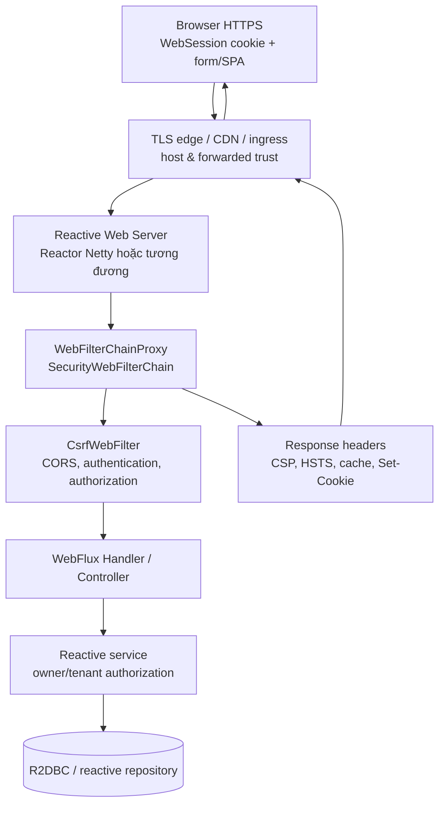
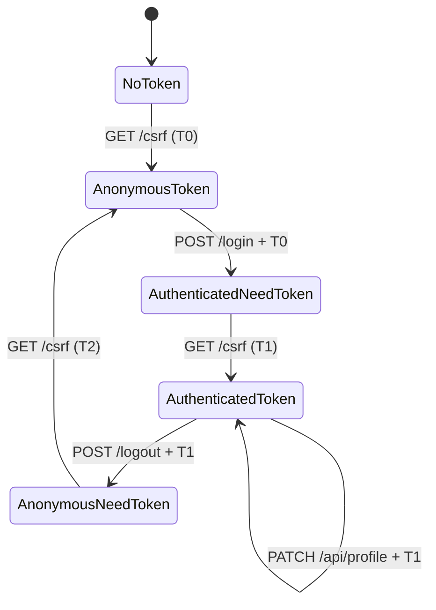

# Bảo vệ ứng dụng WebFlux với CSRF và header tương ứng

> **Chương:** Thực hành tổng hợp  
> **Module:** `SPRING_SECURITY_HTTP_PROTECTION` — áp dụng các lớp phòng vệ HTTP/trình duyệt trong Spring Security, từ CSRF, CORS, security headers, CSP, HSTS, HTTP firewall đến bảo vệ session; cấu hình cho Servlet lẫn Reactive, kiểm thử tấn công web và chẩn đoán xung đột khi triển khai.  
> **Mục tiêu bài:** Thiết kế, triển khai và kiểm chứng một ứng dụng **Spring WebFlux/Reactive** dùng **WebSession cookie**, có form đăng nhập, API JSON và security headers, đặc biệt bảo vệ **login, thao tác thay đổi dữ liệu, logout** bằng CSRF. Phân biệt rõ API Reactive với API Servlet để tránh sao chép cấu hình sai stack.

## 1. Tình huống thực hành

Một ứng dụng quản lý tài khoản được xây bằng **Spring Boot WebFlux + Spring Security Reactive**. Người dùng truy cập bằng trình duyệt:

- `GET /`: trang giới thiệu công khai.
- `GET /login`: biểu mẫu đăng nhập.
- `POST /login`: xác thực username/password và tạo authenticated WebSession.
- `GET /csrf`: bootstrap CSRF token cho SPA cùng-origin hoặc cross-origin đã được phép.
- `GET /account`: trang tài khoản riêng tư.
- `GET /api/profile`: JSON hồ sơ của principal hiện tại.
- `PATCH /api/profile`: cập nhật tên hiển thị.
- `POST /api/orders`: tạo đơn hàng.
- `GET /api/orders/{id}`: đọc một đơn hàng khi user có quyền owner.
- `GET /admin/reports`: trang quản trị.
- `POST /logout`: kết thúc WebSession/đăng xuất.
- `GET /assets/**`: JS/CSS có version dùng chung.

Frontend/Backend có thể cùng public origin `https://portal.example.test` hoặc được tách thành `https://app.example.test` và `https://api.example.test` sau reverse proxy/CDN. **Browser tự gửi cookie phiên** theo host/path/SameSite/credentials policy.

### 1.1. Mục tiêu sau bài

Sau bài này, người học có thể:

1. Giải thích vì sao **WebFlux + JSON API** vẫn cần CSRF nếu xác thực bằng cookie.
2. Lập threat model bảo vệ WebSession, CSRF token, các route quản trị/owner và response browser.
3. Cấu hình `SecurityWebFilterChain` bằng `ServerHttpSecurity` với các route public, authenticated, admin và default deny.
4. Chọn `WebSessionServerCsrfTokenRepository` cho form/session hoặc `CookieServerCsrfTokenRepository` khi thực sự cần JS đọc token.
5. Materialize và đưa CSRF token ra form HTML hoặc endpoint JSON bằng `Mono<CsrfToken>`.
6. Xử lý vòng đời token trước login, sau login, khi logout, timeout và nhiều tab.
7. Bật và test security headers: CSP, HSTS, frame protection, `nosniff`, cache-control, Referrer-Policy theo phiên bản.
8. Thiết lập `Secure`, `HttpOnly`, `SameSite`, `Path`, session timeout và xử lý session fixation/logout theo runtime.
9. Cấu hình CORS Reactive theo allowlist khi frontend khác origin mà không nhầm CORS là CSRF.
10. Kiểm thử bằng `WebTestClient` với `mockUser()`, `csrf()` và test HTTP session thật.
11. Kiểm bằng browser thật qua TLS edge/CDN: cookies, CSP, HSTS, redirect, cache và forwarded headers.
12. Chẩn đoán lỗi 401/403, missing headers, token expired, preflight OPTIONS và stale session.

**Đầu ra:** Một thiết kế bảo vệ **từ WebFilter tới browser và edge**; không chỉ có bean `SecurityWebFilterChain` compile thành công.

## 2. Hai ranh giới bảo vệ chính



**Browser boundary:** JavaScript và HTML forms có thể bị kích hoạt trong các ngữ cảnh cross-origin. Cookie session là credential **browser tự gắn** theo policy; CSRF token chứng minh thêm rằng request unsafe thuộc một flow được bảo vệ.

**Server/edge boundary:** Dữ liệu từ browser (URL, ID, Origin, forwarded headers, custom headers) không đáng tin cho tới khi được xác minh theo nguồn; ngay cả khi authenticated, controller/service vẫn phải kiểm quyền trên **đối tượng**.

### 2.1. Cấu hình Servlet không áp dụng máy móc cho Reactive

| Servlet / MVC | WebFlux / Reactive |
|---|---|
| `HttpSecurity` | `ServerHttpSecurity` |
| `SecurityFilterChain` | `SecurityWebFilterChain` |
| `HttpServletRequest` | `ServerWebExchange` |
| `HttpSession` | `WebSession` |
| `CsrfFilter` | `CsrfWebFilter` |
| `HttpSessionCsrfTokenRepository` | `WebSessionServerCsrfTokenRepository` |
| `CookieCsrfTokenRepository` | `CookieServerCsrfTokenRepository` |
| `MockMvc` | `WebTestClient` |
| `ForwardedHeaderFilter` | `ForwardedHeaderTransformer` |
| Servlet `StrictHttpFirewall` | Cần phối hợp path validation/normalization ở Reactive router, server và edge; **không** có cùng Servlet firewall API |

**Cảnh báo:** Một ứng dụng thêm cả `spring-boot-starter-web` và `spring-boot-starter-webflux` có thể mặc định chạy MVC tùy cấu hình. Khi học bài này, chọn **WebFlux app thật** và kiểm web application type; không kết luận đã kiểm reactive security chỉ từ dependency có WebFlux.

### 2.2. Authentication, CSRF và authorization là ba phép kiểm

Đối với `PATCH /api/profile`:

1. Session cookie có được WebSession/security context nhận và xác thực không?
2. CSRF token có được `CsrfWebFilter` xác minh với repository không?
3. User có quyền sửa tài khoản nào? Có lấy owner ID từ principal/service đúng không?
4. Body có hợp lệ không, có XSS/output encoding risk không?
5. Response có cache/header policy phù hợp public browser không?

Một request bị 403 chưa nói chính xác lớp nào đã chặn; phải xác định auth/CSRF/authorization/edge.

## 3. Threat model cho Reactive browser app

| Tài sản | Rủi ro | Phòng vệ |
|---|---|---|
| WebSession cookie | Chiếm phiên, cookie bị gửi sai scope, session fixation | HTTPS, Secure/HttpOnly/SameSite, rotation theo runtime, timeout/logout |
| CSRF token | Cross-site unsafe request | CsrfWebFilter, per-session token, token lifecycle |
| Login | Login CSRF, credential stuffing | POST + CSRF, password encoder, rate limit/MFA theo rủi ro |
| Logout | Ép logout bằng GET/cross-site POST | POST + CSRF, invalidate WebSession |
| Hồ sơ/đơn hàng | IDOR, horizontal privilege escalation | Principal-bound service query, owner/tenant auth |
| Trang HTML | XSS, clickjacking, mixed content | Output encoding, CSP, frame protection |
| Browser APIs | Cross-origin read exposure | CORS allowlist, no wildcard credentials |
| Static assets | Dependency/content injection | Version/hash, CSP script-src/style-src |
| Private responses | CDN cache trả dữ liệu user A cho B | no-store + cache bypass |
| External URL/redirect | Host poisoning, downgrade, prefix sai | Trusted forwarding, canonical URL/TLS |
| URI/path | Decode/normalize không nhất quán | Edge/server reject ambiguous paths; route tests |
| Diagnostics | Rò session ID/CSRF token trong logs | Redaction, correlation IDs |

### 3.1. CSRF vẫn tồn tại dù API trả JSON

Đừng suy “WebFlux là non-blocking” hoặc “API trả `application/json`” đồng nghĩa stateless. Nếu server xác thực request bằng **WebSession cookie**, browser có thể gửi cookie mà JavaScript ở site khác không cần đọc cookie value.

Một HTML form cross-site có thể gửi một số kiểu POST mà CORS không nhất thiết chặn ở bước gửi. Vì vậy unsafe methods dùng browser auto-credentials vẫn cần CSRF.

### 3.2. Khi nào CSRF có thể được miễn?

Một **Bearer-only machine API** tách riêng, chỉ chấp nhận `Authorization: Bearer` và không đọc cookie auth có thể miễn CSRF theo route/chain, vì browser không tự gắn bearer header vào HTML form. Nhưng nếu Bearer JWT nằm trong cookie hoặc có cookie fallback, rủi ro CSRF vẫn còn.

Trong bài này, **không tắt CSRF** cho `POST /login`, `POST /logout`, `PATCH /api/profile` và `POST /api/orders`.

## 4. Route matrix và security contract

| Method | Path | Auth | Authorization | CSRF | Cache |
|---|---|---|---|---|---|
| GET | `/` | Public | Public | Không cho safe GET | Theo nội dung |
| GET | `/assets/**` | Public | Public | Không | Cache versioned assets |
| GET | `/login` | Public | Public | Không; HTML POST form cần token | no-store nếu chứa token |
| GET | `/csrf` | Public | Token bootstrap theo WebSession | Không | **no-store + CDN bypass** |
| POST | `/login` | Anonymous form flow | Authentication provider | **Có** | no-store |
| GET | `/account` | Session | Authenticated | Không | **no-store** |
| GET | `/api/profile` | Session | Authenticated/owner | Không | **no-store** |
| PATCH | `/api/profile` | Session | Owner hiện tại | **Có** | no-store |
| POST | `/api/orders` | Session | Business permission | **Có** | no-store |
| GET | `/api/orders/{id}` | Session | Owner/role | Không | **no-store** |
| GET | `/admin/reports` | Session | `ROLE_ADMIN` | Không | no-store |
| POST | `/logout` | Session | Logout | **Có** | no-store |
| OPTIONS | Allowed browser CORS routes | Preflight | Origin/method/headers | Browser preflight không yêu cầu token | Không cache trộn variants |
| Mọi route khác | `/**` | Chưa có contract | **Deny by default** | Theo method | Không tự public |

**Bắt buộc:** HTTP `GET`/`HEAD` không được tạo side effect nhạy cảm. Nếu một GET có semantics “delete/create/update”, không thể dựa vào CSRF filter mặc định để ngăn nó.

### 4.1. Mỗi public route vẫn cần security filters

`permitAll` là quyết định authorization, **không** bỏ `CsrfWebFilter` hoặc security headers. Không bypass toàn bộ chain cho `/assets/**` và `/login` chỉ vì là public, trừ khi có một mục tiêu đã được review.

### 4.2. Domain authorization không nằm hết trong matcher

`/api/orders/{id}.authenticated()` không chứng minh user A được đọc order của B. Service/repository phải truy vấn theo ID + owner/tenant hoặc kiểm permission sau lookup và không trả dữ liệu khác user vào cache shared.

## 5. Chọn stack và dependencies

Bài dùng **Spring Boot 3.x + Spring Security 6.x + WebFlux + Java 17+** làm baseline; đối chiếu API với phiên bản dự án thực, nhất là Spring Boot 4.x/Spring Security 7.x.

Maven dependencies minh họa:

```xml
<!-- Chọn WebFlux, không thêm spring-boot-starter-web chỉ để lấy MVC API. -->
<dependency>
    <groupId>org.springframework.boot</groupId>
    <artifactId>spring-boot-starter-webflux</artifactId>
</dependency>
<dependency>
    <groupId>org.springframework.boot</groupId>
    <artifactId>spring-boot-starter-security</artifactId>
</dependency>
<dependency>
    <groupId>org.springframework.boot</groupId>
    <artifactId>spring-boot-starter-validation</artifactId>
</dependency>
<dependency>
    <groupId>org.springframework.boot</groupId>
    <artifactId>spring-boot-starter-test</artifactId>
    <scope>test</scope>
</dependency>
<dependency>
    <groupId>org.springframework.security</groupId>
    <artifactId>spring-security-test</artifactId>
    <scope>test</scope>
</dependency>
```

Nếu render HTML bằng Thymeleaf/WebFlux templates, thêm template engine tương thích. Nếu dùng R2DBC, thêm driver/dependencies riêng. **Không dùng blocking JPA repository** như một lời giải mặc định cho reactive request path; đây không phải bài đánh giá hiệu năng nhưng blocking code vẫn có hậu quả vận hành.

### 5.1. Cấu trúc ứng dụng giả định

```text
ReactiveSecurityConfig
  -> SecurityWebFilterChain
  -> PasswordEncoder / ReactiveUserDetailsService
  -> CSRF repo + CORS source + header config

PageController
  GET /login, /account
CsrfBootstrapController
  GET /csrf -> Mono<CsrfDto>
ProfileController
  GET/PATCH /api/profile
OrdersController
  POST /api/orders
  GET /api/orders/{id}
AdminController
  GET /admin/reports

ProfileService / OrderService
  reactive data/owner authorization
```

`ReactiveUserDetailsService` hoặc authentication provider phải được cấu hình thực tế; đoạn code security chain không tự tạo user/password database.

## 6. SecurityWebFilterChain: cấu hình nền tảng

```java
package example.webflux.security;

import java.time.Duration;

import org.springframework.context.annotation.Bean;
import org.springframework.context.annotation.Configuration;
import org.springframework.http.HttpMethod;
import org.springframework.security.config.Customizer;
import org.springframework.security.config.web.server.ServerHttpSecurity;
import org.springframework.security.web.server.SecurityWebFilterChain;

@Configuration
public class ReactiveSecurityConfig {

    @Bean
    SecurityWebFilterChain webFilterChain(ServerHttpSecurity http) {
        return http
            .authorizeExchange(auth -> auth
                .pathMatchers(HttpMethod.GET,
                    "/", "/login", "/csrf", "/assets/**", "/error")
                    .permitAll()
                .pathMatchers("/admin/**").hasRole("ADMIN")
                .pathMatchers("/account/**", "/api/**")
                    .authenticated()
                .anyExchange().denyAll())
            .formLogin(Customizer.withDefaults())
            .logout(Customizer.withDefaults())
            .csrf(Customizer.withDefaults())
            .headers(headers -> headers
                .contentSecurityPolicy(csp -> csp
                    .policyDirectives(
                        "default-src 'self'; " +
                        "script-src 'self'; " +
                        "style-src 'self'; " +
                        "connect-src 'self'; " +
                        "img-src 'self' data:; " +
                        "object-src 'none'; " +
                        "base-uri 'self'; " +
                        "form-action 'self'; " +
                        "frame-ancestors 'none'"))
                .hsts(hsts -> hsts
                    .maxAge(Duration.ofDays(1))
                    .includeSubdomains(false)))
            .build();
    }
}
```

**Đây là skeleton minh họa WebFlux**, cần bổ sung authentication source, controller/routes, templates và tests. Cụ thể:

- `formLogin` mặc định phù hợp HTML form authentication, có thể redirect.
- `logout` mặc định dùng logout flow và CSRF semantics; test POST.
- `csrf(Customizer.withDefaults())` giữ bảo vệ unsafe requests, không phải lời gọi bắt buộc nếu default đã bật, nhưng ghi rõ contract.
- `headers(...)` bổ sung CSP và định cấu hình HSTS có TTL demo; các headers mặc định khác vẫn do Spring Security cung cấp khi chưa bị disable.
- `anyExchange().denyAll()` tránh vô tình public endpoint mới.
- `/api/**.authenticated()` chỉ bảo vệ mức HTTP; service vẫn kiểm owner/tenant.
- HSTS phụ thuộc request public HTTPS/trusted forwarding và header owner.
- Nếu frontend assets dùng inline scripts/styles, CSP mẫu sẽ chặn; nên externalize assets hoặc dùng nonce/hash được thiết kế đúng.

### 6.1. Vì sao không dùng `HttpSecurity`?

`ServerHttpSecurity` cấu hình WebFilter chain cho WebFlux. Servlet `HttpSecurity` tạo `SecurityFilterChain` Servlet, không phải Reactive. Code ví dụ MVC có `HttpServletRequest`/`HttpSession` không kiểm được WebFlux runtime.

### 6.2. Vì sao chọn default deny?

Một controller mới `GET /debug/export` sẽ không tự accessible. Người thêm route phải quyết định public/role/authenticated và cập nhật matcher/test. Có thể thiết kế `anyExchange().authenticated()` ở app khác, nhưng ở bài lab này **denyAll** giúp kiểm rõ các exceptions.

### 6.3. Chính sách role

`hasRole("ADMIN")` thường yêu cầu authority `ROLE_ADMIN`. Nếu identity provider trả `SCOPE_admin` hoặc custom claim `roles`, phải map authorities theo contract. Không tự coi token có scope nào đó là WebSession admin role.

### 6.4. Nhiều SecurityWebFilterChains

Nếu cùng ứng dụng có machine API `/api/m2m/**` chỉ nhận Bearer:

- Tạo chain chuyên biệt `@Order(1)`, `securityMatcher` theo `PathPatternParserServerWebExchangeMatcher`, Resource Server + NoOp security-context repository nếu phù hợp.
- Cho chain machine miễn CSRF **chỉ** nếu không cookie fallback.
- Đặt chain browser `@Order(2)`, bật CSRF và fallback deny.
- Test browser cookie-only vào machine API phải 401, ngay cả khi user đang login.
- Test invalid Bearer + cookie không fallback.
- Không đặt `csrf.disable()` toàn bộ WebFlux application để phục vụ m2m.

Bài này tập trung **browser WebFlux chain**; Bearer-only chain là boundary cần nhận biết khi tích hợp.

## 7. CSRF trên WebFlux: cơ chế nền

Spring Security Reactive dùng `CsrfWebFilter` và một `ServerCsrfTokenRepository` để tạo/lưu/tải expected token. Với WebSession browser flow, repository thường dùng `WebSessionServerCsrfTokenRepository`.

Khi request unsafe đến:

1. Xác định method/path có yêu cầu CSRF không.
2. Lấy expected token qua repository reactive.
3. Giải quyết token được gửi theo header hoặc request parameter.
4. So sánh token theo cơ chế request handler/repository của version.
5. Nếu thiếu/sai, từ chối trước khi handler thực hiện mutation.
6. Khi CSRF hợp lệ, request vẫn phải vượt authentication/authorization/domain permissions.

### 7.1. Safe và unsafe methods

Theo default CSRF matcher, các safe methods thông thường như `GET`, `HEAD`, `OPTIONS`, `TRACE` không bắt buộc token; còn `POST`, `PUT`, `PATCH`, `DELETE` cần token khi CSRF enabled.

**Vì thế**:

- `GET /csrf` có thể dùng để bootstrap, không tự đòi token.
- `POST /login` cần token dù người dùng chưa authenticated.
- `PATCH /api/profile` cần token và session.
- `POST /logout` cần token.
- GET không được thay đổi state nhạy cảm.

Không dùng một endpoint GET “để tiện UI” nhưng thực chất có side effect rồi kỳ vọng filter default ngăn CSRF.

### 7.2. Những token không nên tự tạo

Không dùng `UUID.randomUUID()` tại controller rồi so với header trong service nếu không có repository/session binding và lifecycle rõ. Không dùng token hardcode chung toàn bộ users, không lưu token trong global static variable và không suy token raw luôn là một chuỗi định dạng cố định.

### 7.3. Repository token và transport không giống nhau

`ServerCsrfTokenRepository` quản lý expected token phía server. Token tới frontend có thể nằm trong:

- Hidden field HTML form.
- JSON response `GET /csrf`.
- Cookie riêng `XSRF-TOKEN` (nếu chọn cookie repo).
- Header response/bootstrapped HTML, theo contract đã review.

**Vị trí transport của CSRF token không nên trộn với session cookie authentication.**

## 8. Dùng WebSessionServerCsrfTokenRepository

Đối với WebFlux form hoặc SPA cần bootstrap qua `GET /csrf`, session-backed repository là baseline dễ audit:

- Expected CSRF token được gắn với WebSession.
- Session cookie đánh dấu phiên, nhưng token phải được gửi thêm ở header/form.
- JavaScript không cần đọc session cookie.
- Tránh phải mở JavaScript-readable cookie chỉ để lấy CSRF token.
- Spring Security dùng reactive API; không truy cập `HttpSession`.

Một cấu hình explicit (nếu muốn giữ rõ lựa chọn):

```java
import org.springframework.security.web.server.csrf
    .WebSessionServerCsrfTokenRepository;

// Bên trong cấu hình ServerHttpSecurity ở WebFlux:
http.csrf(csrf -> csrf.csrfTokenRepository(
    new WebSessionServerCsrfTokenRepository()
));
```

Đây là mảnh cấu hình đặt vào `ServerHttpSecurity`, không phải một bean độc lập đã bao gồm imports/authorization. Default của Spring Security WebFlux có thể đã dùng repository tương đương; explicit chỉ có ích khi bạn cần pin contract.

### 8.1. Token theo session nhưng không có nghĩa mỗi GET phải khác

Repository có thể trả cùng expected token trong một WebSession. Đừng viết test yêu cầu cứ `GET /csrf` là đổi token. Kiểm:

- Token có mặt và được server chấp nhận trong cùng session.
- Token từ phiên khác không được chấp nhận thay thế.
- Token cũ sau login/logout/session invalidation được xử lý theo lifecycle của version/runtime.
- Token không bị CDN trả lẫn giữa người dùng.

### 8.2. Token bootstrap có thể tạo WebSession

`GET /csrf` thường cần materialize token và có thể dẫn tới session/cookie nếu repository sử dụng WebSession. Điều này **không** đồng nghĩa người dùng đã authenticated. Anonymous WebSession có thể cần cho login CSRF.

Nếu session đã tồn tại, response không nhất thiết phát `Set-Cookie` mới.

## 9. Reactive GET /csrf cho SPA

Một endpoint chuẩn để SPA lấy CSRF token trước POST login và sau khi authentication state thay đổi.

### 9.1. DTO không expose toàn bộ WebSession

```java
package example.webflux.api;

public record CsrfDto(
    String headerName,
    String parameterName,
    String token
) {}
```

DTO chỉ gồm fields frontend cần. Không trả session ID, username/password, authentication object hoặc internal security context.

### 9.2. Controller reactive

```java
package example.webflux.api;

import org.springframework.http.CacheControl;
import org.springframework.http.ResponseEntity;
import org.springframework.security.web.server.csrf.CsrfToken;
import org.springframework.web.bind.annotation.GetMapping;
import org.springframework.web.bind.annotation.RestController;
import org.springframework.web.server.ServerWebExchange;
import reactor.core.publisher.Mono;

@RestController
class CsrfBootstrapController {

    @GetMapping("/csrf")
    Mono<ResponseEntity<CsrfDto>> csrf(ServerWebExchange exchange) {

        // CsrfWebFilter gắn Mono<CsrfToken> vào exchange attributes.
        Mono<CsrfToken> tokenMono =
            exchange.getAttribute(CsrfToken.class.getName());

        if (tokenMono == null) {
            return Mono.error(new IllegalStateException(
                "Reactive CSRF token attribute missing"));
        }

        return tokenMono.map(t -> ResponseEntity.ok()
            .cacheControl(CacheControl.noStore())
            .body(new CsrfDto(
                t.getHeaderName(),
                t.getParameterName(),
                t.getToken())));
    }
}
```

Ví dụ response:

```http
HTTP/1.1 200 OK
Content-Type: application/json
Cache-Control: no-store

{
  "headerName": "X-CSRF-TOKEN",
  "parameterName": "_csrf",
  "token": "<token-issued-for-this-WebSession>"
}
```

**Lưu ý:** HeaderName/parameterName/token cụ thể phụ thuộc repository/handler và version, không hardcode ngoài contract. Endpoint có thể trả `Set-Cookie: SESSION=...` khi WebSession cần tạo, nhưng không bắt buộc mọi GET đều set cookie.

### 9.3. Vì sao subscribe Mono là cần thiết?

Reactive stream có thể lazy. Nếu code chỉ lấy attribute nhưng không subscribe/mapping token, việc tạo/lưu token có thể chưa được thực hiện. Endpoint trên trả `Mono<ResponseEntity<...>>` và dùng token khi framework subscribe response.

### 9.4. Không biến `GET /csrf` thành public cache

Token endpoint là **anonymous-accessible** nhưng không phải **shared-cacheable**:

- `Cache-Control: no-store`.
- CDN bypass route `/csrf`.
- Không log raw token ở ingress/WAF/APM.
- CORS chỉ allowlist frontend origins tin cậy.
- Không expose token qua wildcard ACAO credentials.
- Không cache HTML/SPA bootstrap có token embedded theo key dùng chung.

**Anonymous-accessible** để hỗ trợ login; không có nghĩa bất kỳ origin khác được phép đọc token trong browser.

## 10. Server-rendered form trong WebFlux: đưa token vào HTML

Khi WebFlux render Thymeleaf hoặc một reactive template engine, token cần có mặt trong HTML form cuối theo cơ chế tích hợp thực tế. **Không giả định** mọi behavior tự chèn hidden CSRF field của Spring MVC/Servlet được áp dụng y hệt cho WebFlux.

### 10.1. Controller đưa token vào model

```java
import org.springframework.security.web.server.csrf.CsrfToken;
import org.springframework.stereotype.Controller;
import org.springframework.web.bind.annotation.GetMapping;
import org.springframework.web.reactive.result.view.Rendering;
import org.springframework.web.server.ServerWebExchange;
import reactor.core.publisher.Mono;

@Controller
class LoginPageController {

    @GetMapping("/login")
    Mono<Rendering> login(ServerWebExchange exchange) {
        Mono<CsrfToken> tokenMono =
            exchange.getAttribute(CsrfToken.class.getName());

        if (tokenMono == null) {
            return Mono.error(new IllegalStateException(
                "CSRF token missing"));
        }

        return tokenMono.map(token ->
            Rendering.view("login")
                .modelAttribute("_csrf", token)
                .build());
    }
}
```

`Rendering` thuộc WebFlux view API. Với WebFlux functional routing hoặc Thymeleaf integration khác, cách đưa token vào model có thể khác; luôn test HTML cuối.

### 10.2. Template HTML có hidden CSRF input

```html
<!doctype html>
<html lang="vi" xmlns:th="http://www.thymeleaf.org">
<head>
  <meta charset="UTF-8">
  <title>Đăng nhập</title>
  <link rel="stylesheet" th:href="@{/assets/app.css}">
</head>
<body>
  <main>
    <h1>Đăng nhập</h1>
    <form method="post" th:action="@{/login}">
      <input type="hidden"
             th:name="${_csrf.parameterName}"
             th:value="${_csrf.token}">

      <label for="username">Tên đăng nhập</label>
      <input id="username" name="username" required
             autocomplete="username">

      <label for="password">Mật khẩu</label>
      <input id="password" name="password" type="password"
             autocomplete="current-password" required>

      <button type="submit">Đăng nhập</button>
    </form>
  </main>
</body>
</html>
```

**Kiểm tra khi render:** Tên input/token đã được resolve theo `CsrfToken`; không còn biểu thức template thô. Khi template integration **đã tự thêm CSRF field**, không chèn thêm field trùng một cách mù quáng; chọn một cơ chế rõ và verify request parser.

### 10.3. Form logout cũng cần token

```html
<form method="post" th:action="@{/logout}">
  <input type="hidden"
         th:name="${_csrf.parameterName}"
         th:value="${_csrf.token}">
  <button type="submit">Đăng xuất</button>
</form>
```

Page render logout form cần `_csrf` trong model theo cùng cơ chế. Không đổi thành `<a href="/logout">` và không bật GET logout chỉ để gắn link dễ hơn.

### 10.4. Form API JSON và form HTML khác transport

- HTML form gửi token qua hidden parameter.
- SPA thường gửi token qua header `X-CSRF-TOKEN`.
- Body JSON không được Spring CSRF filter tự parse để tìm `_csrf` field tùy tiện.
- Request handler/version có thể áp masking/XOR cho token đưa lên HTML; test đúng integration.
- Form POST vẫn phải qua authentication/authorization/validation.

## 11. SPA dùng fetch: token trước và sau authentication

Với SPA cùng origin `https://portal.example.test`, thiết kế token lifecycle:



**T0/T1/T2 là tên logic**, không cam kết mỗi GET hoặc mỗi transition đều sinh chuỗi khác. Phải test token được server chấp nhận sau transition và token cũ không được tái sử dụng tùy semantics của repository/handler.

### 11.1. JavaScript client cùng origin

```javascript
let csrf = null;

async function fetchCsrf() {
  const response = await fetch("/csrf", {
    credentials: "same-origin",
    cache: "no-store",
    headers: { Accept: "application/json" }
  });
  if (!response.ok) throw new Error("Không thể lấy CSRF");

  const body = await response.json();
  if (!body.token || !body.headerName) {
    throw new Error("CSRF response không đúng contract");
  }
  csrf = { token: body.token, headerName: body.headerName };
  return csrf;
}

async function postLogin(username, password) {
  await fetchCsrf(); // T0 trước login.

  const response = await fetch("/login", {
    method: "POST",
    credentials: "same-origin",
    cache: "no-store",
    headers: {
      "Content-Type": "application/x-www-form-urlencoded",
      [csrf.headerName]: csrf.token
    },
    body: new URLSearchParams({ username, password })
  });

  if (!response.ok) throw new Error("Login thất bại");
  csrf = null;         // Token cũ có thể hết hiệu lực.
  await fetchCsrf();   // T1 cho unsafe request tiếp theo.
}

async function patchProfile(displayName) {
  if (!csrf) await fetchCsrf();

  const response = await fetch("/api/profile", {
    method: "PATCH",
    credentials: "same-origin",
    cache: "no-store",
    headers: {
      "Content-Type": "application/json",
      [csrf.headerName]: csrf.token
    },
    body: JSON.stringify({ displayName })
  });

  if (!response.ok) {
    // 403 còn có thể là authorization, WAF hoặc token expired.
    // Không tự retry một mutation vô hạn.
    throw new Error("Cập nhật hồ sơ không thành công");
  }
}

async function postLogout() {
  if (!csrf) await fetchCsrf();

  const response = await fetch("/logout", {
    method: "POST",
    credentials: "same-origin",
    cache: "no-store",
    headers: { [csrf.headerName]: csrf.token }
  });

  if (!response.ok) throw new Error("Logout chưa được xác nhận");
  csrf = null;
  await fetchCsrf();   // T2 nếu SPA không reload trang.
}
```

### 11.2. Cảnh báo về redirect mặc định của WebFlux formLogin

Cấu hình `formLogin(Customizer.withDefaults())` có thể trả **302 redirect** tới trang sau login hoặc lỗi login. `fetch` theo redirect theo cách của browser; `response.ok` không tự chứng minh authentication thành công.

Để frontend có hợp đồng rõ, chọn một trong hai:

- **HTML redirect flow:** submit form/navigation truyền thống; browser xử lý 302, trang được render theo session.
- **SPA status API flow:** tùy biến reactive `ServerAuthenticationSuccessHandler`/`ServerAuthenticationFailureHandler` để trả 204/401; tương tự logout success handler, rồi test token refresh.

Không tự viết REST controller so password và gắn `WebSession` thủ công chỉ để né form-login filters.

### 11.3. Ví dụ success/failure handler cho SPA (khi cần)

```java
import org.springframework.http.HttpStatus;
import org.springframework.security.web.server.WebFilterExchange;
import org.springframework.security.web.server.authentication
    .ServerAuthenticationSuccessHandler;
import org.springframework.security.web.server.authentication
    .ServerAuthenticationFailureHandler;

ServerAuthenticationSuccessHandler success = (web, auth) -> {
    var response = web.getExchange().getResponse();
    response.setStatusCode(HttpStatus.NO_CONTENT);
    response.getHeaders().setCacheControl("no-store");
    return response.setComplete();
};

ServerAuthenticationFailureHandler failure = (web, ex) -> {
    var response = web.getExchange().getResponse();
    response.setStatusCode(HttpStatus.UNAUTHORIZED);
    response.getHeaders().setCacheControl("no-store");
    return response.setComplete();
};

// Tích hợp vào:
// .formLogin(login -> login
//     .authenticationSuccessHandler(success)
//     .authenticationFailureHandler(failure))
```

Đây là **mảnh cấu hình** cần đặt đúng scope khi xây chain, không phải một Java class có thể copy compile độc lập. Vẫn phải có authentication manager/user store và test cookie/session lifecycle.

### 11.4. Không tự retry mutation sau 403

Một 403 có thể là CSRF hoặc thiếu role/owner; một failure mạng có thể xảy ra sau khi side effect đã hoàn tất. Frontend có thể fetch token mới và yêu cầu user xác nhận, nhưng không replay `POST /api/orders` hoặc `PATCH` một cách tự động vô hạn.

## 12. WebSession cookie, timeout và logout

Ví dụ một cấu hình Spring Boot WebFlux thường dùng cho HTTPS public (kiểm đúng version):

```yaml
server:
  reactive:
    session:
      timeout: 20m
      cookie:
        name: SESSION
        secure: true
        http-only: true
        same-site: lax
        path: /
```

**Kiểm runtime thực:** Spring Session, custom `WebSessionIdResolver`, Netty/proxy và Boot version có thể quyết định cuối cùng về cookie name/flags. Các thuộc tính ở đây là **policy minh họa**, không phải đảm bảo header được phát y hệt trong mọi hạ tầng.

### 12.1. Cookie auth cần thuộc tính nào?

```http
Set-Cookie: SESSION=<opaque>; Path=/; Secure; HttpOnly; SameSite=Lax
```

| Thuộc tính | Tác dụng | Không thay |
|---|---|---|
| `Secure` | Browser gửi qua HTTPS theo semantics hỗ trợ | CSRF, authorization |
| `HttpOnly` | JavaScript không đọc cookie ID | Browser vẫn tự gửi |
| `SameSite=Lax` | Giảm nhiều cross-site sending scenarios | CSRF token |
| `SameSite=Strict` | Hạn chế mạnh hơn | Có thể ảnh hưởng SSO/deep-link |
| `SameSite=None` | Cho phép cross-site contexts (cần Secure) | Third-party browser restrictions |
| `Domain` | Scope host/subdomains | Không cấp quyền giữa apps |
| `Path` | Scope URL paths | Không là authorization boundary |
| `Max-Age` | Browser lưu cookie bao lâu | Server session timeout |

### 12.2. Host-only cookie

Không đặt `Domain=.example.test` chỉ vì nhiều subdomain cùng công ty. Khi không cần chia sẻ, cookie host-only thường giảm bề mặt tấn công từ subdomain khác. Domain/Path rộng hơn phải được security review.

### 12.3. Session fixation

Mục tiêu: sau login, session ID trước authentication không thể được dùng để duy trì authenticated identity ngoài ý định. WebFlux security/session context implementation có semantics cụ thể theo phiên bản và có thể rotate session ID. **Hãy test** session ID trước/sau auth success, không copy Servlet `sessionManagement().sessionFixation().changeSessionId()` vì DSL đó không tương đương trực tiếp.

### 12.4. Logout thực sự là hủy session

Sau `POST /logout` có token đúng:

1. Security context không còn authenticated.
2. WebSession/session repository phản ánh trạng thái đã logout theo contract.
3. Cookie clearing/expiry đúng name/path/domain.
4. GET `/account` hoặc `/api/profile` với session cũ không được trả private data.
5. CDN không phát cached private HTML/JSON của session trước.
6. Token CSRF cũ được bỏ khỏi frontend state; bootstrap mới nếu SPA vẫn hiển thị login.

Nếu dùng Spring Session distributed, logout phải có tác động trong session store, không chỉ ở một instance.

### 12.5. Session timeout và nhiều tab

- Tab A logout, Tab B còn CSRF token cũ: unsafe action không được thực thi.
- Session timeout khiến cookie có thể còn lưu nhưng server không chấp nhận.
- Login lại có thể tạo/rotate WebSession, token cần refresh.
- Frontend phải xử lý 401/403 theo nguồn, không tắt CSRF để tránh UX lỗi.
- Không log raw session cookie, kể cả trong test artifact.

## 13. CSRF cookie repository dành cho SPA: lựa chọn có điều kiện

Một số SPA frameworks muốn JavaScript đọc cookie `XSRF-TOKEN` và gửi header `X-XSRF-TOKEN`:

```http
Set-Cookie: XSRF-TOKEN=<csrf-token>; Path=/; Secure; SameSite=Lax
X-XSRF-TOKEN: <csrf-token>
```

**Đây không phải session cookie**. WebSession cookie `SESSION` vẫn phải `HttpOnly=true`.

### 13.1. CookieServerCsrfTokenRepository

```java
import org.springframework.security.web.server.csrf
    .CookieServerCsrfTokenRepository;

CookieServerCsrfTokenRepository repo =
    CookieServerCsrfTokenRepository.withHttpOnlyFalse();

// Bên trong ServerHttpSecurity:
// http.csrf(csrf -> csrf.csrfTokenRepository(repo));
```

Chỉ chọn cookie repository khi frontend thực cần đọc token qua cookie. Với WebFlux SPA, **GET /csrf JSON dùng WebSession repository** thường đơn giản hơn và tránh mở cookie JS-readable.

### 13.2. Deferred tokens và XOR masking theo Spring Security version

Các dòng Spring Security hiện đại có cơ chế deferred CSRF token và xử lý token trên request nhằm hạn chế BREACH. Khi dùng cookie repo:

- Token raw trong `XSRF-TOKEN` cookie có thể khác token đã mask để render trong HTML.
- Client gửi plain cookie token ở `X-XSRF-TOKEN`.
- Request handler của version phải giải quyết header vs form/token masking đúng.
- Token có thể bị clear hoặc cấp lại trong login/logout flow.
- Nếu chỉ thêm cookie repo rồi POST bị 403, hãy kiểm **handler + token lifecycle**, không tắt CSRF.

**Không copy request handler Servlet** (`CsrfTokenRequestHandler` và `XorCsrfTokenRequestAttributeHandler`) sang WebFlux; nếu cần custom Reactive handler, dùng đúng `ServerCsrfTokenRequestHandler`/API tương ứng của version và test theo tài liệu.

### 13.3. CSRF cookie host-only và cross-subdomain SPA

Nếu API ở `api.example.test` đặt cookie `XSRF-TOKEN` host-only, JS ở `app.example.test` **không thể đọc cookie đó** qua `document.cookie`. Không mở rộng `Domain=.example.test` chỉ để sửa, vì điều đó thay trust boundary giữa subdomains.

Một cách dễ kiểm hơn: SPA `app` gọi `GET https://api.example.test/csrf` với `credentials: include` và CORS exact allowlist; nhận token JSON, vẫn giữ auth session cookie HttpOnly.

### 13.4. Không dùng cookie double-submit tự chế

Thiết kế “trùng cookie value và header là đủ” nếu thiếu session binding/HMAC và cookie injection threat model có thể gây rủi ro. Ưu tiên repository chính thức; nếu tự thiết kế double-submit, cần security review riêng, test subdomain injection/path collision và rotation.

## 14. CORS Reactive: cho phép frontend origin thật cần thiết

Nếu SPA cùng origin với API, **không** cần mở CORS chỉ để gọi `/api/profile`. Nếu frontend `https://app.example.test` gọi API `https://api.example.test`, đây là **cross-origin**, dù có thể same-site. Browser `fetch` cần `credentials: "include"` khi dùng cookie, và backend cần CORS explicit.

### 14.1. CORS policy theo route

| Route | Origin được phép | Credentials |
|---|---|---|
| `/csrf` | `https://app.example.test` | Có nếu bootstrap session |
| `/login` | `https://app.example.test` | Có nếu browser cookie login |
| `/logout` | `https://app.example.test` | Có |
| `/api/**` browser | `https://app.example.test` | Có |
| `/admin/**` | Admin origin riêng nếu có frontend đó | Theo session + role |
| `/actuator/**` | Không browser CORS mặc định | Không |
| `/api/m2m/**` | Không browser CORS mặc định | Bearer-only service |
| Không khai báo | Không | Không |

**Không đặt `allowedOriginPatterns("*")` cùng `allowCredentials(true)`.** Spring có thể reflect matched Origin khi dùng patterns, khiến bất kỳ origin nào được đọc credentialed response. Dùng exact allowlist.

### 14.2. Reactive CorsConfigurationSource

```java
package example.webflux.security;

import java.util.List;

import org.springframework.context.annotation.Bean;
import org.springframework.context.annotation.Configuration;
import org.springframework.web.cors.CorsConfiguration;
import org.springframework.web.cors.reactive
    .UrlBasedCorsConfigurationSource;

@Configuration
class ReactiveCorsConfig {

    @Bean
    UrlBasedCorsConfigurationSource corsSource() {
        CorsConfiguration cfg = new CorsConfiguration();
        cfg.setAllowedOrigins(
            List.of("https://app.example.test"));
        cfg.setAllowCredentials(true);
        cfg.setAllowedMethods(List.of(
            "GET", "POST", "PATCH", "DELETE"));
        cfg.setAllowedHeaders(List.of(
            "Content-Type", "X-CSRF-TOKEN", "X-XSRF-TOKEN"));
        cfg.setExposedHeaders(List.of("X-Request-ID"));
        cfg.setMaxAge(600L);

        UrlBasedCorsConfigurationSource source =
            new UrlBasedCorsConfigurationSource();

        source.registerCorsConfiguration("/api/**", cfg);
        source.registerCorsConfiguration("/csrf", cfg);
        source.registerCorsConfiguration("/login", cfg);
        source.registerCorsConfiguration("/logout", cfg);
        return source;
    }
}
```

Ví dụ này dành cho WebFlux **browser-only `/api/**`**. Nếu app còn bearer-only API hoặc admin APIs, hãy **tách route CORS config hẹp hơn**, không đăng ký `/api/**` chung. Origin list nên cấp qua config theo local/staging/production và fail-closed; hardcode ở đây chỉ để minh họa semantics.

### 14.3. Tích hợp vào ServerHttpSecurity

```java
import org.springframework.security.config.Customizer;
import org.springframework.web.cors.reactive
    .UrlBasedCorsConfigurationSource;

// Bên trong bean SecurityWebFilterChain:
http.cors(cors -> cors.configurationSource(corsSource));
http.csrf(Customizer.withDefaults());
```

Preflight thường không mang authenticated WebSession cookie, nên CORS phải xử lý **trước** logic bảo mật đòi login. Không dùng `permitAll()` cho toàn `OPTIONS` để thay thế các ACAO/ACAM/ACAH headers.

### 14.4. Không đăng ký hai owners CORS

Nếu application đồng thời có `CorsWebFilter` global, `ServerHttpSecurity.cors` và ingress tự phát ACAO, có thể xuất hiện:

- Hai `Access-Control-Allow-Origin`.
- Headers đúng trên 200 nhưng sai trên 401/403.
- CDN phản chiếu Origin ngoài allowlist.
- Preflight do edge cho qua route mà backend không hiểu.
- Một origin được cấp quyền đọc nhiều API hơn dự kiến.

Chọn owner, giữ policy nhất quán và test viewer response.

### 14.5. CORS không thay CSRF

Một allowed Origin + authenticated cookie nhưng **thiếu token CSRF** vào `PATCH /api/profile` vẫn phải 403, không side effect. Preflight pass chỉ là lời cho phép browser **thử** actual request, không là authentication.

## 15. Security headers trong WebFlux

Spring Security Reactive thêm một số header bảo vệ mặc định cho responses đi qua security chain. Dù defaults khác theo version, cần thiết kế rõ chính sách thực tế:

| Header | Mục đích | Ghi chú WebFlux |
|---|---|---|
| `Content-Security-Policy` | Giới hạn nguồn JS/CSS/connect/form/frame | **Cấu hình explicit**, không kỳ vọng default policy |
| `Strict-Transport-Security` | Browser ghi nhớ HTTPS cho host | Chỉ có hiệu lực qua HTTPS hợp lệ |
| `X-Content-Type-Options: nosniff` | Giảm MIME sniffing | Kiểm JS/CSS/JSON |
| `X-Frame-Options: DENY` | Chống clickjacking | Phối hợp CSP `frame-ancestors` |
| `Cache-Control` | Ngăn private data lưu/shared cache | Origin và CDN phải thống nhất |
| `Referrer-Policy` | Hạn chế lộ URL, query token ra bên ngoài | Explicit tùy risk |
| `Permissions-Policy` | Hạn chế browser capabilities | Thường do app/edge bổ sung |
| `Cross-Origin-Opener-Policy` | Isolation browsing context | Cân nhắc compatibility OAuth/popups |
| `Cross-Origin-Resource-Policy` | Hạn chế cross-origin resource reuse | Cân nhắc static/media embeds |
| `Cross-Origin-Embedder-Policy` | Cross-origin isolation | Có thể ảnh hưởng third-party assets |

**CSP không thay output encoding; HSTS không thay CSRF; `nosniff` không làm authorization; CORS không thay session.** Các lớp này bổ sung nhau.

### 15.1. Defaults không tương đương policy đầy đủ

Spring Security thường cung cấp một số default security headers; **không giả định CSP, Referrer-Policy, Permissions-Policy hoặc COOP/COEP/CORP đã được bật theo ý muốn**. Kiểm headers trên response cuối thực tế.

### 15.2. Không disable toàn bộ headers

Phản ví dụ:

```java
// KHÔNG dùng chỉ vì một header xung đột với frontend.
http.headers(ServerHttpSecurity.HeaderSpec::disable);
```

Tắt toàn bộ headers có thể làm mất `nosniff`, frame protection, cache/HSTS và những header mặc định khác. Chỉ thay policy cụ thể sau khi hiểu xung đột và test regression.

## 16. Content Security Policy cho HTML/SPA

Ví dụ header thích hợp cho SPA assets cùng origin:

```http
Content-Security-Policy: default-src 'self'; script-src 'self'; style-src 'self'; connect-src 'self'; img-src 'self' data:; object-src 'none'; base-uri 'self'; form-action 'self'; frame-ancestors 'none'
```

- `default-src 'self'`: fallback nguồn tài nguyên.
- `script-src 'self'`: chỉ tải JS từ same origin theo policy; inline JS không tự được phép.
- `style-src 'self'`: CSS cùng origin.
- `connect-src 'self'`: `fetch`, XHR/WebSocket và kết nối phù hợp vào cùng origin.
- `img-src 'self' data:`: ví dụ cho phép data images; review nhu cầu thật.
- `object-src 'none'`: chặn plugin objects.
- `base-uri 'self'`: giảm base URL injection.
- `form-action 'self'`: form submit đến same origin.
- `frame-ancestors 'none'`: không cho trang bị nhúng vào iframe.

### 16.1. CSP và API khác origin

Nếu SPA ở `https://app.example.test` gọi API `https://api.example.test`, **CSP của trang SPA** cần `connect-src 'self' https://api.example.test`. API vẫn phải có CORS allowlist cho app origin; hai chính sách độc lập.

Nếu CSP chặn, request có thể không tới backend; đừng sửa `CorsConfiguration` khi DevTools báo `connect-src`.

### 16.2. Inline scripts và event handlers

Nếu frontend dùng script inline hoặc `onclick=...`, `script-src 'self'` có thể chặn. Hướng ưu tiên:

1. Đưa JS vào file external same-origin có version/hash.
2. Nếu inline là bắt buộc, thiết kế nonce/hash policy và lifecycle phù hợp.
3. Không blanket `'unsafe-inline'`/`'unsafe-eval'` để “làm hết CSP errors”.
4. Chạy report-only rollout và kiểm violations có kiểm soát.

### 16.3. CSP Report-Only trước enforcement

Có thể đặt `Content-Security-Policy-Report-Only` để quan sát violations trước khi enforce. Nhưng report-only **không chặn tấn công**, và reports có thể chứa URLs/nội dung nhạy cảm; thiết kế retention, rate limit, redaction. Khi policy ổn định mới enforce, rồi tiếp tục giám sát.

### 16.4. Frame protection và clickjacking

`frame-ancestors 'none'` bổ sung hoặc thay thế role của `X-Frame-Options: DENY` trên browser hiện đại. Nếu app cần iframe nhúng từ trusted partner, policy `frame-ancestors` phải allowlist origin cụ thể, và XFO tương thích; không mở toàn domain.

### 16.5. XSS vẫn là nguồn tấn công CSRF token

Một XSS chạy cùng origin có thể fetch `GET /csrf` rồi tự gửi unsafe request. Dù session cookie HttpOnly, XSS có thể thao tác thay user. Vì vậy output encoding/sanitization, CSP, dependency safety vẫn cần thiết.

## 17. HSTS: HTTPS thực qua proxy

HSTS response ví dụ:

```http
Strict-Transport-Security: max-age=86400
```

Spring Security có thể phát HSTS khi request được xem là HTTPS theo policy. Nhưng nếu TLS kết thúc ở edge rồi backend WebFlux chỉ thấy HTTP:

```text
Browser HTTPS https://portal.example.test
    -> TLS edge
    -> HTTP http://reactive.internal:8080
    -> WebFlux ServerWebExchange
```

Nếu WebFlux không được cấp **trusted forwarded scheme**, redirect, absolute links và HSTS behavior có thể sai.

### 17.1. HSTS có ý nghĩa gì?

- Browser nhớ yêu cầu HTTPS cho host đã thấy trên **kết nối HTTPS hợp lệ**.
- `includeSubDomains` ảnh hưởng mọi subdomain; không bật nếu chưa kiểm inventory.
- `preload` là quyết định domain-wide lâu dài, cần quy trình và điều kiện riêng.
- HSTS không bảo đảm hop edge→backend đã mã hóa.
- HSTS không ngăn CSRF hay XSS.
- `max-age=86400` chỉ là TTL demo/rollout, không tự coi là policy production cuối.

### 17.2. Chọn một owner HSTS

Có thể để:

- **TLS edge/CDN** phát HSTS cho mọi public HTTPS responses.
- **Spring Security WebFlux** phát khi request secure-state được xác định đúng.

Tránh phát hai policy mâu thuẫn. Test response từ origin, CDN HIT/MISS, 302, 4xx và đường public HTTPS.

### 17.3. Đừng tắt HSTS chỉ để chữa redirect loop

Nếu public browser HTTPS nhưng Spring nghĩ HTTP vì header sai, cần sửa trusted forwarded strategy/edge scheme. Cần quan sát `Location` và scheme ở các hops, không bỏ HTTPS protection.

## 18. Referrer-Policy và những header khác

Một app có email verification, reset password hoặc OAuth callback có thể đưa token/state vào URL. Chọn `Referrer-Policy` hợp lý để giảm leak URL details tới origin khác.

Ví dụ:

```http
Referrer-Policy: strict-origin-when-cross-origin
```

Policy cụ thể tùy sensitivity; với URL chứa token, cân nhắc `no-referrer` ở trang nhạy cảm, short-lived one-time tokens và tránh tải third-party resources không cần thiết.

### 18.1. `X-Content-Type-Options`

`X-Content-Type-Options: nosniff` giúp ngăn browser tự suy MIME không mong muốn. Cần phục vụ static JS/CSS với Content-Type đúng, không chỉ dựa header để sửa misconfigured static server.

### 18.2. `Permissions-Policy`

Ví dụ nếu app không cần camera/microphone:

```http
Permissions-Policy: camera=(), microphone=(), geolocation=()
```

Nó bổ sung browser feature restrictions, không phải phần của CSRF/session. Kiểm browser support và use cases trước khi áp.

### 18.3. COOP/COEP/CORP

Cross-origin isolation headers có thể tác động OAuth popup, document opener, web workers, third-party scripts/media. Đừng bật đồng loạt để “đầy đủ security headers” mà chưa có threat model/compatibility tests.

## 19. Cache-Control cho private WebFlux responses

`GET /api/profile` là safe request nhưng trả dữ liệu riêng. Cần:

```http
Cache-Control: private, no-store
```

Trong Reactive controller có thể explicit:

```java
import org.springframework.http.CacheControl;
import org.springframework.http.ResponseEntity;
import reactor.core.publisher.Mono;

Mono<ResponseEntity<ProfileDto>> readProfile(...) {
    return profileService.currentProfile(...)
        .map(p -> ResponseEntity.ok()
            .cacheControl(CacheControl.noStore())
            .body(p));
}
```

Đây là **mảnh handler**; `ProfileDto`/`profileService` và method params do app triển khai. `no-store` quan trọng trên private route; `private` có thể được thêm theo policy nếu cần, không thay no-store.

### 19.1. CDN bypass là lớp bắt buộc

Một CDN có thể trả cache HIT **trước khi WebFlux SecurityWebFilterChain được chạy**. Nếu private response bị cached và phát cho user khác, Spring Security không còn cơ hội kiểm quyền.

Phân vùng cache:

| Route | Chính sách |
|---|---|
| `/assets/app.<hash>.js` | Public cache TTL/immutable khi đã fingerprint |
| `/csrf` | **No-store + CDN BYPASS** |
| `/login`/`/logout` | Không shared-cache theo auth/token |
| `/account` | No-store + CDN BYPASS |
| `/api/profile`, `/api/orders/**` | No-store + CDN BYPASS |
| `/admin/**` | No-store + CDN BYPASS |
| OAuth state/callback/token | No-store + CDN BYPASS |
| Public catalog không cá nhân hóa | Cache theo `Vary` và business policy, test HIT/MISS |

### 19.2. `no-cache` không thay `no-store`

`no-cache` cho phép lưu nhưng yêu cầu revalidation. Với private HTML/token/session data, `no-store` thường phù hợp. `Set-Cookie` không đảm bảo mọi CDN tự động bỏ cache; phụ thuộc provider/cache policy.

### 19.3. Kiểm thử hai users

```text
Alice GET /api/profile -> Alice data; CDN BYPASS
Bob   GET /api/profile -> Bob data;   CDN BYPASS
Alice GET /api/profile -> Alice data; CDN BYPASS
Anon  GET /api/profile -> login/401; không nhận Alice/Bob
```

Nếu Bob thấy Alice data trên cache HIT, đây có thể là **sự cố lộ dữ liệu**: tắt caching, purge objects, điều tra và audit theo quy trình. Không chỉ chỉnh header rồi tin cached object cũ tự biến mất.

## 20. Reactive service: kiểm ownership không blocking

Một ví dụ đơn giản với reactive repository do app định nghĩa:

```java
import org.springframework.http.HttpStatus;
import org.springframework.stereotype.Service;
import org.springframework.web.server.ResponseStatusException;
import reactor.core.publisher.Mono;

@Service
class OrderService {

    private final ReactiveOrderRepository repository;

    OrderService(ReactiveOrderRepository repository) {
        this.repository = repository;
    }

    Mono<OrderView> findForOwner(long orderId, String username) {
        return repository.findViewByIdAndOwnerUsername(
                orderId, username)
            .switchIfEmpty(Mono.error(
                new ResponseStatusException(HttpStatus.NOT_FOUND)));
    }
}
```

`ReactiveOrderRepository` và `OrderView` là domain abstractions cần triển khai. Query kết hợp `id` và `ownerUsername`, thay vì query bằng ID rồi tin URL là an toàn.

### 20.1. Controller lấy principal từ reactive context

```java
import org.springframework.security.core.Authentication;
import org.springframework.web.bind.annotation.GetMapping;
import org.springframework.web.bind.annotation.PathVariable;
import org.springframework.web.bind.annotation.RestController;
import reactor.core.publisher.Mono;

@RestController
class OrderApiController {
    private final OrderService orders;

    OrderApiController(OrderService orders) {
        this.orders = orders;
    }

    @GetMapping("/api/orders/{id}")
    Mono<OrderView> detail(@PathVariable long id,
                           Mono<Authentication> authentication) {
        return authentication.flatMap(auth ->
            orders.findForOwner(id, auth.getName()));
    }
}
```

Cách inject principal/reactive authentication có thể phụ thuộc Spring Framework version/argument resolvers; có thể dùng `Principal` hoặc reactive security context adapter theo test app. Điều quan trọng là **lấy principal do framework xác thực**, không tin `ownerId` trong query/body. Controller này là skeleton, không phải project compile độc lập.

### 20.2. Domain authorization ngoài security matcher

- User A token CSRF/session hợp lệ vẫn không được xem order B.
- Admin có thể được cấp quyền riêng dựa policy và audit.
- Tenant boundary cần kiểm ở service/repository.
- Không làm blocking database calls trên event-loop chỉ vì đơn giản.
- Status 404 cho resource không thuộc owner có thể giảm existence leakage, nhưng phải nhất quán với business requirements.

## 21. Tests bằng WebTestClient: ưu tiên full chain

`WebTestClient` có thể bind trực tiếp controller hoặc chạy full application. Để chứng minh Spring Security:

- Dùng `@SpringBootTest(webEnvironment = RANDOM_PORT)` và `@AutoConfigureWebTestClient` khi phù hợp.
- Hoặc bind application context và apply reactive `springSecurity()` configurer.
- Đảm bảo `SecurityWebFilterChain`/`CsrfWebFilter` thật sự chạy.
- Không coi `WebTestClient.bindToController(...)` một mình là security integration test.

### 21.1. Dependencies test

```xml
<dependency>
  <groupId>org.springframework.boot</groupId>
  <artifactId>spring-boot-starter-test</artifactId>
  <scope>test</scope>
</dependency>
<dependency>
  <groupId>org.springframework.security</groupId>
  <artifactId>spring-security-test</artifactId>
  <scope>test</scope>
</dependency>
```

Kiểm version vì Spring Boot 4.x có thay đổi test starter/module layout. Các snippets minh họa cho 3.x/6.x baseline; code test cần controller/fixture tương ứng để chạy.

## 22. WebTestClient CSRF âm/dương

Test class giả định có `WebTestClient` đã bind full application với `SecurityWebFilterChain` và `POST /api/orders` trả 201 khi request hợp lệ.

```java
import org.junit.jupiter.api.Test;
import org.springframework.beans.factory.annotation.Autowired;
import org.springframework.boot.test.autoconfigure.web.reactive
    .AutoConfigureWebTestClient;
import org.springframework.boot.test.context.SpringBootTest;
import org.springframework.http.MediaType;
import org.springframework.test.web.reactive.server.WebTestClient;

import static org.springframework.security.test.web.reactive.server
    .SecurityMockServerConfigurers.mockUser;
import static org.springframework.security.test.web.reactive.server
    .SecurityMockServerConfigurers.csrf;

@SpringBootTest(
    webEnvironment = SpringBootTest.WebEnvironment.RANDOM_PORT)
@AutoConfigureWebTestClient
class ReactiveSecurityIT {

    @Autowired WebTestClient webTestClient;

    @Test
    void authenticatedPostWithoutCsrfIsForbidden() {
        webTestClient.mutateWith(mockUser("alice").roles("USER"))
            .post().uri("/api/orders")
            .contentType(MediaType.APPLICATION_JSON)
            .bodyValue("{\"productId\":42,\"quantity\":1}")
            .exchange()
            .expectStatus().isForbidden();
    }

    @Test
    void authenticatedPostWithCsrfCanProceed() {
        webTestClient.mutateWith(mockUser("alice").roles("USER"))
            .mutateWith(csrf())
            .post().uri("/api/orders")
            .contentType(MediaType.APPLICATION_JSON)
            .bodyValue("{\"productId\":42,\"quantity\":1}")
            .exchange()
            .expectStatus().isCreated();
    }
}
```

**Hạn chế quan trọng:** `mockUser()` và `csrf()` là helpers cho security logic tests; chúng **không** chứng minh WebSession cookie được browser gửi, CSRF endpoint lifecycle, SameSite, HTTPS hay CDN. Bổ sung integration HTTP session thực và browser E2E.

### 22.1. CSRF token sai

Với reactive test helper `csrf()` theo version, cần xác minh cách tạo invalid token; nếu API không cung cấp helper tương tự Servlet `useInvalidToken()`, hãy lấy token T1 từ WebSession A rồi gửi kèm session B hoặc sửa header value trong test HTTP-level để tạo token mismatch thật.

**Không copy API Servlet `csrf().useInvalidToken()` sang WebTestClient nếu version Reactive không hỗ trợ.**

### 22.2. Verify không có side effect

Một 403 đủ để biết response bị từ chối nhưng chưa chứng minh không tạo order trong custom pipeline. Với service mock/repository fixture:

- Ghi nhận số orders trước request.
- Gửi POST thiếu/sai CSRF.
- Xác nhận số orders không đổi hoặc verify service không được gọi.
- Gửi POST có token đúng.
- Xác nhận chính xác một order được tạo.

Kiểm thêm asynchronous side effects/message queues nếu app tạo job reactive.

### 22.3. Anonymous vs authenticated

`mockUser()` đưa fake authenticated principal. Cần test anonymous POST không token, anonymous GET private, authorized user và unauthorized role riêng để phân biệt CSRF/authorization.

## 23. Test CSRF bootstrap và lifecycle trên WebFlux

### 23.1. GET token anonymous

```java
import org.junit.jupiter.api.Test;
import org.springframework.http.MediaType;

@Test
void anonymousCanBootstrapCsrf() {
    webTestClient.get().uri("/csrf")
        .accept(MediaType.APPLICATION_JSON)
        .exchange()
        .expectStatus().isOk()
        .expectHeader().valueMatches(
            "Cache-Control", ".*no-store.*")
        .expectBody()
        .jsonPath("$.token").isNotEmpty()
        .jsonPath("$.headerName").isNotEmpty();
}
```

Test này chỉ chứng minh endpoint trả token và no-store. Khi repo là WebSession-backed, kiểm thêm response cookies/session association và browser flow.

### 23.2. Request sequence có cookie/WebSession thật

Dùng test client ở HTTP level với cookie jar hoặc propagate `ResponseCookie`:

```text
1. GET /csrf
   -> ghi nhận token T0 và session cookie nếu được phát.

2. POST /login
   Cookie: <anonymous WebSession>
   X-CSRF-TOKEN: T0
   Content-Type: application/x-www-form-urlencoded
   username=alice&password=<fixture>

3. Kiểm login success contract (redirect hoặc 204),
   cookie mới/rotated session theo runtime.

4. GET /csrf với WebSession authenticated
   -> token T1 hợp lệ.

5. PATCH /api/profile cùng WebSession và T1
   -> nghiệp vụ thành công.

6. PATCH /api/profile với WebSession nhưng không token
   -> 403 và không side effect.

7. POST /logout cùng WebSession và token T1
   -> logout success, session bị vô hiệu.

8. GET private API bằng session cũ
   -> không authenticated.

9. GET /csrf anonymous rồi login lại bằng token T2 nếu SPA còn mở.
```

**Điểm khó:** `WebTestClient` không tự đảm bảo mọi cookie được chuyển giữa các `exchange()` như một browser có cookie jar. Khi viết integration test, quản lý `ResponseCookie` hoặc dùng real HTTP client/browser. Không gửi raw `SESSION` value vào logs.

### 23.3. Login CSRF

Test `POST /login` với credentials đúng nhưng **thiếu CSRF token** phải bị từ chối trước khi authentication success. Điều này chống *login CSRF* — ép victim sử dụng tài khoản do attacker kiểm soát. Test login token đúng/credentials sai tách biệt.

### 23.4. Logout CSRF

`POST /logout` thiếu/sai CSRF token không được kết thúc authenticated WebSession theo contract. GET logout không nên được bật như state-changing route. Test logout token hợp lệ rồi GET protected data thất bại.

### 23.5. Session fixation

Với login thực, đo session identifier trước/sau xác thực theo policy và version; không dựa `mockUser()` để chứng minh fixation protection. Tránh log full session ID, chỉ so bằng assertions.

### 23.6. Token sau logout

Không giả định mọi token luôn đổi chuỗi; test expected token thuộc session hiện tại và request cũ không được dùng để mutate sau invalidation. Nếu frontend vẫn hiển thị login sau logout, bootstrap token mới.

## 24. Tests security headers trên WebTestClient

Các response trong full security chain nên có headers theo policy. Ví dụ:

```java
import org.junit.jupiter.api.Test;

@Test
void browserPageHasSecurityHeaders() {
    webTestClient.get().uri("/login")
        .exchange()
        .expectStatus().isOk()
        .expectHeader().valueMatches(
            "Content-Security-Policy",
            ".*default-src 'self'.*")
        .expectHeader().valueEquals(
            "X-Content-Type-Options", "nosniff");
}
```

**HSTS caveat:** Nếu test WebTestClient dùng `http://`, việc header HSTS không xuất hiện có thể là đúng theo Secure request semantics. Kiểm HSTS trên **HTTPS public staging endpoint** hoặc mock request secure-state chính xác. Không disable secure-only logic để test pass.

### 24.1. Frame protection

Test `X-Frame-Options: DENY` theo policy, và CSP `frame-ancestors 'none'` nếu không cho iframe. Browser E2E cần kiểm embedding failure khi use case yêu cầu.

### 24.2. Cache-Control trên token/private route

```java
@Test
void csrfBootstrapCannotBeSharedCached() {
    webTestClient.get().uri("/csrf")
        .exchange()
        .expectStatus().isOk()
        .expectHeader().valueMatches(
            "Cache-Control", ".*no-store.*");
}
```

Test ở origin chưa chứng minh CDN BYPASS; cần thực tế qua edge, xem `Age`/`Cache-Status`/provider headers hoặc logs.

### 24.3. CSP thật không chỉ là header string

Browser kiểm JS có chạy đúng không, console có CSP violations không, template có inline script vô tình bị chặn không. Một header hiện diện chưa chứng minh chính sách không có `unsafe-inline` hoặc không mâu thuẫn với runtime.

## 25. WebTestClient preflight CORS

Giả sử CORS source chỉ cho `https://app.example.test`.

```java
import org.springframework.http.HttpHeaders;

@Test
void allowedOriginPreflightHasExactCorsHeaders() {
    webTestClient.options().uri("/api/profile")
        .header(HttpHeaders.ORIGIN,
            "https://app.example.test")
        .header(HttpHeaders.ACCESS_CONTROL_REQUEST_METHOD,
            "PATCH")
        .header(HttpHeaders.ACCESS_CONTROL_REQUEST_HEADERS,
            "content-type,x-csrf-token")
        .exchange()
        .expectStatus().isOk()
        .expectHeader().valueEquals(
            HttpHeaders.ACCESS_CONTROL_ALLOW_ORIGIN,
            "https://app.example.test")
        .expectHeader().valueEquals(
            HttpHeaders.ACCESS_CONTROL_ALLOW_CREDENTIALS,
            "true");
}

@Test
void untrustedOriginGetsNoCorsPermission() {
    webTestClient.options().uri("/api/profile")
        .header(HttpHeaders.ORIGIN,
            "https://evil.example.test")
        .header(HttpHeaders.ACCESS_CONTROL_REQUEST_METHOD,
            "PATCH")
        .exchange()
        .expectStatus().isForbidden()
        .expectHeader().doesNotExist(
            HttpHeaders.ACCESS_CONTROL_ALLOW_ORIGIN);
}
```

Default Spring CORS processor có thể trả 403 với unallowed preflight; nếu edge có xử lý khác, test theo route contract nhưng giữ bất biến **không cấp ACAO cho origin lạ**.

### 25.1. Preflight không mang cookie authentication

OPTIONS browser preflight thường không mang authenticated session cookie. Nếu bị 302 login, xác minh `cors(...)` integration, chain selection và edge CORS handling. Không dùng `anyExchange().permitAll()` để chữa bằng cách mở toàn bộ app.

### 25.2. CORS pass vẫn có thể CSRF fail

`POST/PATCH` thực vẫn phải có WebSession + token. Test allowed Origin nhưng thiếu CSRF: 403/no side effect. Test allowed Origin + token hợp lệ + thiếu owner: 403/404 theo domain policy.

## 26. Browser E2E: nơi policy thực sự có hiệu lực

`WebTestClient` không chạy cookie jar, HSTS state, CSP enforcement và SOP như browser thực. Cần Playwright/Cypress/manual DevTools trên staging có TLS certificate hợp lệ.

### 26.1. Một flow cần kiểm

1. Browser sạch mở `https://portal.example.test`.
2. GET `/csrf` anonymous thành công, no-store, có thể tạo WebSession.
3. POST `/login` có token T0; login thành công.
4. Browser nhận session cookie `Secure`/`HttpOnly`/`SameSite` đúng.
5. GET `/csrf` sau login; token T1 hợp lệ.
6. PATCH `/api/profile` có session cookie + T1 thành công đúng user.
7. PATCH cùng session **thiếu token** bị 403, DB không đổi.
8. GET private API của user khác bị owner authorization từ chối.
9. POST `/logout` với CSRF; session không còn authenticated.
10. GET private API sau logout không trả dữ liệu.
11. CSP, HSTS, no-store, preflight/CORS đúng trên **public HTTPS response**.
12. Mở tab khác/logout/session expiry và xác minh stale token không gây mutation.

### 26.2. Playwright cookie flags

```typescript
import { test, expect } from '@playwright/test';

const BASE = process.env.STAGING_PUBLIC_BASE_URL ?? '';

test('reactive login maintains secure browser session', async ({ page }) => {
  if (!BASE) throw new Error('Missing staging public URL');

  await page.goto(BASE + '/login');
  await page.getByLabel('Tên đăng nhập')
      .fill(process.env.E2E_USER ?? '');
  await page.getByLabel('Mật khẩu')
      .fill(process.env.E2E_PASSWORD ?? '');
  await page.getByRole('button', { name: 'Đăng nhập' }).click();

  await expect(page).toHaveURL(/\/account/);

  const cookies = await page.context().cookies(BASE);
  const session = cookies.find(
    c => c.name === 'SESSION' || c.name === 'JSESSIONID');

  expect(session).toBeDefined();
  expect(session?.secure).toBe(true);
  expect(session?.httpOnly).toBe(true);
});
```

Đây là **skeleton**, cần templates/labels/redirect/credentials test thực. Tên cookie WebFlux có thể khác theo resolver; kiểm config runtime. Không lưu full HAR/session cookies vào artifacts chia sẻ.

### 26.3. Browser thực thi CSP

- Dùng console/traces kiểm `script-src`/`connect-src` violations.
- Không để frontend sửa bằng blanket `unsafe-inline`.
- Xem user-generated content được escape như văn bản, không inject markup/script.
- Thử iframe embedding theo policy của hệ thống.
- Nếu CSP report-only, xác nhận nó chưa enforce.

### 26.4. Browser HSTS

Dùng public HTTPS, chứng chỉ hợp lệ, response `Strict-Transport-Security` trên hostname đã chọn; không dùng `curl -k` hoặc chỉ mock HTTP mà kết luận browser đã ghi nhớ HSTS.

## 27. Reactive reverse proxy và forwarded headers

Trong staging/production, đường thật có thể:

```text
Browser:
  https://portal.example.test:9443/app/account
Ingress:
  /app/account -> /account
Backend:
  http://webflux.internal:8080/account
```

App có thể tạo redirect absolute URL, cookies Path và HSTS dựa secure-state. Cần trusted forwarded metadata:

- `Forwarded` (RFC 7239) nếu proxy dùng.
- `X-Forwarded-Proto`.
- `X-Forwarded-Host`.
- `X-Forwarded-Port`.
- `X-Forwarded-Prefix` nếu public prefix khác backend.
- `X-Forwarded-For` cho IP audit/rate limit, không là authentication.

### 27.1. Reactive ForwardedHeaderTransformer

Trong WebFlux, framework có `ForwardedHeaderTransformer` để áp metadata vào `ServerHttpRequest` theo contract. Nó **không tự chứng minh client Internet được phép gửi các header đó**; edge phải strip/overwrite và chặn direct backend access.

### 27.2. Spring Boot forwarding strategy theo version

Ở nhiều Spring Boot 2.2–4.1 deployments:

```yaml
server:
  forward-headers-strategy: framework
```

Spring Boot 4.2 có namespace forwarded config mới `server.request.header.forwarded.strategy` theo tài liệu phiên bản đó và có yêu cầu opt-in cho prefix khi phù hợp. **Không kết hợp cả hai property hoặc dựa ví dụ không đúng version.**

### 27.3. Nginx edge minh họa

```nginx
server {
    listen 9443 ssl;
    server_name portal.example.test;

    # TLS, default-vhost deny và network controls ở production
    # cần được cấu hình thêm đầy đủ.

    location /app/ {
        proxy_pass http://webflux.internal:8080/;

        proxy_set_header Host portal.example.test:9443;
        proxy_set_header Forwarded "";
        proxy_set_header X-Forwarded-Proto https;
        proxy_set_header X-Forwarded-Host portal.example.test;
        proxy_set_header X-Forwarded-Port 9443;
        proxy_set_header X-Forwarded-Prefix /app;
        proxy_set_header X-Forwarded-For $remote_addr;
    }
}
```

Đây là demo cho edge trực tiếp. Nếu đứng sau CDN/LB, `$remote_addr` có thể là IP hop CDN/LB, cần trusted real-IP logic riêng; **không** dựa raw XFF từ client để cấp quyền.

### 27.4. Header spoofing test

```bash
curl -i \
  -H 'Forwarded: proto=http;host=attacker.example' \
  -H 'X-Forwarded-Proto: http' \
  -H 'X-Forwarded-Host: attacker.example' \
  -H 'X-Forwarded-Prefix: /admin' \
  'https://portal.example.test:9443/app/login'
```

Chỉ thực hiện trên staging được ủy quyền. Edge phải reject hoặc strip/overwrite spoofed metadata. Không để `Location`, CSP origins, cookie Path hoặc HSTS bị client điều khiển.

### 27.5. Cookie Path khi có prefix

`Path=/` có thể khiến browser gửi cookie rộng hơn cần thiết nếu cùng hostname nhiều apps. Nếu chọn `Path=/app`, cần kiểm cookie được phát theo public prefix, session id resolver, frontend fetch và logout clearing dùng đúng Path. Forwarded prefix không tự động bảo đảm cookie Path của custom WebSession resolver sẽ đổi theo mong muốn.

### 27.6. Không bypass origin

Nếu backend `webflux.internal:8080` reachable từ Internet, attacker có thể bỏ qua WAF/edge và tự gửi forwarded headers. Dùng firewall/NetworkPolicy/security groups/mTLS để chỉ nhận trusted hops. CORS/CSRF không thay network boundary.

## 28. URI normalization và phòng vệ Reactive

Servlet có `StrictHttpFirewall` trong `FilterChainProxy`. WebFlux không dùng lớp đó như một servlet filter; cần nhất quán:

- Request-target parsing của Reactor Netty/server.
- Path matching của Spring WebFlux router/security `pathMatchers`.
- Reverse proxy normalization/rewrites.
- URL decoding/encoded slash, dot segments, semicolon matrix params.
- Allowed HTTP methods và method override behavior.
- Những URL bị edge từ chối trước origin.

### 28.1. Negative path tests

```text
/api/profile
//api/profile
/api/../admin/reports
/api/%2e%2e/admin/reports
/api%2fprofile
/api/profile;role=ADMIN
/app/../admin/reports
```

Trên staging, kết quả có thể là 400/404 hoặc reject ở edge/container; điều quan trọng là không đường encoded/normalized nào tới protected handler mà bypass authentication, CSRF, chain matcher hoặc role.

### 28.2. Không “nới” parsing chỉ để fix ingress

Nếu proxy rewrite sai khiến valid URL gặp 404/403, sửa hợp đồng routing. Đừng cho phép encoded slash/semicolon tùy tiện mà không đánh giá security matcher và domain routing.

## 29. Observability và chẩn đoán 401/403

| Triệu chứng | Nguồn có thể | Cách kiểm |
|---|---|---|
| POST login 403 | Thiếu/sai token CSRF | GET /csrf, WebSession cookie, header/form field |
| Login redirect đúng nhưng PATCH 403 | Token cũ sau login, session rotate, role | Refresh token, check filter/order |
| GET private 302 | Default formLogin entry point | Browser HTML vs AJAX 401 policy |
| Logout 403 | Missing/stale token, cookie không gửi | Token/session lifecycle |
| Session biến mất giữa requests | Cookie Path/Domain/SameSite/Secure, distributed session | Browser Storage + WebSession store |
| HSTS thiếu trên public HTTPS | Spring thấy HTTP nội bộ, edge overwrite | Forwarded strategy, TLS/HSTS owner |
| CSP chặn frontend | Inline JS, connect-src thiếu API | Browser console/violations |
| OPTIONS 401/302 | CORS chưa đi trước auth | Reactive CorsSource/filter ordering |
| Actual GET báo CORS | ACAO thiếu trên response/error, browser CSP, edge | Origin, viewer response, cache status |
| 403 trên URI encoded | Edge/router/path normalization | Correlation ID, effective path |
| Bob thấy Alice data | CDN shared cache/owner check | Cache bypass, session/tenant tracing |
| 403 không có Spring log | WAF/CDN trả trước origin | Edge logs và origin request ID |

### 29.1. Không kết luận 403 là CSRF nếu chưa xem selected chain

403 có thể đến từ:
- CORS processor.
- `CsrfWebFilter`.
- Authorization rule.
- Business owner check.
- WAF/ingress.
- Downstream service exception mapping.

Cần correlate request IDs và kiểm side effects, không tắt một filter khi lỗi ở tầng khác.

### 29.2. Tránh log secrets

Không log raw WebSession cookie, CSRF token, password, Authorization Bearer, OAuth state hoặc người dùng nhạy cảm; đặc biệt khi bật DEBUG/TRACE trong môi trường production.

Có thể log:
- Request/correlation ID.
- HTTP method/route template.
- Origin allowed/denied category.
- Authenticated/anonymous category.
- CSRF pass/fail **không có token value**.
- Policy version, cache HIT/MISS.
- Status và nguồn trả 401/403.

## 30. Ma trận nghiệm thu tích hợp

| Lớp | Test dương | Test âm |
|---|---|---|
| WebFlux stack | SecurityWebFilterChain chạy trong full app | Nhầm Servlet bean không được coi pass |
| Route auth | Authenticated user đọc account | Anonymous GET protected bị chặn |
| Admin role | `ROLE_ADMIN` mở admin | User thường 403 |
| Owner | Alice đọc order Alice | Alice không đọc Bob |
| CSRF bootstrap | Anonymous GET /csrf có token | Token endpoint không public-cache |
| CSRF login | POST login token đúng | Thiếu/sai token 403 |
| CSRF unsafe | PATCH/POST token đúng | Session hợp lệ thiếu/sai token 403, no side effect |
| CSRF logout | POST logout token đúng | GET/no token logout không kết thúc session |
| Session fixation | Session lifecycle đúng sau login | Không chấp nhận fixed/stale authenticated ID |
| Session timeout | Timeout/re-login có UX | Session expired không còn quyền |
| Cookie flags | Secure/HttpOnly/SameSite đúng | Không cho JS đọc session cookie |
| CORS | Exact Origin preflight pass | Untrusted Origin/null không ACAO |
| CORS + CSRF | Allowed Origin POST token đúng | Allowed Origin POST thiếu token vẫn fail |
| CSP | Same-origin assets/chosen API hoạt động | Unapproved inline script/connect bị block |
| Frame protection | Trang top-level hoạt động | Iframe trái policy bị chặn |
| HSTS | Public HTTPS có policy | Header/proxy sai không làm downgrade |
| Referrer-Policy | Không leak token URL | External link không nhận query token nhạy cảm |
| Cache | Static hashed assets cache đúng | Account/CSRF/private APIs BYPASS |
| CDN isolation | Alice/Bob tách response | Không HIT lẫn user |
| Forwarded trust | Redirect đúng HTTPS/host/port/prefix | Client spoof host/proto/prefix bị strip/reject |
| Firewall/path | Canonical URL tới đúng handler | Encoded path không bypass |
| Observability | Có request ID và error category | Không raw secrets trong logs |

Một test `403` chỉ được đánh dấu **CSRF PASS** nếu biết nó do CsrfWebFilter và nghiệp vụ không chạy. Một response có CSP header chỉ được đánh dấu **browser CSP PASS** khi browser behavior/violation tests phù hợp.

## 31. Bài tập triển khai theo vòng

### Vòng A — Reactive security foundation

1. Tạo WebFlux app không dùng Servlet controller/security APIs.
2. Cấu hình `SecurityWebFilterChain` với route matrix và default deny.
3. Cấu hình reactive authentication source và test user/admin.
4. Chạy `WebTestClient` full application context.
5. Test anonymous/account/admin/owner access.

**Đầu ra:** Filter chain được chọn đúng, role và owner không bị bypass.

### Vòng B — CSRF và session

1. Giữ `csrf(defaults)` và WebSession-backed repository.
2. Tạo `GET /csrf` reactive endpoint no-store.
3. Tạo HTML login form hoặc SPA fetch flow với token.
4. Test login token thiếu/đúng, session lifecycle sau authentication.
5. Test PATCH/POST token thiếu/sai/đúng; verify no side effect.
6. Test logout token thiếu/đúng, session invalidation và token refresh.
7. Test timeout/multi-tab/session cookie flags.

**Đầu ra:** Cookie session không đủ để tự ý thay đổi trạng thái.

### Vòng C — Security headers và browser

1. Chọn CSP phù hợp assets/frontend.
2. Kiểm XFO/frame-ancestors, nosniff, Referrer-Policy khi cần.
3. Thiết kế HSTS owner/rollout trên public HTTPS.
4. Đặt no-store trên private/token routes và CDN bypass.
5. Browser E2E test CSP/headers/cookies.

**Đầu ra:** Browser nhận và thực thi các chính sách đúng mà không phá chức năng.

### Vòng D — CORS và public edge

1. Xác định SPA/API same-origin hay cross-origin; không tự mở CORS khi không cần.
2. CORS exact allowed origins/methods/headers và credential policy.
3. Test preflight OPTIONS, actual cookie+CSRF và denied Origin.
4. Edge sanitize forwarded headers; chặn direct-origin bypass.
5. Test redirect/cookie Path/HSTS qua public prefix/port.
6. Test CDN cache BYPASS và Alice/Bob isolation.

**Đầu ra:** Bảo vệ đúng trên đường người dùng thật, không chỉ localhost.

## 32. Tình huống cuối bài: WebFlux “đã bật security” nhưng vẫn rò dữ liệu

Production topology:

```text
Frontend: https://app.example.test
API:      https://api.example.test
Edge:     TLS termination + CDN
Backend:  http://webflux.internal:8080
Auth:     WebSession cookie
CSRF:     chỉ có trong frontend init state
```

Nhóm phát triển gặp:

1. `http.csrf(csrf -> csrf.disable())` vì POST JSON bị 403.
2. Đổi `Secure=false` vì backend có HTTP nội bộ.
3. SPA chỉ GET `/csrf` **một lần** trước login, không refresh sau auth/logout.
4. CORS dùng `allowedOriginPatterns("*")` cùng credentials.
5. CSP `script-src 'self' 'unsafe-inline'` để sửa UI.
6. CDN cache mọi GET `/api/**`, bao gồm profile/CSRF.
7. HSTS thiếu vì WebFlux không thấy HTTPS public.
8. Form logout chuyển sang GET để không cần CSRF.
9. API chỉ kiểm `authenticated()`, không đối chiếu owner ID.
10. Team dùng `MockMvc` để test rồi kết luận Reactive security đã pass.

### 32.1. Yêu cầu người học

Hãy viết kế hoạch sửa và bộ test xác minh:

- Chọn đúng WebFlux APIs và full WebTestClient context.
- CSRF-on cho login, mutation, logout với WebSession.
- Bootstrap/refresh token theo lifecycle.
- Cookie Secure/HttpOnly/SameSite theo **public HTTPS**, không theo HTTP upstream.
- CORS exact origin và credentials đúng; không wildcard.
- CSP strict, external assets hoặc nonce/hash thay vì unsafe-inline.
- HSTS owner/trusted Forwarded processing.
- Cache no-store + CDN BYPASS cho private/token.
- Authorization owner tại service.
- Browser E2E qua public proxy và Alice/Bob isolation.

### 32.2. Gợi ý lời giải

1. Khôi phục `csrf(defaults)` trong `SecurityWebFilterChain`; điều tra 403 bằng token/session chain.
2. Dùng `GET /csrf` trả token qua Mono trong WebSession; POST login với T0; refresh T1 sau login, T2 sau logout theo semantics test.
3. Đảm bảo WebSession cookie `Secure=true`, `HttpOnly=true`, SameSite phù hợp với frontend topology, Path/Domain theo public URL.
4. Tách `ServerHttpSecurity.cors` với exact `https://app.example.test`, allow preflight headers `X-CSRF-TOKEN` và credentials; không wildcard.
5. Đổi inline scripts sang assets/nonce/hash, kiểm browser CSP.
6. Chọn edge hoặc Spring là HSTS owner, sanitization `X-Forwarded-*` và network boundary.
7. Bypass CDN cho `/csrf`, `/api/profile`, `/api/orders/**`, login/logout, session responses; purge object cũ nếu cache sai.
8. Query order theo `id + owner`, test Alice/Bob.
9. Dùng `WebTestClient` full chain và browser/edge E2E, không coi MockMvc là reactive test.
10. Thực hiện rollback đồng bộ app config, CDN/edge policy nếu regression critical.

**Thông điệp:** “WebFlux non-blocking” không loại bỏ rủi ro browser. Hệ thống chỉ an toàn khi cookie session, CSRF, headers, ủy quyền và đường triển khai cùng đúng.

## 33. Rubric đánh giá

| Tiêu chí | Trọng số | Điều kiện đạt |
|---|---:|---|
| Threat model và route contract | 10% | Phân biệt browser/session và token, owner/admin |
| SecurityWebFilterChain | 15% | Đúng Reactive API, matcher/role/default deny |
| CSRF form/SPA | 20% | GET bootstrap, login/mutation/logout token, no side effects |
| WebSession/cookie | 15% | Secure/HttpOnly/SameSite, timeout, logout/fixation |
| Security headers | 15% | CSP/HSTS/nosniff/frame/referrer/cache policy |
| CORS/proxy/CDN | 10% | Exact origin, trusted forwarding, private bypass |
| Testing & evidence | 15% | WebTestClient/browser/edge âm/dương, Alice/Bob |
| **Tổng** | **100%** | Không còn critical browser-security gap |

**Fail nghiêm trọng:** CSRF disabled trong cookie session zone; private data lộ qua shared CDN; WebSession cookie không Secure trên public HTTPS; login/logout bỏ CSRF; user A đọc được order B; header spoofing khiến redirect ra attacker host; chỉ có MockMvc tests mà không kiểm WebFlux runtime.

## 34. Checklist trước khi merge và release

- [ ] Project thực sự chạy WebFlux, không vô tình chạy MVC vì dependency.
- [ ] Security dùng `ServerHttpSecurity`/`SecurityWebFilterChain`, không Servlet DSL.
- [ ] Mọi routes phân loại public/authenticated/admin/owner.
- [ ] `anyExchange().denyAll()` hoặc fallback policy được review.
- [ ] `permitAll` không bị hiểu sai là CSRF exemption.
- [ ] `CsrfWebFilter`/repository enabled cho browser unsafe methods.
- [ ] WebSessionServerCsrfTokenRepository hoặc repository thay thế có contract rõ.
- [ ] Anonymous GET /csrf hoặc form login có token trước POST login.
- [ ] Token được materialize trong Mono/HTML response và đúng session.
- [ ] `GET /csrf` no-store, CDN BYPASS, không token logs.
- [ ] Login POST thiếu/sai token bị chặn.
- [ ] Frontend refresh CSRF token sau login theo lifecycle.
- [ ] PATCH/POST nghiệp vụ thiếu/sai token không side effect.
- [ ] Token đúng vẫn phải qua owner/tenant/role authorization.
- [ ] Logout là POST + token, invalidates WebSession và xóa state.
- [ ] Frontend refresh token sau logout nếu còn trên SPA.
- [ ] Session fixation lifecycle được test với cookie/session thực.
- [ ] Session expiry, multi-tab, network retry có UX rõ.
- [ ] Session cookie có Secure/HttpOnly/SameSite/Domain/Path phù hợp browser public URL.
- [ ] Không hạ HttpOnly session cookie chỉ để đọc CSRF.
- [ ] CookieServerCsrfTokenRepository chỉ dùng khi frontend thực cần.
- [ ] Cookie CSRF XOR/deferred token request handling được test đúng version.
- [ ] Không copy Servlet CSRF request handler vào WebFlux.
- [ ] SPA/API same-origin không bật CORS không cần thiết.
- [ ] Cross-origin API chỉ exact allowlisted Origin, allowCredentials đúng.
- [ ] CORS preflight OPTIONS đi trước auth-dependent rejection.
- [ ] CORS pass không bỏ CSRF/authz của actual request.
- [ ] CORS không wildcard credentialed, không allow Origin null.
- [ ] CSP script/style/connect/form/frame directives phù hợp assets.
- [ ] Inline scripts được xử lý bằng external assets/nonce/hash, không mở unsafe-inline tùy tiện.
- [ ] Output encoding/sanitization ngăn XSS ngoài CSP.
- [ ] XFO/frame-ancestors đúng iframe policy.
- [ ] nosniff, Referrer-Policy và browser headers theo nhu cầu.
- [ ] HSTS owner và HTTPS detection qua proxy đúng, có rollout policy.
- [ ] CDN bypass private HTML/API/CSRF/session/OAuth; no-store tại origin.
- [ ] Static hashed assets cache hợp lý; không trộn với private responses.
- [ ] Browser Alice/Bob/anon không nhận cached private data chéo.
- [ ] Proxy strip/overwrite spoofed Forwarded/X-Forwarded-*.
- [ ] Backend không có direct-origin bypass.
- [ ] Public scheme/host/port/prefix/cookie Path/redirect đúng.
- [ ] WebFlux path normalization không cho encoded path bypass matcher.
- [ ] WebTestClient thực sự chạy full reactive security pipeline.
- [ ] CSRF tests dùng mockUser()+csrf() đúng mục tiêu và có real-session test bổ sung.
- [ ] Login/logout test với real WebSession không chỉ mock principal.
- [ ] Header tests kiểm origin response và public HTTPS response.
- [ ] Browser E2E kiểm cookie flags, CSP, HSTS, CORS, redirect và logout.
- [ ] Error 401/403 được phân loại theo CORS, CSRF, authz, WAF và không làm side effect.
- [ ] Logs/telemetry không lưu raw cookie, CSRF token, password hoặc Bearer token.
- [ ] Security config, Spring Boot/Security upgrades, ingress/CDN/cookie changes kích hoạt regression suite.
- [ ] Rollback bao gồm app, config, ingress, CDN cache rules và purge nếu cần.

## 35. Tài liệu đối chiếu theo phiên bản

Các đường dẫn tham khảo cần kiểm **đúng phiên bản Spring Boot/Spring Security** đang triển khai; một ví dụ cho Servlet hoặc Spring Security mới hơn không nhất thiết copy sang WebFlux 6.x.

1. [Spring Security — WebFlux Security](https://docs.spring.io/spring-security/reference/reactive/configuration/webflux.html): `SecurityWebFilterChain` và `ServerHttpSecurity`.
2. [Spring Security — Reactive CSRF](https://docs.spring.io/spring-security/reference/reactive/exploits/csrf.html): `CsrfWebFilter`, repository và token integration.
3. [Spring Security — Reactive Headers](https://docs.spring.io/spring-security/reference/reactive/exploits/headers.html): browser response headers, HSTS, CSP.
4. [Spring Security — Reactive CORS](https://docs.spring.io/spring-security/reference/reactive/integrations/cors.html): CorsConfigurationSource/WebFilter integration.
5. [Spring Security — Reactive Authentication](https://docs.spring.io/spring-security/reference/reactive/authentication/index.html): authentication chain và login.
6. [Spring Security — Reactive Testing](https://docs.spring.io/spring-security/reference/reactive/test/index.html): `WebTestClient`, mockUser/CSRF.
7. [Spring Security — Reactive Logout](https://docs.spring.io/spring-security/reference/reactive/authentication/logout.html): logout semantics.
8. [Spring Framework — WebFlux Controllers](https://docs.spring.io/spring-framework/reference/web/webflux/controller.html): reactive handlers và response types.
9. [Spring Framework — WebFlux CORS](https://docs.spring.io/spring-framework/reference/web/webflux-cors.html): reactive CORS config.
10. [Spring Framework — WebFlux WebSession](https://docs.spring.io/spring-framework/reference/web/webflux-websession.html): WebSession behavior.
11. [Spring Boot — Application Properties](https://docs.spring.io/spring-boot/appendix/application-properties/index.html): reactive session cookie và forwarded headers theo version.
12. [OWASP — CSRF Prevention Cheat Sheet](https://cheatsheetseries.owasp.org/cheatsheets/Cross-Site_Request_Forgery_Prevention_Cheat_Sheet.html): browser credential/CSRF token threat model.
13. [OWASP — Session Management Cheat Sheet](https://cheatsheetseries.owasp.org/cheatsheets/Session_Management_Cheat_Sheet.html): fixation, cookie flags, sessions.
14. [OWASP — Content Security Policy Cheat Sheet](https://cheatsheetseries.owasp.org/cheatsheets/Content_Security_Policy_Cheat_Sheet.html): strict CSP, report-only/nonce/hash.
15. [OWASP — HTTP Headers Cheat Sheet](https://cheatsheetseries.owasp.org/cheatsheets/HTTP_Headers_Cheat_Sheet.html): HSTS, nosniff, Referrer-Policy, framing.
16. [OWASP — Authorization Cheat Sheet](https://cheatsheetseries.owasp.org/cheatsheets/Authorization_Cheat_Sheet.html): least privilege, owner check.
17. [MDN — Set-Cookie](https://developer.mozilla.org/en-US/docs/Web/HTTP/Reference/Headers/Set-Cookie): SameSite, Secure, HttpOnly, Path/Domain.
18. [MDN — Content-Security-Policy](https://developer.mozilla.org/en-US/docs/Web/HTTP/Reference/Headers/Content-Security-Policy): browser enforcement.
19. [MDN — Strict-Transport-Security](https://developer.mozilla.org/en-US/docs/Web/HTTP/Reference/Headers/Strict-Transport-Security): HSTS.
20. [MDN — CORS](https://developer.mozilla.org/en-US/docs/Web/HTTP/Guides/CORS): preflight và credentialed requests.
21. [RFC 9111 — HTTP Caching](https://www.rfc-editor.org/rfc/rfc9111.html): private/no-store và shared cache.
22. [Playwright — Browser Tests](https://playwright.dev/docs/intro): cookies, redirects và browser E2E.

**Ghi nhớ:** **WebFlux Reactive** phải được bảo vệ bằng **SecurityWebFilterChain/ServerHttpSecurity**, với **CsrfWebFilter và WebSession** khi browser sử dụng cookie. Cần CSRF token cho **POST login, PATCH/POST dữ liệu và POST logout**, đồng thời theo dõi token lifecycle qua xác thực/session expiry. Các header như **CSP, HSTS, nosniff, frame protection, Referrer-Policy, Cache-Control** chỉ có giá trị khi browser thật nhận đúng response; reverse proxy/CDN có thể làm thay đổi hoặc bỏ qua chúng. **WebTestClient + browser E2E + kiểm thử qua public edge** là ba nguồn bằng chứng bổ sung cho nhau: code đúng ở origin chưa đủ để bảo vệ hệ thống nếu cookie, cache hoặc trusted forwarding sai ở deployment.
