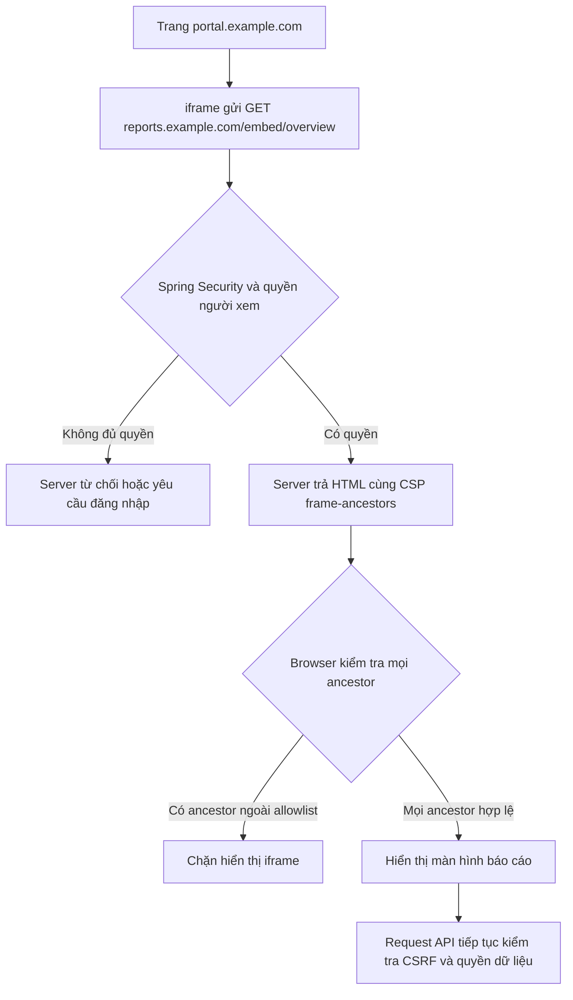

# Cho phép nhúng một màn hình trong phạm vi đã xác định

## Mục tiêu thực hành

Một ứng dụng Spring Security thường gửi các HTTP security headers để ngăn người khác nhúng trang của nó trong `<iframe>`. Đây là lớp bảo vệ quan trọng trước **clickjacking**: kẻ tấn công đặt một giao diện thật trong khung trong suốt hoặc giả giao diện, rồi dẫn người dùng đến thao tác mà họ không nhận ra.

Trong một số tình huống nghiệp vụ, tổ chức lại **cần cho phép nhúng đúng một màn hình**, chẳng hạn bảng tổng quan chỉ đọc của hệ thống báo cáo vào cổng thông tin nội bộ. Bài thực hành này hướng dẫn mở ngoại lệ có phạm vi xác định, kiểm tra được và giữ nguyên các phòng vệ HTTP khác.

Tình huống dùng xuyên suốt:

- Ứng dụng cung cấp màn hình: `https://reports.example.com/embed/overview`.
- Cổng được phép nhúng: `https://portal.example.com`; cũng cho phép chính `reports.example.com` nhúng trang của mình để thử nghiệm cùng origin.
- Các đường dẫn khác, như `/account`, `/admin`, `/reports/export` và `/settings`, **không được nhúng**.
- Người xem vẫn phải được **xác thực và ủy quyền** để đọc dữ liệu; việc cổng có quyền tạo iframe không tự cấp quyền dữ liệu.
- Hệ thống dùng Spring Boot 3.x, Spring Security 6.x trên **Servlet/MVC**. Cuối bài nêu hướng áp dụng cho **WebFlux/Reactive**.

Sau bài này, người học có thể:

1. Phân biệt `Content-Security-Policy: frame-ancestors`, `X-Frame-Options` và `frame-src`.
2. Cấu hình một ngoại lệ nhúng duy nhất theo route và origin trong Spring Security.
3. Tự xác minh những trang khác vẫn chặn iframe và phiên đăng nhập/CSRF không bị nới lỏng.
4. Kiểm thử browser, chain nhiều tầng, reverse proxy và giao tiếp `postMessage` nếu tính năng cần dùng.
5. Chỉ ra giới hạn bảo mật của việc allowlist origin và cách giảm nguy cơ clickjacking.

## 1. Xác định ranh giới trước khi mở ngoại lệ

Việc “cho phép nhúng một màn hình” gồm **hai quyết định tách biệt**:

| Quyết định | Câu hỏi | Cơ chế chính |
| --- | --- | --- |
| Quyền **đặt trang vào iframe** | Site nào được phép xuất hiện ở bất kỳ mức ancestor nào của màn hình? | Response header `Content-Security-Policy: frame-ancestors ...` |
| Quyền **xem hoặc thao tác dữ liệu** | Người đang xem có quyền mở báo cáo/workspace cụ thể không? | Authentication, authorization và kiểm tra quyền tại service/DB |

Trình duyệt quyết định có được hiển thị iframe hay không; server vẫn phải kiểm tra người xem khi xử lý request. Một client ngoài browser có thể gửi request trực tiếp đến URL nhúng, bất kể `frame-ancestors`. Vì vậy, **header chống nhúng không thay thế xác thực hoặc phân quyền**.



Bản thân request vẫn tới server, và Spring Security vẫn có thể trả nội dung hoặc lỗi. Việc browser chặn hiển thị không có nghĩa request chưa từng được gửi. Bởi vậy khi kiểm thử cần quan sát **HTTP response** cùng với **hành vi render** của browser.

### 1.1 Phân biệt các header thường gây nhầm lẫn

| Header/chỉ thị | Công dụng | Có kiểm soát ai được nhúng màn hình này? |
| --- | --- | --- |
| `Content-Security-Policy: frame-ancestors 'none'` | Cấm mọi ancestor tạo frame cho trang | **Có**, không cho nhúng |
| `Content-Security-Policy: frame-ancestors 'self'` | Chỉ cho phép ancestor cùng origin | **Có**, nhưng không cho portal khác origin |
| `Content-Security-Policy: frame-ancestors 'self' https://portal.example.com` | Cho phép cùng origin và origin portal cụ thể | **Có**, đúng nhu cầu thực hành |
| `X-Frame-Options: DENY` | Cấm nhúng theo cơ chế header cũ | **Có**, nhưng xung đột với ngoại lệ nếu còn áp dụng |
| `X-Frame-Options: SAMEORIGIN` | Chỉ cho phép nhúng cùng origin | **Có**, không mô tả được allowlist portal khác origin |
| `CSP: frame-src ...` | Chỉ định nguồn iframe mà **trang hiện tại được phép tải để nhúng vào chính nó** | **Không**, kiểm soát chiều ngược lại |
| `CSP: default-src ...` | Fallback cho một số tài nguyên tải bởi trang | **Không**, không thay `frame-ancestors` |
| `Access-Control-Allow-Origin` | Quy định JavaScript của origin khác được đọc phản hồi CORS hay không | **Không**, tải trang bằng iframe không dựa vào CORS cho việc nhúng |

`frame-ancestors` phải nằm trong **HTTP response header được thực thi**, không đặt trong thẻ `<meta http-equiv="Content-Security-Policy">` để mong browser áp dụng. `Content-Security-Policy-Report-Only` có ích trong quan sát một số chính sách CSP, nhưng không được xem là cách thực thi quyết định cho phép/chặn khung.

Với `frame-ancestors`, các origin trong allowlist nên khai báo **scheme, host và port khi không phải cổng mặc định**. Đường dẫn `/embed/overview` không thuộc cú pháp xác định origin nhúng. Việc giới hạn **trang nào** được phép nhúng phải được thực hiện bằng **route trả response header**, còn việc giới hạn **ai được nhúng** phải được thể hiện bằng source list của `frame-ancestors`.

Một response cho route trong bài:

```http
HTTP/1.1 200 OK
Content-Type: text/html;charset=UTF-8
Content-Security-Policy: frame-ancestors 'self' https://portal.example.com
```

Một response của trang khác:

```http
HTTP/1.1 200 OK
Content-Security-Policy: frame-ancestors 'none'
X-Frame-Options: DENY
```

Hai response khác nhau vì có chính sách riêng theo route. **Không gửi `X-Frame-Options: DENY` cho trang được nhúng**: mặc dù các browser hiện đại ưu tiên `frame-ancestors` khi CSP được thực thi, việc để hai header mâu thuẫn có thể gây kết quả khác nhau giữa browser cũ và mới.

### 1.2 Vì sao không dùng `ALLOW-FROM` hay một allowlist quá rộng?

`X-Frame-Options: ALLOW-FROM https://portal.example.com` là cú pháp lịch sử với mức hỗ trợ kém và không phù hợp để dựa vào trong các browser hiện đại. Dùng `frame-ancestors` cho yêu cầu allowlist theo origin.

Tránh các kiểu cấu hình như:

```http
# Sai mục tiêu: cho tất cả website đặt trang vào iframe.
Content-Security-Policy: frame-ancestors *

# Sai mục tiêu: cho mọi subdomain mà không có đánh giá tin cậy.
Content-Security-Policy: frame-ancestors https://*.example.com
```

Wildcard subdomain có thể bao gồm môi trường staging, hệ thống quản trị chưa được bảo vệ hoặc subdomain bị chiếm quyền. Giới hạn trong ví dụ chỉ gồm `'self'` và `https://portal.example.com`. Khi bổ sung một origin mới, phải qua đánh giá phạm vi và kiểm thử lại.

## 2. Thiết kế ngoại lệ theo màn hình, không theo toàn hệ thống

Đặt chính sách cần kiểm chứng:

| Đường dẫn được trả về | Phương thức | Origin được phép nhúng | X-Frame-Options | Authentication/authorization |
| --- | --- | --- | --- | --- |
| `/embed/overview` | `GET` | `'self'` và `https://portal.example.com` | Không gửi `DENY`/`SAMEORIGIN` | Bắt buộc và kiểm tra quyền xem báo cáo |
| `/embed/overview` | `POST` | Không mở ngoại lệ | `DENY` | CSRF/ủy quyền như bình thường |
| `/account` | `GET` | Không | `DENY` | Bắt buộc |
| `/settings`, `/admin` | Mọi phương thức | Không | `DENY` | Bắt buộc, riêng quyền admin nếu cần |
| `/reports/export` | Mọi phương thức | Không | `DENY` | Bắt buộc, kiểm soát quyền tài liệu |
| Các URL không được khai báo | Mọi phương thức | Không | `DENY` | Theo quy tắc mặc định chặt |

Chọn một **trang chỉ đọc** khi bắt đầu. Nếu màn hình có nút xác nhận, xóa, chuyển tiền, đổi quyền hoặc xuất dữ liệu, cần thiết kế kỹ bảo vệ clickjacking và xác nhận thao tác; không cho rằng allowlist origin đã loại bỏ nguy cơ giao diện bị che phủ.

Nên dùng một route chuyên dụng như `/embed/overview` thay vì nới `/reports/**`. Đường dẫn riêng giúp áp chính sách theo route, giới hạn chức năng và thu hồi ngoại lệ nhanh nếu có sự cố.

### 2.1 Mã cấu hình Spring Security Servlet

Ví dụ dùng hai `SecurityFilterChain` có thứ tự cụ thể. Chain đầu tiên chỉ khớp với **GET của route được phép nhúng**. Chain còn lại giữ mặc định chặn frame đối với các request khác.

```java
import org.springframework.context.annotation.Bean;
import org.springframework.context.annotation.Configuration;
import org.springframework.core.annotation.Order;
import org.springframework.security.config.annotation.web.builders.HttpSecurity;
import org.springframework.security.web.SecurityFilterChain;
import org.springframework.security.web.util.matcher.AntPathRequestMatcher;

import static org.springframework.security.config.Customizer.withDefaults;

@Configuration
class FrameEmbeddingSecurityConfig {

    // Chỉ GET /embed/overview nhận chính sách iframe được nới.
    @Bean
    @Order(1)
    SecurityFilterChain embeddedOverviewChain(HttpSecurity http)
            throws Exception {

        http
            .securityMatcher(new AntPathRequestMatcher(
                "/embed/overview", "GET"))
            .authorizeHttpRequests(auth -> auth
                .anyRequest().authenticated())
            .headers(headers -> headers
                // Tắt X-Frame-Options chỉ trong chain này.
                .frameOptions(frame -> frame.disable())
                .contentSecurityPolicy(csp -> csp
                    .policyDirectives(
                        "frame-ancestors 'self' https://portal.example.com")))
            .formLogin(withDefaults());

        // CSRF, HSTS và những header khác vẫn theo cấu hình phù hợp.
        return http.build();
    }

    // Tất cả URL còn lại đi qua chain chặn iframe.
    @Bean
    @Order(2)
    SecurityFilterChain defaultApplicationChain(HttpSecurity http)
            throws Exception {

        http
            .authorizeHttpRequests(auth -> auth
                // Có thể thêm các route công khai và quyền riêng của ứng dụng.
                .anyRequest().authenticated())
            .headers(headers -> headers
                .frameOptions(frame -> frame.deny())
                .contentSecurityPolicy(csp -> csp
                    .policyDirectives("frame-ancestors 'none'")))
            .formLogin(withDefaults());

        return http.build();
    }
}
```

**Cách đọc cấu hình:**

1. `@Order(1)` kết hợp `securityMatcher` xác định **chain nào bảo vệ request**. Chỉ GET tới đúng `/embed/overview` sử dụng ngoại lệ nhúng.
2. `frameOptions(frame -> frame.disable())` tắt riêng việc ghi `X-Frame-Options` trong chain màn hình nhúng. Lệnh này **không được đặt ở chain toàn cục**.
3. CSP `frame-ancestors` trên màn hình nhúng chỉ chấp nhận origin khai báo. Việc chọn `'self'` là chủ đích của bài; nếu nội bộ không cần iframe cùng origin thì có thể loại bỏ nó sau khi thử nghiệm.
4. Chain mặc định ghi `X-Frame-Options: DENY` và `frame-ancestors 'none'`, nên mọi trang khác bị chặn nhúng. Đây là giá trị rất chặt; nếu ứng dụng có các màn hình cũ đang nhúng cùng origin, phải kiểm kê và quyết định rõ trước khi áp chính sách.
5. `authenticated()` yêu cầu người xem có danh tính hợp lệ, **chưa thay thế kiểm tra quyền đọc đối tượng**. Đoạn cấu hình này là phần HTTP/frame của bài tập; app thật cần tích hợp chính sách quyền, login, session và handler theo kiến trúc đang dùng.

`AntPathRequestMatcher` có mặt trong Spring Security 6.x; một số phiên bản mới đánh dấu API này deprecated và khuyến nghị matcher dựa trên `PathPattern`. Khi nâng phiên bản, hãy dùng matcher được hỗ trợ ở phiên bản mục tiêu nhưng vẫn giữ nguyên yêu cầu **GET + đường dẫn chính xác**. Không dùng `securityMatcher("/embed/**")` nếu phạm vi cho phép chỉ gồm một màn hình.

Với ứng dụng đã có nhiều `SecurityFilterChain`, không sao chép cơ học hai bean trên làm mất các rule hiện tại. Phải đặt ngoại lệ ở đúng thứ tự, giữ lại xác thực và phân quyền của chain tương ứng. Nếu route được bảo vệ bằng OAuth2/OIDC, cấu hình login khác với `formLogin`; chỉ thay đổi cơ chế chứng thực để phù hợp ứng dụng.

Nếu đã có CSP khác cho `script-src`, `style-src`, `object-src` hay `base-uri`, phải **ghép các chỉ thị đó vào policy** của cả hai chain, tránh vô tình ghi đè bằng CSP chỉ chứa `frame-ancestors`. Không tạo hai header CSP mâu thuẫn từ Spring Security và reverse proxy mà chưa thử hành vi thực tế.

### 2.2 Một controller tối thiểu để thử nghiệm

Ứng dụng cần thật sự cung cấp response HTML từ route đã chọn. Ví dụ controller trả một màn hình read-only đơn giản, chỉ phục vụ mục đích thử nghiệm:

```java
import org.springframework.http.MediaType;
import org.springframework.web.bind.annotation.GetMapping;
import org.springframework.web.bind.annotation.RestController;

@RestController
class EmbeddedOverviewController {

    @GetMapping(
        value = "/embed/overview",
        produces = MediaType.TEXT_HTML_VALUE)
    String overview() {
        return """
            <!doctype html>
            <html lang="vi">
              <head><meta charset="utf-8"><title>Báo cáo minh họa</title></head>
              <body>
                <main data-testid="overview">Bảng tổng quan chỉ đọc</main>
              </body>
            </html>
            """;
    }
}
```

Trong sản phẩm thật, controller sẽ đọc quyền theo principal và ID báo cáo, sau đó render template có output encoding đúng. Nếu người dùng có thể chọn `reportId`, phải xác minh họ có quyền đọc **chính báo cáo đó**, không chỉ xác minh user đã login.

Cấu hình `frame-ancestors` áp dụng theo **response HTML**, kể cả khi controller trả trang lỗi; test cần lấy đúng response thành công vì một redirect sang trang login có thể mang header khác.

## 3. Kết nối an toàn và phiên khi dùng iframe

### 3.1 HTTPS và cookie cùng site/khác site

Trong tình huống `reports.example.com` và `portal.example.com`, hai origin khác nhau nhưng thường là **cùng site** do có cùng scheme HTTPS và registrable domain `example.com`. Nếu phiên được thiết kế đúng, cookie `SameSite=Lax` có thể được gửi trên request cùng site dù iframe khác origin. Tuy nhiên cần kiểm tra các thiết lập browser và cookie cụ thể, không suy chỉ từ tên host.

Khi portal thật ở `https://portal.partner.example` (khác site), iframe tới `https://reports.example.com` trở thành **ngữ cảnh cross-site**. Cookie `SameSite=Lax` hoặc `Strict` thông thường sẽ không được gửi trong request iframe cross-site; `SameSite=None; Secure` là yêu cầu cơ bản cho một số luồng cookie cross-site nhưng vẫn có thể bị trình duyệt **chặn third-party cookie**. Không có CSP nào buộc browser phải gửi những cookie đó.

Các phương án cần cân nhắc:

- Giữ embedding trên hai subdomain tin cậy của cùng site nếu kiến trúc cho phép.
- Dùng điều hướng top-level để xác thực, sau đó kiểm thử lại hành vi cookie khi nhúng; không mặc định phiên sẽ tồn tại trong mọi chế độ riêng tư.
- Nếu có thiết kế embed cho đối tác khác site, xây dựng cơ chế cấp quyền chuyên dụng với thời hạn và phạm vi tối thiểu, được kiểm thử bảo mật. Không đưa token lâu dài vào query string và không dùng origin iframe làm “chứng cứ” về danh tính người dùng.
- Nếu trình duyệt/thiết bị không hỗ trợ phiên trong iframe, cung cấp đường mở màn hình ở tab mới thay vì yêu cầu người dùng tắt lớp bảo vệ quyền riêng tư.

`SameSite` bảo vệ cookie trong một số bối cảnh; nó không thay CSRF token. Một ứng dụng có phiên đăng nhập hợp lệ vẫn phải bảo vệ mọi `POST`/`PUT`/`PATCH`/`DELETE` theo mô hình xác thực. **Đừng gọi `csrf.disable()` chỉ để làm cho iframe hoạt động.**

### 3.2 CSP và giao thức không đồng nghĩa với quyền truy cập

CSP `frame-ancestors` có tác dụng kiểm tra **tổ tiên của frame**. Nếu ứng dụng cần cấm frame con từ nguồn lạ bên trong trang được nhúng, phải áp dụng thêm `frame-src` cho **trang nội dung**. Ở cổng portal, chính portal có thể có CSP `frame-src` hoặc `child-src` riêng; muốn nhúng được, **cả chính sách của portal lẫn của reports app đều phải cho phép**.

Các redirect đến IdP, trang login hoặc tài nguyên khác có thể có `X-Frame-Options: DENY` hoặc CSP nghiêm ngặt. Đây có thể là hành vi bảo mật đúng. Không hạ chính sách của IdP để “đăng nhập ngay trong iframe”; thường nên thực hiện đăng nhập bằng điều hướng top-level.

Với HTTPS, kiểm tra cấu hình TLS, certificate và HSTS ở cả portal lẫn reports. Trang portal HTTPS nhúng iframe HTTP có thể bị browser chặn như mixed active content; không chữa bằng cách nới CSP hoặc CORS.

## 4. Giảm rủi ro clickjacking ngay cả với origin đã cho phép

Allowlist một portal là quyết định tin cậy có giới hạn: nếu portal bị XSS, tài khoản portal bị chiếm hoặc người quản trị tùy biến HTML/JS thiếu kiểm soát, kẻ tấn công có thể thao túng giao diện chứa iframe.

Vì vậy nên:

1. Giới hạn nội dung iframe thành **chỉ đọc**; không đưa nút xóa, đổi quyền, chuyển tiền hoặc quyết định nhạy cảm lên view nhúng.
2. Nếu có thao tác thay đổi trạng thái, giữ CSRF, phân quyền server và yêu cầu xác nhận có ngữ cảnh rõ ràng khi cần. **Frame allowlist không đủ để bảo vệ thao tác nguy hiểm**.
3. Chỉ lấy dữ liệu vừa đủ cho báo cáo; không expose API/route quản trị qua cùng chính sách nhúng.
4. Không dùng header `Referer` hoặc `Origin` từ request GET làm **cơ chế duy nhất** để quyết định dữ liệu được phép đọc. Một số client không gửi header, và client ngoài browser có thể tự tạo chúng.
5. Không mở `'unsafe-inline'`, `'unsafe-eval'` hay wildcard trong `script-src` chỉ vì frame load bị lỗi; kiểm tra CSP violation cụ thể và chỉnh tài nguyên cần thiết.
6. Nếu báo cáo có thông tin nhạy cảm, đặt `Cache-Control` theo yêu cầu và tránh log nội dung. Việc cho iframe hiển thị không làm biến mất nguy cơ dữ liệu bị chụp màn hình trong trình duyệt của người dùng hợp lệ.
7. Có người sở hữu allowlist portal, quy trình thu hồi origin và bộ test regression cho mỗi thay đổi môi trường/hostname.

Khi trang cha đặt thuộc tính `sandbox` trên iframe, browser sẽ giới hạn thêm các khả năng như chạy script, submit form, pop-up và điều hướng top-level. Đây là một lớp phòng vệ có thể hữu ích, nhưng nó phụ thuộc các flag `allow-*` cụ thể. Không bật tổ hợp `allow-scripts` và `allow-same-origin` mà chưa phân tích ảnh hưởng, đặc biệt khi nội dung có cùng origin và có thể tự tác động đến khung.

Ví dụ của **trang portal**:

```html
<iframe
  title="Tổng quan báo cáo"
  src="https://reports.example.com/embed/overview"
  loading="lazy"
  referrerpolicy="strict-origin-when-cross-origin"
  sandbox="allow-scripts allow-forms">
</iframe>
```

Đây là minh họa ban đầu, không phải chính sách `sandbox` bắt buộc cho mọi ứng dụng. Nếu nội dung cần đọc cookie/DOM theo origin của chính nó hoặc tích hợp API bị sandbox hạn chế, phải đánh giá flag phù hợp và kiểm thử; có thể cần cơ chế nhúng khác. Trang cha không thể dùng `sandbox` để thay thế `frame-ancestors` trên response của trang con.

## 5. Giao tiếp giữa trang cha và iframe qua postMessage

Hai origin khác nhau không thể tùy tiện đọc DOM của nhau do **same-origin policy**. Nếu portal cần thông báo lựa chọn bộ lọc hoặc nhận trạng thái “đã tải”, có thể trao đổi thông điệp qua `window.postMessage`, nhưng phải kiểm tra **origin, source và schema payload**.

Ví dụ **JavaScript bên trong iframe**:

```javascript
const allowedParentOrigin = "https://portal.example.com";

// Chỉ thông báo một trạng thái không nhạy cảm cho đúng origin.
window.parent.postMessage(
  { type: "report:ready", version: 1 },
  allowedParentOrigin
);

window.addEventListener("message", (event) => {
  if (event.origin !== allowedParentOrigin) return;
  if (event.source !== window.parent) return;

  const data = event.data;
  if (!data || typeof data !== "object") return;
  if (data.type !== "report:set-period") return;

  // Chỉ nhận giá trị đã được allowlist và tự kiểm tra quyền ở server.
  const allowed = new Set(["day", "week", "month"]);
  if (!allowed.has(data.period)) return;

  renderPeriod(data.period);
});
```

`renderPeriod` là hàm nghiệp vụ do ứng dụng định nghĩa; nếu nó gọi API server, API phải xác minh session/token và quyền dữ liệu như một request bình thường.

**Không dùng `postMessage(..., "*")` khi truyền dữ liệu nhạy cảm**. Không coi việc nhận thông điệp từ `portal.example.com` là bằng chứng đủ cho phép tải báo cáo của bất cứ user nào. Nếu có nhiều origin đối tác, phải đối chiếu với allowlist cụ thể cho đúng tài khoản/tích hợp, không so sánh theo suffix chuỗi dễ giả mạo.

Ở phía portal, khi gửi lệnh vào iframe, cũng phải truyền đúng `targetOrigin` là `https://reports.example.com`. Đối với dữ liệu nhạy cảm, tránh nhét trực tiếp vào message và ưu tiên API có xác thực/ủy quyền thích hợp.

## 6. Kiểm thử Spring Security bằng MockMvc

`MockMvc` có thể xác nhận **đúng chain** ghi **đúng header** cho từng route. Tuy nhiên nó không mô phỏng đầy đủ quyết định chặn iframe của browser, cookie policy hoặc các header bị reverse proxy bổ sung.

Ví dụ sau giả định controller `/embed/overview` ở mục 2 cùng security configuration đã được đưa vào application context:

```java
import org.junit.jupiter.api.Test;
import org.springframework.beans.factory.annotation.Autowired;
import org.springframework.boot.test.autoconfigure.web.servlet.AutoConfigureMockMvc;
import org.springframework.boot.test.context.SpringBootTest;
import org.springframework.test.web.servlet.MockMvc;

import static org.hamcrest.Matchers.containsString;
import static org.springframework.security.test.web.servlet.request.SecurityMockMvcRequestPostProcessors.user;
import static org.springframework.test.web.servlet.request.MockMvcRequestBuilders.get;
import static org.springframework.test.web.servlet.request.MockMvcRequestBuilders.post;
import static org.springframework.test.web.servlet.result.MockMvcResultMatchers.header;
import static org.springframework.test.web.servlet.result.MockMvcResultMatchers.status;

@SpringBootTest
@AutoConfigureMockMvc
class FramePolicyIT {

    @Autowired MockMvc mvc;

    @Test
    void onlyOverviewGetCanBeEmbeddedByPortal() throws Exception {
        mvc.perform(get("/embed/overview").secure(true).with(user("alice")))
            .andExpect(status().isOk())
            .andExpect(header().string(
                "Content-Security-Policy",
                containsString(
                    "frame-ancestors 'self' https://portal.example.com")))
            .andExpect(header().doesNotExist("X-Frame-Options"));
    }

    @Test
    void otherPagesRemainUnframeable() throws Exception {
        mvc.perform(get("/account").secure(true).with(user("alice")))
            .andExpect(header().string("X-Frame-Options", "DENY"))
            .andExpect(header().string(
                "Content-Security-Policy", "frame-ancestors 'none'"));
    }

    @Test
    void postingToEmbedRouteDoesNotGetException() throws Exception {
        mvc.perform(post("/embed/overview").secure(true).with(user("alice")))
            .andExpect(header().string("X-Frame-Options", "DENY"))
            .andExpect(header().string(
                "Content-Security-Policy", "frame-ancestors 'none'"));
    }
}
```

Bài test `post` chỉ kiểm tra response headers của chain mặc định; nếu CSRF đang bật thì request có thể trả `403` do thiếu token, hoàn toàn phù hợp. Chú ý rằng test header trên `/account` có thể chạy cả khi handler không tồn tại và trả `404`; trong dự án thật nên chọn route bảo vệ đang tồn tại và bổ sung assertion status mong đợi.

Với nhiều chain thực tế, kiểm tra thêm đường dẫn có query, chữ hoa/thường, slash cuối, phiên bản route, `GET /embed/overview/` và đường dẫn gần giống. Mục tiêu là tránh matcher quá rộng tạo ngoại lệ cho những trang không dự tính. Nếu ứng dụng có CSP chung, test phải xác nhận **đủ các directive cần thiết** ngoài `frame-ancestors`.

## 7. Kiểm thử trên browser và proxy thật

### 7.1 Vì sao chỉ xem header chưa đủ?

Một browser có thể từ chối iframe vì nhiều nguyên nhân khác nhau:

- `frame-ancestors` trên reports app không cho phép portal.
- `X-Frame-Options: DENY` còn được reverse proxy thêm vào response của trang nhúng.
- Portal gửi CSP `frame-src` chặn reports app.
- Response thực tế là redirect sang login hoặc IdP có chính sách không cho nhúng.
- Cookie phiên không được browser gửi khi nhúng khác site.
- iframe bị giới hạn bởi `sandbox`, Mixed Content hoặc certificate lỗi.

Cần phân biệt lỗi frame policy với lỗi xác thực, kết nối và JavaScript để tránh “sửa” bằng cách tắt toàn bộ headers.

### 7.2 Xem response thật

Sau khi đăng nhập bằng tài khoản thử nghiệm và gọi GET route, dùng Network tab của DevTools hoặc kiểm tra response tại môi trường staging:

```bash
# GET thay vì HEAD vì ví dụ securityMatcher chỉ khớp GET.
# Gọi từ môi trường đã có phiên hợp lệ, tránh đưa cookie vào lịch sử terminal/log.
curl -sS -D - -o /dev/null https://reports.example.com/embed/overview

# Trang thường phải giữ chính sách chặn nhúng.
curl -sS -D - -o /dev/null https://reports.example.com/account
```

Nếu chưa đăng nhập, lệnh đầu có thể nhận `302` hoặc `401/403` tùy cấu hình. Khi đó header quan sát được thuộc response xác thực thất bại, **không chứng minh** chính sách trên response `200` của màn hình nhúng. Kiểm tra response thành công qua browser đã đăng nhập hoặc fixture được kiểm soát. Không đưa session cookie thật vào command được chia sẻ hoặc ghi log HTTP.

Kiểm tra cả header từ ứng dụng lẫn qua ingress/CDN. Nếu proxy tự thêm `X-Frame-Options: DENY` cho toàn hệ thống, ngoại lệ ở Spring Security vẫn bị ảnh hưởng. Chính sách nới phải được cấu hình nhất quán ở các tầng, chỉ áp cho đúng route.

### 7.3 Ma trận kiểm thử iframe

| ID | Bối cảnh và hành động | Kỳ vọng |
| --- | --- | --- |
| F01 | Portal `https://portal.example.com` nhúng `GET /embed/overview` với user đủ quyền | Màn hình hiển thị, không có lỗi `frame-ancestors` |
| F02 | Chính `https://reports.example.com` nhúng màn hình đó | Hiển thị vì `'self'` được phép |
| F03 | `https://untrusted.example.net` nhúng màn hình | Browser chặn hiển thị theo CSP |
| F04 | Portal hợp lệ nhúng `/account` | Browser chặn hiển thị |
| F05 | Portal hợp lệ nhúng `/admin` | Browser chặn hiển thị, kể cả khi user có role admin |
| F06 | Portal hợp lệ nhúng `/reports/export` | Browser chặn hiển thị |
| F07 | Trang portal bị nhúng bên trong một origin không được cho phép; iframe báo cáo nằm sâu hơn | Browser chặn vì **mọi ancestor** đều phải phù hợp `frame-ancestors` |
| F08 | Portal load báo cáo khi user chưa đăng nhập | Không lộ dữ liệu; hiển thị trạng thái xác thực hoặc hướng dẫn mở top-level |
| F09 | User đăng nhập nhưng thiếu quyền với báo cáo | Server từ chối dữ liệu, dù origin portal hợp lệ |
| F10 | Gửi `POST /embed/overview` hoặc một route gần giống | Không được hưởng ngoại lệ header GET chính xác |
| F11 | Có X-Frame-Options bổ sung bởi reverse proxy/CDN | Phát hiện và sửa đúng ngoại lệ ở proxy; response cuối không còn header mâu thuẫn |
| F12 | Portal CSP `frame-src` chặn reports app | Phát hiện chính sách của trang cha và cập nhật allowlist thật sự cần |
| F13 | Chrome/Edge, Firefox và Safari thuộc phạm vi hỗ trợ | Hành vi cho phép/từ chối nhất quán; kiểm tra vấn đề cookie riêng |
| F14 | iframe gửi `postMessage` từ origin không tin cậy hoặc payload sai schema | Handler bỏ qua; không thay đổi dữ liệu/không gọi API nhạy cảm |
| F15 | Thử thao tác thay đổi trạng thái với CSRF thiếu/sai và user không đủ quyền | Server từ chối, không có side effect |
| F16 | Thay đổi host/port/scheme của portal, ví dụ `http://portal.example.com` | Không được coi là origin đã allowlist `https://portal.example.com` |

**Kiểm thử nested iframe rất quan trọng.** `frame-ancestors` kiểm tra toàn bộ chuỗi ancestor, không chỉ trang cha gần nhất. Một trang của portal hợp lệ bị nhúng trong site lạ không được dùng làm “cầu nối” để site đó nhúng reports app.

### 7.4 Ví dụ Playwright ở môi trường staging

Kịch bản giả định đã có hai trang kiểm thử:

- `https://portal.example.com/frame-test` chứa iframe `data-testid="report-frame"` trỏ tới `https://reports.example.com/embed/overview`.
- `https://untrusted.example.net/frame-test` chứa iframe tương tự.

Dùng một test account đã đăng nhập hợp lệ vào reports app, và cấu hình browser context phù hợp với chính sách cookie đang kiểm thử.

```typescript
import { test, expect } from "@playwright/test";

test("portal trong allowlist nhúng được overview", async ({ page }) => {
  await page.goto("https://portal.example.com/frame-test");

  const frame = page.frameLocator('[data-testid="report-frame"]');
  await expect(frame.locator('[data-testid="overview"]'))
      .toBeVisible();
});

test("origin ngoài allowlist không nhúng được overview", async ({ page }) => {
  await page.goto("https://untrusted.example.net/frame-test");

  const frame = page.frameLocator('[data-testid="report-frame"]');
  await expect(frame.locator('[data-testid="overview"]'))
      .toHaveCount(0);
});
```

Đây là khung test; kết quả phụ thuộc các trang staging và session test được tạo sẵn. Trong bộ test thực tế, cần **ghi nhận CSP violation/console hoặc navigation error**, kiểm tra response mạng và có ca đối chứng dương. `toHaveCount(0)` đơn lẻ không đủ chứng minh CSP đang chặn: thiếu đăng nhập, route lỗi, mạng hỏng cũng làm phần tử không xuất hiện.

Không dùng `ignoreHTTPSErrors=true` để che lỗi certificate hoặc tắt mọi bảo vệ browser khi thực hành. Với Safari/iOS phải kiểm thử bằng môi trường hỗ trợ tương ứng; tự động hóa Chromium không chứng minh mọi browser xử lý cookie giống nhau.

## 8. WebFlux/Reactive và hệ thống nhiều lớp

Khái niệm allowlist origin, `frame-ancestors`, `X-Frame-Options` và quyền người xem là như nhau trên Servlet và Reactive. Nhưng WebFlux dùng `SecurityWebFilterChain` và `ServerHttpSecurity`, không dùng bean `SecurityFilterChain`, `HttpSecurity` hay Servlet matcher ở mục 2.

Ví dụ hướng cấu hình tương ứng cho **Spring Security WebFlux**:

```java
import org.springframework.context.annotation.Bean;
import org.springframework.context.annotation.Configuration;
import org.springframework.core.annotation.Order;
import org.springframework.http.HttpMethod;
import org.springframework.security.config.web.server.ServerHttpSecurity;
import org.springframework.security.web.server.SecurityWebFilterChain;

@Configuration
class ReactiveFrameSecurityConfig {

    @Bean
    @Order(1)
    SecurityWebFilterChain embedChain(ServerHttpSecurity http) {
        return http
            .securityMatcher(
                new org.springframework.security.web.server.util.matcher.PathPatternParserServerWebExchangeMatcher(
                    "/embed/overview", HttpMethod.GET))
            .authorizeExchange(exchanges -> exchanges
                .anyExchange().authenticated())
            .headers(headers -> headers
                .frameOptions(frame -> frame.disable())
                .contentSecurityPolicy(csp -> csp
                    .policyDirectives(
                        "frame-ancestors 'self' https://portal.example.com")))
            .build();
    }

    @Bean
    @Order(2)
    SecurityWebFilterChain defaultChain(ServerHttpSecurity http) {
        return http
            .authorizeExchange(exchanges -> exchanges
                .anyExchange().authenticated())
            .headers(headers -> headers
                .frameOptions(frame -> frame.mode(
                    org.springframework.security.web.server.header.XFrameOptionsServerHttpHeadersWriter.Mode.DENY))
                .contentSecurityPolicy(csp -> csp
                    .policyDirectives("frame-ancestors 'none'")))
            .build();
    }
}
```

Đoạn này trình bày ý tưởng về **matcher theo route/method** với API Reactive. Cần tích hợp cơ chế `formLogin`, `oauth2Login` hoặc authentication đang dùng trong ứng dụng Reactive; cũng phải đảm bảo CSRF và session policy phù hợp. Khi nâng phiên bản Spring Security, đối chiếu tên matcher/header API theo phiên bản thực tế trước khi biên dịch.

Ở cả hai stack, **header thực tế cuối cùng** sau khi qua reverse proxy, CDN, API gateway hoặc service mesh mới là header browser nhận. Hãy kiểm tra cả môi trường staging/production, vì unit test Spring Security không phát hiện lớp proxy chèn `X-Frame-Options: DENY` hoặc thay CSP.

## 9. Quy trình giải quyết lỗi khi iframe không hiển thị

Khi portal báo màn hình trắng, bắt đầu bằng bằng chứng cụ thể:

1. Mở trực tiếp `https://reports.example.com/embed/overview` trong tab mới và xác minh trang trả `200`, có nội dung khi đã đăng nhập.
2. Kiểm tra Network trong tab có iframe: request cuối cùng tới URL nào, response `200` hay redirect `302`/`401`/`403`, có cookie phiên không?
3. Đọc **response headers cuối cùng** trên trang HTML: `Content-Security-Policy` có `frame-ancestors` đúng? Có `X-Frame-Options` mâu thuẫn do ứng dụng/proxy thêm?
4. Kiểm tra console violation: browser chặn bởi chính sách của **trang con** (`frame-ancestors`) hay **trang cha** (`frame-src`)?
5. Kiểm tra đúng scheme, host, port và **mọi ancestor**. `https://portal.example.com` và `http://portal.example.com` không phải một origin.
6. Nếu trang đã hiển thị nhưng báo cáo rỗng, quay lại xác thực và kiểm tra quyền API/báo cáo; không nới CSP để giải quyết lỗi phân quyền.
7. Nếu lỗi chỉ xảy ra trên Safari/chế độ riêng tư, kiểm tra cookie policy và flow đăng nhập; nếu cần, cung cấp đường mở top-level.

Lưu lại test case đã gây lỗi để lần sau không mở rộng allowlist ngoài ý muốn. Không đưa cookie, access token, CSRF token, session ID hoặc dữ liệu báo cáo nhạy cảm vào log chẩn đoán công khai.

## 10. Bài tập mở rộng và tiêu chí hoàn thành

**Bài tập:** Cổng thông tin muốn nhúng thêm `https://reports.example.com/reports/export` vì người dùng thường cần tải CSV từ dashboard. Một đề xuất yêu cầu đổi `frame-ancestors` toàn ứng dụng sang `*` hoặc tắt `X-Frame-Options` ở mọi route.

Hãy đánh giá đề xuất theo các câu hỏi:

1. Vì sao chỉ cần iframe màn hình `/embed/overview` đã đạt nhu cầu xem báo cáo, còn export có thể mở qua một liên kết hoặc action riêng?
2. `frame-ancestors *` tăng bề mặt clickjacking ra sao, kể cả khi người dùng đã đăng nhập?
3. Nếu export thực sự cần nằm trong iframe, loại thao tác, CSRF, quyền báo cáo, dữ liệu nhạy cảm và browser cookie cần được kiểm thử thêm những gì?
4. Khi thêm origin thứ hai vào allowlist, ai phê duyệt và làm thế nào để thu hồi nhanh?
5. Những ca âm tính nào trong bảng F01–F16 phải chạy lại để chứng minh phạm vi không bị mở rộng?

Một triển khai hoàn thành khi đạt **đồng thời** các điều kiện:

- Chỉ **GET `/embed/overview`** được trả header `frame-ancestors 'self' https://portal.example.com` và không bị `X-Frame-Options` mâu thuẫn.
- Tất cả trang còn lại vẫn có chính sách chặn iframe, đặc biệt `/account`, `/admin`, `/settings` và endpoint hành động.
- Người xem không đủ quyền không thể đọc dữ liệu ngay cả khi đến từ origin portal hợp lệ.
- CSRF, session, HTTPS, phân quyền object và bảo vệ các API giữ nguyên theo chính sách ứng dụng.
- Kiểm thử header, browser, nested iframe và proxy cho kết quả nhất quán; có ca đối chứng dương và ca bị từ chối.
- Hệ thống có giới hạn hỗ trợ browser, quy trình cấp/thu hồi origin và ghi nhận thay đổi allowlist.

## Tài liệu tham khảo

- [Spring Security Reference — Security HTTP response headers](https://docs.spring.io/spring-security/reference/servlet/exploits/headers.html): CSP, frame options và security headers của Servlet.
- [Spring Security Reference — WebFlux security headers](https://docs.spring.io/spring-security/reference/reactive/exploits/headers.html): cấu hình headers tương ứng trong Reactive.
- [MDN — CSP frame-ancestors](https://developer.mozilla.org/en-US/docs/Web/HTTP/Reference/Headers/Content-Security-Policy/frame-ancestors): nguồn frame ancestor hợp lệ và các giới hạn của chỉ thị.
- [MDN — X-Frame-Options](https://developer.mozilla.org/en-US/docs/Web/HTTP/Reference/Headers/X-Frame-Options): `DENY`, `SAMEORIGIN` và giới hạn tương thích.
- [MDN — CSP frame-src](https://developer.mozilla.org/en-US/docs/Web/HTTP/Reference/Headers/Content-Security-Policy/frame-src): chính sách tài nguyên iframe do trang cha tải.
- [OWASP — Clickjacking Defense Cheat Sheet](https://cheatsheetseries.owasp.org/cheatsheets/Clickjacking_Defense_Cheat_Sheet.html): nguyên tắc chống clickjacking và header áp dụng.
- [MDN — Window.postMessage](https://developer.mozilla.org/en-US/docs/Web/API/Window/postMessage): xác minh origin/source khi giao tiếp giữa frame.
