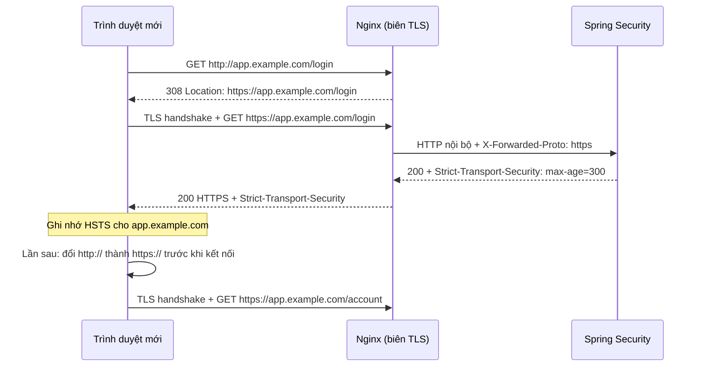

# Triển khai HTTPS qua reverse proxy và xác minh HSTS

## 1. Bối cảnh bài thực hành

Trong hệ thống dùng Spring Security, trình duyệt thường kết nối HTTPS đến **reverse proxy** (Nginx, ingress, load balancer hoặc CDN), còn ứng dụng Spring Boot chạy HTTP trên mạng nội bộ. Cấu hình này hợp lý khi TLS được kết thúc ở biên tin cậy, nhưng nó tạo ra một ranh giới quan trọng: **trình duyệt đang dùng HTTPS, trong khi ứng dụng Java có thể nhìn thấy một kết nối HTTP**.

Nếu xử lý ranh giới sai, ứng dụng có thể tạo URL chuyển hướng về `http://`, cookie không mang thuộc tính cần thiết, hoặc Spring Security không ghi `Strict-Transport-Security` (HSTS) vì request không được nhận diện là secure. Kiểm thử chỉ bằng `MockMvc` hoặc kiểm tra cấu hình Nginx không đủ để khẳng định trình duyệt đã nhận và ghi nhớ HSTS.

Bài thực hành này nằm trong nhóm **Thực hành tổng hợp** của `SPRING_SECURITY_HTTP_PROTECTION`. Người học sẽ triển khai một luồng HTTPS, giữ nguyên các lớp bảo vệ HTTP của Spring Security, kiểm tra các request đi qua proxy và chứng minh HSTS có hiệu lực trên trình duyệt thật. Ví dụ sử dụng Nginx và Spring Boot Servlet; một phần riêng mô tả cấu hình WebFlux/Reactive.

### Kết quả mong đợi

Sau bài thực hành, người học cần chứng minh được:

1. Trình duyệt kết nối đến `https://app.example.com` bằng **TLS và chứng chỉ hợp lệ**.
2. Yêu cầu `http://app.example.com` ban đầu nhận redirect rõ ràng sang HTTPS khi trình duyệt chưa có chính sách HSTS.
3. Ứng dụng Spring Security được reverse proxy truyền **scheme/host/port bên ngoài** chính xác, qua những forwarded header được kiểm soát.
4. Phản hồi HTTPS thực tế chứa **một chính sách HSTS nhất quán**, chẳng hạn `Strict-Transport-Security: max-age=300` ở giai đoạn thử nghiệm.
5. Trình duyệt đã nhận HSTS sẽ tự nâng cấp những lần truy cập HTTP sau đó thành HTTPS **trước khi gửi HTTP request qua mạng**, trong thời gian chính sách còn hiệu lực.
6. Chức năng đăng nhập, đăng xuất, cookie phiên, CSRF, các security header khác và request qua proxy vẫn hoạt động đúng.

**Phạm vi:** hướng dẫn là mẫu lab có thể thích nghi, không phải cấu hình production đầy đủ cho mọi CA, DNS, firewall, CDN hay TLS policy. Các hostname, đường dẫn chứng chỉ và endpoint là ví dụ; phải thay bằng giá trị đã được cấp phát trong môi trường thử nghiệm.

## 2. Hiểu đúng HTTPS, redirect và HSTS

HTTPS mã hóa và xác thực kết nối bằng TLS. HSTS là **chính sách trình duyệt ghi nhớ** từ một response HTTPS hợp lệ: trong một khoảng thời gian, trình duyệt sẽ dùng HTTPS cho các yêu cầu tiếp theo đến host đó, ngay cả khi người dùng nhập `http://`.

Một quá trình điển hình:



### Redirect và HSTS giải quyết hai thời điểm khác nhau

| Cơ chế | Thời điểm tác động | Điều cần hiểu |
| --- | --- | --- |
| HTTP → HTTPS redirect (301/302/307/308) | Khi server **đã nhận** request HTTP | Không ngăn được kẻ trung gian sửa phản hồi HTTP ở lần truy cập đầu tiên. |
| HSTS đã ghi nhớ | Trước khi trình duyệt gửi request mới | Nâng cấp sang HTTPS ngay tại client; thường không gửi request HTTP ra mạng. |
| HSTS preload | Trước lần kết nối đầu tiên, nếu domain đã có trong danh sách preload của browser | Đòi hỏi cam kết HTTPS nghiêm ngặt cho domain và các subdomain; khó hoàn tác ngay lập tức. |
| Cookie `Secure` | Khi browser quyết định có gửi cookie trên kết nối hay không | Là phòng vệ riêng, không thay thế redirect/HSTS. |

Ví dụ cú pháp:

```http
Strict-Transport-Security: max-age=300
Strict-Transport-Security: max-age=31536000; includeSubDomains
Strict-Transport-Security: max-age=63072000; includeSubDomains; preload
```

Đây là **ba lựa chọn riêng**, không phát cả ba cùng lúc. `max-age` tính bằng **giây**; ví dụ `300` là 5 phút, còn `31536000` xấp xỉ một năm. `includeSubDomains` mở rộng hiệu lực xuống mọi subdomain của host đã gửi chính sách; `preload` là tín hiệu cho quy trình preload, **tự thêm chữ `preload` không đưa domain vào danh sách trình duyệt**.

Trình duyệt chỉ tiếp nhận HSTS từ **kết nối HTTPS đáng tin cậy**; header gửi trên HTTP bị bỏ qua. HSTS áp dụng cho **hostname**, không dùng để đánh dấu địa chỉ IP là HSTS host. Khi TLS chứng chỉ sai với một HSTS host, browser thường không cho người dùng bấm bỏ qua lỗi chứng chỉ.

**Giới hạn quan trọng:** HSTS không mã hóa hop HTTP nội bộ từ proxy tới Spring, không thay thế kiểm tra chứng chỉ, không ngăn CSRF/XSS và không thay thế `CSP`, `SameSite` hay authorization. Nó xử lý việc trình duyệt chọn HTTPS khi kết nối tới host.

## 3. Thiết kế lab và quyết định ai quản lý HSTS

### 3.1. Kiến trúc giả định

| Thành phần | Giá trị mẫu | Ràng buộc |
| --- | --- | --- |
| Public hostname | `app.example.com` | DNS trỏ đúng địa chỉ reverse proxy. |
| Client → Nginx | HTTPS cổng `443` | Chứng chỉ có SAN chứa `app.example.com`, còn hạn, được CA mà browser tin cậy ký. |
| HTTP → HTTPS | HTTP cổng `80` → redirect 308 | Chỉ giữ lại nếu hệ thống có nhu cầu nhận HTTP ban đầu; không dùng HTTP để gửi HSTS. |
| Nginx → Spring Boot | `http://127.0.0.1:8080` | Chỉ truy cập từ proxy cùng host trong lab; **không công khai port 8080**. |
| Ứng dụng | Spring Boot + Spring Security | Form login hoặc endpoint HTML công khai `/login` dùng để kiểm tra HSTS. |
| HSTS thử nghiệm | `max-age=300`, chưa bật `includeSubDomains` | Giảm phạm vi ảnh hưởng trong giai đoạn lab; không phải giá trị cuối cho production. |

Trong lab, **Spring Security là bên sở hữu header HSTS**; Nginx làm nhiệm vụ TLS termination, redirect và truyền forwarded headers. Sau khi hoàn tất, phần 9 trình bày phương án ngược lại, để **proxy/CDN sở hữu HSTS** nếu phù hợp với hệ thống vận hành.

Đừng để cả Spring và proxy phát hai header HSTS khác chính sách. Một số trình duyệt có cách xử lý các trường header trùng nhau khác với điều người triển khai suy đoán; tốt nhất phải xác định một tầng chịu trách nhiệm và kiểm tra response cuối cùng.

### 3.2. Điều kiện cần chuẩn bị

- Có quyền cấu hình DNS, cổng HTTPS, certificate và Nginx trên môi trường thử nghiệm.
- Có Spring Boot ứng dụng chạy cổng 8080 trong mạng tin cậy, được bảo vệ bởi Spring Security Servlet **hoặc** Reactive.
- Có `curl` và trình duyệt với DevTools; Playwright chỉ cần khi muốn tự động hóa.
- Có cách xem log reverse proxy và ứng dụng nhưng không ghi mật khẩu, cookie phiên hay token vào báo cáo.
- Chọn một domain thử nghiệm có TLS hợp lệ. Nếu dùng chứng chỉ self-signed chưa được browser tin cậy, kết quả **không chứng minh** trình duyệt nhận HSTS trong điều kiện production.

Với một máy Nginx và Spring riêng, thay địa chỉ `127.0.0.1:8080` bằng địa chỉ backend nội bộ được kiểm soát. Nếu Nginx chạy trong container khác, `127.0.0.1` chỉ trỏ đến **chính container Nginx**, không trỏ sang Spring; dùng tên dịch vụ trong mạng riêng và bảo vệ cổng backend tương ứng.

## 4. Triển khai Nginx làm reverse proxy HTTPS

Giả sử chứng chỉ và private key đã được cài tại đường dẫn lab tương ứng. Cấu hình server minh họa:

```nginx
# HTTP ban đầu: chỉ redirect tới hostname HTTPS đã biết.
server {
    listen 80;
    server_name app.example.com;
    return 308 https://app.example.com$request_uri;
}

# Reverse proxy phục vụ HTTPS công khai.
server {
    listen 443 ssl;
    server_name app.example.com;

    ssl_certificate     /etc/letsencrypt/live/app.example.com/fullchain.pem;
    ssl_certificate_key /etc/letsencrypt/live/app.example.com/privkey.pem;
    ssl_protocols TLSv1.2 TLSv1.3;

    location / {
        proxy_pass http://127.0.0.1:8080;
        proxy_http_version 1.1;

        # Canonical host/scheme/port của request public.
        proxy_set_header Host app.example.com;
        proxy_set_header X-Forwarded-Host app.example.com;
        proxy_set_header X-Forwarded-Proto https;
        proxy_set_header X-Forwarded-Port 443;

        # Ở mô hình 1 proxy, không giữ X-Forwarded-For do client tự gửi.
        proxy_set_header X-Forwarded-For $remote_addr;

        # Chặn header khai báo scheme/prefix không được xác thực từ client.
        proxy_set_header Forwarded "";
        proxy_set_header X-Forwarded-Prefix "";
        proxy_set_header X-Forwarded-Ssl "";
    }
}
```

**Giải thích từng quyết định:**

1. `listen 80` chỉ thực hiện redirect cố định đến hostname mong đợi, tránh xây URL redirect từ một giá trị `Host` chưa kiểm soát.
2. `listen 443 ssl` và cặp `ssl_certificate`/`ssl_certificate_key` phục vụ TLS cho domain công khai. Phải bảo vệ quyền đọc private key và có quy trình gia hạn chứng chỉ.
3. `proxy_pass` dùng HTTP nội bộ **chỉ khi hop này nằm trong cùng vùng mạng được tin cậy**. Nếu đi qua mạng không tin cậy, dùng HTTPS/mTLS đến backend theo mô hình triển khai.
4. `X-Forwarded-Proto: https` cho phép Spring hiểu yêu cầu của client đã dùng HTTPS, **nếu** ứng dụng cấu hình chỉ tin proxy hợp lệ. `X-Forwarded-Host` và `X-Forwarded-Port` phục vụ URL/redirect đúng public origin.
5. Các giá trị forwarded được **ghi đè tại biên tin cậy**. Không chuyển tiếp nguyên `Forwarded` hoặc `X-Forwarded-Proto` từ client; nếu không, client có thể giả mạo request secure/host.
6. Không có lệnh `add_header Strict-Transport-Security ...` trong cấu hình chính, vì bài lab đã chọn **Spring Security phát HSTS**.

Ở mô hình CDN → Nginx → Spring, ví dụ trên **không được sao chép nguyên xi** nếu Nginx không còn là điểm TLS termination bên ngoài. Khi CDN kết thúc HTTPS và chuyển HTTP tới Nginx, `$scheme` trong Nginx có thể là `http`; khi đó phải thiết kế chuỗi forwarded headers từ **proxy đáng tin cậy**, làm sạch giá trị do client tự gửi và chỉ truyền scheme public đã được xác minh. Không hardcode `https` cho một cổng có thể bị gọi trực tiếp qua HTTP công khai.

### 4.1. Xác minh cấu hình Nginx trước khi áp dụng

Trong môi trường bạn quản trị, kiểm tra syntax và sau đó mới reload:

```bash
nginx -t
nginx -s reload
```

Các lệnh trên là thao tác vận hành **minh họa**, không được thực thi trong bài viết. Trong sản phẩm dùng service manager hoặc Kubernetes ingress, triển khai qua cơ chế tương ứng rồi kiểm tra trạng thái rollout, kết nối TLS và access logs.

Nếu domain không khớp `server_name` hoặc có nhiều virtual host, cần kiểm tra thứ tự/default server và quy tắc từ chối host không hợp lệ. Nếu có WAF/CDN, hãy kiểm tra cả chính sách ở tầng đó vì response cuối cùng có thể khác cấu hình Nginx ở origin.

## 5. Cho Spring Boot nhận biết đúng HTTPS ở biên

### 5.1. Vì sao forwarded headers quyết định sự xuất hiện của HSTS?

Ở Servlet, Spring Security thường chỉ ghi HSTS khi request được xem là secure, ví dụ `request.isSecure() == true`. Nếu TLS kết thúc ở Nginx và servlet request tới Spring là HTTP nội bộ, kết quả mặc định có thể là `false`.

Spring Boot có cơ chế xử lý forwarded headers để sửa biểu diễn scheme/host/port khi request đi qua proxy:

```properties
# Ví dụ cho Spring Boot 3.x/4.0 với Spring Framework xử lý forwarded headers
server.forward-headers-strategy=framework
```

Trong các bản tham chiếu Spring Boot mới hơn, đường dẫn property có thể xuất hiện dưới dạng:

```properties
# Dạng được mô tả trong tài liệu Spring Boot mới hơn:
server.request.header.forwarded.strategy=framework
```

**Chỉ sử dụng property phù hợp với phiên bản Spring Boot của dự án**, không thêm cả hai rồi giả định chúng cùng được áp dụng. Tài liệu Spring Boot 3.5/4.0 dùng `server.forward-headers-strategy` với các giá trị như `NATIVE`/`FRAMEWORK`; tài liệu mới mô tả cấu trúc `server.request.header.forwarded.strategy` cùng các giá trị như `web-server`/`framework`. Nếu dùng native/web-server, phải đối chiếu hành vi container (Tomcat, Jetty, Netty...) và mạng proxy thực tế. Spring Framework có `ForwardedHeaderFilter` cho Servlet và `ForwardedHeaderTransformer` cho Reactive.

**Ranh giới tin cậy bắt buộc:** chỉ bật xử lý forwarded headers khi ingress/proxy xóa hoặc ghi đè các trường `Forwarded` và `X-Forwarded-*` không đáng tin cậy. Đồng thời, phải chặn truy cập trực tiếp vào cổng backend từ Internet; cấu hình property đơn lẻ không biến header do client gửi thành thông tin đáng tin cậy.

### 5.2. Cấu hình Spring Security Servlet sở hữu HSTS

Ví dụ Java DSL cho một `SecurityFilterChain` sử dụng form login, CSRF mặc định và HSTS ngắn hạn khi thử nghiệm:

```java
import org.springframework.context.annotation.Bean;
import org.springframework.context.annotation.Configuration;
import org.springframework.security.config.Customizer;
import org.springframework.security.config.annotation.web.builders.HttpSecurity;
import org.springframework.security.web.SecurityFilterChain;

@Configuration
class HttpProtectionConfig {

    @Bean
    SecurityFilterChain securityFilterChain(HttpSecurity http) throws Exception {
        http
            .authorizeHttpRequests(auth -> auth
                .requestMatchers("/login", "/public/**").permitAll()
                .anyRequest().authenticated())
            .formLogin(Customizer.withDefaults())
            .headers(headers -> headers
                .httpStrictTransportSecurity(hsts -> hsts
                    .maxAgeInSeconds(300)
                    .includeSubDomains(false)
                    .preload(false)));

        return http.build();
    }
}
```

Khi request được nhận diện là HTTPS, response mong đợi:

```http
HTTP/1.1 200 OK
Strict-Transport-Security: max-age=300
X-Content-Type-Options: nosniff
X-Frame-Options: DENY
...
```

Ví dụ không thay đổi toàn bộ security header mặc định. Tùy phiên bản và ứng dụng, các header về cache, content type, frame options và những header khác có thể đi kèm; **không nên dùng `headers().disable()`** chỉ để xử lý HSTS. Phải chạy request qua đúng filter chain và đúng HTTPS public domain mới kết luận được.

Nếu ứng dụng có **nhiều `SecurityFilterChain`**, phải xem chain nào khớp request. Một route public hoặc route login được một chain khác xử lý có thể trả HSTS khác hoặc không có. Trang lỗi do proxy/CDN tự tạo cũng không đi qua filter chain của Spring.

### 5.3. Biến thể Reactive WebFlux

WebFlux dùng `ServerHttpSecurity` và writer dành cho Reactive; API cấu hình HSTS cũng khác tên phương thức:

```java
import java.time.Duration;
import org.springframework.context.annotation.Bean;
import org.springframework.context.annotation.Configuration;
import org.springframework.security.config.Customizer;
import org.springframework.security.config.web.server.ServerHttpSecurity;
import org.springframework.security.web.server.SecurityWebFilterChain;

@Configuration
class ReactiveHttpProtectionConfig {

    @Bean
    SecurityWebFilterChain securityWebFilterChain(ServerHttpSecurity http) {
        return http
            .authorizeExchange(auth -> auth
                .pathMatchers("/login", "/public/**").permitAll()
                .anyExchange().authenticated())
            .formLogin(Customizer.withDefaults())
            .headers(headers -> headers
                .hsts(hsts -> hsts
                    .maxAge(Duration.ofSeconds(300))
                    .includeSubdomains(false)
                    .preload(false)))
            .build();
    }
}
```

Không dùng `HttpSecurity`, `HttpServletRequest` hoặc `ForwardedHeaderFilter` của Servlet để cấu hình một ứng dụng WebFlux thuần. Với WebFlux, phải kiểm tra scheme của `ServerHttpRequest` sau khi `ForwardedHeaderTransformer` hoặc cơ chế native xử lý forwarded headers, rồi xác minh header cuối cùng qua proxy giống như Servlet.

## 6. Kiểm tra chức năng trước khi kiểm tra HSTS

### 6.1. TLS và redirect trên public hostname

Từ máy thử nghiệm có truy cập public domain:

```bash
# Yêu cầu HTTP đầu vào: kỳ vọng một redirect tới HTTPS.
curl --silent --show-error --dump-header - --output /dev/null \
  http://app.example.com/login

# Yêu cầu HTTPS: curl phải xác minh chứng chỉ thành công.
curl --silent --show-error --dump-header - --output /dev/null \
  https://app.example.com/login

# Theo dõi toàn bộ các response trong chuỗi redirect.
curl --silent --show-error --location --dump-header - --output /dev/null \
  http://app.example.com/login
```

Kỳ vọng ở request HTTP ban đầu là `308 Permanent Redirect` và `Location: https://app.example.com/login`. HSTS **không cần** có trên response HTTP; nếu có, trình duyệt vẫn bỏ qua header đó.

Ở request HTTPS, phải kiểm tra chứng chỉ hợp lệ, URL cuối thuộc đúng domain, không có redirect lặp và có header HSTS từ Spring. Không dùng `curl -k`/`--insecure` để làm bằng chứng chứng chỉ TLS đúng. Việc `curl` có thể kiểm tra response chứng minh server gửi HSTS, **chưa chứng minh trình duyệt đã ghi nhớ và thực thi**.

Nếu cần kiểm tra thông tin chứng chỉ/TLS bằng OpenSSL:

```bash
openssl s_client -connect app.example.com:443 \
  -servername app.example.com -verify_return_error
```

Trong thực tế cần xem certificate chain, hostname/SAN, CA tin cậy, ngày hết hạn và giao thức TLS được thương lượng. Lệnh trên giúp quan sát bắt tay TLS; kết quả xác minh hostname cụ thể còn phụ thuộc tùy chọn và phiên bản OpenSSL, vì vậy nên kết hợp kiểm tra bằng browser/curl.

### 6.2. Kiểm tra body/header của đúng response

Ví dụ output dự kiến khi truy cập trực tiếp qua HTTPS:

```http
GET /login HTTP/1.1
Host: app.example.com

HTTP/1.1 200 OK
Strict-Transport-Security: max-age=300
Content-Type: text/html;charset=UTF-8
X-Content-Type-Options: nosniff
X-Frame-Options: DENY
```

Nếu request nhận `302`, `401`, `403` hoặc lỗi từ gateway, vẫn cần xem **header trên response chính xác**. Đừng chỉ mở trang login cuối sau redirect rồi cho rằng mọi response trong chuỗi đều có HSTS.

Đối với login/logout, đồng thời xác nhận cookie có `Secure`/`HttpOnly`/`SameSite` phù hợp, form submit gửi CSRF token hợp lệ và redirect `Location` giữ đúng scheme HTTPS. Việc HSTS xuất hiện không chứng minh session/cookie an toàn nếu các kiểm tra này thất bại.

## 7. Xác minh HSTS bằng trình duyệt thực

### 7.1. Lượt truy cập đầu và lượt tiếp theo

Sử dụng profile trình duyệt mới hoặc môi trường thử nghiệm không có HSTS đã lưu cho domain:

1. Mở DevTools → **Network**, bật **Preserve log**.
2. Điều hướng tới `http://app.example.com/login`. Nếu chưa có HSTS/preload, browser phải đi qua redirect HTTP → HTTPS. Chọn từng request để xem status và `Location`.
3. Trên response HTTPS cuối, xác minh `Strict-Transport-Security: max-age=300` ở **Response Headers**. Đồng thời xem tab **Security** để xác nhận TLS/chứng chỉ.
4. Mở một tab mới và nhập lại `http://app.example.com/login` trước khi `max-age` hết hạn.
5. Kiểm tra browser dùng HTTPS. Một số trình duyệt hiển thị **307 Internal Redirect** hoặc thông báo HSTS nội bộ trong DevTools; cách biểu diễn phụ thuộc engine/phiên bản.
6. Để chứng minh yêu cầu HTTP **không đi qua mạng** sau khi ghi nhớ HSTS, đối chiếu access log ở cổng 80 của proxy cho lượt thứ hai, hoặc dùng công cụ network capture phù hợp trong môi trường test.

**Chú ý:** test chỉ assert URL cuối bắt đầu bằng `https://` có thể **đạt dù HSTS không hoạt động**, vì Nginx vẫn có thể trả redirect 308. Cần thêm bằng chứng rằng HTTPS được chọn tại browser trước khi HTTP request được gửi, hoặc browser ghi nhận HSTS host.

Browser đã dùng HSTS trước đó do preload, parent domain có `includeSubDomains` hoặc profile đã truy cập site trước sẽ không đại diện cho “first visit”. Vì vậy, cần ghi rõ trạng thái profile, domain và cache/HSTS policy trong báo cáo.

### 7.2. Một tab khác, logout và subdomain

HSTS là chính sách theo host, không theo user/session. Đăng xuất, đóng tab hoặc xóa cookie phiên **không mặc định xóa HSTS**. Các tab trong cùng browser profile dùng chung chính sách HSTS đang được lưu theo cơ chế browser.

Với `includeSubDomains`, thử domain con thật sự có HTTPS và certificate hợp lệ; không chỉ test hostname chính. Một server legacy chạy HTTP-only tại `legacy.app.example.com` sẽ không còn truy cập được bằng HTTP khi host cha `app.example.com` được browser ghi nhớ với `includeSubDomains`. Cần kiểm tra danh sách subdomain trước khi bật.

### 7.3. HSTS, cache và Service Worker

Nếu browser trả HTML từ cache, bạn có thể đang đọc một response cũ. Trong DevTools cần phân biệt **network response**, **disk/memory cache** và **Service Worker**. Không suy ra policy mới đã tới người dùng chỉ từ code đã deploy. Dùng profile sạch hoặc tắt/bypass cache và Service Worker trong lúc đo, sau đó thử lại với cấu hình thông thường để bảo đảm không làm hỏng chức năng offline.

`max-age=0` qua **HTTPS hợp lệ** có thể xóa chính sách động của host đã phát header khi browser nhận response đó. Tuy nhiên, nó không tự xóa HSTS do parent domain còn hiệu lực với `includeSubDomains`, và **không loại bỏ ngay** một domain khỏi danh sách preload đã nằm trong browser. Đây là lý do phải triển khai HSTS theo giai đoạn.

## 8. Kiểm thử ở tầng Spring Security

### 8.1. Servlet: xác nhận Spring gửi header khi request secure

Với Spring Boot Test, `MockMvc` và `spring-security-test` được cấu hình cho ứng dụng, ví dụ:

```java
import org.junit.jupiter.api.Test;
import org.springframework.beans.factory.annotation.Autowired;
import org.springframework.boot.test.autoconfigure.web.servlet.AutoConfigureMockMvc;
import org.springframework.boot.test.context.SpringBootTest;
import org.springframework.test.web.servlet.MockMvc;

import static org.springframework.test.web.servlet.request.MockMvcRequestBuilders.get;
import static org.springframework.test.web.servlet.result.MockMvcResultMatchers.header;
import static org.springframework.test.web.servlet.result.MockMvcResultMatchers.status;

@SpringBootTest
@AutoConfigureMockMvc
class HstsServletTest {

    @Autowired
    MockMvc mvc;

    @Test
    void secureRequestGetsHsts() throws Exception {
        mvc.perform(get("/login").secure(true))
            .andExpect(status().isOk())
            .andExpect(header().string(
                "Strict-Transport-Security", "max-age=300"));
    }

    @Test
    void insecureRequestDoesNotGetHsts() throws Exception {
        mvc.perform(get("/login").secure(false))
            .andExpect(status().isOk())
            .andExpect(header().doesNotExist("Strict-Transport-Security"));
    }
}
```

Test giả định trang `/login` do `formLogin` cung cấp và các filter đã được tích hợp với `MockMvc`. Nếu ứng dụng tùy chỉnh login URL hoặc dùng chain khác, thay endpoint/kỳ vọng tương ứng.

Phép thử `secure(true)` chỉ mô phỏng request đã được coi là HTTPS. Nó không đi qua Nginx hay xác nhận forwarded headers an toàn. Một test local thành công mà browser không có HSTS thường cho thấy vấn đề ở **chuỗi proxy, scheme nhận diện, filter chain hoặc response do edge tự tạo**.

### 8.2. Reactive: kiểm tra response từ WebTestClient

Với ứng dụng WebFlux, xác nhận trên một HTTPS URI trong test dùng `WebTestClient` đã gắn Spring Security:

```java
// Trong lớp test đã khởi tạo WebTestClient client với WebFlux Security:
client.get()
    .uri("https://app.example.com/login")
    .exchange()
    .expectStatus().isOk()
    .expectHeader().valueEquals(
        "Strict-Transport-Security", "max-age=300");
```

Cách `WebTestClient` mô phỏng URI/scheme phụ thuộc cách bind server/controller/test context; cần kiểm tra client và endpoint thực tế. Dù PASS, vẫn phải kiểm thử riêng request qua reverse proxy.

### 8.3. Playwright: kiểm tra header cuối ở browser

Ví dụ TypeScript cho môi trường test đã triển khai và có chứng chỉ hợp lệ:

```typescript
import { test, expect } from "@playwright/test";

const BASE = "https://app.example.com";

test("HTML qua proxy nhận một chính sách HSTS", async ({ page }) => {
  const response = await page.goto(BASE + "/login", {
    waitUntil: "domcontentloaded",
  });

  expect(response).not.toBeNull();
  expect(response!.status()).toBe(200);

  const hsts = await response!.headerValues("strict-transport-security");
  expect(hsts).toHaveLength(1);
  expect(hsts[0]).toBe("max-age=300");

  expect(await page.evaluate(() => window.isSecureContext)).toBe(true);
  expect(new URL(page.url()).protocol).toBe("https:");
});

test("lượt truy cập HTTP kết thúc ở HTTPS", async ({ page }) => {
  await page.goto("http://app.example.com/login");
  await expect(page).toHaveURL(/^https:\/\/app\.example\.com\/login/);
});
```

Playwright hỗ trợ `response.headerValues(...)`, phù hợp để phát hiện nhiều dòng HSTS cùng tên khi browser cung cấp chúng. Bài test thứ hai chỉ xác nhận **kết quả HTTPS cuối**; cần thêm quan sát Network/proxy logs ở phần 7 để phân biệt HSTS internal upgrade với redirect HTTP của server.

Để test reverse proxy thực sự, không route Playwright tới một mock HTTP handler thay thế server thật. Nếu test có cookie/đăng nhập, dùng tài khoản thử và bảo vệ các file `storageState`, HAR hoặc trace vì chúng có thể chứa session token.

## 9. Phương án thay thế: để Nginx/CDN sở hữu HSTS

Trong hệ thống có nhiều ứng dụng dưới cùng biên TLS, đội vận hành có thể chọn Nginx hoặc CDN phát HSTS để chính sách nhất quán kể cả với trang lỗi do proxy tạo. Khi đó, ví dụ ở khối HTTPS Nginx:

```nginx
server {
    listen 443 ssl;
    server_name app.example.com;
    # ssl_certificate, ssl_certificate_key và các cấu hình TLS khác...

    # Một chính sách HSTS tại edge, áp dụng cả response lỗi.
    add_header Strict-Transport-Security "max-age=300" always;

    location / {
        proxy_pass http://127.0.0.1:8080;
        # Các proxy_set_header giống cấu hình ở mục 4.

        # Không chuyển tiếp HSTS do Spring gửi để tránh trùng.
        proxy_hide_header Strict-Transport-Security;
    }
}
```

Đây là **biến thể thay thế** cho cấu hình ở mục 4, không phải một `server` thứ hai để thêm vào cùng hostname. Đội vận hành có thể tắt riêng HSTS ở Spring Security, nhưng vẫn giữ các security header khác:

```java
// Servlet, trong cấu hình HttpSecurity hiện có:
http.headers(headers -> headers
    .httpStrictTransportSecurity(hsts -> hsts.disable()));
```

Không được tắt tất cả headers theo kiểu `headers.disable()` vì mục đích này. Với Reactive, cấu hình vô hiệu hóa riêng HSTS phải dùng customizer tương ứng của `ServerHttpSecurity`.

**Lưu ý riêng Nginx:** `add_header ... always` cho phép phát header trên nhiều status, kể cả 4xx/5xx. Trong nhiều phiên bản Nginx, việc thêm `add_header` ở `location` có thể làm các header kế thừa từ `server` không còn được kế thừa; ở phiên bản mới có cơ chế `add_header_inherit`. Phải kiểm tra cấu hình thực tế và thử response 200, 302, 403, 404, 502. Không giả định HSTS luôn có ở mọi route chỉ vì thấy một lệnh `add_header` ở cấp server.

Nếu CDN/WAF tạo response riêng trước khi request tới Nginx, header của Nginx **không xuất hiện** trên response đó. Muốn edge CDN sở hữu HSTS thì phải cấu hình ở CDN và đo trên đúng public hostname. Không cho nhiều tầng cùng viết HSTS khác giá trị rồi suy đoán thứ tự ghi đè.

## 10. Chẩn đoán lỗi triển khai

| Triệu chứng | Giả thuyết cần kiểm tra | Hướng xử lý |
| --- | --- | --- |
| HTTPS hoạt động nhưng thiếu HSTS từ Spring | Backend thấy HTTP do chưa tin forwarded header hoặc chain header writer không chạy. | Kiểm tra `X-Forwarded-Proto` do proxy đặt, cấu hình Boot phù hợp phiên bản, `request.isSecure()` và SecurityFilterChain khớp. |
| HSTS chỉ có khi gọi trực tiếp backend | Proxy/CDN xóa hoặc thay header, cache response cũ. | So sánh response tại origin và public edge; kiểm tra rule header/cache. |
| Trang cứ redirect HTTP ↔ HTTPS | Backend tự tạo redirect HTTP vì nhận scheme sai hoặc proxy tạo redirect trùng. | Kiểm tra `Location` từng hop, forwarded host/proto/port và canonical URL. |
| `Location` chuyển sang host lạ | Trust `Host`/`X-Forwarded-Host` không đúng, rewrite host tùy ý. | Whitelist host và ghi đè forwarded headers ở ingress; không dùng giá trị client để xây redirect. |
| Cookie phiên mất sau login | `Secure`/`Domain`/`Path`/`SameSite` không khớp, proxy rewrite cookie hoặc HTTPS nhận diện sai. | Kiểm tra `Set-Cookie` trong Network và cookie thật được browser lưu; kiểm tra callback và CSRF. |
| HTTP có HSTS nhưng browser vẫn dùng HTTP | Header gửi qua HTTP bị bỏ qua; browser chưa nhận chính sách HTTPS. | Đảm bảo header HSTS trên response HTTPS với certificate hợp lệ. |
| Nhiều header HSTS khác nhau | Spring, Nginx và CDN cùng sinh header. | Chọn một tầng sở hữu và kiểm tra `headerValues`/Network cho mọi response. |
| Trang lỗi 502 không có HSTS | HSTS chỉ phát ở Spring; lỗi được proxy tạo trước khi gọi backend. | Xác định chính sách cho response do edge sinh; nếu edge sở hữu HSTS dùng `always` và kiểm tra kế thừa. |
| Sau bật `includeSubDomains` site cũ không truy cập được | Subdomain HTTP-only hoặc chứng chỉ TLS không hợp lệ. | Khảo sát mọi subdomain trước khi mở rộng; đưa chúng lên HTTPS hoặc điều chỉnh chiến lược trước rollout. |
| Browser vẫn ép HTTPS sau khi bỏ header | Chính sách HSTS đã lưu vẫn còn đến khi hết `max-age` hoặc bị preload/parent chi phối. | Gửi `max-age=0` qua HTTPS cho host khi phù hợp, kiểm tra parent/preload; chuẩn bị kế hoạch hồi phục trước. |
| Test `curl` PASS nhưng browser FAIL | Browser dùng cache/HSTS cũ, mixed content, cookie policy hoặc CSP khác với HTTP client. | Dùng browser profile sạch, DevTools Network/Security và kiểm tra hành vi thật. |
| Header thiếu chỉ ở một số URL | Route khác `SecurityFilterChain`, proxy location, CDN cache hoặc trang lỗi. | Lập ma trận theo path/status, đối chiếu owner ở từng tầng. |

### Kiểm tra an toàn forwarded headers

Trong môi trường test được phép, thử gửi header giả mạo từ phía client:

```bash
# Proxy phải ghi đè/loại bỏ giá trị X-Forwarded-Proto do client gửi.
curl --silent --show-error --dump-header - --output /dev/null \
  --header "X-Forwarded-Proto: http" \
  https://app.example.com/login
```

Với cấu hình Nginx ở phần 4, proxy gửi giá trị công khai đã xác minh `https` lên backend, nên hành vi HSTS/redirect không phụ thuộc header giả mạo từ client. Cần kiểm thử thêm `Forwarded`, `X-Forwarded-Host` và các biến thể tương ứng nếu ingress chấp nhận. Không mở port backend ra Internet để thực hiện bài test.

Đối với chuỗi nhiều proxy, không thể xử lý an toàn chỉ bằng việc tin mặc định mọi `X-Forwarded-*`: phải xác định các hop tin cậy, cách chuẩn hóa tại từng lớp và cấu hình mạng tương ứng.

## 11. Chiến lược đưa HSTS vào production

HSTS có thể khiến người dùng không truy cập được ứng dụng nếu HTTPS hoặc chứng chỉ bị lỗi. Triển khai có kiểm soát theo độ trưởng thành của hệ thống:

| Giai đoạn | Header ví dụ trên HTTPS | Việc phải hoàn tất trước khi tăng phạm vi |
| --- | --- | --- |
| Lab / thử nghiệm giới hạn | `max-age=300` | Chứng chỉ hợp lệ, route/redirect/cookie hoạt động, browser nhận HSTS. |
| Pilot | `max-age=86400` | Giám sát TLS, redirect, các endpoint và môi trường vận hành quan trọng. |
| Dùng ổn định cho host | `max-age=31536000` | Khả năng duy trì HTTPS, renew certificate, xử lý downtime, kiểm tra URL phụ trợ. |
| Mở rộng sang subdomain | `max-age=31536000; includeSubDomains` | Kiểm kê tất cả subdomain và bảo đảm chúng phục vụ HTTPS đúng. |
| Xem xét preload | `max-age=63072000; includeSubDomains; preload` | Thỏa yêu cầu hiện hành trên `https://hstspreload.org/` và được phê duyệt cam kết dài hạn. |

Các mốc trên là lộ trình minh họa, không có nghĩa phải đi qua đúng thời gian cố định. Khi nâng `max-age`, trình duyệt đã nhận policy sẽ tiếp tục ghi nhớ cho đến khi hết hạn, ngay cả khi bạn tạm thời gỡ header. Với preload, việc gỡ khỏi browser list còn phụ thuộc quy trình cập nhật bản phát hành browser và có thể mất lâu.

**Phát HSTS trên subdomain độc lập cũng cần thiết:** browser có thể lần đầu truy cập trực tiếp `login.example.com` trước khi từng nhìn thấy HSTS của `example.com`. Không giả định header trên apex domain bảo vệ mọi người dùng trước khi họ tải domain đó (trừ trường hợp preload hợp lệ).

Kế hoạch vận hành nên bao gồm giám sát ngày hết hạn chứng chỉ, auto-renewal, TLS availability, redirect, log HSTS header, lỗi browser, CDN/invalidation và người chịu trách nhiệm rollback cấu hình. HSTS không thay thế việc gia hạn chứng chỉ và duy trì dịch vụ HTTPS.

## 12. Ma trận nghiệm thu thực hành

| ID | Thao tác | Kết quả PASS | Công cụ/quan sát |
| --- | --- | --- | --- |
| T01 | Truy cập `https://app.example.com/login` | TLS hợp lệ, không có cảnh báo certificate | Browser Security, `curl` không dùng `-k` |
| T02 | Gọi `http://app.example.com/login` với client chưa có HSTS | Nhận redirect 308 tới HTTPS canonical host | `curl`, DevTools profile mới |
| T03 | Gọi HTTPS qua proxy và xem response | Có đúng HSTS `max-age=300` trên document | Network Response Headers |
| T04 | Kiểm tra HTTP response | Không coi HSTS trên HTTP là hiệu lực; redirect vẫn hoạt động | `curl -D -` |
| T05 | Truy cập HTTP lần hai từ browser đã nhận HSTS | Browser nâng cấp lên HTTPS trước khi gửi HTTP, trong thời hạn `max-age` | DevTools và log cổng 80 |
| T06 | Kiểm tra login/logout/CSRF | Session được xác thực, POST hợp lệ, redirect HTTPS và cookie đúng | Browser Network/Application |
| T07 | Giả mạo `X-Forwarded-Proto` từ client | Proxy không cho client thay đổi scheme backend tin cậy | Gửi test header qua public HTTPS |
| T08 | Kiểm tra các response 200, 302, 403, 404, 502 | Chính sách header đúng với tầng sinh response | DevTools, edge logs |
| T09 | Kiểm tra browser riêng / profile sạch | Kết quả thống nhất; phân biệt redirect server và upgrade HSTS | Browser test trên nhiều engine |
| T10 | Nếu bật `includeSubDomains` | Mọi subdomain dự kiến đều có HTTPS/cert hợp lệ | Inventory, DNS, TLS test |
| T11 | Nếu dùng CDN | Cache hit/miss và POP khác nhau không làm mất/nhân đôi HSTS | So sánh Network và edge |
| T12 | Kiểm thử Servlet/Reactive tại app | HSTS chỉ xuất hiện khi request được xem là secure | `MockMvc` / `WebTestClient` |

**Điều kiện nghiệm thu:** có bằng chứng ở **ba nơi**: kiểm thử ứng dụng, response qua public reverse proxy và hành vi trình duyệt. Kết quả cuối phải chứng minh HTTPS đúng, HSTS được nhận, không có xung đột giữa các tầng và các luồng xác thực cơ bản vẫn hoạt động.

## 13. Bài tập mở rộng

### Bài A — Tìm lỗi HSTS bị mất sau proxy

Một nhóm có `MockMvc` PASS với `secure(true)`, nhưng response từ `https://app.example.com/login` không có HSTS. Hãy lập chuỗi bằng chứng:

1. Response HTML có qua đúng Spring Security chain không?
2. Backend xem `request.isSecure()` là gì khi đi qua proxy?
3. Forwarded headers được ai phát, có bị client sửa được không?
4. Spring Security hay CDN có vô tình bị tắt/ghi đè HSTS không?
5. Sau khi sửa, test browser thật có ghi nhận HSTS không?

Trả lời cần nêu **nguyên nhân cụ thể**, không chỉ nêu “thêm HSTS vào Nginx”.

### Bài B — Hai tầng phát HSTS không nhất quán

Spring gửi `max-age=300`, còn CDN gửi `max-age=31536000; includeSubDomains`. Hãy thiết kế chính sách một owner, kiểm tra trường header thực nhận được, khảo sát domain con và kế hoạch rollout trước khi chấp nhận cấu hình dài hạn.

### Bài C — Đang chuyển ứng dụng Servlet sang WebFlux

Giữ nguyên mục tiêu HTTPS, nhưng thay filter Servlet bằng `SecurityWebFilterChain` và cách xử lý forwarded headers tương ứng. Viết hai test: một test response ở Reactive application, một test browser qua proxy. Giải thích vì sao chỉ test `ServerHttpSecurity` không xác nhận TLS/cookie/redirect thực tế.

## 14. Những điểm phải nhớ

1. **HTTPS là điều kiện nền; HSTS là bộ nhớ chính sách ở trình duyệt.** HTTP redirect không tự tạo được bảo vệ cho những lần kết nối đầu tiên, còn HSTS chỉ có hiệu lực khi được browser nhận đúng qua HTTPS.
2. **Reverse proxy là ranh giới tin cậy.** Chuẩn hóa scheme/host/port từ phía ingress, hạn chế đường vào backend và không cho client giả mạo forwarded headers.
3. **Chọn một owner cho HSTS.** Spring Security có thể phát HSTS theo request secure; Nginx/CDN có thể phát ở biên, kể cả trang lỗi. Không để policy nhân đôi khó kiểm soát.
4. **Kiểm thử đầu cuối là bắt buộc.** `MockMvc`/`WebTestClient`, `curl` và DevTools/Playwright cung cấp các loại bằng chứng khác nhau; không công cụ nào thay thế toàn bộ công cụ khác.
5. **Triển khai HSTS theo phạm vi đã được kiểm kê.** Bắt đầu với `max-age` ngắn trong lab, rồi mở rộng sau khi HTTPS, chứng chỉ, subdomain và khả năng vận hành đã ổn định.

### Tài liệu tham khảo

- [Spring Security — Servlet Security HTTP Response Headers](https://docs.spring.io/spring-security/reference/servlet/exploits/headers.html): cấu hình HSTS bằng `HttpSecurity`, header mặc định và secure request.
- [Spring Security — Reactive Security HTTP Response Headers](https://docs.spring.io/spring-security/reference/reactive/exploits/headers.html): HSTS với `ServerHttpSecurity` và `Duration`.
- [Spring Boot 3.5 — Running Behind a Front-end Proxy Server](https://docs.spring.io/spring-boot/3.5/how-to/webserver.html): `server.forward-headers-strategy` và các lựa chọn xử lý forwarded headers.
- [Spring Boot — Embedded Web Servers (tài liệu hiện hành)](https://docs.spring.io/spring-boot/how-to/webserver.html): tùy chọn forwarded headers của phiên bản mới; cần đối chiếu với bản dùng thực tế.
- [MDN — Strict-Transport-Security](https://developer.mozilla.org/en-US/docs/Web/HTTP/Reference/Headers/Strict-Transport-Security): cơ chế nhớ HSTS, HTTPS, `includeSubDomains`, `max-age=0` và preload.
- [MDN — TLS configuration](https://developer.mozilla.org/en-US/docs/Web/Security/Practical_implementation_guides/TLS): nguyên tắc cấu hình và vận hành HTTPS.
- [Nginx — ngx_http_headers_module](https://nginx.org/en/docs/http/ngx_http_headers_module.html): `add_header ... always`, quy tắc kế thừa và ghi header ở biên.
- [Playwright — Response API](https://playwright.dev/docs/api/class-response): `headerValue`, `headerValues` và kiểm tra response qua browser.
- [HSTS Preload](https://hstspreload.org/): tiêu chí và quy trình preload cần kiểm tra trước khi triển khai.
