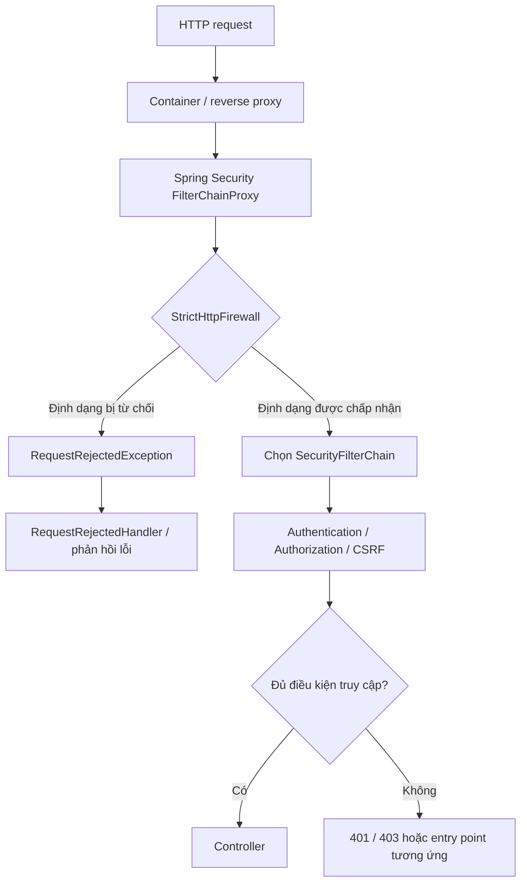

# Kiểm tra một ngoại lệ firewall bằng ca hợp lệ cùng ca bị từ chối

> **Chương:** Thực hành tổng hợp  
> **Module:** `SPRING_SECURITY_HTTP_PROTECTION`  
> **Môi trường:** Spring Security trên Servlet và Reactive (WebFlux), Java, JUnit 5; dùng Spring Test và Reactor Test ở các ví dụ tương ứng.  
> **Mục tiêu thực hành:** Chỉ mở một ngoại lệ có lý do nghiệp vụ trong HTTP firewall, chứng minh request cần thiết được chấp nhận, đồng thời xác nhận các request nguy hiểm khác vẫn bị từ chối.

## 1. Bài toán: cần một ngoại lệ nhưng vẫn giữ hàng rào mặc định

Ứng dụng bán hàng có API dùng **matrix variables** theo dạng URL:

```http
GET /products/42;color=red
```

Controller cần đọc `id=42` và `color=red`. Trong Spring Security, `StrictHttpFirewall` mặc định không cho phép dấu chấm phẩy (`;`) trong đường dẫn vì dấu này từng liên quan đến các cách diễn giải URL khác nhau giữa container, framework và security matcher. Một cách cấu hình có chủ đích cho nhu cầu này là:

```java
firewall.setAllowSemicolon(true);
```

Nhưng thay đổi chỉ được chấp nhận khi thỏa **cả hai điều kiện**:

1. Request hợp lệ `GET /products/42;color=red` qua được firewall và được controller xử lý theo quy tắc phân quyền.
2. Các request không liên quan đến ngoại lệ, chẳng hạn `GET /products/42%2Fadmin` (dấu slash được mã hóa) hoặc `TRACE /products/42;color=red`, **vẫn bị firewall từ chối**.

Nếu chỉ có ca hợp lệ, phép thử không chứng minh được rằng ta chưa làm yếu những rào chắn khác. Nếu chỉ có ca bị từ chối, phép thử cũng chưa chứng minh được ngoại lệ giúp giải quyết yêu cầu nghiệp vụ.

**Lưu ý quan trọng:** Cho phép dấu `;` qua firewall không đồng nghĩa một người dùng được truy cập tài nguyên. Firewall kiểm tra định dạng request trước; sau đó Spring Security còn thực thi authentication, authorization, CSRF, CORS, chính sách session và các filter phù hợp.

## 2. Ranh giới thực thi của firewall

### 2.1. Servlet

Trong Servlet, `FilterChainProxy` của Spring Security dùng `HttpFirewall` để kiểm tra request, tạo request wrapper nhất quán cho việc so khớp đường dẫn và có thể ném `RequestRejectedException`. Triển khai mặc định là `StrictHttpFirewall`.



`RequestRejectedException` là kết quả từ **firewall**. Ngược lại, `401` hoặc `403` thường thể hiện sự từ chối ở lớp xác thực hoặc phân quyền. Không nên gộp tất cả thành “firewall chặn”.

### 2.2. Reactive/WebFlux

WebFlux dùng `ServerWebExchangeFirewall` và mặc định là `StrictServerWebExchangeFirewall`. Nó làm việc qua `WebFilterChainProxy`, trả về `Mono<ServerWebExchange>` và phát lỗi `ServerExchangeRejectedException` nếu từ chối.

Hai cơ chế tương đương về mục đích nhưng **khác API**:

| Servlet | Reactive/WebFlux |
|---|---|
| `StrictHttpFirewall` | `StrictServerWebExchangeFirewall` |
| `HttpFirewall#getFirewalledRequest` | `ServerWebExchangeFirewall#getFirewalledExchange` |
| `RequestRejectedException` | `ServerExchangeRejectedException` |
| `FilterChainProxy` | `WebFilterChainProxy` |
| `MockHttpServletRequest`, JUnit 5 | `MockServerWebExchange`, Reactor `StepVerifier` |
| `RequestRejectedHandler` | `ServerExchangeRejectedHandler` |

Không dùng `MockMvc` để chứng minh cấu hình firewall của WebFlux, cũng không dùng `WebTestClient` như một thay thế mặc nhiên cho các phép thử trực tiếp `StrictHttpFirewall` trên Servlet.

## 3. Xác định phạm vi ngoại lệ trước khi thay đổi

Đối với bài này, ngoại lệ duy nhất là **dấu chấm phẩy trong URL**. Ta không cho phép dấu slash mã hóa, đường dẫn không chuẩn hóa, ký tự điều khiển hoặc HTTP method bất thường.

| Điều kiện kiểm tra | Request mẫu | Kỳ vọng ở firewall tùy chỉnh |
|---|---|---|
| Baseline trước khi có ngoại lệ | `GET /products/42;color=red` | Bị từ chối. |
| Ca hợp lệ sau ngoại lệ | `GET /products/42;color=red` | Được chấp nhận; tiếp tục đến bước phân quyền/route. |
| Ca âm: encoded slash | `GET /products/42%2Fadmin` | Bị từ chối. |
| Ca âm: HTTP method không được cho phép | `TRACE /products/42;color=red` | Bị từ chối. |
| Ca âm: đường dẫn không chuẩn | `GET /products//42` | Cần bị chặn bởi quy tắc normalization; xác minh trên mô hình triển khai thực. |
| Ca bảo vệ nghiệp vụ | Người chưa xác thực gọi endpoint bắt buộc đăng nhập | Bị chặn ở lớp authorization, dù request qua firewall. |

Việc `setAllowSemicolon(true)` có hiệu lực trên **mọi URL đi qua bean firewall đó**, không chỉ `/products/**`. Đây là ràng buộc rất quan trọng. Nếu ứng dụng chỉ muốn dùng tham số tìm kiếm đơn giản, chuyển thành `GET /products/42?color=red` thường dễ kiểm thử và ít tạo khác biệt về diễn giải URL hơn.

### Vì sao chọn `%2F` làm ca âm chính?

`%2F` là dạng mã hóa của dấu `/`. Proxy, container và ứng dụng có thể xử lý hoặc giải mã nó khác nhau. Việc cho phép encoded slash ở lớp firewall có thể làm đường dẫn thực tế khác với đường dẫn dùng khi chọn security rule. `StrictHttpFirewall` mặc định từ chối encoded slash; mở `allowSemicolon` **không được làm thay đổi quy tắc đó**.

Ca `TRACE` là phép thử độc lập: mặc định firewall chỉ cho các phương thức HTTP phổ biến như `DELETE, GET, HEAD, OPTIONS, PATCH, POST, PUT`. Cho phép dấu chấm phẩy không đồng nghĩa được bật `setUnsafeAllowAnyHttpMethod(true)`.

## 4. Cấu hình tối thiểu cho Servlet

Trong ứng dụng Spring Security Servlet, khai báo một bean `StrictHttpFirewall`:

```java
import org.springframework.context.annotation.Bean;
import org.springframework.context.annotation.Configuration;
import org.springframework.security.web.firewall.StrictHttpFirewall;

@Configuration
class FirewallConfiguration {

    @Bean
    StrictHttpFirewall httpFirewall() {
        StrictHttpFirewall firewall = new StrictHttpFirewall();

        // Ngoại lệ có chủ đích cho matrix variables.
        firewall.setAllowSemicolon(true);

        // Những kiểm tra còn lại giữ nguyên giá trị an toàn mặc định.
        return firewall;
    }
}
```

Spring Security có thể sử dụng bean firewall được công bố trong cấu hình bảo mật thông thường. Không tạo thêm `FilterChainProxy` thứ hai nếu ứng dụng đã có security filter chain. Đối với cấu hình nhiều application context hoặc tùy biến sâu, cần xác minh bean thực tế được chain sử dụng.

Cấu hình phân quyền vẫn phải độc lập với firewall:

```java
import org.springframework.context.annotation.Bean;
import org.springframework.context.annotation.Configuration;
import org.springframework.http.HttpMethod;
import org.springframework.security.config.annotation.web.builders.HttpSecurity;
import org.springframework.security.web.SecurityFilterChain;

@Configuration
class SecurityConfiguration {

    @Bean
    SecurityFilterChain securityFilterChain(HttpSecurity http) throws Exception {
        http.authorizeHttpRequests(authorize -> authorize
            .requestMatchers(HttpMethod.GET, "/products/**")
                .hasAuthority("catalog:read")
            .anyRequest().authenticated()
        );

        return http.build();
    }
}
```

Đây là hai đoạn cấu hình phối hợp: firewall cho phép một dạng URL, còn yêu cầu `catalog:read` quyết định người gọi có được đọc sản phẩm không. Các bảo vệ như CSRF, session và security headers vẫn giữ cấu hình riêng của ứng dụng.

Ví dụ controller (Spring MVC hỗ trợ matrix variables):

```java
import org.springframework.web.bind.annotation.GetMapping;
import org.springframework.web.bind.annotation.MatrixVariable;
import org.springframework.web.bind.annotation.PathVariable;
import org.springframework.web.bind.annotation.RestController;

@RestController
class ProductController {

    @GetMapping("/products/{id}")
    String find(
            @PathVariable String id,
            @MatrixVariable(pathVar = "id", name = "color") String color) {

        // Demo: ứng dụng thật còn kiểm tra id, dữ liệu và quyền truy cập.
        return id + ":" + color;
    }
}
```

Khi endpoint hoạt động với `GET /products/42;color=red`, giá trị nghiệp vụ mong đợi là `42:red`. Với các bản Spring MVC hiện đại, cơ chế `PathPatternParser` hỗ trợ matrix variables; hệ thống cũ dùng cấu hình so khớp đường dẫn khác có thể cần điều chỉnh. Cần kiểm tra cả cách chọn security matcher và cách controller đọc tham số.

## 5. Kiểm thử trực tiếp Servlet: baseline, ca hợp lệ và ca bị từ chối

Kiểm thử firewall ở mức đơn vị giúp tránh nhiễu từ login, controller, URL mapping, reverse proxy và xử lý ngoại lệ. Ví dụ dưới dùng **JUnit Jupiter** và `spring-test` (`MockHttpServletRequest`).

```java
import org.junit.jupiter.api.Test;
import org.springframework.mock.web.MockHttpServletRequest;
import org.springframework.security.web.firewall.RequestRejectedException;
import org.springframework.security.web.firewall.StrictHttpFirewall;

import static org.junit.jupiter.api.Assertions.assertDoesNotThrow;
import static org.junit.jupiter.api.Assertions.assertThrows;

class FirewallExceptionTest {

    private static MockHttpServletRequest request(
            String method, String rawUri) {
        // rawUri giữ nguyên mẫu kiểm thử trước khi container xử lý.
        return new MockHttpServletRequest(method, rawUri);
    }

    private static StrictHttpFirewall firewallWithMatrixVariables() {
        StrictHttpFirewall firewall = new StrictHttpFirewall();
        firewall.setAllowSemicolon(true);
        return firewall;
    }

    @Test
    void defaultFirewallRejectsSemicolon() {
        StrictHttpFirewall defaultFirewall = new StrictHttpFirewall();

        assertThrows(
            RequestRejectedException.class,
            () -> defaultFirewall.getFirewalledRequest(
                request("GET", "/products/42;color=red")
            )
        );
    }

    @Test
    void allowsRequiredMatrixVariableAfterException() {
        StrictHttpFirewall firewall = firewallWithMatrixVariables();

        assertDoesNotThrow(() -> firewall.getFirewalledRequest(
            request("GET", "/products/42;color=red")
        ));
    }

    @Test
    void stillRejectsEncodedSlash() {
        StrictHttpFirewall firewall = firewallWithMatrixVariables();

        assertThrows(
            RequestRejectedException.class,
            () -> firewall.getFirewalledRequest(
                request("GET", "/products/42%2Fadmin")
            )
        );
    }

    @Test
    void stillRejectsTraceMethod() {
        StrictHttpFirewall firewall = firewallWithMatrixVariables();

        assertThrows(
            RequestRejectedException.class,
            () -> firewall.getFirewalledRequest(
                request("TRACE", "/products/42;color=red")
            )
        );
    }
}
```

### Đọc kết quả

- **Baseline PASS:** mặc định chặn `;`, xác nhận bài toán thực sự cần ngoại lệ.
- **Ca hợp lệ PASS:** thay đổi có tác dụng đối với đúng dạng request mong đợi.
- **Encoded slash PASS:** ngoại lệ không làm mất cơ chế từ chối `%2F`.
- **TRACE PASS:** ngoại lệ không vô hiệu hóa kiểm tra HTTP method.

Khi dùng Spring Security, ca bị từ chối có thể biểu hiện bằng `RequestRejectedException` trong phép thử trực tiếp. Mã trạng thái HTTP ở mức tích hợp phụ thuộc vào `RequestRejectedHandler` và các tầng xử lý khác; **không lấy “nhìn thấy 400” làm bằng chứng duy nhất**.

Một kiểm thử mạnh hơn nên kiểm tra cả dấu chấm phẩy tại đường dẫn nhạy cảm và biến thể mã hóa mà hệ thống thực tế chấp nhận:

```java
@Test
void semicolonDoesNotImplicitlyPermitEncodedSlash() {
    StrictHttpFirewall firewall = firewallWithMatrixVariables();

    assertThrows(RequestRejectedException.class,
        () -> firewall.getFirewalledRequest(
            request("GET", "/admin;view=all%2Fsecrets")
        ));
}
```

Ở đây dấu `;` được chấp nhận theo ngoại lệ, nhưng `%2F` vẫn phải bị chặn. Đây là một **ca kết hợp** hữu ích để phát hiện cấu hình mở quá rộng.

> **Phạm vi của unit test:** Các phép thử trên xác nhận trực tiếp tính năng chấp nhận/từ chối của `StrictHttpFirewall`. Chúng chưa chứng minh việc chọn đúng `SecurityFilterChain`, áp dụng `catalog:read`, đọc matrix variables ở controller hay cách proxy xử lý đường dẫn.

## 6. Bổ sung kiểm thử tích hợp Servlet

Khi cấu hình hoàn chỉnh, dùng Spring Boot Test + MockMvc + Spring Security Test để kiểm tra cả đường đi request. Ví dụ bên dưới giả định đã khai báo các bean `FirewallConfiguration`, `SecurityConfiguration`, `ProductController` ở phần trước và có các dependency test tương ứng.

```java
import org.junit.jupiter.api.Test;
import org.springframework.beans.factory.annotation.Autowired;
import org.springframework.boot.test.autoconfigure.web.servlet.AutoConfigureMockMvc;
import org.springframework.boot.test.context.SpringBootTest;
import org.springframework.test.web.servlet.MockMvc;
import org.springframework.security.test.context.support.WithMockUser;

import static org.springframework.test.web.servlet.request.MockMvcRequestBuilders.get;
import static org.springframework.test.web.servlet.result.MockMvcResultMatchers.content;
import static org.springframework.test.web.servlet.result.MockMvcResultMatchers.status;

@SpringBootTest
@AutoConfigureMockMvc
class ProductFirewallIntegrationTest {

    @Autowired
    MockMvc mvc;

    @Test
    @WithMockUser(authorities = "catalog:read")
    void matrixVariableReachesControllerWhenAuthorized() throws Exception {
        mvc.perform(get("/products/42;color=red"))
            .andExpect(status().isOk())
            .andExpect(content().string("42:red"));
    }

    @Test
    @WithMockUser // Không có catalog:read.
    void firewallAllowedRequestStillNeedsAuthorization() throws Exception {
        mvc.perform(get("/products/42;color=red"))
            .andExpect(status().isForbidden());
    }
}
```

Hai test này kiểm tra **kết quả ứng dụng**: một request đã vượt qua firewall chỉ đến được controller khi có quyền thích hợp. Điều này đặc biệt quan trọng với URL chứa matrix variables vì phần đường dẫn dùng trong security matching có thể khác hình thức đầy đủ mà controller thấy.

**Thận trọng khi assert mã lỗi:** Đối với URL chứa `%2F`, mặc định `DefaultRequestRejectedHandler` có thể ném lại `RequestRejectedException` thay vì gửi HTTP 400. Nếu ứng dụng cấu hình `HttpStatusRequestRejectedHandler(400)` thì có thể kiểm chứng status 400; nếu không, cần xác nhận exception hoặc behavior đúng với handler đang dùng. Không cố định một mã HTTP khi chưa xác nhận đường đi thực tế.

Ví dụ cấu hình handler độc lập cho trường hợp **muốn trả 400**:

```java
import org.springframework.security.web.FilterChainProxy;
import org.springframework.security.web.firewall.HttpStatusRequestRejectedHandler;

void configureRejectedResponse(FilterChainProxy chain) {
    // Minh họa khi bạn đang sở hữu cấu hình FilterChainProxy.
    chain.setRequestRejectedHandler(
        new HttpStatusRequestRejectedHandler(400)
    );
}
```

Đoạn trên **chỉ minh họa API**, không phải một bean để tự động copy vào ứng dụng: phần lớn dự án do Spring Security tạo `FilterChainProxy`. Nếu cần đổi handler, hãy cấu hình tại điểm tích hợp phù hợp với phiên bản và kiến trúc hiện có; tránh tự dựng thêm chain thứ hai.

## 7. Kiểm tra ngoại lệ tương ứng trong WebFlux

Đối với ứng dụng Reactive, dùng bean `StrictServerWebExchangeFirewall`. Không dùng `StrictHttpFirewall` của Servlet trong WebFlux.

```java
import org.springframework.context.annotation.Bean;
import org.springframework.context.annotation.Configuration;
import org.springframework.security.web.server.firewall.StrictServerWebExchangeFirewall;

@Configuration
class ReactiveFirewallConfiguration {

    @Bean
    StrictServerWebExchangeFirewall httpFirewall() {
        StrictServerWebExchangeFirewall firewall =
            new StrictServerWebExchangeFirewall();

        firewall.setAllowSemicolon(true);
        return firewall;
    }
}
```

### 7.1. Kiểm thử Reactive ở lớp firewall

Với `spring-test` và `reactor-test`, có thể kiểm thử `Mono` mà firewall trả về bằng `StepVerifier`. `Mono.defer` đảm bảo cả ngoại lệ ném ngay khi gọi lẫn lỗi phát trong stream đều được StepVerifier ghi nhận.

```java
import org.junit.jupiter.api.Test;
import org.springframework.mock.http.server.reactive.MockServerHttpRequest;
import org.springframework.mock.web.server.MockServerWebExchange;
import org.springframework.security.web.server.firewall.ServerExchangeRejectedException;
import org.springframework.security.web.server.firewall.StrictServerWebExchangeFirewall;
import org.springframework.web.server.ServerWebExchange;
import reactor.core.publisher.Mono;
import reactor.test.StepVerifier;

class ReactiveFirewallExceptionTest {

    private static Mono<ServerWebExchange> validate(
            StrictServerWebExchangeFirewall firewall,
            String rawUri) {

        return Mono.defer(() -> firewall.getFirewalledExchange(
            MockServerWebExchange.from(
                MockServerHttpRequest.get(rawUri).build()
            )
        ));
    }

    @Test
    void defaultRejectsSemicolon() {
        StrictServerWebExchangeFirewall firewall =
            new StrictServerWebExchangeFirewall();

        StepVerifier.create(validate(
                firewall, "/products/42;color=red"))
            .expectError(ServerExchangeRejectedException.class)
            .verify();
    }

    @Test
    void allowsExpectedPathButStillBlocksEncodedSlash() {
        StrictServerWebExchangeFirewall firewall =
            new StrictServerWebExchangeFirewall();
        firewall.setAllowSemicolon(true);

        StepVerifier.create(validate(
                firewall, "/products/42;color=red"))
            .expectNextCount(1)
            .verifyComplete();

        StepVerifier.create(validate(
                firewall, "/products/42%2Fadmin"))
            .expectError(ServerExchangeRejectedException.class)
            .verify();
    }
}
```

Nếu cần phủ thêm HTTP method ở WebFlux, tạo `MockServerHttpRequest.method(HttpMethod.TRACE, URI.create(...))` và xác nhận lỗi `ServerExchangeRejectedException`. Trường hợp đó kiểm tra riêng chức năng allowlist method; không trộn với kết quả xử lý của controller.

Ở tầng HTTP, tài liệu Spring Security mô tả `HttpStatusExchangeRejectedHandler` mặc định gửi 400 khi request bị firewall WebFlux từ chối. Các proxy/gateway hoặc handler tùy chỉnh vẫn có thể làm khác quan sát từ bên ngoài, nên cần thêm integration test bằng `WebTestClient` khi chạy ứng dụng thật.

## 8. Kiểm thử trên đường đi thực tế, không chỉ trong test framework

Mock request không mô phỏng đầy đủ Nginx, load balancer, WAF, CDN hoặc cấu hình Tomcat/Jetty/Undertow. Một URL được phép trong unit test có thể bị container từ chối hoặc bị giải mã trước khi tới firewall. Một URL được kỳ vọng firewall từ chối có thể bị tầng ngoài chặn trước.

Trong môi trường kiểm thử cho phép, có thể gửi request tới endpoint staging:

```bash
# Ca hợp lệ: giữ chính xác dấu chấm phẩy trong path.
curl -i --path-as-is \
  'https://staging.example.test/products/42;color=red'

# Ca âm: encoded slash phải tiếp tục bị từ chối ở một tầng phòng vệ.
curl -i --path-as-is \
  'https://staging.example.test/products/42%2Fadmin'

# Ca âm độc lập: phương thức TRACE không được chấp nhận.
curl -i -X TRACE --path-as-is \
  'https://staging.example.test/products/42;color=red'
```

Các lệnh trên dùng tên miền minh họa. Ca hợp lệ cần danh tính có `catalog:read`, hoặc token test tương ứng. Nếu chỉ nhận 401, ta chưa biết request có qua được firewall hay không. Khi kiểm thử yêu cầu xác thực, dùng tài khoản thử nghiệm đúng quyền và không đưa credential vào log.

Đối chiếu kết quả từ nhiều điểm:

| Nơi quan sát | Cần làm rõ |
|---|---|
| Client/curl | HTTP status, redirect, response headers, nội dung hợp lệ. |
| Reverse proxy/WAF | Có rewrite, decode, normalize hoặc reject URL trước ứng dụng không? |
| Ứng dụng Spring Security | Có `RequestRejectedException`/`ServerExchangeRejectedException`? Có vào security chain? |
| Authorization | Request chấp nhận về cú pháp có vẫn bị chặn nếu thiếu quyền? |
| Controller | Matrix variable được đọc đúng chưa? |
| Monitoring | Số lần request bị firewall từ chối có tăng bất thường sau khi bật ngoại lệ không? |

Giá trị kiểm tra quan trọng hơn một status đơn lẻ là **nguyên nhân và ranh giới từ chối**. Ở Servlet, lỗi 400 có thể đến từ container hoặc handler; 404 cũng có thể là endpoint không khớp, hoàn toàn khác với quyết định của firewall.

## 9. Tiêu chí đạt và những lỗi dễ bỏ sót

### 9.1. Bảng pass/fail

| Mã ca | Điều kiện | Bằng chứng đạt |
|---|---|---|
| FW-00 | Firewall mặc định, request có `;` | Test xác nhận `RequestRejectedException` hoặc `ServerExchangeRejectedException`. |
| FW-01 | Chỉ bật `allowSemicolon`, request hợp lệ | Test firewall chấp nhận; integration test có quyền đi tới controller đúng dữ liệu. |
| FW-02 | Chỉ bật `allowSemicolon`, URL chứa `%2F` | Firewall vẫn từ chối, không đi vào business handler. |
| FW-03 | Chỉ bật `allowSemicolon`, `TRACE` | Firewall từ chối do HTTP method không hợp lệ. |
| AUTH-01 | Request hợp lệ nhưng thiếu `catalog:read` | Authorization chặn; không được coi là firewall từ chối. |
| DEPLOY-01 | URL đi qua gateway/container thực | Có bằng chứng giữ nguyên điều kiện kiểm tra hoặc xác định rõ tầng nào chặn. |

**Một bài kiểm thử chỉ có FW-01 chưa đủ đạt.** Cần ít nhất FW-02 hoặc FW-03, kết hợp kiểm chứng đúng quyết định phân quyền khi ứng dụng chạy thật.

### 9.2. Các lỗi triển khai phổ biến

**Lỗi 1 — Mở nhiều cờ để sửa một URL.** Ví dụ đồng thời bật `setAllowSemicolon(true)`, `setAllowUrlEncodedSlash(true)` và `setUnsafeAllowAnyHttpMethod(true)`. Điều này mở thêm những hình thức request vốn không nằm trong nhu cầu matrix variables. Quay lại ngoại lệ nhỏ nhất và viết ca âm cho từng khả năng ngoài phạm vi.

**Lỗi 2 — Chỉ test mã trạng thái HTTP.** Một endpoint 404 không có nghĩa firewall đã từ chối, cũng như một 403 không chứng minh firewall đã chặn URL bất thường. Test ở lớp firewall xác nhận ngoại lệ; integration test xác nhận request thực tế và phân quyền.

**Lỗi 3 — Test đường dẫn đã được giải mã.** `/products/42/admin` không thay thế được ca `/products/42%2Fadmin`. Dữ liệu kiểm thử phải giữ **raw request target** nếu muốn phát hiện vấn đề encoded slash. Theo dõi thay đổi ở proxy và servlet container.

**Lỗi 4 — Kiểm thử với người dùng không đủ quyền.** Mọi request đều 401/403 nên nhóm phát triển tưởng firewall vẫn an toàn. Trước hết phân loại request bị từ chối ở lớp nào, sau đó dùng tài khoản thử nghiệm đúng quyền để xác nhận đường đi hợp lệ.

**Lỗi 5 — Bỏ qua bypass qua path matching.** Nếu URL có matrix variable, security matcher có thể dùng một dạng path đã loại path parameter trong khi MVC vẫn nhận matrix variable. Phải kiểm tra các đường dẫn yêu cầu xác thực cao (`/admin/**`, `/internal/**`) và bảo vệ tại service layer khi phù hợp.

**Lỗi 6 — Chỉ chạy trong MockMvc.** Cấu hình ứng dụng có thể đúng nhưng container, gateway hoặc WAF biến đổi request. Thử nghiệm staging qua luồng mạng thực tế là lớp xác minh cần thiết trước khi triển khai.

**Lỗi 7 — Nhầm firewall với các lớp HTTP khác.** `StrictHttpFirewall` không thay thế CSRF token, cấu hình CORS, CSP/HSTS, session fixation protection hoặc kiểm tra quyền trong service. Ngoại lệ dấu chấm phẩy cũng không phải lý do vô hiệu hóa các cơ chế đó.

## 10. Bài tập mở rộng

Hãy hoàn thành ba thay đổi sau trong môi trường học tập, rồi ghi kết quả vào bảng kiểm thử riêng:

1. **Thay nhu cầu matrix variable bằng query parameter:** đổi `/products/42;color=red` thành `/products/42?color=red`; xóa `setAllowSemicolon(true)`. So sánh firewall baseline, kết quả routing và phân quyền. Trường hợp này thường cho phép quay về mặc định chặt hơn.
2. **Thêm một ca kết hợp:** `GET /products/42;color=red%2Fadmin`. Dự đoán và kiểm tra rằng encoded slash tiếp tục bị từ chối dù dấu `;` đã được cho phép.
3. **Thêm một luồng phân quyền:** gửi cùng request hợp lệ dưới người dùng có và không có `catalog:read`. Chứng minh khác biệt `200`/`403` đến từ quyền truy cập, không phải từ firewall.

Câu hỏi tự đánh giá:

- **Vì sao test “ngoại lệ thành công” chưa đủ?** Vì nó không phát hiện các quy tắc khác đã bị nới rộng.
- **Nếu request bị 400 từ gateway, có thể kết luận `StrictHttpFirewall` hoạt động đúng không?** Không; cần bằng chứng request đã đi tới firewall hoặc test trực tiếp tại lớp firewall.
- **Khi `setAllowSemicolon(true)`, có thể giới hạn ngoại lệ chỉ tại `/products/**` bằng cách dùng một bean firewall toàn cục không?** Không tự động; cờ được áp dụng cho mọi request qua instance firewall đó. Cần thiết kế kiến trúc kiểm soát rõ ràng hoặc thay đổi hình thức URL.
- **Nếu request đi qua firewall nhưng bị 403, nguyên nhân là gì?** Nhiều khả năng là authorization hoặc lớp security tiếp theo; phải xem log và cấu hình thực tế để phân biệt chính xác.
- **Nếu không thật sự cần matrix variables, lựa chọn ưu tiên là gì?** Dùng query parameter và giữ firewall mặc định.

## 11. Checklist trước khi hoàn thành thực hành

- [ ] Nêu rõ nhu cầu nghiệp vụ của dấu `;`, không mở ngoại lệ khi chưa cần.
- [ ] Chứng minh baseline mặc định từ chối request đó.
- [ ] Chỉ bật `setAllowSemicolon(true)`, không mở các cờ URL/method khác.
- [ ] Có test ca hợp lệ và ít nhất một ca bị firewall từ chối sau thay đổi.
- [ ] Có ca test chứng minh endpoint hợp lệ vẫn phải tuân thủ authentication/authorization.
- [ ] Phân biệt exception tại lớp firewall với status được HTTP handler/proxy trả về.
- [ ] Có thử nghiệm trên Servlet hoặc WebFlux đúng stack của hệ thống.
- [ ] Có kiểm thử qua proxy/container thực tế nếu đưa thay đổi lên staging.
- [ ] Có quy trình theo dõi lỗi và rollback khi phát hiện request bypass hoặc tính năng phụ thuộc bị hỏng.

## Tài liệu tham khảo

- [Spring Security — Servlet HttpFirewall](https://docs.spring.io/spring-security/reference/servlet/exploits/firewall.html): `StrictHttpFirewall`, matrix variables, default HTTP methods, quản lý `RequestRejectedException`.
- [Spring Security — StrictHttpFirewall API](https://docs.spring.io/spring-security/reference/api/java/org/springframework/security/web/firewall/StrictHttpFirewall.html): các tùy chọn `setAllowSemicolon`, `setAllowUrlEncodedSlash` và các điều kiện từ chối.
- [Spring Security — Servlet FilterChainProxy API](https://docs.spring.io/spring-security/reference/api/java/org/springframework/security/web/FilterChainProxy.html): đường đi request và phương thức `setRequestRejectedHandler`.
- [Spring Security — DefaultRequestRejectedHandler API](https://docs.spring.io/spring-security/reference/api/java/org/springframework/security/web/firewall/DefaultRequestRejectedHandler.html): handler mặc định ném lại ngoại lệ.
- [Spring Security — Reactive ServerWebExchangeFirewall](https://docs.spring.io/spring-security/reference/reactive/exploits/firewall.html): cấu hình `StrictServerWebExchangeFirewall` và hành vi từ chối.
- [Spring Security — StrictServerWebExchangeFirewall API](https://docs.spring.io/spring-security/reference/api/java/org/springframework/security/web/server/firewall/StrictServerWebExchangeFirewall.html): `getFirewalledExchange` và các tùy chọn phòng vệ.
