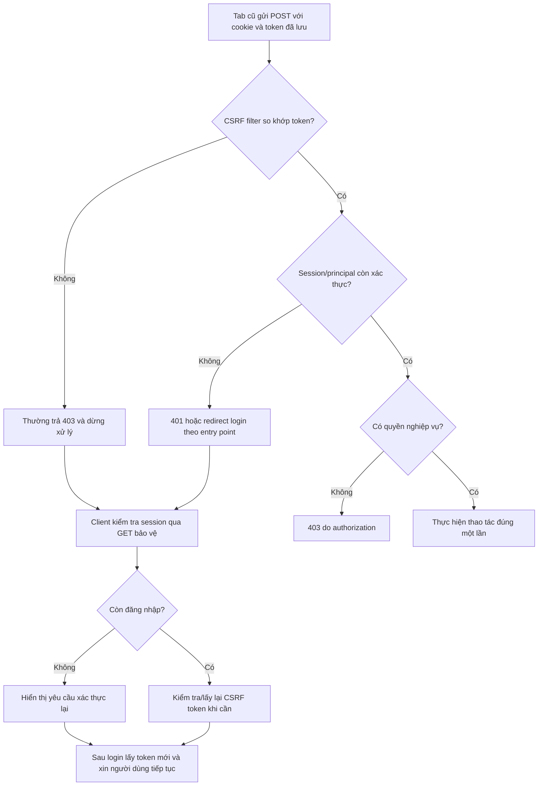

# Tái hiện phiên hết hạn cùng luồng lấy CSRF token mới

## Mục tiêu thực hành

Trong ứng dụng web dùng Spring Security, người dùng có thể mở trang chỉnh sửa, để trình duyệt không hoạt động đủ lâu cho **HTTP session hết hạn**, rồi quay lại nhấn nút Lưu. Giao diện vẫn giữ form cũ và CSRF token đã lấy trước đó, nhưng server không còn nhận diện phiên đăng nhập ban đầu. Yêu cầu thay đổi dữ liệu có thể nhận `403 Forbidden` do CSRF không hợp lệ, `401 Unauthorized` do thiếu xác thực, hoặc một redirect tới trang đăng nhập, tùy cấu hình và thứ tự các lớp bảo vệ.

Bài học **Thực hành tổng hợp** này thuộc phạm vi `SPRING_SECURITY_HTTP_PROTECTION`, kết nối bảo vệ session, CSRF, HTTP status, cookie, HTTPS, trình duyệt và kiểm thử Spring Security. Bạn sẽ tái hiện chính xác tình huống phiên hết hạn, tạo **CSRF token mới**, xác thực lại khi cần và xác minh request nghiệp vụ chỉ được thực hiện một lần sau khi người dùng chủ động tiếp tục.

Kết thúc bài học, người học có thể:

- Giải thích vì sao **session hết hạn** và **CSRF token hết hiệu lực** là hai sự kiện liên quan nhưng khác nhau.
- Triển khai endpoint cấp CSRF token theo cách phù hợp với session và cơ chế deferred token của Spring Security.
- Thiết kế luồng client xử lý `401`/`403`, phân biệt yêu cầu đăng nhập lại với yêu cầu lấy token mới, tránh vòng lặp và tránh gửi lại thao tác nguy hiểm.
- Dựng lại lỗi ở mức `MockMvc` và trình duyệt thật với cookie/session store, quan sát HTTP response, token và side effect.
- Nêu điểm giống và khác giữa **Servlet/MVC** và **WebFlux/Reactive**, cũng như giới hạn của cookie-based CSRF với SPA.

Ví dụ chính dùng **Spring Boot 3.x / Spring Security 6.x**, Java 17+, Spring MVC/Servlet và form login có cookie `JSESSIONID`. Ý tưởng vẫn áp dụng cho bản Spring Security mới hơn nhưng cần đối chiếu API của phiên bản thực tế; phần Reactive được hướng dẫn riêng ở cuối bài.

## 1. Phân tích hiện tượng trước khi cấu hình

Xét một ứng dụng có ba endpoint:

| Endpoint | Phương thức | Mục đích |
| --- | --- | --- |
| `/api/csrf` | `GET` | Trả về tên header và CSRF token cho **phiên HTTP hiện tại** |
| `/api/session` | `GET` | Xác minh người dùng hiện còn đăng nhập hay không |
| `/api/actions` | `POST` | Thực hiện thao tác thay đổi trạng thái, yêu cầu đăng nhập và CSRF hợp lệ |

Luồng bình thường:

1. Người dùng mở ứng dụng qua HTTPS, đăng nhập bằng `POST /login` với CSRF token của form.
2. Browser lưu session cookie; ứng dụng gọi `GET /api/csrf` và nhận token dùng cho yêu cầu thay đổi trạng thái.
3. Browser gửi `POST /api/actions` kèm cookie và CSRF token; server xác thực, kiểm tra CSRF và quyền, sau đó thực hiện nghiệp vụ.
4. Người dùng không hoạt động hoặc quản trị viên thu hồi session; session cũ không còn hợp lệ trên server.
5. Browser còn giữ trang, có thể vẫn giữ cookie cũ và token trước đó. Lần `POST` tiếp theo **phải bị chặn**.
6. Frontend kiểm tra tình trạng đăng nhập, dẫn người dùng xác thực lại, lấy CSRF token mới và chỉ tiếp tục thao tác theo quyết định của người dùng.

### 1.1 Hai trạng thái không đồng nghĩa

| Trạng thái | Browser có thể quan sát | Ý nghĩa ở server | Xử lý phù hợp |
| --- | --- | --- | --- |
| Session còn hợp lệ, CSRF token phù hợp | `POST` thành công nếu có quyền | Xác thực, CSRF và quyền đều đạt | Tiếp tục |
| Session còn hợp lệ, token thiếu/sai | `POST` thường trả `403` | Chính sách CSRF chặn trước nghiệp vụ | Xem lại token, có thể tải token mới; không tự khẳng định mất đăng nhập |
| Session hết hạn, client gửi token cũ | `403`/`401`/redirect tùy cấu hình | Server không còn phiên cũ; CSRF có thể thất bại trước auth | Kiểm tra phiên; yêu cầu đăng nhập lại nếu cần |
| Session mới nhưng người dùng chưa đăng nhập | Có thể lấy token qua endpoint cho phép anonymous | Có CSRF token nhưng **không có danh tính** | Đăng nhập trước khi thực hiện nghiệp vụ |
| Sau đăng nhập hoặc logout thành công | CSRF token trước đó có thể bị xóa/đổi | Spring Security có thể xóa token cũ để ngăn cố định token | Lấy token mới từ đúng session |
| User đang đăng nhập nhưng thiếu quyền thao tác | Có thể trả `403` | Authorization từ chối ngay cả khi CSRF hợp lệ | Thông báo thiếu quyền; không sửa bằng cách đổi token |

CSRF là cơ chế bảo vệ browser khi **credentials được tự động đính kèm**, điển hình là session cookie. Bearer token được JavaScript chủ động đặt vào `Authorization` không giống hoàn toàn cơ chế cookie; chính sách CSRF phải dựa vào cách client xác thực thực tế. Trong bài này **giữ CSRF bật** cho form login dùng session.

### 1.2 Thứ tự xử lý tạo ra kết quả 401/403 khác nhau



Đây là mô hình giải thích. Thực tế một request có thể được chặn ở filter/proxy khác trước khi đi tới controller. **Không thể dựa riêng vào `403` để kết luận session đã hết hạn**: 403 cũng có thể do CSRF token sai, thiếu quyền hoặc một rule khác.

Với form login mặc định, yêu cầu API chưa đăng nhập thường bị redirect về `/login`. Đối với frontend dùng `fetch` và mong chờ JSON, một redirect đến HTML login có thể gây lỗi parse JSON khó chẩn đoán. Thực hành bên dưới cấu hình `401` cho nhóm `/api/**` khi chưa xác thực, trong khi trang login vẫn dùng giao diện thông thường.

## 2. Mô hình tin cậy và các điều kiện hạ tầng

```mermaid
sequenceDiagram
    participant U as Trình duyệt
    participant P as HTTPS proxy
    participant S as Spring Security
    participant R as Session store
    participant B as Nghiệp vụ

    U->>P: GET /api/csrf + session cookie
    P->>S: Chuyển tiếp request tin cậy
    S->>R: Đọc/tạo CSRF token gắn với session
    S-->>U: 200 {headerName, token} + cookie nếu cần
    U->>P: POST /api/actions + cookie + CSRF token
    P->>S: Forward request
    S->>R: Kiểm tra token và phiên
    S->>B: Chỉ gọi khi đã qua bảo vệ
    B-->>U: 204 No Content
    Note over R: Session cũ hết hạn/được vô hiệu
    U->>P: POST với cookie/token cũ
    P->>S: Forward request
    S-->>U: 403 hoặc 401/redirect; nghiệp vụ không chạy
    U->>P: GET /api/session
    P->>S: Kiểm tra xác thực hiện tại
    S-->>U: 401 nếu chưa đăng nhập
    U->>S: Đăng nhập lại bằng luồng hợp lệ
    U->>S: GET /api/csrf sau khi đăng nhập
    S-->>U: CSRF token của phiên hiện tại
    U->>S: Chỉ gửi lại hành động nếu người dùng xác nhận
```

Chuẩn bị môi trường thử nghiệm:

- Môi trường dùng **HTTPS**, certificate hợp lệ và chính sách cookie phù hợp. Nếu TLS kết thúc tại reverse proxy, cấu hình forwarded headers và chỉ tin cậy proxy đã kiểm soát.
- Browser giữ cookie qua cùng origin để token, đăng nhập và request thao tác dùng **cùng một session**. Không gửi `JSESSIONID` hoặc CSRF token vào URL, log hay tài liệu công khai.
- Có hai tài khoản test hoặc một tài khoản và một phiên bị thu hồi; dữ liệu thử nghiệm có cách đếm side effect (bản ghi DB/audit/event).
- Có phương thức xác định để kết thúc session trong **môi trường test cô lập**, ví dụ invalidation bằng test fixture phía server hoặc trực tiếp qua test session store. Không thêm endpoint “expire session” không được bảo vệ vào production.
- Nếu sử dụng Spring Session với Redis/JDBC, kiểm thử trên session store đó khi chạy tích hợp; kết quả ở `MockHttpSession` chỉ đại diện lớp Servlet test.

Không dựa vào việc browser còn cookie để quyết định còn đăng nhập. Cookie có thể vẫn được gửi sau khi phiên đã hết hạn trên server.

## 3. Endpoint cấp CSRF token của session hiện tại

### 3.1 Vì sao cần endpoint chủ động?

Spring Security 6 dùng cơ chế **deferred CSRF token**: token có thể được tải hoặc tạo khi có nhu cầu, giúp tránh tạo session không cần thiết cho nhiều request GET tĩnh. Khi backend phải cung cấp CSRF token cho JavaScript, frontend cần **truy cập một endpoint buộc token được tạo/đọc** và nhận tên header/token.

Ví dụ controller:

```java
import org.springframework.http.CacheControl;
import org.springframework.http.ResponseEntity;
import org.springframework.security.web.csrf.CsrfToken;
import org.springframework.web.bind.annotation.GetMapping;
import org.springframework.web.bind.annotation.RestController;

record CsrfResponse(String headerName, String parameterName, String token) {}

@RestController
class CsrfTokenController {

    @GetMapping("/api/csrf")
    ResponseEntity<CsrfResponse> getCsrf(CsrfToken csrf) {
        // getToken() buộc token deferred được materialize.
        CsrfResponse body = new CsrfResponse(
                csrf.getHeaderName(),
                csrf.getParameterName(),
                csrf.getToken());

        return ResponseEntity.ok()
                .cacheControl(CacheControl.noStore())
                .body(body);
    }
}
```

Response ví dụ (giá trị chỉ minh họa):

```http
HTTP/1.1 200 OK
Content-Type: application/json
Cache-Control: no-store
Set-Cookie: JSESSIONID=<opaque-value>; Secure; HttpOnly; SameSite=Lax

{
  "headerName": "X-CSRF-TOKEN",
  "parameterName": "_csrf",
  "token": "<opaque-csrf-value>"
}
```

`Set-Cookie` có thể không xuất hiện nếu browser đã có session hợp lệ và server không cần phát lại cookie. Mỗi môi trường có chính sách cookie và tên token khác nhau. Đừng hardcode tên header cho mọi cấu hình; phía client nên dùng `headerName` do endpoint trả về.

Với **`HttpSessionCsrfTokenRepository` mặc định**, token gắn với session. Trong Spring Security 6, mặc định còn có xử lý **XOR/masking** để giảm rủi ro BREACH khi token được đưa vào response; chuỗi token lộ ra ở các request có thể thay đổi ngay cả khi **CSRF token gốc trong session chưa đổi**. Vì vậy, kiểm tra “token mới khác chuỗi token cũ” **không đủ chứng minh session đã hết hạn hoặc token server đã được thay thế**. Phải kiểm tra bằng session store, kết quả request và bằng chứng không có side effect.

### 3.2 SecurityFilterChain cho demo Servlet

Ví dụ dùng form login với session. `GET /api/csrf` được cho phép khi chưa đăng nhập, bởi ngay cả người dùng anonymous cũng cần token để bắt đầu một số flow (ví dụ đăng nhập bằng form). `GET /api/session` và `POST /api/actions` yêu cầu xác thực.

```java
import org.springframework.context.annotation.Bean;
import org.springframework.context.annotation.Configuration;
import org.springframework.http.HttpMethod;
import org.springframework.http.HttpStatus;
import org.springframework.security.config.annotation.web.builders.HttpSecurity;
import org.springframework.security.web.SecurityFilterChain;
import org.springframework.security.web.authentication.HttpStatusEntryPoint;
import org.springframework.security.web.util.matcher.AntPathRequestMatcher;

@Configuration
class SessionCsrfSecurityConfig {

    @Bean
    SecurityFilterChain securityFilterChain(HttpSecurity http)
            throws Exception {

        http
            .authorizeHttpRequests(auth -> auth
                .requestMatchers(HttpMethod.GET, "/api/csrf").permitAll()
                .requestMatchers("/api/**").authenticated()
                .anyRequest().authenticated())
            // API chưa đăng nhập trả 401 để JS không parse nhầm HTML login.
            .exceptionHandling(ex -> ex
                .defaultAuthenticationEntryPointFor(
                    new HttpStatusEntryPoint(HttpStatus.UNAUTHORIZED),
                    new AntPathRequestMatcher("/api/**")))
            .formLogin(form -> form.permitAll())
            .logout(logout -> logout.permitAll());
            // Giữ CSRF mặc định, không gọi csrf.disable().

        return http.build();
    }
}
```

Chính sách này chỉ mô tả cơ sở cho bài thực hành: ứng dụng thật phải bổ sung quyền theo vai trò và đối tượng đối với `/api/actions`, giới hạn session timeout, xử lý lỗi, bảo vệ HTTP headers và HTTPS. Nếu ứng dụng có nhiều `SecurityFilterChain`, bảo đảm matcher của endpoint được áp vào đúng chain. `AntPathRequestMatcher` ở đây phù hợp với Spring Security 6.x đang dùng; kiểm tra matcher thay thế khi nâng lên phiên bản có API mới.

**Lưu ý về `/api/csrf` được phép anonymous:** lấy CSRF token **không tương đương được đăng nhập**. Endpoint này chỉ trả token, không trả thông tin đăng nhập hoặc bí mật khác; phải trả qua HTTPS, chống cache và giữ chính sách same-origin/CORS chặt. Không dùng `Access-Control-Allow-Origin: *` với credentials. Đối với API chỉ cho phép user đã đăng nhập lấy token, luồng phục hồi phải bắt đầu từ trang login hoặc endpoint khác hỗ trợ anonymous, không giả định client luôn lấy được token lúc hết hạn.

### 3.3 Endpoint xác nhận trạng thái phiên và hành động

Để JavaScript quyết định có cần đăng nhập lại không, cung cấp một endpoint **được bảo vệ bằng authentication**, trả `200` khi còn phiên và `401` khi hết phiên:

```java
import org.springframework.http.HttpStatus;
import org.springframework.security.core.Authentication;
import org.springframework.web.bind.annotation.GetMapping;
import org.springframework.web.bind.annotation.PostMapping;
import org.springframework.web.bind.annotation.ResponseStatus;
import org.springframework.web.bind.annotation.RestController;

record SessionStatus(boolean authenticated) {}

interface ActionService {
    void executeAs(String username);
}

@RestController
class SessionActionController {
    private final ActionService actions;

    SessionActionController(ActionService actions) {
        this.actions = actions;
    }

    @GetMapping("/api/session")
    SessionStatus currentSession(Authentication authentication) {
        return new SessionStatus(true);
    }

    @PostMapping("/api/actions")
    @ResponseStatus(HttpStatus.NO_CONTENT)
    void perform(Authentication authentication) {
        // Demo: service phải kiểm tra quyền nghiệp vụ của user nếu có object.
        actions.executeAs(authentication.getName());
    }
}
```

Endpoint `/api/session` có thể trả thêm thông tin tối thiểu để UI hiển thị, nhưng không cần trả cookie, ID của session hoặc CSRF token. Nếu ứng dụng dùng logout/SSO, mô hình hết phiên còn tùy provider; một request tới IdP tự xác thực lại có thể làm client nhận session mới, nên test cần quan sát rõ khi nào xảy ra login.

## 4. Tái hiện session hết hạn trong một lượt thực hành

### 4.1 Đối chứng dương: token và session còn hợp lệ

Trên HTTPS:

1. Truy cập `/login`, nhập tài khoản test, lấy CSRF token của form login theo cách ứng dụng render; đăng nhập thành công.
2. Gọi `GET /api/session` và xác minh `200 OK`.
3. Gọi `GET /api/csrf` qua **cùng cookie jar**, nhận `headerName` và `token`.
4. Gọi `POST /api/actions` có `Cookie` session hiện tại và header CSRF tương ứng; xác minh `204 No Content`.
5. Kiểm tra service/DB/audit ghi **đúng một** tác động nghiệp vụ.

Ví dụ cặp request/response:

```text
GET /api/csrf
Cookie: JSESSIONID=<session-a>
   -> 200 { "headerName": "X-CSRF-TOKEN", "token": "<token-a>" }

POST /api/actions
Cookie: JSESSIONID=<session-a>
X-CSRF-TOKEN: <token-a>
   -> 204 (ghi nhận 1 action)
```

Đây là dạng minh họa. Trong kiểm thử tự động nên lấy token và cookie **từ response thực**, không hardcode token hoặc dán cookie thật vào console.

### 4.2 Cho session hết hạn có kiểm soát

Có hai cách phù hợp:

**Cách A — test fixture hoặc session store (khuyến nghị cho test quyết định):** sau khi tạo session `A`, dùng test harness phía server vô hiệu chính session `A`. Sau đó client **giữ nguyên cookie và token A** để gửi lần nữa. Cách này mô phỏng tình trạng “browser không biết server đã bỏ phiên” mà không chờ đồng hồ.

**Cách B — timeout ngắn trên môi trường thử nghiệm tách biệt:** cấu hình ví dụ:

```properties
# Chỉ dùng trong cấu hình test/staging cô lập.
server.servlet.session.timeout=1m

# Cookie production vẫn phải có Secure, HttpOnly, SameSite phù hợp.
server.servlet.session.cookie.secure=true
server.servlet.session.cookie.http-only=true
server.servlet.session.cookie.same-site=lax
```

Timeout container/session store có thể có độ phân giải và quy tắc gia hạn khác nhau. Một request polling vào session có thể kéo dài thời gian tồn tại, vì vậy không nên biến test thành “ngủ 60 giây rồi đoán phiên đã hết”. Cách A thường ổn định hơn cho kiểm thử CI.

Khi phiên bị vô hiệu, cookie `JSESSIONID` phía client có thể **vẫn còn**. Hãy quan sát server session store thay vì kiểm tra cookie có bị xóa hay không.

### 4.3 Thử POST với token cũ

Giữ token A, cookie session A và gửi lại `POST /api/actions`. Kết quả dự kiến là **request không được thực thi**. Thường xảy ra:

- `CsrfFilter` không tìm thấy token gốc tương ứng với session cũ, sinh/tải token khác và trả `403` cho token A.
- Nếu request có token phù hợp với một session mới nhưng user chưa đăng nhập, authentication entry point của API trả `401`.
- Cấu hình form login khác có thể redirect tới `/login`. Reverse proxy hoặc custom error handler có thể làm status khác.

**Yêu cầu chứng minh:** không có bản ghi/action mới, không có outbound event/email/charge thứ hai. Một status code đúng **chưa đủ** nếu có thành phần xử lý nghiệp vụ nằm trước filter hoặc tác động xảy ra ở đường xử lý bất thường.

### 4.4 Lấy token mới và kiểm tra xác thực

Gọi `GET /api/csrf` sau khi session A không còn hợp lệ. Vì demo cho phép anonymous và gọi `getToken()`, Spring Security có thể tạo token mới gắn với **session B**, và browser có thể nhận cookie mới. Sau đó:

- Gọi `GET /api/session`: nếu nhận `401`, **vẫn chưa đăng nhập**. Không được suy ra có quyền từ việc đã nhận token B.
- Gọi `POST /api/actions` bằng token B nhưng **chưa đăng nhập**: CSRF có thể qua, nhưng authentication phải chặn, ví dụ `401` theo config.
- Đăng nhập lại bằng luồng hợp lệ; sau login, **lấy lại CSRF token** trước khi gửi `POST`. Spring Security có chiến lược xóa token cũ khi xác thực thành công nhằm giảm rủi ro token fixation.
- Chỉ gửi lại thao tác nghiệp vụ sau khi người dùng xác nhận nội dung và có chiến lược xử lý tác vụ lặp.

```text
Session A hết hạn
POST /api/actions (token A, cookie A)
   -> 403 hoặc chính sách chưa xác thực; không side effect

GET /api/csrf
   -> 200 { token B } (có thể hình thành session B, nhưng anonymous)

GET /api/session
   -> 401 (chưa đăng nhập)

Đăng nhập lại bằng session B và CSRF hợp lệ cho form login
GET /api/csrf
   -> 200 { token C } (token dùng sau login)

GET /api/session
   -> 200 (đã xác thực)

Người dùng xác nhận tiếp tục
POST /api/actions (token C, cookie session đã xác thực)
   -> 204; một tác động mới được phép
```

Ký hiệu A/B/C mô tả **giai đoạn của luồng**, không bắt buộc mỗi lần đọc về phải trả một chuỗi khác nhau theo kiểu so sánh ký tự. Với XOR token masking, giá trị nhìn thấy ở client có thể khác mỗi lần cấp ngay trong cùng session.

## 5. Client: xử lý lỗi có kiểm soát

Frontend không nên tự động retry mọi request `POST` sau khi nhận `403`. 403 có thể là lỗi phân quyền, CSRF hoặc một policy khác; retry mù có thể tạo tác động kép nếu response bị mất nhưng server đã xử lý request lần đầu.

Đây là ví dụ JavaScript dùng cùng origin, giả định API `/api/session` trả `401` khi chưa đăng nhập theo mục 3:

```javascript
async function getCsrfToken() {
  const response = await fetch("/api/csrf", {
    method: "GET",
    credentials: "same-origin",
    cache: "no-store",
    headers: { Accept: "application/json" }
  });
  if (!response.ok) {
    throw new Error("Không thể lấy CSRF token");
  }

  const info = await response.json();
  if (!info.headerName || !info.token) {
    throw new Error("Phản hồi CSRF thiếu thông tin");
  }
  return info;
}

async function isAuthenticated() {
  const response = await fetch("/api/session", {
    credentials: "same-origin",
    cache: "no-store",
    headers: { Accept: "application/json" }
  });
  if (response.status === 401) return false;
  if (response.ok) return true;
  throw new Error("Không xác định được trạng thái đăng nhập");
}

async function submitActionOnce() {
  // Truy cập token ở thời điểm chuẩn bị thao tác; không lưu lâu trong localStorage.
  const csrf = await getCsrfToken();
  const response = await fetch("/api/actions", {
    method: "POST",
    credentials: "same-origin",
    headers: {
      Accept: "application/json",
      [csrf.headerName]: csrf.token
    }
  });

  if (response.status === 204) {
    return { outcome: "success" };
  }

  if (response.status === 401 || response.status === 403) {
    const authenticated = await isAuthenticated();
    if (!authenticated) {
      return {
        outcome: "sign-in-required",
        message: "Phiên đăng nhập đã hết hiệu lực. Hãy đăng nhập lại."
      };
    }

    // Đã đăng nhập nhưng request vẫn bị từ chối:
    // Có thể là CSRF, thiếu quyền hoặc lỗi chính sách khác.
    // Lấy token mới cho lần thao tác được người dùng chủ động thực hiện.
    await getCsrfToken();
    return {
      outcome: "review-required",
      message: "Yêu cầu bị từ chối. Hãy kiểm tra thông tin và thử lại."
    };
  }

  throw new Error("Tác vụ không thành công: HTTP " + response.status);
}
```

Đoạn này cố ý **không tự gửi lại `POST`**. UI sẽ giữ dữ liệu form cần thiết trong bộ nhớ phiên của giao diện (tránh lưu bí mật không cần thiết), đưa người dùng tới luồng đăng nhập và yêu cầu xác nhận trước lần gửi tiếp theo. Với thao tác có thể tạo bản ghi hoặc thanh toán, nên có **idempotency key** và xử lý chống trùng trên server, bởi lỗi mạng có thể xảy ra **sau khi server đã thực hiện tác vụ**.

Một số lưu ý triển khai:

- `fetch` mặc định có thể theo redirect. Nếu API trả HTML login dưới status `200` sau redirect, code parse JSON sẽ sai. Thiết kế API trả `401` rõ ràng hoặc có cơ chế phân biệt response đáng tin cậy.
- Không chạy refresh token liên tục trong vòng lặp nhận `403`. Một token mới không giải quyết lỗi thiếu quyền hoặc session chưa xác thực.
- Nếu nhiều tab cùng báo hết phiên, điều phối **một lần** chuyển sang login/refresh thay vì đồng thời tạo nhiều request. Sau logout ở tab A, tab B phải chấp nhận token cũ đã mất hiệu lực.
- Không ghi CSRF token, session cookie, password vào console, analytics, URL hay localStorage. CSRF token là dữ liệu cần tránh lộ ngoài origin tin cậy; nó **không phải access token**.
- Nếu response thay đổi trạng thái thành công nhưng browser mất kết nối, tuyệt đối không đoán rằng thao tác chưa xảy ra. Kiểm tra trạng thái nghiệp vụ trước khi cho user gửi lại.

## 6. Integration test MockMvc: thay phiên và xác nhận token cũ bị chặn

`MockMvc` rất phù hợp để kiểm thử **mối quan hệ giữa CSRF token và session** trong `SecurityFilterChain`. Test ở phần này giả định ứng dụng đã có security config, `/api/csrf` và `/api/actions` như mục 3 cùng dependency `spring-security-test`.

Điểm quan trọng: helper `csrf()` của `spring-security-test` thường tạo **token hợp lệ cho request được mô phỏng**. Nó hữu ích cho test endpoint bình thường, nhưng nếu dùng helper đó trong ca “token hết hạn” thì test sẽ không thật sự tái hiện token cũ. Ở ca âm tính, phải **lấy token thực từ endpoint**, thay session server bằng một session khác và cố ý gửi lại token cũ.

```java
import com.fasterxml.jackson.databind.JsonNode;
import com.fasterxml.jackson.databind.ObjectMapper;
import org.junit.jupiter.api.Test;
import org.springframework.beans.factory.annotation.Autowired;
import org.springframework.boot.test.autoconfigure.web.servlet.AutoConfigureMockMvc;
import org.springframework.boot.test.context.SpringBootTest;
import org.springframework.mock.web.MockHttpSession;
import org.springframework.test.web.servlet.MockMvc;

import static org.assertj.core.api.Assertions.assertThat;
import static org.springframework.security.test.web.servlet.request.SecurityMockMvcRequestPostProcessors.user;
import static org.springframework.test.web.servlet.request.MockMvcRequestBuilders.get;
import static org.springframework.test.web.servlet.request.MockMvcRequestBuilders.post;
import static org.springframework.test.web.servlet.result.MockMvcResultMatchers.status;

@SpringBootTest
@AutoConfigureMockMvc
class SessionCsrfExpiryIT {

    @Autowired MockMvc mvc;
    @Autowired ObjectMapper json;

    record Token(String headerName, String token) {}

    private Token tokenFrom(MockHttpSession session) throws Exception {
        String body = mvc.perform(get("/api/csrf")
                    .session(session).secure(true))
                .andExpect(status().isOk())
                .andReturn().getResponse().getContentAsString();

        JsonNode value = json.readTree(body);
        return new Token(
                value.get("headerName").asText(),
                value.get("token").asText());
    }

    @Test
    void staleCsrfTokenMustFailAfterSessionReplacement() throws Exception {
        MockHttpSession firstSession = new MockHttpSession();
        Token old = tokenFrom(firstSession);

        // Đối chứng: token đã được phát cho session A.
        assertThat(old.token()).isNotBlank();

        // Mô phỏng server bỏ phiên A và client dùng phiên B.
        firstSession.invalidate();
        MockHttpSession replacement = new MockHttpSession();

        mvc.perform(post("/api/actions")
                    .session(replacement)
                    .secure(true)
                    // Chỉ cấp principal giả để cô lập kiểm tra CSRF.
                    .with(user("alice"))
                    .header(old.headerName(), old.token()))
                .andExpect(status().isForbidden());

        Token fresh = tokenFrom(replacement);

        mvc.perform(post("/api/actions")
                    .session(replacement)
                    .secure(true)
                    .with(user("alice"))
                    .header(fresh.headerName(), fresh.token()))
                .andExpect(status().isNoContent());
    }
}
```

**Giới hạn test:** `with(user("alice"))` gắn principal giả cho từng request, nên test này chỉ kiểm tra tính hợp lệ của CSRF token giữa các session. Nó **không chứng minh** rằng một browser đã đăng nhập lại thật sau khi HTTP session hết hạn. Không dùng riêng test này để kết luận toàn bộ cơ chế đăng nhập đã an toàn.

Để tăng giá trị test, cấu hình `ActionService` với một fixture có thể quan sát được (spy hoặc kho dữ liệu test) và khẳng định **lượt gửi token cũ không gọi service**, trong khi lượt hợp lệ gọi chính xác một lần. Tránh chỉ kiểm tra `403` nếu cần chứng minh không có side effect.

Bổ sung test `GET /api/session` với request anonymous phải là `401` theo config, còn authenticated request phải `200`. Đối với CSRF lúc login/logout, chạy test riêng để chứng minh token được lấy lại sau khi các chiến lược xác thực/đăng xuất làm mất hiệu lực token cũ.

## 7. End-to-end trên browser thật và session store

MockMvc không mô phỏng cookie jar, TLS, redirect, cache hay thời gian của Redis/JDBC. Vì vậy một kiểm thử tích hợp phải dùng browser thật qua môi trường HTTPS với session store đã cấu hình.

Quy trình kiểm thử browser có thể dùng Playwright hoặc thực hiện có kiểm soát qua DevTools:

1. Mở browser context **mới**, không mang cookie từ test trước; đăng nhập và xác nhận `GET /api/session` trả `200`.
2. Lấy token A từ `GET /api/csrf`, gửi một request hợp lệ có mã định danh nghiệp vụ riêng và xác minh DB/audit ghi đúng một lần.
3. Ở server test fixture, **vô hiệu session vừa tạo** (hoặc đợi timeout đã xác minh trong session store). Giữ nguyên cookie jar và token A ở browser.
4. Thử `POST` với token A, ghi lại status/redirect/response headers; xác minh không có side effect.
5. Gọi `GET /api/csrf`, ghi nhận phiên hiện tại có thể là session anonymous mới; `GET /api/session` phải chỉ ra chưa đăng nhập.
6. Đăng nhập lại qua form/SSO đúng chính sách; lấy lại token sau login, xác minh `GET /api/session` thành công.
7. Để người dùng hoặc test driver **chủ động xác nhận** thao tác tiếp theo; gửi `POST` với token mới. Xác minh không có thao tác lặp ngoài dự kiến.
8. Lặp lại với logout chủ động, hai tab cùng mở và đổi phiên ở session store.

Khung test Playwright có thể phân tách fixture thay vì ngủ để chờ timeout:

```typescript
import { test, expect } from "@playwright/test";

// loginAsTestUser: dùng UI đăng nhập thật với tài khoản test.
// expireCurrentSessionInTestStore: hook CHỈ có trong test harness,
// thao tác trên session store qua kênh quản trị test được bảo vệ.
// readActionCount: đọc DB/audit của dữ liệu test (không dựa vào UI cache).
declare function loginAsTestUser(page: import("@playwright/test").Page): Promise<void>;
declare function expireCurrentSessionInTestStore(): Promise<void>;
declare function readActionCount(): Promise<number>;

test("expired session rejects old csrf and requires re-login", async ({ page }) => {
  await page.goto("https://app.example.test/login");
  await loginAsTestUser(page);

  const before = await readActionCount();

  const old = await page.evaluate(async () => {
    const response = await fetch("/api/csrf", {
      credentials: "same-origin", cache: "no-store"
    });
    if (!response.ok) throw new Error("GET /api/csrf failed");
    return response.json();
  });

  await expireCurrentSessionInTestStore();

  const rejected = await page.evaluate(async (csrf) => fetch("/api/actions", {
    method: "POST",
    credentials: "same-origin",
    headers: { [csrf.headerName]: csrf.token }
  }).then(r => ({ status: r.status, url: r.url })), old);

  // Với cấu hình API trong bài, request phải bị từ chối bằng 401 hoặc 403.
  // Redirect tới trang login trả 200 cuối cùng không được xem là kết quả hợp lệ.
  expect([401, 403]).toContain(rejected.status);
  expect(await readActionCount()).toBe(before);

  const authAfterExpiry = await page.evaluate(async () => {
    const r = await fetch("/api/session", {
      credentials: "same-origin", cache: "no-store"
    });
    return r.status;
  });
  expect(authAfterExpiry).toBe(401);
});
```

Đây là **khung cần triển khai fixtures**, không phải một test runnable độc lập. Test trên chấp nhận hai nhánh từ chối (CSRF `403` hoặc chưa xác thực `401`); nếu ứng dụng cam kết một status duy nhất, nên assert **chính xác status đó**. Với `fetch`, redirect có thể được tự động theo, nên response `200` là trang HTML login không phải hành động thành công. Đối chiếu `Content-Type`, `URL` cuối và trace trong server, rồi chuẩn hóa API trả `401` để test mạnh hơn.

Hãy mở rộng test sau bước `401` thành luồng đăng nhập lại, lấy token mới và thử hành động có xác nhận; đoạn khung trên dừng ở ca từ chối để minh họa fixture. Cần xóa dữ liệu test và session qua kênh kiểm thử riêng, không ghi session ID hoặc password vào log.

## 8. Ma trận kiểm thử tổng hợp

| Mã | Tình huống | Kết quả và bằng chứng mong đợi |
| --- | --- | --- |
| S01 | Login hợp lệ, lấy CSRF token và POST đúng quyền | `2xx`, side effect đúng một lần |
| S02 | POST không kèm CSRF token khi session còn hợp lệ | `403` theo chính sách mặc định; không side effect |
| S03 | POST kèm token giả/sai session | `403`; không side effect |
| S04 | Server vô hiệu session A, client vẫn giữ cookie/token A | POST không được thực hiện; ghi lại `403/401` hoặc redirect theo hợp đồng |
| S05 | Client lấy CSRF token B sau session A hết hạn | Có token của phiên hiện tại, **chưa được coi là đăng nhập** |
| S06 | `GET /api/session` sau hết hạn | `401` theo cấu hình API; không trả thông tin nhạy cảm |
| S07 | POST với token B nhưng chưa đăng nhập | Bị từ chối xác thực; không side effect |
| S08 | Đăng nhập lại rồi lấy CSRF mới | Protected API hoạt động khi user có quyền |
| S09 | Giữ token cũ qua login làm token server bị xóa | Request cũ bị từ chối theo cấu hình; frontend phải lấy token sau login |
| S10 | Logout bằng POST với CSRF hợp lệ | Server vô hiệu phiên theo chính sách; request bảo vệ tiếp theo bị từ chối |
| S11 | Logout thiếu CSRF | Không logout khi CSRF bật; không thay đổi session ngoài ý muốn |
| S12 | Tab A logout, tab B giữ form/token cũ | Tab B không được thao tác tiếp dưới session đã logout |
| S13 | User đăng nhập nhưng thiếu quyền nghiệp vụ | Bị từ chối phân quyền, không cố retry bằng token mới |
| S14 | Gọi hai POST liên tiếp do browser retry/mất mạng | Idempotency hoặc kiểm tra trạng thái nghiệp vụ ngăn tác động trùng |
| S15 | Response `GET /api/csrf` ở HTTPS | `Cache-Control: no-store`, token không lộ ra URL/log |
| S16 | Session store Redis/JDBC hết hạn nhưng cookie vẫn có | Server không chấp nhận session cũ, tạo phiên mới khi cần |
| S17 | SPA khác origin hợp lệ | CORS, credentials, cookie `SameSite` và CSRF cùng hoạt động theo thiết kế |
| S18 | Frontend bị trả trang login HTML thay JSON | Phát hiện redirect/content type; API không báo nhầm action thành công |
| S19 | CORS/Origin hoặc CSRF bị chặn ở reverse proxy/framework | Chẩn đoán đúng tầng; không tắt CSRF hoặc mở CORS rộng để chữa lỗi |
| S20 | Nhiều request refresh CSRF đồng thời ở hai tab | Không rơi vào vòng lặp retry; session và quyền vẫn đúng |

Một kết quả tốt phải có cả **đối chứng dương** và **bằng chứng âm tính**: lỗi được phát hiện, nghiệp vụ không chạy khi bị từ chối, và sau xác thực lại người dùng có thể hoàn thành đúng một thao tác hợp lệ.

## 9. WebFlux/Reactive: cùng hành vi, API khác

Ở WebFlux, bảo vệ chạy qua `SecurityWebFilterChain`/`ServerHttpSecurity` và session reactive (`WebSession`), không dùng `HttpSecurity`/`MockHttpSession` của Servlet. Spring Security Reactive có `ServerCsrfTokenRepository` (thông thường lưu trong session) và các cơ chế xử lý token tương ứng. Khi sử dụng deferred token, phải subscribe/đọc token để gửi về client.

Một endpoint minh họa:

```java
import reactor.core.publisher.Mono;
import org.springframework.http.CacheControl;
import org.springframework.http.ResponseEntity;
import org.springframework.security.web.server.csrf.CsrfToken;
import org.springframework.web.bind.annotation.GetMapping;
import org.springframework.web.bind.annotation.RestController;

record CsrfResponse(String headerName, String parameterName, String token) {}

@RestController
class ReactiveCsrfController {

    @GetMapping("/api/csrf")
    Mono<ResponseEntity<CsrfResponse>> csrf(Mono<CsrfToken> token) {
        return token.map(csrf ->
            ResponseEntity.ok()
                .cacheControl(CacheControl.noStore())
                .body(new CsrfResponse(
                    csrf.getHeaderName(),
                    csrf.getParameterName(),
                    csrf.getToken())));
    }
}
```

Cấu hình route bảo vệ tương ứng:

```java
import org.springframework.context.annotation.Bean;
import org.springframework.context.annotation.Configuration;
import org.springframework.http.HttpMethod;
import org.springframework.security.config.web.server.ServerHttpSecurity;
import org.springframework.security.web.server.SecurityWebFilterChain;

@Configuration
class ReactiveSessionCsrfConfig {

    @Bean
    SecurityWebFilterChain security(ServerHttpSecurity http) {
        return http
            .authorizeExchange(auth -> auth
                .pathMatchers(HttpMethod.GET, "/api/csrf").permitAll()
                .pathMatchers("/api/**").authenticated()
                .anyExchange().authenticated())
            .formLogin(org.springframework.security.config.Customizer.withDefaults())
            // Bảo vệ CSRF mặc định cho unsafe methods được giữ.
            .build();
    }
}
```

Ví dụ Reactive trên giữ ý tưởng **cấp token và bảo vệ endpoint** nhưng chưa tùy biến `401` cho API. Nếu frontend mong JSON, cấu hình một `ServerAuthenticationEntryPoint` phù hợp cho API hoặc đặt chain riêng với matcher chính xác; không sao chép API `HttpStatusEntryPoint` của Servlet sang Reactive.

Kiểm thử WebFlux bằng `WebTestClient`, session cookie của môi trường test và một cơ chế vô hiệu `WebSession` có kiểm soát. Dùng `mutateWith(csrf())` cho happy path, nhưng ở ca stale-token phải dùng token **thật từng được cấp** và gửi nó sau khi server đã bỏ session tương ứng. Với reactive app, còn phải xác nhận không có publisher xử lý nghiệp vụ hoặc event phát ra khi CSRF/auth bị chặn.

### 9.1 Khi dùng CookieCsrfTokenRepository cho SPA

Một số SPA dùng cookie như `XSRF-TOKEN` và gửi lại header `X-XSRF-TOKEN`. Cách này khác với endpoint `/api/csrf` dùng mặc định trong ví dụ. Với Spring Security 6, cần chú ý:

- Token có thể được **deferred** nên cookie chưa được tạo nếu ứng dụng chưa chủ động yêu cầu token.
- Mặc định `XorCsrfTokenRequestAttributeHandler` có thể xử lý token masked; SPA đọc **giá trị raw từ cookie** và gửi lên header cần request handler phù hợp để giải mã/so khớp theo định dạng đó. Không chỉ bật `CookieCsrfTokenRepository.withHttpOnlyFalse()` rồi giả định mọi phiên bản Spring Security 6 sẽ làm việc đúng.
- `CsrfAuthenticationStrategy` và `CsrfLogoutHandler` có thể xóa token cũ khi login/logout. Phải có luồng cấp lại cookie/token sau các sự kiện này.
- Nếu cookie CSRF cho phép JS đọc, phòng vệ XSS như CSP và output encoding càng cần được kiểm thử; `XSRF-TOKEN` không thay thế bảo vệ dữ liệu phía server.

Bài thực hành dùng endpoint trả token nhằm làm rõ vòng đời với session và tránh trộn lẫn những chi tiết triển khai SPA cookie vào kịch bản chính.

## 10. Những lỗi chẩn đoán thường gặp

| Biểu hiện | Cần phân biệt | Hành động |
| --- | --- | --- |
| Sau 30 phút, Save trả `403` | CSRF sai do session đã hết hay user thiếu quyền? | Kiểm tra `GET /api/session` và log nguyên nhân được chuẩn hóa |
| Gọi `GET /api/csrf` thấy token mới nhưng POST vẫn `401` | Token mới có thể thuộc session anonymous | Đăng nhập lại, lấy token sau login |
| GET token lần nào chuỗi cũng khác | XOR/masked token mỗi response | Không coi khác chuỗi là bằng chứng đã đổi session |
| Login thành công rồi POST với token vừa lấy trước login bị `403` | Token cũ có thể bị xóa lúc xác thực | Lấy CSRF token mới **sau** login |
| Logout thành công, tab khác vẫn render dữ liệu cũ | Cache/bfcache và nội dung DOM cũ | Test request mới; đặt cache policy phù hợp cho dữ liệu nhạy cảm |
| Browser còn `JSESSIONID` nhưng API trả `401` | Session đã hết ở server | Không đánh giá trạng thái đăng nhập từ cookie presence |
| Gọi token endpoint nhận HTML | API bị redirect tới login; matcher/entry point sai | Xem status, redirect chain, content type |
| POST thiếu token chạy được trong test | Test dùng `csrf()` helper, endpoint bị ignore hoặc filter chain khác | Dùng token cũ thực, kiểm tra security chain và filter |
| Token hợp lệ chỉ trên một node | Session store không chia sẻ/sticky session sai | Kiểm tra Redis/JDBC/session replication và cookie |
| GET token 200 nhưng browser không lưu cookie | `SameSite`, `Secure`, Domain/Path, HTTPS/CORS | Kiểm tra DevTools Network/Application; không nới bừa CORS |

**Quan sát an toàn:** ghi nhận timestamp, route, status, loại exception (ví dụ `MissingCsrfTokenException` hoặc `InvalidCsrfTokenException`), user/session fingerprint không đảo ngược được nếu có chính sách, request correlation ID và trạng thái tác vụ. Không ghi thẳng CSRF token, cookie, password, access token hoặc thông tin định danh nhạy cảm vào log. Trên client chỉ hiển thị lỗi chung đủ để người dùng xử lý, tránh lộ chi tiết kiểm tra bảo mật.

## 11. Bài tập mở rộng: hai tab và giao dịch cần xác nhận

Một nhân viên đang chỉnh đơn hàng trên tab A. Tab B thực hiện logout rồi đăng nhập bằng tài khoản khác. Tab A vẫn giữ form, token và nút “Xác nhận”. Khi người dùng nhấn nút, frontend nhận `403`.

Thiết kế cách khôi phục an toàn:

1. Xác định tab A đang giữ token của phiên nào; kiểm tra `GET /api/session` xem user còn đăng nhập không, và nếu đã đổi tài khoản thì cần **loại bỏ ngữ cảnh dữ liệu cũ**.
2. Không tự động gửi lại đơn hàng khi phát hiện token mới. Đặc biệt, **không mang nội dung đơn của tài khoản A sang phiên tài khoản B**.
3. Khi người dùng đăng nhập lại cùng tài khoản và có quyền, lấy token mới. Yêu cầu xem lại đơn trước khi gửi.
4. Đặt một idempotency key cho đơn; server phải chống ghi trùng nếu request cũ đã được xử lý nhưng client không nhận response.
5. Kiểm thử tab A logout/tab B login, token cũ, quyền đối tượng mới, cache, redirect và side effect trong DB.

Mỗi lỗi `403` là tín hiệu cần xác minh nguyên nhân. Khôi phục trải nghiệm tốt vẫn phải giữ **xác thực, quyền đối tượng và tính duy nhất của tác vụ**.

## 12. Checklist hoàn thành

1. **Phiên:** Có cách hết hạn/vô hiệu session trong môi trường test; kiểm tra server session store và cookie.
2. **CSRF:** CSRF đang bật cho unsafe methods dùng cookie; có endpoint cấp token qua HTTPS, no-store và cùng session.
3. **Phân biệt lỗi:** Client không suy rằng `403` luôn là hết phiên; `GET /api/session` hoặc cơ chế tương đương xác minh authentication.
4. **Sau login/logout:** Có bước lấy lại token và kiểm tra trạng thái auth; không giữ token cũ qua điểm thay đổi phiên.
5. **Không retry mù:** POST quan trọng phải do người dùng xác nhận và có biện pháp chống trùng khi thích hợp.
6. **Kiểm thử:** Có ca happy path, stale token, anonymous-with-new-token, re-login, logout, nhiều tab và quyền nghiệp vụ.
7. **Quan sát:** Có log/metrics phù hợp, không lộ token/cookie/password, xác nhận side effect tại service/DB.
8. **Tương thích:** Kiểm tra HTTPS, reverse proxy, cookie `Secure`/`HttpOnly`/`SameSite`, browser được hỗ trợ và session store thực.
9. **Servlet/Reactive:** Sử dụng đúng API và bộ công cụ test cho stack được triển khai.

## Tài liệu tham khảo

- [Spring Security Reference — CSRF (Servlet)](https://docs.spring.io/spring-security/reference/servlet/exploits/csrf.html): deferred CSRF token, BREACH/XOR, form login và SPA.
- [Spring Security Reference — Session Management](https://docs.spring.io/spring-security/reference/servlet/authentication/session-management.html): vòng đời HTTP session và session fixation.
- [Spring Security Reference — CSRF (Reactive)](https://docs.spring.io/spring-security/reference/reactive/exploits/csrf.html): token CSRF trong WebFlux.
- [Spring Security Reference — Testing CSRF (MockMvc)](https://docs.spring.io/spring-security/reference/servlet/test/mockmvc/csrf.html): `csrf()` helper dùng cho test.
- [Spring Framework Reference — WebTestClient](https://docs.spring.io/spring-framework/reference/testing/webtestclient.html): kiểm thử ứng dụng reactive và HTTP.
- [OWASP — Cross-Site Request Forgery Prevention Cheat Sheet](https://cheatsheetseries.owasp.org/cheatsheets/Cross-Site_Request_Forgery_Prevention_Cheat_Sheet.html): các nguyên tắc bảo vệ request dùng cookie.
- [MDN — Set-Cookie](https://developer.mozilla.org/en-US/docs/Web/HTTP/Reference/Headers/Set-Cookie): `Secure`, `HttpOnly` và `SameSite`.
