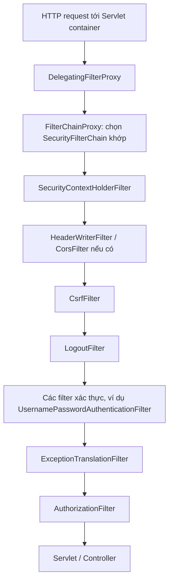
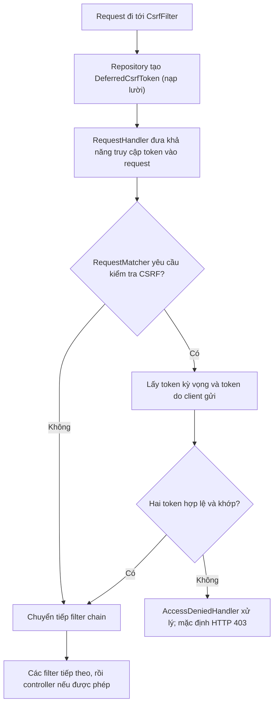

# `CsrfFilter` và vị trí kiểm tra trong filter chain

Trong ứng dụng **Spring Security Servlet**, bảo vệ Cross-Site Request Forgery (CSRF) không diễn ra tại controller hay tại bước phân quyền cuối cùng. Nó chủ yếu được thực hiện bởi **`CsrfFilter`**, một security filter chạy ở vị trí tương đối sớm trong chuỗi xử lý HTTP. Hiểu đúng vị trí đó giúp lý giải vì sao một lệnh `POST /login` có thể nhận `403 Forbidden` dù endpoint đã được `permitAll()`, vì sao `GET` có thể thành công nhưng `POST` thất bại, và vì sao đổi cấu hình CORS không tự giải quyết lỗi CSRF.

Bài thuộc chương **CSRF trên Servlet** trong module **SPRING_SECURITY_HTTP_PROTECTION**. Để đặt `CsrfFilter` vào bối cảnh: Spring Security còn cung cấp các lớp phòng vệ HTTP và trình duyệt như CORS, security headers, CSP, HSTS, HTTP firewall và bảo vệ session. Mỗi lớp có nhiệm vụ khác nhau; bài này tập trung vào đường đi của request qua **Servlet security filter chain** và điểm quyết định cho phép hoặc từ chối request do CSRF.

## 1. Vì sao phải kiểm tra CSRF trước khi xử lý nghiệp vụ?

Giả sử người dùng đã đăng nhập `https://bank.example` và trình duyệt giữ cookie phiên đăng nhập. Khi họ mở một trang độc hại, trang đó có thể khiến trình duyệt gửi form `POST` tới `https://bank.example/transfer`. Tùy chính sách cookie, trình duyệt có thể tự đính kèm thông tin xác thực. Máy chủ lúc này thấy một request mang phiên hợp lệ, nhưng **không thể suy ra người dùng đã chủ ý tạo ra request đó**.

CSRF là việc lợi dụng khả năng trình duyệt tự gửi thông tin xác thực, điển hình là cookie phiên, để tạo request thay mặt người dùng. Hàng rào token CSRF bổ sung một điều kiện: với request có khả năng thay đổi trạng thái, phía gửi phải cung cấp giá trị token hợp lệ gắn với ngữ cảnh của ứng dụng. Trang thuộc origin khác thường không đọc được token này theo cơ chế bảo vệ của trình duyệt.

Điều cần phân biệt:

| Cơ chế | Câu hỏi chính |
| --- | --- |
| Xác thực (authentication) | Request đại diện cho ai? |
| Phân quyền (authorization) | Chủ thể đó được phép thực hiện thao tác nào? |
| CSRF | Request thay đổi trạng thái có kèm bằng chứng chống giả mạo hợp lệ không? |
| CORS | JavaScript từ origin nào được phép đọc hoặc thực hiện một số kiểu yêu cầu cross-origin theo chính sách trình duyệt? |

CSRF không thay thế xác thực hoặc phân quyền; một token hợp lệ cũng **không** có nghĩa là người dùng được phép thực hiện thao tác. Ngược lại, request đã xác thực và đủ quyền vẫn có thể bị `CsrfFilter` chặn.

## 2. `CsrfFilter` nằm ở đâu trong Servlet filter chain?

Với Servlet, bộ lọc của container thường chuyển request qua `DelegatingFilterProxy` tới `FilterChainProxy` của Spring Security. `FilterChainProxy` chọn **`SecurityFilterChain` đầu tiên khớp request** rồi gọi các security filter của chain đó theo thứ tự cấu hình.

Sơ đồ sau minh họa **thứ tự tương đối thường gặp** khi ứng dụng có các tính năng tương ứng. Những filter tùy chọn có thể không xuất hiện; danh sách và thứ tự chi tiết phụ thuộc phiên bản Spring Security và cấu hình thực tế.



Trong cấu hình phổ biến, `CsrfFilter` chạy **sau** các thành phần thiết lập security context và xử lý CORS (nếu có), nhưng **trước** `LogoutFilter`, nhiều filter xác thực và `AuthorizationFilter`. Hệ quả trực tiếp:

1. `CsrfFilter` có thể từ chối một request **trước khi** filter xác thực hoặc controller nhận được request.
2. Quy tắc `permitAll()` thuộc tầng authorization, vốn được đánh giá về sau; nó **không miễn** kiểm tra CSRF cho `POST`.
3. Khi bật bảo vệ CSRF, thao tác đăng xuất mặc định thường yêu cầu `POST` kèm token hợp lệ. Spring Security đặt `CsrfFilter` trước `LogoutFilter` để kiểm tra request đăng xuất trước khi thực hiện logout.
4. Nếu request không khớp security chain chứa `CsrfFilter`, hoặc ứng dụng loại đường dẫn ra khỏi Spring Security bằng cách bỏ qua toàn bộ filter chain, việc kiểm tra CSRF ở chain đó sẽ không xảy ra.

**Đừng nhầm thứ tự filter với thứ tự controller interceptor.** `CsrfFilter` là Servlet filter thuộc hạ tầng Spring Security, chạy trước khi xử lý MVC controller thông thường.

### Nhiều `SecurityFilterChain` thì sao?

Một hệ thống có thể có chain riêng cho `/api/**` và chain cho trang web. `FilterChainProxy` chọn chain khớp đầu tiên, nên mỗi chain có thể có chính sách CSRF khác nhau. Ví dụ, nếu chain `/api/**` được cấu hình không có CSRF còn chain trang web có CSRF, request `POST /api/orders` sẽ tuân theo chain API. Khi chẩn đoán, cần xác định **chain nào thật sự được chọn**, không chỉ kiểm tra rằng ứng dụng có một bean `SecurityFilterChain` bật CSRF.

## 3. Bên trong `CsrfFilter`: kiểm tra ở thời điểm nào?

`CsrfFilter` được triển khai trên nền `OncePerRequestFilter` và phối hợp ba thành phần chính:

- **`CsrfTokenRepository`**: lưu, tải hoặc tạo token CSRF; mặc định thường dùng `HttpSessionCsrfTokenRepository`.
- **`CsrfTokenRequestHandler`**: công bố token để phía giao diện sử dụng và lấy giá trị token mà client gửi lên để so sánh.
- **`RequestMatcher` yêu cầu CSRF**: quyết định request có cần vượt qua kiểm tra token hay không.

Luồng xử lý khái quát:



Diễn giải chi tiết:

1. **Chuẩn bị token:** filter yêu cầu repository cung cấp một `DeferredCsrfToken`. Đây là cách trì hoãn việc thực sự truy xuất hoặc tạo token cho đến khi cần; không phải mọi `GET` đều bắt buộc tạo session chỉ vì đi qua `CsrfFilter`.
2. **Công bố token:** `CsrfTokenRequestHandler` nhận một `Supplier<CsrfToken>` và thiết lập cách view hoặc thành phần khác truy cập token. Ở ứng dụng render form phía server, token thường được dùng qua request attribute `_csrf`.
3. **Xét request matcher:** nếu request không thuộc nhóm cần CSRF, filter chuyển tiếp. Nếu cần, filter lấy token kỳ vọng từ repository và giải quyết giá trị do client gửi (tham số form hoặc HTTP header, tùy cấu hình).
4. **So sánh token:** filter so sánh an toàn giữa token kỳ vọng và giá trị gửi lên. Nếu hợp lệ, request tiếp tục sang filter kế tiếp.
5. **Xử lý thất bại:** `CsrfFilter` gọi `AccessDeniedHandler` của mình; mặc định kết quả thường là `403 Forbidden`. `MissingCsrfTokenException` hoặc `InvalidCsrfTokenException` mô tả tình huống; tên exception cụ thể phụ thuộc trạng thái token kỳ vọng trong repository, không chỉ việc header có tồn tại hay không.

**Điểm chốt:** thao tác kiểm tra CSRF nằm **ngay trong `CsrfFilter` trước `filterChain.doFilter(...)` dành cho request cần bảo vệ**. Request bị chặn tại đây sẽ không đi tiếp tới `AuthorizationFilter` hoặc controller.

### Tại sao có `DeferredCsrfToken`?

Các phiên bản Spring Security hiện đại cho phép **nạp token theo nhu cầu**. Một `GET /health` hoặc `GET /assets/app.css` có thể đi qua chain mà không có lý do sử dụng CSRF token; việc trì hoãn giúp tránh đọc/ghi session không cần thiết. Trái lại, khi render form hoặc khi xử lý `POST` cần xác minh, token sẽ được truy xuất. Nếu ứng dụng SPA đợi một cookie token xuất hiện ngay sau mọi request `GET`, cơ chế nạp lười này là một trong những lý do cần thiết kế rõ cách cung cấp token cho client.

## 4. HTTP method nào được `CsrfFilter` kiểm tra?

Theo matcher mặc định của Spring Security, các phương thức HTTP thường được xem là **an toàn** sẽ không yêu cầu token; các phương thức còn lại yêu cầu token.

| HTTP method | Mặc định yêu cầu CSRF token? | Ý nghĩa |
| --- | --- | --- |
| `GET` | Không | Đọc tài nguyên, hiển thị trang hoặc form |
| `HEAD` | Không | Lấy metadata/headers |
| `OPTIONS` | Không | Bao gồm CORS preflight |
| `TRACE` | Không | Được matcher mặc định loại trừ; thực tế nên vô hiệu hóa TRACE nếu không cần |
| `POST` | Có | Gửi form, tạo hoặc thay đổi dữ liệu |
| `PUT` | Có | Cập nhật/thay thế tài nguyên |
| `PATCH` | Có | Cập nhật một phần |
| `DELETE` | Có | Xóa tài nguyên |

Đây là **quy tắc theo method**, không phải phân tích xem controller có thực sự ghi database hay không. Do đó:

- Không thiết kế `GET /delete-account` để thực hiện xóa, vì matcher mặc định sẽ bỏ qua CSRF với `GET`.
- `POST /login` hoặc `POST /register` vẫn cần token trong chain được bật CSRF, dù có `permitAll()`.
- Với route webhook không thể gửi token CSRF của ứng dụng, có thể chọn ngoại lệ **rất cụ thể** và thay bằng cơ chế xác minh phù hợp như chữ ký webhook. Không mở ngoại lệ rộng cho các endpoint dùng cookie đăng nhập.

Có thể thay matcher bằng cấu hình nâng cao, nhưng điều đó thay đổi chính sách bảo vệ; nên bắt đầu từ hành vi mặc định và chỉ điều chỉnh theo threat model rõ ràng.

## 5. Vòng đời token: request, form, header và session

Token CSRF cần xuất hiện ở **hai phía**:

1. **Phía server** có giá trị kỳ vọng, được quản lý bởi `CsrfTokenRepository`.
2. **Phía client** nhận một biểu diễn token hợp lệ từ ứng dụng và gửi lại khi thực hiện thao tác cần bảo vệ.

Với `HttpSessionCsrfTokenRepository`, token được lưu theo `HttpSession`. Client phải duy trì **cùng session cookie** giữa lần lấy token và lần gửi form. Gửi đúng token nhưng bỏ cookie session tương ứng vẫn có thể khiến server không tìm thấy token kỳ vọng.

Mặc định, ứng dụng web render form phía server thường dùng request attribute `_csrf`, form parameter `_csrf`, hoặc header `X-CSRF-TOKEN` (theo repository/handler tương ứng). Ví dụ với một template Thymeleaf **tự đưa hidden field vào form**:

```html
<form action="/profile/email" method="post">
  <label for="email">Email</label>
  <input id="email" name="email" type="email" required>
  <input type="hidden"
         th:name="${_csrf.parameterName}"
         th:value="${_csrf.token}">
  <button type="submit">Cập nhật</button>
</form>
```

Ở một số tích hợp Thymeleaf/Spring MVC, cơ chế xử lý form (như `RequestDataValueProcessor`) đã tự chèn hidden CSRF field khi dùng `th:action`. Khi đó không cần thêm một hidden field thủ công lần nữa. Quy tắc chính là đảm bảo form gửi **một giá trị token do ứng dụng cung cấp**, phù hợp với request handler đang dùng.

### `XorCsrfTokenRequestAttributeHandler` và token được che (masked token)

Spring Security hiện đại sử dụng cơ chế request handler hỗ trợ **che token ngẫu nhiên theo từng lần hiển thị** nhằm giảm rủi ro BREACH khi token xuất hiện trong nội dung phản hồi có nén. Token nhìn thấy trong HTML có thể thay đổi qua các response dù giá trị token gốc của session chưa đổi. Đó không đồng nghĩa token bị tạo lại sau mỗi request.

Với ứng dụng JavaScript SPA, cần phân biệt hai kiểu trình bày token:

| Cách gửi | Điểm cần chú ý |
| --- | --- |
| Form do server render | Dùng giá trị token được request handler trình bày cho view; handler tương ứng có thể giải mã biểu diễn masked khi nhận form |
| SPA lấy token từ API hoặc cookie có thể đọc bởi JS | Nếu client gửi **token gốc** qua header, cần handler hỗ trợ cách giải quyết token gốc thay vì mặc định trông đợi biểu diễn masked |
| `CookieCsrfTokenRepository` | Mặc định dùng cookie `XSRF-TOKEN`, header `X-XSRF-TOKEN`; `withHttpOnlyFalse()` cho phép JavaScript đọc cookie nhưng cần cân nhắc rủi ro XSS |

Đừng giả định đổi sang `CookieCsrfTokenRepository` là đủ cho mọi SPA. Cần phối hợp `CsrfTokenRepository`, `CsrfTokenRequestHandler`, cách client nhận/gửi token và việc **làm mới token sau đăng nhập/đăng xuất**. Cách cấu hình handler dành cho SPA có thể khác nhau theo phiên bản Spring Security.

`HttpOnly`, `Secure` và `SameSite` trên cookie là các thuộc tính bảo vệ quan trọng, nhưng có mục tiêu khác nhau. Đặc biệt, `HttpOnly` ngăn JavaScript đọc cookie, **không** ngăn trình duyệt tự gửi cookie và vì thế không tự loại bỏ CSRF. `SameSite` giúp giảm một số trường hợp gửi cookie cross-site; vẫn nên áp dụng chiến lược CSRF phù hợp với luồng xác thực.

## 6. Cấu hình `CsrfFilter` bằng `HttpSecurity`

Đối với ứng dụng Spring MVC dùng form login và session, cấu hình bên dưới giữ bảo vệ CSRF. Ví dụ dùng API cấu hình kiểu lambda thường gặp ở Spring Security 6.x:

```java
import org.springframework.context.annotation.Bean;
import org.springframework.context.annotation.Configuration;
import org.springframework.security.config.Customizer;
import org.springframework.security.config.annotation.web.builders.HttpSecurity;
import org.springframework.security.web.SecurityFilterChain;

@Configuration
class SecurityConfiguration {

    @Bean
    SecurityFilterChain webSecurity(HttpSecurity http) throws Exception {
        http
            .authorizeHttpRequests(auth -> auth
                .requestMatchers("/login", "/css/**").permitAll()
                .anyRequest().authenticated())
            .formLogin(Customizer.withDefaults())
            .csrf(Customizer.withDefaults());

        return http.build();
    }
}
```

Trong cấu hình này, `GET /login` được truy cập công khai; `POST /login` vẫn phải qua `CsrfFilter`. Sau khi vượt qua CSRF, `UsernamePasswordAuthenticationFilter` mới xử lý thông tin đăng nhập.

Nếu cần loại một webhook ra khỏi CSRF vì bên gửi không có session/token CSRF của hệ thống:

```java
http.csrf(csrf -> csrf
    .ignoringRequestMatchers("/webhooks/provider-a"));
```

Đây là **đoạn cấu hình minh họa** đặt trong quá trình xây dựng `SecurityFilterChain`, không phải lý do bỏ qua xác minh webhook. Endpoint đó vẫn cần kiểm tra chữ ký request, timestamp/chống replay (nếu nhà cung cấp hỗ trợ), xác thực hoặc các kiểm soát phù hợp. Với một web app dùng session cookie, tránh vô hiệu hóa CSRF toàn cục chỉ để một công cụ `curl` hoặc một form đang cấu hình sai hoạt động được.

### Khi nào có thể cân nhắc tắt CSRF cho một chain?

Một REST API dùng **duy nhất** bearer token mà JavaScript/chương trình khách chủ động đặt trong header `Authorization`, không dựa vào thông tin xác thực mà trình duyệt tự gửi, thường có threat model CSRF khác ứng dụng web dùng cookie session. Nhưng `SessionCreationPolicy.STATELESS` **không tự bảo đảm** API miễn nhiễm CSRF: nếu xác thực dựa trên cookie tự gửi, kể cả cookie chứa JWT, nguy cơ vẫn tồn tại. Đánh giá theo **cách credentials đi vào request**, không chỉ theo tên kiến trúc “stateless”.

## 7. Vì sao `403` xuất hiện trước cả `401` hoặc redirect tới login?

Xét một người chưa đăng nhập gửi `POST /profile/email` mà không kèm token:

```text
POST /profile/email
Cookie: (có thể chưa có session đăng nhập)
Content-Type: application/x-www-form-urlencoded

email=user@example.com
```

Nếu request khớp chain có CSRF và matcher mặc định yêu cầu kiểm tra `POST`, `CsrfFilter` có thể chặn ngay với `403`. Request chưa tới `AuthorizationFilter`, nên bạn chưa thấy phản hồi `401` hoặc redirect sang trang đăng nhập như khi một request đi qua bước phân quyền. `403` tại đây **không nhất thiết** có nghĩa là người dùng đã đăng nhập nhưng thiếu role.

Phân biệt một số tình huống thường gặp:

| Dấu hiệu | Lớp nên kiểm tra trước |
| --- | --- |
| `GET /login` thành công, `POST /login` trả `403` | Hidden field/header CSRF, session cookie, request handler |
| `POST` có `permitAll()` nhưng vẫn `403` | `CsrfFilter` chạy trước `AuthorizationFilter` |
| `GET` trả `200`, `POST` cùng URL trả `403` | Matcher theo HTTP method và token |
| `POST` có token nhưng vẫn `403` | Token không khớp session, token cũ, kiểu masked/raw, chain thực tế |
| Request `OPTIONS` thất bại | Cấu hình CORS/preflight, route hoặc filter khác; matcher CSRF mặc định bỏ qua `OPTIONS` |
| `POST` có token vượt qua CSRF nhưng bị `403` sau đó | Có thể là phân quyền (`AuthorizationFilter`), cần xem log và exception gốc |

`CsrfFilter` có `AccessDeniedHandler` riêng cho lỗi xác minh token. Bởi vậy khi chẩn đoán, cần xác định **filter phát sinh lỗi**, thay vì quy mọi `403` về cấu hình `exceptionHandling()` hoặc thiếu quyền ở controller.

## 8. CSRF, CORS và các lớp bảo vệ HTTP khác kết hợp thế nào?

**CORS không phải cơ chế chống CSRF.** CORS điều khiển khả năng truy cập cross-origin của JavaScript theo chính sách trình duyệt và xử lý preflight. Một form HTML cross-origin vẫn có thể gây ra một số request mà không cần đọc response. Vì vậy thêm `Access-Control-Allow-Origin` hay `http.cors(...)` không thể thay thế token CSRF.

Khi bật CORS trong Spring Security Servlet, xử lý preflight cần diễn ra đủ sớm, thường trước những filter đòi hỏi session/đăng nhập. Request `OPTIONS` mặc định không cần CSRF token, nhưng vẫn có thể bị CORS từ chối nếu origin, method hoặc header không được cho phép.

Các lớp phòng vệ trong module có thể phối hợp theo vai trò:

- **Security headers / CSP:** giảm các bề mặt tấn công trình duyệt, đặc biệt giúp hạn chế XSS vốn có thể làm lộ token CSRF.
- **HSTS:** yêu cầu trình duyệt dùng HTTPS cho host đã nhận chính sách, giúp bảo vệ kênh truyền khi triển khai đúng.
- **HTTP firewall:** chuẩn hóa hoặc từ chối request bất thường trước khi xử lý sâu hơn; không thay thế logic token CSRF.
- **Bảo vệ session:** quản lý cookie, vòng đời và đổi session ID khi xác thực; token dựa trên session cần được đồng bộ với vòng đời này.

Nếu ứng dụng bị XSS, mã độc chạy cùng origin có thể đọc hoặc gửi token theo quyền của trang. Vì thế CSRF và XSS cần được phòng vệ đồng thời.

## 9. Ví dụ theo dõi một request thực tế

Giả sử người dùng truy cập trang chỉnh email có form chứa token:

```text
1) GET /profile/edit
   -> CsrfFilter: GET không cần kiểm tra token.
   -> Controller render form; view truy cập _csrf để có token.
   -> Trình duyệt nhận HTML và cookie session nếu cần.

2) POST /profile/email
   Cookie: JSESSIONID=<cùng phiên>
   Body: email=...&_csrf=<token từ form>
   -> CsrfFilter: POST cần token.
   -> Repository nạp token kỳ vọng của session.
   -> RequestHandler đọc token client gửi.
   -> Token khớp: request tiếp tục tới authentication/authorization/controller.

3) POST /profile/email thiếu _csrf hoặc khác session
   -> CsrfFilter không xác minh được token.
   -> AccessDeniedHandler trả 403; controller không chạy.
```

Điều kiện “token khớp” chỉ nói rằng **cửa CSRF đã qua**; request bước 2 vẫn có thể bị từ chối do chưa đăng nhập, thiếu quyền, dữ liệu sai hoặc quy tắc nghiệp vụ.

### Ví dụ lỗi với SPA

Một SPA nhận cookie `XSRF-TOKEN`, đọc nó và gửi header `X-XSRF-TOKEN`. Nếu server dùng request handler chỉ giải quyết **masked token** trong khi SPA gửi token gốc, request có thể trả `403` dù header có vẻ trùng cookie. Giải pháp là cấu hình luồng SPA đúng với phiên bản Spring Security đang dùng, xác định cách server tạo/phát token và cách handler giải quyết giá trị header. Sau khi đăng nhập/đăng xuất, phải bảo đảm client nhận token hiện hành thay vì tái sử dụng một giá trị đã bị xóa hoặc thay đổi.

## 10. Kiểm thử `CsrfFilter` bằng MockMvc

Thư viện `spring-security-test` cung cấp `SecurityMockMvcRequestPostProcessors.csrf()` để tạo request có token hợp lệ, và `.useInvalidToken()` để mô phỏng token sai. Cách này kiểm tra luồng filter thực tế thay vì tự gán một chuỗi token bất kỳ.

Giả sử dự án Spring Boot có controller sau, với `GET` để đọc và `POST` để thay đổi cấu hình:

```java
import org.springframework.web.bind.annotation.GetMapping;
import org.springframework.web.bind.annotation.PostMapping;
import org.springframework.web.bind.annotation.RestController;

@RestController
class SettingsController {
    @GetMapping("/settings")
    String show() {
        return "current settings";
    }

    @PostMapping("/settings")
    String update() {
        return "updated";
    }
}
```

Với cấu hình bật CSRF như mục 6, các bài test dưới đây tách rõ kết quả kiểm tra token khỏi việc xác thực bằng `@WithMockUser`:

```java
import org.junit.jupiter.api.Test;
import org.springframework.beans.factory.annotation.Autowired;
import org.springframework.boot.test.autoconfigure.web.servlet.AutoConfigureMockMvc;
import org.springframework.boot.test.context.SpringBootTest;
import org.springframework.security.test.context.support.WithMockUser;
import org.springframework.test.web.servlet.MockMvc;

import static org.springframework.security.test.web.servlet.request.SecurityMockMvcRequestPostProcessors.csrf;
import static org.springframework.test.web.servlet.request.MockMvcRequestBuilders.get;
import static org.springframework.test.web.servlet.request.MockMvcRequestBuilders.post;
import static org.springframework.test.web.servlet.result.MockMvcResultMatchers.status;

@SpringBootTest
@AutoConfigureMockMvc
@WithMockUser(username = "learner")
class CsrfFlowTest {
    @Autowired
    MockMvc mvc;

    @Test
    void getDoesNotNeedCsrfToken() throws Exception {
        mvc.perform(get("/settings"))
            .andExpect(status().isOk());
    }

    @Test
    void postWithoutCsrfTokenIsForbidden() throws Exception {
        mvc.perform(post("/settings"))
            .andExpect(status().isForbidden());
    }

    @Test
    void postWithValidCsrfTokenIsAccepted() throws Exception {
        mvc.perform(post("/settings").with(csrf()))
            .andExpect(status().isOk());
    }

    @Test
    void postWithInvalidCsrfTokenIsForbidden() throws Exception {
        mvc.perform(post("/settings").with(csrf().useInvalidToken()))
            .andExpect(status().isForbidden());
    }
}
```

Các kỳ vọng `200` ở đây dựa trên controller minh họa, người dùng thử đã được xác thực và không có quy tắc nghiệp vụ bổ sung. Nếu dự án thực tế có controller, security chain hoặc kết quả HTTP khác, hãy sửa kỳ vọng của test theo luồng đó. Điều quan trọng là so sánh ba trường hợp **thiếu**, **đúng**, **sai** token trên cùng một endpoint `POST`.

Ngoài MockMvc, khi thử thủ công bằng trình duyệt, `curl` hoặc Postman nên ghi lại **cả cookie session và giá trị token**. Chỉ copy `_csrf` từ một phiên sang một phiên khác không chứng minh được CSRF hoạt động sai.

## 11. Quy trình chẩn đoán khi nghi ngờ `CsrfFilter` chặn request

Khi gặp `403`, đi theo thứ tự sau:

1. **Xác định method và URL thực tế.** Đặc biệt kiểm tra `POST`, `PUT`, `PATCH`, `DELETE`; không suy từ URL rằng một request được miễn CSRF.
2. **Xác định `SecurityFilterChain` khớp request.** Với nhiều chain, thứ tự `@Order` và `securityMatcher(...)` quyết định chain được dùng.
3. **Kiểm tra `CsrfFilter` có trong chain không.** Có thể bật logging dành cho môi trường phát triển, ví dụ `org.springframework.security.web.FilterChainProxy=DEBUG` và `org.springframework.security.web.csrf=TRACE`, rồi xem filter và exception liên quan. Tránh ghi giá trị token nhạy cảm vào log.
4. **Kiểm tra client gửi token qua kênh đúng.** Form parameter hay header? Tên field/header có khớp repository và request handler không?
5. **Kiểm tra tính liên tục của session và vòng đời token.** Cookie có được gửi lại không? Phiên có hết hạn không? Có vừa login/logout làm xóa token cũ không?
6. **Kiểm tra cơ chế masked token / raw token.** Đặc biệt quan trọng với SPA và `CookieCsrfTokenRepository`.
7. **Nếu token hợp lệ mà vẫn `403`, kiểm tra tầng tiếp theo.** Xem authorization, CORS, firewall và lỗi nghiệp vụ. Không phải mọi `403` đều do CSRF.

Ví dụ cấu hình log tạm thời trong môi trường phát triển:

```properties
logging.level.org.springframework.security.web.FilterChainProxy=DEBUG
logging.level.org.springframework.security.web.csrf=TRACE
```

Không bật log chi tiết này bừa bãi trong môi trường production. Khi debug, mục tiêu là tìm **filter nào chặn request và tại sao**, không thu thập hoặc phát tán token thật.

## 12. Những hiểu nhầm dễ dẫn tới lỗ hổng

| Hiểu nhầm | Cách hiểu đúng |
| --- | --- |
| “`permitAll()` cho phép POST không cần CSRF” | `permitAll()` là luật authorization, không vô hiệu hóa `CsrfFilter` |
| “Đã cấu hình CORS nên không cần CSRF” | CORS và CSRF có hai mục tiêu độc lập |
| “API stateless chắc chắn không cần CSRF” | Phải xét credentials có được trình duyệt tự gửi hay không |
| “GET có token là được, GET đổi trạng thái cũng an toàn” | Matcher mặc định bỏ qua GET; GET không nên làm thay đổi trạng thái |
| “Mọi `403` đều là thiếu role” | `CsrfFilter` có thể trả `403` trước khi authorization chạy |
| “Token hiển thị thay đổi là session đã đổi” | Với masked token, biểu diễn có thể đổi theo response trong khi token gốc giữ nguyên |
| “Tắt CSRF giải quyết ổn thỏa lỗi form” | Tắt CSRF có thể loại bỏ một lớp phòng vệ cần thiết với cookie/session |

## 13. Tự kiểm tra kiến thức

1. Trong luồng `DelegatingFilterProxy` → `FilterChainProxy` → `SecurityFilterChain`, thành phần nào chọn chain khớp request và thành phần nào xác minh token CSRF?
2. Vì sao `POST /login` có thể trả `403` dù `/login` được `permitAll()`?
3. Vì sao một request `GET` có thể đi qua `CsrfFilter` nhưng chưa cần tải token từ session?
4. `CookieCsrfTokenRepository` và `XorCsrfTokenRequestAttributeHandler` có thể gây vướng mắc gì nếu SPA gửi token gốc trong header?
5. Khi một request `POST` có token hợp lệ vẫn nhận `403`, bạn sẽ kiểm tra những filter hoặc lớp chính sách nào tiếp theo?

**Ghi nhớ:** `CsrfFilter` là điểm kiểm tra CSRF của **Servlet security filter chain**. Nó chuẩn bị token qua repository và request handler, áp dụng matcher theo request, rồi **chặn với `403` trước khi chuyển request đi tiếp** nếu token không hợp lệ. Hiểu vị trí này là nền tảng để cấu hình form login, SPA, webhook và kiểm thử các kịch bản tấn công web một cách chính xác.
