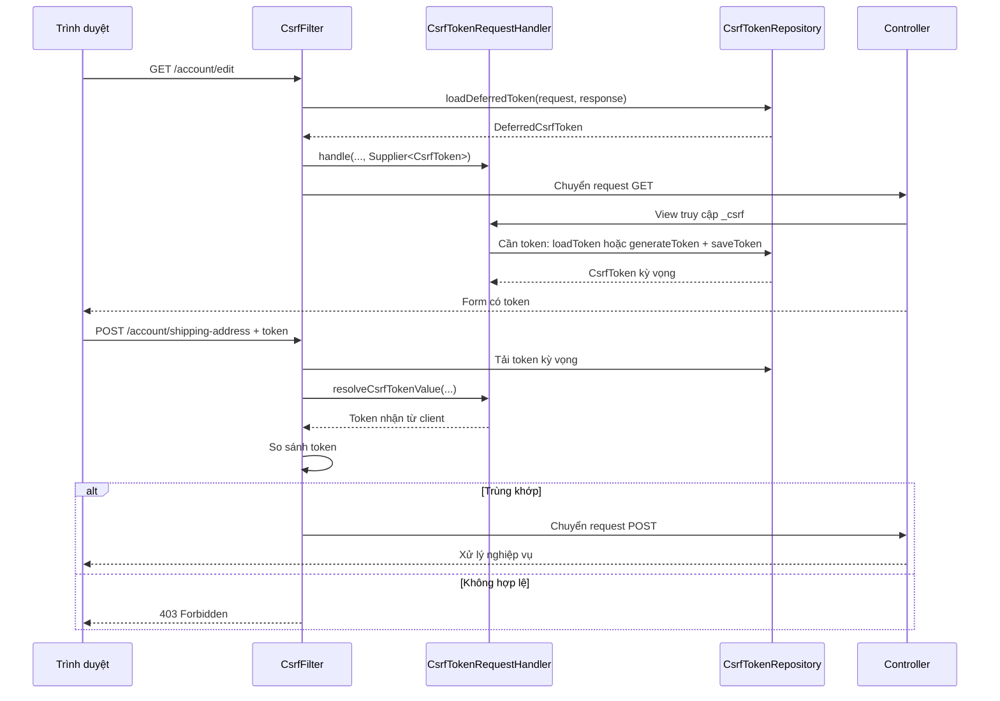
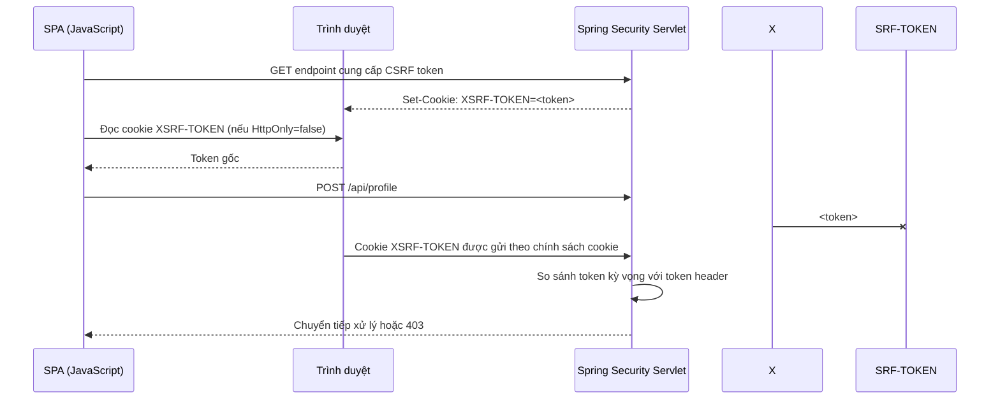

# `CsrfTokenRepository` và trách nhiệm tạo, lưu, đọc token

Trong bảo vệ CSRF của **Spring Security Servlet**, `CsrfTokenRepository` là nơi quản lý **vòng đời token mà máy chủ kỳ vọng**: tạo token mới, lưu token để có thể kiểm tra ở request tiếp theo, đọc token hiện có và xóa token khi không còn hợp lệ. Thành phần này không tự quyết định URL nào cần bảo vệ, cũng không trực tiếp so sánh token do client gửi lên. Những trách nhiệm đó thuộc về `CsrfFilter` và `CsrfTokenRequestHandler`.

Bài thuộc chương **CSRF trên Servlet** trong module **SPRING_SECURITY_HTTP_PROTECTION**. Module nghiên cứu các lớp phòng vệ HTTP và trình duyệt như CSRF, CORS, security headers, CSP, HSTS, HTTP firewall và bảo vệ session, trên cả Servlet lẫn Reactive. Riêng bài này dùng **Servlet API** (`HttpServletRequest`, `HttpServletResponse`) để giải thích `CsrfTokenRepository`; phía Reactive có giao diện riêng là `ServerCsrfTokenRepository`.

## 1. Tình huống: cần nhớ token nào là đúng?

Giả sử ứng dụng có form đổi địa chỉ giao hàng:

```http
POST /account/shipping-address HTTP/1.1
Host: shop.example
Cookie: JSESSIONID=...
Content-Type: application/x-www-form-urlencoded

city=Hue&_csrf=<token-do-ung-dung-cung-cap>
```

Khi nhận request này, ứng dụng không thể chỉ hỏi “có tham số `_csrf` hay không?”. Máy chủ cần có **một giá trị token kỳ vọng** để đối chiếu. `CsrfTokenRepository` giải quyết phần này: token kỳ vọng đến từ đâu, được giữ ở đâu, sống qua bao nhiêu request và bị xóa lúc nào.

Hình dung luồng tương tác:



Sơ đồ mô tả ứng dụng render form có truy cập `_csrf`. Việc `GET` **có thực sự đọc và lưu token hay không** phụ thuộc vào nơi token được sử dụng, vì các bản Spring Security hiện đại hỗ trợ tải token theo nhu cầu.

## 2. Hợp đồng `CsrfTokenRepository`: ba thao tác cốt lõi

Giao diện cho Servlet nằm trong `org.springframework.security.web.csrf.CsrfTokenRepository`. Rút gọn chữ ký chính:

```java
public interface CsrfTokenRepository {
    CsrfToken generateToken(HttpServletRequest request);

    void saveToken(
            CsrfToken token,
            HttpServletRequest request,
            HttpServletResponse response);

    CsrfToken loadToken(HttpServletRequest request);

    // Các phiên bản Spring Security hiện đại còn hỗ trợ
    // loadDeferredToken(request, response) để tải theo nhu cầu.
}
```

| Phương thức | Trách nhiệm | Điều cần nhớ |
| --- | --- | --- |
| `generateToken(request)` | Tạo một đối tượng `CsrfToken` mới với giá trị khó đoán | **Tạo** chưa đồng nghĩa **lưu** |
| `saveToken(token, request, response)` | Ghi token vào nơi lưu trữ phù hợp | Cần cả response vì cách lưu có thể là `Set-Cookie` |
| `loadToken(request)` | Đọc token đã lưu tương ứng với request | Có thể trả về `null` khi chưa từng lưu, đã xóa hoặc đã hết hạn |
| `loadDeferredToken(request, response)` | Cung cấp `DeferredCsrfToken`, trì hoãn đọc/tạo token đến lúc cần | Là cơ chế mặc định quan trọng trong những phiên bản gần đây |

`CsrfToken` chứa ba thông tin thường dùng:

```java
String tokenValue = csrfToken.getToken();             // Giá trị bí mật cần xác minh
String parameterName = csrfToken.getParameterName();  // Ví dụ: "_csrf"
String headerName = csrfToken.getHeaderName();        // Ví dụ: "X-CSRF-TOKEN"
```

Tên parameter và header là **metadata của token**. Chúng thông báo cho client cách gửi lại token; repository tự nó không quyết định request nào cần bảo vệ và không xác minh token do client gửi.

### `generateToken` khác `saveToken` ra sao?

Một trình tự minh họa khi lưu token theo session:

```text
Request mới chưa có token:
  loadToken(request)                  -> null
  generateToken(request)              -> CsrfToken A
  saveToken(A, request, response)      -> lưu A

Request sau trong cùng session:
  loadToken(request)                  -> CsrfToken A

Khi chủ động hủy token:
  saveToken(null, request, response)   -> xóa trạng thái token đã lưu
```

Không nên tự gọi `generateToken` ở mọi request rồi so với token client cũ: làm vậy sẽ tạo giá trị khác, khiến mọi form đã render trước đó có thể thất bại. `CsrfFilter` và `DeferredCsrfToken` điều phối đọc, tạo và lưu token tùy trạng thái hiện tại.

## 3. Vai trò giữa repository, request handler và filter

Ba đối tượng có ranh giới rõ ràng:

| Thành phần | Nó làm gì? | Nó không chịu trách nhiệm chính về việc gì? |
| --- | --- | --- |
| `CsrfTokenRepository` | Sinh token gốc, lưu, đọc, xóa token kỳ vọng | Chọn HTTP method/endpoint cần kiểm tra |
| `CsrfTokenRequestHandler` | Công bố token trên request cho view/client; giải quyết token do client gửi | Quản lý nơi lưu token kỳ vọng |
| `CsrfFilter` | Xác định request cần kiểm tra; lấy token kỳ vọng và token client; so sánh, từ chối nếu sai | Tự thiết kế kho lưu token |

Trong cấu hình thông thường, `CsrfFilter` sử dụng repository để chuẩn bị token. Nó chỉ yêu cầu client chứng minh token hợp lệ với các request thuộc matcher cần CSRF (mặc định thường là `POST`, `PUT`, `PATCH`, `DELETE`). Nếu không khớp, `CsrfFilter` sẽ xử lý `AccessDeniedException` và thường trả `403 Forbidden` **trước khi request tới controller**. Không nên nhầm việc này với kiểm tra quyền của `AuthorizationFilter`.

Token CSRF là **bằng chứng chống giả mạo request** trong một threat model cụ thể, không phải access token, không chứa quyền hạn của người dùng và không thay thế bước xác thực/phân quyền.

## 4. `HttpSessionCsrfTokenRepository`: lưu token trong HTTP session

`HttpSessionCsrfTokenRepository` là lựa chọn mặc định phổ biến của Spring Security Servlet. Nó lưu token kỳ vọng phía máy chủ trong `HttpSession` liên quan tới request, thường được định danh với client bằng cookie `JSESSIONID`.

Luồng cơ bản:

1. Form được render và cần `_csrf`: repository đọc token đã lưu trong session.
2. Nếu chưa có token, Spring Security tạo token mới rồi lưu vào session.
3. Khi người dùng gửi form, client gửi cả cookie session và token trong form/header.
4. Repository đọc lại token của session; `CsrfFilter` đối chiếu với token client gửi.
5. Khi session hết hạn hoặc bị mất, token cũ không còn nằm trong session được truy cập; form cũ thường bị từ chối.

Ví dụ cấu hình:

```java
import org.springframework.context.annotation.Bean;
import org.springframework.context.annotation.Configuration;
import org.springframework.security.config.Customizer;
import org.springframework.security.config.annotation.web.builders.HttpSecurity;
import org.springframework.security.web.SecurityFilterChain;
import org.springframework.security.web.csrf.HttpSessionCsrfTokenRepository;

@Configuration
class SecurityConfig {

    @Bean
    SecurityFilterChain securityFilterChain(HttpSecurity http) throws Exception {
        http
            .authorizeHttpRequests(auth -> auth
                .requestMatchers("/login", "/css/**").permitAll()
                .anyRequest().authenticated())
            .formLogin(Customizer.withDefaults())
            .csrf(csrf -> csrf.csrfTokenRepository(
                new HttpSessionCsrfTokenRepository()));

        return http.build();
    }
}
```

Việc khai báo `HttpSessionCsrfTokenRepository` ở đây giúp thấy rõ thành phần đang dùng; trong cấu hình CSRF Servlet tiêu chuẩn, Spring Security thường đã chọn repository này mặc định. `formLogin` minh họa mô hình ứng dụng có phiên đăng nhập bằng cookie.

### Điều gì xảy ra nếu người dùng có hai tab?

Nếu hai tab chia sẻ cùng session và token gốc còn hiệu lực, chúng có thể cùng gửi token tương ứng. Khi token bị xóa hoặc session thay đổi, một tab đang mở form cũ có thể gửi token lỗi thời. Đây là tình huống thường gặp sau đăng nhập lại, đăng xuất, session timeout hoặc đăng nhập ở cửa sổ khác.

**Session fixation protection** và **CSRF token rotation** là hai khía cạnh riêng. Chỉ thay session ID không tự nói lên token CSRF có thay đổi hay chưa. Hãy kiểm tra cơ chế làm mới token thực tế của Spring Security và luồng xác thực đang sử dụng.

### Phải chăng `GET` nào cũng tạo session?

Không. Khi dùng cơ chế `DeferredCsrfToken` hiện đại, `CsrfFilter` có thể chuẩn bị khả năng lấy token mà **chưa lập tức gọi** `loadToken` hay `generateToken`. Nếu request `GET` không cần hiển thị hoặc xuất token, thao tác tải/lưu có thể không xảy ra. Khi view truy cập `_csrf.token`, giá trị token mới được lấy và, nếu thiếu, được tạo rồi lưu.

Điều này giúp tránh tạo session không cần thiết cho một số trang và endpoint chỉ đọc. Ngược lại, một endpoint cố tình cung cấp token cho SPA cần **chủ động truy cập token** để bảo đảm token đã được materialize.

## 5. `CookieCsrfTokenRepository`: lưu token bằng cookie

`CookieCsrfTokenRepository` là cách lưu khác: máy chủ ghi token bằng `Set-Cookie`, sau đó đọc giá trị từ cookie mà trình duyệt gửi ở request tiếp theo. Mẫu tên mặc định thường là:

| Thuộc tính | Giá trị thường gặp |
| --- | --- |
| Cookie | `XSRF-TOKEN` |
| Header client gửi lại | `X-XSRF-TOKEN` |
| Form parameter | `_csrf` |
| Cookie `HttpOnly` | Bật theo mặc định; `withHttpOnlyFalse()` cho phép JavaScript đọc cookie |

Luồng với SPA chạy cùng origin:



Khác với session repository, token kỳ vọng ở đây được khôi phục từ **cookie trên request**, chứ không phải bản ghi token được tìm trong `HttpSession`. Client cần gửi giá trị token trong header (hoặc form parameter tương thích) **ngoài** việc trình duyệt tự gửi cookie.

Không xem `CookieCsrfTokenRepository` như một thay thế trực tiếp cho session repository trong mọi hệ thống. Cookie có thể bị ảnh hưởng bởi domain/path scope, chính sách `SameSite`, `Secure`, các subdomain không tin cậy và XSS. Tránh cấu hình `Domain` quá rộng; bảo vệ việc phát và đọc cookie qua HTTPS; xác định rõ origin nào sở hữu token.

### Vì sao có `withHttpOnlyFalse()`?

Một số SPA cần JavaScript đọc cookie `XSRF-TOKEN` để copy giá trị sang header `X-XSRF-TOKEN`. Cookie có `HttpOnly=true` thì JavaScript không đọc được. Vì vậy Spring Security cung cấp:

```java
CookieCsrfTokenRepository repository =
    CookieCsrfTokenRepository.withHttpOnlyFalse();
```

Cấu hình này **không làm token tự động hợp lệ**. Nó chỉ cho phép script truy cập cookie. Nếu kiến trúc có thể phát token bằng một cơ chế khác an toàn và không cần JS đọc cookie, việc giữ `HttpOnly` có thể phù hợp hơn. Dù chọn cách nào, phải phòng chống XSS: script độc hại chạy cùng origin thường có thể lợi dụng thông tin và quyền của trang.

## 6. Token gốc, token che (masked) và `CsrfTokenRequestHandler`

Từ các phiên bản Spring Security hiện đại, request handler mặc định có thể dùng **`XorCsrfTokenRequestAttributeHandler`** để công bố biểu diễn token đã che bằng dữ liệu ngẫu nhiên. Cơ chế này giảm nguy cơ lộ token do tấn công BREACH khi token được phản chiếu trong nội dung HTTP có nén.

Điều quan trọng:

- Repository quản lý **token gốc** cần đối chiếu.
- View render form có thể nhận **token được che**; giá trị hiển thị có thể khác nhau qua nhiều response dù token gốc giữ nguyên.
- Khi client gửi token che, request handler thích hợp phải giải mã trước khi `CsrfFilter` so sánh.
- SPA đọc cookie `XSRF-TOKEN` thường lấy **token gốc**; nếu handler chỉ mong đợi giá trị che, header có thể bị từ chối dù server và client đều nhìn thấy cùng một chuỗi gốc.

Vì thế cấu hình repository và request handler phải nhất quán với cách client lấy và trả lại token.

### Cấu hình mẫu cho SPA gửi token gốc trong header

Ví dụ dưới đây minh họa một chiến lược có chủ đích: giữ xử lý token che cho form, nhưng đọc token gốc từ header do SPA gửi. Các API sử dụng thuộc dòng Spring Security Servlet 6.x; khi áp dụng vào phiên bản cụ thể, cần đối chiếu API tương ứng.

```java
import jakarta.servlet.http.HttpServletRequest;
import jakarta.servlet.http.HttpServletResponse;
import java.util.function.Supplier;
import org.springframework.security.web.csrf.CsrfToken;
import org.springframework.security.web.csrf.CsrfTokenRequestAttributeHandler;
import org.springframework.security.web.csrf.CsrfTokenRequestHandler;
import org.springframework.security.web.csrf.XorCsrfTokenRequestAttributeHandler;
import org.springframework.util.StringUtils;

final class SpaCsrfTokenRequestHandler implements CsrfTokenRequestHandler {
    private final CsrfTokenRequestHandler plain =
        new CsrfTokenRequestAttributeHandler();
    private final CsrfTokenRequestHandler xor =
        new XorCsrfTokenRequestAttributeHandler();

    @Override
    public void handle(
            HttpServletRequest request,
            HttpServletResponse response,
            Supplier<CsrfToken> csrfToken) {
        xor.handle(request, response, csrfToken);
        csrfToken.get(); // Chủ động tải/tạo token để cookie được phát khi cần.
    }

    @Override
    public String resolveCsrfTokenValue(
            HttpServletRequest request,
            CsrfToken csrfToken) {
        String headerValue = request.getHeader(csrfToken.getHeaderName());
        CsrfTokenRequestHandler handler = StringUtils.hasText(headerValue)
            ? plain
            : xor;
        return handler.resolveCsrfTokenValue(request, csrfToken);
    }
}
```

Đưa handler vào chain:

```java
import org.springframework.security.web.csrf.CookieCsrfTokenRepository;

CookieCsrfTokenRepository repository =
    CookieCsrfTokenRepository.withHttpOnlyFalse();

http.csrf(csrf -> csrf
    .csrfTokenRepository(repository)
    .csrfTokenRequestHandler(new SpaCsrfTokenRequestHandler()));
```

Đoạn thứ hai được đặt **bên trong phương thức cấu hình `SecurityFilterChain` có biến `HttpSecurity http`**. Nếu SPA gửi header, handler lấy giá trị gốc từ header; nếu form gửi parameter, handler sử dụng cơ chế giải quyết token che. Cần bảo đảm API cung cấp token thực sự được client gọi trước request thay đổi trạng thái.

Không tự ý áp dụng đoạn cấu hình này nếu ứng dụng đang dùng một handler khác, framework tự chèn token theo cách riêng hoặc một chính sách cookie không tương thích. Kỹ thuật này giải quyết **cách trình bày/đọc token**, không thay thế kiểm soát origin, session, CORS hay phân quyền.

## 7. `DeferredCsrfToken`: không phải cứ đi qua filter là có token mới

Trong những bản Spring Security hỗ trợ nạp lười, repository có thể trả về `DeferredCsrfToken` qua `loadDeferredToken(request, response)`. Một số trường hợp điển hình:

| Request | Token có cần được tải/tạo ngay? | Giải thích |
| --- | --- | --- |
| `GET /assets/app.js` | Thường không | Không kiểm tra CSRF và không dùng request attribute token |
| `GET /form` có view tham chiếu `_csrf.token` | Có, khi view đọc | Cần biểu diễn token để đưa vào form |
| `POST /profile` | Có | `CsrfFilter` cần token kỳ vọng để xác minh |
| `GET /csrf` chủ động trả token cho SPA | Có, khi endpoint truy cập token | SPA cần có token trước khi gửi request unsafe |
| `GET` với SPA handler chủ động gọi `csrfToken.get()` | Có | Handler ép tải nhằm phát cookie token khi cần |

**Deferred** không có nghĩa token tồn tại mãi hoặc hệ thống không bao giờ tạo session. Nó chỉ giúp hoãn chi phí đọc/tạo/lưu cho đến khi một đoạn xử lý thật sự yêu cầu token. Nếu custom repository được triển khai, cần xem xét hành vi trì hoãn thay vì phát sinh I/O nặng ngay ở bước chuẩn bị request.

### Token hết hạn, bị xóa hoặc cần làm mới

Spring Security có các cơ chế xóa token cũ trong các luồng xác thực/đăng xuất, điển hình qua `CsrfAuthenticationStrategy` và `CsrfLogoutHandler`. Việc xóa dùng ý tưởng `saveToken(null, request, response)`, rồi token mới được tạo khi lần sau có nhu cầu.

Hệ quả:

1. SPA có thể còn giữ token cũ sau login/logout.
2. Session hết hạn có thể khiến form phía client giữ token không còn phù hợp.
3. Token mới đôi khi không được gửi ngay nếu một response không truy cập token do cơ chế tải lười.

Thiết kế client nên có **luồng lấy hoặc làm mới token rõ ràng** sau đăng nhập/đăng xuất, với cách xử lý hợp lý khi phiên hết hạn. Không nên khắc phục lỗi bằng cách tự động gửi đi gửi lại vô hạn một `POST` với token cũ.

## 8. Lựa chọn repository theo mô hình ứng dụng

| Trường hợp | Lựa chọn thường phù hợp | Cần chú ý |
| --- | --- | --- |
| Web MVC render form, xác thực bằng session cookie | `HttpSessionCsrfTokenRepository` | Hidden field/header, cookie session và session timeout |
| SPA cần đọc CSRF token qua cookie | `CookieCsrfTokenRepository` cùng request handler phù hợp | `HttpOnly`, header raw/masked, XSS, cookie scope, refresh token |
| SPA được server cấp token qua endpoint riêng | Session hoặc repository tùy kiến trúc | Endpoint phải công bố token hiện hành, bảo vệ origin và phiên |
| API chỉ nhận bearer token do client chủ động gắn trong `Authorization` | Đánh giá threat model trước khi cần CSRF | Nếu còn dùng cookie tự gửi để xác thực, nguy cơ CSRF vẫn hiện diện |
| Webhook từ bên thứ ba | Thường không thể cung cấp token CSRF của web app | Ngoại lệ theo endpoint và xác minh chữ ký/nguồn gửi bằng cơ chế khác |
| Hệ thống nhiều instance | Repository có cách chia sẻ/lưu trạng thái phù hợp | Session replication, sticky session hoặc kiến trúc cookie phù hợp |

`SessionCreationPolicy.STATELESS` không tự biến mọi loại xác thực thành miễn nhiễm CSRF: nếu trình duyệt vẫn tự gửi cookie dùng làm credentials, nguy cơ vẫn cần được đánh giá. Ngược lại, không nên bật hay tắt CSRF chỉ dựa vào tên “REST API”.

### Servlet so với Reactive

`CsrfTokenRepository` ở đây làm việc với `HttpServletRequest`/`HttpServletResponse`. Trong WebFlux, tương ứng là `ServerCsrfTokenRepository` với các kiểu dữ liệu reactive, và filter chính là `CsrfWebFilter`. Không đưa một implementation Servlet trực tiếp vào cấu hình `ServerHttpSecurity`; hai mô hình có hợp đồng xử lý khác nhau.

## 9. Khi nào cần tự viết `CsrfTokenRepository`?

Chỉ cân nhắc repository tùy biến khi cách lưu mặc định không đáp ứng yêu cầu thực tế, chẳng hạn hệ thống cần lưu token trong một kho dữ liệu phiên tập trung, quản lý vòng đời đặc biệt hoặc đồng bộ token giữa nhiều instance theo một kiến trúc đã phân tích.

Implementation cần duy trì những tính chất sau:

- **Khó đoán:** token phải được tạo bằng nguồn ngẫu nhiên có tính bảo mật; không dùng username, timestamp, mã đơn hàng hoặc chuỗi có thể suy ra.
- **Gắn với đúng ngữ cảnh:** cách đọc token phải xác định đúng session/trình duyệt/đối tượng bảo vệ theo mô hình đã chọn; token của người dùng này không được trở thành token hợp lệ của người khác.
- **Vòng đời nhất quán:** `generateToken` tạo, `saveToken` ghi hoặc xóa, `loadToken` đọc; TTL, logout, invalidation và race condition phải được xác định.
- **An toàn khi concurrent requests:** nhiều tab hoặc nhiều request đồng thời không được khiến trạng thái token bị thay đổi tùy tiện.
- **Bảo vệ dữ liệu:** không đưa token vào URL, access log, analytics hoặc message lỗi; tránh rò rỉ qua các cache và các nội dung công khai.
- **Hiệu năng:** tránh làm chậm mọi `GET` do truy vấn kho lưu trữ khi chưa có nhu cầu dùng token; cân nhắc `loadDeferredToken`.

Ví dụ một implementation ủy quyền, hữu ích để thấy rõ ranh giới giao diện trước khi thay kho lưu token:

```java
import jakarta.servlet.http.HttpServletRequest;
import jakarta.servlet.http.HttpServletResponse;
import org.springframework.security.web.csrf.CsrfToken;
import org.springframework.security.web.csrf.CsrfTokenRepository;
import org.springframework.security.web.csrf.HttpSessionCsrfTokenRepository;

public final class DelegatingCsrfTokenRepository
        implements CsrfTokenRepository {

    private final CsrfTokenRepository delegate =
        new HttpSessionCsrfTokenRepository();

    @Override
    public CsrfToken generateToken(HttpServletRequest request) {
        return delegate.generateToken(request);
    }

    @Override
    public void saveToken(
            CsrfToken token,
            HttpServletRequest request,
            HttpServletResponse response) {
        delegate.saveToken(token, request, response);
    }

    @Override
    public CsrfToken loadToken(HttpServletRequest request) {
        return delegate.loadToken(request);
    }
}
```

Lớp này **không bổ sung tính năng bảo mật mới**; nó minh họa chính xác ba phương thức cần thực thi. Trong thực tế, nếu viết wrapper cho repository, cần xem xét và kiểm thử cả hành vi `loadDeferredToken(...)` vì đường nạp lười có thể ảnh hưởng số lần truy cập kho lưu trữ hoặc thời điểm tạo session.

Không tự viết một repository chỉ dùng biến static để lưu token chung cho toàn ứng dụng: một token chia sẻ toàn bộ người dùng làm mất ý nghĩa gắn token với ngữ cảnh thích hợp.

## 10. Kiểm thử vòng đời bằng `spring-test`

Test tầng repository nên kiểm tra **trạng thái tạo, lưu, đọc, xóa**, khác với test request qua `CsrfFilter`. Ví dụ JUnit 5 sử dụng `MockHttpServletRequest` và `MockHttpServletResponse`:

```java
import org.junit.jupiter.api.Test;
import org.springframework.mock.web.MockHttpServletRequest;
import org.springframework.mock.web.MockHttpServletResponse;
import org.springframework.security.web.csrf.CsrfToken;
import org.springframework.security.web.csrf.HttpSessionCsrfTokenRepository;

import static org.junit.jupiter.api.Assertions.*;

class SessionCsrfTokenRepositoryTest {

    @Test
    void createSaveLoadAndDeleteToken() {
        HttpSessionCsrfTokenRepository repository =
            new HttpSessionCsrfTokenRepository();
        MockHttpServletRequest request =
            new MockHttpServletRequest();
        MockHttpServletResponse response =
            new MockHttpServletResponse();

        assertNull(repository.loadToken(request));

        CsrfToken generated = repository.generateToken(request);
        assertNotNull(generated.getToken());
        assertNull(repository.loadToken(request)); // generate chưa save

        repository.saveToken(generated, request, response);
        CsrfToken loaded = repository.loadToken(request);
        assertNotNull(loaded);
        assertEquals(generated.getToken(), loaded.getToken());

        repository.saveToken(null, request, response);
        assertNull(repository.loadToken(request));
    }
}
```

Đây là test vòng đời của repository trên **cùng request/session mô phỏng**. Muốn kiểm tra token hoạt động qua hai request thật, cần duy trì session giữa hai request trong bài test tích hợp.

### Test cookie repository: response phát cookie, request sau gửi lại

```java
import jakarta.servlet.http.Cookie;
import org.junit.jupiter.api.Test;
import org.springframework.mock.web.MockHttpServletRequest;
import org.springframework.mock.web.MockHttpServletResponse;
import org.springframework.security.web.csrf.CookieCsrfTokenRepository;
import org.springframework.security.web.csrf.CsrfToken;

import static org.junit.jupiter.api.Assertions.*;

class CookieCsrfTokenRepositoryTest {

    @Test
    void writeCookieAndReadItOnNextRequest() {
        CookieCsrfTokenRepository repository =
            CookieCsrfTokenRepository.withHttpOnlyFalse();
        MockHttpServletRequest firstRequest =
            new MockHttpServletRequest();
        MockHttpServletResponse firstResponse =
            new MockHttpServletResponse();

        CsrfToken token = repository.generateToken(firstRequest);
        repository.saveToken(token, firstRequest, firstResponse);

        String setCookie = firstResponse.getHeader("Set-Cookie");
        assertNotNull(setCookie);
        assertTrue(setCookie.startsWith("XSRF-TOKEN="));

        MockHttpServletRequest secondRequest =
            new MockHttpServletRequest();
        secondRequest.setCookies(
            new Cookie("XSRF-TOKEN", token.getToken()));
        CsrfToken loaded = repository.loadToken(secondRequest);

        assertNotNull(loaded);
        assertEquals(token.getToken(), loaded.getToken());

        MockHttpServletResponse deleteResponse =
            new MockHttpServletResponse();
        repository.saveToken(null, secondRequest, deleteResponse);
        String deletion = deleteResponse.getHeader("Set-Cookie");
        assertNotNull(deletion);
        assertTrue(deletion.contains("Max-Age=0"));
    }
}
```

Ở repository dựa trên cookie, `saveToken(null, ...)` thường phát **cookie hết hạn** qua response để trình duyệt xóa cookie ở request kế tiếp; nó không thể xóa cookie đã nằm sẵn trong **request hiện tại**. Bởi vậy không dùng `loadToken(secondRequest) == null` ngay sau lệnh xóa để kết luận thất bại.

### Test toàn filter chain bằng MockMvc

Khi cần chứng minh request `POST` bị chặn hoặc được chấp nhận, dùng `spring-security-test` và `MockMvc`:

```java
import static org.springframework.security.test.web.servlet
    .request.SecurityMockMvcRequestPostProcessors.csrf;

// Minh họa các lời gọi trong một test có MockMvc đã cấu hình Spring Security:
mockMvc.perform(post("/profile"))               // thiếu token
    .andExpect(status().isForbidden());

mockMvc.perform(post("/profile").with(csrf()))    // token hợp lệ
    .andExpect(status().isOk());

mockMvc.perform(post("/profile")
    .with(csrf().useInvalidToken()))               // token sai
    .andExpect(status().isForbidden());
```

Đoạn MockMvc mang tính **minh họa**, giả định endpoint `/profile` tồn tại, người dùng đã được xác thực/đủ quyền và khi thành công controller trả `200`. Trong file test thực tế, cần thêm imports, cấu hình MockMvc và test user tương ứng. Bộ xử lý `.with(csrf())` tạo giá trị thích hợp để kiểm thử đường đi của filter; nó **không** thay thế test cookie/session round trip khi bạn cần xác minh chi tiết cách repository lưu và khôi phục token.

## 11. Chẩn đoán lỗi liên quan đến repository

| Triệu chứng | Nguyên nhân có thể | Hướng xác minh |
| --- | --- | --- |
| Form vừa tải gửi `POST` đã bị `403` | Form không gửi token, token chưa được công bố hoặc handler không đọc đúng tên field | Kiểm tra HTML cuối cùng, request parameter/header, handler |
| Token gửi đúng nhưng bị `403` sau một thời gian | Session timeout, cookie session mất, token cũ | So sánh session giữa lần render và submit; kiểm tra thời điểm login/logout |
| SPA không có cookie `XSRF-TOKEN` sau `GET` | Token vẫn deferred, response không ép tải token, hoặc phạm vi cookie không phù hợp | Kiểm tra điểm gọi `csrfToken.get()` và header `Set-Cookie` |
| SPA có cookie và header giống nhau nhưng `403` | Handler xử lý token che trong khi SPA gửi token gốc | Kiểm tra `CsrfTokenRequestHandler` và phiên bản Spring Security |
| Token bị xóa nhưng browser vẫn gửi cookie cũ ở cùng request | Xóa cookie tác động đến response/request sau | Kiểm tra `Set-Cookie` với `Max-Age=0` và request tiếp theo |
| Ứng dụng nhiều instance chỉ lỗi khi chuyển node | Lưu session không thống nhất hoặc thiết lập cookie khác nhau | Kiểm tra session sharing, routing và cookie scope |
| `POST` có token hợp lệ vẫn `403` | Có thể bị filter phân quyền hoặc một lớp khác từ chối | Xem exception phát sinh từ `CsrfFilter` hay filter tiếp theo |

Một quy trình điều tra thực dụng:

1. Xác định **`SecurityFilterChain` nào khớp** và có cấu hình CSRF nào.
2. Xác định **repository** đang dùng; đừng nhầm session token với cookie token.
3. Kiểm tra lần request đầu đã tạo/công bố token hay chưa và ở đâu.
4. Quan sát cookie session, cookie CSRF, HTTP header hoặc form parameter **mà không ghi giá trị token nhạy cảm ra log chia sẻ**.
5. Kiểm tra cơ chế request handler và raw/masked token.
6. Nếu token vẫn bị từ chối, kiểm tra thời điểm session bị hết hạn hoặc token bị xóa; sau đó mới điều tra quyền và các HTTP filter khác.

**Không nên tắt toàn bộ CSRF chỉ để xóa `403` khi POST.** Một web app dùng session cookie vẫn có thể bị website khác dụ trình duyệt gửi request có credentials. CORS, CSP, HSTS, security headers, HTTP firewall và bảo vệ session bổ sung các hàng rào khác, nhưng không thay thế việc quản lý token phù hợp.

## 12. Các lỗi thiết kế hay gặp

| Cách làm dễ sai | Vì sao sai | Cách làm đúng hơn |
| --- | --- | --- |
| Tự tạo token mỗi lần render rồi không lưu | Token gửi về không có bản lưu kỳ vọng để so sánh | Dùng repository và đường tải/lưu do Spring Security quản lý |
| Dùng token cố định chung cho mọi người | Không còn gắn với ngữ cảnh người dùng/phiên | Dùng token khó đoán, vòng đời được quản lý riêng |
| Chỉ có cookie `XSRF-TOKEN` là đủ | Trình duyệt tự gửi cookie, cần thêm giá trị do client chủ động cung cấp | Gửi header hoặc form parameter phù hợp request handler |
| Trộn token masked và raw | Header/form nhìn có giá trị nhưng vẫn không được giải mã đúng | Ghép đúng handler với cách client nhận/gửi token |
| Để token trong query string | Dễ rò qua URL, history, logs hoặc `Referer` | Truyền token qua hidden field hoặc HTTP header |
| Giả định `permitAll()` bỏ qua CSRF | Authorization không kiểm soát việc repository xác minh token | Giữ CSRF cho request unsafe, kể cả login nếu phù hợp |
| Chỉ test `.with(csrf())` rồi kết luận cookie đúng | Đây là test filter, chưa chứng minh cookie được ghi/đọc | Bổ sung test `Set-Cookie` và request tiếp theo |

## 13. Câu hỏi tự kiểm tra

1. Vì sao `generateToken()` không thể thay thế cho cặp `saveToken()` và `loadToken()`?
2. Khi dùng `HttpSessionCsrfTokenRepository`, điều gì xảy ra nếu client gửi token đúng từ một session cũ nhưng cookie `JSESSIONID` đã đổi?
3. `CookieCsrfTokenRepository` đọc token kỳ vọng từ đâu, và vì sao client vẫn cần gửi header hoặc form parameter?
4. `DeferredCsrfToken` thay đổi thời điểm tạo session/cookie như thế nào trong request `GET` không dùng `_csrf`?
5. Với SPA gửi header `X-XSRF-TOKEN` chứa token gốc, tại sao phải để ý `CsrfTokenRequestHandler`?
6. Làm thế nào để kiểm thử sự khác nhau giữa lỗi repository, lỗi request handler và `403` do phân quyền?

**Ghi nhớ:** `CsrfTokenRepository` chịu trách nhiệm **tạo, lưu, đọc và xóa token kỳ vọng**. `CsrfTokenRequestHandler` quyết định cách token xuất hiện với client và cách đọc token client gửi; `CsrfFilter` mới áp dụng luật kiểm tra và từ chối request không hợp lệ. Khi chẩn đoán lỗi CSRF trên Servlet, hãy xác minh ba lớp này cùng với vòng đời session/cookie, nhất là ở SPA và sau login/logout.
