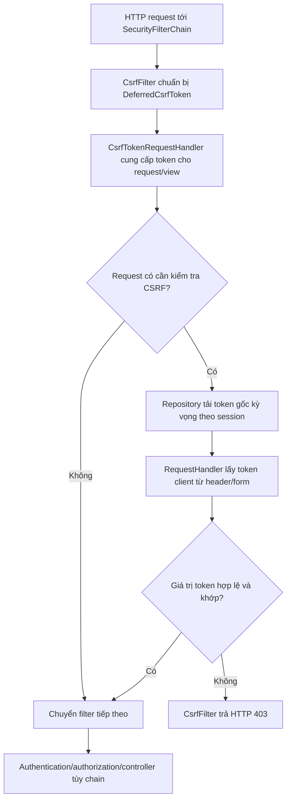

# `HttpSessionCsrfTokenRepository`

Trong ứng dụng **Spring Security Servlet** sử dụng session, `HttpSessionCsrfTokenRepository` quản lý token chống Cross-Site Request Forgery (CSRF) **ở phía máy chủ, bên trong `HttpSession`**. Khi client gửi lại token, Spring Security đọc token kỳ vọng từ session tương ứng rồi xác minh request. Hiểu cơ chế này giúp giải thích một lỗi thường gặp: form có `_csrf` vẫn nhận `403 Forbidden` khi phiên đăng nhập đã hết hạn hoặc thay đổi.

Đây là bài thuộc chương **CSRF trên Servlet**, module **SPRING_SECURITY_HTTP_PROTECTION**. Module bao quát các lớp phòng vệ HTTP và trình duyệt trong Spring Security: CSRF, CORS, security headers, CSP, HSTS, HTTP firewall và bảo vệ session, đồng thời phân biệt triển khai Servlet và Reactive. Bài tập trung **cụ thể vào `HttpSessionCsrfTokenRepository` của Servlet**, cách nó phối hợp với `CsrfFilter`, `CsrfTokenRequestHandler`, form login và vòng đời session. Hạ tầng Reactive có giao diện và implementation riêng là `ServerCsrfTokenRepository` và `WebSessionServerCsrfTokenRepository`.

## 1. Vì sao cần lưu CSRF token trong session?

Giả sử người dùng đã đăng nhập `https://shop.example`. Trình duyệt có thể tự gửi cookie xác thực khi thực hiện HTTP request tới website này. Một website độc hại có thể dụ trình duyệt tạo request thay đổi trạng thái; vì thế sự xuất hiện của cookie đăng nhập **không chứng minh người dùng chủ ý thực hiện thao tác**.

Mẫu phòng vệ *synchronizer token* bổ sung một chuỗi khó đoán: ứng dụng cung cấp token cho trang được phép, client chủ động gửi token qua **form parameter hoặc HTTP header**, còn server giữ một bản kỳ vọng tương ứng với session. Request cần chống CSRF chỉ được đi tiếp khi hai giá trị hợp lệ và khớp nhau.

`HttpSessionCsrfTokenRepository` đảm nhiệm **bản token kỳ vọng**, không trực tiếp kiểm tra token do client gửi. Phần xác minh thuộc về `CsrfFilter`.

```text
Trình duyệt A: Cookie JSESSIONID=SESSION_A
    └── HttpSession A lưu token gốc "random-A"
    └── POST + token hợp lệ của A => qua bước kiểm tra CSRF

Trình duyệt B: Cookie JSESSIONID=SESSION_B
    └── HttpSession B lưu token gốc "random-B"
    └── POST + token của A => token không khớp với session B
```

Đây là giá trị minh họa, không phải cách đặt token thật. CSRF token không phải access token và **không chứa quyền truy cập**; vượt qua bước CSRF không có nghĩa request đã được xác thực, phân quyền hay xử lý nghiệp vụ thành công.

## 2. API và trách nhiệm của `HttpSessionCsrfTokenRepository`

Lớp nằm trong package:

```java
org.springframework.security.web.csrf.HttpSessionCsrfTokenRepository
```

Nó hiện thực `CsrfTokenRepository`, với ba phương thức chính:

```java
CsrfToken generateToken(HttpServletRequest request);

void saveToken(
    CsrfToken token,
    HttpServletRequest request,
    HttpServletResponse response);

CsrfToken loadToken(HttpServletRequest request);
```

| Phương thức | Trách nhiệm trong mô hình session | Lưu ý |
| --- | --- | --- |
| `generateToken(request)` | Sinh một đối tượng `CsrfToken` chứa token ngẫu nhiên | **Chưa lưu** token vào session |
| `saveToken(token, request, response)` | Lưu token vào session attribute | Khi ghi token khác `null`, có thể tạo session mới |
| `loadToken(request)` | Lấy token đã lưu từ session hiện tại | Có thể trả về `null`; không cần tạo session mới |
| `saveToken(null, request, response)` | Xóa token đã lưu trong session hiện có | Không tự xóa toàn bộ session |

`CsrfToken` có các phương thức:

```java
csrfToken.getToken();          // Giá trị token
csrfToken.getParameterName();  // Mặc định "_csrf"
csrfToken.getHeaderName();     // Mặc định "X-CSRF-TOKEN"
```

Repository lưu một đối tượng token vào **attribute bên trong `HttpSession`**. Cookie `JSESSIONID` thường chỉ giúp Servlet container xác định session tương ứng; cookie này không chứa chính CSRF token mà repository lưu.

Khi cần đổi tên parameter/header cho phù hợp giao diện:

```java
HttpSessionCsrfTokenRepository repository =
    new HttpSessionCsrfTokenRepository();

repository.setParameterName("_csrf");
repository.setHeaderName("X-CSRF-TOKEN");
```

Lớp cũng có thể cấu hình tên session attribute nội bộ thông qua `setSessionAttributeName(...)`. Không thay tên này tùy tiện: token đã lưu dưới tên cũ sẽ không được tìm thấy bằng tên mới. Tên header/parameter và tên session attribute giải quyết **hai vấn đề khác nhau**.

### Vì sao `generateToken()` không đồng nghĩa với `saveToken()`?

Một lần sinh token chưa đủ để request tiếp theo xác minh được. Xét mô hình đơn giản:

```text
Chưa có token trong session:
    loadToken(request)                       -> null
    generateToken(request)                   -> token A
    loadToken(request)                       -> vẫn null
    saveToken(token A, request, response)    -> lưu A

Request khác thuộc cùng session:
    loadToken(request)                       -> token A

Khi vô hiệu hóa token:
    saveToken(null, request, response)       -> xóa A
    loadToken(request)                       -> null
```

Không nên đặt lệnh `generateToken()` tùy ý vào mọi controller mỗi khi nhận request, vì tạo token mới mà không phối hợp lưu và hiển thị token sẽ khiến form cũ thất bại. Spring Security đã có cơ chế phối hợp repository và filter theo vòng đời request.

## 3. Repository đứng ở đâu trong Servlet security filter chain?

`DelegatingFilterProxy` chuyển request vào Spring Security; `FilterChainProxy` chọn `SecurityFilterChain` khớp với request. Khi CSRF được bật, `CsrfFilter` dùng repository để lấy token kỳ vọng. `CsrfTokenRequestHandler` công bố token cho view và diễn giải token client gửi; nó không phải kho lưu token.



Với matcher mặc định, `GET`, `HEAD`, `TRACE`, `OPTIONS` không bắt buộc token; `POST`, `PUT`, `PATCH`, `DELETE` và các phương thức khác thường cần token. Đây là luật **theo HTTP method**, không phải theo việc controller có ghi database hay không. Vì vậy endpoint `GET` không nên thay đổi trạng thái.

| Thành phần | Vai trò |
| --- | --- |
| `HttpSessionCsrfTokenRepository` | Tạo, lưu, đọc, xóa token kỳ vọng trong session |
| `CsrfTokenRequestHandler` | Cung cấp biểu diễn token cho view; đọc token do client gửi qua form/header |
| `CsrfFilter` | Chọn request cần token, so sánh, chặn request không hợp lệ |
| `AuthorizationFilter` | Kiểm tra quyền ở bước sau; không quyết định có cần token CSRF không |

Do `CsrfFilter` thường chạy trước nhiều filter xác thực và phân quyền, **`POST /login` có thể bị `403` ngay cả khi `/login` được `permitAll()`**. Thay đổi quyền truy cập không giải quyết lỗi thiếu token.

## 4. Vòng đời token từ GET form tới POST

Xét một người dùng mở trang chỉnh hồ sơ:

```mermaid
sequenceDiagram
    participant Browser as Trình duyệt
    participant Filter as CsrfFilter
    participant Repository as HttpSessionCsrfTokenRepository
    participant View as MVC View
    Browser->>Filter: GET /profile/edit
    Filter->>Repository: loadDeferredToken(request, response)
    Repository-->>Filter: DeferredCsrfToken
    Filter->>View: Tiếp tục request GET
    View->>Repository: View truy cập _csrf.token
    Repository->>Repository: loadToken(); nếu thiếu thì generateToken() + saveToken()
    Repository-->>View: CsrfToken
    View-->>Browser: Render HTML chứa hidden _csrf; cookie session nếu cần
    Browser->>Filter: POST /profile/email + cùng cookie session + _csrf
    Filter->>Repository: Tải token kỳ vọng từ session
    Repository-->>Filter: Token gốc của session
    Filter->>Filter: RequestHandler lấy token từ form, sau đó xác minh
    alt Hợp lệ
        Filter-->>Browser: Request tiếp tục tới controller nếu được phép
    else Thiếu/sai token
        Filter-->>Browser: 403 Forbidden
    end
```

Nếu session đã tồn tại do đăng nhập trước đó, việc lưu token chỉ thêm attribute vào session. Nếu chưa có session, bước lưu token có thể tạo session mới. **Sinh token**, **đọc token** và **tạo session** không phải ba thao tác luôn xảy ra đồng thời.

### Khi client gửi token đúng nhưng khác session

`HttpSessionCsrfTokenRepository` đọc token gốc qua session **của request hiện tại**. Nếu client không gửi cookie session, cookie đổi, session bị invalidate hoặc đã hết hạn, repository có thể trả về `null` thay vì token đã dùng để render form. Giá trị `_csrf` copy từ phiên trước lúc đó không cứu được request.

Một số nguyên nhân cụ thể:

- `fetch` không gửi cookie trong bối cảnh cần credentials.
- Người dùng tải trang rồi giữ form qua thời điểm session timeout.
- Login/logout làm token cũ bị xóa, client chưa lấy token mới.
- Một node khác trong cụm không truy cập được cùng session.
- Frontend dùng token của tab/trình duyệt khác có session không tương ứng.

Khi gặp `403`, nên so sánh **cookie/session của lần lấy token** với **cookie/session của lần gửi request**, thay vì chỉ kiểm tra header có tồn tại hay không.

## 5. `DeferredCsrfToken`: khi nào thực sự tạo session?

Các phiên bản Spring Security Servlet hiện đại hỗ trợ cơ chế **nạp token theo nhu cầu**. `CsrfFilter` có thể nhận `DeferredCsrfToken` từ repository mà chưa cần truy cập session. Token chỉ được tải/tạo/lưu khi một thành phần thật sự cần.

| Tình huống | Khi nào token có thể được nạp? |
| --- | --- |
| `GET /health` không sử dụng `_csrf` | Có thể đi hết chain mà không tải token và không tạo session |
| `GET /profile/edit` render `_csrf.token` | Khi view truy cập thuộc tính token |
| `GET /csrf` công bố token cho JavaScript | Khi endpoint truy cập `getToken()` |
| `POST /profile/email` cần xác minh CSRF | Khi `CsrfFilter` nạp token kỳ vọng |
| SPA chỉ gọi `GET` rồi trông đợi token xuất hiện | Token có thể chưa được tạo nếu không có ai truy cập token |

Điều này quan trọng về hiệu năng: một endpoint chỉ đọc hoặc tải tài nguyên tĩnh không nhất thiết phải tạo session chỉ để đi qua CSRF filter. Tuy nhiên **nạp lười không có nghĩa token tồn tại vĩnh viễn**; token vẫn phụ thuộc session và chính sách vô hiệu hóa.

### Endpoint chủ động cung cấp CSRF token cho JavaScript

Một ứng dụng dùng session cookie và JavaScript có thể tạo endpoint `GET /csrf` để cung cấp biểu diễn token hiện hành:

```java
import org.springframework.security.web.csrf.CsrfToken;
import org.springframework.web.bind.annotation.GetMapping;
import org.springframework.web.bind.annotation.RequestAttribute;
import org.springframework.web.bind.annotation.RestController;

@RestController
class CsrfEndpoint {

    @GetMapping("/csrf")
    CsrfResponse getToken(@RequestAttribute("_csrf") CsrfToken csrfToken) {
        return new CsrfResponse(
            csrfToken.getHeaderName(),
            csrfToken.getParameterName(),
            csrfToken.getToken());
    }

    record CsrfResponse(
        String headerName,
        String parameterName,
        String token) {}
}
```

Lệnh `csrfToken.getToken()` làm token được truy xuất khi cần. Ở cấu hình có request handler che token, giá trị công bố cho client có thể là **biểu diễn masked**; client cần gửi lại giá trị tương thích với handler thay vì tự đào token gốc từ session.

JavaScript cùng origin gửi lại token qua tên header mà server cấp:

```javascript
const tokenResponse = await fetch("/csrf", {
  credentials: "same-origin",
  cache: "no-store"
});
if (!tokenResponse.ok) {
  throw new Error("Khong the lay CSRF token");
}

const csrf = await tokenResponse.json();

const result = await fetch("/profile/email", {
  method: "POST",
  credentials: "same-origin",
  headers: {
    "Content-Type": "application/json",
    [csrf.headerName]: csrf.token
  },
  body: JSON.stringify({ email: "user@example.com" })
});
```

Ví dụ giả định có endpoint nhận JSON tại `/profile/email`, người dùng có đủ quyền và cookie session còn hiệu lực. Nếu frontend khác origin, cần thiết kế thêm CORS và credentials phù hợp. `HttpSessionCsrfTokenRepository` không thay thế bước cấu hình đó.

## 6. Form render phía server: hidden input `_csrf`

Với form HTML, token thường đi trong request parameter. Ví dụ template Thymeleaf có thể biểu diễn:

```html
<form action="/profile/email" method="post">
  <label for="email">Email mới</label>
  <input id="email" name="email" type="email" required>
  <input type="hidden"
         th:name="${_csrf.parameterName}"
         th:value="${_csrf.token}">
  <button type="submit">Lưu</button>
</form>
```

`_csrf` do request handler cung cấp cho view. Một số tích hợp Thymeleaf với Spring MVC đã tự chèn hidden CSRF field khi dùng `th:action`; khi đó không nên chèn thêm bản thủ công không cần thiết. Điều cốt lõi là form gửi giá trị token **được ứng dụng cấp cho đúng session và đúng handler**.

Ví dụ luồng HTTP, các giá trị chỉ mang tính minh họa:

```http
GET /profile/edit HTTP/1.1
Host: app.example

HTTP/1.1 200 OK
Set-Cookie: JSESSIONID=...
Content-Type: text/html

<input type="hidden" name="_csrf" value="<token-duoc-cong-bo>">
```

```http
POST /profile/email HTTP/1.1
Host: app.example
Cookie: JSESSIONID=<cung-session>
Content-Type: application/x-www-form-urlencoded

email=user@example.com&_csrf=<token-duoc-cong-bo>
```

Header `Set-Cookie` chỉ xuất hiện nếu session cần được tạo/cập nhật; các thuộc tính cookie thực tế phụ thuộc container và cấu hình ứng dụng. Không truyền token trong URL vì URL có thể bị đưa vào history, log hoặc `Referer`.

## 7. Cấu hình repository trong `SecurityFilterChain`

Trong ứng dụng Spring Security Servlet dùng form login và session, `HttpSessionCsrfTokenRepository` thường là **repository mặc định** khi bật bảo vệ CSRF. Cấu hình tường minh giúp dễ quan sát việc repository tham gia vào chain:

```java
import org.springframework.context.annotation.Bean;
import org.springframework.context.annotation.Configuration;
import org.springframework.security.config.Customizer;
import org.springframework.security.config.annotation.web.builders.HttpSecurity;
import org.springframework.security.web.SecurityFilterChain;
import org.springframework.security.web.csrf.HttpSessionCsrfTokenRepository;

@Configuration
public class SecurityConfiguration {

    @Bean
    SecurityFilterChain webSecurity(HttpSecurity http) throws Exception {
        HttpSessionCsrfTokenRepository repository =
            new HttpSessionCsrfTokenRepository();

        http
            .authorizeHttpRequests(auth -> auth
                .requestMatchers("/login", "/csrf", "/css/**").permitAll()
                .anyRequest().authenticated())
            .formLogin(Customizer.withDefaults())
            .csrf(csrf -> csrf.csrfTokenRepository(repository));

        return http.build();
    }
}
```

Phân tích cấu hình:

1. `.csrf(csrf -> csrf.csrfTokenRepository(repository))` chọn cách lưu token kỳ vọng.
2. `permitAll()` cho phép truy cập một số URL ở bước phân quyền; **không miễn CSRF cho `POST /login`**.
3. `GET /csrf` được phép truy cập để cấp token nếu ứng dụng có controller tương ứng; client phải duy trì session khi sử dụng token đó.
4. `formLogin()` dựa trên cookie session; CSRF token chỉ là một điều kiện bổ sung khi request cần chống giả mạo.
5. Nếu ứng dụng có nhiều `SecurityFilterChain`, repository chỉ áp dụng cho request đi vào **chain được chọn thực tế**.

Không cần tạo repository bean riêng nếu chỉ cấu hình một chain. Khi có nhiều chain, hãy dùng `securityMatcher(...)` và thứ tự `@Order` cẩn thận, bởi `FilterChainProxy` dùng chain khớp đầu tiên.

### Đặt tên riêng cho frontend

```java
HttpSessionCsrfTokenRepository repository =
    new HttpSessionCsrfTokenRepository();

repository.setHeaderName("X-APP-CSRF");
repository.setParameterName("csrf_value");

http.csrf(csrf -> csrf.csrfTokenRepository(repository));
```

Đây là phần cấu hình nằm trong quá trình xây dựng `SecurityFilterChain` có `HttpSecurity http`. Client phải dùng chính tên header/parameter mới. Nếu view sử dụng `_csrf.headerName` hoặc `_csrf.parameterName`, dữ liệu metadata đó phản ánh cấu hình repository và giúp tránh hard-code.

### Ngoại lệ cho endpoint không dùng token từ phiên người dùng

Một webhook được gọi bởi hệ thống bên ngoài thường không thể gửi token CSRF thuộc session web app. Khi thật sự cần, có thể giới hạn ngoại lệ vào endpoint cụ thể:

```java
http.csrf(csrf -> csrf
    .csrfTokenRepository(new HttpSessionCsrfTokenRepository())
    .ignoringRequestMatchers("/webhooks/provider-a"));
```

Webhook vẫn cần một cơ chế xác minh phù hợp như chữ ký, timestamp hoặc chống replay. Không dùng ngoại lệ bao trùm `/api/**` chỉ vì công cụ thử nghiệm hoặc SPA đang thiếu token. Với API dùng cookie đăng nhập, bỏ CSRF có thể tạo lỗ hổng.

## 8. Login, logout, session timeout và vô hiệu hóa token

Token được lưu trong `HttpSession` nên vòng đời token bị tác động khi session thay đổi. Ngoài ra, Spring Security có thể chủ động xóa token trong các bước xử lý xác thực và đăng xuất.

| Sự kiện | Hệ quả đối với token | Điều client cần làm |
| --- | --- | --- |
| Session còn sống và token chưa bị xóa | Repository đọc lại cùng token gốc | Sử dụng token còn hiệu lực của session |
| Session chưa tồn tại | `loadToken()` trả `null` | Lấy token qua form hoặc endpoint khi cần |
| Session hết hạn | Token gốc cũ không được tìm trong session hiện tại | Tải lại form/lấy token mới |
| Login thành công | Chiến lược bảo mật có thể xóa token trước đăng nhập | Cập nhật token trước request unsafe tiếp theo |
| Logout | Cơ chế logout có thể xóa token | Nếu còn request khác, lấy token mới |
| Nhiều tab cùng session | Có thể dùng chung token gốc khi còn hiệu lực | Làm mới token ở tab cũ sau khi trạng thái phiên thay đổi |
| Đổi tên session attribute token | Giá trị lưu cũ không còn được tìm bằng tên mới | Đồng bộ cấu hình, dự liệu lỗi token cũ |

Trong các cấu hình Spring Security phổ biến, `CsrfAuthenticationStrategy` và `CsrfLogoutHandler` dùng cơ chế xóa token, tương đương ý tưởng `saveToken(null, request, response)`. Sau đó, token mới được sinh khi có nhu cầu. Việc này giúp token không tiếp tục sống qua mọi chuyển đổi ngữ cảnh xác thực.

**Không đồng nhất thay session ID với thay CSRF token.** Cơ chế chống *session fixation* có thể làm thay ID session, còn xóa hoặc tạo token thuộc cơ chế riêng. Để giải thích một lỗi cụ thể, cần kiểm tra cả chiến lược session lẫn bước invalidation token.

### Session timeout khi người dùng đang điền form

Một người dùng có thể mở `GET /checkout`, điền form 30 phút rồi submit. Trong thời gian đó, session có thể hết hạn; request `POST` gửi token thuộc session cũ. `HttpSessionCsrfTokenRepository` không tìm thấy token kỳ vọng và `CsrfFilter` có thể trả `403`, dù HTML có field `_csrf`.

Hướng xử lý sản phẩm là cho phép người dùng tải lại form hoặc khôi phục phiên một cách phù hợp, có thông báo rõ ràng về session đã hết hạn. Không giải quyết bằng cách bỏ CSRF toàn cục; điều đó chỉ giấu nguyên nhân.

### Cụm nhiều instance

Repository này không tự đồng bộ session giữa các node ứng dụng. Nó dựa vào cách Servlet container hoặc hệ thống quản lý session cung cấp `HttpSession`. Với load balancer, cần thiết kế **sticky session**, **session replication** hoặc session store chia sẻ như một cấu hình Spring Session phù hợp.

Một mẫu lỗi:

```text
GET /profile/edit  --> Node A  --> Session S chứa CSRF token T
POST /profile/edit --> Node B  --> Không có dữ liệu Session S
                               --> loadToken() trả null
                               --> CsrfFilter từ chối với 403
```

Hãy tìm hiểu session infrastructure nếu lỗi chỉ xảy ra khi đổi node, sau rollout hoặc khi load balancer đổi routing. Đổi tên CSRF header sẽ không giải quyết vấn đề mất session.

## 9. Token gốc, masked token và request handler

Trong Spring Security hiện đại, `XorCsrfTokenRequestAttributeHandler` có thể dùng biểu diễn token đã **che ngẫu nhiên** để giảm rủi ro BREACH khi token xuất hiện trong nội dung response có nén.

- `HttpSessionCsrfTokenRepository` lưu **token gốc** vào session.
- View thông qua request handler có thể nhận **biểu diễn masked**, vì vậy chuỗi trong HTML có thể khác nhau ở các lần render.
- Khi client gửi token masked, request handler xử lý biểu diễn đó trước khi filter so sánh với token gốc.
- Một SPA trả về token dạng gốc trong header cần bảo đảm request handler được cấu hình để diễn giải đúng dạng này.

Do đó, nếu hai tab cùng session hiển thị hai giá trị `_csrf` khác nhau thì **chưa đủ bằng chứng** rằng repository đã tạo hai token gốc. Cần xét request handler và phiên bản Spring Security đang chạy.

Không nên tự trích xuất token trực tiếp từ session attribute rồi gửi cho JavaScript: điều đó bỏ qua lớp công bố token có thể bao gồm masking. Nếu cần endpoint cấp token, sử dụng đối tượng `CsrfToken` mà request handler công bố như ví dụ mục 5.

## 10. Kiểm thử tạo, lưu, đọc, xóa bằng Spring Test

Các ví dụ dưới đây dùng JUnit 5, `spring-test` và `spring-security-web`. Mục tiêu là kiểm tra trực tiếp trạng thái **repository theo session**, trước khi kiểm thử thêm đường đi qua `CsrfFilter`.

### Test A: tạo token chưa làm token xuất hiện trong session

```java
import org.junit.jupiter.api.Test;
import org.springframework.mock.web.MockHttpServletRequest;
import org.springframework.mock.web.MockHttpServletResponse;
import org.springframework.security.web.csrf.CsrfToken;
import org.springframework.security.web.csrf.HttpSessionCsrfTokenRepository;

import static org.junit.jupiter.api.Assertions.*;

class HttpSessionCsrfTokenRepositoryTest {

    @Test
    void generateDoesNotStoreUntilSave() {
        var repository = new HttpSessionCsrfTokenRepository();
        var request = new MockHttpServletRequest();
        var response = new MockHttpServletResponse();

        assertNull(repository.loadToken(request));
        assertNull(request.getSession(false)); // Chưa có session

        CsrfToken generated = repository.generateToken(request);
        assertNotNull(generated.getToken());
        assertFalse(generated.getToken().isEmpty());
        assertNull(repository.loadToken(request));
        assertNull(request.getSession(false)); // Chỉ generate chưa tạo session

        repository.saveToken(generated, request, response);
        assertNotNull(request.getSession(false));
        assertEquals(
            generated.getToken(),
            repository.loadToken(request).getToken());
    }
}
```

Test này thể hiện **`generateToken()` và `saveToken()` là hai thao tác riêng**. Bài test không thay thế tích hợp qua HTTP; nó chứng minh hành vi lưu trong `MockHttpSession` khi có lệnh `saveToken`.

### Test B: token thuộc session và có thể đọc ở request khác

```java
import org.junit.jupiter.api.Test;
import org.springframework.mock.web.MockHttpServletRequest;
import org.springframework.mock.web.MockHttpServletResponse;
import org.springframework.mock.web.MockHttpSession;
import org.springframework.security.web.csrf.CsrfToken;
import org.springframework.security.web.csrf.HttpSessionCsrfTokenRepository;

import static org.junit.jupiter.api.Assertions.*;

class SessionTokenRoundTripTest {

    @Test
    void tokenIsAvailableInTheSameSession() {
        var repository = new HttpSessionCsrfTokenRepository();
        var first = new MockHttpServletRequest();
        var response = new MockHttpServletResponse();

        CsrfToken token = repository.generateToken(first);
        repository.saveToken(token, first, response);

        MockHttpSession session = (MockHttpSession) first.getSession(false);
        var second = new MockHttpServletRequest();
        second.setSession(session);

        assertEquals(
            token.getToken(),
            repository.loadToken(second).getToken());

        var unrelated = new MockHttpServletRequest();
        assertNull(repository.loadToken(unrelated));
    }
}
```

Đây là mô phỏng hai request dùng **cùng `MockHttpSession`**. Trong trình duyệt thật, việc dùng cùng session phụ thuộc vào cookie, đường dẫn, domain và cấu hình session của container.

### Test C: xóa token không đồng nghĩa hủy session

```java
import org.junit.jupiter.api.Test;
import org.springframework.mock.web.MockHttpServletRequest;
import org.springframework.mock.web.MockHttpServletResponse;
import org.springframework.security.web.csrf.HttpSessionCsrfTokenRepository;

import static org.junit.jupiter.api.Assertions.*;

class SessionTokenClearTest {

    @Test
    void clearingTokenDoesNotInvalidateSession() {
        var repository = new HttpSessionCsrfTokenRepository();
        var request = new MockHttpServletRequest();
        var response = new MockHttpServletResponse();

        var token = repository.generateToken(request);
        repository.saveToken(token, request, response);
        assertNotNull(repository.loadToken(request));

        repository.saveToken(null, request, response);

        assertNull(repository.loadToken(request));
        assertNotNull(request.getSession(false));
    }
}
```

Vì `saveToken(null, ...)` không tự invalidate toàn bộ `HttpSession`, ứng dụng có thể vẫn có session mà **không còn CSRF token cũ**. Request tiếp theo cần token mới phải dùng luồng cấp token phù hợp.

### Test D: kiểm tra filter với MockMvc

Để kiểm tra trực tiếp request `POST` bị `CsrfFilter` chặn, dùng `spring-security-test`:

```java
import org.junit.jupiter.api.Test;
import org.springframework.beans.factory.annotation.Autowired;
import org.springframework.boot.test.autoconfigure.web.servlet.AutoConfigureMockMvc;
import org.springframework.boot.test.context.SpringBootTest;
import org.springframework.security.test.context.support.WithMockUser;
import org.springframework.test.web.servlet.MockMvc;

import static org.springframework.security.test.web.servlet.request.SecurityMockMvcRequestPostProcessors.csrf;
import static org.springframework.test.web.servlet.request.MockMvcRequestBuilders.post;
import static org.springframework.test.web.servlet.result.MockMvcResultMatchers.status;

@SpringBootTest
@AutoConfigureMockMvc
@WithMockUser(username = "learner")
class CsrfFilterIntegrationTest {

    @Autowired
    MockMvc mvc;

    @Test
    void postNeedsValidCsrfToken() throws Exception {
        mvc.perform(post("/settings"))
            .andExpect(status().isForbidden());

        mvc.perform(post("/settings").with(csrf().useInvalidToken()))
            .andExpect(status().isForbidden());

        mvc.perform(post("/settings").with(csrf()))
            .andExpect(status().isOk());
    }
}
```

Ví dụ giả định dự án có `POST /settings` trả HTTP `200` khi thành công, người dùng thử được phép truy cập, và chain có bật CSRF. Nếu controller trả một status khác, phải đổi kỳ vọng. `.with(csrf())` cho phép kiểm tra filter, nhưng **chưa chứng minh** `HttpSessionCsrfTokenRepository` duy trì token qua hai HTTP request thật. Cần thêm kiểm thử giữ nguyên session và dùng token được ứng dụng phát từ `GET /csrf`.

### Kiểm thử tích hợp theo đúng session

Một kịch bản end-to-end nên đi qua các bước:

1. Gọi `GET /csrf` hoặc `GET /form` và ghi nhận token client thực sự nhận được.
2. Giữ session giữa các request, ví dụ dùng cookie jar trong HTTP client hoặc `MockHttpSession` khi thử MockMvc.
3. `POST` với đúng cookie/session và token qua header hoặc form parameter; kỳ vọng request vượt qua bước CSRF.
4. Gửi token này từ **session khác**; kỳ vọng token không hợp lệ với session đó.
5. Xóa token hoặc mô phỏng session timeout, sau đó kiểm tra client có nhận lại token mới hay không.

Không tự gọi `.with(csrf())` trên mọi request rồi kết luận vòng đời repository đã được chứng minh: helper đó chủ yếu hỗ trợ thiết lập token hợp lệ cho test filter.

## 11. Chẩn đoán lỗi CSRF liên quan đến session

| Dấu hiệu | Nguyên nhân khả dĩ | Kiểm tra trước |
| --- | --- | --- |
| `GET /form` ổn, `POST /form` trả `403` | Thiếu form field/header hoặc cookie session | HTML render, HTTP request body, cookie |
| Có `_csrf` nhưng vẫn `403` sau một thời gian | Session timeout hoặc token cũ | Session giữa lần GET và POST |
| Vừa đăng nhập xong, request tiếp theo `403` | Token trước login đã bị xóa | Luồng cấp lại token sau xác thực |
| Chỉ lỗi khi load balancer chuyển node | Node khác không có cùng session | Cơ chế session sharing, sticky sessions |
| HTML hiển thị token khác nhau theo response | Request handler có thể tạo masked token | Handler và token gốc trong session |
| `GET /csrf` chưa cấp token như dự kiến | Chưa truy cập token do deferred loading | Endpoint có gọi `getToken()` không? |
| `POST /login` có `permitAll()` vẫn `403` | Kiểm tra CSRF chạy trước authorization | Form login và chain chứa `CsrfFilter` |
| Token đúng nhưng còn `403` | Phân quyền hoặc filter khác từ chối | Log exception và filter thực sự chặn |

Quy trình tìm nguyên nhân:

1. **Xác định security chain.** Có nhiều chain thì kiểm tra chain được match đầu tiên, repository và chính sách CSRF của chain đó.
2. **Xác định nơi cấp token.** View hoặc API đã thật sự đọc `_csrf.token` chưa?
3. **Kiểm tra session.** Cookie `JSESSIONID` còn hiệu lực, request nhận token và request gửi token có cùng session không?
4. **Kiểm tra token client.** Tên header/form parameter và dạng masked/raw có đúng request handler?
5. **Xem vòng đời.** Vừa login/logout, timeout, đổi node hay invalidate session?
6. **Xác định filter chặn.** Tìm dấu hiệu `MissingCsrfTokenException`, `InvalidCsrfTokenException` hoặc lỗi authorization khác.

Có thể bật log tạm thời trong môi trường phát triển:

```properties
logging.level.org.springframework.security.web.FilterChainProxy=DEBUG
logging.level.org.springframework.security.web.csrf=TRACE
```

Đừng in CSRF token hoặc session ID thật vào log chia sẻ, cũng không duy trì log mức chi tiết cao không cần thiết trong production. Chỉ quan sát status `403` rồi tắt CSRF có thể làm mất lớp phòng vệ quan trọng với ứng dụng dùng cookie đăng nhập.

## 12. Quan hệ với CORS, SameSite, CSP và lớp bảo vệ HTTP khác

`HttpSessionCsrfTokenRepository` chỉ giải quyết **lưu token kỳ vọng**. Nó cần phối hợp với các cơ chế khác của module:

| Cơ chế | Vai trò |
| --- | --- |
| `CsrfFilter` | Quyết định request nào phải qua CSRF, xác minh token và chặn khi sai |
| `HttpSessionCsrfTokenRepository` | Gắn token kỳ vọng với session phía server |
| CORS | Quy định truy cập cross-origin của JavaScript và preflight; không thay CSRF token |
| Cookie `SameSite` | Hạn chế một số trường hợp cookie được gửi cross-site |
| Cookie `HttpOnly` | Hạn chế JavaScript đọc cookie; không ngăn browser tự đính kèm cookie |
| Cookie `Secure`, HTTPS, HSTS | Giúp bảo vệ kênh truyền và cookie |
| CSP và chống XSS | Hạn chế script độc hại có thể lợi dụng token và quyền của trang |
| HTTP firewall | Kiểm tra/từ chối một số request bất thường trước khi vào sâu trong ứng dụng |
| Session management | Quản lý timeout, invalidation, session fixation và tính sẵn có của session |

Mô hình stateless chỉ dùng bearer token mà client **chủ động** gửi trong `Authorization` header có thể có threat model CSRF khác. Nhưng nếu ứng dụng dùng JWT chứa trong cookie được trình duyệt tự gửi, nguy cơ CSRF vẫn cần được xét dù backend không lưu session. Đánh giá dựa trên cách credentials được truyền, không dựa vào tên “REST” hay “stateless”.

Không đưa `HttpSessionCsrfTokenRepository` vào `ServerHttpSecurity` của WebFlux. Reactive có `ServerCsrfTokenRepository` làm việc với `ServerWebExchange` và các kiểu reactive tương ứng.

## 13. Những hiểu nhầm dễ gây lỗi

| Nhận định sai | Cách hiểu đúng |
| --- | --- |
| “Gọi `generateToken()` là session đã chứa token” | Cần `saveToken()` hoặc để Spring Security điều phối vòng đời |
| “Đi qua `CsrfFilter` nghĩa là GET đã tạo session” | `DeferredCsrfToken` có thể trì hoãn tải và lưu |
| “Chỉ cần cookie session là POST an toàn” | Request unsafe còn cần token hợp lệ qua form/header |
| “`permitAll()` vô hiệu hóa CSRF” | `permitAll()` là luật authorization |
| “Chuỗi `_csrf` khác nhau luôn có nghĩa token gốc khác nhau” | Request handler có thể che token theo từng response |
| “`saveToken(null, ...)` hủy mọi dữ liệu session” | Repository xóa token, không mặc định hủy session |
| “Test `.with(csrf())` chứng minh session ổn qua browser” | Cần round trip với đúng session và token phát ra |
| “Bị 403 thì mở CORS hoặc tắt CSRF” | Phải xác định filter và nguyên nhân cụ thể |

## 14. Câu hỏi tự luyện

1. Vì sao token thuộc session A thường không thể dùng làm token hợp lệ cho session B?
2. Phân biệt `generateToken()`, `saveToken()` và `loadToken()`. Trong thao tác nào repository có thể tạo `HttpSession`?
3. Vì sao `GET /health` có thể không tạo session dù request đi qua `CsrfFilter`?
4. Vì sao `POST /login` vẫn có thể bị `403` dù `/login` đã `permitAll()`?
5. Hai tab hiển thị hai giá trị `_csrf` khác nhau: cần kiểm tra gì để phân biệt masked token với token gốc?
6. Nếu lỗi `POST` chỉ xuất hiện khi load balancer chuyển node, bạn sẽ kiểm tra lớp hạ tầng nào?
7. Cách kiểm thử vòng đời `generate → save → load → delete` khác kiểm thử `CsrfFilter` bằng MockMvc ra sao?

**Ghi nhớ:** `HttpSessionCsrfTokenRepository` quản lý **token gốc kỳ vọng trong `HttpSession`**. `CsrfTokenRequestHandler` công bố và diễn giải token client gửi; `CsrfFilter` mới áp dụng luật kiểm tra và từ chối request không hợp lệ. Khi gặp `403` ở ứng dụng Servlet dùng session cookie, hãy lần theo chuỗi **lấy token → giữ đúng session → gửi token → filter xác minh**, đặc biệt sau login/logout, khi hết hạn phiên và khi chạy nhiều instance.
