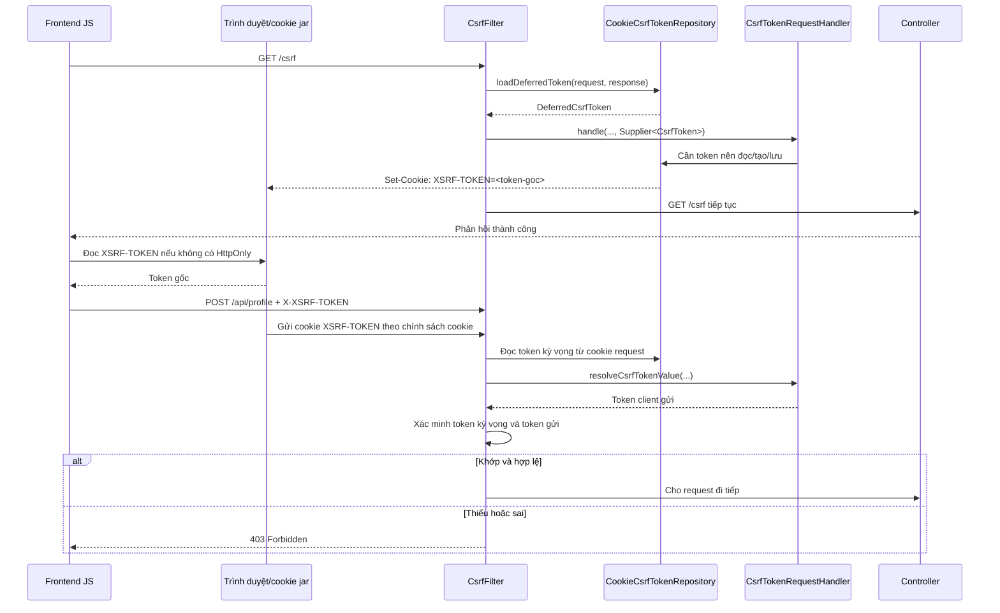

# `CookieCsrfTokenRepository` và quy ước cookie–header

Trong ứng dụng **Spring Security Servlet**, `CookieCsrfTokenRepository` lưu token chống Cross-Site Request Forgery (CSRF) trong **cookie HTTP**. Quy ước phổ biến là server phát cookie `XSRF-TOKEN`, còn JavaScript của ứng dụng đọc giá trị và chủ động gửi lại qua header `X-XSRF-TOKEN` ở các request thay đổi trạng thái. Tại phía server, `CsrfFilter` đối chiếu token client gửi với token kỳ vọng mà repository đọc từ cookie.

Đây là bài thuộc chương **CSRF trên Servlet** của module **SPRING_SECURITY_HTTP_PROTECTION**, nơi người học áp dụng các lớp phòng vệ HTTP và trình duyệt như CSRF, CORS, security headers, CSP, HSTS, HTTP firewall và bảo vệ session trên cả Servlet lẫn Reactive. Bài này tập trung vào **`CookieCsrfTokenRepository` dành cho Servlet**: quy ước cookie–header, vòng đời token, tác động của các thuộc tính cookie, cấu hình SPA/form, kiểm thử và xử lý lỗi khi triển khai. Spring Security WebFlux có các repository và filter Reactive riêng, không dùng trực tiếp lớp Servlet này.

## 1. Tại sao có cả cookie lẫn header?

Giả sử ứng dụng quản lý tài khoản tại `https://account.example` dùng cookie đăng nhập để xác thực. Trình duyệt có thể tự đính kèm cookie này khi gửi request tới website. Kẻ tấn công có thể tìm cách dụ trình duyệt gửi một request không mong muốn, chẳng hạn `POST /profile/change-email`, trong khi người dùng vẫn đang có phiên đăng nhập.

Nếu server chỉ kiểm tra cookie đăng nhập, việc trình duyệt **tự gửi credentials** có thể khiến request giả mạo được chấp nhận. CSRF token bổ sung một điều kiện: request cần bảo vệ phải chứa **một token do client chủ động cung cấp** bằng form parameter hoặc header, và giá trị đó phải khớp với token mà server kỳ vọng.

Với `CookieCsrfTokenRepository`, server lưu token kỳ vọng bằng cookie; JavaScript hợp lệ của ứng dụng có thể đọc cookie khi được phép và gửi lại giá trị qua header. JavaScript ở origin khác thường không thể đọc cookie của origin ứng dụng theo chính sách cùng origin. Do đó việc trình duyệt tự đính kèm cookie **không tự đáp ứng** điều kiện có header/form token hợp lệ.

```text
Phản hồi khi client lấy CSRF token:
    Set-Cookie: XSRF-TOKEN=abc123; Path=/; ...

Request thay đổi dữ liệu hợp lệ:
    Cookie: XSRF-TOKEN=abc123; SESSION=...
    X-XSRF-TOKEN: abc123

Request chỉ có cookie:
    Cookie: XSRF-TOKEN=abc123; SESSION=...
    (thiếu X-XSRF-TOKEN / form parameter tương ứng)
    => không đủ để vượt qua bước kiểm tra CSRF
```

`abc123` chỉ là giá trị minh họa; token thực phải được tạo ngẫu nhiên với độ khó đoán cao. Tên cookie và header có thể tùy chỉnh, nhưng **hai nơi phải cùng dùng đúng quy ước** mà Spring Security được cấu hình.

### Cookie–header là mẫu bảo vệ gì?

Mô hình này thường được gọi là **double-submit cookie**: token xuất hiện một lần ở cookie dùng làm giá trị kỳ vọng và một lần ở header/form do client cung cấp. Nó khác với mô hình synchronizer token lưu bản kỳ vọng trong `HttpSession`.

Không nên suy ra rằng vì cookie chứa token và client gửi header khớp nên server đã xác thực người dùng. `CookieCsrfTokenRepository` **không tự gắn token với danh tính hoặc một session đăng nhập**. Request vẫn phải qua xác thực, phân quyền và kiểm tra nghiệp vụ. Mẫu cookie kép còn cần đánh giá các nguy cơ như cookie injection qua subdomain không đáng tin và cấu hình CORS quá rộng; xem mục bảo mật bên dưới.

## 2. Quy ước mặc định: `XSRF-TOKEN` ↔ `X-XSRF-TOKEN`

`CookieCsrfTokenRepository` nằm trong package:

```java
org.springframework.security.web.csrf.CookieCsrfTokenRepository
```

Các tên mặc định quen thuộc của lớp này:

| Thành phần | Giá trị mặc định | Dùng trong request/response |
| --- | --- | --- |
| Tên cookie | `XSRF-TOKEN` | Server phát bằng `Set-Cookie`; browser gửi bằng `Cookie` |
| Tên HTTP header | `X-XSRF-TOKEN` | Client chủ động gửi lại token trong request cần CSRF |
| Tên form parameter | `_csrf` | Dùng với form HTML khi không gửi custom header |
| Giá trị token | Chuỗi sinh ngẫu nhiên | Repository lưu/đọc và filter dùng để đối chiếu |

Quy ước này phổ biến trong hệ sinh thái JavaScript frontend, đặc biệt ở các ứng dụng theo convention Angular. Dù framework có thể tự đọc và gắn header trong một số cấu hình, hãy **kiểm tra thực tế trên Network panel**: có cookie chưa bảo đảm request sẽ có header.

Ví dụ một HTTP request:

```http
POST /api/profile HTTP/1.1
Host: app.example
Cookie: XSRF-TOKEN=ab12-cd34; JSESSIONID=your-session-id
X-XSRF-TOKEN: ab12-cd34
Content-Type: application/json

{"displayName":"Learner"}
```

Repository **đọc token kỳ vọng từ cookie `XSRF-TOKEN`**. `CsrfTokenRequestHandler` giải quyết giá trị được gửi bằng `X-XSRF-TOKEN` hoặc `_csrf`; `CsrfFilter` mới quyết định có chặn request hay không. Giá trị trong ví dụ mang tính trình bày, không phải token thật hoặc session thật.

### Ba vai trò cần phân biệt

| Thành phần | Trách nhiệm |
| --- | --- |
| `CookieCsrfTokenRepository` | Tạo token, ghi cookie, đọc cookie, phát cookie hết hạn khi xóa token |
| `CsrfTokenRequestHandler` | Công bố token cho view/endpoint và đọc giá trị token client gửi; có thể xử lý token đã che |
| `CsrfFilter` | Xác định request cần CSRF, so sánh token kỳ vọng với token do client gửi và từ chối nếu không hợp lệ |

Các request `GET`, `HEAD`, `OPTIONS`, `TRACE` thường được matcher mặc định miễn kiểm tra CSRF. `POST`, `PUT`, `PATCH`, `DELETE` thông thường phải vượt qua kiểm tra token. Dù method `GET` được miễn, **không dùng GET để thay đổi trạng thái**.

## 3. Vòng đời token từ response đến request kế tiếp



Sơ đồ mô tả **một endpoint cấp token có chủ động làm token được nạp**. Ở Spring Security hiện đại, token có thể được tải theo nhu cầu (`DeferredCsrfToken`): chỉ gọi `GET` không bảo đảm response luôn chứa `Set-Cookie: XSRF-TOKEN=...`. Phần cấu hình SPA ở mục 6 sẽ xử lý rõ điểm này.

Vòng đời theo thời gian:

1. Client gọi một endpoint hợp lệ cần token hoặc render một trang sử dụng token.
2. Repository đọc cookie `XSRF-TOKEN` trên request hiện tại; nếu thiếu và token được yêu cầu, Spring Security tạo token mới.
3. Repository phát `Set-Cookie` chứa token cần lưu để browser giữ cho request sau.
4. Browser gửi cookie theo domain, path, `Secure`, `SameSite` và quy tắc credentials.
5. Client gửi token chủ động trong header `X-XSRF-TOKEN` hoặc parameter `_csrf`.
6. `CsrfFilter` đối chiếu token từ cookie với token nhận qua header/form; nếu không hợp lệ, mặc định thường trả `403`.
7. Khi token được xóa, repository phát cookie hết hạn; client cần lấy token mới trước request unsafe kế tiếp.

Điểm quan trọng là **cookie lưu token kỳ vọng** và **header mang giá trị client chủ động đưa vào**. Cookie tự động được browser đính kèm không thay cho header.

### Trường hợp chỉ có cookie

Nếu một request `POST` tới server có:

```http
Cookie: XSRF-TOKEN=token-1; JSESSIONID=...
```

nhưng không có header `X-XSRF-TOKEN` hoặc form parameter `_csrf`, `CsrfFilter` không có giá trị token do client chủ động gửi để so sánh. Request sẽ thất bại khi thuộc phạm vi kiểm tra CSRF, bất kể cookie đã có mặt.

### Trường hợp header và cookie khác nhau

```http
Cookie: XSRF-TOKEN=token-1
X-XSRF-TOKEN: token-2
```

Nếu request handler dùng giá trị raw trong header, hai giá trị không khớp. Đừng khắc phục bằng cách tắt CSRF: hãy xác định client vừa login/logout, giữ cookie cũ, đọc sai cookie, hoặc request thuộc origin/path khác.

## 4. Repository sinh, lưu, đọc và xóa cookie như thế nào?

`CookieCsrfTokenRepository` thực hiện hợp đồng của `CsrfTokenRepository` trên Servlet:

```java
CsrfToken generateToken(HttpServletRequest request);

void saveToken(
    CsrfToken token,
    HttpServletRequest request,
    HttpServletResponse response);

CsrfToken loadToken(HttpServletRequest request);
```

| Lời gọi | Hành vi thường gặp |
| --- | --- |
| `generateToken(request)` | Sinh đối tượng `CsrfToken` có giá trị mới; **chưa phát cookie** |
| `saveToken(token, request, response)` | Gửi `Set-Cookie` để client lưu token |
| `loadToken(request)` | Tìm cookie `XSRF-TOKEN` trong request và khôi phục giá trị kỳ vọng |
| `saveToken(null, request, response)` | Gửi `Set-Cookie` hết hạn để browser xóa cookie |
| `loadDeferredToken(request, response)` | Hoãn đọc/tạo/lưu đến lúc request thực sự cần token (ở cấu hình hiện đại) |

Không nhầm `loadToken(request)` với đọc header `X-XSRF-TOKEN`: repository đọc cookie; còn header được xử lý ở request handler.

Hệ quả của mô hình cookie là **không phải tạo `HttpSession` chỉ để giữ bản token kỳ vọng**. Tuy nhiên ứng dụng vẫn có thể tạo và dùng session cho đăng nhập, giỏ hàng hoặc các nhu cầu khác. `CookieCsrfTokenRepository` không tự biến toàn bộ ứng dụng thành stateless.

### Xóa token không thể xóa cookie đã nằm trong request hiện tại

Khi ứng dụng gọi:

```java
repository.saveToken(null, request, response);
```

repository phát một header kiểu:

```http
Set-Cookie: XSRF-TOKEN=; Max-Age=0; Path=/; ...
```

Trình duyệt nhận response và **xóa cookie cho các request tiếp theo**. Request đã được gửi tới server vẫn có thể mang cookie cũ, vì request là dữ liệu đã được chuyển đi. Khi viết test, nên kiểm tra header `Set-Cookie` xóa cookie, thay vì đòi hỏi `request.getCookies()` lập tức thay đổi.

## 5. Các thuộc tính cookie quyết định khả năng hoạt động

Ngoài tên cookie và giá trị token, cách thiết lập cookie có thể khiến client không đọc được token, không gửi lại token hoặc vô tình mở rộng phạm vi tin cậy.

| Thuộc tính | Ý nghĩa | Ảnh hưởng tới CSRF |
| --- | --- | --- |
| `HttpOnly` | Không cho JavaScript đọc cookie khi bật | SPA đọc cookie để gắn header cần tắt thuộc tính này cho **cookie CSRF** |
| `Secure` | Chỉ gửi cookie qua kênh HTTPS (có ngoại lệ hành vi localhost tùy trình duyệt) | Production nên chạy HTTPS và bật `Secure` |
| `SameSite` | Giới hạn khi nào browser gửi cookie trong bối cảnh cross-site | Bổ sung giảm CSRF nhưng không thay xác minh token |
| `Path` | Chỉ gửi cookie tới các URL thuộc đường dẫn phù hợp | Cookie path không bao phủ API có thể khiến POST thiếu token kỳ vọng |
| `Domain` | Xác định phạm vi hostname/subdomain nhận cookie | Cấu hình quá rộng làm tăng nguy cơ ảnh hưởng từ subdomain kém tin cậy |
| `Max-Age` | Thời gian tồn tại của cookie | Cookie hết hạn có thể khiến token không còn ở request kế tiếp |

### `HttpOnly`: vì sao có `withHttpOnlyFalse()`?

Theo mặc định, cookie CSRF được tạo theo chính sách không cho JavaScript đọc (`HttpOnly=true`). Nếu frontend cần lấy token trực tiếp từ `document.cookie` để gắn header, Spring Security cung cấp:

```java
CookieCsrfTokenRepository repository =
    CookieCsrfTokenRepository.withHttpOnlyFalse();
```

Điều này **chỉ tắt `HttpOnly` trên cookie CSRF** do repository này phát; không có lý do tự động tắt `HttpOnly` cho cookie đăng nhập hoặc session. Cookie xác thực vẫn cần được bảo vệ theo chính sách riêng.

Nếu frontend nhận token qua một endpoint JSON hoặc HTML do server render, có thể không cần cho JavaScript đọc cookie CSRF trực tiếp. Khi đó cần thiết kế cách client gửi token phù hợp và giữ `HttpOnly` theo nhu cầu. Dù chọn cách nào, **XSS có thể làm suy yếu bảo vệ CSRF** vì script độc hại chạy cùng origin có thể gửi request với quyền của trang.

### `SameSite`: hỗ trợ, nhưng không thay thế token

Ba chế độ thường gặp:

- `Strict`: hạn chế mạnh việc gửi cookie từ ngữ cảnh cross-site; có thể ảnh hưởng luồng điều hướng/sự tích hợp hợp lệ.
- `Lax`: cho phép một số điều hướng top-level an toàn; chặn nhiều tình huống cross-site gửi request không an toàn.
- `None`: cho phép cookie được gửi trong ngữ cảnh cross-site khi trình duyệt chấp nhận; thường yêu cầu `Secure`.

`SameSite` dựa trên khái niệm **site**, còn CORS và same-origin policy dựa trên **origin**. Hai subdomain có thể cùng site nhưng khác origin; vì thế không thể suy rằng chỉ cần `SameSite=Lax` thì mọi tình huống tấn công đều bị loại bỏ. `CookieCsrfTokenRepository` vẫn cần kiểm tra token và giới hạn nguồn tương tác phù hợp.

### `Domain` và cookie injection

Ưu tiên để cookie gắn với **hostname chính xác** (host-only cookie, không đặt `Domain`) khi kiến trúc cho phép. Nếu đặt `Domain=.example.com`, nhiều subdomain cùng gốc có thể có quyền ảnh hưởng cookie theo phạm vi cấu hình. Một subdomain bị chiếm quyền hoặc không đáng tin có thể tạo rủi ro **cookie tossing/injection**. Với mẫu double-submit không ràng buộc cryptographic với session, đây là mối đe dọa quan trọng.

Không xem việc cookie và header trùng nhau là bằng chứng hoàn chỉnh cho tính nguyên vẹn của origin; hãy bảo vệ subdomain, HTTPS, CSP, CORS và cookie scope. Nếu hệ thống có subdomain không tin cậy hoặc yêu cầu bảo mật cao, cân nhắc thiết kế token có ràng buộc với phiên hoặc chiến lược chống CSRF phù hợp threat model.

### `Path` và `Secure`

Giả sử SPA ở `/app/` gọi API ở `/api/`: cookie có `Path=/app/` có thể không được gửi tới `/api/profile`, nên repository không đọc được token kỳ vọng. Với hệ thống cùng host và API ở nhiều path, thường cần `Path=/`, đồng thời không mở rộng `Domain` hơn mức cần thiết.

Trong production, `Secure` và HTTPS cần nhất quán với TLS termination và proxy. Nếu ứng dụng chạy sau reverse proxy, kiểm tra cấu hình forwarded headers để backend hiểu đúng scheme; cookie bị cấu hình `Secure` không phù hợp ở môi trường HTTP phát triển có thể không được client gửi lại.

## 6. Cấu hình Servlet cho SPA: cookie, header và masked token

Một vấn đề cần chú ý trong Spring Security 6.x: **token gốc** trong cookie `XSRF-TOKEN` và **biểu diễn token đã che (masked token)** được công bố cho view có thể không giống nhau. Mặc định, `XorCsrfTokenRequestAttributeHandler` bảo vệ token được phản chiếu trong response nhằm giảm rủi ro BREACH. Trong khi đó, một SPA đọc cookie thường gửi **token gốc** qua header `X-XSRF-TOKEN`.

Nếu chỉ thêm:

```java
http.csrf(csrf -> csrf.csrfTokenRepository(
    CookieCsrfTokenRepository.withHttpOnlyFalse()));
```

mà giữ request handler chỉ xử lý token masked, ứng dụng có thể gặp `403` dù header trùng cookie. Cần thống nhất **cách phát token** với **cách giải quyết token khi nhận request**.

### Ví dụ cấu hình hỗ trợ SPA và form

Đoạn sau minh họa Spring Security Servlet 6.1+ với Java 17 và Spring Boot 3.x. `CookieCsrfTokenRepository` xuất token vào cookie; request handler dùng XOR cho form đã được che và đọc token gốc trong header của SPA. Thuộc tính `secure(true)` giả định ứng dụng đã triển khai **HTTPS**.

```java
import jakarta.servlet.http.HttpServletRequest;
import jakarta.servlet.http.HttpServletResponse;
import java.util.function.Supplier;
import org.springframework.context.annotation.Bean;
import org.springframework.context.annotation.Configuration;
import org.springframework.security.config.Customizer;
import org.springframework.security.config.annotation.web.builders.HttpSecurity;
import org.springframework.security.web.SecurityFilterChain;
import org.springframework.security.web.csrf.CookieCsrfTokenRepository;
import org.springframework.security.web.csrf.CsrfToken;
import org.springframework.security.web.csrf.CsrfTokenRequestAttributeHandler;
import org.springframework.security.web.csrf.CsrfTokenRequestHandler;
import org.springframework.security.web.csrf.XorCsrfTokenRequestAttributeHandler;
import org.springframework.util.StringUtils;

@Configuration
class SecurityConfiguration {

    @Bean
    SecurityFilterChain securityFilterChain(HttpSecurity http)
            throws Exception {
        CookieCsrfTokenRepository repository =
            CookieCsrfTokenRepository.withHttpOnlyFalse();

        repository.setCookieCustomizer(cookie -> cookie
            .path("/")
            .sameSite("Lax")
            .secure(true));

        http
            .authorizeHttpRequests(auth -> auth
                .requestMatchers("/csrf", "/login", "/assets/**").permitAll()
                .anyRequest().authenticated())
            .formLogin(Customizer.withDefaults())
            .csrf(csrf -> csrf
                .csrfTokenRepository(repository)
                .csrfTokenRequestHandler(new SpaCsrfTokenRequestHandler()));

        return http.build();
    }

    static final class SpaCsrfTokenRequestHandler
            implements CsrfTokenRequestHandler {

        private final CsrfTokenRequestHandler plain =
            new CsrfTokenRequestAttributeHandler();
        private final CsrfTokenRequestHandler xor =
            new XorCsrfTokenRequestAttributeHandler();

        @Override
        public void handle(
                HttpServletRequest request,
                HttpServletResponse response,
                Supplier<CsrfToken> csrfToken) {
            xor.handle(request, response, csrfToken);
            csrfToken.get(); // Ép nạp token để có cookie khi cần.
        }

        @Override
        public String resolveCsrfTokenValue(
                HttpServletRequest request,
                CsrfToken csrfToken) {
            String header = request.getHeader(csrfToken.getHeaderName());
            CsrfTokenRequestHandler resolver =
                StringUtils.hasText(header) ? plain : xor;
            return resolver.resolveCsrfTokenValue(request, csrfToken);
        }
    }
}
```

Trong handler trên:

1. `xor.handle(...)` giữ cách công bố token đã che cho những form sử dụng request attribute `_csrf`.
2. `csrfToken.get()` buộc token kỳ vọng được nạp. Nếu request thiếu cookie và cần token mới, repository có cơ hội tạo và phát cookie, thay vì trì hoãn mãi.
3. Nếu client gửi header `X-XSRF-TOKEN`, `plain` giải quyết **token gốc** từ header.
4. Nếu request không có header mà gửi `_csrf` từ form, `xor` giải quyết **biểu diễn masked** tương ứng.
5. `CsrfFilter` thực hiện so sánh giá trị handler giải quyết với token kỳ vọng mà repository đã đọc.

Không coi việc gọi `csrfToken.get()` là “đổi token mỗi request”. Nó chỉ **làm token đang được yêu cầu được materialize**; repository thường đọc lại cookie hiện hành nếu cookie hợp lệ. Việc vô hiệu hóa token và phát cookie mới là vấn đề vòng đời riêng.

Với Spring Security cũ không có `setCookieCustomizer(...)` hoặc API request handler tương ứng, cần điều chỉnh cấu hình theo phiên bản thực tế. Không trộn mã cấu hình 6.x vào hệ thống cũ mà không đối chiếu API.

### Endpoint bootstrap token

Frontend nên có một điểm rõ ràng để lấy token trước khi gửi request thay đổi dữ liệu, chẳng hạn:

```java
import org.springframework.http.CacheControl;
import org.springframework.http.ResponseEntity;
import org.springframework.security.web.csrf.CsrfToken;
import org.springframework.web.bind.annotation.GetMapping;
import org.springframework.web.bind.annotation.RequestAttribute;
import org.springframework.web.bind.annotation.RestController;

@RestController
class CsrfBootstrapController {

    @GetMapping("/csrf")
    ResponseEntity<Void> csrf(@RequestAttribute("_csrf") CsrfToken token) {
        token.getToken();
        return ResponseEntity.noContent()
            .cacheControl(CacheControl.noStore())
            .build();
    }
}
```

Ví dụ dùng **cùng chain và request handler ở trên**. Khi truy cập `GET /csrf`, token được nạp và cookie hiện hành có thể được phát nếu thiếu. Endpoint trả `204 No Content`, không cần gửi token trong body khi JavaScript đọc được cookie. Dù vậy, `Set-Cookie` **chỉ cần phát khi có token mới hoặc trạng thái cookie cần cập nhật**, không phải cứ mỗi lần gọi endpoint là chắc chắn có header này.

Nếu cần dùng `http.cors(...)`, các origin được phép phải được cấu hình tường minh. CORS không tự bật hoặc thay đổi hành vi của `CookieCsrfTokenRepository`.

## 7. JavaScript đọc cookie và gửi header đúng quy ước

Giả sử frontend chạy **cùng origin** với backend và cookie CSRF có `HttpOnly=false`, `Path=/`. Một đoạn JavaScript thuần có thể:

```javascript
function getCookie(name) {
  const prefix = encodeURIComponent(name) + "=";
  const entry = document.cookie
    .split("; ")
    .find((part) => part.startsWith(prefix));

  if (!entry) {
    return null;
  }

  return decodeURIComponent(entry.slice(prefix.length));
}

async function getCsrfToken() {
  const bootstrap = await fetch("/csrf", {
    method: "GET",
    credentials: "same-origin",
    cache: "no-store"
  });

  if (!bootstrap.ok) {
    throw new Error("Không thể lấy CSRF token");
  }

  const token = getCookie("XSRF-TOKEN");
  if (!token) {
    throw new Error("Thiếu cookie XSRF-TOKEN");
  }

  return token;
}

async function updateProfile(displayName) {
  const token = await getCsrfToken();

  const response = await fetch("/api/profile", {
    method: "POST",
    credentials: "same-origin",
    headers: {
      "Content-Type": "application/json",
      "X-XSRF-TOKEN": token
    },
    body: JSON.stringify({ displayName })
  });

  if (!response.ok) {
    throw new Error(`Cập nhật thất bại: HTTP ${response.status}`);
  }

  return response;
}
```

Đoạn mã này cần endpoint `POST /api/profile` và người dùng đã được phép gọi endpoint. Token từ cookie chỉ giúp qua bước CSRF; không tự tạo quyền truy cập. `credentials: "same-origin"` hỗ trợ gửi các cookie cùng origin theo chính sách trình duyệt, trong đó cookie đăng nhập có thể hoàn toàn khác cookie `XSRF-TOKEN`.

`document.cookie` chỉ nhìn thấy cookie phù hợp **origin, domain, path** và không có `HttpOnly`. Nếu giá trị null, đừng mặc định “Spring Security lỗi”: kiểm tra response bootstrap, `Set-Cookie`, HTTPS, đường dẫn, hostname và các chính sách của trình duyệt.

### Header không được tự tạo bằng một cookie khác

Không tráo nhầm:

```http
Cookie: JSESSIONID=...
X-XSRF-TOKEN: <JSESSIONID>
```

Header `X-XSRF-TOKEN` phải chứa **token CSRF** được ứng dụng cấp, không phải session ID, access token, JWT hoặc chuỗi ngẫu nhiên do frontend tự phát minh. Cookie đăng nhập nên được bảo vệ riêng, thường bằng `HttpOnly`, `Secure` và `SameSite` phù hợp.

### Khi framework frontend tự gắn header

Một số thư viện frontend có interceptor đọc `XSRF-TOKEN` và gửi `X-XSRF-TOKEN` theo convention. Hành vi có thể phụ thuộc phiên bản, cấu hình và việc request cùng origin hay cross-origin. Không dựa vào tên framework để kết luận đã an toàn; trên Network panel hãy kiểm tra request unsafe có **cả cookie kỳ vọng và header/form token** hay không.

## 8. Form HTML và header SPA có thể cùng tồn tại

Không phải ứng dụng nào cũng dùng JavaScript hoàn toàn. Một hệ thống có thể vừa render form server-side, vừa có SPA gọi JSON API.

Form HTML có thể gửi token bằng hidden field:

```html
<form action="/orders" method="post">
  <input name="productId" value="42">
  <input type="hidden"
         th:name="${_csrf.parameterName}"
         th:value="${_csrf.token}">
  <button type="submit">Đặt hàng</button>
</form>
```

Với request handler SPA ở mục 6, view nhận token **masked** và client gửi biểu diễn đó qua `_csrf`. Handler dùng `XorCsrfTokenRequestAttributeHandler` để diễn giải giá trị. Với JavaScript, client gửi token **gốc** đã đọc từ cookie qua `X-XSRF-TOKEN`, và handler dùng resolver plain.

Không bắt buộc phải dùng cùng một request handler cho mọi kiến trúc. Ví dụ chỉ có form server-side có thể giữ request handler mặc định. Ví dụ **chỉ** SPA với raw header có thể dùng handler phù hợp đơn giản hơn. Điều quan trọng là **repository, handler và cách client gửi token phải nhất quán**.

Trong một số tích hợp Thymeleaf/Spring MVC, form có `th:action` được tự chèn hidden CSRF field. Nếu dùng tính năng đó, không cần thêm hidden input thủ công lần nữa. Khi nghi ngờ lỗi CSRF, hãy kiểm tra **HTML thực tế trong trình duyệt** và request cuối cùng, thay vì suy từ template nguồn.

## 9. Frontend và backend khác origin: thêm một lớp bài toán

Ví dụ frontend chạy tại `https://app.example.com`, API ở `https://api.example.com`. Chúng là hai **origin** khác nhau, dù có thể thuộc cùng **site**. Điều này ảnh hưởng cả CORS lẫn khả năng JavaScript đọc cookie.

| Vấn đề | Điều cần xác định |
| --- | --- |
| Browser có gửi cookie tới API không? | `fetch` credentials, `SameSite`, `Secure`, `Path`, hostname, chính sách trình duyệt |
| JavaScript có đọc được cookie API không? | Cookie host-only của `api.example.com` không xuất hiện trong `document.cookie` của `app.example.com` |
| Browser có cho phép gửi custom header không? | CORS preflight, `Access-Control-Allow-Headers` bao gồm `X-XSRF-TOKEN` |
| Frontend có được đọc response bootstrap token không? | CORS origin hợp lệ và credentials khi cần |
| API có dùng xác thực bằng cookie tự gửi không? | Nếu có, cần tiếp tục bảo vệ CSRF kể cả API được gọi qua AJAX |

**Không nên khắc phục bằng cách mở rộng `Domain=.example.com` một cách máy móc** để JavaScript ở mọi subdomain đọc token. Điều đó có thể mở rộng vùng tin cậy và tăng nguy cơ cookie injection.

Một phương án thay thế là endpoint `GET /csrf` trả **biểu diễn token hợp lệ** trong JSON cho frontend đã được cho phép bởi CORS, trong khi browser vẫn giữ cookie CSRF của API và tự gửi nó theo chính sách credentials. Nếu client nhận token qua JSON, hãy cấu hình request handler nhất quán với biểu diễn token (raw hoặc masked) được trả về.

Ví dụ về CORS Servlet giới hạn origin, dùng khi frontend khác origin:

```java
import java.util.List;
import org.springframework.context.annotation.Bean;
import org.springframework.web.cors.CorsConfiguration;
import org.springframework.web.cors.CorsConfigurationSource;
import org.springframework.web.cors.UrlBasedCorsConfigurationSource;

@Bean
CorsConfigurationSource corsConfigurationSource() {
    CorsConfiguration config = new CorsConfiguration();
    config.setAllowedOrigins(List.of("https://app.example.com"));
    config.setAllowedMethods(List.of("GET", "POST", "PUT", "PATCH", "DELETE"));
    config.setAllowedHeaders(List.of("Content-Type", "X-XSRF-TOKEN"));
    config.setAllowCredentials(true);

    UrlBasedCorsConfigurationSource source =
        new UrlBasedCorsConfigurationSource();
    source.registerCorsConfiguration("/**", config);
    return source;
}
```

Sau đó cấu hình `http.cors(Customizer.withDefaults())` trong `SecurityFilterChain` nếu ứng dụng cần tích hợp CORS của Spring Security. Ví dụ giả định `CorsConfigurationSource` nằm trong lớp cấu hình thích hợp và được import vào ứng dụng. Chỉ origin được tin cậy mới nên có quyền gửi request kèm credentials và đọc response token.

**CORS không thay thế CSRF.** CORS điều khiển một số tương tác cross-origin của JavaScript và preflight; các kiểu request như form HTML cross-origin vẫn có thể được trình duyệt gửi trong nhiều tình huống. `OPTIONS` preflight thường không yêu cầu token CSRF theo matcher mặc định, nhưng có thể thất bại vì chính sách CORS không phù hợp.

## 10. Login, logout, token cũ và cookie bị xóa

Một điều dễ gây bất ngờ: người dùng vừa đăng nhập thành công nhưng `POST` kế tiếp nhận `403` vì frontend đang giữ một giá trị CSRF token cũ.

Trong những cấu hình Spring Security thông thường, `CsrfAuthenticationStrategy` và `CsrfLogoutHandler` có thể gọi cơ chế xóa token khi xác thực thành công hoặc đăng xuất. Với `CookieCsrfTokenRepository`, xóa token tương ứng việc phát **cookie hết hạn** trên response, thay vì xóa một attribute trong session.

```mermaid
sequenceDiagram
    participant App as Frontend
    participant Security as Spring Security
    participant Browser as Trình duyệt
    App->>Security: GET /csrf
    Security-->>Browser: Set-Cookie: XSRF-TOKEN=T1
    App->>Security: POST /login + token T1
    Security->>Security: Login thành công; xóa token cũ
    Security-->>Browser: Set-Cookie: XSRF-TOKEN=; Max-Age=0
    App->>Security: GET /csrf sau login
    Security-->>Browser: Set-Cookie: XSRF-TOKEN=T2
    App->>Security: POST /api/profile + header T2 + cookie T2
    Security-->>App: Cho request đi tiếp nếu đủ quyền
```

Sơ đồ mô tả luồng điển hình; hành vi thật phụ thuộc chiến lược authentication/logout và thời điểm token được nạp. Cần tránh giữ token trong một biến JavaScript cố định quá lâu, nhất là qua login/logout. Một SPA nên có **bước làm mới token rõ ràng** sau thay đổi trạng thái xác thực.

### Phân biệt lỗi sau login với lỗi hết hạn session

`CookieCsrfTokenRepository` **không tự lưu token kỳ vọng trong `HttpSession`**, nhưng ứng dụng vẫn có thể dùng `HttpSession` cho xác thực. Do đó:

- Session đăng nhập hết hạn: request có thể thất bại ở lớp **authentication/authorization**, dù cookie CSRF và header còn khớp nhau.
- CSRF token bị xóa/đổi: request unsafe có thể bị `CsrfFilter` trả `403`, kể cả khi session đăng nhập hiện hành hợp lệ.
- Hai lỗi có thể xảy ra gần nhau, nhưng không nên kết luận nguyên nhân từ status code duy nhất.

Không đặt token CSRF trong localStorage như một “giá trị vĩnh viễn” để dùng qua nhiều lần login. Khi cần, hãy gọi endpoint bootstrap và sử dụng token mới của ứng dụng; tránh retry vô hạn thao tác thay đổi dữ liệu trong khi cookie hoặc session không ổn định.

## 11. Kiểm thử trực tiếp `CookieCsrfTokenRepository`

`spring-test` có `MockHttpServletRequest` và `MockHttpServletResponse` để kiểm tra phương thức repository mà không cần khởi động server. Đặt biệt chú ý **hai thời điểm**: `Set-Cookie` nằm trong response hiện tại, còn giá trị cookie chỉ xuất hiện trong request kế tiếp khi client gửi lại.

### Test: tạo, lưu và đọc cookie ở request tiếp theo

```java
import jakarta.servlet.http.Cookie;
import org.junit.jupiter.api.Test;
import org.springframework.mock.web.MockHttpServletRequest;
import org.springframework.mock.web.MockHttpServletResponse;
import org.springframework.security.web.csrf.CookieCsrfTokenRepository;
import org.springframework.security.web.csrf.CsrfToken;

import static org.junit.jupiter.api.Assertions.*;

class CookieCsrfTokenRepositoryTest {

    @Test
    void generateSaveAndLoadAcrossRequests() {
        CookieCsrfTokenRepository repository =
            CookieCsrfTokenRepository.withHttpOnlyFalse();

        var firstRequest = new MockHttpServletRequest();
        var firstResponse = new MockHttpServletResponse();

        assertNull(repository.loadToken(firstRequest));

        CsrfToken generated = repository.generateToken(firstRequest);
        assertNotNull(generated.getToken());
        assertNull(repository.loadToken(firstRequest)); // Chưa lưu

        repository.saveToken(
            generated, firstRequest, firstResponse);

        String setCookie = firstResponse.getHeader("Set-Cookie");
        assertNotNull(setCookie);
        assertTrue(setCookie.startsWith("XSRF-TOKEN="));

        var nextRequest = new MockHttpServletRequest();
        nextRequest.setCookies(
            new Cookie("XSRF-TOKEN", generated.getToken()));

        CsrfToken loaded = repository.loadToken(nextRequest);
        assertNotNull(loaded);
        assertEquals(generated.getToken(), loaded.getToken());
        assertEquals("X-XSRF-TOKEN", loaded.getHeaderName());
        assertEquals("_csrf", loaded.getParameterName());
    }
}
```

Ví dụ này kiểm tra giá trị mà repository lưu/đọc. Trong trình duyệt thật, cookie value có thể phải tuân theo quy tắc mã hóa và giải mã HTTP cookie; test cố tình dùng chính chuỗi token được repository tạo để tập trung vào hợp đồng lưu trữ.

### Test: xóa token phát cookie hết hạn

```java
import jakarta.servlet.http.Cookie;
import org.junit.jupiter.api.Test;
import org.springframework.mock.web.MockHttpServletRequest;
import org.springframework.mock.web.MockHttpServletResponse;
import org.springframework.security.web.csrf.CookieCsrfTokenRepository;

import static org.junit.jupiter.api.Assertions.*;

class CookieCsrfDeleteTest {

    @Test
    void deletingTokenWritesExpiredCookie() {
        var repository =
            CookieCsrfTokenRepository.withHttpOnlyFalse();
        var request = new MockHttpServletRequest();
        request.setCookies(new Cookie("XSRF-TOKEN", "old-token"));
        var response = new MockHttpServletResponse();

        repository.saveToken(null, request, response);

        String deletion = response.getHeader("Set-Cookie");
        assertNotNull(deletion);
        assertTrue(deletion.startsWith("XSRF-TOKEN="));
        assertTrue(deletion.contains("Max-Age=0"));
    }
}
```

Repository phát chỉ dẫn xóa cookie **qua response**. Không kỳ vọng `request.getCookies()` trong cùng lượt tự đổi ngay; browser chỉ áp dụng chỉ dẫn khi nhận response. Khi thay đổi `Path` hoặc `Domain` qua cookie customizer, cookie dùng để xóa cần khớp phạm vi cookie đã phát.

### Test kiểm tra `HttpOnly` và thuộc tính cookie

Có thể mở rộng unit test để xác minh giá trị của `Set-Cookie`:

```java
repository.setCookieCustomizer(cookie -> cookie
    .path("/")
    .sameSite("Lax")
    .secure(true));

repository.saveToken(
    repository.generateToken(request), request, response);

String cookie = response.getHeader("Set-Cookie");
assertNotNull(cookie);
assertTrue(cookie.contains("Path=/"));
assertTrue(cookie.contains("Secure"));
assertTrue(cookie.contains("SameSite=Lax"));
```

Đây là **phần bổ sung vào một test** đã khai báo biến `repository`, `request`, `response` tương ứng, không phải file Java độc lập. Với `withHttpOnlyFalse()`, cookie CSRF cần không mang cờ `HttpOnly` nếu frontend đọc bằng JavaScript; đồng thời cookie session đăng nhập phải được kiểm tra độc lập. Cần kiểm chứng cả trên trình duyệt thật, nơi các chính sách cookie có thể chặt hơn mô phỏng.

## 12. Kiểm thử cookie–header qua `MockMvc`

Test repository ở trên chưa chứng minh được `CsrfFilter` đọc header và so sánh token. Để kiểm chứng **luồng đầy đủ**, dùng `spring-security-test` với cấu hình request handler phù hợp phần 6.

Giả sử có endpoint mẫu:

```java
import org.springframework.http.ResponseEntity;
import org.springframework.web.bind.annotation.PostMapping;
import org.springframework.web.bind.annotation.RestController;

@RestController
class ProfileController {

    @PostMapping("/api/profile")
    ResponseEntity<Void> update() {
        return ResponseEntity.noContent().build();
    }
}
```

Trong ứng dụng Spring Boot 3.x có `SecurityConfiguration`, `CsrfBootstrapController` và endpoint ở trên, có thể kiểm tra ba trường hợp: chỉ cookie, cookie cộng header sai, cookie cộng header đúng.

```java
import jakarta.servlet.http.Cookie;
import org.junit.jupiter.api.Test;
import org.springframework.beans.factory.annotation.Autowired;
import org.springframework.boot.test.autoconfigure.web.servlet.AutoConfigureMockMvc;
import org.springframework.boot.test.context.SpringBootTest;
import org.springframework.security.test.context.support.WithMockUser;
import org.springframework.test.web.servlet.MockMvc;
import org.springframework.test.web.servlet.MvcResult;

import static org.junit.jupiter.api.Assertions.*;
import static org.springframework.test.web.servlet.request.MockMvcRequestBuilders.*;
import static org.springframework.test.web.servlet.result.MockMvcResultMatchers.status;

@SpringBootTest
@AutoConfigureMockMvc
@WithMockUser(username = "learner")
class CookieHeaderCsrfFlowTest {

    @Autowired
    MockMvc mvc;

    @Test
    void postNeedsCookieAndMatchingRawHeader() throws Exception {
        MvcResult bootstrap = mvc.perform(get("/csrf"))
            .andExpect(status().isNoContent())
            .andReturn();

        String setCookie =
            bootstrap.getResponse().getHeader("Set-Cookie");
        assertNotNull(setCookie);
        assertTrue(setCookie.startsWith("XSRF-TOKEN="));

        String rawToken = setCookie
            .split(";", 2)[0]
            .substring("XSRF-TOKEN=".length());
        Cookie xsrfCookie = new Cookie("XSRF-TOKEN", rawToken);

        mvc.perform(post("/api/profile").cookie(xsrfCookie))
            .andExpect(status().isForbidden());

        mvc.perform(post("/api/profile")
                .cookie(xsrfCookie)
                .header("X-XSRF-TOKEN", "incorrect-token"))
            .andExpect(status().isForbidden());

        mvc.perform(post("/api/profile")
                .cookie(xsrfCookie)
                .header("X-XSRF-TOKEN", rawToken))
            .andExpect(status().isNoContent());
    }
}
```

Test này giả định repository sinh token có giá trị tương thích khi đưa lại vào cookie mô phỏng, giống cách sử dụng token ngẫu nhiên mặc định; nếu cookie customizer hoặc chiến lược encode thay đổi, cần trích xuất và giải mã theo giá trị cookie thực tế. Test cũng giả định `SecurityFilterChain` đã bật CSRF, request handler đọc **raw header**, người dùng thử có quyền truy cập và controller trả `204`.

`MockMvc` là kiểm thử trên Servlet request/response mô phỏng. Để xác nhận trình duyệt thực sự giữ cookie, gửi credentials, áp dụng `SameSite` và `Secure`, bổ sung kiểm thử tích hợp chạy qua HTTP/HTTPS trong môi trường triển khai phù hợp. Không kết luận hành vi browser chỉ từ `MockMvc`.

### Vì sao `.with(csrf())` chưa đủ để chứng minh cookie–header?

Helper của `spring-security-test`:

```java
mockMvc.perform(post("/api/profile").with(csrf()));
```

có thể thiết lập token hợp lệ cho test của `CsrfFilter`. Nó tiện để kiểm tra endpoint cần token, nhưng **không tự chứng minh** cookie `XSRF-TOKEN` đã được phát qua response rồi client gửi lại dưới dạng `X-XSRF-TOKEN`. Khi mục tiêu là kiểm tra quy ước cookie–header, hãy dùng test round trip như trên.

## 13. Chẩn đoán `403` và lỗi cookie trong triển khai thực tế

| Triệu chứng | Nguyên nhân có thể | Điểm kiểm tra |
| --- | --- | --- |
| `GET /csrf` thành công nhưng không có `XSRF-TOKEN` | Token vẫn deferred, endpoint/handler không truy cập token hoặc cookie bị chặn | Network → `Set-Cookie`, request handler, trình duyệt |
| Có `XSRF-TOKEN` trong browser nhưng JavaScript đọc được `null` | Cookie có `HttpOnly`, khác hostname/path hoặc thuộc origin khác | Cookie attributes và origin của frontend |
| Browser gửi cookie nhưng `POST` vẫn `403` | Thiếu header `X-XSRF-TOKEN` hoặc `_csrf` | Request headers/form data |
| Cookie và header nhìn giống nhau nhưng `403` | Raw token bị giải quyết như masked token | `CsrfTokenRequestHandler`, phiên bản Security |
| `POST` đầu tiên sau login/logout `403` | Cookie CSRF đã bị xóa, client giữ token cũ | Response login/logout và bước lấy token mới |
| Chỉ lỗi trên HTTPS/proxy | `Secure`, scheme, forwarded headers hoặc cookie path | Reverse proxy, response `Set-Cookie` |
| Frontend khác origin không gửi được header | CORS preflight hoặc allowed headers/origins | `OPTIONS`, `Access-Control-Allow-Headers`, credentials |
| Cookie không gửi tới `/api` | `Path` không bao phủ `/api`, hostname khác | Cookie `Path`/`Domain` và request URL |
| `POST` có token hợp lệ vẫn `403` | Lỗi authorization hoặc filter khác sau CSRF | Log exception và `SecurityFilterChain` thực tế |
| Test pass nhưng browser không hoạt động | MockMvc không mô phỏng mọi chính sách cookie | DevTools và test HTTP trên browser thật |

### Quy trình điều tra một request thực tế

1. **Xem URL và HTTP method.** Xác định request có thuộc matcher cần CSRF hay không.
2. **Xác định `SecurityFilterChain` thật sự được chọn.** Với nhiều chain, route API có thể dùng cấu hình CSRF khác route web.
3. **Xem response cấp token.** Kiểm tra `Set-Cookie: XSRF-TOKEN=...`, `Path`, `Domain`, `Secure`, `HttpOnly`, `SameSite` và trạng thái cookie trên browser.
4. **Xem request tiếp theo.** Có `Cookie: XSRF-TOKEN=...` không? Có `X-XSRF-TOKEN` hoặc form parameter `_csrf` không?
5. **Xem request handler.** Header SPA chứa raw token hay masked token? Handler có đọc đúng dạng và tên header không?
6. **Kiểm tra login/logout và các proxy.** Token có vừa bị xóa, cookie mất hoặc request chuyển sang hostname khác không?
7. **Xác định nơi phát sinh `403`.** Nếu token qua được CSRF, kiểm tra authentication, authorization hoặc bộ lọc khác.

Có thể bật log tạm thời ở môi trường phát triển:

```properties
logging.level.org.springframework.security.web.FilterChainProxy=DEBUG
logging.level.org.springframework.security.web.csrf=TRACE
```

Không sao chép token hoặc cookie phiên thật vào log chia sẻ, ticket công khai hay ảnh chụp minh họa. Khi điều tra, thường chỉ cần ghi nhận **cookie/header có hay thiếu, trạng thái phiên, filter nào từ chối**. Tránh để log chi tiết ngoài mục đích chẩn đoán trong production.

## 14. Những sai lầm bảo mật cần tránh

| Cách làm dễ sai | Vấn đề | Cách xử lý đúng hơn |
| --- | --- | --- |
| Chỉ kiểm tra cookie `XSRF-TOKEN` có mặt | Browser tự gửi cookie, không chứng minh thao tác chủ động | Yêu cầu token trong header/form và để `CsrfFilter` xác minh |
| Gửi `JSESSIONID` vào `X-XSRF-TOKEN` | Nhầm session ID với CSRF token | Lấy token đúng nguồn của repository |
| Tắt CSRF khi thấy `403` | Mất hàng rào với các request dùng credentials tự gửi | Xem cookie, header, handler và chain trước |
| Luôn đặt `Domain=.example.com` | Mở rộng khả năng ảnh hưởng cookie của subdomain | Ưu tiên cookie host-only, kiểm soát subdomain |
| Mở CORS `*` và gửi credentials | Không thể dùng wildcard origin theo cấu hình credentialed CORS hợp lệ; tăng vùng tin cậy nếu mở bừa | Khai báo chính xác origin đáng tin |
| Cho JavaScript đọc mọi cookie | Lộ thêm cookie xác thực khi XSS | Chỉ cân nhắc `HttpOnly=false` cho cookie CSRF cần thiết |
| Giữ raw token cũ sau login/logout | Token có thể đã bị xóa hoặc đổi | Bootstrap/làm mới token theo vòng đời xác thực |
| Xem `SameSite` là đủ để loại bỏ CSRF | Còn các tình huống same-site/cross-origin và cookie injection | Kết hợp token, cookie scope và các lớp phòng vệ khác |
| Giả định `CookieCsrfTokenRepository` tự ràng buộc session | Double-submit cookie không tự chứng minh session identity | Đánh giá threat model; cân nhắc mô hình session-bound phù hợp |
| Test `.with(csrf())` rồi kết luận cookie đúng | Helper không mô phỏng toàn bộ browser cookie cycle | Test `Set-Cookie` → request cookie → header và trình duyệt thật |

### Kết hợp với các lớp phòng vệ HTTP khác

`CookieCsrfTokenRepository` **không thay thế** quản lý session, xác thực hay phân quyền. CORS quyết định những nguồn JavaScript được phép tương tác cross-origin; CSP và chống XSS hạn chế mã độc có thể sử dụng token; HSTS, HTTPS và `Secure` bảo vệ kênh truyền; HTTP firewall từ chối một số request bất thường. Cookie `SameSite` giúp giảm một số tình huống gửi cookie chéo site. Các lớp này phối hợp để bảo vệ ứng dụng, nhưng mỗi lớp giải quyết một nguy cơ cụ thể.

Khi triển khai **Reactive/WebFlux**, không sử dụng `CookieCsrfTokenRepository` của Servlet; hãy dùng `ServerCsrfTokenRepository` và các API tương ứng với `ServerWebExchange`. Các ý tưởng về cookie–header và threat model vẫn hữu ích, nhưng chữ ký API và cách điều phối token khác.

## 15. Tự kiểm tra kiến thức

1. Tại sao browser tự gửi cookie `XSRF-TOKEN` vẫn chưa đủ để một request `POST` vượt qua kiểm tra CSRF?
2. Mặc định `CookieCsrfTokenRepository` dùng tên cookie, header và form parameter nào? Thành phần nào đọc header client gửi?
3. `generateToken()`, `saveToken()` và `loadToken()` khác nhau thế nào? Khi gọi `saveToken(null, ...)`, server thật sự tác động tới request hay response?
4. Trong Spring Security hiện đại, tại sao một SPA đọc token từ cookie và gửi header trùng giá trị vẫn có thể gặp `403`?
5. Khi nào nên dùng `withHttpOnlyFalse()`? Có cần tắt `HttpOnly` của cookie đăng nhập theo không?
6. Một SPA chạy tại `app.example.com` gọi API tại `api.example.com`. Vì sao JavaScript có thể không đọc được cookie mà API đã phát?
7. Vì sao đặt `Domain` rộng cho token cookie có thể tăng nguy cơ cookie injection?
8. Sau login/logout, cần kiểm tra và làm mới token thế nào để tránh request unsafe sử dụng token cũ?
9. Unit test repository và test MockMvc cookie–header kiểm tra hai khía cạnh khác nhau ra sao?
10. Nếu `POST` bị `403`, làm thế nào để phân biệt lỗi thiếu token, lỗi raw/masked, lỗi CORS và lỗi phân quyền?

**Ghi nhớ:** Với Spring Security Servlet, **`CookieCsrfTokenRepository` phát và đọc token từ cookie `XSRF-TOKEN`, còn client chủ động gửi lại token qua `X-XSRF-TOKEN` hoặc `_csrf`**. Repository quản lý token kỳ vọng, request handler giải quyết biểu diễn token và `CsrfFilter` xác minh request. Cấu hình đúng phải xét đồng thời cookie attributes, raw/masked token, CORS, vòng đời login/logout và các nguy cơ của mẫu double-submit cookie.
