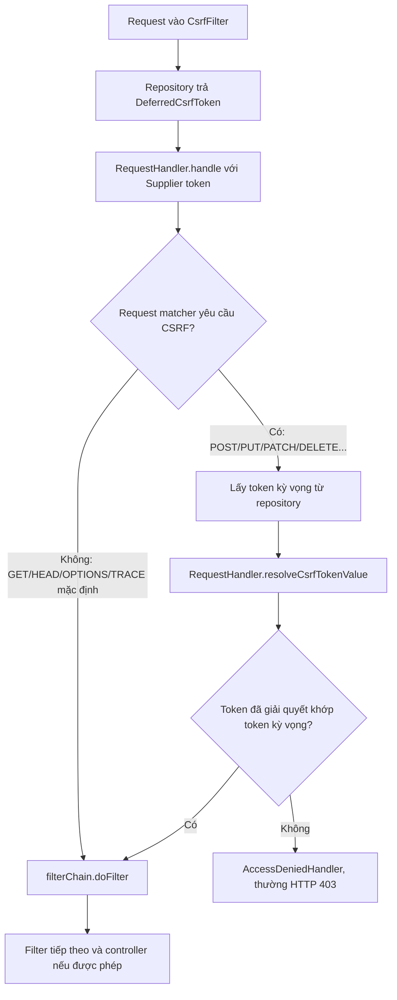
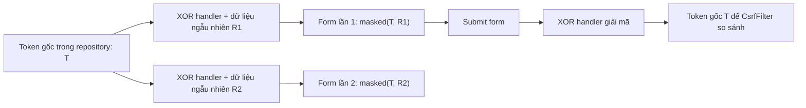

# `CsrfTokenRequestHandler` và cách đưa token vào request

Trong **Spring Security Servlet**, `CsrfTokenRequestHandler` chịu trách nhiệm **đưa token CSRF tới những thành phần xử lý HTTP request** (chẳng hạn view, controller) và **diễn giải token mà client gửi về**. Đây là mắt xích nằm giữa `CsrfTokenRepository` — nơi giữ token kỳ vọng — và `CsrfFilter` — nơi quyết định một request có được đi tiếp hay bị từ chối. Nắm rõ mắt xích này giúp giải thích vì sao một form gửi `_csrf` có thể hoạt động trong khi một SPA gửi token giống hệt cookie lại nhận `403 Forbidden`.

Bài thuộc chương **CSRF trên Servlet** trong module **SPRING_SECURITY_HTTP_PROTECTION**. Module đặt CSRF bên cạnh CORS, security headers, CSP, HSTS, HTTP firewall và bảo vệ session để người học cấu hình phòng vệ HTTP trên cả Servlet lẫn Reactive, kiểm thử các kịch bản tấn công web và chẩn đoán xung đột khi triển khai. Phạm vi bài này là **Servlet API** và `CsrfTokenRequestHandler`; WebFlux sử dụng API Reactive riêng.

## 1. Bài toán: làm sao token tới được form và quay lại bộ lọc?

Giả sử một ứng dụng đăng nhập bằng session cookie có form đổi email. Spring Security cần tạo hoặc tìm **token CSRF kỳ vọng**; template phải biết tên field và giá trị token để nhúng vào HTML; khi người dùng submit, bộ lọc phải đọc giá trị mà client gửi để đối chiếu.

```text
Server:  Session chứa token gốc A
                │
                ▼
        CsrfTokenRequestHandler
                │ công bố một biểu diễn token cho request/view
                ▼
Browser: <input name="_csrf" value="giá-trị-được-công-bố">
                │ submit POST có cookie session và _csrf
                ▼
        CsrfTokenRequestHandler
                │ đọc/diễn giải giá trị client gửi
                ▼
        CsrfFilter so sánh với token gốc A
                │
                ├─ Hợp lệ → các filter tiếp theo → controller
                └─ Không hợp lệ → mặc định HTTP 403
```

Vì có thể tồn tại **token đã che (masked)** trong HTML, giá trị ở hidden input không nhất thiết có chuỗi ký tự giống token gốc A. `CsrfTokenRequestHandler` bảo đảm giá trị được công bố và cách đọc lại phù hợp với nhau.

Một số thành phần có trách nhiệm riêng:

| Thành phần | Trách nhiệm chính | Không nên nhầm với |
| --- | --- | --- |
| `CsrfTokenRepository` | Sinh, lưu, đọc hoặc xóa **token kỳ vọng** (session/cookie) | Bộ lọc quyết định request bị chặn |
| `CsrfTokenRequestHandler` | Công bố token cho request và giải quyết token client gửi | Nơi lưu token gốc |
| `CsrfFilter` | Chọn request cần CSRF, yêu cầu token, so sánh và từ chối khi lỗi | Controller hoặc bộ phân quyền |
| `AuthorizationFilter` | Xét quyền truy cập endpoint | Kiểm tra tính hợp lệ của CSRF token |

Vì `CsrfFilter` thường đứng trước `AuthorizationFilter`, `permitAll()` **không miễn CSRF** cho `POST /login` hoặc `POST /register`.

## 2. Giao diện `CsrfTokenRequestHandler` có hai chiều xử lý

Giao diện nằm trong package `org.springframework.security.web.csrf`. Chữ ký quan trọng trong Spring Security Servlet 6.x:

```java
import jakarta.servlet.http.HttpServletRequest;
import jakarta.servlet.http.HttpServletResponse;
import java.util.function.Supplier;
import org.springframework.security.web.csrf.CsrfToken;

public interface CsrfTokenRequestHandler {

    void handle(
        HttpServletRequest request,
        HttpServletResponse response,
        Supplier<CsrfToken> csrfToken);

    String resolveCsrfTokenValue(
        HttpServletRequest request,
        CsrfToken csrfToken);
}
```

Ở đây `Supplier<CsrfToken>` cho phép token được **tải theo nhu cầu**. Bản thân việc đi qua filter không bắt buộc session hoặc cookie token mới phải được tạo ngay trên mọi `GET`.

### Chiều đi ra: `handle(request, response, csrfTokenSupplier)`

`CsrfFilter` chuẩn bị token thông qua repository rồi gọi `handle(...)` để request và các thành phần xử lý về sau có thể truy cập một biểu diễn của token. Handler mặc định thuộc họ request-attribute handler thường cung cấp token dưới thuộc tính request tên `_csrf`.

Ví dụ khi controller/view cần:

```java
CsrfToken csrfToken =
    (CsrfToken) request.getAttribute("_csrf");

String parameterName = csrfToken.getParameterName();
String headerName = csrfToken.getHeaderName();
String valueForClient = csrfToken.getToken();
```

Đoạn này giả định request đang đi qua `SecurityFilterChain` có CSRF và handler đã công bố `_csrf`. Không áp dụng khi route bị loại khỏi Spring Security hoặc handler tùy biến chọn tên attribute khác. **Request attribute `_csrf` là một đối tượng `CsrfToken`**, không phải một chuỗi token đơn lẻ.

Một số request handler cũng có thể cung cấp token dưới tên thuộc tính tương ứng với tên đầy đủ của lớp `CsrfToken`. Thông thường view nên sử dụng thuộc tính `_csrf` hoặc API của framework thay vì phụ thuộc chi tiết triển khai nội bộ.

### Chiều đi vào: `resolveCsrfTokenValue(request, csrfToken)`

Khi request thuộc nhóm phải bảo vệ, `CsrfFilter` gọi handler để lấy token mà client đã gửi. Với request-attribute handler thông thường, giá trị này được lấy từ:

- HTTP header theo `csrfToken.getHeaderName()`, chẳng hạn `X-CSRF-TOKEN` hoặc `X-XSRF-TOKEN`.
- Form parameter theo `csrfToken.getParameterName()`, thường là `_csrf`.

Với cách xử lý phổ biến, **header có giá trị ưu tiên hơn form parameter**; nếu header trống hoặc không có, handler có thể xét parameter. Khi đã tìm được, handler cần giải quyết đúng **biểu diễn token**: đọc raw token trực tiếp hoặc giải mã masked token.

Giá trị trả về có thể là `null` nếu request không cung cấp token. Handler không tự quyết định HTTP status; `CsrfFilter` so sánh với token kỳ vọng và thông thường gọi `AccessDeniedHandler` khi thiếu hoặc sai.

### `CsrfToken` có gì để handler dùng?

```java
String token = csrfToken.getToken();
String parameter = csrfToken.getParameterName();
String header = csrfToken.getHeaderName();
```

Tên header/parameter phụ thuộc repository và cấu hình. Ví dụ `HttpSessionCsrfTokenRepository` thường dùng `_csrf` cùng `X-CSRF-TOKEN`, còn `CookieCsrfTokenRepository` thường dùng cookie `XSRF-TOKEN`, form field `_csrf` và header `X-XSRF-TOKEN`. Không nên hard-code `X-CSRF-TOKEN` nếu repository được thiết kế để nhận `X-XSRF-TOKEN`.

## 3. `CsrfFilter` gọi handler ở bước nào?

Trong Servlet, `FilterChainProxy` chọn `SecurityFilterChain` khớp request; `CsrfFilter` thực hiện các bước khái quát:



Điểm dễ bỏ qua: handler được gọi để **chuẩn bị cách truy cập token trên request trước khi xét việc method có cần kiểm tra CSRF**. Nhưng việc chuẩn bị này có thể **chưa** khiến token được tạo/lưu bởi vì handler nhận `Supplier<CsrfToken>`. Khi view đọc `_csrf.token`, lúc đó token mới cần được truy xuất.

Trên `POST`, filter buộc phải lấy token kỳ vọng để so sánh, dù controller không dùng `_csrf`. Nếu token không hợp lệ, request có thể dừng trước khi controller hoặc bước phân quyền được gọi. Đừng nhầm lỗi `403` tại CSRF với lỗi thiếu role từ `AuthorizationFilter`.

## 4. Cách đưa token vào request để HTML form sử dụng

Trong MVC render phía server, `CsrfTokenRequestHandler` thường công bố thuộc tính `_csrf`. View sử dụng metadata trên `CsrfToken` để tạo hidden field và gửi token lại cùng form.

Ví dụ Thymeleaf:

```html
<form action="/account/email" method="post">
  <label for="email">Email mới</label>
  <input id="email" type="email" name="email" required>

  <input type="hidden"
         th:name="${_csrf.parameterName}"
         th:value="${_csrf.token}">

  <button type="submit">Cập nhật</button>
</form>
```

Sau khi render, HTML có thể trông như:

```html
<input type="hidden" name="_csrf" value="token-duoc-handler-cong-bo">
```

Nếu Spring MVC + Thymeleaf đã tự chèn field qua `RequestDataValueProcessor` khi dùng `th:action`, tránh chèn thêm hidden field thủ công. Hãy nhìn **HTML render thực tế** để xác định token có được đưa vào form chưa.

Một số engine/template hỗ trợ request attribute trực tiếp, còn với controller Spring MVC có thể nhận:

```java
import org.springframework.security.web.csrf.CsrfToken;
import org.springframework.stereotype.Controller;
import org.springframework.web.bind.annotation.GetMapping;
import org.springframework.web.bind.annotation.RequestAttribute;

@Controller
class AccountFormController {

    @GetMapping("/account/email")
    String emailForm(@RequestAttribute("_csrf") CsrfToken csrfToken) {
        // Truy cập getToken() khi thực sự cần giá trị đưa vào response.
        String tokenForForm = csrfToken.getToken();
        return "account/email-form";
    }
}
```

Ở ví dụ này `tokenForForm` chỉ minh họa thời điểm nạp token; template dùng `_csrf` trực tiếp sẽ không cần gán biến cục bộ như vậy. Đặt token trong form của trang thuộc cùng origin là cách phổ biến để browser có thể gửi nó mà website khác không đọc được.

**Không đưa token vào URL** như `/account/email?_csrf=...`: URL dễ xuất hiện trong history, log, analytics hoặc `Referer`. Form parameter, HTTP header và cơ chế hiển thị trong HTML thuộc phạm vi cần thiết phù hợp hơn.

## 5. `CsrfTokenRequestAttributeHandler`: đọc và công bố token dạng gốc

`CsrfTokenRequestAttributeHandler` cung cấp cách xử lý đơn giản: công bố `CsrfToken` vào request attribute và giải quyết giá trị client gửi **không cần bước giải mã XOR**. Nếu view truy cập trực tiếp token với handler này, giá trị được hiển thị thường là token gốc do repository quản lý.

Ví dụ cấu hình:

```java
import org.springframework.security.web.csrf.CsrfTokenRequestAttributeHandler;

http.csrf(csrf -> csrf
    .csrfTokenRequestHandler(
        new CsrfTokenRequestAttributeHandler()));
```

Đoạn này được đặt trong quá trình cấu hình `HttpSecurity http` của `SecurityFilterChain`. Nó hữu ích để hiểu hành vi plain/raw token hoặc tích hợp có yêu cầu cụ thể, nhưng **không nên đổi mặc định sang plain handler chỉ để một form/SPA hết lỗi** mà chưa xét nguy cơ phản chiếu token gốc trong response HTML có nén.

Trong ứng dụng hiện đại, request handler dùng XOR thường được ưu tiên cho form render HTML để chống một lớp tấn công như BREACH. Nếu cần đọc token gốc trong header SPA, có thể chỉ dùng plain handler ở **chiều giải quyết header** mà vẫn giữ XOR khi công bố token cho HTML.

## 6. `XorCsrfTokenRequestAttributeHandler`: token che để chống BREACH

Với cấu hình phổ biến ở Spring Security 6, **`XorCsrfTokenRequestAttributeHandler`** là lựa chọn mặc định cho việc công bố token ở request. Handler tạo **biểu diễn đã che** từ token gốc và dữ liệu ngẫu nhiên. Khi nhận biểu diễn đó qua form/header, handler có thể giải mã để trả lại token gốc cho `CsrfFilter` so sánh.

Lý do là tấn công **BREACH**: khi dữ liệu bí mật được phản chiếu vào phản hồi có nén và kẻ tấn công kiểm soát một phần nội dung, kích thước phản hồi có thể để lộ thông tin về bí mật. Nếu HTML luôn nhúng cùng token gốc, token có nguy cơ bị khai thác qua kênh phụ của cơ chế nén. Token che ngẫu nhiên khiến biểu diễn công bố không cố định theo mọi phản hồi.



`masked(T, R1)` và `masked(T, R2)` có thể khác nhau dù repository vẫn giữ **cùng token gốc T**. Vì vậy:

- Không dùng phép so sánh chuỗi giữa hai HTML response để kết luận session/token gốc đã thay đổi.
- Không gửi token che vào một resolver chỉ hiểu token gốc, hoặc gửi token gốc vào resolver chỉ giải mã token che.
- Không lấy token trực tiếp từ session rồi nhúng vào form nếu cấu hình hiện hành đã có XOR handler.
- Không xem XOR là mã hóa bảo mật độc lập, xác thực request hoặc thay thế HTTPS. Nó là kỹ thuật bảo vệ biểu diễn token trước một lớp tấn công kênh phụ.

### Ví dụ kiểm thử trực tiếp `XorCsrfTokenRequestAttributeHandler`

Ví dụ JUnit 5 + `spring-test` và `spring-security-web` sau minh họa việc token được công bố khác với token gốc nhưng được giải quyết về đúng giá trị:

```java
import org.junit.jupiter.api.Test;
import org.springframework.mock.web.MockHttpServletRequest;
import org.springframework.mock.web.MockHttpServletResponse;
import org.springframework.security.web.csrf.CsrfToken;
import org.springframework.security.web.csrf.DefaultCsrfToken;
import org.springframework.security.web.csrf.XorCsrfTokenRequestAttributeHandler;

import static org.junit.jupiter.api.Assertions.*;

class XorCsrfTokenRequestAttributeHandlerTest {

    @Test
    void exposesMaskedValueAndResolvesItBackToOriginal() {
        CsrfToken stored = new DefaultCsrfToken(
            "X-CSRF-TOKEN", "_csrf", "secret-value-from-repository");

        var handler = new XorCsrfTokenRequestAttributeHandler();
        var getRequest = new MockHttpServletRequest("GET", "/form");
        var getResponse = new MockHttpServletResponse();

        handler.handle(getRequest, getResponse, () -> stored);

        CsrfToken exposed =
            (CsrfToken) getRequest.getAttribute("_csrf");
        assertNotNull(exposed);

        String maskedValue = exposed.getToken();
        assertNotEquals(stored.getToken(), maskedValue);

        var postRequest = new MockHttpServletRequest("POST", "/form");
        postRequest.addParameter("_csrf", maskedValue);

        String resolved = handler.resolveCsrfTokenValue(
            postRequest, stored);

        assertEquals(stored.getToken(), resolved);
    }
}
```

Test gọi trực tiếp handler nên tập trung vào **công bố và giải quyết biểu diễn token**; nó không kiểm tra xem `CsrfFilter` có chặn request hay không. Việc so sánh/chặn vẫn cần test filter hoặc MockMvc ở mức tích hợp.

## 7. `Supplier<CsrfToken>` và cơ chế deferred token

Một nguyên tắc quan trọng của Spring Security hiện đại là **không cần tạo token hoặc session khi chưa ai sử dụng**. `CsrfFilter` thường gọi `repository.loadDeferredToken(request, response)` rồi chuyển khả năng lấy token qua `Supplier` tới request handler.

```text
GET /health
  └─ CsrfFilter chuẩn bị DeferredCsrfToken
     └─ RequestHandler.handle(...) đặt khả năng truy cập token
        └─ Endpoint không truy cập _csrf
           └─ Có thể không cần đọc/lưu token, không tạo session chỉ vì CSRF

GET /account/edit
  └─ CsrfFilter chuẩn bị DeferredCsrfToken
     └─ RequestHandler.handle(...)
        └─ View gọi _csrf.token
           └─ Repository đọc token; nếu chưa có thì tạo và lưu

POST /account/email
  └─ CsrfFilter cần token kỳ vọng để xác minh
     └─ DeferredCsrfToken được giải quyết trong quá trình kiểm tra
```

Điểm khác nhau nằm ở **thời điểm** gọi supplier, không phải việc repository bị loại khỏi luồng. Nếu tự viết handler và gọi `csrfToken.get()` ngay trong `handle(...)`, bạn **ép token được nạp** ở mỗi request đi qua handler. Đó có thể là lựa chọn có chủ đích cho SPA cần cookie CSRF sau một GET, nhưng có thể làm tăng việc truy xuất kho lưu token hoặc tạo session không cần thiết ở những route chỉ đọc.

| Thiết kế request handler | Khi nào có thể cần dùng? | Hệ quả |
| --- | --- | --- |
| Đặt token trên request theo cách lazy | Web MVC render form khi cần, endpoint không liên quan đến token | Giảm thao tác session/cookie không cần thiết |
| Ép gọi `csrfToken.get()` | SPA trông đợi `XSRF-TOKEN` được cấp ở response bootstrap | Có thể khiến repository tạo/phát token sớm hơn |
| Chỉ đọc token qua endpoint `GET /csrf` | Frontend có bước lấy token tường minh trước POST | Dễ kiểm soát thời điểm lấy/làm mới token |

Không mặc định cho rằng cứ gọi `GET /` là browser phải có cookie `XSRF-TOKEN`: nếu request handler và controller không sử dụng token, cơ chế nạp lười có thể chưa tạo nó.

## 8. Vì sao SPA đọc cookie lại thường gửi token raw?

Một ứng dụng JavaScript có thể dùng `CookieCsrfTokenRepository`:

```text
Server response: Set-Cookie: XSRF-TOKEN=T
JavaScript đọc cookie: XSRF-TOKEN=T
JavaScript gửi POST: X-XSRF-TOKEN: T
```

Giá trị `T` ở cookie thường là **token gốc**. Nếu `CsrfTokenRequestHandler` đang là XOR handler và xử lý mọi token nhận được như một giá trị masked, nó không thể giải mã `T` theo đúng định dạng; request có thể bị `403` dù cookie và header hiển thị cùng chuỗi.

Đây là vấn đề **cách giải quyết token trên request**, không nhất thiết là repository tạo token sai.

| Nguồn token gửi về | Kiểu biểu diễn thường gặp | Handler phù hợp |
| --- | --- | --- |
| Hidden form `_csrf` do `XorCsrfTokenRequestAttributeHandler` công bố | Token masked | Resolver XOR |
| Header `X-XSRF-TOKEN` lấy trực tiếp từ cookie `XSRF-TOKEN` | Token gốc | Resolver plain |
| Header chứa token từ API trả đối tượng `_csrf` có masking | Token masked | Resolver XOR hoặc handler được thiết kế theo API đó |

Để hỗ trợ cả form và SPA, ta có thể **giữ XOR khi công bố token vào request**, nhưng lựa chọn resolver theo đường truyền ở chiều client gửi về. Đây là cơ sở cho `SpaCsrfTokenRequestHandler` bên dưới.

## 9. Ví dụ đầy đủ: request handler cho form và SPA

Ví dụ dùng API Spring Security Servlet 6.1+ (thường cùng Java 17/Spring Boot 3.x). `CookieCsrfTokenRepository` phát token vào cookie `XSRF-TOKEN`; form MVC dùng masked token, còn JavaScript gửi raw token qua `X-XSRF-TOKEN`.

```java
import jakarta.servlet.http.HttpServletRequest;
import jakarta.servlet.http.HttpServletResponse;
import java.util.function.Supplier;
import org.springframework.security.web.csrf.CsrfToken;
import org.springframework.security.web.csrf.CsrfTokenRequestAttributeHandler;
import org.springframework.security.web.csrf.CsrfTokenRequestHandler;
import org.springframework.security.web.csrf.XorCsrfTokenRequestAttributeHandler;
import org.springframework.util.StringUtils;

final class SpaCsrfTokenRequestHandler
        implements CsrfTokenRequestHandler {

    private final CsrfTokenRequestHandler plain =
        new CsrfTokenRequestAttributeHandler();
    private final CsrfTokenRequestHandler xor =
        new XorCsrfTokenRequestAttributeHandler();

    @Override
    public void handle(
            HttpServletRequest request,
            HttpServletResponse response,
            Supplier<CsrfToken> csrfToken) {

        // Vẫn công bố masked token cho form dùng request attribute.
        xor.handle(request, response, csrfToken);

        // Có chủ đích: buộc nạp token để phát cookie CSRF cho SPA.
        csrfToken.get();
    }

    @Override
    public String resolveCsrfTokenValue(
            HttpServletRequest request,
            CsrfToken csrfToken) {

        String headerValue =
            request.getHeader(csrfToken.getHeaderName());

        CsrfTokenRequestHandler resolver = StringUtils.hasText(headerValue)
            ? plain
            : xor;

        return resolver.resolveCsrfTokenValue(request, csrfToken);
    }
}
```

Đưa handler vào `SecurityFilterChain`:

```java
import org.springframework.context.annotation.Bean;
import org.springframework.context.annotation.Configuration;
import org.springframework.security.config.Customizer;
import org.springframework.security.config.annotation.web.builders.HttpSecurity;
import org.springframework.security.web.SecurityFilterChain;
import org.springframework.security.web.csrf.CookieCsrfTokenRepository;

@Configuration
class SecurityConfig {

    @Bean
    SecurityFilterChain web(HttpSecurity http) throws Exception {
        CookieCsrfTokenRepository repository =
            CookieCsrfTokenRepository.withHttpOnlyFalse();

        repository.setCookieCustomizer(cookie -> cookie
            .path("/")
            .sameSite("Lax")
            .secure(true));

        http
            .authorizeHttpRequests(auth -> auth
                .requestMatchers("/csrf", "/login", "/assets/**").permitAll()
                .anyRequest().authenticated())
            .formLogin(Customizer.withDefaults())
            .csrf(csrf -> csrf
                .csrfTokenRepository(repository)
                .csrfTokenRequestHandler(
                    new SpaCsrfTokenRequestHandler()));

        return http.build();
    }
}
```

`secure(true)` trong ví dụ giả định triển khai qua **HTTPS**. Khi chạy môi trường phát triển thuần HTTP, cần cấu hình cookie thích hợp với môi trường để trình duyệt thật gửi lại được. `withHttpOnlyFalse()` được chọn vì SPA cần JavaScript đọc **cookie CSRF**; không phải lý do tắt `HttpOnly` trên cookie đăng nhập.

Tại sao chọn resolver theo header? SPA gửi raw token từ cookie qua header; form thông thường gửi masked token trong `_csrf`. Khi request có header theo tên đã cấu hình, đoạn mã giải quyết token raw; nếu không có, nó dùng XOR cho form. Đây là **quy ước tương tác** giữa frontend và server, không phải quy tắc mọi client trên thế giới đều tuân theo.

Không dùng mẫu này nếu client gửi token masked trong header nhưng handler lại coi header là raw, hoặc nếu ứng dụng đã có chiến lược handler khác. Hãy xác định cách phát token và dạng token gửi về trước khi lựa chọn.

### Tên cookie không đồng nghĩa tên header

Với `CookieCsrfTokenRepository`, các tên thường dùng là:

```http
Set-Cookie: XSRF-TOKEN=<token-goc>; Path=/; ...

POST /api/profile HTTP/1.1
Cookie: XSRF-TOKEN=<token-goc>; ...
X-XSRF-TOKEN: <token-goc>
```

`CookieCsrfTokenRepository` đọc **cookie**, handler đọc **header**. Dù hai giá trị có thể giống nhau trong mẫu SPA, trình duyệt tự gửi cookie không có nghĩa browser tự tạo header. JavaScript hoặc thư viện frontend phải chủ động gắn header phù hợp.

## 10. Endpoint bootstrap token và JavaScript gửi về

Trong một SPA cùng origin, endpoint GET có thể chủ động yêu cầu token để cookie xuất hiện khi cần:

```java
import org.springframework.http.CacheControl;
import org.springframework.http.ResponseEntity;
import org.springframework.security.web.csrf.CsrfToken;
import org.springframework.web.bind.annotation.GetMapping;
import org.springframework.web.bind.annotation.RequestAttribute;
import org.springframework.web.bind.annotation.RestController;

@RestController
class CsrfController {

    @GetMapping("/csrf")
    ResponseEntity<Void> bootstrap(
            @RequestAttribute("_csrf") CsrfToken csrfToken) {
        csrfToken.getToken();
        return ResponseEntity.noContent()
            .cacheControl(CacheControl.noStore())
            .build();
    }
}
```

Với repository/handler cấu hình ở mục 9, khi cookie token chưa tồn tại, việc truy cập token dẫn tới tạo và phát cookie phù hợp. Không cần kỳ vọng **mọi response `GET /csrf` đều chứa `Set-Cookie` mới** khi browser đã có token hợp lệ.

JavaScript cùng origin:

```javascript
function readCookie(name) {
  const prefix = encodeURIComponent(name) + "=";
  const cookie = document.cookie
    .split("; ")
    .find((part) => part.startsWith(prefix));

  return cookie
    ? decodeURIComponent(cookie.slice(prefix.length))
    : null;
}

async function updateProfile(displayName) {
  const csrfResponse = await fetch("/csrf", {
    credentials: "same-origin",
    cache: "no-store"
  });
  if (!csrfResponse.ok) {
    throw new Error("Không thể lấy CSRF token");
  }

  const rawToken = readCookie("XSRF-TOKEN");
  if (!rawToken) {
    throw new Error("Thiếu cookie XSRF-TOKEN");
  }

  const response = await fetch("/api/profile", {
    method: "POST",
    credentials: "same-origin",
    headers: {
      "Content-Type": "application/json",
      "X-XSRF-TOKEN": rawToken
    },
    body: JSON.stringify({ displayName })
  });

  if (!response.ok) {
    throw new Error(`Cập nhật thất bại: HTTP ${response.status}`);
  }
  return response;
}
```

Ví dụ giả định có endpoint `/api/profile` chấp nhận JSON và caller có đủ quyền. Frontend phải giữ cookies theo chính sách trình duyệt; `HttpOnly`, `Path`, `Domain`, `Secure`, `SameSite` đều có thể ảnh hưởng việc đọc hoặc gửi cookie. Nếu frontend chạy **khác origin** với API, `document.cookie` ở frontend thường **không đọc được cookie host-only của API**, và cần thiết kế kênh cấp token khác cùng cấu hình CORS/credentials phù hợp.

### Nếu dùng `HttpSessionCsrfTokenRepository` và cấp token qua JSON?

SPA có thể sử dụng repository lưu trong session mà không cần JavaScript đọc cookie CSRF. Controller công bố giá trị từ request handler:

```java
@GetMapping("/csrf-token")
CsrfInfo getCsrf(@RequestAttribute("_csrf") CsrfToken csrfToken) {
    return new CsrfInfo(
        csrfToken.getHeaderName(),
        csrfToken.getToken());
}

record CsrfInfo(String headerName, String token) {}
```

Đây là **mảnh code đặt trong `@RestController`** có import `CsrfToken`, `GetMapping`, `RequestAttribute` tương ứng. Nếu handler công bố masked token thì JSON có thể chứa **token masked**, khi đó client cần gửi nguyên biểu diễn này theo header/parameter mà handler biết giải quyết. Cần bảo vệ endpoint cấp token và chống cache nhầm phản hồi chứa dữ liệu gắn với người dùng. `Cache-Control: no-store` và chính sách CORS chặt chẽ là những biện pháp nên xem xét.

## 11. Test đơn vị hai chiều của request handler

Để biết lỗi thuộc handler hay repository, nên kiểm tra riêng rằng **handler công bố đúng giá trị** và **đọc lại đúng kiểu biểu diễn**. Test sau sử dụng `DefaultCsrfToken` giả lập token do repository đã cung cấp, không cần Servlet container hoặc security chain.

### Test plain handler đọc header và form parameter

```java
import org.junit.jupiter.api.Test;
import org.springframework.mock.web.MockHttpServletRequest;
import org.springframework.mock.web.MockHttpServletResponse;
import org.springframework.security.web.csrf.CsrfToken;
import org.springframework.security.web.csrf.CsrfTokenRequestAttributeHandler;
import org.springframework.security.web.csrf.DefaultCsrfToken;

import static org.junit.jupiter.api.Assertions.*;

class PlainCsrfHandlerTest {

    @Test
    void handlePublishesTokenAndResolveReadsSubmittedValue() {
        CsrfToken original = new DefaultCsrfToken(
            "X-CSRF-TOKEN", "_csrf", "a-raw-test-token");
        var handler = new CsrfTokenRequestAttributeHandler();
        var get = new MockHttpServletRequest("GET", "/form");

        handler.handle(
            get, new MockHttpServletResponse(), () -> original);

        CsrfToken exposed =
            (CsrfToken) get.getAttribute("_csrf");
        assertNotNull(exposed);
        assertEquals(original.getToken(), exposed.getToken());

        var submittedForm =
            new MockHttpServletRequest("POST", "/form");
        submittedForm.addParameter("_csrf", original.getToken());
        assertEquals(
            original.getToken(),
            handler.resolveCsrfTokenValue(submittedForm, original));

        var submittedHeader =
            new MockHttpServletRequest("POST", "/api/save");
        submittedHeader.addHeader(
            original.getHeaderName(), original.getToken());
        assertEquals(
            original.getToken(),
            handler.resolveCsrfTokenValue(submittedHeader, original));
    }
}
```

Nếu muốn kiểm tra handler **tự chọn header hay parameter**, thêm trường hợp request chứa cả hai với giá trị khác nhau và quan sát giá trị được giải quyết. Luôn căn cứ vào hành vi của handler đang dùng, vì một custom handler có thể có quy tắc riêng.

### Test handler SPA với raw header và masked form

Test này giả sử đã tạo lớp `SpaCsrfTokenRequestHandler` ở mục 9:

```java
import org.junit.jupiter.api.Test;
import org.springframework.mock.web.MockHttpServletRequest;
import org.springframework.mock.web.MockHttpServletResponse;
import org.springframework.security.web.csrf.CsrfToken;
import org.springframework.security.web.csrf.DefaultCsrfToken;

import static org.junit.jupiter.api.Assertions.*;

class SpaCsrfHandlerTest {

    @Test
    void resolvesRawHeaderAndMaskedForm() {
        CsrfToken original = new DefaultCsrfToken(
            "X-XSRF-TOKEN", "_csrf", "the-stored-raw-token");

        var handler = new SpaCsrfTokenRequestHandler();
        var get = new MockHttpServletRequest("GET", "/form");
        handler.handle(
            get, new MockHttpServletResponse(), () -> original);

        CsrfToken exposed =
            (CsrfToken) get.getAttribute("_csrf");
        String maskedValue = exposed.getToken();
        assertNotEquals(original.getToken(), maskedValue);

        var headerRequest =
            new MockHttpServletRequest("POST", "/api/profile");
        headerRequest.addHeader("X-XSRF-TOKEN", original.getToken());
        assertEquals(original.getToken(),
            handler.resolveCsrfTokenValue(headerRequest, original));

        var formRequest =
            new MockHttpServletRequest("POST", "/account/email");
        formRequest.addParameter("_csrf", maskedValue);
        assertEquals(original.getToken(),
            handler.resolveCsrfTokenValue(formRequest, original));
    }
}
```

Khi test nhận token raw đúng nhưng masked form sai (hoặc ngược lại), cần xem **đường nhánh resolver** tương ứng. Những bài test này mới kiểm tra cách **diễn giải giá trị request**, chưa chứng minh `CsrfFilter` áp dụng matcher hoặc trả status chính xác.

## 12. Test tích hợp `CsrfFilter` với cookie–header bằng MockMvc

Trong ứng dụng sử dụng handler ở mục 9, có thể kiểm chứng cả luồng `GET /csrf` → `POST /api/profile` với Spring Boot và `spring-security-test`.

Controller mẫu:

```java
import org.springframework.http.ResponseEntity;
import org.springframework.web.bind.annotation.PostMapping;
import org.springframework.web.bind.annotation.RestController;

@RestController
class ProfileController {

    @PostMapping("/api/profile")
    ResponseEntity<Void> updateProfile() {
        return ResponseEntity.noContent().build();
    }
}
```

Test minh họa:

```java
import jakarta.servlet.http.Cookie;
import org.junit.jupiter.api.Test;
import org.springframework.beans.factory.annotation.Autowired;
import org.springframework.boot.test.autoconfigure.web.servlet.AutoConfigureMockMvc;
import org.springframework.boot.test.context.SpringBootTest;
import org.springframework.security.test.context.support.WithMockUser;
import org.springframework.test.web.servlet.MockMvc;
import org.springframework.test.web.servlet.MvcResult;

import static org.junit.jupiter.api.Assertions.*;
import static org.springframework.test.web.servlet.request.MockMvcRequestBuilders.*;
import static org.springframework.test.web.servlet.result.MockMvcResultMatchers.status;

@SpringBootTest
@AutoConfigureMockMvc
@WithMockUser(username = "learner")
class CsrfRequestHandlerIntegrationTest {

    @Autowired
    MockMvc mvc;

    @Test
    void acceptsRawHeaderButRejectsMissingOrWrongToken()
            throws Exception {

        MvcResult bootstrap = mvc.perform(get("/csrf"))
            .andExpect(status().isNoContent())
            .andReturn();

        String setCookie = bootstrap.getResponse()
            .getHeader("Set-Cookie");
        assertNotNull(setCookie);
        assertTrue(setCookie.startsWith("XSRF-TOKEN="));

        String raw = setCookie.split(";", 2)[0]
            .substring("XSRF-TOKEN=".length());
        Cookie csrfCookie = new Cookie("XSRF-TOKEN", raw);

        // Có cookie CSRF nhưng thiếu token trong header/form.
        mvc.perform(post("/api/profile").cookie(csrfCookie))
            .andExpect(status().isForbidden());

        // Có header nhưng giá trị sai.
        mvc.perform(post("/api/profile")
                .cookie(csrfCookie)
                .header("X-XSRF-TOKEN", "wrong-token"))
            .andExpect(status().isForbidden());

        // Header raw khớp cookie và handler đọc raw header.
        mvc.perform(post("/api/profile")
                .cookie(csrfCookie)
                .header("X-XSRF-TOKEN", raw))
            .andExpect(status().isNoContent());
    }
}
```

Ví dụ giả định security chain có `CookieCsrfTokenRepository` và `SpaCsrfTokenRequestHandler`, endpoint `/csrf` trả `204`, endpoint `/api/profile` tồn tại và trả `204`, mock user có quyền truy cập. Trong hệ thống thật, thay kết quả kỳ vọng cho phù hợp controller và luật phân quyền. Nếu có custom cookie encoding, cách lấy giá trị từ `Set-Cookie` trong test cần xử lý tương ứng.

`MockMvc` mô phỏng request/response Servlet; nó **không mô phỏng đầy đủ** quy tắc trình duyệt về `SameSite`, `Secure`, cookie cross-origin hoặc preflight. Phải kiểm chứng các khía cạnh đó bằng trình duyệt/HTTP client thật khi triển khai.

### Test với `csrf()` của `spring-security-test` khác gì?

`SecurityMockMvcRequestPostProcessors.csrf()` là helper tiện dụng:

```java
mockMvc.perform(post("/api/profile").with(csrf()));
mockMvc.perform(post("/api/profile")
    .with(csrf().useInvalidToken()));
```

Nó giúp test một request có token hợp lệ hoặc không hợp lệ ở tầng security filter. Tuy nhiên, một test `.with(csrf())` thành công **không tự chứng minh** response đã phát cookie `XSRF-TOKEN` hay JavaScript đã copy nó đúng vào `X-XSRF-TOKEN`. Nếu lỗi cần giải quyết thuộc request handler, nên kiểm thử riêng biểu diễn token và round trip thực tế.

## 13. Vì sao vẫn có `403` khi đã gửi token?

Một lỗi CSRF có thể bắt nguồn từ các bước rất khác nhau:

| Triệu chứng | Điểm nghi ngờ | Cách kiểm tra |
| --- | --- | --- |
| View truy cập `_csrf` bị `null` | Request không đi qua chain có CSRF hoặc custom handler không công bố `_csrf` | Chain thực tế, handler và tên request attribute |
| `GET /form` có token nhưng POST thiếu `_csrf` | Form không chèn input hoặc JavaScript không gửi header | Rendered HTML và request body/header |
| `GET /csrf` không có `Set-Cookie` | Token đang deferred, cookie đã tồn tại hoặc thuộc tính cookie không phù hợp | Endpoint có gọi `getToken()` không, Network panel |
| Header `X-XSRF-TOKEN` giống cookie nhưng POST `403` | XOR handler đang cố giải mã raw token | Kiểm tra `resolveCsrfTokenValue` và cấu hình SPA |
| Form gửi masked token nhưng vẫn `403` | Handler plain đọc masked như raw | Kiểm tra cách handler công bố và giải mã |
| Request POST có token của phiên cũ | Token bị xóa hoặc session hết hạn sau login/logout | Vòng đời token, session/cookie hiện tại |
| Header không đến server ở cross-origin | CORS preflight từ chối custom header hoặc credentials không được phép | Response `OPTIONS`, chính sách allowed headers/origins |
| URL `POST /login` có `permitAll()` vẫn `403` | `CsrfFilter` kiểm tra trước authorization | Token trong form login, chain chứa `CsrfFilter` |
| Token CSRF đúng, POST vẫn `403` | Authentication/authorization hoặc filter khác | Stack trace và filter phát sinh exception |

Một quy trình chẩn đoán hiệu quả:

1. **Xác định URL, method và security chain được chọn.** Nhiều `SecurityFilterChain` có thể có repository hoặc request handler khác nhau.
2. **Xác định nơi token được lưu**: `HttpSessionCsrfTokenRepository`, `CookieCsrfTokenRepository` hay repository tùy biến.
3. **Xác định cách token được công bố**: request attribute `_csrf`, hidden input, JSON, response header hoặc cookie.
4. **Xác định cách client gửi lại**: form parameter `_csrf`, `X-CSRF-TOKEN` hoặc `X-XSRF-TOKEN`. Tên này phải khớp metadata token.
5. **Phân biệt masked/raw token** và resolver nào được gọi ở `resolveCsrfTokenValue`.
6. **Kiểm tra session/cookie và login/logout** nếu token cũ không còn khớp.
7. **Xác định filter chặn**: `CsrfFilter` có thể tạo `MissingCsrfTokenException` hoặc `InvalidCsrfTokenException`; những lớp khác cũng có thể trả `403`.

Có thể bật log tạm thời ở môi trường phát triển:

```properties
logging.level.org.springframework.security.web.FilterChainProxy=DEBUG
logging.level.org.springframework.security.web.csrf=TRACE
```

Mục tiêu logging là phát hiện **filter nào từ chối request và lý do tổng quát**, không ghi token bí mật hoặc session ID thật vào log. Không dùng trace logging quá rộng trong production.

## 14. Ranh giới bảo mật với CORS, CSP, XSS và session

Request handler không thay thế những cơ chế bảo vệ HTTP khác. Khi hiểu cách token được công bố và gửi lại, cần xét thêm:

| Cơ chế | Liên hệ với request handler |
| --- | --- |
| **CORS** | Quy định origin JavaScript được phép tương tác cross-origin. Custom header CSRF có thể kích hoạt preflight; CORS không thay thế CSRF token. |
| **CSP và chống XSS** | Script độc hại chạy cùng origin có thể đọc hoặc sử dụng token theo quyền của trang. Token CSRF không ngăn được XSS. |
| **Security headers** | Hỗ trợ giảm các nguy cơ ở trình duyệt; không thay bộ kiểm tra CSRF. |
| **HTTPS, HSTS** | Giúp bảo vệ kênh truyền và hạn chế rò rỉ token/cookie khi triển khai đúng. |
| **Cookie `HttpOnly`, `Secure`, `SameSite`** | Quyết định JS có đọc được cookie hay browser có gửi nó; phải phân biệt cookie CSRF và cookie đăng nhập. |
| **HTTP firewall** | Có thể từ chối request bất thường trước khi xử lý sâu hơn; không giải mã hoặc xác minh CSRF token thay handler. |
| **Session management** | Token dựa trên session cần theo dõi timeout, login/logout, invalidation và nhiều node. |

Riêng với `CookieCsrfTokenRepository`, việc frontend đọc cookie qua `document.cookie` yêu cầu cookie CSRF có thể đọc được bởi JavaScript. Điều này **không yêu cầu** làm cookie session xác thực mất `HttpOnly`. Cần thận trọng khi mở rộng `Domain` cho cookie CSRF tới các subdomain không đáng tin, vì mẫu double-submit cookie còn chịu ảnh hưởng của nguy cơ cookie injection.

Với WebFlux/Reactive, giao diện `ServerCsrfTokenRequestHandler` và `CsrfWebFilter` có kiểu dữ liệu và pipeline Reactive khác Servlet. Không chép nguyên mã `HttpServletRequest`/`HttpServletResponse` vào cấu hình `ServerHttpSecurity`; chỉ áp dụng các ý tưởng về hai chiều token, masked/raw và deferred token khi thiết kế lại cho WebFlux.

## 15. Những nhầm lẫn thường gặp

| Hiểu nhầm | Cách hiểu đúng |
| --- | --- |
| “Repository tự đặt token vào HTML form” | Request handler công bố token; view/framework quyết định cách render form |
| “`_csrf` luôn là chuỗi token” | Thường là request attribute kiểu `CsrfToken`, có cả token, parameter name và header name |
| “`handle()` luôn tạo token và session” | Handler nhận `Supplier<CsrfToken>`; token có thể được nạp lười |
| “`resolveCsrfTokenValue()` tự trả 403” | Handler giải quyết giá trị client; `CsrfFilter` xác minh và chặn |
| “Masked token khác token session nghĩa là bị lỗi” | Masking là cơ chế có chủ đích; handler sẽ giải mã khi phù hợp |
| “Cookie `XSRF-TOKEN` và header giống nhau thì chắc chắn hợp lệ” | Handler có thể đang mong masked token; còn cần xét cookie và chính sách bảo mật |
| “Đổi sang plain handler luôn là giải pháp tốt” | Có thể làm lộ token gốc trong HTML có nén; cân nhắc BREACH |
| “`permitAll()` bỏ qua CSRF” | Quy tắc authorization không thay yêu cầu CSRF |
| “CORS cho phép origin thì không cần CSRF” | CORS và CSRF giải quyết các nguy cơ khác nhau |

## 16. Bài tập tự kiểm tra

1. Trong `CsrfTokenRequestHandler`, `handle(...)` và `resolveCsrfTokenValue(...)` giải quyết hai chiều thông tin nào?
2. Vì sao `Supplier<CsrfToken>` giúp ứng dụng tránh tạo session không cần thiết cho một số request `GET`?
3. Phân biệt trách nhiệm của repository, handler và `CsrfFilter` khi một request `POST` chứa `_csrf` không hợp lệ.
4. Nếu form dùng `XorCsrfTokenRequestAttributeHandler`, vì sao chuỗi `_csrf.token` trong HTML có thể đổi qua mỗi lần tải mà token gốc không đổi?
5. Vì sao SPA dùng `CookieCsrfTokenRepository` có thể gặp `403` dù `X-XSRF-TOKEN` bằng giá trị cookie `XSRF-TOKEN`?
6. Trong `SpaCsrfTokenRequestHandler`, vì sao resolver plain được chọn khi header có giá trị, còn resolver XOR được dùng cho form parameter?
7. Khi nào nên chủ động gọi `csrfToken.get()` và lúc nào nên giữ việc nạp lười?
8. Vì sao test `.with(csrf())` chưa đủ để chứng minh cơ chế cookie–header của SPA hoạt động?
9. Nếu controller nhận `@RequestAttribute("_csrf")` trả `null`, cần kiểm tra chain và handler nào trước?
10. Nếu token hợp lệ nhưng `POST` vẫn `403`, làm sao tìm đúng filter chịu trách nhiệm?

**Ghi nhớ:** `CsrfTokenRequestHandler` là **cầu nối hai chiều của CSRF token trong Servlet**: `handle(...)` công bố token cho request/view, còn `resolveCsrfTokenValue(...)` diễn giải token client gửi để `CsrfFilter` so sánh với token kỳ vọng. Sự khác biệt giữa **token gốc trong repository**, **token masked khi công bố** và **cách client gửi token** là chìa khóa để triển khai form/SPA đúng, kiểm thử chính xác và chẩn đoán HTTP 403.
