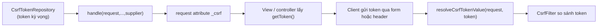
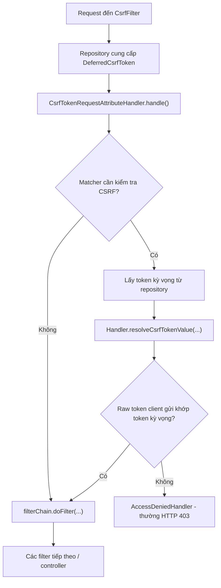
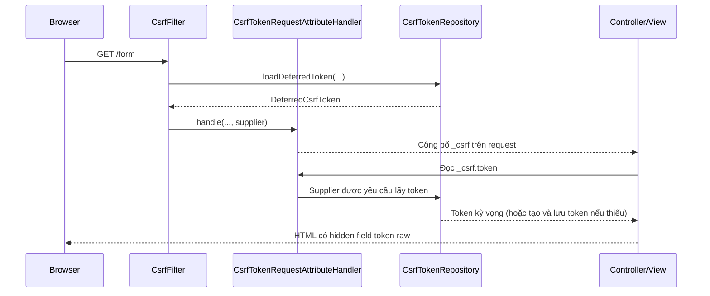

# `CsrfTokenRequestAttributeHandler` và giá trị token thông thường

Trong **Spring Security Servlet**, `CsrfTokenRequestAttributeHandler` là cách xử lý trực tiếp token CSRF: handler đặt một đối tượng `CsrfToken` vào thuộc tính của HTTP request và khi client gửi token về, nó đọc giá trị từ **HTTP header hoặc form parameter** theo tên đã cấu hình. Điểm phân biệt quan trọng của lớp này là nó sử dụng **giá trị token thông thường (raw/plain token)**; bản thân handler không tạo lớp biểu diễn ngẫu nhiên bằng XOR trước khi công bố token.

Bài nằm trong chương **CSRF trên Servlet**, thuộc module **SPRING_SECURITY_HTTP_PROTECTION**. Phạm vi module là các lớp phòng vệ HTTP và trình duyệt của Spring Security, từ CSRF, CORS, security headers, CSP, HSTS, HTTP firewall đến bảo vệ session, với bài tập cấu hình Servlet/Reactive và kiểm thử tình huống tấn công web. Trong bài này, ta tập trung riêng vào API **Servlet** của `CsrfTokenRequestAttributeHandler`, cách nó kết hợp với `CsrfFilter`, `CsrfTokenRepository`, view MVC và JavaScript. Khi dùng WebFlux, cần chuyển sang các API `ServerCsrfTokenRequestHandler`/`CsrfWebFilter` tương ứng.

**Sau bài học, người học có thể** giải thích hai chiều xử lý của request handler; truy cập `_csrf` trong request; cấu hình raw handler; gửi token qua hidden form field hoặc header; phân biệt raw và masked token; kiểm thử cách công bố và giải quyết token; chẩn đoán `403 Forbidden` mà không vô hiệu hóa CSRF.

## 1. “Token thông thường” là gì?

Giả sử repository giữ giá trị CSRF token gốc `T` cho một session hoặc cookie. Khi dùng `CsrfTokenRequestAttributeHandler`, thuộc tính `_csrf` mà handler công bố có thể cung cấp chính giá trị `T` qua `getToken()`. Nếu form gửi `T` trở lại, handler cũng trả về chính chuỗi đó để `CsrfFilter` đối chiếu.

```text
CsrfTokenRepository
    └── Token kỳ vọng: T
              │
              ▼
CsrfTokenRequestAttributeHandler.handle(...)
    └── request attribute "_csrf": CsrfToken(getToken() = T)
              │
              ▼
View render form:
    <input type="hidden" name="_csrf" value="T">
              │
              ▼
Client POST (cookie phiên và form _csrf=T)
              │
              ▼
CsrfTokenRequestAttributeHandler.resolveCsrfTokenValue(...)
    └── Giá trị client gửi: T
              │
              ▼
CsrfFilter so sánh với token kỳ vọng T
```

`T` là ký hiệu minh họa; token thật phải được tạo bằng nguồn ngẫu nhiên đủ mạnh. “Thông thường” ở đây chỉ **cách biểu diễn và giải quyết giá trị token**, không có nghĩa token dễ đoán, được phép bỏ kiểm tra hoặc không cần giữ bí mật.

Ba thành phần đóng vai trò khác nhau:

| Thành phần | Trách nhiệm | Điều nó không tự làm |
| --- | --- | --- |
| `CsrfTokenRepository` | Sinh, lưu, đọc và xóa token CSRF kỳ vọng | Phân tích token trong form/header của client |
| `CsrfTokenRequestAttributeHandler` | Công bố `CsrfToken` trên request và lấy giá trị client gửi dạng raw | Chọn URL/method yêu cầu CSRF hay tự trả `403` |
| `CsrfFilter` | Chọn request phải được kiểm tra, lấy token kỳ vọng, so sánh và từ chối nếu sai | Trực tiếp render HTML form |

`CsrfTokenRequestAttributeHandler` **không phải kho lưu token**. Nó hoạt động với cả `HttpSessionCsrfTokenRepository` và `CookieCsrfTokenRepository` nếu cách phát và gửi token được thiết kế nhất quán.

## 2. Hai phương thức cốt lõi của request handler

Trong các phiên bản Spring Security Servlet hiện đại, lớp nằm ở package:

```java
org.springframework.security.web.csrf.CsrfTokenRequestAttributeHandler
```

Nó hiện thực hợp đồng `CsrfTokenRequestHandler` với các phương thức chính:

```java
import jakarta.servlet.http.HttpServletRequest;
import jakarta.servlet.http.HttpServletResponse;
import java.util.function.Supplier;
import org.springframework.security.web.csrf.CsrfToken;

void handle(
    HttpServletRequest request,
    HttpServletResponse response,
    Supplier<CsrfToken> csrfToken);

String resolveCsrfTokenValue(
    HttpServletRequest request,
    CsrfToken csrfToken);
```

**`handle(...)`** được gọi khi request đi qua `CsrfFilter`. Nó chuẩn bị cách truy cập token trên `HttpServletRequest`, mặc định dưới tên attribute `_csrf`. Handler nhận `Supplier<CsrfToken>` để việc truy cập token có thể **trì hoãn tới lúc thật sự cần**, thay vì buộc tạo token ngay tại thời điểm request đi qua filter.

**`resolveCsrfTokenValue(...)`** được dùng khi `CsrfFilter` cần kiểm tra token client gửi. Handler đọc giá trị bằng tên header hoặc parameter lấy từ `CsrfToken`, rồi trả về chuỗi nhận được theo cách **plain/raw**, không thực hiện bước tháo lớp XOR masking.

Hành vi hai chiều được mô tả như sau:



Ở đây, hai mũi tên đi qua handler thực chất là **hai giai đoạn khác nhau**: công bố token cho phía gửi, rồi lấy lại giá trị do phía gửi cung cấp. Lớp repository mới là nguồn token kỳ vọng, còn `CsrfFilter` mới là nơi thực hiện xác minh.

### Nếu client không gửi token thì sao?

Khi không tìm thấy header và parameter tương ứng, `resolveCsrfTokenValue(...)` có thể trả `null`. Nó không tự tạo token thay client hay tự gọi controller xử lý lỗi. Đối với một request thuộc diện kiểm tra CSRF, `CsrfFilter` nhận giá trị này, so sánh với token kỳ vọng và thường trả `403 Forbidden` thông qua `AccessDeniedHandler`.

Tương tự, nếu client gửi một chuỗi raw token khác giá trị kỳ vọng, handler vẫn có thể trả chuỗi đó; **trách nhiệm quyết định hợp lệ hay không thuộc về filter**.

## 3. Request attribute `_csrf`: đối tượng, không phải chuỗi đơn lẻ

Một nhầm lẫn phổ biến là nghĩ `request.getAttribute("_csrf")` trả về `String`. Trong thiết kế thông thường, đó là một **đối tượng `CsrfToken`** cung cấp cả giá trị token và metadata:

```java
import jakarta.servlet.http.HttpServletRequest;
import org.springframework.security.web.csrf.CsrfToken;

CsrfToken token =
    (CsrfToken) request.getAttribute("_csrf");

if (token != null) {
    String value = token.getToken();
    String fieldName = token.getParameterName();
    String headerName = token.getHeaderName();
}
```

Với các repository phổ biến:

| Repository | Form parameter mặc định | Header mặc định | Nguồn token kỳ vọng |
| --- | --- | --- | --- |
| `HttpSessionCsrfTokenRepository` | `_csrf` | `X-CSRF-TOKEN` | `HttpSession` phía server |
| `CookieCsrfTokenRepository` | `_csrf` | `X-XSRF-TOKEN` | Cookie `XSRF-TOKEN` từ request |

Tên parameter/header được repository đưa vào đối tượng `CsrfToken`; client nên đọc metadata hoặc tuân thủ hợp đồng đã thống nhất. Nếu ứng dụng đổi tên header thành `X-APP-CSRF`, một frontend vẫn gửi `X-CSRF-TOKEN` sẽ không được request handler đọc đúng.

Trong Spring MVC, controller có thể nhận thuộc tính bằng:

```java
import org.springframework.security.web.csrf.CsrfToken;
import org.springframework.web.bind.annotation.GetMapping;
import org.springframework.web.bind.annotation.RequestAttribute;
import org.springframework.web.bind.annotation.RestController;

@RestController
class InspectCsrfController {

    @GetMapping("/csrf-info")
    CsrfInfo current(@RequestAttribute("_csrf") CsrfToken csrfToken) {
        return new CsrfInfo(
            csrfToken.getParameterName(),
            csrfToken.getHeaderName(),
            csrfToken.getToken());
    }

    record CsrfInfo(String parameter, String header, String token) {}
}
```

Đây là một endpoint minh họa giúp nhìn rõ token và metadata. Nếu dùng endpoint trả token trong ứng dụng thật, cần thiết kế quyền truy cập phù hợp, chống cache nhầm giữa các phiên và không đưa token vào log. Controller chỉ nhận được `_csrf` nếu request được xử lý qua chain có CSRF và request handler công bố attribute đó.

### Có thể đổi tên request attribute không?

`CsrfTokenRequestAttributeHandler` hỗ trợ cấu hình tên attribute thông qua `setCsrfRequestAttributeName(...)`. Tên `_csrf` là convention dễ dùng với các template Spring MVC. Nếu đổi sang một tên khác, controller, template hoặc framework tích hợp cũng phải đổi cách lấy attribute.

```java
CsrfTokenRequestAttributeHandler handler =
    new CsrfTokenRequestAttributeHandler();

handler.setCsrfRequestAttributeName("_csrf");
```

Đoạn trên giữ tên mặc định và nhấn mạnh rằng **tên request attribute** là một khái niệm khác với **tên form parameter** và **tên HTTP header**. Không đổi tên attribute chỉ vì client đang gửi header sai. Với cấu hình attribute name `null` hoặc biến thể phụ thuộc phiên bản, thời điểm tải token có thể thay đổi; nên kiểm thử khi thay đổi khỏi mặc định.

## 4. Thứ tự xử lý trong `CsrfFilter`

Trong Servlet, request được chuyển từ `DelegatingFilterProxy` qua `FilterChainProxy`, rồi tới `SecurityFilterChain` phù hợp. Khi chain bật CSRF, các bước liên quan:



Với matcher mặc định, các phương thức an toàn `GET`, `HEAD`, `TRACE`, `OPTIONS` không bắt buộc token; `POST`, `PUT`, `PATCH`, `DELETE` và nhiều phương thức khác cần token. Việc `GET` được miễn CSRF **không cho phép thiết kế endpoint GET để xóa hoặc thay đổi dữ liệu**.

`handle(...)` có thể diễn ra **ngay cả với `GET` được miễn kiểm tra**. Nhưng điều đó chưa khẳng định repository đã nạp và lưu token. Handler có thể công bố một đối tượng tải lười. Khi view truy cập `_csrf.token`, hoặc khi filter kiểm tra một `POST`, token kỳ vọng mới cần được lấy.

Do `CsrfFilter` thông thường chạy trước `AuthorizationFilter`, một endpoint `POST /login` hoặc `POST /register` được `permitAll()` vẫn có thể trả `403` do thiếu token. `permitAll()` không phải là lệnh bỏ qua CSRF.

## 5. Cấu hình plain request handler trên Servlet

Một cấu hình minh họa Spring Security Servlet 6.x dùng session và form login:

```java
import org.springframework.context.annotation.Bean;
import org.springframework.context.annotation.Configuration;
import org.springframework.security.config.Customizer;
import org.springframework.security.config.annotation.web.builders.HttpSecurity;
import org.springframework.security.web.SecurityFilterChain;
import org.springframework.security.web.csrf.CsrfTokenRequestAttributeHandler;
import org.springframework.security.web.csrf.HttpSessionCsrfTokenRepository;

@Configuration
class SecurityConfiguration {

    @Bean
    SecurityFilterChain securityFilterChain(HttpSecurity http)
            throws Exception {
        CsrfTokenRequestAttributeHandler plain =
            new CsrfTokenRequestAttributeHandler();

        http
            .authorizeHttpRequests(auth -> auth
                .requestMatchers("/login", "/csrf-info", "/css/**").permitAll()
                .anyRequest().authenticated())
            .formLogin(Customizer.withDefaults())
            .csrf(csrf -> csrf
                .csrfTokenRepository(
                    new HttpSessionCsrfTokenRepository())
                .csrfTokenRequestHandler(plain));

        return http.build();
    }
}
```

Trong ví dụ này:

1. `HttpSessionCsrfTokenRepository` giữ token kỳ vọng trong session.
2. `CsrfTokenRequestAttributeHandler` công bố token raw và đọc lại token raw.
3. `CsrfFilter` vẫn quyết định request unsafe có hợp lệ hay không.
4. `GET /login` có thể truy cập công khai; `POST /login` vẫn cần token.
5. Để endpoint `/csrf-info` hoạt động, controller tương ứng phải có mặt.

Khai báo cả repository lẫn handler làm ví dụ rõ ràng; trong nhiều cấu hình Servlet thông thường, `HttpSessionCsrfTokenRepository` đã là repository mặc định. **Raw/plain handler là lựa chọn cấu hình tường minh**, khác với cách mặc định che token ở những phiên bản Spring Security hiện đại; không giả định mọi dự án luôn dùng handler raw.

### Vì sao không đổi sang plain handler một cách máy móc?

Token gốc xuất hiện trực tiếp trong HTML có nén có thể tăng nguy cơ bị lộ qua **BREACH**, một kênh phụ khai thác khác biệt kích thước phản hồi nén. `XorCsrfTokenRequestAttributeHandler` dùng biểu diễn masked để hạn chế nguy cơ đó. Vì vậy chọn plain handler cần dựa trên cách ứng dụng đưa token tới client, mức độ phản chiếu token trong phản hồi, cơ chế nén và threat model; mục 9 phân tích sâu hơn.

## 6. Ví dụ form HTML và cách client gửi token raw

Với MVC render form, view đọc `_csrf` và tạo hidden input. Ví dụ Thymeleaf:

```html
<form action="/profile/email" method="post">
  <label for="email">Email mới</label>
  <input id="email" name="email" type="email" required>

  <input type="hidden"
         th:name="${_csrf.parameterName}"
         th:value="${_csrf.token}">

  <button type="submit">Cập nhật</button>
</form>
```

Khi cấu hình plain handler, `th:value` nhận **giá trị token thông thường**. Form submit sẽ kèm `_csrf=<token>` trong phần dữ liệu request. Với `HttpSessionCsrfTokenRepository`, browser cần gửi **cookie session tương ứng** để server có thể tải token kỳ vọng.

```http
POST /profile/email HTTP/1.1
Host: app.example
Cookie: JSESSIONID=...
Content-Type: application/x-www-form-urlencoded

email=learner%40example.com&_csrf=<token-tu-form>
```

Ví dụ HTTP trên là mô phỏng. Spring MVC/Thymeleaf có tích hợp `RequestDataValueProcessor` có thể tự thêm CSRF hidden input khi dùng `th:action`; nếu cơ chế đó đã hoạt động, không thêm một trường trùng lặp. Khi debug, hãy xem HTML **đã render** và request **đã gửi**, không chỉ xem mã template nguồn.

### Header thay cho form parameter

Với JavaScript hoặc ứng dụng tự gửi request, token có thể nằm trong header:

```http
POST /profile/email HTTP/1.1
Host: app.example
Cookie: JSESSIONID=...
Content-Type: application/json
X-CSRF-TOKEN: <token-tu-server>

{"email":"learner@example.com"}
```

`CsrfTokenRequestAttributeHandler` đọc tên header từ `CsrfToken.getHeaderName()`, không mặc định tìm một chuỗi JSON chứa `_csrf`. Nếu client chỉ gửi `{"_csrf":"..."}` trong JSON body mà không đặt header, request handler thông thường **không tự parse body JSON** để lấy token.

Khi header và form parameter cùng xuất hiện, cách giải quyết thường ưu tiên header; đừng cố tình gửi hai giá trị khác nhau. Hãy bảo đảm client dùng tên header mà repository công bố và không tạo ra một token tự phát tại frontend.

## 7. Cấp raw token cho JavaScript bằng endpoint tường minh

Một SPA có thể nhận token qua endpoint `GET /csrf` và lưu nó trong bộ nhớ để gửi bằng header trên những request cần kiểm tra CSRF. Cách này phù hợp với repository lưu token trong session khi ứng dụng đã thống nhất sử dụng **plain request handler**.

```java
import org.springframework.http.CacheControl;
import org.springframework.http.ResponseEntity;
import org.springframework.security.web.csrf.CsrfToken;
import org.springframework.web.bind.annotation.GetMapping;
import org.springframework.web.bind.annotation.RequestAttribute;
import org.springframework.web.bind.annotation.RestController;

@RestController
class CsrfBootstrapController {

    @GetMapping("/csrf")
    ResponseEntity<CsrfDetails> csrf(
            @RequestAttribute("_csrf") CsrfToken csrfToken) {
        CsrfDetails details = new CsrfDetails(
            csrfToken.getHeaderName(),
            csrfToken.getParameterName(),
            csrfToken.getToken());

        return ResponseEntity.ok()
            .cacheControl(CacheControl.noStore())
            .body(details);
    }

    record CsrfDetails(String header, String parameter, String token) {}
}
```

Khi client truy cập endpoint, lời gọi `getToken()` buộc token được tải. Với `HttpSessionCsrfTokenRepository`, nếu token chưa tồn tại, token có thể được tạo và lưu trong session. Response có thể mang cookie phiên mới nếu container cần tạo session. Chính sách cache `no-store` giúp hạn chế lưu nhầm phản hồi chứa token trong những bộ nhớ cache thông thường; endpoint vẫn cần chính sách quyền truy cập và CORS phù hợp.

Client JavaScript **cùng origin** có thể sử dụng đúng tên header do server trả về:

```javascript
async function getCsrfDetails() {
  const response = await fetch("/csrf", {
    method: "GET",
    credentials: "same-origin",
    cache: "no-store"
  });

  if (!response.ok) {
    throw new Error("Không lấy được CSRF token");
  }

  return response.json();
}

async function changeEmail(email) {
  const csrf = await getCsrfDetails();

  const response = await fetch("/profile/email", {
    method: "POST",
    credentials: "same-origin",
    headers: {
      "Content-Type": "application/json",
      [csrf.header]: csrf.token
    },
    body: JSON.stringify({ email })
  });

  if (!response.ok) {
    throw new Error(`Request thất bại: ${response.status}`);
  }
  return response;
}
```

`credentials: "same-origin"` giúp request cùng origin gửi cookie liên quan theo chính sách trình duyệt. Token từ JSON phải được dùng với **cùng ngữ cảnh lưu trữ token kỳ vọng**. Với session repository, chuyển token sang một client không có cookie phiên tương ứng sẽ không giúp token được chấp nhận.

**Giới hạn của ví dụ:** endpoint `/profile/email` cần tồn tại, chấp nhận JSON và có luật authorization phù hợp. Khi frontend khác origin với backend, chính sách CORS và credentials trở thành yêu cầu bổ sung. Không mở CORS cho mọi origin có credentials chỉ để frontend đọc được token.

### Vì sao không cho token vào URL?

Không nên dùng đường dẫn như `GET /csrf?token=...` để lưu hay chuyển token. URL có thể xuất hiện trong history, proxy log, analytics và một số trường hợp `Referer`. Nếu cần phát token cho client, dùng response body hoặc cơ chế view/form phù hợp, kết hợp kiểm soát cache và origin.

## 8. `Supplier<CsrfToken>`: công bố token không đồng nghĩa tạo token ngay

`handle(...)` không nhận một chuỗi token có sẵn mà nhận **`Supplier<CsrfToken>`**. Một lý do là Spring Security có thể trì hoãn tải token (deferred token loading):



Những request chỉ đọc không truy cập `_csrf` có thể đi qua `CsrfFilter` mà không buộc repository tạo session hay cookie mới. Ngược lại, `POST` cần CSRF phải có token kỳ vọng để so sánh, nên token sẽ được tải khi filter kiểm tra.

| Tình huống | Có thể xảy ra với nạp lười |
| --- | --- |
| `GET /health` không render token | Không cần đọc/tạo CSRF token |
| `GET /form` render `${_csrf.token}` | Token được truy xuất, có thể được tạo và lưu |
| `GET /csrf` trả `csrfToken.getToken()` | Token được truy xuất để cấp cho client |
| `POST` tới endpoint có CSRF | Filter tải token kỳ vọng để kiểm tra |
| Tự viết handler và gọi `supplier.get()` ngay trong `handle()` | Token được yêu cầu sớm, có thể khiến tạo session hoặc phát cookie nhiều hơn cần thiết |

**Đừng cố dùng mọi request GET làm bước cấp token ngầm.** Nếu SPA cần token trước khi gửi request thay đổi trạng thái, nên định nghĩa rõ endpoint hoặc cơ chế bootstrap để xác định thời điểm token được materialize.

Khi thay đổi `setCsrfRequestAttributeName(...)`, cần kiểm tra ảnh hưởng tới nạp lười: một số cách cấu hình khiến handler phải truy xuất token sớm để suy ra metadata. Tài liệu/cách triển khai cụ thể theo phiên bản Spring Security nên được đối chiếu khi điều chỉnh ngoài mặc định.

## 9. So sánh raw handler và `XorCsrfTokenRequestAttributeHandler`

Trong Spring Security 6, request handler mặc định thường là **`XorCsrfTokenRequestAttributeHandler`**. Nó tạo biểu diễn token được che ngẫu nhiên khi công bố vào request và giải quyết biểu diễn đã che do client gửi về. `CsrfTokenRequestAttributeHandler` là lựa chọn **plain/raw** khi muốn dùng trực tiếp token gốc.

| Tiêu chí | `CsrfTokenRequestAttributeHandler` | `XorCsrfTokenRequestAttributeHandler` |
| --- | --- | --- |
| Giá trị công bố qua `_csrf.token` | Token thông thường (gốc) | Token đã che ngẫu nhiên (masked) |
| Giá trị nhận từ client | Đọc và trả raw token | Giải mã biểu diễn masked theo quy ước |
| Chuỗi token trong hai HTML render | Thường giống nhau khi token gốc không đổi | Có thể khác nhau ở mỗi lần công bố |
| Cân nhắc khi dùng HTML có nén | Raw token có thể tăng nguy cơ BREACH | Giảm khả năng bị lợi dụng bởi BREACH |
| SPA gửi raw token từ cookie | Phù hợp với cách đọc raw header | Cần handler/cấu hình SPA tương thích |
| Form tự render | Được nếu đã chấp nhận threat model | Thường phù hợp với cấu hình mặc định hiện đại |

### BREACH liên quan gì tới token raw?

BREACH là một dạng tấn công kênh phụ lợi dụng độ dài của nội dung phản hồi HTTP khi phản hồi có nén và chứa bí mật được phản chiếu cùng dữ liệu mà kẻ tấn công có thể tác động. Nếu server liên tục render **cùng token gốc** trong HTML, việc quan sát biến thiên kích thước phản hồi trong một số điều kiện có thể làm lộ thông tin.

`XorCsrfTokenRequestAttributeHandler` tạo biểu diễn masked ngẫu nhiên ở phía công bố, khiến cùng một token gốc có thể hiện ra thành các chuỗi khác nhau qua từng response. Khi form gửi masked token, handler giải quyết nó về token gốc để filter so sánh.

```text
Repository giữ token gốc: T

Plain handler:
  GET lần 1 -> HTML chứa T
  GET lần 2 -> HTML chứa T

XOR handler:
  GET lần 1 -> HTML chứa masked(T, R1)
  GET lần 2 -> HTML chứa masked(T, R2)
  (R1 và R2 được tạo ngẫu nhiên; chuỗi hiển thị có thể khác nhau)
```

**Masking không thay thế HTTPS, không thay token ngẫu nhiên an toàn và không ngăn được XSS**. Nó giải quyết một nguy cơ cụ thể liên quan tới biểu diễn token trong response. Khi một dự án đang dùng cấu hình mặc định với XOR handler, không nên chuyển toàn bộ sang raw chỉ vì JavaScript chưa gửi được header đúng: có thể thiết kế handler đọc raw header cho SPA mà vẫn công bố masked token trong HTML.

### Một token có thể vừa raw vừa masked không?

Trong một ứng dụng kết hợp form MVC và SPA, có thể cấu hình một request handler tùy biến để:

- Công bố **masked token** cho view/render HTML.
- Đọc **raw token** khi SPA gửi header được thống nhất trước.
- Giải quyết **masked token** khi form gửi parameter `_csrf`.

Mục đích là giữ lớp phòng vệ cho HTML nén trong khi vẫn hỗ trợ frontend đọc token từ cookie. Đây là chiến lược khác với **chọn `CsrfTokenRequestAttributeHandler` làm handler duy nhất**. Khi xử lý lỗi, trước hết phải biết client đang gửi định dạng nào.

## 10. Kết hợp `CookieCsrfTokenRepository` với plain handler

`CookieCsrfTokenRepository` lưu token kỳ vọng trong cookie (thường `XSRF-TOKEN`). Một SPA cùng origin có thể đọc cookie khi `HttpOnly=false`, rồi gửi giá trị gốc qua header (thường `X-XSRF-TOKEN`). Plain handler có thể diễn giải trực tiếp giá trị này:

```java
import org.springframework.security.web.csrf.CookieCsrfTokenRepository;
import org.springframework.security.web.csrf.CsrfTokenRequestAttributeHandler;

CookieCsrfTokenRepository repository =
    CookieCsrfTokenRepository.withHttpOnlyFalse();

http.csrf(csrf -> csrf
    .csrfTokenRepository(repository)
    .csrfTokenRequestHandler(
        new CsrfTokenRequestAttributeHandler()));
```

Đoạn code này thuộc phần cấu hình `HttpSecurity http` trong `SecurityFilterChain`. Nếu ứng dụng **chỉ dùng JavaScript, không phản chiếu token trong nội dung HTML**, cấu hình có thể đáp ứng nhu cầu kỹ thuật của raw header. Nếu ứng dụng còn render token vào HTML nén, cần đánh giá BREACH và cân nhắc phối hợp XOR/SPA handler thay vì dùng plain handler cho tất cả.

Với cookie repository cần lưu ý:

1. Browser **tự đính kèm** cookie `XSRF-TOKEN` theo chính sách cookie; JavaScript hoặc frontend framework vẫn phải **chủ động đưa token vào header**.
2. `HttpOnly=false` chỉ nên áp dụng cho cookie CSRF mà JavaScript cần đọc; không vì thế tắt `HttpOnly` trên cookie đăng nhập.
3. `Path`, `Domain`, `SameSite`, `Secure` và CORS ảnh hưởng việc browser giữ/gửi cookie và header.
4. Token của cookie repository không mặc nhiên được gắn cryptographic với session đăng nhập; threat model của double-submit cookie phải xét cả cookie injection, subdomain không đáng tin và XSS.
5. `CsrfTokenRequestAttributeHandler` **không chủ động ép tạo cookie** trong mọi `GET`. Nếu SPA muốn nhận cookie token trước khi gửi `POST`, cần endpoint bootstrap hoặc cách nạp token có chủ đích.

Ví dụ JavaScript có cookie CSRF đọc được:

```javascript
function cookieValue(name) {
  const prefix = encodeURIComponent(name) + "=";
  const item = document.cookie
    .split("; ")
    .find((part) => part.startsWith(prefix));
  return item ? decodeURIComponent(item.slice(prefix.length)) : null;
}

const token = cookieValue("XSRF-TOKEN");
if (!token) {
  throw new Error("Cookie CSRF chưa có; cần bootstrap token");
}

await fetch("/api/profile", {
  method: "POST",
  credentials: "same-origin",
  headers: {
    "Content-Type": "application/json",
    "X-XSRF-TOKEN": token
  },
  body: JSON.stringify({ displayName: "Student" })
});
```

Ở cấu hình hiện đại có XOR handler mặc định, **không mặc định** rằng đoạn JavaScript trên sẽ chạy nếu server chưa cấu hình cách giải quyết raw header; cookie và header giống nhau vẫn có thể bị từ chối vì handler đang đợi masked token.

## 11. Kiểm thử đơn vị `handle()` và `resolveCsrfTokenValue()`

Kiểm thử trực tiếp request handler giúp phát hiện lỗi **công bố và đọc token**, không bị nhiễu bởi repository, session, CORS hoặc phân quyền. Các ví dụ sử dụng JUnit 5, `spring-test` và `spring-security-web`.

### Test A: `handle()` đưa `CsrfToken` lên request

```java
import org.junit.jupiter.api.Test;
import org.springframework.mock.web.MockHttpServletRequest;
import org.springframework.mock.web.MockHttpServletResponse;
import org.springframework.security.web.csrf.CsrfToken;
import org.springframework.security.web.csrf.CsrfTokenRequestAttributeHandler;
import org.springframework.security.web.csrf.DefaultCsrfToken;

import static org.junit.jupiter.api.Assertions.*;

class PlainCsrfAttributeTest {

    @Test
    void exposesRawTokenAsRequestAttribute() {
        CsrfToken stored = new DefaultCsrfToken(
            "X-CSRF-TOKEN", "_csrf", "token-from-repository");
        var handler = new CsrfTokenRequestAttributeHandler();
        var request = new MockHttpServletRequest("GET", "/form");
        var response = new MockHttpServletResponse();

        handler.handle(request, response, () -> stored);

        Object attribute = request.getAttribute("_csrf");
        assertInstanceOf(CsrfToken.class, attribute);

        CsrfToken exposed = (CsrfToken) attribute;
        assertEquals(stored.getToken(), exposed.getToken());
        assertEquals("X-CSRF-TOKEN", exposed.getHeaderName());
        assertEquals("_csrf", exposed.getParameterName());
    }
}
```

Test dùng `DefaultCsrfToken` giả lập dữ liệu repository nên có thể chỉ tập trung vào **attribute `_csrf` và tính raw của giá trị được công bố**. Giá trị `"token-from-repository"` là chuỗi dùng cho test, không phải token đủ mạnh để sử dụng trong sản phẩm thật.

### Test B: đọc token từ header hoặc form parameter

```java
import org.junit.jupiter.api.Test;
import org.springframework.mock.web.MockHttpServletRequest;
import org.springframework.security.web.csrf.CsrfToken;
import org.springframework.security.web.csrf.CsrfTokenRequestAttributeHandler;
import org.springframework.security.web.csrf.DefaultCsrfToken;

import static org.junit.jupiter.api.Assertions.*;

class PlainCsrfResolveTest {

    private final CsrfToken token = new DefaultCsrfToken(
        "X-CSRF-TOKEN", "_csrf", "expected-token");

    private final CsrfTokenRequestAttributeHandler handler =
        new CsrfTokenRequestAttributeHandler();

    @Test
    void readsRawTokenFromHeader() {
        var request = new MockHttpServletRequest("POST", "/api/profile");
        request.addHeader("X-CSRF-TOKEN", "sent-by-client");

        assertEquals(
            "sent-by-client",
            handler.resolveCsrfTokenValue(request, token));
    }

    @Test
    void readsRawTokenFromFormParameter() {
        var request = new MockHttpServletRequest("POST", "/profile");
        request.addParameter("_csrf", "sent-by-form");

        assertEquals(
            "sent-by-form",
            handler.resolveCsrfTokenValue(request, token));
    }

    @Test
    void returnsNullWhenTokenIsMissing() {
        var request = new MockHttpServletRequest("POST", "/profile");

        assertNull(handler.resolveCsrfTokenValue(request, token));
    }

    @Test
    void doesNotValidateTokenByItself() {
        var request = new MockHttpServletRequest("POST", "/profile");
        request.addHeader("X-CSRF-TOKEN", "wrong-value");

        // Handler trả lại giá trị nhận được; CsrfFilter mới xác minh.
        assertEquals(
            "wrong-value",
            handler.resolveCsrfTokenValue(request, token));
    }
}
```

Test cuối minh họa ranh giới trách nhiệm: raw handler trả đúng giá trị nhận được dù nó **khác** token kỳ vọng. Đây không phải lỗi của handler; `CsrfFilter` mới phải từ chối request.

### Test C: `handle()` hỗ trợ tải token theo nhu cầu

Test sau kiểm tra tính lazy với cấu hình attribute name thông thường. Bộ đếm không phải test hiệu năng hay đo session thật; nó chỉ quan sát thời điểm supplier được gọi:

```java
import java.util.concurrent.atomic.AtomicInteger;
import org.junit.jupiter.api.Test;
import org.springframework.mock.web.MockHttpServletRequest;
import org.springframework.mock.web.MockHttpServletResponse;
import org.springframework.security.web.csrf.CsrfToken;
import org.springframework.security.web.csrf.CsrfTokenRequestAttributeHandler;
import org.springframework.security.web.csrf.DefaultCsrfToken;

import static org.junit.jupiter.api.Assertions.*;

class LazyCsrfAttributeTest {

    @Test
    void doesNotResolveSupplierUntilTokenIsUsed() {
        var calls = new AtomicInteger();
        CsrfToken expected = new DefaultCsrfToken(
            "X-CSRF-TOKEN", "_csrf", "deferred-value");
        var handler = new CsrfTokenRequestAttributeHandler();
        var request = new MockHttpServletRequest("GET", "/form");

        handler.handle(request, new MockHttpServletResponse(), () -> {
            calls.incrementAndGet();
            return expected;
        });

        assertEquals(0, calls.get());

        CsrfToken exposed =
            (CsrfToken) request.getAttribute("_csrf");
        assertNotNull(exposed);

        assertEquals(expected.getToken(), exposed.getToken());
        assertEquals(1, calls.get());
    }
}
```

Khi custom handler chủ động gọi supplier, kết quả sẽ khác. Cũng cần phân biệt **thời điểm supplier được gọi** với việc tạo session/cookie ở repository: đó là hai lớp có thể được kiểm thử độc lập.

## 12. Kiểm thử tích hợp raw token với MockMvc và session

Để chứng minh **token được công bố trong request và gửi lại qua header với cùng session**, nên kiểm thử đường đi thực sự qua `CsrfFilter`. Ví dụ dưới đây giả định ứng dụng Spring Boot 3.x đã dùng cấu hình plain handler và `HttpSessionCsrfTokenRepository` ở mục 5.

Thêm một controller thay đổi trạng thái:

```java
import org.springframework.http.ResponseEntity;
import org.springframework.web.bind.annotation.PostMapping;
import org.springframework.web.bind.annotation.RestController;

@RestController
class ProfileApiController {

    @PostMapping("/api/profile")
    ResponseEntity<Void> updateProfile() {
        return ResponseEntity.noContent().build();
    }
}
```

Đảm bảo ứng dụng cũng có endpoint `GET /csrf-info` từ mục 3. Trong endpoint đó, việc gọi `getToken()` khiến token được materialize và lưu vào session khi cần. Bài test giữ **đúng `MockHttpSession`** của lần lấy token:

```java
import com.fasterxml.jackson.databind.JsonNode;
import com.fasterxml.jackson.databind.ObjectMapper;
import org.junit.jupiter.api.Test;
import org.springframework.beans.factory.annotation.Autowired;
import org.springframework.boot.test.autoconfigure.web.servlet.AutoConfigureMockMvc;
import org.springframework.boot.test.context.SpringBootTest;
import org.springframework.mock.web.MockHttpSession;
import org.springframework.security.test.context.support.WithMockUser;
import org.springframework.test.web.servlet.MockMvc;
import org.springframework.test.web.servlet.MvcResult;

import static org.junit.jupiter.api.Assertions.*;
import static org.springframework.test.web.servlet.request.MockMvcRequestBuilders.*;
import static org.springframework.test.web.servlet.result.MockMvcResultMatchers.status;

@SpringBootTest
@AutoConfigureMockMvc
@WithMockUser(username = "learner")
class PlainCsrfHttpFlowTest {

    @Autowired
    MockMvc mvc;

    @Autowired
    ObjectMapper mapper;

    @Test
    void validRawHeaderWorksOnlyWithMatchingSession()
            throws Exception {
        MvcResult bootstrap = mvc.perform(get("/csrf-info"))
            .andExpect(status().isOk())
            .andReturn();

        JsonNode body = mapper.readTree(
            bootstrap.getResponse().getContentAsString());
        String headerName = body.path("header").asText();
        String rawToken = body.path("token").asText();
        assertFalse(rawToken.isBlank());

        MockHttpSession session = (MockHttpSession)
            bootstrap.getRequest().getSession(false);
        assertNotNull(session);

        // Cùng session nhưng thiếu token.
        mvc.perform(post("/api/profile").session(session))
            .andExpect(status().isForbidden());

        // Cùng session, gửi sai token.
        mvc.perform(post("/api/profile")
                .session(session)
                .header(headerName, "not-the-token"))
            .andExpect(status().isForbidden());

        // Cùng session, gửi token gốc đã được cấp.
        mvc.perform(post("/api/profile")
                .session(session)
                .header(headerName, rawToken))
            .andExpect(status().isNoContent());

        // Token của session trước không hợp lệ với session mới.
        mvc.perform(post("/api/profile")
                .header(headerName, rawToken))
            .andExpect(status().isForbidden());
    }
}
```

Điều kiện ví dụ: endpoint `/api/profile` tồn tại và trả `204` khi đủ quyền; cấu hình CSRF dùng `HttpSessionCsrfTokenRepository` và `CsrfTokenRequestAttributeHandler`; `GET /csrf-info` trả JSON với thuộc tính `header`, `token`; có `spring-security-test` và Spring Boot Test. Một ứng dụng trả status khác phải điều chỉnh test tương ứng.

Trường hợp cuối gửi token trên một request không có session từ bước bootstrap để minh họa cơ chế gắn token với session. Test này phù hợp với **session repository**; không thể áp nguyên kỳ vọng đó cho `CookieCsrfTokenRepository` vì cách lưu token kỳ vọng khác.

### Khi nào dùng `.with(csrf())`?

`spring-security-test` có helper cho các request độc lập:

```java
import static org.springframework.security.test.web.servlet.request
    .SecurityMockMvcRequestPostProcessors.csrf;

// Đoạn minh họa trong test đã có đối tượng MockMvc:
mockMvc.perform(post("/api/profile").with(csrf()));
mockMvc.perform(post("/api/profile")
    .with(csrf().useInvalidToken()));
```

Helper rất hữu ích khi test **luật CSRF ở mức filter**. Nhưng nếu mục tiêu là chứng minh request handler đã công bố raw token cho client và client dùng lại token trong đúng session, phải kiểm thử bootstrap → giữ session → POST như ví dụ đầy đủ. Không chỉ nhìn `.with(csrf())` pass rồi kết luận luồng cấp token trên frontend đã chính xác.

## 13. Chẩn đoán lỗi khi dùng raw request handler

Không phải mọi phản hồi `403` đều bắt nguồn từ một token có giá trị sai. Có thể là request chưa đi qua đúng `SecurityFilterChain`, token chưa được công bố, frontend gửi sai tên header, session đã mất, hoặc một filter khác từ chối sau bước CSRF.

| Triệu chứng | Khả năng nguyên nhân | Kiểm tra cụ thể |
| --- | --- | --- |
| Controller nhận `_csrf` bằng `null` | Chain không có CSRF, URL bị bỏ qua, handler thay tên attribute | Chain được chọn và `setCsrfRequestAttributeName(...)` |
| `GET /csrf-info` thành công nhưng client không có token | Endpoint không truy cập token, response JSON không chứa thuộc tính dự kiến, cache sai | Dữ liệu body thực tế và `getToken()` |
| Form render được nhưng `POST` trả `403` | Thiếu hidden input, sai parameter name hoặc cookie session không gửi lại | HTML đã render, form data và cookie |
| Client gửi `_csrf` trong JSON nhưng không có header | Plain handler không tự đọc field trong JSON body | Header request hoặc form parameter thật sự |
| Gửi `X-CSRF-TOKEN` nhưng vẫn thiếu token | Repository được cấu hình header khác, ví dụ `X-XSRF-TOKEN` | `csrfToken.getHeaderName()` |
| Token raw gửi chính xác nhưng `403` sau timeout | Session token kỳ vọng đã hết hạn hoặc bị xóa | Cookie session và vòng đời login/logout |
| HTML dùng masked token nhưng server đọc plain | Handler công bố/đọc token không cùng chiến lược | So sánh XOR/raw ở hai chiều |
| SPA gửi raw từ cookie nhưng server dùng XOR handler | Resolver mong masked token | Cấu hình handler nhận header SPA |
| Preflight `OPTIONS` thất bại | Chính sách CORS hoặc bộ lọc khác | Allowed origins, headers, methods và credentials |
| POST có token đúng nhưng vẫn `403` | Authorization hoặc bộ lọc khác sau CSRF từ chối | Exception và filter phát sinh phản hồi |

### Kịch bản: `POST /login` đã `permitAll()` mà vẫn `403`

Ví dụ cấu hình:

```java
http.authorizeHttpRequests(auth -> auth
    .requestMatchers("/login").permitAll()
    .anyRequest().authenticated());
```

Nếu form đăng nhập dùng phương thức `POST`, `CsrfFilter` vẫn cần token hợp lệ theo matcher mặc định. Khi form không có hidden field `_csrf`, request có thể bị chặn **trước khi** logic xử lý username/password chạy. Không khắc phục bằng cách thêm role hay mở rộng `permitAll()`; hãy sửa cách cấp và gửi CSRF token.

### Kịch bản: frontend đổi sang `CookieCsrfTokenRepository` rồi `403`

Giả sử trước đây ứng dụng dùng `HttpSessionCsrfTokenRepository` với header `X-CSRF-TOKEN`, sau đó đổi sang cookie repository với header `X-XSRF-TOKEN`. Frontend tiếp tục gửi tên cũ:

```http
Cookie: XSRF-TOKEN=<token>
X-CSRF-TOKEN: <token>
```

Nếu metadata token hiện tại yêu cầu `X-XSRF-TOKEN`, raw handler không tự suy luận header cũ là token CSRF. Cần đồng bộ lại giao ước header, hoặc cấu hình repository sao cho server và client dùng thống nhất. **Tên header thuộc metadata token, không phải hard-code cố định trong mọi request handler.**

### Kịch bản: sau login/logout, token cũ không dùng được

Khi xác thực hoặc đăng xuất, Spring Security có thể xóa token theo cơ chế như `CsrfAuthenticationStrategy` hoặc `CsrfLogoutHandler`. Một SPA lưu token raw trong bộ nhớ từ trước login có thể gửi token cũ ở request kế tiếp. Nên thiết kế **bước lấy token mới sau thay đổi trạng thái xác thực**, thay vì tự động retry vô hạn thao tác ghi dữ liệu.

### Trình tự điều tra đề xuất

1. Xem URL, method và chain được chọn; xác nhận request có đi qua `CsrfFilter`.
2. Kiểm tra repository (`HttpSessionCsrfTokenRepository`, `CookieCsrfTokenRepository` hay tùy biến) và token kỳ vọng được lưu ở đâu.
3. Kiểm tra request handler đang dùng: plain, XOR hay handler dành cho SPA.
4. Quan sát nơi token xuất hiện với client: `_csrf` trên view, JSON endpoint hoặc cookie.
5. Quan sát request unsafe thật sự: header name/value, form parameter, cookie/session; phân biệt raw với masked.
6. Kiểm tra token có bị xóa sau login/logout, session timeout hoặc đổi node.
7. Nếu CSRF đã qua mà vẫn `403`, kiểm tra authentication, authorization và các filter khác.

Để xác định chuỗi filter và nguyên nhân CSRF, có thể bật log trong môi trường phát triển:

```properties
logging.level.org.springframework.security.web.FilterChainProxy=DEBUG
logging.level.org.springframework.security.web.csrf=TRACE
```

Không ghi giá trị CSRF token, session ID hoặc cookie bí mật vào log chia sẻ. Tránh để logging quá chi tiết chạy không kiểm soát trong production.

## 14. CORS, CSP, session và các lớp phòng vệ liên quan

`CsrfTokenRequestAttributeHandler` chỉ giải quyết **cách công bố và đọc token CSRF ở request**. Nó không thay thế những hàng rào HTTP khác:

| Lớp phòng vệ | Vai trò trong luồng token raw |
| --- | --- |
| **CORS** | Điều khiển truy cập cross-origin của JavaScript. Gửi `X-CSRF-TOKEN`/`X-XSRF-TOKEN` qua cross-origin có thể yêu cầu preflight. |
| **CSP và chống XSS** | Giảm nguy cơ script không đáng tin chạy cùng origin và đọc/sử dụng token. |
| **Security headers** | Cung cấp nhiều quy tắc bảo vệ trình duyệt; không tự xác minh CSRF token. |
| **HTTPS và HSTS** | Giúp bảo vệ token/cookie trên đường truyền, khi cấu hình và triển khai đúng. |
| **Cookie `Secure`, `HttpOnly`, `SameSite`** | Ảnh hưởng việc browser gửi cookie, JavaScript có đọc được cookie hay không; phải xét riêng cookie CSRF và cookie xác thực. |
| **HTTP firewall** | Có thể từ chối request bất thường trước khi logic kiểm tra sâu hơn. |
| **Session management** | Quản lý vòng đời phiên, timeout, logout và khả năng chia sẻ session giữa các node. |

**CORS không phải biện pháp thay thế CSRF.** Một form được gửi từ trang khác vẫn có thể tạo request mà không cần đọc được response. `SameSite` giúp hạn chế một số đường tấn công dựa trên việc trình duyệt gửi cookie, nhưng không được xem là bảo đảm độc lập cho mọi tình huống.

**XSS có thể làm suy yếu CSRF.** Nếu script không đáng tin chạy cùng origin, nó có thể đọc token trên trang hoặc thực hiện thao tác được phép bởi ngữ cảnh trang. Với raw token được phản chiếu vào HTML, càng cần xem xét đồng thời kiểm soát XSS, CSP, phản hồi có nén, cache và mức độ truy cập của JavaScript.

`HttpSessionCsrfTokenRepository` phù hợp với mô hình session-based web app; `CookieCsrfTokenRepository` có threat model double-submit cookie riêng. Việc đặt `SessionCreationPolicy.STATELESS` không đủ để suy ra CSRF không cần thiết: nếu browser vẫn tự gửi cookie dùng để xác thực (kể cả cookie chứa JWT), nguy cơ request giả mạo vẫn có thể tồn tại.

## 15. Những lỗi hiểu sai phổ biến

| Quan niệm sai | Cách hiểu đúng |
| --- | --- |
| “Plain token nghĩa là token không cần bảo mật” | Raw chỉ là cách biểu diễn; token vẫn cần khó đoán và được bảo vệ. |
| “`handle()` gọi lúc nào cũng tạo session” | Handler nhận supplier; token có thể được tải theo nhu cầu. |
| “`_csrf` trong request là `String`” | Đó thường là đối tượng `CsrfToken` với `getToken()`, `getParameterName()`, `getHeaderName()`. |
| “`resolveCsrfTokenValue()` trả giá trị nghĩa là đã hợp lệ” | Filter mới đối chiếu với token kỳ vọng. |
| “Header phải luôn là `X-CSRF-TOKEN`” | Tên header đến từ metadata token/repository; cookie repository thường dùng `X-XSRF-TOKEN`. |
| “Có token trong JSON body thì handler tự đọc” | Plain handler thông thường lấy header hoặc request parameter, không parse JSON body. |
| “Đổi sang plain handler là cách tốt nhất chữa SPA 403” | Cần xem raw/masked, nguy cơ BREACH và có thể dùng handler kết hợp. |
| “`permitAll()` làm POST không cần CSRF” | `permitAll()` là luật authorization, không vô hiệu hóa CSRF. |
| “GET qua filter thì chắc chắn có token trong session” | Deferred token cho phép hoãn tải/tạo cho tới lúc dùng. |
| “MockMvc `.with(csrf())` xác nhận frontend gửi đúng token” | Nó là helper test, không thay thế kiểm thử vòng cấp token → request thật. |

## 16. Câu hỏi và bài tập tự luyện

1. `CsrfTokenRequestAttributeHandler` khác `CsrfTokenRepository` và `CsrfFilter` về nhiệm vụ như thế nào?
2. Tại sao `_csrf` được xem là request attribute kiểu `CsrfToken` thay vì một chuỗi đơn thuần? Ba phương thức nào thường được dùng từ đối tượng này?
3. `handle(...)` nhận `Supplier<CsrfToken>` để giải quyết nhu cầu gì? Vì sao request `GET /health` có thể không tạo session?
4. `resolveCsrfTokenValue(...)` nhận token từ những nơi nào? Nó có tự biết token gửi lên hợp lệ hay không?
5. Nếu đổi `HttpSessionCsrfTokenRepository` sang `CookieCsrfTokenRepository`, tại sao frontend phải quan tâm tới tên header?
6. Token raw được phản chiếu vào HTML có nén gây ra cân nhắc nào về BREACH? XOR handler giảm nguy cơ đó bằng cách nào?
7. Một SPA đọc `XSRF-TOKEN` và gửi `X-XSRF-TOKEN` nhưng nhận `403`: làm thế nào phân biệt lỗi token raw/masked với lỗi cookie/session hoặc CORS?
8. Viết test kiểm tra `handle(...)` công bố `_csrf`, sau đó dùng `resolveCsrfTokenValue(...)` đọc từ header rồi form parameter.
9. Viết test MockMvc gồm `GET /csrf` lấy token raw, `POST` cùng session có token đúng, `POST` cùng session thiếu token và `POST` với session khác.
10. Tại sao không được dùng `permitAll()`, tắt CSRF hoặc mở CORS tùy tiện để “sửa” lỗi token của form đăng nhập?

**Ghi nhớ:** `CsrfTokenRequestAttributeHandler` xử lý **token thông thường** theo hai chiều: **`handle()` công bố `CsrfToken` lên `HttpServletRequest`, còn `resolveCsrfTokenValue()` lấy giá trị client gửi từ header hoặc form parameter**. Repository mới giữ token kỳ vọng và `CsrfFilter` mới xác minh/từ chối request. Khi dùng plain handler, cần đồng bộ cách cấp và gửi token, quản lý session/cookie và cân nhắc nguy cơ phản chiếu token raw trong phản hồi HTML có nén.
