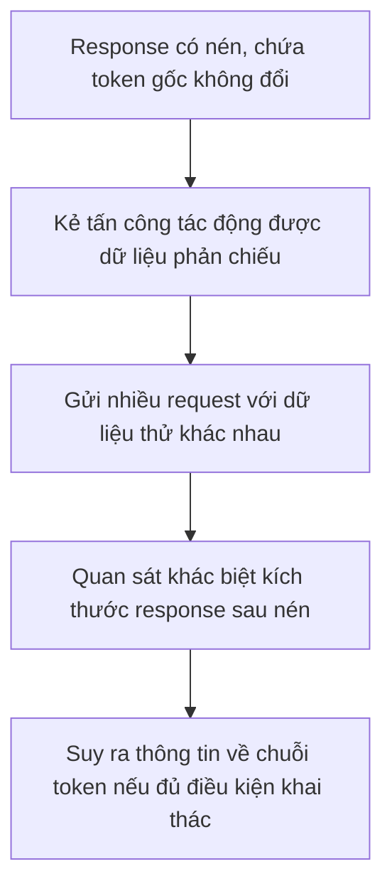
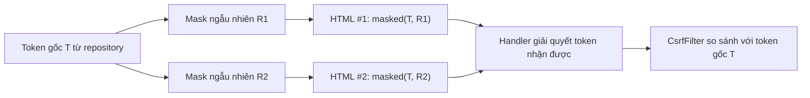
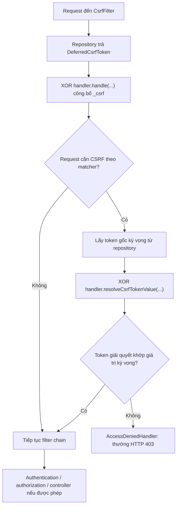

# `XorCsrfTokenRequestAttributeHandler` và cơ chế giảm nguy cơ BREACH

Trong Spring Security Servlet, `XorCsrfTokenRequestAttributeHandler` giúp **công bố CSRF token dưới một biểu diễn được che ngẫu nhiên (masked token)** thay vì lặp lại nguyên văn token gốc trong mỗi phản hồi HTML. Khi trình duyệt gửi biểu diễn đó qua form hoặc HTTP header, handler giải quyết nó về token gốc để `CsrfFilter` xác minh. Cơ chế che này được Spring Security sử dụng nhằm giảm nguy cơ **BREACH**, một loại tấn công kênh phụ lợi dụng kích thước phản hồi HTTP có nén.

Bài thuộc chương **CSRF trên Servlet** của module **SPRING_SECURITY_HTTP_PROTECTION**. Module hướng dẫn áp dụng các lớp bảo vệ HTTP và trình duyệt như CSRF, CORS, security headers, CSP, HSTS, HTTP firewall và bảo vệ session, cấu hình cho cả Servlet và Reactive, kiểm thử tấn công web và chẩn đoán xung đột bảo mật. Bài này đi sâu vào handler **Servlet** (`HttpServletRequest`, `HttpServletResponse`); trong WebFlux cần sử dụng các API reactive tương ứng.

Sau khi học, bạn cần giải thích được nguyên nhân BREACH đáng quan tâm với form có CSRF token, phân biệt **token gốc** và **masked token**, biết cách `handle(...)` và `resolveCsrfTokenValue(...)` phối hợp, cấu hình form/SPA thích hợp, kiểm thử luồng gửi lại token và chẩn đoán lỗi `403 Forbidden`.

## 1. Bối cảnh: CSRF token bị phản chiếu trong phản hồi có nén

Với ứng dụng xác thực bằng cookie, token CSRF giúp ngăn một trang bên ngoài khiến trình duyệt tự gửi request thay đổi trạng thái mà không có token hợp lệ. Trong thiết kế synchronizer token, server có một **token gốc** gắn với session và render token đó vào hidden field:

```html
<form method="post" action="/account/email">
  <input type="hidden" name="_csrf" value="TOKEN_GOC_CAN_BAO_VE">
  <input name="email" type="email">
  <button type="submit">Lưu</button>
</form>
```

Vấn đề phát sinh nếu phản hồi HTML **có nén** (ví dụ gzip/Brotli), vẫn chứa cùng một giá trị bí mật qua nhiều lần tải và trong một số điều kiện kẻ tấn công kiểm soát được một phần nội dung phản hồi hoặc đầu vào được phản chiếu.

BREACH (*Browser Reconnaissance and Exfiltration via Adaptive Compression of Hypertext*) khai thác mối quan hệ giữa **độ dài dữ liệu sau nén** và **mức độ trùng lặp của các chuỗi**. Nếu kẻ tấn công có thể tạo nhiều request, thay đổi phần văn bản được phản chiếu và quan sát kích thước phản hồi đủ chính xác, họ có thể suy đoán dần chuỗi bí mật bằng một kênh phụ.

Sơ đồ điều kiện:



Đây **không phải** cơ chế mà bất kỳ website lạ nào cũng có thể tự động đọc body HTTPS. Tấn công cần những tiền điều kiện cụ thể, gồm khả năng thao túng dữ liệu phản chiếu, quan sát một kênh đo liên quan đến kích thước và lấy đủ mẫu trong ngữ cảnh nạn nhân. Tuy nhiên, một token gốc cố định được đưa thẳng vào nội dung nén sẽ làm xuất hiện mục tiêu bí mật có thể lặp lại qua các phản hồi.

Giảm nguy cơ BREACH có nhiều lớp (thiết kế phản hồi, tránh phản chiếu bí mật không cần thiết, chính sách nén, cách xử lý dữ liệu phản chiếu). **XOR masking** là giải pháp tập trung vào cách trình bày CSRF token: biểu diễn của token **không giữ nguyên** qua các lần phản hồi.

## 2. `XorCsrfTokenRequestAttributeHandler` giải quyết điều gì?

Trong Spring Security Servlet, ba đối tượng có nhiệm vụ riêng:

| Thành phần | Nhiệm vụ |
| --- | --- |
| `CsrfTokenRepository` | Tạo, lưu, đọc, xóa **token gốc kỳ vọng**, ví dụ từ `HttpSession` hoặc cookie |
| `XorCsrfTokenRequestAttributeHandler` | Đưa **biểu diễn token đã che** lên request cho view; giải quyết biểu diễn đó khi client gửi lại |
| `CsrfFilter` | Xác định request cần CSRF, lấy token kỳ vọng, so sánh và từ chối nếu không hợp lệ |

Handler này **không tạo chính sách phân quyền**, không đổi HTTP method nào cần kiểm tra và không trực tiếp gửi `403`. Nó quản lý **biểu diễn của token trong request**. Spring Security Servlet 6.x thường chọn `XorCsrfTokenRequestAttributeHandler` làm request handler mặc định khi bật CSRF, còn repository mặc định thường là `HttpSessionCsrfTokenRepository`.

So sánh với `CsrfTokenRequestAttributeHandler` dạng plain/raw:

| Thuộc tính | Plain handler | XOR handler |
| --- | --- | --- |
| Giá trị `_csrf.token` mà view thấy | Token gốc | Biểu diễn token đã che |
| Hai lần render cùng token gốc | Thường thấy cùng chuỗi | Thường thấy hai chuỗi khác nhau |
| Giá trị từ form gửi lại | Raw token | Masked token được giải quyết về raw |
| Mục tiêu chống phản chiếu token ổn định trong HTML nén | Không cung cấp masking | Giảm nguy cơ BREACH bằng tính ngẫu nhiên |
| Phù hợp với SPA chỉ đọc raw token từ cookie | Có thể đọc trực tiếp raw header | Cần giải pháp cho raw header hoặc cách cấp token phù hợp |

**Mấu chốt:** token gốc mà repository giữ **không bắt buộc thay đổi** chỉ vì biểu diễn `_csrf.token` ở HTML thay đổi. Đây là kết quả mong đợi của masking.

## 3. Cơ chế XOR masking hoạt động ra sao?

Về mặt ý tưởng, handler dùng dữ liệu ngẫu nhiên mới để tạo một biểu diễn khác cho cùng một token. Một mô tả khái niệm, không phải mã nguồn Spring Security:

1. Chuyển token gốc `T` thành dãy byte.
2. Tạo dãy byte ngẫu nhiên `R` có cùng độ dài bằng nguồn ngẫu nhiên đủ mạnh.
3. Tính `X = T XOR R` theo từng byte.
4. Ghép `R` và `X` vào cùng một payload, mã hóa payload thành chuỗi có thể đặt trong form/header (ví dụ dạng Base64 URL-safe).
5. Khi nhận chuỗi masked, giải mã payload, tách hai phần và tính `X XOR R = T`.

```text
Token gốc:            T = 01001010 11001100 ...
Random mask lần 1:    R = 10110101 00110011 ...
XOR result:           X = 11111111 11111111 ...

Token công bố lần 1:  encode(R || X)
Client gửi lại:       encode(R || X)
Handler giải quyết:   X XOR R = T

Lần 2 dùng R' khác:   encode(R' || (T XOR R'))
                      -> chuỗi khác dù T không đổi
```



**XOR masking không phải mã hóa bảo mật để giữ kín token khi ai đó đã đọc được toàn bộ masked token.** Payload chứa đủ thông tin để handler phục hồi token gốc, nên người có thể đọc trọn biểu diễn token cũng có thể suy ra token gốc theo thuật toán. Lợi ích ở đây là **ngẫu nhiên hóa chuỗi được phản chiếu giữa các response**, làm khó kênh phụ dựa trên nén; masking không thay thế same-origin policy, CSP, phòng chống XSS, HTTPS hay tính khó đoán của token.

Hai hệ quả quan trọng:

- Một form được render hôm nay có thể chứa chuỗi masked khác form khác, dù cả hai dùng cùng token gốc còn hợp lệ. Mỗi chuỗi được tạo hợp lệ đều có thể giải quyết về `T`, miễn là repository vẫn kỳ vọng `T`.
- Gửi **raw token gốc** vào một handler chỉ chờ **masked token** có thể bị từ chối, bởi handler không giải mã được định dạng mong đợi. Đây là vấn đề hay gặp với SPA đọc cookie CSRF.

## 4. API Servlet: `handle()` và `resolveCsrfTokenValue()`

Lớp nằm trong package:

```java
org.springframework.security.web.csrf.XorCsrfTokenRequestAttributeHandler
```

Nó kế thừa từ `CsrfTokenRequestAttributeHandler` và tuân theo giao diện `CsrfTokenRequestHandler`:

```java
void handle(
    HttpServletRequest request,
    HttpServletResponse response,
    Supplier<CsrfToken> csrfToken);

String resolveCsrfTokenValue(
    HttpServletRequest request,
    CsrfToken csrfToken);
```

**`handle(...)`** công bố một đối tượng `CsrfToken` cho request, mặc định dưới attribute `_csrf`, nhưng giá trị trả về từ `getToken()` của đối tượng công bố **đã được che**. `getParameterName()` và `getHeaderName()` vẫn phản ánh tên field/header của token gốc do repository cung cấp.

**`resolveCsrfTokenValue(...)`** lấy chuỗi do client gửi qua header hoặc form parameter, giải quyết định dạng masked và trả **token gốc** cho `CsrfFilter`. Nếu token client thiếu, malformed hoặc không thể giải quyết theo định dạng handler yêu cầu, kết quả không phải token kỳ vọng; `CsrfFilter` sẽ xử lý lỗi kiểm tra.

Một ví dụ truy cập từ Spring MVC:

```java
import org.springframework.security.web.csrf.CsrfToken;
import org.springframework.web.bind.annotation.GetMapping;
import org.springframework.web.bind.annotation.RequestAttribute;
import org.springframework.web.bind.annotation.RestController;

@RestController
class CsrfPreviewController {

    @GetMapping("/csrf-preview")
    CsrfView preview(@RequestAttribute("_csrf") CsrfToken csrf) {
        return new CsrfView(
            csrf.getParameterName(),
            csrf.getHeaderName(),
            csrf.getToken()); // Biểu diễn masked với XOR handler.
    }

    record CsrfView(String parameter, String header, String token) {}
}
```

Đây là ví dụ **công bố token**; nếu dùng làm endpoint thật, cần đặt quyền truy cập, CORS, cache và authentication phù hợp với ứng dụng. Không ghi giá trị token thật ra log. Việc `_csrf` tồn tại phụ thuộc request đi qua chain có bật CSRF và request handler đang công bố attribute này.

### `_csrf` là một đối tượng, không phải `String`

```java
CsrfToken requestCsrf =
    (CsrfToken) request.getAttribute("_csrf");

String visibleValue = requestCsrf.getToken();
String fieldName = requestCsrf.getParameterName();
String headerName = requestCsrf.getHeaderName();
```

Trong cấu hình XOR, `visibleValue` là masked token; repository vẫn lưu token gốc. Cần phân biệt **request attribute name `_csrf`**, **form parameter name `_csrf`** và **HTTP header name `X-CSRF-TOKEN` hoặc `X-XSRF-TOKEN`**. Tên header do repository/token metadata quyết định, không phải handler bắt buộc cố định cho mọi dự án.

## 5. `CsrfFilter` kết hợp handler ở thời điểm nào?

Trong Servlet, `DelegatingFilterProxy` chuyển request vào `FilterChainProxy`, bộ chọn `SecurityFilterChain` đầu tiên khớp URL. Khi chain có CSRF, luồng tổng quát:



Matcher CSRF mặc định thường miễn `GET`, `HEAD`, `OPTIONS`, `TRACE` và yêu cầu token cho `POST`, `PUT`, `PATCH`, `DELETE` cũng như các method khác không nằm trong nhóm an toàn. Đó là lý do một `POST /login` có `permitAll()` vẫn có thể bị `CsrfFilter` chặn trước bước phân quyền.

### Deferred loading: công bố token chưa chắc đã tạo session

Các bản Spring Security hiện đại hỗ trợ `DeferredCsrfToken`. `CsrfFilter` chuẩn bị khả năng đọc/tạo token qua repository, handler nhận `Supplier<CsrfToken>` và có thể trì hoãn việc tải token cho tới khi view hoặc controller truy cập `_csrf.token`.

| Request | Khả năng nạp token |
| --- | --- |
| `GET /health` không sử dụng `_csrf` | Có thể đi qua filter mà không cần nạp/tạo token |
| `GET /account/edit` render `${_csrf.token}` | Token được yêu cầu để đưa vào HTML; nếu thiếu có thể được tạo/lưu |
| `GET /csrf-preview` trả `csrf.getToken()` | Token được yêu cầu để đưa vào JSON |
| `POST /account/email` | Filter phải tải token kỳ vọng và xử lý token nhận được để xác minh |

Đừng kết luận rằng vì `XorCsrfTokenRequestAttributeHandler` đã chạy nên request `GET` chắc chắn tạo `HttpSession` hoặc phát cookie `XSRF-TOKEN`. Điều đó phụ thuộc việc token có được truy cập và repository lưu token bằng cách nào.

## 6. Cấu hình XOR handler trong Servlet security chain

Một ứng dụng Spring MVC dùng form login và cookie session có thể dùng repository theo session và XOR handler. Ví dụ dưới đây dành cho API lambda của Spring Security Servlet 6.x:

```java
import org.springframework.context.annotation.Bean;
import org.springframework.context.annotation.Configuration;
import org.springframework.security.config.Customizer;
import org.springframework.security.config.annotation.web.builders.HttpSecurity;
import org.springframework.security.web.SecurityFilterChain;
import org.springframework.security.web.csrf.HttpSessionCsrfTokenRepository;
import org.springframework.security.web.csrf.XorCsrfTokenRequestAttributeHandler;

@Configuration
class SecurityConfiguration {

    @Bean
    SecurityFilterChain webSecurity(HttpSecurity http) throws Exception {
        http
            .authorizeHttpRequests(auth -> auth
                .requestMatchers("/login", "/csrf-preview", "/css/**")
                    .permitAll()
                .anyRequest().authenticated())
            .formLogin(Customizer.withDefaults())
            .csrf(csrf -> csrf
                .csrfTokenRepository(
                    new HttpSessionCsrfTokenRepository())
                .csrfTokenRequestHandler(
                    new XorCsrfTokenRequestAttributeHandler()));

        return http.build();
    }
}
```

Việc khai báo tường minh ở đây phục vụ học tập; trong cấu hình phổ biến của Spring Security 6.x, **CSRF đã dùng request handler XOR theo mặc định** và repository mặc định thường lưu vào `HttpSession`. Với phiên bản khác, hãy kiểm tra hành vi mặc định và API của phiên bản đang triển khai.

Khi chạy cấu hình này:

1. `GET /login` có thể trả form được render với masked token.
2. `POST /login` cần gửi masked token hợp lệ nếu request đi qua chain có CSRF.
3. `XorCsrfTokenRequestAttributeHandler` giải quyết biểu diễn đó về raw token.
4. `CsrfFilter` so sánh với token kỳ vọng trong session.
5. Khi CSRF hợp lệ, request mới tiếp tục tới xử lý đăng nhập; khi sai, filter thường trả `403`.

`permitAll()` chỉ mở quyền truy cập ở tầng authorization; nó không vô hiệu hóa CSRF. Không tắt CSRF chỉ để `POST /login` hoặc một form đang thiếu token hoạt động.

### Cấu hình tên attribute

Vì kế thừa từ `CsrfTokenRequestAttributeHandler`, XOR handler hỗ trợ đặt tên request attribute:

```java
XorCsrfTokenRequestAttributeHandler handler =
    new XorCsrfTokenRequestAttributeHandler();
handler.setCsrfRequestAttributeName("_csrf");

http.csrf(csrf -> csrf.csrfTokenRequestHandler(handler));
```

Đoạn mã nằm trong cấu hình có `HttpSecurity http`. Việc thay tên attribute có thể làm template/controller không tìm thấy `_csrf`. Không nhầm tên request attribute với tên hidden form parameter hoặc tên HTTP header. Nếu chủ động đặt tên attribute thành `null`, thời điểm cần nạp token và các thuộc tính được công bố có thể khác; chỉ thay đổi khi hiểu rõ hành vi ở phiên bản đang dùng.

## 7. Render HTML form: submit masked token, không tự chuyển về raw

Một form Thymeleaf có thể lấy token từ request attribute:

```html
<form action="/account/email" method="post">
  <label for="email">Email mới</label>
  <input id="email" name="email" type="email" required>

  <input type="hidden"
         th:name="${_csrf.parameterName}"
         th:value="${_csrf.token}">

  <button type="submit">Lưu email</button>
</form>
```

Với XOR handler, `th:value` nhận một **masked token** do handler công bố. Khi form được submit theo `application/x-www-form-urlencoded`, request có thể mang:

```http
POST /account/email HTTP/1.1
Host: app.example
Cookie: JSESSIONID=<cung-session-da-render-form>
Content-Type: application/x-www-form-urlencoded

email=learner%40example.com&_csrf=<gia-tri-masked>
```

`XorCsrfTokenRequestAttributeHandler` đọc parameter `_csrf`, giải quyết masked token về giá trị gốc, rồi `CsrfFilter` xác minh với `HttpSessionCsrfTokenRepository`. Với cách triển khai này, **không cần** JavaScript giải mã token ở browser; submit chính chuỗi mà template đã render.

Nếu dự án dùng tích hợp Thymeleaf/Spring MVC tự chèn CSRF hidden input qua cơ chế xử lý form (ví dụ khi dùng `th:action`), nên kiểm tra **HTML cuối cùng** trước khi thêm hidden input bằng tay. Tránh đưa hai field `_csrf` có giá trị khác nhau vào form: việc chọn tham số có thể không như dự tính.

### Có thể gửi masked token trong HTTP header không?

Có, miễn client gửi **giá trị masked do server cấp**, và handler đang đọc header với đúng tên. Nếu repository là `HttpSessionCsrfTokenRepository`, tên header mặc định thường là `X-CSRF-TOKEN`:

```http
POST /api/profile HTTP/1.1
Cookie: JSESSIONID=<cung-session>
Content-Type: application/json
X-CSRF-TOKEN: <masked-token-tu-server>

{"displayName":"Learner"}
```

Handler giải quyết biểu diễn masked nhận từ header, sau đó filter so sánh với token gốc trong session. Header không bắt buộc phải chứa token raw trong mọi kiến trúc: **định dạng header phụ thuộc hợp đồng giữa server handler và client**.

Nếu client chỉ gửi `_csrf` bên trong một JSON body, handler thông thường không tự parse JSON để tìm thuộc tính đó. Với JSON API, dùng header đúng tên là cách đơn giản, dễ kiểm thử.

## 8. SPA lấy masked token từ endpoint JSON

Một SPA **cùng origin** có thể dùng `HttpSessionCsrfTokenRepository` mà không đọc cookie `XSRF-TOKEN`. Server cấp biểu diễn masked qua endpoint, trình duyệt duy trì cookie session và JavaScript gửi lại biểu diễn masked trong header.

Ví dụ endpoint Spring MVC:

```java
import org.springframework.http.CacheControl;
import org.springframework.http.ResponseEntity;
import org.springframework.security.web.csrf.CsrfToken;
import org.springframework.web.bind.annotation.GetMapping;
import org.springframework.web.bind.annotation.RequestAttribute;
import org.springframework.web.bind.annotation.RestController;

@RestController
class CsrfBootstrapController {

    @GetMapping("/csrf")
    ResponseEntity<CsrfPayload> token(
            @RequestAttribute("_csrf") CsrfToken csrfToken) {
        CsrfPayload body = new CsrfPayload(
            csrfToken.getHeaderName(),
            csrfToken.getParameterName(),
            csrfToken.getToken());

        return ResponseEntity.ok()
            .cacheControl(CacheControl.noStore())
            .body(body);
    }

    record CsrfPayload(String header, String parameter, String token) {}
}
```

Thêm quyền cho `/csrf` trong `SecurityFilterChain` nếu frontend cần gọi endpoint này trước khi đăng nhập; lựa chọn quyền truy cập dựa trên luồng xác thực thật. Lệnh `getToken()` kích hoạt việc lấy token khi cần. Nếu session chưa có token, repository có thể tạo và lưu token gốc; controller chỉ trả **biểu diễn do handler công bố**, không trực tiếp lấy giá trị gốc từ session.

JavaScript dùng chính tên header được API trả về:

```javascript
async function csrfForCurrentSession() {
  const response = await fetch("/csrf", {
    method: "GET",
    credentials: "same-origin",
    cache: "no-store"
  });

  if (!response.ok) {
    throw new Error("Không lấy được CSRF token");
  }

  return response.json();
}

async function updateProfile(displayName) {
  const csrf = await csrfForCurrentSession();

  const response = await fetch("/api/profile", {
    method: "POST",
    credentials: "same-origin",
    headers: {
      "Content-Type": "application/json",
      [csrf.header]: csrf.token
    },
    body: JSON.stringify({ displayName })
  });

  if (!response.ok) {
    throw new Error(`POST thất bại: ${response.status}`);
  }
  return response;
}
```

Ví dụ giả định `/api/profile` nhận JSON, caller đã đăng nhập và có đủ quyền. Cả hai request cần dùng **cùng session** để repository tìm đúng token kỳ vọng. Một giá trị masked được cấp ở session khác, hoặc từ trước khi token gốc bị xóa, sẽ không còn tương ứng.

Ưu điểm của cách cấp qua JSON là frontend có thể gửi lại đúng **masked token** theo request handler mặc định, không phải chuyển toàn hệ thống sang handler plain. Tuy nhiên endpoint cấp token phải được bảo vệ phù hợp: kiểm soát origin, xác thực nếu cần, không cache nhầm giữa người dùng và không ghi token ra log.

## 9. Vì sao SPA đọc cookie `XSRF-TOKEN` thường gặp `403`?

Với `CookieCsrfTokenRepository`, server thường phát cookie **`XSRF-TOKEN` chứa token gốc**, và nhiều frontend có quy ước đọc cookie rồi gửi header **`X-XSRF-TOKEN` chứa cùng giá trị gốc**. Ví dụ:

```http
Cookie: XSRF-TOKEN=RAW_T
X-XSRF-TOKEN: RAW_T
```

Nếu `CsrfFilter` đang dùng `XorCsrfTokenRequestAttributeHandler` cho cả việc giải quyết header, handler có thể mong nhận **masked token** nhưng lại thấy `RAW_T`, nên không giải quyết được token theo định dạng XOR. Khi đó request bị `403` ngay cả khi chuỗi header giống chuỗi cookie.

Lỗi này là **xung đột biểu diễn token giữa frontend và request handler**; không có nghĩa browser không gửi cookie hay repository nhất thiết bị lỗi.

| Luồng client | Token client gửi | Handler nên giải quyết |
| --- | --- | --- |
| Server-rendered HTML form với `_csrf.token` từ XOR handler | Masked token | XOR resolver |
| SPA lấy token từ endpoint JSON phản chiếu `_csrf.token` của XOR handler | Masked token | XOR resolver |
| SPA đọc raw token trực tiếp từ cookie `XSRF-TOKEN` | Raw token | Plain resolver |
| Client tự tạo một chuỗi ngẫu nhiên không do server cấp | Không có giá trị hợp lệ | Filter từ chối |

Khi có cả form và SPA trong một ứng dụng, một chiến lược thường dùng là **công bố masked token cho HTML nhưng đọc raw token từ header SPA**, trình bày dưới đây.

## 10. Handler phối hợp: XOR cho form, raw cho header SPA

Một handler dành riêng cho SPA có thể kết hợp `XorCsrfTokenRequestAttributeHandler` và `CsrfTokenRequestAttributeHandler`. Ví dụ kiểu cấu hình Spring Security Servlet 6.1+:

```java
import jakarta.servlet.http.HttpServletRequest;
import jakarta.servlet.http.HttpServletResponse;
import java.util.function.Supplier;
import org.springframework.security.web.csrf.CsrfToken;
import org.springframework.security.web.csrf.CsrfTokenRequestAttributeHandler;
import org.springframework.security.web.csrf.CsrfTokenRequestHandler;
import org.springframework.security.web.csrf.XorCsrfTokenRequestAttributeHandler;
import org.springframework.util.StringUtils;

final class SpaCsrfTokenRequestHandler
        implements CsrfTokenRequestHandler {

    private final CsrfTokenRequestHandler plain =
        new CsrfTokenRequestAttributeHandler();
    private final CsrfTokenRequestHandler xor =
        new XorCsrfTokenRequestAttributeHandler();

    @Override
    public void handle(
            HttpServletRequest request,
            HttpServletResponse response,
            Supplier<CsrfToken> csrfToken) {
        // Form/view vẫn nhìn thấy masked token.
        this.xor.handle(request, response, csrfToken);

        // Có chủ đích nạp token để SPA có cookie khi cần.
        csrfToken.get();
    }

    @Override
    public String resolveCsrfTokenValue(
            HttpServletRequest request,
            CsrfToken csrfToken) {
        String rawHeader = request.getHeader(csrfToken.getHeaderName());
        CsrfTokenRequestHandler resolver = StringUtils.hasText(rawHeader)
            ? this.plain
            : this.xor;
        return resolver.resolveCsrfTokenValue(request, csrfToken);
    }
}
```

Cấu hình repository cookie và handler:

```java
import org.springframework.security.web.csrf.CookieCsrfTokenRepository;

CookieCsrfTokenRepository repository =
    CookieCsrfTokenRepository.withHttpOnlyFalse();

repository.setCookieCustomizer(cookie -> cookie
    .path("/")
    .sameSite("Lax")
    .secure(true));

http.csrf(csrf -> csrf
    .csrfTokenRepository(repository)
    .csrfTokenRequestHandler(new SpaCsrfTokenRequestHandler()));
```

Đây là **đoạn cấu hình đặt bên trong phương thức tạo `SecurityFilterChain` với biến `HttpSecurity http`**; trong dự án thật cần các import và bean còn lại. `setCookieCustomizer(...)` thuộc API có trong các bản Spring Security 6.1+; `secure(true)` giả định môi trường HTTPS. Với môi trường phát triển chỉ chạy HTTP, cấu hình cookie cần phù hợp để browser thật có thể gửi lại cookie.

Handler trên thực hiện ba việc:

1. View vẫn nhận biểu diễn masked qua `_csrf`, phù hợp với mục tiêu giảm nguy cơ BREACH khi token xuất hiện trong HTML.
2. SPA gửi `X-XSRF-TOKEN` từ cookie; nhánh plain giải quyết giá trị **raw**.
3. Form gửi `_csrf` dạng masked mà không có header SPA; nhánh XOR giải quyết token form về raw.

Lời gọi `csrfToken.get()` trong `handle(...)` **ép nạp token**, hữu ích khi SPA kỳ vọng cookie token được tạo/phát sau request bootstrap. Điều này có thể tăng số thao tác tải/lưu token ở các request không cần token. Nếu ứng dụng có endpoint bootstrap riêng, cân nhắc thiết kế nạp token tại điểm thích hợp, thay vì ép trên mọi request.

**Giới hạn của ví dụ:** mọi header CSRF có giá trị đều được xem là raw. Nếu có client gửi **masked token qua header**, nhánh plain sẽ không giải quyết đúng. Một hệ thống nhiều client cần thống nhất hợp đồng, hoặc thiết kế handler chọn cách giải quyết bằng tiêu chí rõ ràng hơn.

### Browser đọc cookie CSRF khác cookie đăng nhập

`withHttpOnlyFalse()` cho JavaScript đọc **cookie CSRF**. Không vì vậy tắt `HttpOnly` trên session cookie dùng để xác thực. Hãy kiểm tra cookie `Secure`, `SameSite`, `Path`, `Domain`, CORS và HTTPS. Đặc biệt, việc mở rộng `Domain` sang nhiều subdomain không đáng tin có thể tạo nguy cơ cookie injection đối với mẫu double-submit cookie. Một token raw trong cookie không tự bảo đảm được ràng buộc với phiên đăng nhập.

Với frontend khác origin (ví dụ `app.example.com` và `api.example.com`), JavaScript thường không đọc được cookie host-only của API, nên cách đọc cookie raw có thể không hoạt động dù browser vẫn gửi cookie tới API. Khi đó có thể chọn kênh cấp token qua endpoint có CORS chặt chẽ, dùng masked token qua header và giữ handler XOR tương thích.

## 11. Test đơn vị: cùng token gốc nhưng hai biểu diễn masked

`spring-test` cung cấp `MockHttpServletRequest` và `MockHttpServletResponse` để kiểm tra handler độc lập với filter chain. Dùng `DefaultCsrfToken` mô phỏng giá trị kỳ vọng do repository cấp.

Test JUnit 5 sau kiểm tra **hai chiều của XOR handler**:

```java
import org.junit.jupiter.api.Test;
import org.springframework.mock.web.MockHttpServletRequest;
import org.springframework.mock.web.MockHttpServletResponse;
import org.springframework.security.web.csrf.CsrfToken;
import org.springframework.security.web.csrf.DefaultCsrfToken;
import org.springframework.security.web.csrf.XorCsrfTokenRequestAttributeHandler;

import static org.junit.jupiter.api.Assertions.*;

class XorCsrfHandlerUnitTest {

    @Test
    void twoExposedValuesResolveToSameStoredToken() {
        CsrfToken stored = new DefaultCsrfToken(
            "X-CSRF-TOKEN", "_csrf", "secret-for-unit-test");

        var handler = new XorCsrfTokenRequestAttributeHandler();

        var first = new MockHttpServletRequest("GET", "/edit");
        handler.handle(
            first, new MockHttpServletResponse(), () -> stored);
        CsrfToken firstExposed =
            (CsrfToken) first.getAttribute("_csrf");
        assertNotNull(firstExposed);
        String masked1 = firstExposed.getToken();

        var second = new MockHttpServletRequest("GET", "/edit");
        handler.handle(
            second, new MockHttpServletResponse(), () -> stored);
        CsrfToken secondExposed =
            (CsrfToken) second.getAttribute("_csrf");
        assertNotNull(secondExposed);
        String masked2 = secondExposed.getToken();

        assertNotEquals(stored.getToken(), masked1);
        assertNotEquals(stored.getToken(), masked2);
        assertNotEquals(masked1, masked2);

        var post1 = new MockHttpServletRequest("POST", "/edit");
        post1.addParameter("_csrf", masked1);
        assertEquals(stored.getToken(),
            handler.resolveCsrfTokenValue(post1, stored));

        var post2 = new MockHttpServletRequest("POST", "/edit");
        post2.addParameter("_csrf", masked2);
        assertEquals(stored.getToken(),
            handler.resolveCsrfTokenValue(post2, stored));
    }
}
```

Test dùng chuỗi giả và giả định tạo ngẫu nhiên khác nhau giữa các lần masking, điều có xác suất trùng biểu diễn cực thấp khi dùng nguồn ngẫu nhiên an toàn. Nó chứng minh **biểu diễn khác nhau không làm thay đổi token kỳ vọng**. Test này chưa đi qua `CsrfFilter` hoặc HTTP session thật.

### Test đọc masked token từ header

Handler cũng có thể giải quyết masked token trong HTTP header khi header có đúng tên:

```java
import org.junit.jupiter.api.Test;
import org.springframework.mock.web.MockHttpServletRequest;
import org.springframework.mock.web.MockHttpServletResponse;
import org.springframework.security.web.csrf.CsrfToken;
import org.springframework.security.web.csrf.DefaultCsrfToken;
import org.springframework.security.web.csrf.XorCsrfTokenRequestAttributeHandler;

import static org.junit.jupiter.api.Assertions.*;

class XorCsrfHeaderTest {

    @Test
    void resolvesMaskedHeaderToStoredToken() {
        CsrfToken stored = new DefaultCsrfToken(
            "X-CSRF-TOKEN", "_csrf", "stored-test-token");
        var handler = new XorCsrfTokenRequestAttributeHandler();
        var get = new MockHttpServletRequest("GET", "/csrf");

        handler.handle(
            get, new MockHttpServletResponse(), () -> stored);
        CsrfToken exposed =
            (CsrfToken) get.getAttribute("_csrf");

        var post = new MockHttpServletRequest("POST", "/api/save");
        post.addHeader(stored.getHeaderName(), exposed.getToken());

        assertEquals(stored.getToken(),
            handler.resolveCsrfTokenValue(post, stored));
    }
}
```

Không cần đổi handler sang plain nếu client đang gửi **masked token** hợp lệ trong header. Với client gửi raw token từ cookie, phải thiết kế resolver phù hợp như mục 10.

### Test ranh giới plain và XOR

Một phép kiểm tra nhỏ giúp thấy vì sao không thể trộn hai dạng giá trị:

```java
import org.springframework.security.web.csrf.CsrfTokenRequestAttributeHandler;

// Giả sử masked1 là biểu diễn XOR của token gốc stored.getToken().
var plain = new CsrfTokenRequestAttributeHandler();
var submitted = new MockHttpServletRequest("POST", "/edit");
submitted.addParameter("_csrf", masked1);

String value = plain.resolveCsrfTokenValue(submitted, stored);
assertEquals(masked1, value);
assertNotEquals(stored.getToken(), value);
```

Đây là **đoạn minh họa tiếp nối test đầu tiên**, không phải file Java độc lập; cần dùng `masked1`, `stored` và các import từ test đó. Plain handler trả lại nguyên chuỗi masked và **không giải mã**, nên `CsrfFilter` sẽ thấy giá trị không khớp token gốc. Điều này giải thích lỗi khi server đổi request handler nhưng frontend vẫn gửi biểu diễn cũ.

## 12. Test tích hợp `GET /csrf` rồi `POST` với masked token bằng MockMvc

Test handler đơn vị chưa xác minh repository/session hay vị trí của `CsrfFilter`. Để quan sát cả luồng Servlet, giả sử ứng dụng Spring Boot có:

- Cấu hình `SecurityFilterChain` dùng `HttpSessionCsrfTokenRepository` và `XorCsrfTokenRequestAttributeHandler` ở mục 6, đồng thời cho phép `GET /csrf`.
- Endpoint `GET /csrf` ở mục 8 trả JSON gồm `header`, `parameter`, `token`.
- Controller minh họa sau xử lý `POST /profile` và trả `204` khi đủ quyền.

```java
import org.springframework.http.ResponseEntity;
import org.springframework.web.bind.annotation.PostMapping;
import org.springframework.web.bind.annotation.RestController;

@RestController
class ProfileController {

    @PostMapping("/profile")
    ResponseEntity<Void> update() {
        return ResponseEntity.noContent().build();
    }
}
```

Test Spring Boot + `spring-security-test`:

```java
import com.fasterxml.jackson.databind.JsonNode;
import com.fasterxml.jackson.databind.ObjectMapper;
import org.junit.jupiter.api.Test;
import org.springframework.beans.factory.annotation.Autowired;
import org.springframework.boot.test.autoconfigure.web.servlet.AutoConfigureMockMvc;
import org.springframework.boot.test.context.SpringBootTest;
import org.springframework.mock.web.MockHttpSession;
import org.springframework.security.test.context.support.WithMockUser;
import org.springframework.test.web.servlet.MockMvc;
import org.springframework.test.web.servlet.MvcResult;

import static org.junit.jupiter.api.Assertions.*;
import static org.springframework.test.web.servlet.request.MockMvcRequestBuilders.*;
import static org.springframework.test.web.servlet.result.MockMvcResultMatchers.status;

@SpringBootTest
@AutoConfigureMockMvc
@WithMockUser(username = "learner")
class XorCsrfIntegrationTest {

    @Autowired MockMvc mvc;
    @Autowired ObjectMapper json;

    @Test
    void maskedTokenCanBeSubmittedWithTheSameSession()
            throws Exception {
        MvcResult initial = mvc.perform(get("/csrf"))
            .andExpect(status().isOk())
            .andReturn();

        JsonNode payload = json.readTree(
            initial.getResponse().getContentAsString());
        String header = payload.path("header").asText();
        String masked1 = payload.path("token").asText();

        assertFalse(header.isBlank());
        assertFalse(masked1.isBlank());

        MockHttpSession session = (MockHttpSession)
            initial.getRequest().getSession(false);
        assertNotNull(session);

        // Không có token do client chủ động gửi.
        mvc.perform(post("/profile").session(session))
            .andExpect(status().isForbidden());

        // Token do client gửi không hợp lệ.
        mvc.perform(post("/profile").session(session)
                .header(header, "invalid-token"))
            .andExpect(status().isForbidden());

        // Masked token hợp lệ, cùng session.
        mvc.perform(post("/profile").session(session)
                .header(header, masked1))
            .andExpect(status().isNoContent());

        // Cùng token gốc: request GET khác công bố masked token mới.
        MvcResult second = mvc.perform(get("/csrf").session(session))
            .andExpect(status().isOk())
            .andReturn();
        JsonNode secondPayload = json.readTree(
            second.getResponse().getContentAsString());
        String masked2 = secondPayload.path("token").asText();
        assertNotEquals(masked1, masked2);

        mvc.perform(post("/profile").session(session)
                .header(header, masked2))
            .andExpect(status().isNoContent());
    }
}
```

Ở đây `@WithMockUser` giúp tách lỗi CSRF khỏi lỗi người dùng chưa xác thực. Test giữ `MockHttpSession` giữa lần lấy token và lần gửi `POST`. Nếu route `/profile` có quy tắc phân quyền hoặc status khác, cần sửa kỳ vọng của test. Khi kiểm thử thực tế, còn phải xét cookie session có được trình duyệt gửi qua `fetch`, hostname và chính sách cookie hay không.

### Test công cụ `.with(csrf())` có giới hạn gì?

`spring-security-test` có `SecurityMockMvcRequestPostProcessors.csrf()` để nhanh chóng kiểm thử request hợp lệ hoặc sai token:

```java
import static org.springframework.security.test.web.servlet.request
    .SecurityMockMvcRequestPostProcessors.csrf;

mockMvc.perform(post("/profile").with(csrf()));
mockMvc.perform(post("/profile")
    .with(csrf().useInvalidToken()));
```

Đây là đoạn ví dụ dùng bên trong test đã có `MockMvc` và imports phù hợp. Helper giúp kiểm thử **chính sách CSRF của filter**, nhưng một test `.with(csrf())` thành công chưa chứng minh form đã render masked token, repository lưu đúng session, frontend giữ session hoặc token đã được gửi theo định dạng client thực tế. Nếu mục tiêu là kiểm tra masking/BREACH, test qua **cấp token và gửi lại** có giá trị hơn.

## 13. Chẩn đoán lỗi `403` liên quan đến XOR masking

Đừng suy từ status `403` rằng “người dùng thiếu quyền”. Với Servlet chain có CSRF, `CsrfFilter` có thể từ chối request **trước khi** logic authorization hoặc controller xử lý.

| Triệu chứng | Giả thuyết ban đầu | Cách xác minh |
| --- | --- | --- |
| Hai lần `GET /form` có `_csrf.token` khác nhau | XOR masking tạo biểu diễn mới | Giữ cùng session, gửi từng masked token hợp lệ để kiểm tra |
| Form gửi raw token nhưng server dùng XOR handler | Không giải quyết được định dạng masked | Xem nguồn cấp token và `CsrfTokenRequestHandler` |
| SPA có cookie `XSRF-TOKEN`, header `X-XSRF-TOKEN` giống cookie nhưng `403` | Header raw bị xử lý bởi XOR resolver | Kiểm tra cấu hình SPA handler/plain resolver |
| SPA gửi masked token trong header nhưng handler coi header là raw | Nhánh resolver không đúng kiểu token | Kiểm tra hợp đồng header và đường chọn resolver |
| Form thiếu `_csrf` hoặc có sai tên field | View không công bố hoặc không gửi token | Kiểm tra HTML render và request form data |
| `GET /csrf` không cấp token | Deferred token chưa được truy cập hoặc không đi qua đúng chain | Xem endpoint có gọi `csrf.getToken()` và `_csrf` có tồn tại |
| `POST /login` có `permitAll()` nhưng vẫn `403` | `CsrfFilter` kiểm tra trước authorization | Xem form login, request method và token |
| Token từng hợp lệ nhưng `POST` sau login/logout bị `403` | Token gốc bị xóa hoặc thay đổi | Lấy token mới, giữ đúng session và xem response login/logout |
| `POST` chỉ lỗi trên một số node | Node không tìm thấy session token kỳ vọng | Kiểm tra shared session, sticky session hoặc routing |
| `OPTIONS` preflight thất bại | CORS hoặc filter khác | Xem allowed origin, method, headers, credentials; matcher CSRF mặc định miễn `OPTIONS` |
| Request qua được CSRF nhưng vẫn `403` | Authorization hoặc quy tắc khác | Xác định exception/filter thật sự phát sinh lỗi |

### Quy trình gỡ lỗi có thể thực hiện

1. **Xác nhận chain được chọn**: với nhiều `SecurityFilterChain`, xem request có đi vào chain chứa `CsrfFilter` và handler nào.
2. **Xác nhận repository**: token gốc nằm trong `HttpSession`, cookie `XSRF-TOKEN` hay kho tùy biến? Có còn tồn tại ở request unsafe không?
3. **Xác nhận kiểu token được công bố**: plain hay masked? Token lấy qua `_csrf`, JSON, header response hoặc cookie?
4. **Xem request thật**: có field/header CSRF không, tên có khớp metadata không, client gửi raw hay masked? Không sao chép giá trị bí mật vào log chia sẻ.
5. **Xác nhận cùng ngữ cảnh phiên**: cookie session/cookie CSRF, login/logout, session timeout và việc đổi node.
6. **Phân biệt lỗi sau CSRF**: nếu token hợp lệ, kiểm tra authentication, authorization, HTTP firewall và lớp nghiệp vụ.

Có thể bật log tạm thời trong môi trường phát triển:

```properties
logging.level.org.springframework.security.web.FilterChainProxy=DEBUG
logging.level.org.springframework.security.web.csrf=TRACE
```

Mục đích là tìm dấu hiệu `MissingCsrfTokenException`, `InvalidCsrfTokenException`, chain/filter được áp dụng hoặc một lỗi khác. Không in toàn bộ token, cookie hay session ID thật trong log; hạn chế log nhạy cảm khi chạy production.

### Ví dụ lỗi do thay handler trong lúc nâng cấp

Một ứng dụng cũ tự render **raw CSRF token** vào form. Sau khi nâng cấp và dùng XOR handler, một phần client vẫn lấy raw token từ session hoặc cookie theo cách cũ. Request `POST` lúc đó có thể nhận `403` mặc dù server vẫn giữ đúng token gốc. Thứ cần sửa là **hợp đồng cấp và gửi token**, không phải giá trị authorization.

Ngược lại, nếu ứng dụng chuyển từ XOR handler về plain handler nhưng form đang gửi masked token, plain handler chỉ trả chuỗi masked như nhận được, khiến nó không khớp token gốc của repository. Hãy chọn một cách công bố và giải quyết thống nhất cho từng loại client.

## 14. Hạn chế của XOR masking và những phòng vệ bổ sung

XOR handler có mục tiêu hẹp: **ngẫu nhiên hóa biểu diễn CSRF token** để giảm nguy cơ suy luận token ổn định qua độ dài phản hồi nén. Nó không bảo vệ mọi nguy cơ HTTP hoặc trình duyệt.

| Lớp bảo vệ | Phần việc của nó và mối quan hệ với XOR handler |
| --- | --- |
| CSRF token + `CsrfFilter` | Ngăn request unsafe thiếu token hợp lệ trong threat model dùng credentials trình duyệt tự gửi |
| XOR masking | Giảm tính ổn định của chuỗi token được phản chiếu trong response có nén |
| Chống XSS và CSP | Hạn chế script độc hại cùng origin; XSS có thể lấy/sử dụng masked token và phá vỡ giả định an toàn |
| HTTPS, cookie `Secure`, HSTS | Hỗ trợ bảo vệ kết nối và cookie khi được triển khai đúng |
| Cookie `HttpOnly` | Ngăn JavaScript đọc cookie, nhưng không ngăn browser tự gửi credentials nên không tự loại bỏ CSRF |
| Cookie `SameSite` | Giảm một số đường gửi cookie cross-site; không bảo đảm chặn mọi trường hợp CSRF |
| CORS | Kiểm soát tương tác cross-origin của JavaScript và preflight; không thay thế CSRF |
| HTTP firewall | Từ chối một số request bất thường trước khi vào xử lý sâu hơn |
| Session management | Quản lý timeout, invalidation, đổi session ID; token gốc trong session cần đi đúng vòng đời |

### Vì sao XSS vẫn nguy hiểm?

Nếu JavaScript độc hại đã chạy được **cùng origin với ứng dụng**, nó có thể đọc nội dung trang có masked token, tương tác với form và gọi API bằng credentials của trình duyệt. Masked token phục vụ chống kênh phụ nén, **không phải mật mã đầu cuối để giấu giá trị khỏi script cùng origin**. Vì vậy cần phòng ngừa XSS bằng encoding đúng ngữ cảnh, CSP, tránh sink nguy hiểm và kiểm soát nội dung không tin cậy.

### Nếu ứng dụng tắt nén HTML thì sao?

Tắt nén trên những phản hồi phản chiếu bí mật có thể làm giảm một trong các điều kiện BREACH, nhưng quyết định này có tác động hiệu năng và không thay thế đánh giá bảo mật tổng thể. Duy trì cơ chế masking mặc định trong phần lớn ứng dụng Spring Security hiện đại là cách hợp lý để tránh đưa raw token ổn định vào HTML nén, đồng thời không nên xem XOR là biện pháp duy nhất chống lộ bí mật.

### Reactive có sử dụng trực tiếp handler Servlet không?

Không. Trong Spring WebFlux, `CsrfWebFilter` và `ServerCsrfTokenRequestHandler` xử lý luồng reactive (`ServerWebExchange`, `Mono`); một implementation Servlet dựa trên `HttpServletRequest` không được cắm trực tiếp vào `ServerHttpSecurity`. Tư duy về **token kỳ vọng, biểu diễn token đã che và giá trị client gửi** vẫn hữu ích, nhưng phải dùng API Reactive tương ứng.

## 15. Thực hành: ba ca kiểm chứng và một ca phân tích

Để củng cố bài học, tạo một ứng dụng Spring MVC dùng session và `XorCsrfTokenRequestAttributeHandler`, có trang `/account/edit`, endpoint `POST /account/email` và một API `GET /csrf` cấp masked token:

1. **Hai lần GET, cùng session:** render form hai lần; quan sát hai giá trị hidden `_csrf`. Chúng có thể khác nhau. Gửi mỗi giá trị với cùng session và xác minh đều vượt qua bước CSRF.
2. **Đổi sang raw request handler:** giữ repository và controller; thay handler thành `CsrfTokenRequestAttributeHandler`. Quan sát thay đổi của `_csrf.token` qua các lần render. Dùng cùng form để kiểm tra token vẫn được so sánh, nhưng không còn biểu diễn XOR mới theo từng lần hiển thị.
3. **Gửi sai định dạng:** dùng XOR handler, gửi raw token trực tiếp vào header (chỉ trong môi trường test) và quan sát request không vượt qua CSRF. Sau đó gửi masked token được server công bố để chứng minh nguyên nhân là định dạng token.
4. **Phân tích SPA:** cấu hình `CookieCsrfTokenRepository.withHttpOnlyFalse()` và frontend đọc `XSRF-TOKEN`. Giải thích vì sao header `X-XSRF-TOKEN` dạng raw cần handler tương thích; đề xuất cách kết hợp XOR cho form và plain cho raw header.

Trong mọi ca, giữ các kiểm tra xác thực/phân quyền như cũ và quan sát **filter chặn request**. Những ca này được triển khai ở môi trường thử nghiệm với tài khoản/dữ liệu mẫu, không lấy token của người dùng thật để làm minh họa.

## 16. Những cách hiểu sai cần tránh

| Hiểu nhầm | Cách hiểu đúng |
| --- | --- |
| “Masked token khác token gốc nghĩa là token hỏng” | Masked token là biểu diễn hợp lệ có thể giải quyết về token gốc |
| “Mỗi GET có masked token mới thì session đã đổi” | Random mask có thể đổi ngay cả khi repository giữ cùng token gốc |
| “XOR mã hóa token để người thấy masked không thể đọc raw” | Mask và dữ liệu XOR nằm cùng payload; lợi ích là làm biểu diễn thay đổi để giảm kênh phụ nén |
| “Cần lưu cả masked token vào session” | Repository thường giữ raw token kỳ vọng; handler công bố/giải quyết masked token |
| “XOR handler tự quyết định endpoint nào được phép” | `CsrfFilter` chọn method/request và xác minh; authorization xử lý quyền |
| “SPA cookie và header trùng nhau luôn đủ” | Header raw có thể không được XOR resolver giải quyết đúng |
| “Chuyển toàn bộ sang plain handler luôn giải quyết tốt nhất” | Có thể làm token gốc bị phản chiếu cố định vào HTML nén; cần xét BREACH |
| “`permitAll()` bỏ qua CSRF” | Luật authorization không thay thế việc xác minh token |
| “CORS hoặc SameSite thay thế CSRF” | Chúng có nhiệm vụ khác, cần phối hợp theo threat model |
| “Test `.with(csrf())` pass chứng minh XOR masking hoạt động” | Phải kiểm tra biểu diễn token và round trip từ GET sang POST |

## 17. Câu hỏi tự kiểm tra

1. BREACH khai thác đặc điểm nào của phản hồi HTTP có nén? Vì sao token CSRF gốc xuất hiện lặp lại trong HTML có thể thành mục tiêu?
2. XOR masking tạo masked token từ token gốc như thế nào? Vì sao hai biểu diễn masked có thể khác nhau mà vẫn giải quyết về cùng một token gốc?
3. `XorCsrfTokenRequestAttributeHandler` khác `CsrfTokenRequestAttributeHandler` ở chiều `handle(...)` và `resolveCsrfTokenValue(...)` ra sao?
4. Khi controller đọc `@RequestAttribute("_csrf") CsrfToken`, giá trị `getToken()` mang ý nghĩa gì trong cấu hình XOR?
5. Nếu SPA nhận masked token từ `GET /csrf` và gửi nó qua `X-CSRF-TOKEN`, liệu có nhất thiết phải dùng plain resolver không? Giải thích.
6. Vì sao SPA lấy raw token từ cookie `XSRF-TOKEN` có thể nhận `403` khi server dùng XOR handler mặc định?
7. Trong handler kết hợp, vì sao chọn plain resolver cho raw header và XOR resolver cho form masked? Có rủi ro gì nếu một client gửi masked token qua header?
8. `DeferredCsrfToken` ảnh hưởng thế nào tới việc tạo session hoặc cookie khi người dùng chỉ truy cập `GET /health`?
9. Thiết kế test chứng minh hai masked token khác nhau nhưng đều hợp lệ với cùng session; cần quan sát phần nào của hệ thống?
10. Vì sao XOR masking không ngăn được XSS và không thể thay thế HTTPS, CSP hoặc kiểm tra quyền?

**Ghi nhớ:** `XorCsrfTokenRequestAttributeHandler` **che ngẫu nhiên biểu diễn CSRF token ở chiều công bố và giải quyết biểu diễn đó về token gốc ở chiều nhận**. Cơ chế này giảm nguy cơ BREACH khi token xuất hiện trong HTML có nén; repository vẫn quản lý token kỳ vọng và `CsrfFilter` vẫn xác minh request. Cần giữ nhất quán giữa masked token của form, raw token từ cookie SPA, request handler và vòng đời session để bảo vệ đúng mà không gây `403` ngoài ý muốn.
