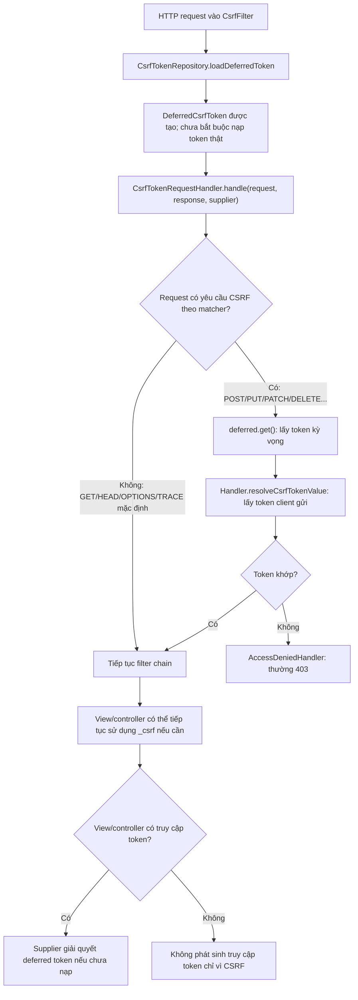

# `DeferredCsrfToken` và thời điểm tải hoặc tạo token

Trong Spring Security Servlet, **`DeferredCsrfToken`** là cơ chế cho phép **trì hoãn việc đọc hoặc tạo CSRF token cho đến khi request thực sự cần token**. Một HTTP request đi qua `CsrfFilter` không nhất thiết phải truy cập `HttpSession`, tạo session mới hay phát cookie `XSRF-TOKEN` ngay lập tức. Khác biệt về *thời điểm* này vừa ảnh hưởng hiệu năng vừa giải thích nhiều lỗi thực tế: `GET` trả `200` nhưng frontend chưa nhận token; một `POST` đầu tiên trả `403` đồng thời lại tạo session; hoặc SPA nhận lỗi sau login/logout vì token cũ đã bị xóa mà token mới chưa được yêu cầu.

Bài học thuộc chương **CSRF trên Servlet** của module **SPRING_SECURITY_HTTP_PROTECTION**. Module nghiên cứu các lớp phòng vệ HTTP/trình duyệt — CSRF, CORS, security headers, CSP, HSTS, HTTP firewall, bảo vệ session — và yêu cầu cấu hình, kiểm thử cả Servlet lẫn Reactive. Phạm vi bài này là **API Servlet** (`HttpServletRequest`, `HttpServletResponse`, `CsrfFilter`); WebFlux sử dụng cơ chế và kiểu dữ liệu Reactive riêng.

**Mục tiêu học tập:** Phân biệt *chuẩn bị khả năng lấy token* với *thực sự đọc, sinh và lưu token*; hiểu `get()` và `isGenerated()`; xác định khi nào `HttpSessionCsrfTokenRepository` tạo session hoặc `CookieCsrfTokenRepository` phát `Set-Cookie`; cấu hình cấp token chủ động cho MVC/SPA; viết kiểm thử để chứng minh hành vi lazy và chẩn đoán HTTP 403.

## 1. Vấn đề: mọi request có cần CSRF token ngay không?

Giả sử cùng một ứng dụng phục vụ:

- `GET /health`: endpoint kiểm tra sức khỏe, chỉ trả trạng thái.
- `GET /catalog`: trang công khai không chứa form hay JavaScript cần token.
- `GET /checkout`: trang HTML có form `POST` để đặt hàng.
- `POST /checkout`: request thay đổi trạng thái, cần kiểm tra CSRF.

Nếu Spring Security **đọc token và tạo session mới ngay cho mọi GET**, kể cả health check hoặc trang công khai, hệ thống có thể phát sinh nhiều session/cookie không cần thiết. Điều này làm tăng truy cập kho session, lưu trữ trạng thái và chi phí vận hành.

`DeferredCsrfToken` tách hai hành động:

1. **Chuẩn bị:** `CsrfFilter` yêu cầu repository cung cấp *khả năng lấy token khi cần*.
2. **Thực thi:** khi view, controller, custom handler hoặc chính `CsrfFilter` cần giá trị thật, đối tượng deferred mới đọc token đã lưu; nếu thiếu thì tạo và lưu token.

```text
GET /health
  CsrfFilter: "Đây là khả năng lấy CSRF token nếu ai đó cần."
  Endpoint: không dùng _csrf
  Kết quả: không nhất thiết đọc session hay phát token.

GET /checkout
  CsrfFilter: chuẩn bị khả năng lấy token.
  View: đọc _csrf.token để render form.
  Kết quả: repository lấy token; thiếu thì tạo và lưu.

POST /checkout
  CsrfFilter: request unsafe phải xác minh.
  Kết quả: bắt buộc lấy token kỳ vọng để so sánh.
```

**Deferred không đồng nghĩa CSRF bị tắt.** Các request unsafe vẫn phải qua luật kiểm tra như trước. Cơ chế này chỉ thay đổi *khi nào* token được nạp, chứ không thay đổi *request nào* cần token.

## 2. API: `DeferredCsrfToken` và `CsrfTokenRepository`

Trong Spring Security Servlet, giao diện `DeferredCsrfToken` thuộc package:

```java
org.springframework.security.web.csrf.DeferredCsrfToken
```

Về mặt hợp đồng, hai phương thức đáng chú ý là:

```java
public interface DeferredCsrfToken {
    CsrfToken get();
    boolean isGenerated();
}
```

| Phương thức | Ý nghĩa |
| --- | --- |
| `get()` | Trả `CsrfToken` kỳ vọng, kích hoạt đọc token từ repository nếu chưa nạp; có thể dẫn tới tạo và lưu token mới khi chưa có |
| `isGenerated()` | Cho biết trong lần giải quyết deferred token đó có phải tạo token mới hay không; truy vấn này cũng có thể khiến deferred token phải được giải quyết |

`CsrfToken` trả về từ `get()` chứa **token gốc** và metadata như `getToken()`, `getHeaderName()`, `getParameterName()`. Đây là đối tượng repository cung cấp; **không mặc nhiên giống biểu diễn masked** mà request handler đưa vào form HTML.

Repository có phương thức:

```java
DeferredCsrfToken loadDeferredToken(
    HttpServletRequest request,
    HttpServletResponse response);
```

Giao diện `CsrfTokenRepository` còn có ba phương thức cốt lõi:

```java
CsrfToken generateToken(HttpServletRequest request);

void saveToken(
    CsrfToken token,
    HttpServletRequest request,
    HttpServletResponse response);

CsrfToken loadToken(HttpServletRequest request);
```

Với hành vi repository mặc định thông dụng, quá trình **giải quyết** một deferred token có thể hình dung:

```java
// MÃ GIẢ giải thích nguyên tắc, không phải source code của Spring Security.
CsrfToken token = repository.loadToken(request);
boolean generated = false;

if (token == null) {
    token = repository.generateToken(request);
    repository.saveToken(token, request, response);
    generated = true;
}

// get() trả token; isGenerated() cho biết nhánh tạo mới.
```

**Không tự sao chép mã giả trên vào mỗi controller.** `CsrfFilter` và repository đã điều phối việc nạp token. Với repository tùy biến, cần xem xét hợp đồng `loadDeferredToken(...)` để duy trì tính lazy và nhất quán trạng thái.

### `isGenerated()` dùng để làm gì?

Một lý do là phân biệt tình huống **request chưa có token kỳ vọng được lưu** với tình huống **đã có token nhưng client gửi sai**. Trong đường xử lý `CsrfFilter`, thông tin token mới được tạo có thể giúp phân loại lỗi thiếu token (`MissingCsrfTokenException`) so với token không hợp lệ (`InvalidCsrfTokenException`).

Đừng diễn giải `isGenerated() == true` là “client đã nhận token mới” hoặc “request được chấp nhận”. Nó chỉ phản ánh trạng thái tạo token trong quá trình giải quyết đối tượng deferred hiện tại; nếu `CsrfFilter` từ chối `POST`, response vẫn có thể mang dữ liệu session/cookie mới được tạo ở bước chuẩn bị xác minh.

### Mỗi request hay toàn bộ ứng dụng?

Đối tượng deferred thường gắn với **một lần xử lý request**; sau khi được giải quyết, kết quả đọc/tạo token được giữ lại để các thành phần trong request không phải tạo token liên tục. Điều này **không biến token thành biến toàn cục** và không có nghĩa mọi request đều có cùng đối tượng deferred.

Hai request thuộc cùng session có thể nhận hai đối tượng `DeferredCsrfToken` khác nhau, nhưng nếu repository đã lưu token kỳ vọng, cả hai vẫn có thể truy xuất **cùng giá trị token gốc**. Khi token bị xóa hoặc session hết hạn, request tiếp theo có thể tạo token gốc mới.

## 3. Vị trí của deferred token trong `CsrfFilter`

Trong Servlet, request đi từ `DelegatingFilterProxy` tới `FilterChainProxy`, rồi vào `SecurityFilterChain` được chọn. `CsrfFilter` chuẩn bị deferred token và đưa một supplier tới request handler:



Sơ đồ mô tả thứ tự trách nhiệm, không phải toàn bộ các security filter. `CsrfTokenRequestHandler` công bố token cho view và diễn giải token client gửi; `CsrfTokenRepository` lưu token kỳ vọng; `CsrfFilter` mới so sánh và quyết định chặn request.

Với matcher mặc định, các method `GET`, `HEAD`, `OPTIONS`, `TRACE` không cần kiểm tra CSRF, còn `POST`, `PUT`, `PATCH`, `DELETE` và các method khác thường cần token. Đây là phân loại theo HTTP method: **không thiết kế `GET` để cập nhật hoặc xóa dữ liệu**.

### Vì sao `permitAll()` không liên quan đến lazy token?

`permitAll()` là luật của tầng **authorization**, không quyết định việc `CsrfFilter` có cần token hay không. Một `POST /login` được `permitAll()` vẫn có thể bị từ chối vì thiếu token. Deferred loading không thay đổi thứ tự đó; khi request unsafe, filter vẫn phải giải quyết token và kiểm tra.

### Request attribute `_csrf` xuất hiện khi nào?

`CsrfTokenRequestHandler` thường công bố thuộc tính `_csrf` cho controller/view. Ở các handler hỗ trợ lazy, **sự tồn tại của request attribute không đồng nghĩa repository đã tạo token**: việc gọi `getToken()` trên đối tượng công bố mới có thể kích hoạt supplier. Nếu request đi vào chain không bật CSRF, không thể mặc định sẽ có thuộc tính `_csrf`.

## 4. So sánh bốn request có hành vi khác nhau

| Tình huống | Có cần token kỳ vọng ngay? | Có thể tạo session/cookie vì CSRF? |
| --- | --- | --- |
| `GET /assets/site.css`, không sử dụng `_csrf` | Thường không | Không bắt buộc |
| `GET /form`, template render `_csrf.token` | Có, khi view đọc token | Có, nếu chưa có token |
| `GET /csrf`, controller trả token cho SPA | Có, khi controller truy cập `getToken()` | Có, nếu chưa có token |
| `POST /transfer`, request unsafe | Có, để `CsrfFilter` so sánh | Có thể, ngay cả khi POST cuối cùng bị `403` |

**Điểm cuối rất quan trọng:** một `POST` chưa có token kỳ vọng có thể khiến repository sinh và lưu token *trong khi đang xác minh*, nhưng client vẫn thiếu token hợp lệ để chứng minh thao tác được phép. Vì vậy response lỗi có thể kèm `Set-Cookie`; không suy rằng `Set-Cookie` chứng minh request được chấp nhận.

```mermaid
sequenceDiagram
    participant B as Trình duyệt
    participant F as CsrfFilter
    participant R as CsrfTokenRepository
    participant V as View/controller
    B->>F: GET /public
    F->>R: loadDeferredToken(...)
    R-->>F: DeferredCsrfToken
    F->>V: Tiếp tục GET
    V-->>B: 200; không dùng _csrf
    Note over R,V: Chưa cần tạo/lưu token vì CSRF
    B->>F: GET /form
    F->>R: loadDeferredToken(...)
    F->>V: Tiếp tục GET
    V->>R: View dùng _csrf.token
    R->>R: loadToken; thiếu thì generateToken + saveToken
    R-->>V: Giá trị token được công bố
    V-->>B: HTML form chứa token
    B->>F: POST /submit + token + cookie phiên
    F->>R: deferred.get() để xác minh
    R-->>F: Token kỳ vọng
    F->>F: So sánh token client gửi
    F-->>B: Cho tiếp tục hoặc 403
```

Trong triển khai thật, việc có session hay không còn phụ thuộc authentication, Spring MVC, cơ chế session khác, cookie policy hoặc logic nghiệp vụ. Bảng trên chỉ mô tả **phần chi phí do CSRF gây ra**, không khẳng định `GET /public` chắc chắn không tạo session vì bất kỳ lý do nào.

## 5. `HttpSessionCsrfTokenRepository`: thời điểm một session được tạo

`HttpSessionCsrfTokenRepository` lưu **token gốc kỳ vọng** vào một attribute của `HttpSession`. Khi cần đọc, repository tìm session hiện có; khi lưu một token mới, nó có thể yêu cầu tạo session nếu trước đó chưa có.

```text
GET /health (không dùng token):
  CsrfFilter -> loadDeferredToken()
  Controller không truy cập _csrf
  => Có thể không cần gọi loadToken/saveToken.

GET /checkout (view cần token):
  View -> _csrf.token
  DeferredCsrfToken.get()
  -> loadToken(): không có token
  -> generateToken(): token T
  -> saveToken(T): token được lưu vào HttpSession
  => Session có thể mới được tạo tại đây.

GET /checkout lần sau trong cùng session:
  DeferredCsrfToken.get()
  -> loadToken(): lấy lại T
  => Không bắt buộc sinh token mới.
```

**Không nhầm `generateToken()` với `saveToken()`.** `generateToken()` tự nó chỉ sinh đối tượng token; thao tác lưu mới là bước cần trạng thái session. `loadToken()` thông thường đọc session hiện có và có thể trả `null` mà không tạo session mới.

### Tại sao `GET` công khai vẫn có thể mang `JSESSIONID`?

Ngay cả khi CSRF nạp lười, một phần khác của ứng dụng có thể tạo session: lưu thông tin truy cập, flash attribute, giỏ hàng, Spring Security lưu ngữ cảnh xác thực hoặc logic controller. Vì vậy không thể chỉ nhìn cookie `JSESSIONID` trên response rồi kết luận **CSRF** đã tạo session.

Để xác định nguyên nhân, hãy đo ở test chỉ có repository, sau đó so sánh với test tích hợp đầy đủ security chain. Hai phép đo có mục tiêu khác nhau.

### Khi token đã tồn tại, nạp lười có sinh token khác không?

Không phải chỉ vì deferred loading. Nếu session còn chứa token kỳ vọng, `DeferredCsrfToken.get()` lấy token đó. Request khác tạo một **đối tượng deferred mới**, nhưng repository có thể trả cùng token gốc. Token mới được tạo khi kho không có token, ví dụ phiên hết hạn hoặc token đã được xóa.

Hai tab cùng session có thể nhận hai biểu diễn `_csrf.token` khác nhau khi dùng XOR request handler, nhưng token gốc trong session vẫn có thể giống nhau. Đừng nhầm **mask thay đổi** với **repository đã generate token mới**.

## 6. `CookieCsrfTokenRepository`: thời điểm server phát `Set-Cookie`

`CookieCsrfTokenRepository` giữ token kỳ vọng trong cookie `XSRF-TOKEN` (tên mặc định). Nó không nhất thiết tạo `HttpSession` để lưu token CSRF. Khi deferred token được giải quyết:

1. Repository thử đọc cookie `XSRF-TOKEN` từ request.
2. Nếu cookie chứa token hợp lệ theo cách lưu trữ của repository, nó có thể dùng lại token đó.
3. Nếu chưa có token, repository sinh token và `saveToken(...)` phát `Set-Cookie` trên response.
4. Browser nhận response, lưu cookie theo `Path`, `Domain`, `Secure`, `SameSite`, `HttpOnly` và các chính sách của trình duyệt.
5. Ở request tiếp theo, browser gửi cookie lại theo phạm vi áp dụng; JavaScript hoặc HTML phải **chủ động cung cấp token trong header/form** cho request unsafe.

Ví dụ:

```http
GET /public HTTP/1.1
Host: app.example

HTTP/1.1 200 OK
Content-Type: text/html

<p>Không có thành phần nào cần _csrf.token</p>
```

Không nhất thiết có `Set-Cookie: XSRF-TOKEN` chỉ vì request trên đi qua `CsrfFilter`.

```http
GET /csrf HTTP/1.1
Host: app.example

HTTP/1.1 204 No Content
Set-Cookie: XSRF-TOKEN=<token-goc>; Path=/; ...
```

Response thứ hai minh họa **lần đầu token được yêu cầu và phải lưu**. Nếu browser đã gửi cookie CSRF hiện hành, repository có thể đọc lại token mà không cần phát `Set-Cookie` mới.

### Cookie trong response không xuất hiện ngược ở request hiện tại

Khi `saveToken(...)` phát `Set-Cookie`, cookie mới thuộc **response**, không tự chèn vào `request.getCookies()` của lượt đang xử lý. Browser chỉ lưu và gửi lại cookie ở những request sau. Vì vậy:

- Test repository phải mô phỏng **hai request** nếu muốn xác nhận việc đọc lại token từ cookie.
- Một `POST` chưa có cookie CSRF có thể bị từ chối, dù response lỗi đồng thời phát cookie mới.
- Sau login/logout, khi cookie token bị xóa qua `Set-Cookie` hết hạn, client cần nhận response và lấy token mới ở một request thích hợp.

### Token CSRF cookie và session cookie là hai thứ khác nhau

`XSRF-TOKEN` mang CSRF token kỳ vọng trong mô hình cookie repository. `JSESSIONID` (hoặc cookie xác thực khác) thường dùng cho danh tính/phiên. Đừng suy rằng cookie CSRF tự xác thực người dùng, hoặc `CookieCsrfTokenRepository` tự làm cho toàn hệ thống stateless.

Một SPA đọc `XSRF-TOKEN` để gắn `X-XSRF-TOKEN` có thể cần `CookieCsrfTokenRepository.withHttpOnlyFalse()`. Cấu hình này chỉ nên làm cookie CSRF có thể đọc bằng JavaScript khi thật sự cần; **không tắt `HttpOnly` trên cookie xác thực** theo.

## 7. Request handler và deferred token: `handle()` có nhất thiết gọi `get()`?

`CsrfFilter` chuẩn bị `DeferredCsrfToken` rồi đưa khả năng nạp token tới `CsrfTokenRequestHandler` bằng `Supplier<CsrfToken>`.

```java
void handle(
    HttpServletRequest request,
    HttpServletResponse response,
    Supplier<CsrfToken> csrfToken);
```

Các handler hỗ trợ deferred loading thường công bố `CsrfToken` cho request attribute `_csrf` mà chưa buộc repository tải token gốc. Khi view/controller gọi `getToken()`, supplier mới được giải quyết. Nhưng một handler tùy biến có thể **chủ động gọi**:

```java
csrfToken.get();
```

ngay trong `handle(...)`. Khi đó token được nạp/tạo **trước khi** các phần sau của request cần đến nó.

| Cách triển khai | Lợi ích | Đánh đổi |
| --- | --- | --- |
| Giữ supplier lazy | Tránh truy cập kho token không cần thiết ở trang tĩnh, health check, public GET | SPA không thể giả định mọi GET đều phát token |
| Gọi `csrfToken.get()` trong handler | Có thể chủ động tạo/phát CSRF cookie, tiện cho một số SPA | Có thể làm phát sinh đọc session hoặc tạo token trên nhiều GET không cần thiết |
| Endpoint `GET /csrf` chủ động truy cập token | Xác định rõ lúc bootstrap và lúc refresh token | Frontend cần gọi endpoint trước request unsafe |

**Ưu tiên lựa chọn theo đường đi thực tế:** nếu SPA có thể gọi một endpoint bootstrap rõ ràng, không cần ép mọi public GET phải tạo CSRF token chỉ để phục vụ một số request thay đổi trạng thái sau đó.

### XOR handler: masked token được tạo khi nào?

`XorCsrfTokenRequestAttributeHandler` công bố một **biểu diễn token che ngẫu nhiên** cho view. Repository vẫn quản lý token gốc; khi view truy cập `_csrf.token`, handler có thể cần token gốc để tạo biểu diễn masked.

```text
Repository giữ raw token T
GET /form lần 1 -> View nhận masked(T, R1)
GET /form lần 2 -> View nhận masked(T, R2)

masked(T, R1) != masked(T, R2)   (thường gặp)
raw token ở repository vẫn là T
```

Điều này giúp hạn chế nguy cơ BREACH khi token xuất hiện trong phản hồi HTTP có nén. Nhưng **masking và deferred loading là hai cơ chế khác nhau**: masking thay đổi cách trình bày token; deferred loading thay đổi thời điểm truy xuất token.

Đặc biệt với SPA: cookie `XSRF-TOKEN` thường chứa **raw token**, còn XOR handler có thể mong **masked token** khi đọc header. Nếu SPA gửi raw token từ cookie nhưng server chỉ dùng XOR resolver, request có thể trả `403` dù cookie và header có cùng chuỗi. Cần dùng request handler phù hợp với cách client lấy và gửi token, không sửa bằng cách tắt CSRF.

## 8. Cấu hình Servlet với deferred loading theo mặc định

Trong ứng dụng Spring Security Servlet 6.x sử dụng form login, có thể cấu hình tường minh repository và handler, nhưng **không cần một lệnh bật `DeferredCsrfToken` riêng** trong mô hình mặc định hiện đại.

```java
import org.springframework.context.annotation.Bean;
import org.springframework.context.annotation.Configuration;
import org.springframework.security.config.Customizer;
import org.springframework.security.config.annotation.web.builders.HttpSecurity;
import org.springframework.security.web.SecurityFilterChain;
import org.springframework.security.web.csrf.HttpSessionCsrfTokenRepository;
import org.springframework.security.web.csrf.XorCsrfTokenRequestAttributeHandler;

@Configuration
class SecurityConfig {

    @Bean
    SecurityFilterChain webSecurity(HttpSecurity http) throws Exception {
        http
            .authorizeHttpRequests(auth -> auth
                .requestMatchers("/login", "/csrf", "/css/**").permitAll()
                .anyRequest().authenticated())
            .formLogin(Customizer.withDefaults())
            .csrf(csrf -> csrf
                .csrfTokenRepository(
                    new HttpSessionCsrfTokenRepository())
                .csrfTokenRequestHandler(
                    new XorCsrfTokenRequestAttributeHandler()));

        return http.build();
    }
}
```

Phân tích:

1. `HttpSessionCsrfTokenRepository` quản lý token gốc trong session.
2. `XorCsrfTokenRequestAttributeHandler` công bố masked token cho form/template.
3. `CsrfFilter` nhận deferred token và xác minh request unsafe theo matcher.
4. `GET /csrf` chỉ thực sự cấp token nếu controller **truy cập** token được công bố; quyền `permitAll()` không tự tạo token.
5. `permitAll()` không miễn CSRF cho `POST /login`, vì đó là bước authorization khác.

Trong nhiều cấu hình Spring Security 6.x, session repository và XOR handler đã là mặc định. Cấu hình trên nhằm làm rõ vai trò của từng thành phần; áp dụng theo API phiên bản dự án thực tế.

### Render form MVC để token được nạp đúng thời điểm

Ví dụ Thymeleaf:

```html
<form action="/account/update" method="post">
  <label for="displayName">Tên hiển thị</label>
  <input id="displayName" name="displayName" required>
  <input type="hidden"
         th:name="${_csrf.parameterName}"
         th:value="${_csrf.token}">
  <button type="submit">Lưu</button>
</form>
```

Khi view đọc `${_csrf.token}`, token được yêu cầu và có thể được tạo/lưu nếu chưa có. Với XOR handler, giá trị đưa vào hidden field là **masked token**; khi form submit, handler sẽ giải quyết về token gốc để `CsrfFilter` so sánh.

Một số tích hợp Thymeleaf/Spring MVC có thể tự thêm hidden field khi dùng `th:action`; cần kiểm tra HTML render thực tế để tránh chèn trùng. Không đặt token trong URL; URL có thể rò rỉ qua history, log hoặc các hệ thống phân tích.

## 9. SPA với session: chủ động gọi endpoint cấp token

Với SPA, “`GET` đã thành công nên chắc có token” là một giả định dễ sai khi deferred loading được bật. Một thiết kế rõ ràng hơn là cung cấp `GET /csrf` cho frontend gọi **trước khi gửi request unsafe** và sau mỗi thay đổi trạng thái đăng nhập.

Đoạn Spring MVC sau trả **token mà request handler công bố**, không trực tiếp đọc token raw trong session:

```java
import org.springframework.http.CacheControl;
import org.springframework.http.ResponseEntity;
import org.springframework.security.web.csrf.CsrfToken;
import org.springframework.web.bind.annotation.GetMapping;
import org.springframework.web.bind.annotation.RequestAttribute;
import org.springframework.web.bind.annotation.RestController;

@RestController
class CsrfBootstrapController {

    @GetMapping("/csrf")
    ResponseEntity<CsrfPayload> getCsrf(
            @RequestAttribute("_csrf") CsrfToken csrfToken) {

        // Truy cập token ngay tại endpoint để deferred token được giải quyết.
        CsrfPayload payload = new CsrfPayload(
            csrfToken.getHeaderName(),
            csrfToken.getParameterName(),
            csrfToken.getToken());

        return ResponseEntity.ok()
            .cacheControl(CacheControl.noStore())
            .body(payload);
    }

    record CsrfPayload(String header, String parameter, String token) {}
}
```

Với **`XorCsrfTokenRequestAttributeHandler`**, giá trị `payload.token` có thể là **masked token** và phải được gửi nguyên biểu diễn đó cho handler giải quyết. Repository theo session vẫn lưu raw token kỳ vọng.

Frontend cùng origin:

```javascript
async function loadCsrfForCurrentSession() {
  const response = await fetch("/csrf", {
    method: "GET",
    credentials: "same-origin",
    cache: "no-store"
  });

  if (!response.ok) {
    throw new Error("Không lấy được CSRF token");
  }
  return response.json();
}

async function saveProfile(displayName) {
  const csrf = await loadCsrfForCurrentSession();

  const response = await fetch("/api/profile", {
    method: "POST",
    credentials: "same-origin",
    headers: {
      "Content-Type": "application/json",
      [csrf.header]: csrf.token
    },
    body: JSON.stringify({ displayName })
  });

  if (!response.ok) {
    throw new Error(`Request thất bại: HTTP ${response.status}`);
  }
  return response;
}
```

Ví dụ giả định backend có `POST /api/profile` nhận JSON, người dùng đủ quyền và cookie session được giữ đúng. **Không phải mọi `403` sau khi dùng token đều do CSRF**: nếu token hợp lệ nhưng người dùng thiếu quyền, filter phân quyền vẫn có thể từ chối.

Khi frontend/backend ở hai origin khác nhau, cần thiết kế CORS, credentials và chính sách cookie phù hợp. Endpoint cấp token phải không được lộ cho các origin không tin cậy qua CORS có credentials và tránh cache chia sẻ phản hồi gắn với phiên người dùng. `Cache-Control: no-store` là một lớp hỗ trợ, không thay thế kiểm soát origin.

### Tại sao không gọi `generateToken()` trong mỗi controller GET?

Nếu từng controller tự sinh token mới, các form đang mở ở tab khác có thể trở nên không nhất quán. Phần lớn ứng dụng nên sử dụng `CsrfToken` mà Spring Security đã đưa vào request; quá trình nạp/tạo/lưu được `DeferredCsrfToken` và repository điều phối.

Nếu cần thay mới token vì lý do vòng đời đặc biệt, hãy thiết kế logic rõ ràng và kiểm thử các request đồng thời, nhiều tab, logout/login và trường hợp client vẫn giữ token cũ.

## 10. SPA với cookie: bootstrap có chủ đích mà vẫn giữ lazy cho GET khác

Với `CookieCsrfTokenRepository`, nhiều SPA cần cookie `XSRF-TOKEN` có thể đọc bằng JavaScript rồi gửi **token raw** qua `X-XSRF-TOKEN`. Thay vì bắt mọi request đi qua handler phải `get()` ngay lập tức, có thể:

1. Dùng một handler kết hợp: công bố masked token cho form, đọc raw token cho header SPA và **không ép nạp token trong `handle()`**.
2. Dùng endpoint `GET /csrf` riêng, truy cập `_csrf.token` để giải quyết deferred token và phát cookie nếu chưa có.
3. Chỉ gọi endpoint này khi frontend cần token, ví dụ trước thao tác unsafe hoặc sau login/logout.

Một handler Servlet minh họa:

```java
import jakarta.servlet.http.HttpServletRequest;
import jakarta.servlet.http.HttpServletResponse;
import java.util.function.Supplier;
import org.springframework.security.web.csrf.CsrfToken;
import org.springframework.security.web.csrf.CsrfTokenRequestAttributeHandler;
import org.springframework.security.web.csrf.CsrfTokenRequestHandler;
import org.springframework.security.web.csrf.XorCsrfTokenRequestAttributeHandler;
import org.springframework.util.StringUtils;

final class LazySpaCsrfTokenRequestHandler
        implements CsrfTokenRequestHandler {

    private final CsrfTokenRequestHandler plain =
        new CsrfTokenRequestAttributeHandler();
    private final CsrfTokenRequestHandler xor =
        new XorCsrfTokenRequestAttributeHandler();

    @Override
    public void handle(
            HttpServletRequest request,
            HttpServletResponse response,
            Supplier<CsrfToken> csrfToken) {
        // Công bố masked token cho form; không gọi csrfToken.get() ở đây.
        xor.handle(request, response, csrfToken);
    }

    @Override
    public String resolveCsrfTokenValue(
            HttpServletRequest request,
            CsrfToken csrfToken) {
        String rawHeader = request.getHeader(csrfToken.getHeaderName());
        CsrfTokenRequestHandler resolver = StringUtils.hasText(rawHeader)
            ? plain
            : xor;
        return resolver.resolveCsrfTokenValue(request, csrfToken);
    }
}
```

Cấu hình với Spring Security Servlet 6.1+:

```java
import org.springframework.security.web.csrf.CookieCsrfTokenRepository;

CookieCsrfTokenRepository repository =
    CookieCsrfTokenRepository.withHttpOnlyFalse();

repository.setCookieCustomizer(cookie -> cookie
    .path("/")
    .sameSite("Lax")
    .secure(true));

http.csrf(csrf -> csrf
    .csrfTokenRepository(repository)
    .csrfTokenRequestHandler(new LazySpaCsrfTokenRequestHandler()));
```

Đoạn trên đặt **bên trong phương thức cấu hình `SecurityFilterChain` có biến `HttpSecurity http`**, và giả định môi trường HTTPS (do `.secure(true)`). `setCookieCustomizer(...)` thuộc API Spring Security 6.1+; ở phiên bản khác cần kiểm tra API tương ứng.

Endpoint bootstrap có thể là:

```java
import org.springframework.http.CacheControl;
import org.springframework.http.ResponseEntity;
import org.springframework.security.web.csrf.CsrfToken;
import org.springframework.web.bind.annotation.GetMapping;
import org.springframework.web.bind.annotation.RequestAttribute;
import org.springframework.web.bind.annotation.RestController;

@RestController
class CookieCsrfBootstrapController {

    @GetMapping("/csrf")
    ResponseEntity<Void> bootstrap(
            @RequestAttribute("_csrf") CsrfToken token) {

        token.getToken(); // Giải quyết deferred token tại endpoint này.
        return ResponseEntity.noContent()
            .cacheControl(CacheControl.noStore())
            .build();
    }
}
```

Với cách này, `GET /health` không nhất thiết tạo cookie CSRF. `GET /csrf` cần token thì sẽ nạp token; nếu cookie token chưa tồn tại, repository có thể phát `Set-Cookie: XSRF-TOKEN=...`. Khi đã có cookie hiện hành, không nhất thiết phát cookie mới.

Sau response bootstrap, JavaScript có thể đọc `XSRF-TOKEN` nếu cookie được cấu hình `HttpOnly=false` và nằm trong phạm vi origin/path phù hợp, rồi gửi nó qua `X-XSRF-TOKEN` cùng request unsafe. Handler ở trên dùng resolver plain cho header raw và XOR cho form masked.

**Cần phân biệt hai cách cấp token:** endpoint JSON ở mục 9 cấp biểu diễn mà request handler trả về (**có thể masked**); endpoint cookie ở mục này phục vụ client đọc **raw token từ cookie**. Không gửi masked token trong header cho một handler đã quy định mọi header CSRF đều là raw, nếu chưa sửa hợp đồng giải quyết token.

### Điều gì xảy ra nếu ép nạp token trong mọi handler?

Nhiều ví dụ SPA chủ động gọi:

```java
@Override
public void handle(
        HttpServletRequest request,
        HttpServletResponse response,
        Supplier<CsrfToken> csrfToken) {
    xor.handle(request, response, csrfToken);
    csrfToken.get();
}
```

Điều này **có chủ đích vô hiệu lợi ích nạp lười tại bước handler** đối với những request đi qua handler, dù không phải lúc nào cũng sinh token mới: nếu repository tìm thấy token hiện hành, nó đọc lại token đó. Cách này đơn giản khi SPA luôn cần cookie CSRF, nhưng có thể không phù hợp các tuyến public/read-only nhiều lưu lượng. Không có một lựa chọn tối ưu cho mọi ứng dụng; hãy đo và thiết kế theo hành vi frontend.

## 11. Sau đăng nhập, đăng xuất hoặc khi session hết hạn

`DeferredCsrfToken` giúp hoãn đọc/tạo token, nhưng **không bảo đảm token cũ còn hiệu lực** sau thay đổi ngữ cảnh xác thực. Trong cấu hình Spring Security phổ biến:

- `CsrfAuthenticationStrategy` có thể xóa token sau một bước xác thực thành công.
- `CsrfLogoutHandler` có thể xóa token trong luồng logout.
- Session hết hạn hoặc bị invalidate khiến repository theo session không còn đọc được token cũ.
- Với repository cookie, xóa token thường thực hiện bằng `Set-Cookie` hết hạn trên response.

Ví dụ tình huống:

```text
1. SPA lấy token T1 bằng GET /csrf.
2. SPA gửi POST /login có T1, đăng nhập thành công.
3. Spring Security xóa token cũ theo chiến lược xác thực.
4. Frontend vẫn giữ T1 trong bộ nhớ.
5. SPA gửi POST /account/update bằng T1 -> có thể nhận 403.
6. SPA gọi GET /csrf sau login -> token hiện hành T2.
7. SPA dùng T2 và đúng cookie/session cho request tiếp theo.
```

**Đừng xem việc gọi `GET /` là bước refresh token mặc định.** Nếu trang không truy cập token, deferred loading có thể không tạo hoặc công bố token mới. Một endpoint `GET /csrf` chủ động đọc `getToken()` là giao thức rõ ràng hơn.

Một request `403` không nên được tự động retry vô hạn. Với hành động có side effect (đặt hàng, chuyển tiền), phải xử lý session expired và tránh gửi lại cùng lệnh nhiều lần khi chưa xác định trạng thái xử lý phía server.

### Hai tab và token mới

Hai tab dùng cùng session có thể giữ masked token khác nhau nhưng cùng giải quyết về một token gốc còn hiệu lực. Nếu login/logout ở một tab làm token gốc bị xóa, tab còn lại có thể giữ **masked token của token gốc cũ**. Lúc này việc che token không phải nguyên nhân; cần lấy token hiện hành rồi render/gửi request mới phù hợp.

### Cụm máy chủ và kho session

Nếu `HttpSessionCsrfTokenRepository` không tìm được session đã lưu do cân bằng tải chuyển sang node không có session, `DeferredCsrfToken.get()` có thể coi token là thiếu và tạo token mới. Request đang gửi token của phiên trước sẽ bị từ chối. Đây là lỗi về **session infrastructure**, không phải một cách dùng `get()` sai. Cần kiểm tra session replication, sticky session hoặc giải pháp chia sẻ session thích hợp.

## 12. Unit test: chứng minh `DeferredCsrfToken` thực sự tải lười với session

Để phân biệt chính xác tác động của deferred CSRF khỏi các thành phần khác, trước tiên kiểm thử **trực tiếp repository** bằng JUnit 5, `spring-test` và `spring-security-web`, không cần khởi động Spring MVC.

### Test 1: trước `get()` chưa có session; sau `get()` có token mới

```java
import org.junit.jupiter.api.Test;
import org.springframework.mock.web.MockHttpServletRequest;
import org.springframework.mock.web.MockHttpServletResponse;
import org.springframework.security.web.csrf.CsrfToken;
import org.springframework.security.web.csrf.DeferredCsrfToken;
import org.springframework.security.web.csrf.HttpSessionCsrfTokenRepository;

import static org.junit.jupiter.api.Assertions.*;

class DeferredSessionCsrfTest {

    @Test
    void doesNotCreateSessionUntilTokenIsRequested() {
        var repository = new HttpSessionCsrfTokenRepository();
        var request = new MockHttpServletRequest("GET", "/form");
        var response = new MockHttpServletResponse();

        DeferredCsrfToken deferred =
            repository.loadDeferredToken(request, response);

        // Chỉ lấy deferred handle chưa phải nạp token.
        assertNull(request.getSession(false));

        CsrfToken actual = deferred.get();
        assertNotNull(actual);
        assertFalse(actual.getToken().isEmpty());
        assertTrue(deferred.isGenerated());

        // Lưu token session lần đầu đã tạo session.
        assertNotNull(request.getSession(false));
        assertEquals(
            actual.getToken(),
            repository.loadToken(request).getToken());

        // Gọi lại trên cùng deferred handle không tạo token khác.
        assertEquals(actual.getToken(), deferred.get().getToken());
    }
}
```

Điểm test này chứng minh là **chưa có session do CSRF trước khi yêu cầu token**, chứ không phải ứng dụng web thực tế luôn không có session ở `GET`. Khi tích hợp authentication, controller, framework hoặc session store, một thành phần khác vẫn có thể tạo session vì lý do riêng.

### Test 2: request khác cùng session sử dụng token đã có

```java
import org.junit.jupiter.api.Test;
import org.springframework.mock.web.MockHttpServletRequest;
import org.springframework.mock.web.MockHttpServletResponse;
import org.springframework.mock.web.MockHttpSession;
import org.springframework.security.web.csrf.CsrfToken;
import org.springframework.security.web.csrf.DeferredCsrfToken;
import org.springframework.security.web.csrf.HttpSessionCsrfTokenRepository;

import static org.junit.jupiter.api.Assertions.*;

class DeferredSessionReuseTest {

    @Test
    void loadsExistingTokenWithoutGeneratingAnotherOne() {
        var repository = new HttpSessionCsrfTokenRepository();
        var first = new MockHttpServletRequest("GET", "/form");
        var response = new MockHttpServletResponse();

        CsrfToken created =
            repository.loadDeferredToken(first, response).get();

        MockHttpSession session = (MockHttpSession)
            first.getSession(false);
        assertNotNull(session);

        var second = new MockHttpServletRequest("GET", "/form");
        second.setSession(session);

        DeferredCsrfToken deferred =
            repository.loadDeferredToken(
                second, new MockHttpServletResponse());

        assertEquals(created.getToken(), deferred.get().getToken());
        assertFalse(deferred.isGenerated());
    }
}
```

Ở đây **đối tượng deferred của request thứ hai là đối tượng mới**, nhưng nó đọc lại token kỳ vọng có sẵn trong cùng session. `isGenerated()` phân biệt token mới được tạo với token được tái sử dụng. Nếu session thay đổi hoặc token đã bị xóa, kết quả có thể khác.

### Test 3: truy cập `isGenerated()` cũng là một yêu cầu thông tin

Không nên hiểu `isGenerated()` là phép đọc cờ luôn không tốn chi phí. Để biết token có được sinh mới hay không, implementation deferred cần biết kết quả của quá trình nạp token. Vì vậy test đo nạp lười nên **kiểm tra session/cookie trước khi gọi `get()` hoặc `isGenerated()`**. Sau khi gọi một trong hai, không còn ở trạng thái “chưa bao giờ yêu cầu token”.

```java
var repository = new HttpSessionCsrfTokenRepository();
var request = new MockHttpServletRequest();
var response = new MockHttpServletResponse();

DeferredCsrfToken deferred =
    repository.loadDeferredToken(request, response);

assertNull(request.getSession(false));  // Kiểm tra trước khi giải quyết.
assertTrue(deferred.isGenerated());      // Có thể kích hoạt load/create.
assertNotNull(request.getSession(false));
```

Đoạn thứ ba là **mảnh code minh họa trong một test** đã có các import/JUnit assertions phù hợp. Không kiểm tra tính lazy bằng cách gọi `isGenerated()` trước rồi mới khẳng định không có session — phép kiểm tra đó có thể tự làm token được nạp.

## 13. Unit test: token cookie chưa được phát trước khi `get()`

Với repository cookie, quan sát `Set-Cookie` trên `MockHttpServletResponse`:

```java
import jakarta.servlet.http.Cookie;
import org.junit.jupiter.api.Test;
import org.springframework.mock.web.MockHttpServletRequest;
import org.springframework.mock.web.MockHttpServletResponse;
import org.springframework.security.web.csrf.CookieCsrfTokenRepository;
import org.springframework.security.web.csrf.CsrfToken;
import org.springframework.security.web.csrf.DeferredCsrfToken;

import static org.junit.jupiter.api.Assertions.*;

class DeferredCookieCsrfTest {

    @Test
    void sendsCookieOnlyAfterTokenIsRequested() {
        var repository =
            CookieCsrfTokenRepository.withHttpOnlyFalse();
        var request = new MockHttpServletRequest("GET", "/csrf");
        var response = new MockHttpServletResponse();

        DeferredCsrfToken deferred =
            repository.loadDeferredToken(request, response);

        assertNull(response.getHeader("Set-Cookie"));

        CsrfToken token = deferred.get();
        assertNotNull(token);
        assertTrue(deferred.isGenerated());

        String setCookie = response.getHeader("Set-Cookie");
        assertNotNull(setCookie);
        assertTrue(setCookie.startsWith("XSRF-TOKEN="));

        // Browser sẽ gửi cookie ở request sau, không phải request này.
        var nextRequest = new MockHttpServletRequest("POST", "/api/save");
        nextRequest.setCookies(
            new Cookie("XSRF-TOKEN", token.getToken()));

        DeferredCsrfToken reused =
            repository.loadDeferredToken(
                nextRequest, new MockHttpServletResponse());

        assertEquals(token.getToken(), reused.get().getToken());
        assertFalse(reused.isGenerated());
    }
}
```

Test này tách được hai trạng thái quan trọng:

- **Trước `deferred.get()`**: repository đã trả một deferred handle nhưng response chưa có `Set-Cookie` vì chưa phát sinh nhu cầu tạo token.
- **Sau `deferred.get()`**: nếu request chưa có cookie token, repository tạo token và phát `Set-Cookie`; request sau mang cookie đó sẽ đọc lại token.

Các trình duyệt thật còn áp dụng chính sách `Secure`, `SameSite`, `Domain`, `Path`, `HttpOnly`, credentials và đôi khi chặn cookie trong các ngữ cảnh bên thứ ba. `MockHttpServletRequest` không tái hiện đầy đủ các quy tắc đó; cần kiểm thử browser/HTTP thật khi triển khai.

### `saveToken(null, ...)` khi logout có giống `get()` không?

Không. `saveToken(null, request, response)` là thao tác **xóa token có chủ đích**, không phải yêu cầu giải quyết deferred token. Với cookie repository, nó có thể phát cookie hết hạn (`Max-Age=0`) để trình duyệt xóa ở response. Nếu sau đó một request khác cần token, `DeferredCsrfToken.get()` có thể tạo và lưu giá trị mới.

Việc cookie hết hạn được phát ở **response hiện tại** không làm `request.getCookies()` của chính lượt đó biến mất. Test reset token phải kiểm tra cả response xóa cookie và **request kế tiếp**.

## 14. MockMvc: xác minh token được bootstrap rồi gửi lại

Unit test repository đã chứng minh tính lazy của kho lưu token, nhưng chưa chứng minh `CsrfFilter` và request handler xử lý request unsafe đúng. Để kiểm thử đầy đủ luồng Servlet, có thể dùng cấu hình session + XOR handler ở mục 8 và endpoint `GET /csrf` ở mục 9.

Ví dụ một controller thử nghiệm:

```java
import org.springframework.http.ResponseEntity;
import org.springframework.web.bind.annotation.PostMapping;
import org.springframework.web.bind.annotation.RestController;

@RestController
class ProfileController {

    @PostMapping("/api/profile")
    ResponseEntity<Void> update() {
        return ResponseEntity.noContent().build();
    }
}
```

Test tích hợp với Spring Boot, `spring-security-test` và Jackson:

```java
import com.fasterxml.jackson.databind.JsonNode;
import com.fasterxml.jackson.databind.ObjectMapper;
import org.junit.jupiter.api.Test;
import org.springframework.beans.factory.annotation.Autowired;
import org.springframework.boot.test.autoconfigure.web.servlet.AutoConfigureMockMvc;
import org.springframework.boot.test.context.SpringBootTest;
import org.springframework.mock.web.MockHttpSession;
import org.springframework.security.test.context.support.WithMockUser;
import org.springframework.test.web.servlet.MockMvc;
import org.springframework.test.web.servlet.MvcResult;

import static org.junit.jupiter.api.Assertions.*;
import static org.springframework.test.web.servlet.request.MockMvcRequestBuilders.*;
import static org.springframework.test.web.servlet.result.MockMvcResultMatchers.status;

@SpringBootTest
@AutoConfigureMockMvc
@WithMockUser(username = "learner")
class DeferredCsrfFlowTest {

    @Autowired MockMvc mvc;
    @Autowired ObjectMapper objectMapper;

    @Test
    void getMaterializesTokenAndPostUsesSameSession()
            throws Exception {
        MvcResult bootstrap = mvc.perform(get("/csrf"))
            .andExpect(status().isOk())
            .andReturn();

        JsonNode payload = objectMapper.readTree(
            bootstrap.getResponse().getContentAsString());
        String header = payload.path("header").asText();
        String tokenForClient = payload.path("token").asText();

        assertFalse(header.isBlank());
        assertFalse(tokenForClient.isBlank());

        MockHttpSession session = (MockHttpSession)
            bootstrap.getRequest().getSession(false);
        assertNotNull(session);

        // Cùng session nhưng thiếu token do client gửi.
        mvc.perform(post("/api/profile").session(session))
            .andExpect(status().isForbidden());

        // Cùng session, token không hợp lệ.
        mvc.perform(post("/api/profile").session(session)
                .header(header, "wrong-value"))
            .andExpect(status().isForbidden());

        // Cùng session, biểu diễn masked do API cấp.
        mvc.perform(post("/api/profile").session(session)
                .header(header, tokenForClient))
            .andExpect(status().isNoContent());
    }
}
```

**Điều kiện:** Ứng dụng có `GET /csrf` và `POST /api/profile`, controller POST trả `204`, security chain có CSRF theo session, XOR handler, và mock user được phép truy cập. Nếu hệ thống dùng status/authorization khác, đổi kỳ vọng theo API thật.

Test này chứng minh **GET thực sự cấp token mà client có thể gửi lại với cùng session**. Nó không tự chứng minh một route GET không đụng `_csrf` sẽ không tạo session — phần đó cần test repository riêng như mục 12, hoặc instrumentation để loại trừ việc tạo session từ các thành phần khác.

### Test request không có token bằng helper

`spring-security-test` có:

```java
import static org.springframework.security.test.web.servlet.request
    .SecurityMockMvcRequestPostProcessors.csrf;

// Mảnh code đặt trong một test đã có MockMvc.
mockMvc.perform(post("/api/profile").with(csrf()));
mockMvc.perform(post("/api/profile")
    .with(csrf().useInvalidToken()));
```

Helper thích hợp để kiểm thử chính sách CSRF của filter, nhưng `.with(csrf())` có thể tự tạo token test theo cách thuận tiện; nó **không chứng minh** frontend đã thực hiện bootstrap, cookie/session được giữ hoặc deferred token đã được tạo tại thời điểm phù hợp. Khi kiểm thử cơ chế nạp lười, phải quan sát **trước/sau khi giải quyết token**.

## 15. Chẩn đoán các lỗi thường gặp do thời điểm nạp token

| Hiện tượng | Nguyên nhân có thể | Cách kiểm tra |
| --- | --- | --- |
| `GET /health` trả 200 nhưng không thấy cookie CSRF | Không thành phần nào cần token; deferred loading hoạt động như mong đợi | Xem endpoint có dùng `_csrf` hay không; không tự coi là lỗi |
| `GET /csrf` trả 200 nhưng không có token trong body | Controller chưa truy cập `getToken()`, hoặc route không đi qua CSRF chain | Xem `@RequestAttribute("_csrf")`, body và security chain |
| `GET /csrf` có body token nhưng không có session ở request POST | Browser không gửi cookie session hoặc session đã đổi | DevTools: cookie, `fetch` credentials, hostname, `SameSite` |
| SPA kỳ vọng `XSRF-TOKEN` nhưng không có cookie sau GET | Token chưa được materialize, cookie bị chặn hoặc đang dùng session repository | Xác định repository, gọi endpoint bootstrap, xem `Set-Cookie` |
| `POST` đầu tiên trả 403 nhưng response có `JSESSIONID` mới | Khi xác minh, repository có thể tạo/lưu token kỳ vọng dù request thiếu token client | Xem luồng `deferred.get()`, không kết luận POST thành công |
| Form gửi token cũ sau login/logout | Token gốc đã bị xóa; request mới cần token hiện hành | Kiểm tra response xác thực và luồng refresh |
| Hai lần `GET /form` trả chuỗi `_csrf` khác nhau | XOR masking có dữ liệu ngẫu nhiên mới | Xem session/repository; phân biệt masked với raw token |
| Cookie `XSRF-TOKEN` và header trùng nhau nhưng 403 | XOR handler mong masked token, SPA gửi raw | Kiểm tra `CsrfTokenRequestHandler`, raw/plain resolver |
| Session bị tạo ngay tại GET dù không dùng token | Handler tự gọi supplier hoặc thành phần khác tạo session | Xem custom handler, MVC/authentication/session logic |
| Chỉ lỗi khi request chuyển node | Node không truy cập cùng session lưu token kỳ vọng | Kiểm tra sticky session, replication, session store |
| `OPTIONS` preflight thất bại | Chính sách CORS, không nhất thiết là CSRF | Xem allowed origins/methods/headers và credentials |
| Token CSRF hợp lệ nhưng `POST` vẫn 403 | Authorization hoặc filter khác chặn request | Xác định exception và filter thực sự từ chối |

### Quy trình chẩn đoán theo thứ tự

1. **Tìm chain thực tế:** request đang được `SecurityFilterChain` nào xử lý, chain đó có `CsrfFilter` không?
2. **Tìm repository:** token kỳ vọng nằm trong `HttpSession`, cookie `XSRF-TOKEN` hay kho tùy biến?
3. **Tìm điểm materialize:** view, controller, request handler hay chính `CsrfFilter` đã gọi `get()`/`getToken()`?
4. **Tìm thông tin client nhận:** token nằm trong form, JSON hay cookie? Giá trị là raw hay masked?
5. **Tìm token client gửi:** tên header/form parameter có đúng không; cookie/session có giống lúc nhận token không?
6. **Tìm biến cố vòng đời:** login/logout, session timeout, thay đổi session ID, load balancing hoặc request sang origin khác.
7. **Tìm lớp từ chối:** CSRF, CORS, authentication, authorization, HTTP firewall hay nghiệp vụ?

Ở môi trường phát triển có thể tạm thời bật log:

```properties
logging.level.org.springframework.security.web.FilterChainProxy=DEBUG
logging.level.org.springframework.security.web.csrf=TRACE
```

Log chỉ nên dùng để thấy đường đi filter, loại exception và thời điểm xử lý. **Không ghi nguyên CSRF token, session ID, cookie xác thực hoặc dữ liệu cá nhân vào log chia sẻ**. Không giữ trace log rộng lâu dài trong production.

### Hai loại lỗi ở bước CSRF

Một request unsafe có thể được phân loại khác nhau khi thất bại:

- **`MissingCsrfTokenException`:** Spring Security xác định không có token kỳ vọng đã được lưu theo trạng thái repository/deferred; điều này không có nghĩa response không thể phát token mới.
- **`InvalidCsrfTokenException`:** Có token kỳ vọng nhưng token do client gửi không phù hợp, bao gồm nhiều tình huống header thiếu, sai định dạng hoặc token cũ.

Trong cấu hình cụ thể, cách phân loại dựa vào trạng thái deferred token và quá trình xử lý của filter; không nên chỉ nhìn một exception rồi khẳng định cookie hay session nào chắc chắn đã được gửi. Quan sát thêm request/response và repository.

## 16. Thiết kế hiệu năng mà không làm suy yếu bảo vệ HTTP

Deferred loading giúp tránh công việc không cần thiết, nhưng cách tận dụng cần gắn với hành vi người dùng và các phòng vệ khác của module.

### Đo hiệu năng như thế nào?

Nên quan sát một tập các tuyến điển hình:

| Tuyến | Mục tiêu quan sát |
| --- | --- |
| `/health`, `/assets/**` | Có tạo session/cookie do CSRF không, có truy cập kho token không? |
| Trang form SSR | Token có được tạo đủ sớm để render form không? |
| `GET /csrf` của SPA | Có cấp token/cookie ở thời điểm đã thiết kế không? |
| `POST` hợp lệ | Có đọc token kỳ vọng đúng nguồn và cùng phiên không? |
| `POST` thiếu token | Có trả `403`, phát sinh session/cookie nào và client xử lý ra sao? |
| Sau login/logout | Có bước cấp lại token trước request unsafe tiếp theo không? |

Không cần vô hiệu hóa CSRF cho mọi endpoint chỉ để giảm số session. Với request safe không dùng token, deferred loading đã cho phép tránh một số truy xuất. Nếu một route thật sự không dùng session authentication, hãy đánh giá threat model và cấu hình chain/matcher phù hợp thay vì bỏ bảo vệ một cách bao trùm.

### Khi tự viết repository hoặc handler

Một repository tùy biến phải đáp ứng hợp đồng tạo/lưu/đọc/xóa token và cân nhắc hành vi `loadDeferredToken(...)`. Đừng viết repository mà `loadDeferredToken(...)` luôn truy cập database/kho session ngay lập tức trong mọi GET nếu mục tiêu là giữ tính lazy; đồng thời phải xử lý đúng caching trong phạm vi request, xóa token, TTL và concurrent requests.

Một handler tùy biến cần quyết định rõ **khi nào** gọi supplier; tránh vô tình:

```java
@Override
public void handle(
        HttpServletRequest request,
        HttpServletResponse response,
        Supplier<CsrfToken> csrfToken) {
    // Nếu gọi ngay, không còn lazy tại điểm này.
    CsrfToken value = csrfToken.get();
    request.setAttribute("_csrf", value);
}
```

Đây là **ví dụ minh họa hành vi eager**, không phải khuyến nghị thay thế handler chuẩn. Handler này còn công bố token gốc mà không masking, cần xem xét riêng nguy cơ BREACH nếu phản chiếu token trong HTML nén. Ưu tiên dùng handler Spring Security cung cấp hoặc giải pháp đã cân nhắc đầy đủ masking, cách resolve và vòng đời token.

### Quan hệ với các lớp bảo vệ HTTP khác

| Lớp bảo vệ | Không nên nhầm với deferred CSRF |
| --- | --- |
| **CORS** | Quy định một số tương tác cross-origin của JavaScript, không tự tạo hay xác minh CSRF token |
| **CSP / chống XSS** | Giảm nguy cơ script độc hại cùng origin sử dụng token; lazy loading không ngăn XSS |
| **HTTPS, HSTS, cookie `Secure`** | Hỗ trợ bảo vệ đường truyền và cookie; không thay thế token CSRF |
| **Cookie `HttpOnly`** | Ảnh hưởng JS có đọc được cookie hay không; session cookie và CSRF cookie có mục tiêu khác nhau |
| **Cookie `SameSite`** | Hạn chế nhiều tình huống gửi cookie cross-site, nhưng không bảo đảm loại bỏ mọi CSRF |
| **HTTP firewall** | Lọc request bất thường, không điều phối lazy CSRF token |
| **Session management** | Quy định timeout/invalidation/session fixation và việc lưu token kỳ vọng trong phiên |

Một ứng dụng stateless chỉ dùng bearer token mà client chủ động đính kèm có thể có threat model CSRF khác. Nhưng nếu browser vẫn tự gửi **cookie dùng làm credentials**, kể cả cookie chứa JWT, nguy cơ CSRF vẫn cần đánh giá. `DeferredCsrfToken` chỉ tối ưu **thời điểm nạp token**, không quyết định có nên bật hay tắt CSRF.

### Servlet và Reactive không dùng chung API

Trên WebFlux, Spring Security dùng `CsrfWebFilter` và các repository/handler Reactive xử lý `ServerWebExchange`, `Mono` hoặc các kiểu reactive thích hợp. Không cắm trực tiếp `DeferredCsrfToken`, `HttpSessionCsrfTokenRepository` hoặc `HttpServletRequest` của Servlet vào `ServerHttpSecurity`. Có thể áp dụng tư duy “chỉ nạp token khi cần”, nhưng phải dùng API đúng hệ Reactive.

## 17. Những hiểu nhầm dễ gặp

| Nhận định chưa đúng | Cách hiểu chính xác hơn |
| --- | --- |
| “Request đi qua `CsrfFilter` thì token được tạo ngay” | Filter có thể chỉ chuẩn bị deferred handle |
| “`GET /health` không có session tức CSRF đang tắt” | Lazy token có thể không cần session trên GET không dùng token |
| “Gọi `loadDeferredToken()` giống gọi `loadToken()`” | Phương thức đầu cung cấp đối tượng trì hoãn; việc nạp có thể xảy ra sau |
| “Gọi `isGenerated()` chắc chắn không tác động gì” | Để biết đã sinh token hay chưa, nó có thể kích hoạt giải quyết deferred token |
| “`isGenerated() == true` tức request thành công” | Nó chỉ nói về nguồn gốc token trong quá trình giải quyết, không phải kết quả xác minh |
| “Cứ GET là cookie `XSRF-TOKEN` xuất hiện” | Cần có thành phần truy cập token và repository cookie phù hợp |
| “`POST` bị 403 thì không thể tạo session” | Filter có thể tạo token/session để kiểm tra rồi vẫn chặn request |
| “Giá trị `_csrf` khác nhau nghĩa là token gốc đã đổi” | XOR masking có thể tạo biểu diễn khác cho cùng token gốc |
| “`CookieCsrfTokenRepository` tự gửi header XSRF cho SPA” | Repository phát cookie; client cần gửi header/form và handler phải đọc đúng biểu diễn |
| “`permitAll()` vô hiệu hóa kiểm tra CSRF” | Authorization và CSRF là hai cơ chế độc lập |
| “Tắt CSRF giải quyết tốt lỗi session timeout” | Điều đó bỏ hàng rào chống request giả mạo, không khắc phục vòng đời phiên |

## 18. Bài tập thực hành và câu hỏi tự kiểm tra

1. Giải thích khác biệt giữa `CsrfTokenRepository.loadDeferredToken(...)` và `DeferredCsrfToken.get()`. Khi nào repository có thể tạo token mới?
2. Vì sao `isGenerated()` có thể tự khiến một deferred token được giải quyết? Thiết kế test như thế nào để không kiểm tra sai tính lazy?
3. Với `HttpSessionCsrfTokenRepository`, viết test khẳng định trước `get()` chưa có session và sau `get()` token mới được lưu trong session.
4. Với `CookieCsrfTokenRepository`, vì sao `Set-Cookie` chỉ xuất hiện sau khi cần token? Cookie được phát ở request hiện tại hay request tiếp theo?
5. Giải thích vì sao một `POST` đầu tiên có thể vừa nhận HTTP 403 vừa khiến server phát `JSESSIONID` hoặc `XSRF-TOKEN`.
6. So sánh `GET /health`, `GET /form` có `_csrf.token`, `GET /csrf` bootstrap và `POST /form`: trường hợp nào cần gọi deferred `get()`?
7. Vì sao hai request GET có masked token khác nhau không đủ chứng minh repository đã sinh lại token gốc?
8. Thiết kế SPA dùng session repository và endpoint `GET /csrf` trả masked token, rồi gửi token đó trong header của `POST` cùng session.
9. Thiết kế SPA dùng cookie repository mà không ép `csrfToken.get()` trên mọi GET. Phần handler và endpoint bootstrap phải làm gì?
10. Sau login/logout, một token cũ không còn được chấp nhận. Đây có phải lỗi của `DeferredCsrfToken` không? Hãy giải thích cách làm mới token đúng.
11. Nếu chỉ POST ở một node trong cluster trả 403, bạn sẽ kiểm tra việc lưu session hay cách masking trước? Vì sao?
12. Vì sao CORS, CSP, SameSite, HTTPS và deferred token đều có tác dụng khác nhau trong phòng vệ trình duyệt?

**Ghi nhớ:** **`DeferredCsrfToken` hoãn việc đọc, tạo và lưu CSRF token cho tới lúc thực sự có nhu cầu**, không hoãn hoặc bỏ qua việc xác minh trên request unsafe. Với Servlet, `CsrfFilter` chuẩn bị deferred token, request handler đưa khả năng truy cập tới view/client, còn repository quyết định đọc/lưu vào session hoặc cookie khi được yêu cầu. Để tránh `403` ngoài ý muốn, hãy kiểm tra **thời điểm token được materialize, nơi token được lưu, biểu diễn raw/masked mà client gửi và vòng đời login/logout**.
