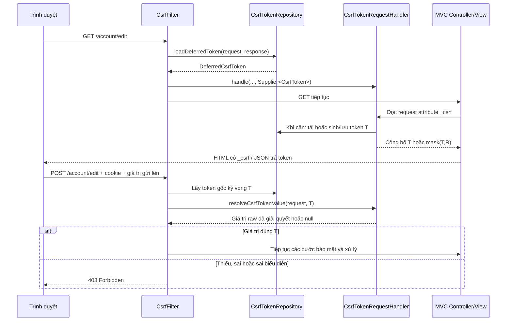
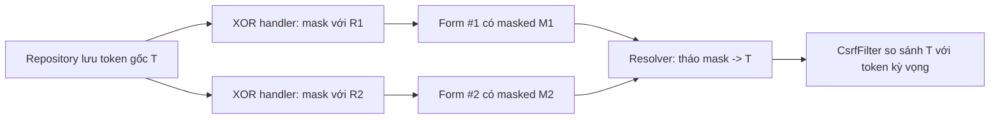
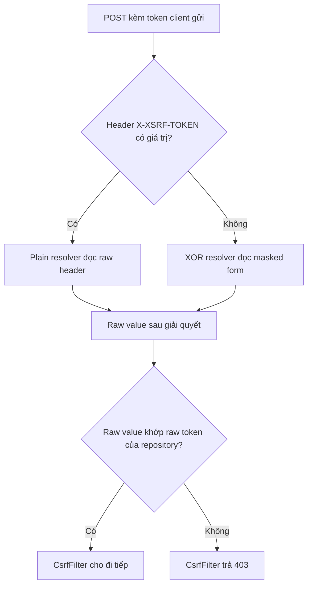

# Token gốc, token được che và quá trình giải quyết giá trị gửi lên

Trong **Spring Security Servlet**, một CSRF token có thể xuất hiện dưới **hai biểu diễn khác nhau**: *token gốc* (raw token) mà `CsrfTokenRepository` lưu làm giá trị kỳ vọng và *token được che* (masked token) do `XorCsrfTokenRequestAttributeHandler` công bố cho form hoặc API. Khi trình duyệt gửi token trở lại, `CsrfTokenRequestHandler.resolveCsrfTokenValue(...)` phải **diễn giải đúng biểu diễn** để `CsrfFilter` có thể so sánh với token gốc. Nhầm lẫn hai biểu diễn là một nguyên nhân phổ biến khiến request trả `403 Forbidden` dù người học nhìn thấy cả cookie lẫn header CSRF.

Bài thuộc chương **CSRF trên Servlet** của module **SPRING_SECURITY_HTTP_PROTECTION**. Module bao quát CSRF, CORS, security headers, CSP, HSTS, HTTP firewall, bảo vệ session, cả Servlet lẫn Reactive, cùng kỹ năng kiểm thử kịch bản tấn công và chẩn đoán xung đột bảo mật khi triển khai. Riêng bài này phân tích đường đi của token trong **Servlet** (`CsrfFilter`, `CsrfTokenRepository`, `CsrfTokenRequestHandler`, `HttpServletRequest`); WebFlux dùng các API reactive khác.

**Kết quả cần đạt:** giải thích được raw/masked token, đọc đúng `CsrfToken.getToken()` theo ngữ cảnh, xác định header và form parameter được ưu tiên thế nào, biết handler nào giải mã token nào, thiết kế giao ước cho form và SPA, kiểm thử đầy đủ một request hợp lệ/sai token và phân biệt lỗi định dạng với lỗi vòng đời token.

## 1. Hai biểu diễn của cùng một token

Giả sử repository đã lưu token kỳ vọng tên `T` cho phiên người dùng. Server có thể đưa token tới trình duyệt bằng hai cách:

- **Raw token:** công bố đúng chuỗi `T`. Đây thường là giá trị mà repository sinh ra/lưu, chẳng hạn trong `HttpSession` hoặc cookie `XSRF-TOKEN`.
- **Masked token:** biến đổi `T` thành một chuỗi khác `M` bằng mặt nạ ngẫu nhiên, nhưng chuỗi `M` chứa đủ thông tin để request handler khôi phục lại `T`.

```text
Giá trị kỳ vọng do repository lưu:     T

Đường A – raw/plain:
  Server công bố                    T
  Client gửi lại                    T
  Plain request handler trả về      T
  CsrfFilter so sánh                T == T → qua CSRF

Đường B – XOR/masked:
  Server công bố             M = mask(T, R)
  Client gửi lại                    M
  XOR request handler giải mã       T
  CsrfFilter so sánh                T == T → qua CSRF
```

`R` là dữ liệu ngẫu nhiên được dùng khi tạo biểu diễn masked. **Mask không phải một token kỳ vọng mới**, vì repository vẫn có thể giữ nguyên `T`. Một request khác có thể dùng mặt nạ `R2` để công bố `M2` khác `M1` nhưng vẫn phục hồi về `T`.

Ngược lại, nếu client gửi `M` tới một handler chỉ hiểu raw, handler có thể trả về chính `M`; phép so sánh `M == T` sẽ thất bại. Nếu client gửi `T` tới handler chỉ mong masked, bước giải mã có thể thất bại. Đó là **lỗi giao ước biểu diễn**, không nhất thiết là lỗi sinh token.

### Vì sao cần masked token?

Nếu token gốc xuất hiện cố định trong nhiều phản hồi HTML **có nén**, một số điều kiện có thể cho phép tấn công kênh phụ **BREACH** suy luận bí mật từ chênh lệch kích thước phản hồi. `XorCsrfTokenRequestAttributeHandler` làm biểu diễn được phản chiếu **thay đổi ngẫu nhiên** giữa các lần công bố để giảm rủi ro đó.

Masking **không phải mã hóa đầu cuối**. Người đọc được toàn bộ biểu diễn masked và biết thuật toán vẫn có thể khôi phục token gốc vì payload bao gồm cả dữ liệu mặt nạ. Giá trị của masking là giảm nguy cơ lộ bí mật qua **tín hiệu nén**, không nhằm che token khỏi script chạy cùng origin. Vì vậy CSP, chống XSS, HTTPS, cookie `Secure` và phân quyền vẫn quan trọng.

## 2. Những thành phần tham gia vào chuỗi xác minh

| Thành phần | Trách nhiệm | Dữ liệu nhìn thấy |
| --- | --- | --- |
| `CsrfTokenRepository` | Sinh, lưu, đọc, xóa token kỳ vọng; có thể nạp theo nhu cầu | **Token gốc** `T` |
| `CsrfTokenRequestHandler.handle(...)` | Công bố một `CsrfToken` cho request/view | Raw `T` hoặc masked `M` tùy handler |
| Client HTML/JavaScript | Nhận biểu diễn token và gửi lại dưới header/form parameter | Đúng giá trị mà giao ước yêu cầu |
| `CsrfTokenRequestHandler.resolveCsrfTokenValue(...)` | Đọc token do client gửi và trả giá trị để xác minh | Raw `T` sau bước giải quyết |
| `CsrfFilter` | Chọn request cần CSRF, tải token kỳ vọng, so sánh và từ chối khi không hợp lệ | So sánh giá trị đã giải quyết với `T` |

Đừng nhầm `CsrfTokenRepository` với `CsrfTokenRequestHandler`: repository **không tự đọc header client**; request handler **không quyết định cuối cùng** request được chấp nhận hay không. `CsrfFilter` mới áp dụng luật bắt buộc token (mặc định các method không an toàn) và thường trả HTTP `403` khi thiếu/sai.



Sơ đồ nêu luồng tổng quát. `GET` không bắt buộc phải tạo token/session nếu không thành phần nào truy cập token; `DeferredCsrfToken` có thể giữ việc tải cho đến khi view/controller thực sự cần.

## 3. Hai chiều của `CsrfTokenRequestHandler`

Giao diện Servlet trong Spring Security 6.x:

```java
import jakarta.servlet.http.HttpServletRequest;
import jakarta.servlet.http.HttpServletResponse;
import java.util.function.Supplier;
import org.springframework.security.web.csrf.CsrfToken;

public interface CsrfTokenRequestHandler {

    void handle(
        HttpServletRequest request,
        HttpServletResponse response,
        Supplier<CsrfToken> csrfToken);

    String resolveCsrfTokenValue(
        HttpServletRequest request,
        CsrfToken csrfToken);
}
```

**`handle(...)`** thực hiện chiều server → request/view. Nó công bố đối tượng `CsrfToken` như request attribute, thường tên `_csrf`, để view hoặc controller truy cập khi cần. Đối tượng công bố có thể là một wrapper giữ token masked.

**`resolveCsrfTokenValue(...)`** thực hiện chiều client → server. Khi một `POST` thuộc diện bảo vệ, `CsrfFilter` gọi phương thức này để lấy giá trị do client gửi. Nếu dùng XOR handler, nó còn tháo masking để trả **token gốc**. Sau đó `CsrfFilter` so sánh với token gốc kỳ vọng từ repository.

Ba phương thức thông dụng của `CsrfToken`:

```java
String value = csrfToken.getToken();
String parameter = csrfToken.getParameterName();
String header = csrfToken.getHeaderName();
```

**Lưu ý ngữ cảnh của `getToken()`:**

- Đối tượng `CsrfToken` gốc được repository trả về: `getToken()` là **token kỳ vọng gốc**.
- Đối tượng `CsrfToken` công bố bởi `XorCsrfTokenRequestAttributeHandler` trên request: `getToken()` có thể là **masked token**.
- Đối tượng công bố bởi `CsrfTokenRequestAttributeHandler` plain: `getToken()` thường là **raw token**.

Không kết luận token gốc đã đổi chỉ bằng cách thấy hai giá trị `${_csrf.token}` khác nhau trong HTML.

## 4. Khi client gửi token, handler lấy ở đâu?

Một handler chuẩn thuộc họ request-attribute thường tìm giá trị client gửi bằng tên được cung cấp trong token:

1. HTTP header theo `csrfToken.getHeaderName()`, ví dụ `X-CSRF-TOKEN` hoặc `X-XSRF-TOKEN`.
2. Nếu không có giá trị header phù hợp, request parameter theo `csrfToken.getParameterName()`, thường `_csrf`.

Đường ưu tiên header/form này phụ thuộc handler, nhưng là hành vi thường gặp của Spring Security Servlet 6.x. Nếu custom handler thay đổi thứ tự thì phải kiểm thử đúng hợp đồng đã viết.

| Request gửi lên | Giá trị handler thấy | Kết quả mong đợi |
| --- | --- | --- |
| `X-CSRF-TOKEN: <token>` đúng tên | Giá trị header | Sẽ được so sánh sau khi giải quyết raw/masked |
| Form `application/x-www-form-urlencoded` với `_csrf=<token>` | Request parameter | Cần đúng biểu diễn token |
| JSON body `{"_csrf":"..."}` nhưng không có header | Không tự suy ra thành request parameter | Thường thiếu token ở bước CSRF |
| Header sai tên, ví dụ `X-CSRF-TOKEN` khi server chờ `X-XSRF-TOKEN` | Không có header khớp | Có thể thiếu token dù browser hiển thị header |
| Có cả header và form token khác nhau | Thường chọn header trước | Có thể lỗi dù form chứa token đúng |

**Tên header không cố định ở mọi repository.** `HttpSessionCsrfTokenRepository` thường công bố `X-CSRF-TOKEN`; `CookieCsrfTokenRepository` thường công bố `X-XSRF-TOKEN` với cookie `XSRF-TOKEN`. Hãy dùng `getHeaderName()`/`getParameterName()` hoặc một giao ước frontend/backend đã được xác minh.

Khi server từ chối request, hãy mở Network panel để xem **request thực sự được gửi**, không chỉ kiểm tra biến JavaScript được chuẩn bị trước `fetch(...)`.

## 5. Giải quyết masked token bằng XOR diễn ra thế nào?

`XorCsrfTokenRequestAttributeHandler` sử dụng một mặt nạ ngẫu nhiên để công bố token. Mô hình khái niệm:

1. Repository giữ raw token `T` dưới dạng các byte của chuỗi.
2. Handler tạo các byte ngẫu nhiên `R` có độ dài tương ứng.
3. Handler tính phần đã XOR: `X = T XOR R`.
4. Một chuỗi masked `M` mang thông tin của `R` và `X`, qua một bước mã hóa thành dạng dùng được trong HTTP form/header.
5. Khi nhận `M`, handler giải mã, tách `R` và `X`, tính `X XOR R = T`, rồi trả token gốc cho filter.

```text
Token gốc T:  01010101 00110110  ...
Random R:    11110000 10001001  ...
XOR result:  10100101 10111111  ...

Masked M = encode(R || (T XOR R))
Resolve(M) = decode(M) -> R, X -> R XOR X = T
```

Đoạn trên mô tả *ý tưởng*, không phải đặc tả định dạng byte, API mã hóa hay mã nguồn Spring Security. **Không tự viết một encoder/decoder XOR cho production** dựa vào sơ đồ đơn giản này: phải dùng request handler của thư viện để tránh sai khác định dạng, UTF-8, mã hóa, dữ liệu ngẫu nhiên và xử lý input không hợp lệ.



Vì `R1` và `R2` được chọn ngẫu nhiên, `M1` thường khác `M2`, kể cả khi raw token `T` chưa đổi. Do đó **không được dùng chuỗi masked để dò xem session đã bị đổi hay chưa**. Phải kiểm tra session/cookie và trạng thái repository.

### Raw gửi cho XOR handler có thể gây lỗi gì?

Nếu client gửi `T` thay vì `M`, XOR resolver có thể không giải mã được cấu trúc dự kiến hoặc giải mã ra giá trị không phù hợp. Khi đó token được giải quyết là `null` hoặc không khớp `T`, và `CsrfFilter` từ chối request.

Ngược lại, plain handler chỉ đọc và trả về chuỗi nhận được. Nếu client gửi masked `M` tới plain handler, kết quả vẫn là `M`, không phải `T`; phép so sánh với raw token từ repository thường thất bại.

| Handler phía server | Raw token `T` gửi lên | Masked token `M` gửi lên |
| --- | --- | --- |
| `CsrfTokenRequestAttributeHandler` | Đọc thành `T`, phù hợp khi repository kỳ vọng `T` | Đọc thành `M`, thường không khớp `T` |
| `XorCsrfTokenRequestAttributeHandler` | Không đúng dạng masked mà handler chờ | Giải quyết `M` thành `T` để xác minh |
| Custom SPA handler | Phụ thuộc nhánh chọn resolver (raw header, masked form, v.v.) | Phụ thuộc hợp đồng của client và nhánh resolver |

Đây là lý do **“cookie và header có cùng giá trị” chưa đủ** để kết luận CSRF phải hợp lệ: cần xét handler đang mong biểu diễn nào.

## 6. Luồng form MVC: giá trị trong HTML thường là masked

Trong ứng dụng Spring Security 6.x dùng `HttpSessionCsrfTokenRepository` và XOR handler, controller/view có thể truy cập request attribute `_csrf`:

```java
import org.springframework.security.web.csrf.CsrfToken;
import org.springframework.stereotype.Controller;
import org.springframework.web.bind.annotation.GetMapping;
import org.springframework.web.bind.annotation.RequestAttribute;

@Controller
class AccountPageController {

    @GetMapping("/account/edit")
    String editForm(@RequestAttribute("_csrf") CsrfToken csrfToken) {
        // getToken() làm biểu diễn masked hiện hành được yêu cầu khi cần.
        String valueForForm = csrfToken.getToken();
        return "account/edit";
    }
}
```

Biến `valueForForm` dùng để minh họa thời điểm đọc token; template có thể dùng trực tiếp `_csrf` mà không cần biến cục bộ này.

Với Thymeleaf:

```html
<form method="post" action="/account/email">
  <label for="email">Email mới</label>
  <input id="email" name="email" type="email" required>

  <input type="hidden"
         th:name="${_csrf.parameterName}"
         th:value="${_csrf.token}">

  <button type="submit">Lưu email</button>
</form>
```

Khi render, giá trị của `_csrf.token` có thể là `M`, không phải raw `T` mà repository đang giữ. Browser gửi nguyên giá trị `M` khi submit:

```http
POST /account/email HTTP/1.1
Host: app.example
Cookie: JSESSIONID=<session-da-render-form>
Content-Type: application/x-www-form-urlencoded

email=learner%40example.com&_csrf=<masked-token-M>
```

XOR resolver đọc form parameter `_csrf`, khôi phục `T`; `CsrfFilter` so sánh `T` với token kỳ vọng trong session. JavaScript **không cần** tự giải mã token trong HTML form.

Một số tích hợp Thymeleaf/Spring MVC có thể tự thêm hidden CSRF field khi form dùng `th:action`. Hãy xem **HTML render thực tế** để tránh chèn hai field `_csrf` hoặc đánh giá sai vì template chưa được xử lý.

### Form cũ có thể gửi masked token khác form mới không?

Có. Nếu hai form được render cùng session khi raw token còn `T`, chúng có thể nhận hai biểu diễn masked khác nhau, nhưng cả hai vẫn giải quyết về `T`. Chỉ khi **token kỳ vọng không còn `T`** (ví dụ logout, đăng nhập, token bị xóa hoặc session hết hạn) thì masked token cũ mới không hợp lệ theo trạng thái mới.

Điều này giúp phân biệt:

- **Masked token thay đổi:** chỉ là biểu diễn ngẫu nhiên khác nhau, thường không ảnh hưởng hợp lệ.
- **Raw token kỳ vọng thay đổi:** biểu diễn cũ có thể giải mã đúng về `T` nhưng `T` không còn là giá trị kỳ vọng hiện tại.

## 7. Luồng API trả token: giữ nguyên biểu diễn do server cấp

Một SPA không nhất thiết phải đọc token raw từ cookie. Với repository lưu trong session và XOR handler, có thể cấp **masked token** qua endpoint JSON và yêu cầu client gửi lại **chính biểu diễn ấy**.

Ví dụ Spring MVC:

```java
import org.springframework.http.CacheControl;
import org.springframework.http.ResponseEntity;
import org.springframework.security.web.csrf.CsrfToken;
import org.springframework.web.bind.annotation.GetMapping;
import org.springframework.web.bind.annotation.RequestAttribute;
import org.springframework.web.bind.annotation.RestController;

@RestController
class CsrfBootstrapController {

    @GetMapping("/csrf")
    ResponseEntity<CsrfDetails> csrf(
            @RequestAttribute("_csrf") CsrfToken csrfToken) {

        return ResponseEntity.ok()
            .cacheControl(CacheControl.noStore())
            .body(new CsrfDetails(
                csrfToken.getHeaderName(),
                csrfToken.getParameterName(),
                csrfToken.getToken()));
    }

    record CsrfDetails(
        String headerName, String parameterName, String token) {}
}
```

Đoạn code giả định request đi qua `SecurityFilterChain` có CSRF, controller được phép truy cập và handler đang công bố `_csrf`. Với XOR handler, `csrfToken.getToken()` có thể mang **masked token**. `Cache-Control: no-store` giúp giảm nguy cơ cache vô tình lưu phản hồi có token; vẫn cần xác định chính sách truy cập và CORS thích hợp.

JavaScript cùng origin:

```javascript
async function currentCsrf() {
  const response = await fetch("/csrf", {
    method: "GET",
    credentials: "same-origin",
    cache: "no-store"
  });
  if (!response.ok) {
    throw new Error("Không lấy được CSRF token");
  }
  return response.json();
}

async function changeEmail(email) {
  const csrf = await currentCsrf();

  return fetch("/account/email", {
    method: "POST",
    credentials: "same-origin",
    headers: {
      "Content-Type": "application/json",
      [csrf.headerName]: csrf.token
    },
    body: JSON.stringify({ email })
  });
}
```

Ví dụ giả định API `/account/email` tồn tại, chấp nhận JSON và caller đã được xác thực/đủ quyền. Client gửi nguyên chuỗi token do endpoint cấp, không tự Base64 decode/XOR rồi thay bằng một giá trị khác. `CsrfFilter` và handler phía server chịu trách nhiệm giải quyết biểu diễn.

**Đối với repository theo session**, trình duyệt phải duy trì session khi lấy và gửi token. Nếu cookie phiên bị mất giữa hai request, masked token vẫn có thể giải mã về raw token ban đầu, nhưng không còn khớp raw token kỳ vọng trong session hiện tại.

### Header có thể mang masked token?

Có. Header chỉ là **kênh truyền giá trị**. Nếu handler sử dụng XOR resolver cho header, header có thể chứa masked token do server cấp. Không mặc định rằng “header luôn raw, form luôn masked”: đó chỉ là một **quy ước** của một số cấu hình SPA kết hợp, không phải luật của HTTP hoặc Spring Security.

## 8. Luồng cookie–header: vì sao một SPA thường gửi raw token?

Với `CookieCsrfTokenRepository`, mặc định thường có:

| Nơi chứa | Tên phổ biến | Kiểu biểu diễn |
| --- | --- | --- |
| Response cookie | `Set-Cookie: XSRF-TOKEN=...` | **Raw token** do repository lưu |
| Request cookie | `Cookie: XSRF-TOKEN=...` | Raw token kỳ vọng được browser gửi lại |
| Request header do JavaScript gắn | `X-XSRF-TOKEN: ...` | Thường là raw token đọc từ cookie |
| Form parameter | `_csrf` | Có thể là masked token nếu view dùng XOR handler |

Một request SPA cùng origin điển hình:

```http
POST /api/profile HTTP/1.1
Host: app.example
Cookie: XSRF-TOKEN=<raw-token-T>; JSESSIONID=<session>
X-XSRF-TOKEN: <raw-token-T>
Content-Type: application/json

{"displayName":"Learner"}
```

**Cookie tự gửi không thay cho header.** Trình duyệt có thể đính kèm cookie `XSRF-TOKEN` theo chính sách cookie, nhưng client phải chủ động cung cấp token qua header hoặc form parameter để vượt qua bước CSRF.

Nếu phía server dùng XOR handler mặc định để giải quyết cả header, header raw `T` có thể không giải mã được theo định dạng masked. Request sẽ bị `403` dù cookie và header trông khớp nhau. Nguyên nhân lúc này không phải thiếu token, mà là **mâu thuẫn giữa kiểu biểu diễn client gửi và resolver server sử dụng**.

Có hai lựa chọn kiến trúc:

1. **Cấp masked token cho SPA** qua form/JSON và gửi lại nó tới XOR handler, giữ repository/session và luật xác minh thống nhất.
2. **Tiếp tục dùng raw cookie–header** nhưng chọn request handler có khả năng đọc raw header, đồng thời có thể giữ XOR cho masked form.

Không sửa lỗi bằng cách vô hiệu hóa CSRF toàn bộ API dùng cookie đăng nhập.

## 9. Cấu hình handler kết hợp: XOR cho form, raw cho header SPA

Với ứng dụng dùng cả HTML form và JavaScript đọc cookie, có thể chọn một hợp đồng rõ ràng:

- **Form:** nhận masked token từ request attribute `_csrf`, gửi qua parameter `_csrf` và được giải quyết bằng XOR handler.
- **SPA:** đọc raw token từ cookie `XSRF-TOKEN`, gửi vào header `X-XSRF-TOKEN`, được giải quyết bằng plain handler.
- **Repository:** `CookieCsrfTokenRepository` vẫn tạo/lưu/đọc raw token kỳ vọng trong cookie.
- **Filter:** `CsrfFilter` so sánh giá trị cuối cùng đã giải quyết với raw token kỳ vọng, không quan tâm token ban đầu được biểu diễn thế nào.

Một implementation Servlet (Spring Security 6.x):

```java
import jakarta.servlet.http.HttpServletRequest;
import jakarta.servlet.http.HttpServletResponse;
import java.util.function.Supplier;
import org.springframework.security.web.csrf.CsrfToken;
import org.springframework.security.web.csrf.CsrfTokenRequestAttributeHandler;
import org.springframework.security.web.csrf.CsrfTokenRequestHandler;
import org.springframework.security.web.csrf.XorCsrfTokenRequestAttributeHandler;
import org.springframework.util.StringUtils;

public final class SpaCsrfTokenRequestHandler
        implements CsrfTokenRequestHandler {

    private final CsrfTokenRequestHandler raw =
        new CsrfTokenRequestAttributeHandler();

    private final CsrfTokenRequestHandler masked =
        new XorCsrfTokenRequestAttributeHandler();

    @Override
    public void handle(
            HttpServletRequest request,
            HttpServletResponse response,
            Supplier<CsrfToken> csrfToken) {
        // Giữ masked token cho view/form.
        masked.handle(request, response, csrfToken);

        // Chủ động tải token để SPA có thể nhận cookie CSRF khi cần.
        csrfToken.get();
    }

    @Override
    public String resolveCsrfTokenValue(
            HttpServletRequest request,
            CsrfToken csrfToken) {
        String headerValue = request.getHeader(
            csrfToken.getHeaderName());

        CsrfTokenRequestHandler resolver =
            StringUtils.hasText(headerValue) ? raw : masked;

        return resolver.resolveCsrfTokenValue(request, csrfToken);
    }
}
```

Giải thích đường rẽ:



Đây là **quy ước thiết kế cụ thể**, không phải cơ chế tự động phát hiện raw/masked token. Vì có header là handler chọn nhánh raw, một client gửi **masked token trong header** sẽ không phù hợp. Muốn hỗ trợ nhiều loại client, phải xác định giao thức khác hoặc thiết kế handler giải quyết rõ từng trường hợp, tránh dự đoán ngẫu nhiên từ nội dung chuỗi.

### Tích hợp vào `SecurityFilterChain`

```java
import org.springframework.context.annotation.Bean;
import org.springframework.context.annotation.Configuration;
import org.springframework.security.config.Customizer;
import org.springframework.security.config.annotation.web.builders.HttpSecurity;
import org.springframework.security.web.SecurityFilterChain;
import org.springframework.security.web.csrf.CookieCsrfTokenRepository;

@Configuration
class SecurityConfig {

    @Bean
    SecurityFilterChain web(HttpSecurity http) throws Exception {
        CookieCsrfTokenRepository repository =
            CookieCsrfTokenRepository.withHttpOnlyFalse();

        repository.setCookieCustomizer(cookie -> cookie
            .path("/")
            .sameSite("Lax")
            .secure(true));

        http
            .authorizeHttpRequests(auth -> auth
                .requestMatchers("/csrf", "/login", "/assets/**")
                    .permitAll()
                .anyRequest().authenticated())
            .formLogin(Customizer.withDefaults())
            .csrf(csrf -> csrf
                .csrfTokenRepository(repository)
                .csrfTokenRequestHandler(
                    new SpaCsrfTokenRequestHandler()));

        return http.build();
    }
}
```

Ví dụ phù hợp với Spring Security Servlet 6.1+ và môi trường **HTTPS** (`secure(true)`). Trong các phiên bản cũ hơn, API tùy chỉnh cookie có thể khác; cần kiểm tra theo phiên bản dự án. `withHttpOnlyFalse()` chỉ làm **cookie CSRF** có thể đọc bởi JavaScript, không phải lý do tắt `HttpOnly` của cookie phiên đăng nhập.

Lệnh `csrfToken.get()` trong `handle(...)` khiến token được nạp trước, hữu ích nếu SPA trông chờ cookie token xuất hiện ngay khi bootstrap. Đổi lại, handler có thể gây truy cập repository ở những request GET không cần token. Nếu ưu tiên nạp lười, có thể **bỏ lệnh ép nạp** và sử dụng một endpoint `GET /csrf` chủ động truy cập `_csrf.token` khi SPA cần token.

### Endpoint bootstrap khi dùng cookie repository

```java
import org.springframework.http.CacheControl;
import org.springframework.http.ResponseEntity;
import org.springframework.security.web.csrf.CsrfToken;
import org.springframework.web.bind.annotation.GetMapping;
import org.springframework.web.bind.annotation.RequestAttribute;
import org.springframework.web.bind.annotation.RestController;

@RestController
class CsrfCookieController {

    @GetMapping("/csrf")
    ResponseEntity<Void> prepare(
            @RequestAttribute("_csrf") CsrfToken token) {
        token.getToken();
        return ResponseEntity.noContent()
            .cacheControl(CacheControl.noStore())
            .build();
    }
}
```

Endpoint đọc token được handler công bố để kích hoạt deferred token khi cần. Nếu cookie chưa tồn tại, repository có thể phát `Set-Cookie: XSRF-TOKEN=...`. Nếu cookie hiện hành còn hợp lệ, không bắt buộc luôn phát cookie mới. Với cách trên, JavaScript đọc cookie raw và gửi header raw; **không dùng biểu diễn masked từ `_csrf` làm header raw**.

## 10. Ma trận: chọn biểu diễn token và resolver phù hợp

| Trường hợp | Nguồn token client nhận | Client gửi | Resolver phù hợp |
| --- | --- | --- | --- |
| MVC form thuần trên Spring Security 6.x | `_csrf.token` từ XOR handler | Parameter `_csrf` masked | XOR |
| SPA nhận JSON `_csrf.token` từ XOR handler | JSON chứa masked token | Header cùng biểu diễn masked | XOR |
| SPA đọc cookie `XSRF-TOKEN` | Cookie raw token | Header `X-XSRF-TOKEN` raw | Plain |
| MVC form với plain handler | `_csrf.token` raw | Parameter `_csrf` raw | Plain |
| Form masked + SPA raw cùng ứng dụng | Hai nguồn khác nhau | Form masked; header raw | Handler kết hợp với hợp đồng rõ ràng |
| Client tự tạo token | Không được repository cấp | Header/form tùy ý | Không resolver nào làm token tự hợp lệ |
| Client dùng token thuộc session cũ | Token từng hợp lệ nhưng đã hết vòng đời | Header/form cũ | Dù resolve được cũng có thể không khớp token kỳ vọng mới |

Để chọn đúng cấu hình, hãy trả lời **ba câu hỏi theo thứ tự**:

1. **Token kỳ vọng nằm ở đâu?** Trong `HttpSession`, cookie `XSRF-TOKEN` hay repository khác?
2. **Client nhận biểu diễn nào?** Raw token từ cookie, raw token từ plain handler hay masked token do XOR handler công bố?
3. **Client gửi lại biểu diễn đó bằng kênh nào?** Form parameter hay header, và server chọn resolver tương ứng ra sao?

Lỗi thường phát sinh khi câu trả lời ở bước 2 không phù hợp bước 3, hoặc bước 1 đã đổi vì session hết hạn/token bị xóa.

## 11. Test đơn vị: chứng minh raw và masked giải quyết khác nhau

Để thấy sự khác biệt mà không phụ thuộc HTTP cookie hay session, dùng `spring-test`, `spring-security-web` và JUnit 5 với một raw token giả lập:

```java
import org.junit.jupiter.api.Test;
import org.springframework.mock.web.MockHttpServletRequest;
import org.springframework.mock.web.MockHttpServletResponse;
import org.springframework.security.web.csrf.CsrfToken;
import org.springframework.security.web.csrf.CsrfTokenRequestAttributeHandler;
import org.springframework.security.web.csrf.DefaultCsrfToken;
import org.springframework.security.web.csrf.XorCsrfTokenRequestAttributeHandler;

import static org.junit.jupiter.api.Assertions.*;

class RawMaskedCsrfTokenTest {

    @Test
    void maskedFormResolvesToOriginalToken() {
        CsrfToken stored = new DefaultCsrfToken(
            "X-CSRF-TOKEN", "_csrf", "raw-token-for-test");
        var xor = new XorCsrfTokenRequestAttributeHandler();
        var getRequest = new MockHttpServletRequest("GET", "/form");

        xor.handle(getRequest, new MockHttpServletResponse(), () -> stored);

        CsrfToken published =
            (CsrfToken) getRequest.getAttribute("_csrf");
        assertNotNull(published);
        String maskedValue = published.getToken();
        assertNotEquals(stored.getToken(), maskedValue);

        var post = new MockHttpServletRequest("POST", "/form");
        post.addParameter("_csrf", maskedValue);

        assertEquals(stored.getToken(),
            xor.resolveCsrfTokenValue(post, stored));

        var plain = new CsrfTokenRequestAttributeHandler();
        assertEquals(maskedValue,
            plain.resolveCsrfTokenValue(post, stored));
        assertNotEquals(stored.getToken(),
            plain.resolveCsrfTokenValue(post, stored));
    }
}
```

Test chứng minh: **XOR giải quyết masked thành raw**, còn plain giữ nguyên chuỗi masked. Test không gọi `CsrfFilter`, nên việc handler trả một chuỗi khác không tự nó sinh HTTP 403. Filter mới thực hiện phép so sánh và từ chối.

### Hai masked token khác nhau vẫn giải quyết về cùng raw token

```java
import org.junit.jupiter.api.Test;
import org.springframework.mock.web.MockHttpServletRequest;
import org.springframework.mock.web.MockHttpServletResponse;
import org.springframework.security.web.csrf.CsrfToken;
import org.springframework.security.web.csrf.DefaultCsrfToken;
import org.springframework.security.web.csrf.XorCsrfTokenRequestAttributeHandler;

import static org.junit.jupiter.api.Assertions.*;

class MultipleMaskedTokensTest {

    @Test
    void differentMasksResolveToSameRawValue() {
        CsrfToken stored = new DefaultCsrfToken(
            "X-CSRF-TOKEN", "_csrf", "same-raw-token");
        var xor = new XorCsrfTokenRequestAttributeHandler();

        var first = new MockHttpServletRequest("GET", "/form");
        xor.handle(first, new MockHttpServletResponse(), () -> stored);
        String masked1 = ((CsrfToken) first.getAttribute("_csrf"))
            .getToken();

        var second = new MockHttpServletRequest("GET", "/form");
        xor.handle(second, new MockHttpServletResponse(), () -> stored);
        String masked2 = ((CsrfToken) second.getAttribute("_csrf"))
            .getToken();

        assertNotEquals(masked1, masked2);

        var post1 = new MockHttpServletRequest("POST", "/form");
        post1.addParameter("_csrf", masked1);
        var post2 = new MockHttpServletRequest("POST", "/form");
        post2.addParameter("_csrf", masked2);

        assertEquals(stored.getToken(),
            xor.resolveCsrfTokenValue(post1, stored));
        assertEquals(stored.getToken(),
            xor.resolveCsrfTokenValue(post2, stored));
    }
}
```

Mục đích test là quan sát **ngẫu nhiên hóa biểu diễn** với cùng raw token. Xác suất hai mask ngẫu nhiên trùng nhau là rất thấp, nhưng test không chứng minh raw token đã thay đổi (ngược lại, ta cố ý dùng cùng `stored`).

## 12. Test handler kết hợp: form masked và header raw có về cùng giá trị?

Nếu triển khai `SpaCsrfTokenRequestHandler` ở mục 9, cần kiểm tra hai nhánh resolve độc lập. Đoạn JUnit sau mô phỏng raw token kỳ vọng:

```java
import org.junit.jupiter.api.Test;
import org.springframework.mock.web.MockHttpServletRequest;
import org.springframework.mock.web.MockHttpServletResponse;
import org.springframework.security.web.csrf.CsrfToken;
import org.springframework.security.web.csrf.DefaultCsrfToken;

import static org.junit.jupiter.api.Assertions.*;

class SpaCsrfResolverTest {

    @Test
    void rawHeaderAndMaskedFormBothResolveToExpectedToken() {
        CsrfToken stored = new DefaultCsrfToken(
            "X-XSRF-TOKEN", "_csrf", "expected-raw-value");

        var handler = new SpaCsrfTokenRequestHandler();
        var initialGet = new MockHttpServletRequest("GET", "/form");
        handler.handle(
            initialGet, new MockHttpServletResponse(), () -> stored);

        CsrfToken exposed =
            (CsrfToken) initialGet.getAttribute("_csrf");
        assertNotNull(exposed);
        String maskedFormValue = exposed.getToken();
        assertNotEquals(stored.getToken(), maskedFormValue);

        var rawHeaderRequest =
            new MockHttpServletRequest("POST", "/api/profile");
        rawHeaderRequest.addHeader(
            stored.getHeaderName(), stored.getToken());

        assertEquals(stored.getToken(),
            handler.resolveCsrfTokenValue(rawHeaderRequest, stored));

        var maskedFormRequest =
            new MockHttpServletRequest("POST", "/account/email");
        maskedFormRequest.addParameter("_csrf", maskedFormValue);

        assertEquals(stored.getToken(),
            handler.resolveCsrfTokenValue(maskedFormRequest, stored));
    }

    @Test
    void wrongRawHeaderDoesNotBecomeValidAutomatically() {
        CsrfToken stored = new DefaultCsrfToken(
            "X-XSRF-TOKEN", "_csrf", "expected-value");
        var handler = new SpaCsrfTokenRequestHandler();
        var request = new MockHttpServletRequest("POST", "/api/save");
        request.addHeader("X-XSRF-TOKEN", "incorrect-value");

        // Resolver lấy giá trị sai từ client.
        assertEquals("incorrect-value",
            handler.resolveCsrfTokenValue(request, stored));
        assertNotEquals(stored.getToken(),
            handler.resolveCsrfTokenValue(request, stored));
        // CsrfFilter, không phải handler, sẽ từ chối request này.
    }
}
```

Các phép kiểm thử trên **không phải kiểm tra xác thực hoặc phân quyền**. Chúng chỉ chứng minh giá trị được giải quyết trước khi filter so sánh. Một handler trả đúng chuỗi client đã gửi (dù sai) vẫn có thể là handler hoạt động đúng.

### Kiểm thử dữ liệu thiếu và sai định dạng

Nên bổ sung các trường hợp ở tầng handler:

| Input | Kỳ vọng quan sát |
| --- | --- |
| Không có header, không có parameter | Resolver không tìm thấy giá trị hợp lệ |
| Header raw sai trong handler kết hợp | Resolver trả chuỗi raw sai; filter phải từ chối |
| Masked token bị cắt ngắn hoặc làm hỏng | XOR resolver không khôi phục đúng token gốc |
| Masked token hợp lệ nhưng repository đã đổi raw token | Resolve được raw cũ, song filter vẫn so với raw mới và từ chối |
| Header có mặt nhưng sai định dạng, form có masked token đúng | Nếu giao ước ưu tiên header raw, header sai có thể khiến toàn request thất bại |

Không tự sửa một chuỗi token malformed bằng cách “đoán” byte encoding hoặc thử nhiều biến thể không kiểm soát trong production. Dùng handler có hợp đồng xác định và để filter từ chối các input không hợp lệ.

## 13. Test tích hợp qua `CsrfFilter` và `MockMvc`

Unit test handler giúp biết một token masked được giải quyết ra sao, nhưng chưa chứng minh **repository + filter + session** hoạt động xuyên request. Một test tích hợp có thể:

1. `GET /csrf` nhận biểu diễn token được server cấp.
2. Giữ `MockHttpSession` của request đó.
3. `POST /profile` cùng session, không có token → `403`.
4. `POST /profile` cùng session, token giả → `403`.
5. `POST /profile` cùng session, masked token do server cấp → tiếp tục tới controller.

Ví dụ cấu hình Servlet Spring Security 6.x với repository theo session và XOR handler:

```java
import org.springframework.context.annotation.Bean;
import org.springframework.context.annotation.Configuration;
import org.springframework.security.config.Customizer;
import org.springframework.security.config.annotation.web.builders.HttpSecurity;
import org.springframework.security.web.SecurityFilterChain;
import org.springframework.security.web.csrf.HttpSessionCsrfTokenRepository;
import org.springframework.security.web.csrf.XorCsrfTokenRequestAttributeHandler;

@Configuration
class ServletSecurityConfig {

    @Bean
    SecurityFilterChain web(HttpSecurity http) throws Exception {
        http
            .authorizeHttpRequests(auth -> auth
                .requestMatchers("/csrf", "/login").permitAll()
                .anyRequest().authenticated())
            .formLogin(Customizer.withDefaults())
            .csrf(csrf -> csrf
                .csrfTokenRepository(
                    new HttpSessionCsrfTokenRepository())
                .csrfTokenRequestHandler(
                    new XorCsrfTokenRequestAttributeHandler()));
        return http.build();
    }
}
```

Endpoint `GET /csrf` ở mục 7 có thể dùng lại, cùng một controller test:

```java
import org.springframework.http.ResponseEntity;
import org.springframework.web.bind.annotation.PostMapping;
import org.springframework.web.bind.annotation.RestController;

@RestController
class ProfileController {

    @PostMapping("/profile")
    ResponseEntity<Void> save() {
        return ResponseEntity.noContent().build();
    }
}
```

Test Spring Boot + JUnit 5 + `spring-security-test`:

```java
import com.fasterxml.jackson.databind.JsonNode;
import com.fasterxml.jackson.databind.ObjectMapper;
import org.junit.jupiter.api.Test;
import org.springframework.beans.factory.annotation.Autowired;
import org.springframework.boot.test.autoconfigure.web.servlet.AutoConfigureMockMvc;
import org.springframework.boot.test.context.SpringBootTest;
import org.springframework.mock.web.MockHttpSession;
import org.springframework.security.test.context.support.WithMockUser;
import org.springframework.test.web.servlet.MockMvc;
import org.springframework.test.web.servlet.MvcResult;

import static org.junit.jupiter.api.Assertions.*;
import static org.springframework.test.web.servlet.request.MockMvcRequestBuilders.*;
import static org.springframework.test.web.servlet.result.MockMvcResultMatchers.status;

@SpringBootTest
@AutoConfigureMockMvc
@WithMockUser(username = "learner")
class CsrfRepresentationIntegrationTest {

    @Autowired
    MockMvc mvc;

    @Autowired
    ObjectMapper json;

    @Test
    void validMaskedHeaderCanBeVerifiedAgainstSessionToken()
            throws Exception {

        MvcResult issued = mvc.perform(get("/csrf"))
            .andExpect(status().isOk())
            .andReturn();

        JsonNode body = json.readTree(
            issued.getResponse().getContentAsString());
        String header = body.path("headerName").asText();
        String masked = body.path("token").asText();

        assertFalse(header.isBlank());
        assertFalse(masked.isBlank());

        MockHttpSession session = (MockHttpSession)
            issued.getRequest().getSession(false);
        assertNotNull(session);

        mvc.perform(post("/profile").session(session))
            .andExpect(status().isForbidden());

        mvc.perform(post("/profile").session(session)
                .header(header, "not-a-valid-masked-value"))
            .andExpect(status().isForbidden());

        mvc.perform(post("/profile").session(session)
                .header(header, masked))
            .andExpect(status().isNoContent());

        // Biểu diễn thuộc session trên không phải token của request mới.
        mvc.perform(post("/profile").header(header, masked))
            .andExpect(status().isForbidden());
    }
}
```

**Điều kiện:** project có controller `GET /csrf` trả JSON với các trường `headerName`, `parameterName`, `token`; controller `POST /profile` trả `204`, CSRF chain được bật và người dùng thử được phân quyền. Nếu luật thực tế trả status khác, hãy đổi assertion tương ứng.

Test dùng `MockHttpSession` để bảo đảm raw token kỳ vọng trong session còn là token đã cấp khi GET. **Không dùng token đã được cấp từ session A rồi gửi kèm session B**; dù giải mã masked token thành raw cũ, filter vẫn phải so sánh với raw kỳ vọng của request hiện tại.

### `with(csrf())` kiểm tra phần nào?

Trong `spring-security-test`, helper:

```java
import static org.springframework.security.test.web.servlet.request
    .SecurityMockMvcRequestPostProcessors.csrf;

// Minh họa trong test có MockMvc đã cấu hình:
mockMvc.perform(post("/profile").with(csrf()));
mockMvc.perform(post("/profile")
    .with(csrf().useInvalidToken()));
```

giúp tạo request có token hợp lệ/sai cho kiểm thử filter một cách tiện dụng. Tuy nhiên helper **không thay thế test vòng cấp token thực tế**, vì nó không bắt buộc chứng minh server render masked token, JavaScript giữ token đúng định dạng hay cookie/session được chuyển giữa các request. Để kiểm thử lỗi raw/masked, hãy kiểm tra **GET lấy token → giữ ngữ cảnh → POST gửi đúng biểu diễn**.

## 14. Phân biệt sai định dạng với token cũ hoặc mất trạng thái

Khi một request trả `403`, có ít nhất ba tình huống cần tách:

**Trường hợp A — sai biểu diễn:** client gửi raw `T` trong header nhưng XOR resolver mong masked `M`. `CsrfTokenRepository` vẫn có thể lưu chính xác `T`, nhưng handler không trả ra `T` phù hợp để filter xác minh.

**Trường hợp B — sai token kỳ vọng:** client gửi masked `M_old` hợp lệ về định dạng và giải quyết được về `T_old`; tuy nhiên repository đã tạo token mới `T_new` sau login/logout, session timeout hay xóa token. `CsrfFilter` so sánh `T_old != T_new` nên từ chối.

**Trường hợp C — không tìm thấy token client:** form không có `_csrf`, JavaScript thiếu header hoặc gửi header sai tên; handler không có giá trị để giải quyết. Nếu request thuộc diện CSRF thì filter từ chối, ngay cả khi trình duyệt vẫn gửi cookie xác thực.

```text
         Giá trị client gửi có tồn tại?
                   |
             +-----+-----+
             |           |
            Không        Có
             |           |
       Thiếu field/       v
       header đúng?   Có đúng kiểu biểu diễn
                      handler mong đợi?
                          |
                     +----+----+
                     |         |
                    Không      Có
                     |         |
                Raw/masked      v
                không khớp   Giải quyết ra raw T_client
                                      |
                                      v
                            So với repository T_server
                                      |
                                 +----+----+
                                 |         |
                                Khớp      Khác
                                 |         |
                              Qua CSRF    403
```

Đây là mô hình chẩn đoán. Một **HTTP 403** thực tế còn có thể đến từ `AuthorizationFilter` hoặc filter khác sau khi CSRF hợp lệ, nên phải xác định nơi phát sinh lỗi.

### Khi nào `MissingCsrfTokenException` và `InvalidCsrfTokenException`?

Trong nhiều đường xử lý Servlet hiện đại, `CsrfFilter` dùng thông tin token kỳ vọng được nạp từ `DeferredCsrfToken` để phân biệt tình huống **chưa có token kỳ vọng được lưu** với tình huống **token client gửi không khớp**. Kết quả có thể được biểu diễn bằng `MissingCsrfTokenException` hoặc `InvalidCsrfTokenException`.

Tuy nhiên, không nên suy rằng mọi lỗi “thiếu HTTP header” đều nhất thiết có exception tên *Missing*: nếu repository **đã** có token kỳ vọng nhưng client gửi thiếu header, trạng thái này vẫn có thể đi vào nhánh token không hợp lệ. Cần xem **ngữ cảnh token kỳ vọng** và exception thực tế, không chỉ nhìn tên exception.

### Chẩn đoán bằng bảng

| Biểu hiện | Khả năng nguyên nhân | Nên xem trước |
| --- | --- | --- |
| Hidden field có token khác nhau sau hai GET | XOR tạo mask mới | Cùng session và raw token còn hiệu lực không? |
| Có `XSRF-TOKEN` và `X-XSRF-TOKEN` giống nhau nhưng `403` | Header raw bị đưa vào XOR resolver | `CsrfTokenRequestHandler` và cách chọn resolver |
| Form lấy token từ XOR handler nhưng plain handler đang chạy khi POST | Masked token không được giải mã | Cấu hình handler giữa GET và POST |
| JSON body có `_csrf` nhưng header thiếu | Handler không tự parse JSON field | Request headers và form parameters |
| Header sai tên | Repository công bố tên khác với client | `CsrfToken.getHeaderName()` |
| `POST /login` có `permitAll()` vẫn `403` | CSRF chạy trước bước authorization | Form login có field token hợp lệ không? |
| Token cũ lỗi sau login/logout | Raw token bị xóa/đổi | Luồng refresh và cookie/session mới |
| Form mở lâu rồi `POST` lỗi | Session timeout hoặc token bị invalidation | Lần GET và POST có cùng session không? |
| Chỉ lỗi khi chuyển node | Kho session không dùng chung | Sticky session, replication, routing |
| Header có token, nhưng POST vẫn `403` | Có thể là CSRF hoặc thiếu quyền | Loại exception và filter chặn |
| Lỗi `OPTIONS` trước khi POST | CORS preflight không hợp lệ | Allowed headers, methods, credentials, origin |

Một quy trình điều tra thực dụng:

1. **Xác định chain** xử lý URL/method, vì nhiều `SecurityFilterChain` có thể dùng handler/repository khác nhau.
2. **Xác định repository** và giá trị kỳ vọng tồn tại theo session/cookie hiện tại hay không.
3. **Xác định nguồn cấp token:** form `_csrf.token`, JSON response hay raw cookie `XSRF-TOKEN`.
4. **Xác định biểu diễn:** raw hay masked? Có phải client tự biến đổi hoặc cache token cũ không?
5. **Xác định kênh gửi:** header thực tế, form parameter, tên field và ưu tiên của handler.
6. **Xác định resolver** mà server gọi và kết quả raw trước khi so sánh (trong test có thể dùng giá trị giả; không log token thật).
7. **Xác định bước từ chối:** CSRF, CORS, authentication, authorization, HTTP firewall hoặc nghiệp vụ.

Có thể bật logging tạm thời trong môi trường phát triển:

```properties
logging.level.org.springframework.security.web.FilterChainProxy=DEBUG
logging.level.org.springframework.security.web.csrf=TRACE
```

Không ghi token, session ID hoặc cookie thật vào log chia sẻ; xác định nguyên nhân dựa trên **sự hiện diện/thiếu vắng**, tên field, kiểu resolver và exception là đủ trong phần lớn tình huống.

## 15. Các giới hạn bảo mật ngoài raw/masked token

Masking giúp giảm nguy cơ BREACH khi token xuất hiện trong HTML có nén, nhưng không tự thay thế các hàng rào khác của module.

| Cơ chế | Liên hệ với raw/masked token |
| --- | --- |
| **CSRF token + `CsrfFilter`** | Ngăn request unsafe thiếu bằng chứng CSRF hợp lệ trong mô hình credentials tự gửi |
| **XOR masking** | Ngẫu nhiên hóa biểu diễn token khi công bố, giảm nguy cơ kênh phụ nén |
| **CSP và chống XSS** | Giảm khả năng script độc hại cùng origin lấy/sử dụng token; masking không ngăn XSS |
| **CORS** | Quy định một số tương tác JavaScript cross-origin; custom header CSRF có thể kích hoạt preflight |
| **`SameSite`** | Giảm nhiều trường hợp browser gửi cookie cross-site, nhưng không là thay thế hoàn chỉnh cho CSRF |
| **HTTPS, HSTS, cookie `Secure`** | Bảo vệ kênh truyền/cookie khi cấu hình đúng |
| **Cookie `HttpOnly`** | Giảm khả năng JS đọc cookie; không ngăn browser tự gửi cookie và không thay xác minh CSRF |
| **HTTP firewall** | Từ chối một số request bất thường trước khi xử lý sâu hơn |
| **Session management** | Xác định timeout/invalidation và token kỳ vọng còn hiệu lực đến khi nào |

### Nếu website bị XSS?

JavaScript độc hại thực thi **cùng origin** có thể lấy token từ HTML hoặc gọi các API như một script hợp lệ của trang. Masked token chứa đủ thông tin cho request handler giải quyết và **không phải cơ chế giấu token khỏi mọi script cùng origin**. Cần kiểm soát nội dung không tin cậy, encoding theo ngữ cảnh, CSP, tránh các DOM sink nguy hiểm và bảo vệ endpoint.

### Nếu frontend và backend khác origin?

Frontend `https://app.example.com` gọi API ở `https://api.example.com` cần xem:

- Cookie session/token có được browser gửi đến API theo `SameSite`, `Domain`, `Path`, `Secure` và `credentials` không?
- JavaScript ở frontend có đọc được cookie `XSRF-TOKEN` của API không? Với cookie host-only, thường **không**.
- `X-XSRF-TOKEN` có nằm trong danh sách allowed headers của CORS không? Preflight có thành công không?
- API có cung cấp token qua JSON với CORS chặt chẽ nếu frontend không thể đọc cookie không?

Không mở `Domain` cookie ra mọi subdomain chỉ để JavaScript đọc được `XSRF-TOKEN`: tăng vùng tin cậy và có thể tạo nguy cơ cookie injection đối với mẫu double-submit cookie. Cũng không được mở rộng CORS thiếu kiểm soát chỉ để request `POST` hết lỗi.

### Token raw có cần gắn với session?

`HttpSessionCsrfTokenRepository` lưu raw token trong `HttpSession`; `CookieCsrfTokenRepository` lưu raw token trong cookie theo mẫu double-submit. **Hai mô hình có threat model khác nhau**. Masking không tự gắn một token cookie vào danh tính người dùng và không bảo vệ việc cookie bị tiêm bởi một subdomain không tin cậy. Khi đánh giá bảo mật, phải xét cách bảo vệ session, cookie scope, subdomain, TLS và cơ chế xác thực đang dùng.

Một API chỉ dùng bearer token do client chủ động gắn header có thể cần đánh giá CSRF khác API dùng cookie xác thực tự động. Không suy “REST/stateless thì không cần CSRF” nếu browser vẫn tự gửi credentials.

### Servlet và Reactive

`CsrfTokenRequestHandler`, `HttpServletRequest` và `CsrfFilter` ở đây là API **Servlet**. Với WebFlux, các thành phần tương ứng là `ServerCsrfTokenRequestHandler`, `ServerCsrfTokenRepository` và `CsrfWebFilter` theo luồng reactive. Tư duy về **raw token, masked token và bước giải quyết trước khi so sánh** vẫn có ích, nhưng không dùng nguyên mã Servlet với `ServerHttpSecurity`.

## 16. Bài tập thực hành theo tình huống

**Tình huống A — hai form khác token:** Mở `GET /account/edit` hai lần trên cùng session, ghi nhận chuỗi `_csrf` khác nhau. Hãy thiết kế test xác minh cả hai có thể được XOR handler giải quyết về cùng token gốc còn hiệu lực. Không dùng token thật trong tài liệu hay log.

**Tình huống B — SPA raw header:** Backend dùng `CookieCsrfTokenRepository` và frontend lấy `XSRF-TOKEN` rồi gửi `X-XSRF-TOKEN`. Nếu server dùng XOR resolver cho mọi header và trả `403`, hãy sửa handler theo giao ước raw header nhưng giữ form masked.

**Tình huống C — token sai phiên:** Lấy masked token của session A rồi gửi trong request thuộc session B. Phân tích kết quả sau bước resolve và tại sao `CsrfFilter` vẫn phải từ chối.

**Tình huống D — JSON field không được đọc:** Frontend gửi `{"_csrf":"..."}` trong JSON body nhưng không có header. Hãy cập nhật frontend để đưa token vào header theo `csrfToken.getHeaderName()`; giữ API nhận JSON cho dữ liệu nghiệp vụ.

**Tình huống E — lỗi sau logout/login:** Một SPA giữ masked token trong bộ nhớ qua logout rồi login mới. Hãy thiết kế bước refresh qua endpoint cấp token và giữ đúng cookie/session; không giải quyết bằng retry vô hạn `POST`.

## 17. Câu hỏi tự kiểm tra

1. Token gốc và token được che khác nhau về **nơi lưu**, **mục đích** và **cách sử dụng** như thế nào?
2. Tại sao hai giá trị masked khác nhau có thể đều hợp lệ với cùng một raw token?
3. Giải thích hai chiều `handle(...)` và `resolveCsrfTokenValue(...)`. Bước nào quyết định trả `403`?
4. Nếu form gửi masked token tới plain handler, giá trị mà `CsrfFilter` nhận để so sánh là gì?
5. Nếu SPA gửi raw token từ cookie vào XOR handler, vì sao cookie và header bằng nhau vẫn có thể bị từ chối?
6. Một HTTP header có bắt buộc phải chứa raw token không? Trình bày trường hợp header chứa masked token hợp lệ.
7. Vì sao gửi token ở JSON body không nhất thiết được request handler đọc?
8. `HttpSessionCsrfTokenRepository` và `CookieCsrfTokenRepository` làm thay đổi cách kiểm tra vòng đời token ra sao?
9. Tại sao `permitAll()` không loại bỏ kiểm tra CSRF với `POST /login`?
10. Hãy viết một test JUnit chứng minh XOR resolver biến masked token về raw; viết test thứ hai chứng minh plain resolver không tự giải mã masked token.
11. Hãy xây dựng test MockMvc `GET /csrf` → `POST /profile` với token đúng, token sai và token thuộc session khác.
12. Những lớp bảo vệ nào vẫn cần thiết ngoài XOR masking để giảm XSS, rò rỉ cookie, CORS sai và request giả mạo?

**Ghi nhớ:** **Repository giữ token gốc kỳ vọng; request handler có thể công bố biểu diễn masked, rồi phải giải quyết giá trị client gửi về raw token trước khi `CsrfFilter` so sánh**. Raw và masked token không thể thay thế cho nhau tùy ý. Khi debug HTTP 403, hãy lần theo **nơi lưu token → nơi công bố → kênh client gửi → resolver → token kỳ vọng ở request hiện tại**, đồng thời kiểm tra vòng đời session/cookie và các lớp phòng vệ HTTP khác.
