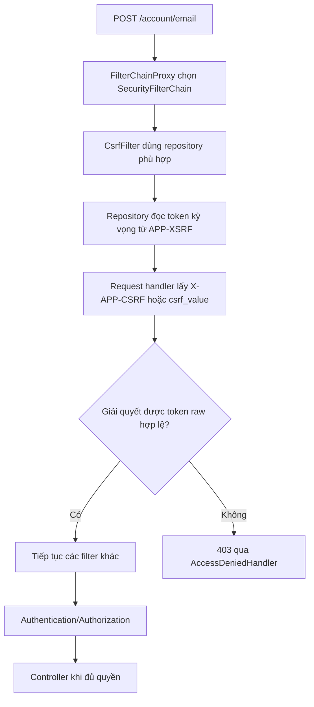

# Tùy chỉnh tên cookie, tên header và tên tham số

Trong **Spring Security Servlet**, việc đổi tên CSRF token không đơn thuần là thay một chuỗi cấu hình. Server, template HTML và JavaScript cần thống nhất **cookie chứa token kỳ vọng**, **HTTP header hoặc form parameter mang token mà client gửi lên**, và **cách request handler diễn giải raw/masked token**. Chỉ một thành phần vẫn dùng tên cũ cũng có thể khiến `POST` bị `403 Forbidden`, mặc dù token thực tế được sinh hoàn toàn hợp lệ.

Bài thuộc chương **CSRF trên Servlet** của module **SPRING_SECURITY_HTTP_PROTECTION**. Module hướng tới xây dựng nhiều lớp phòng vệ HTTP/trình duyệt trong Spring Security — từ CSRF, CORS, security headers, CSP, HSTS, HTTP firewall đến bảo vệ session — cho cả Servlet và Reactive, kèm kỹ năng kiểm thử tình huống tấn công và chẩn đoán xung đột cấu hình. Bài này tập trung vào cách **đặt tên và đồng bộ hợp đồng CSRF trong Servlet**, sử dụng `CookieCsrfTokenRepository`, `HttpSessionCsrfTokenRepository`, `CsrfTokenRequestHandler`, `CsrfFilter`, form và SPA. Cách cấu hình WebFlux dùng các API Reactive riêng.

**Kết quả học tập:** bạn có thể chọn tên cookie/header/parameter có chủ đích, viết `SecurityFilterChain` đúng API, hiểu những tên nào không nên nhầm lẫn, sửa form/JavaScript tương ứng, bảo toàn chiến lược masked/raw token, kiểm thử cả cấp cookie và đọc header, và lập kế hoạch đổi tên mà không tạo lỗ hổng hoặc làm gián đoạn phiên người dùng.

## 1. Năm loại tên dễ bị nhầm

Không phải mọi chuỗi chứa `_csrf` đều chỉ cùng một nơi lưu dữ liệu. Trong một luồng Spring Security Servlet có thể thấy:

| Loại tên | Ví dụ mặc định hoặc phổ biến | Dùng ở đâu? | Ai chịu trách nhiệm? |
| --- | --- | --- | --- |
| **Cookie chứa CSRF token** | `XSRF-TOKEN` | Header `Set-Cookie` của response và `Cookie` của request | `CookieCsrfTokenRepository` |
| **HTTP header chứa token client gửi** | `X-XSRF-TOKEN` hoặc `X-CSRF-TOKEN` | HTTP request từ JavaScript/API client | Tên do `CsrfToken` cung cấp; request handler đọc |
| **Form parameter** | `_csrf` | Form data, thường `application/x-www-form-urlencoded` | Tên do `CsrfToken` cung cấp; request handler đọc |
| **Request attribute cho view** | `_csrf` | `HttpServletRequest.getAttribute("_csrf")`, `${_csrf}` trong template | `CsrfTokenRequestHandler` |
| **Session attribute nội bộ** | Tên nội bộ do repository định nghĩa | Dữ liệu lưu trong `HttpSession` | `HttpSessionCsrfTokenRepository` |

Ở ngoài phạm vi CSRF token còn có **cookie phiên đăng nhập** như `JSESSIONID`, cookie remember-me hoặc cookie chứa credentials. Chúng có vai trò khác. Đổi tên `XSRF-TOKEN` **không đổi** tên cookie session và không tự thay cơ chế xác thực.

Trong bài, ta dùng quy ước minh họa:

```text
Cookie CSRF:        APP-XSRF
Request header:     X-APP-CSRF
Form parameter:     csrf_value
Request attribute:  _csrf
```

Điều đó có nghĩa:

```http
HTTP/1.1 200 OK
Set-Cookie: APP-XSRF=<token-goc>; Path=/; ...
```

Sau đó client gửi request thay đổi trạng thái:

```http
POST /api/profile HTTP/1.1
Host: app.example
Cookie: APP-XSRF=<token-goc>; JSESSIONID=<cookie-phien-neu-co>
X-APP-CSRF: <gia-tri-token-client-gui>
Content-Type: application/json

{"displayName":"Learner"}
```

`<token-goc>` và các giá trị trong ví dụ chỉ là chỗ giữ chỗ, không phải token thật. Giá trị của `X-APP-CSRF` có thể là **raw** hoặc **masked** tùy hợp đồng của request handler; đổi tên header không tự thay đổi định dạng token.

## 2. Luồng đọc và so sánh token: tên nào được dùng ở bước nào?

Hãy đọc luồng từ response cấp token đến `CsrfFilter`:

```mermaid
sequenceDiagram
    participant Browser as Trình duyệt
    participant Filter as CsrfFilter
    participant Repo as CookieCsrfTokenRepository
    participant Handler as CsrfTokenRequestHandler
    participant View as MVC/Frontend
    Browser->>Filter: GET /csrf hoặc /form
    Filter->>Repo: loadDeferredToken(request, response)
    Repo-->>Filter: DeferredCsrfToken
    Filter->>Handler: handle(..., Supplier<CsrfToken>)
    Filter->>View: GET tiếp tục
    View->>Repo: Token được truy cập; nạp hoặc tạo nếu thiếu
    Repo-->>Browser: Set-Cookie: APP-XSRF=T khi cần lưu
    View-->>Browser: Form/JSON chứa token mà handler công bố
    Browser->>Filter: POST + Cookie APP-XSRF + header X-APP-CSRF hoặc form csrf_value
    Filter->>Repo: Đọc token kỳ vọng T từ cookie APP-XSRF
    Filter->>Handler: resolveCsrfTokenValue(request, expectedToken)
    Handler-->>Filter: Raw token đã được giải quyết
    alt Giá trị hợp lệ và khớp T
        Filter-->>Browser: Request được chuyển đến các bước tiếp theo
    else Thiếu, sai tên hoặc sai token
        Filter-->>Browser: 403 Forbidden
    end
```

Repository biết **tên cookie**. `CsrfToken` chứa metadata về **tên header** và **tên form parameter**. Request handler dùng metadata đó để lấy giá trị client gửi; filter mới so sánh với token kỳ vọng. Sự hiện diện của cookie do trình duyệt tự gửi **không thay thế** việc client chủ động cung cấp token qua header/form.

Với `HttpSessionCsrfTokenRepository`, token kỳ vọng được đọc từ session thay vì cookie CSRF. Tuy nhiên request handler vẫn dùng tên header và parameter như trên để lấy token client gửi.

## 3. API cấu hình `CookieCsrfTokenRepository`

Trong Servlet, lớp thuộc package:

```java
org.springframework.security.web.csrf.CookieCsrfTokenRepository
```

Những setter cần quan tâm:

```java
CookieCsrfTokenRepository repository =
    CookieCsrfTokenRepository.withHttpOnlyFalse();

repository.setCookieName("APP-XSRF");
repository.setHeaderName("X-APP-CSRF");
repository.setParameterName("csrf_value");
```

Ba setter trên **không có cùng tác dụng**:

| Setter | Ảnh hưởng tới đâu? | Cần đồng bộ với |
| --- | --- | --- |
| `setCookieName(...)` | Tên cookie repository phát bằng `Set-Cookie` và tìm trong request | Cookie parser ở JavaScript, path/domain và quy trình đổi tên |
| `setHeaderName(...)` | Giá trị `CsrfToken.getHeaderName()` để request handler đọc header | `fetch`, Axios/interceptor, CORS allowed headers |
| `setParameterName(...)` | Giá trị `CsrfToken.getParameterName()` để handler đọc form parameter | Hidden field, HTML form, template engine |

`withHttpOnlyFalse()` là lựa chọn khi một SPA **phải đọc cookie CSRF qua `document.cookie`**. Nó không thay đổi tên cookie và **không có nghĩa** được phép tắt `HttpOnly` của cookie đăng nhập.

Trong Spring Security 6.1+ có thể cấu hình một số thuộc tính cookie bằng `setCookieCustomizer(...)`:

```java
repository.setCookieCustomizer(cookie -> cookie
    .path("/")
    .sameSite("Lax")
    .secure(true));
```

`secure(true)` trong ví dụ yêu cầu triển khai bằng **HTTPS**. `path("/")` giúp cookie có phạm vi bao phủ các API trên cùng host, nhưng không được đặt `Domain` rộng một cách tùy tiện. Thay `Path`/`Domain` có thể ảnh hưởng cả cách cookie được gửi lẫn cách xóa cookie cũ.

### Tên cookie và thuộc tính cookie là hai quyết định khác nhau

`APP-XSRF` là **tên**. `HttpOnly`, `Secure`, `SameSite`, `Path`, `Domain`, `Max-Age` là **thuộc tính** điều khiển việc browser lưu/đọc/gửi cookie. Một tên cookie đúng vẫn có thể bị JavaScript không đọc được nếu `HttpOnly=true`, bị browser từ chối trong môi trường HTTP khi `Secure=true`, hoặc không được gửi tới `/api` vì `Path` không phù hợp.

Vì thế hãy luôn kiểm tra **response `Set-Cookie`**, **cookie browser đang lưu**, và **request `Cookie`**. Chỉ nhìn tên cookie trong source code là chưa đủ.

## 4. `HttpSessionCsrfTokenRepository`: tùy chỉnh header và parameter, không có cookie CSRF riêng

Trong ứng dụng form login dùng session, `HttpSessionCsrfTokenRepository` lưu token kỳ vọng dưới dạng **session attribute phía server**. Vì vậy nó không phát `XSRF-TOKEN` hoặc `APP-XSRF` chỉ vì được chọn làm repository.

```java
import org.springframework.security.web.csrf.HttpSessionCsrfTokenRepository;

HttpSessionCsrfTokenRepository repository =
    new HttpSessionCsrfTokenRepository();

repository.setHeaderName("X-APP-CSRF");
repository.setParameterName("csrf_value");
```

Khi đó:

- Form có thể gửi `csrf_value=<token>`.
- JavaScript có thể gửi `X-APP-CSRF: <token>`.
- Browser cần cookie session phù hợp để server tìm token kỳ vọng trong `HttpSession`.
- **Không có cookie CSRF tên `APP-XSRF`** do repository này tạo.

Lớp cũng hỗ trợ cấu hình **tên session attribute nội bộ** qua `setSessionAttributeName(...)` khi thật sự cần tích hợp đặc biệt. Đây không phải tên cookie `JSESSIONID` hoặc tên HTTP header. Đổi session attribute có thể làm token đang lưu ở các phiên hiện hành không còn được tìm thấy, gây lỗi sau triển khai; không dùng setter này để giải quyết frontend gửi sai tên header.

| Mục tiêu | Công cụ tương ứng |
| --- | --- |
| Đổi tên header client gửi | `setHeaderName(...)` |
| Đổi tên hidden input của form | `setParameterName(...)` |
| Đổi cookie chứa CSRF token | Chọn `CookieCsrfTokenRepository`, rồi `setCookieName(...)` |
| Đổi tên cookie phiên đăng nhập | Cấu hình session cookie ở Servlet/container/Spring Boot tương ứng, **không** qua `CsrfTokenRepository` |
| Đổi tên request attribute để MVC tìm token | `CsrfTokenRequestAttributeHandler.setCsrfRequestAttributeName(...)` |

Không phải ứng dụng nào cũng cần cookie-based repository. Nếu ứng dụng dùng session và form render server-side, repository theo session vẫn phù hợp; hãy chọn dựa trên threat model và cách client nhận token, không chỉ dựa vào việc muốn một tên cookie dễ nhớ.

## 5. Request attribute `_csrf` không tự đổi theo `setParameterName(...)`

Một form Thymeleaf có thể dùng:

```html
<input type="hidden"
       th:name="${_csrf.parameterName}"
       th:value="${_csrf.token}">
```

Giả sử đã gọi `repository.setParameterName("csrf_value")`. Khi đó:

- `${_csrf}` vẫn có thể là **request attribute `_csrf`** chứa một đối tượng `CsrfToken`.
- `${_csrf.parameterName}` trả `"csrf_value"`.
- `${_csrf.token}` là giá trị token được request handler công bố, có thể là raw hoặc masked.
- HTML được render có thể trở thành `<input type="hidden" name="csrf_value" value="...">`.

Không nên thay tên request attribute theo tên form field nếu không có nhu cầu cụ thể. `CsrfTokenRequestAttributeHandler` và `XorCsrfTokenRequestAttributeHandler` dùng `setCsrfRequestAttributeName(...)` để điều chỉnh tên thuộc tính mà view/controller truy cập:

```java
import org.springframework.security.web.csrf.XorCsrfTokenRequestAttributeHandler;

XorCsrfTokenRequestAttributeHandler handler =
    new XorCsrfTokenRequestAttributeHandler();

handler.setCsrfRequestAttributeName("_csrf");
```

Đây là cách **giữ tên request attribute** trong ví dụ. Nó không thay `setParameterName("csrf_value")` của repository. Trong ứng dụng không có lý do riêng, nên giữ tên request attribute mặc định để các tích hợp Spring MVC hoạt động nhất quán.

Để thấy tách biệt ba lớp tên:

```text
Spring MVC: request.getAttribute("_csrf")
    -> CsrfToken object
       getParameterName() = "csrf_value"
       getHeaderName()    = "X-APP-CSRF"
       getToken()         = giá trị client cần gửi theo handler

HTML:
    <input name="csrf_value" value="<token>">

JavaScript:
    headers: { "X-APP-CSRF": "<token>" }
```

Nếu một controller sử dụng `@RequestAttribute("csrf_value") CsrfToken`, nó **không** tự nhận được token chỉ vì parameter đã đổi thành `csrf_value`: đó là hai namespace khác nhau trong Servlet request.

## 6. Cấu hình đầy đủ cho SPA đọc cookie tên riêng

Giả sử ứng dụng có hai kiểu giao diện: các form HTML được server render và SPA gọi JSON API. Hợp đồng của bài sẽ là:

```text
Repository:      CookieCsrfTokenRepository
Cookie:          APP-XSRF              (token raw)
Header SPA:      X-APP-CSRF            (token raw từ cookie)
Form parameter:  csrf_value            (token masked từ view)
Request attr:    _csrf                 (đối tượng CsrfToken)
```

Lưu ý: với Spring Security Servlet 6.x, request handler dạng XOR thường công bố **masked token** để hạn chế BREACH khi render HTML có nén. SPA đọc cookie lại thường gửi **raw token**. Đổi tên cookie/header/parameter **không tự giải quyết** khác biệt raw/masked này.

### Request handler xử lý hai kênh gửi token

Một handler kết hợp cho ví dụ:

```java
import jakarta.servlet.http.HttpServletRequest;
import jakarta.servlet.http.HttpServletResponse;
import java.util.function.Supplier;
import org.springframework.security.web.csrf.CsrfToken;
import org.springframework.security.web.csrf.CsrfTokenRequestAttributeHandler;
import org.springframework.security.web.csrf.CsrfTokenRequestHandler;
import org.springframework.security.web.csrf.XorCsrfTokenRequestAttributeHandler;
import org.springframework.util.StringUtils;

public final class AppCsrfTokenRequestHandler
        implements CsrfTokenRequestHandler {

    private final CsrfTokenRequestHandler plain =
        new CsrfTokenRequestAttributeHandler();
    private final CsrfTokenRequestHandler xor =
        new XorCsrfTokenRequestAttributeHandler();

    @Override
    public void handle(
            HttpServletRequest request,
            HttpServletResponse response,
            Supplier<CsrfToken> csrfToken) {
        // HTML form có masked token; không ép tạo token trên mọi GET.
        xor.handle(request, response, csrfToken);
    }

    @Override
    public String resolveCsrfTokenValue(
            HttpServletRequest request,
            CsrfToken csrfToken) {
        String value =
            request.getHeader(csrfToken.getHeaderName());

        CsrfTokenRequestHandler resolver =
            StringUtils.hasText(value) ? plain : xor;

        return resolver.resolveCsrfTokenValue(request, csrfToken);
    }
}
```

Mỗi nhánh có nhiệm vụ rõ ràng:

| Dữ liệu client gửi | Handler chọn | Vì sao? |
| --- | --- | --- |
| Có `X-APP-CSRF` với token raw từ `APP-XSRF` | `plain` | Giữ nguyên raw token để filter so sánh |
| Không có header, form có `csrf_value` masked | `xor` | Tháo lớp masking của form về raw token |
| Không có header và không có form field | `xor`, nhưng không tìm thấy token | Filter từ chối request unsafe |
| Có header raw sai, dù form có masked token đúng | `plain` do header có giá trị | Định dạng header là hợp đồng ưu tiên; filter từ chối |

Đây là một **quy ước có chủ đích**, không phải handler tự nhận biết token raw hay masked bằng cách đoán nội dung. Nếu frontend gửi masked token qua header `X-APP-CSRF`, handler ở ví dụ này sẽ xử lý theo nhánh raw và không tương thích. Chỉ nên dùng mẫu khi kiểm soát được giao ước giữa server và các client.

### Khai báo `SecurityFilterChain`

```java
import org.springframework.context.annotation.Bean;
import org.springframework.context.annotation.Configuration;
import org.springframework.security.config.Customizer;
import org.springframework.security.config.annotation.web.builders.HttpSecurity;
import org.springframework.security.web.SecurityFilterChain;
import org.springframework.security.web.csrf.CookieCsrfTokenRepository;

@Configuration
public class SecurityConfiguration {

    @Bean
    SecurityFilterChain webSecurity(HttpSecurity http) throws Exception {
        CookieCsrfTokenRepository repository =
            CookieCsrfTokenRepository.withHttpOnlyFalse();

        repository.setCookieName("APP-XSRF");
        repository.setHeaderName("X-APP-CSRF");
        repository.setParameterName("csrf_value");

        repository.setCookieCustomizer(cookie -> cookie
            .path("/")
            .sameSite("Lax")
            .secure(true));

        http
            .authorizeHttpRequests(auth -> auth
                .requestMatchers("/login", "/csrf", "/assets/**")
                    .permitAll()
                .anyRequest().authenticated())
            .formLogin(Customizer.withDefaults())
            .csrf(csrf -> csrf
                .csrfTokenRepository(repository)
                .csrfTokenRequestHandler(
                    new AppCsrfTokenRequestHandler()));

        return http.build();
    }
}
```

Ví dụ dùng API Servlet của Spring Security 6.1+; thuộc tính cookie `.secure(true)` **giả định kết nối HTTPS**. Nếu phát triển trên HTTP thuần, browser có thể không gửi cookie Secure và gây lỗi `403`; hãy có cấu hình môi trường thử nghiệm phù hợp, không hạ yêu cầu HTTPS trong production.

Với cấu hình này, cookie CSRF có thể đọc được bởi JavaScript vì `withHttpOnlyFalse()`, nhưng cookie đăng nhập nên tiếp tục được quản lý an toàn một cách độc lập. `.formLogin(...)` có thể tạo/sử dụng session; cookie CSRF không thay thế cookie xác thực.

### Tránh ép tạo token trên mọi GET

Handler trên **không gọi `csrfToken.get()` ngay trong `handle(...)`**. Vì thế `GET /health` hoặc một trang không dùng token không nhất thiết phải phát cookie `APP-XSRF`.

Nếu SPA cần token, nên có một endpoint bootstrap rõ ràng:

```java
import org.springframework.http.CacheControl;
import org.springframework.http.ResponseEntity;
import org.springframework.security.web.csrf.CsrfToken;
import org.springframework.web.bind.annotation.GetMapping;
import org.springframework.web.bind.annotation.RequestAttribute;
import org.springframework.web.bind.annotation.RestController;

@RestController
class CsrfBootstrapController {

    @GetMapping("/csrf")
    ResponseEntity<Void> bootstrap(
            @RequestAttribute("_csrf") CsrfToken token) {
        token.getToken(); // Buộc nạp token tại điểm bootstrap.

        return ResponseEntity.noContent()
            .cacheControl(CacheControl.noStore())
            .build();
    }
}
```

Trong request `GET /csrf` lần đầu, repository có thể tạo token và gửi `Set-Cookie: APP-XSRF=...`. Lần sau, nếu browser đã gửi cookie CSRF hiện hành, repository có thể đọc lại token mà **không cần phát cookie mới**. Controller chỉ trả `204` vì SPA lấy raw token từ cookie; không cần trả thêm raw token ở JSON body.

`permitAll()` cho `/csrf` chỉ là luật phân quyền. Một `POST /login` vẫn thường cần token CSRF; `permitAll()` không tự vô hiệu hóa `CsrfFilter`.

## 7. JavaScript đọc đúng cookie và gửi đúng header mới

Với frontend **cùng origin**, cookie `APP-XSRF` có `HttpOnly=false`, path/domain phù hợp và được trình duyệt chấp nhận, JavaScript có thể đọc rồi gắn header `X-APP-CSRF`:

```javascript
const CSRF_COOKIE = "APP-XSRF";
const CSRF_HEADER = "X-APP-CSRF";

function readCookie(name) {
  const prefix = encodeURIComponent(name) + "=";
  const match = document.cookie
    .split("; ")
    .find((part) => part.startsWith(prefix));
  return match
    ? decodeURIComponent(match.slice(prefix.length))
    : null;
}

async function issueCsrfCookie() {
  const response = await fetch("/csrf", {
    method: "GET",
    credentials: "same-origin",
    cache: "no-store"
  });

  if (!response.ok) {
    throw new Error("Không thể lấy CSRF token");
  }

  const token = readCookie(CSRF_COOKIE);
  if (!token) {
    throw new Error("Cookie APP-XSRF chưa xuất hiện hoặc không đọc được");
  }
  return token;
}

async function updateProfile(displayName) {
  const token = await issueCsrfCookie();

  const response = await fetch("/api/profile", {
    method: "POST",
    credentials: "same-origin",
    headers: {
      "Content-Type": "application/json",
      [CSRF_HEADER]: token
    },
    body: JSON.stringify({ displayName })
  });

  if (!response.ok) {
    throw new Error(`Cập nhật thất bại: HTTP ${response.status}`);
  }
  return response;
}
```

Ở đây không được tiếp tục đọc cookie tên cũ `XSRF-TOKEN`, cũng không được gửi header tên cũ `X-XSRF-TOKEN`. Nếu server đã đổi cả hai tên nhưng frontend chỉ đổi một, `CsrfFilter` có thể không tìm được token kỳ vọng hoặc token client gửi.

Đoạn mã giả định ứng dụng có `POST /api/profile` nhận JSON và caller được phép thao tác. `credentials: "same-origin"` phục vụ cookie cùng origin; nếu API khác origin, cần thiết kế CORS và cookies riêng, không chỉ thay thành `"include"` mà không hiểu phạm vi cookie.

### Interceptor của thư viện frontend

Nhiều frontend framework hoặc HTTP library hỗ trợ quy ước cookie/header mặc định (thường `XSRF-TOKEN` và `X-XSRF-TOKEN`). Khi server đặt tên riêng, cần cấu hình lại interceptor tương ứng:

```javascript
// Mã giả ở tầng cấu hình HTTP client:
const xsrfConfiguration = {
  cookieName: "APP-XSRF",
  headerName: "X-APP-CSRF"
};
```

Đây **không phải API chung để copy-paste cho mọi framework**. Cú pháp thực tế, hành vi same-origin, việc tự gửi header trên cross-origin và điều kiện có credentials phụ thuộc thư viện/phiên bản. Hãy kiểm tra request cuối cùng trong Network panel, thay vì giả định “đã bật interceptor là đúng tên”.

## 8. Form HTML: đổi tên hidden field mà không phá masking

Với handler ở mục 6, request attribute vẫn là `_csrf`, nhưng `csrfToken.getParameterName()` trả `csrf_value`. Vì thế view Thymeleaf nên dùng metadata:

```html
<form action="/account/email" method="post">
  <label for="email">Email mới</label>
  <input id="email" name="email" type="email" required>

  <input type="hidden"
         th:name="${_csrf.parameterName}"
         th:value="${_csrf.token}">

  <button type="submit">Lưu</button>
</form>
```

HTML sau khi render có thể là:

```html
<input type="hidden"
       name="csrf_value"
       value="<masked-token-do-request-handler-cap>">
```

Khi form submit:

```http
POST /account/email HTTP/1.1
Host: app.example
Cookie: APP-XSRF=<raw-token>
Content-Type: application/x-www-form-urlencoded

email=learner%40example.com&csrf_value=<masked-token>
```

`XorCsrfTokenRequestAttributeHandler` giải quyết masked token từ parameter `csrf_value` về raw token để `CsrfFilter` so sánh với cookie kỳ vọng. **Không cần** ép form gửi raw token chỉ vì cookie chứa raw token.

Nếu template hard-code `name="_csrf"` sau khi repository đã đổi parameter thành `csrf_value`, handler có thể không tìm thấy token. Hãy dùng `${_csrf.parameterName}` hoặc thay chính xác tên field. Một số tích hợp Thymeleaf/Spring MVC tự thêm hidden CSRF field với `th:action`; tránh thêm trường trùng nếu đã có cơ chế tự chèn.

## 9. Tùy chỉnh tên khi có nhiều origin hoặc reverse proxy

Tên cookie/header phải được hiểu trong **ngữ cảnh HTTP thực tế**. Ví dụ frontend tại `https://app.example.com` gọi backend tại `https://api.example.com`:

| Khía cạnh | Điều cần kiểm tra |
| --- | --- |
| **Cookie host-only** | Cookie `APP-XSRF` do `api.example.com` phát có thể được gửi trở lại API nhưng JavaScript tại `app.example.com` không đọc trực tiếp được cookie đó |
| **CORS** | Header riêng `X-APP-CSRF` có thể xuất hiện trong preflight; cấu hình `Access-Control-Allow-Headers` phải cho phép tên header này |
| **Credentials** | `fetch(..., {credentials: "include"})` và cấu hình CORS `allowCredentials` cần phù hợp nếu thực sự dùng cookie qua origin |
| **`SameSite`** | Chính sách cookie xét *site*, không giống hoàn toàn với *origin*; hai subdomain có thể cùng site nhưng vẫn khác origin |
| **`Secure` và HTTPS** | Cookie Secure chỉ được gửi qua kênh bảo mật theo quy tắc trình duyệt; kiểm tra TLS termination và forwarded headers |
| **`Path`** | Cookie với `Path=/app` có thể không được gửi tới `/api`, dù tên cookie đúng |
| **Proxy/WAF** | Một số cấu hình có thể lọc header tùy chỉnh; cần xác nhận `X-APP-CSRF` thật sự tới ứng dụng |

Một cấu hình CORS có danh sách cho phép chặt chẽ (mảnh code cho ứng dụng Spring MVC):

```java
import java.util.List;
import org.springframework.context.annotation.Bean;
import org.springframework.web.cors.CorsConfiguration;
import org.springframework.web.cors.CorsConfigurationSource;
import org.springframework.web.cors.UrlBasedCorsConfigurationSource;

@Bean
CorsConfigurationSource corsConfigurationSource() {
    CorsConfiguration config = new CorsConfiguration();
    config.setAllowedOrigins(List.of("https://app.example.com"));
    config.setAllowedMethods(List.of(
        "GET", "POST", "PUT", "PATCH", "DELETE"));
    config.setAllowedHeaders(List.of(
        "Content-Type", "X-APP-CSRF"));
    config.setAllowCredentials(true);

    UrlBasedCorsConfigurationSource source =
        new UrlBasedCorsConfigurationSource();
    source.registerCorsConfiguration("/**", config);
    return source;
}
```

Đây là ví dụ đăng ký bean trong một class `@Configuration` cùng các import còn lại. Bật xử lý CORS trong security chain khi cần:

```java
http.cors(Customizer.withDefaults());
```

**Điểm đặc biệt:** CORS được cấu hình đúng vẫn **không khiến JavaScript ở `app.example.com` đọc được cookie host-only của `api.example.com`**. Nếu hai origin tách rời, có thể thiết kế endpoint JSON cấp token cho frontend tin cậy và request handler chấp nhận đúng dạng token được cấp, thay vì mở rộng phạm vi `Domain` thiếu kiểm soát.

Custom header có thể được so sánh không phân biệt hoa thường theo quy tắc HTTP, nhưng nên sử dụng thống nhất `X-APP-CSRF` để dễ đọc, debug và cấu hình WAF/CORS. Ưu tiên tên header dùng chữ ASCII và dấu gạch ngang; tránh dấu gạch dưới nếu hạ tầng proxy có quy tắc đặc biệt, và tránh dùng tên chuẩn dành cho mục đích khác như `Authorization` để mang CSRF token.

### Nên dùng tên cookie có tiền tố bảo vệ không?

Trong ứng dụng có HTTPS và yêu cầu ràng buộc phạm vi chặt, trình duyệt hỗ trợ các **cookie name prefix**:

| Tiền tố | Quy tắc cookie liên quan |
| --- | --- |
| `__Secure-` | Cookie phải được đặt với `Secure` qua nguồn HTTPS hợp lệ |
| `__Host-` | Cookie phải có `Secure`, `Path=/` và **không có `Domain`** để ràng buộc host |

Ví dụ có thể chọn tên `__Host-APP-XSRF`, nhưng chỉ khi đáp ứng các thuộc tính do trình duyệt yêu cầu. Tiền tố không phải một API đặc biệt của `CookieCsrfTokenRepository`; chỉ là **một phần của chính chuỗi tên**:

```java
repository.setCookieName("__Host-APP-XSRF");
repository.setCookieCustomizer(cookie -> cookie
    .path("/")
    .secure(true)
    .sameSite("Lax"));
// Không đặt Domain cho cookie __Host-.
```

Frontend cũng phải đọc đúng chuỗi `"__Host-APP-XSRF"`. Tiền tố hỗ trợ giảm một số lỗi phạm vi cookie, nhưng **không thay thế** chống XSS, CSRF token, kiểm soát subdomain hoặc việc chọn chính sách xác thực thích hợp.

## 10. Khi nào nên đổi tên và khi nào không?

Việc đổi tên có thể cần thiết khi tích hợp một frontend đã có giao ước riêng, chuẩn hóa header giữa nhiều dịch vụ hoặc tránh va chạm cookie từ các ứng dụng cùng host. Tuy nhiên thay tên không tự nâng mức ngẫu nhiên của token hay tăng tính đúng đắn của `CsrfFilter`.

**Các lý do hợp lý:**

- Frontend có sẵn interceptor với convention riêng và việc thay server là có chủ đích.
- Nhiều ứng dụng dùng chung host/path khiến cookie tên mặc định bị va chạm; cần tách tên và cấu hình phạm vi.
- Muốn dùng cookie name prefix có ràng buộc scope (`__Host-...`) khi môi trường cho phép.
- Có yêu cầu chuyển đổi hợp đồng HTTP rõ ràng, kiểm thử được và có kế hoạch rollout.

**Các lý do không đủ:**

- “Đổi tên cookie để token trở nên bí mật hơn.” Tên cookie không làm token an toàn hơn.
- “Đổi tên header vì POST đang 403 nhưng chưa tìm nguyên nhân.” Lỗi có thể do masking, session, CORS hoặc thiếu token.
- “Đặt request attribute giống tên cookie cho dễ nhớ.” Các tên thuộc lớp khác nhau, không phải cứ giống nhau là đúng.
- “Tắt `HttpOnly` trên tất cả cookie vì SPA cần token.” Chỉ cookie CSRF có nhu cầu đọc từ JS mới có lý do cân nhắc việc đó.

### Đổi tên có làm token hiện hành hết hiệu lực?

Cần phân biệt ba tình huống:

1. **Chỉ đổi header/parameter:** token kỳ vọng trong repository có thể giữ nguyên, nhưng client cũ gửi sai tên nên handler không tìm thấy nó.
2. **Đổi tên cookie của `CookieCsrfTokenRepository`:** repository mới không còn tìm cookie tên cũ. Một request đầu tiên có thể coi token kỳ vọng bị thiếu, phát cookie tên mới và từ chối POST cũ; client cần bootstrap lại trước request unsafe.
3. **Đổi tên session attribute của `HttpSessionCsrfTokenRepository`:** repository không tìm token lưu dưới attribute cũ; form cũ có thể không hợp lệ cho đến khi token mới được tạo/lưu theo tên mới.

Không đồng nhất đổi tên token với một lần logout. Nhưng **về khả năng tương thích** nó có thể tương đương việc buộc client lấy lại token, đặc biệt khi cookie name hoặc session attribute name thay đổi.

## 11. Kế hoạch rollout khi thay quy ước trên hệ thống đang chạy

Giả sử hệ thống đang dùng:

```text
Cookie cũ:     XSRF-TOKEN
Header cũ:     X-XSRF-TOKEN
Parameter cũ:  _csrf
```

và chuyển sang:

```text
Cookie mới:    APP-XSRF
Header mới:    X-APP-CSRF
Parameter mới: csrf_value
```

Một đợt thay đổi ít rủi ro hơn nên có các bước:

| Giai đoạn | Việc thực hiện | Tiêu chí kiểm chứng |
| --- | --- | --- |
| 1. Kiểm kê | Xác định tất cả form, SPA, mobile/web client, CORS, proxy và nhiều `SecurityFilterChain` | Không còn điểm gửi token chưa được liệt kê |
| 2. Chuẩn bị frontend | Đổi tên cookie/header/parameter ở mã mới, loại bỏ hard-code rải rác | Unit test và Network panel cho thấy đúng tên |
| 3. Chuẩn bị backend | Cấu hình repository/handler và cookie scope; lập kế hoạch tương thích phiên đang sống | Test cookie → header/form → `CsrfFilter` đạt |
| 4. Phối hợp phát hành | Đồng bộ server và assets frontend, xử lý JavaScript cũ bị cache, phiên nhiều tab | Người dùng nhận token mới trước request unsafe |
| 5. Quan sát | Theo dõi tỷ lệ lỗi CSRF theo route, client version và loại exception, **không log token thật** | Không tăng đột biến `403` |
| 6. Dọn dẹp | Khi an toàn, hết hạn cookie cũ đúng `Path`/`Domain`, loại bỏ đường tương thích tạm thời nếu có | Không có client còn dùng convention cũ |

**Không giả định có thể đổi tên đồng thời bằng cách phát cả cookie cũ và cookie mới rồi chấp nhận mọi header tùy ý.** Việc hỗ trợ tạm thời nhiều tên/giá trị là một thay đổi vào hàng rào bảo vệ, cần thiết kế chính sách rõ, đánh giá threat model và test các trường hợp cookie injection, token sai phiên, raw/masked token. Nếu không cần tương thích dài hạn, một lần chuyển đổi có bước bootstrap token mới thường đơn giản và an toàn hơn.

### Vì sao cookie cũ vẫn có thể còn trong browser?

Cookie được phân biệt bởi tên cùng phạm vi như domain/path. Đổi `setCookieName(...)` không tự động xóa cookie tên cũ. `Set-Cookie` xóa cookie (`Max-Age=0`) phải nhắm đúng **tên, Path và Domain** đã được dùng khi phát cookie cũ. Nếu môi trường triển khai có cả cookie cùng tên nhưng khác path, request có thể chứa nhiều cookie và việc đọc trở nên khó chẩn đoán.

Không viết tài liệu hướng dẫn người dùng xóa toàn bộ cookie trình duyệt như bước đầu tiên; cách đó làm mất phiên và che giấu vấn đề cấu hình. Ưu tiên xác minh `Set-Cookie`, cookie scope và quy trình bootstrap.

### Nhiều tab và assets frontend bị cache

Tab A có JavaScript phiên bản cũ tiếp tục gửi `X-XSRF-TOKEN`, trong khi Tab B đã tải phiên bản mới gửi `X-APP-CSRF`. Trong giai đoạn chuyển đổi, backend chỉ chấp nhận tên mới có thể làm Tab A bị `403`. Hãy dự liệu giao diện hiển thị lỗi, tải lại frontend, lấy token mới và bảo toàn dữ liệu form nếu phù hợp. Không tự động lặp lại vô hạn các thao tác như chuyển tiền, đặt hàng hoặc thay đổi dữ liệu.

## 12. SecurityFilterChain, matcher và trách nhiệm phân quyền

Đổi tên cookie/header/parameter không thay luật chọn request cần CSRF.



Với matcher mặc định, `GET`, `HEAD`, `OPTIONS`, `TRACE` thường không cần token; `POST`, `PUT`, `PATCH`, `DELETE` thường yêu cầu. Đổi tên header không tự làm một route `POST` được miễn CSRF, cũng không khiến mọi `GET` cần token.

Vì `permitAll()` thuộc authorization, một `POST /login` vẫn có thể bị `403` nếu thiếu CSRF token. Nếu đang có nhiều `SecurityFilterChain`, cần xác định **chain đầu tiên khớp request**. Cấu hình tên ở chain web không nhất thiết được áp dụng cho chain API khác.

Không cấu hình `ignoringRequestMatchers("/api/**")` chỉ vì một SPA gửi sai header sau khi đổi tên. Hãy sửa hợp đồng và giữ bảo vệ đối với API sử dụng credentials do trình duyệt tự gửi.

## 13. Unit test: repository phát đúng cookie và metadata mới

Kiểm thử trực tiếp `CookieCsrfTokenRepository` giúp xác nhận cả ba setter hoạt động **trước khi đưa request qua `CsrfFilter`**. Ví dụ JUnit 5 + `spring-test` + `spring-security-web`:

```java
import jakarta.servlet.http.Cookie;
import org.junit.jupiter.api.Test;
import org.springframework.mock.web.MockHttpServletRequest;
import org.springframework.mock.web.MockHttpServletResponse;
import org.springframework.security.web.csrf.CookieCsrfTokenRepository;
import org.springframework.security.web.csrf.CsrfToken;

import static org.junit.jupiter.api.Assertions.*;

class CustomNamesCookieRepositoryTest {

    @Test
    void customCookieHeaderAndParameterAreConsistent() {
        var repository = CookieCsrfTokenRepository.withHttpOnlyFalse();
        repository.setCookieName("APP-XSRF");
        repository.setHeaderName("X-APP-CSRF");
        repository.setParameterName("csrf_value");

        var get = new MockHttpServletRequest("GET", "/csrf");
        var response = new MockHttpServletResponse();

        assertNull(repository.loadToken(get));

        CsrfToken generated = repository.generateToken(get);
        assertEquals("X-APP-CSRF", generated.getHeaderName());
        assertEquals("csrf_value", generated.getParameterName());
        assertNotNull(generated.getToken());

        repository.saveToken(generated, get, response);

        String cookieLine = response.getHeaders("Set-Cookie")
            .stream()
            .filter(value -> value.startsWith("APP-XSRF="))
            .findFirst()
            .orElseThrow();
        assertTrue(cookieLine.startsWith("APP-XSRF="));

        var next = new MockHttpServletRequest("POST", "/api/profile");
        next.setCookies(new Cookie("APP-XSRF", generated.getToken()));

        CsrfToken loaded = repository.loadToken(next);
        assertNotNull(loaded);
        assertEquals(generated.getToken(), loaded.getToken());
        assertEquals("X-APP-CSRF", loaded.getHeaderName());
        assertEquals("csrf_value", loaded.getParameterName());
    }

    @Test
    void oldCookieNameIsNotRecognizedAfterRename() {
        var repository = CookieCsrfTokenRepository.withHttpOnlyFalse();
        repository.setCookieName("APP-XSRF");

        var request = new MockHttpServletRequest();
        request.setCookies(new Cookie("XSRF-TOKEN", "old-token"));

        assertNull(repository.loadToken(request));
    }
}
```

Trong test, cookie mới chỉ xuất hiện trong `Set-Cookie` của **response**. Muốn kiểm tra `loadToken()` ở request sau, ta phải tạo `MockHttpServletRequest` mới và đặt cookie `APP-XSRF` vào đó. Cookie từ response không tự xuất hiện trong `get.getCookies()` của request ban đầu.

Test `oldCookieNameIsNotRecognizedAfterRename()` giải thích vì sao frontend cũ có `XSRF-TOKEN` vẫn có thể thất bại: repository đã đổi tên không tìm cookie đó. Chuỗi `"old-token"` chỉ là dữ liệu giả để test, không phải token thực.

### Test thao tác xóa sau khi tùy chỉnh tên cookie

Khi logout hoặc có chiến lược vô hiệu hóa token, repository có thể gọi `saveToken(null, ...)`. Test cần xác minh việc xóa **cookie mới**, không phải tên mặc định:

```java
import org.junit.jupiter.api.Test;
import org.springframework.mock.web.MockHttpServletRequest;
import org.springframework.mock.web.MockHttpServletResponse;
import org.springframework.security.web.csrf.CookieCsrfTokenRepository;

import static org.junit.jupiter.api.Assertions.*;

class CustomCookieDeleteTest {

    @Test
    void deleteUsesConfiguredCookieName() {
        var repository = CookieCsrfTokenRepository.withHttpOnlyFalse();
        repository.setCookieName("APP-XSRF");
        repository.setCookieCustomizer(cookie -> cookie.path("/"));

        var request = new MockHttpServletRequest();
        var response = new MockHttpServletResponse();

        repository.saveToken(null, request, response);

        String deletion = response.getHeader("Set-Cookie");
        assertNotNull(deletion);
        assertTrue(deletion.startsWith("APP-XSRF="));
        assertTrue(deletion.contains("Max-Age=0"));
        assertTrue(deletion.contains("Path=/"));
    }
}
```

Lệnh xóa cookie có hiệu lực ở **browser sau khi nhận response**. Nó không xóa lập tức cookie nằm trong request đã gửi. Nếu cookie tên cũ dùng path/domain khác, repository chỉ cấu hình tên mới sẽ không tự xóa được cookie cũ.

## 14. Unit test: request handler nhận đúng header/form parameter

Test repository chỉ chứng minh **tên token được sinh và cookie được lưu**. Để biết server giải quyết token client gửi thế nào, kiểm tra request handler riêng. Tên phải lấy từ `CsrfToken` chứ không đoán theo giá trị hard-code.

### Plain handler đọc đúng header `X-APP-CSRF`

```java
import org.junit.jupiter.api.Test;
import org.springframework.mock.web.MockHttpServletRequest;
import org.springframework.security.web.csrf.CsrfToken;
import org.springframework.security.web.csrf.CsrfTokenRequestAttributeHandler;
import org.springframework.security.web.csrf.DefaultCsrfToken;

import static org.junit.jupiter.api.Assertions.*;

class CustomHeaderResolveTest {

    @Test
    void readsOnlyConfiguredHeaderName() {
        CsrfToken expected = new DefaultCsrfToken(
            "X-APP-CSRF", "csrf_value", "expected-token");
        var handler = new CsrfTokenRequestAttributeHandler();

        var correct = new MockHttpServletRequest("POST", "/api/save");
        correct.addHeader("X-APP-CSRF", "client-token");
        assertEquals("client-token",
            handler.resolveCsrfTokenValue(correct, expected));

        var old = new MockHttpServletRequest("POST", "/api/save");
        old.addHeader("X-XSRF-TOKEN", "client-token");
        assertNull(handler.resolveCsrfTokenValue(old, expected));

        var wrongValue =
            new MockHttpServletRequest("POST", "/api/save");
        wrongValue.addHeader("X-APP-CSRF", "incorrect-token");
        assertEquals("incorrect-token",
            handler.resolveCsrfTokenValue(wrongValue, expected));
    }
}
```

**Điểm cần nhớ:** handler trả về chuỗi `"incorrect-token"` không có nghĩa nó xác nhận token đó hợp lệ. `CsrfFilter` mới so sánh với raw token kỳ vọng và từ chối nếu khác.

### XOR handler đọc parameter `csrf_value` đã đổi tên

```java
import org.junit.jupiter.api.Test;
import org.springframework.mock.web.MockHttpServletRequest;
import org.springframework.mock.web.MockHttpServletResponse;
import org.springframework.security.web.csrf.CsrfToken;
import org.springframework.security.web.csrf.DefaultCsrfToken;
import org.springframework.security.web.csrf.XorCsrfTokenRequestAttributeHandler;

import static org.junit.jupiter.api.Assertions.*;

class CustomParameterResolveTest {

    @Test
    void maskedFormUsesConfiguredParameterName() {
        CsrfToken stored = new DefaultCsrfToken(
            "X-APP-CSRF", "csrf_value", "raw-test-token");
        var handler = new XorCsrfTokenRequestAttributeHandler();

        var get = new MockHttpServletRequest("GET", "/form");
        handler.handle(get, new MockHttpServletResponse(), () -> stored);
        CsrfToken exposed =
            (CsrfToken) get.getAttribute("_csrf");

        assertNotNull(exposed);
        assertEquals("csrf_value", exposed.getParameterName());
        assertNotEquals(stored.getToken(), exposed.getToken());

        var correct =
            new MockHttpServletRequest("POST", "/form");
        correct.addParameter("csrf_value", exposed.getToken());
        assertEquals(stored.getToken(),
            handler.resolveCsrfTokenValue(correct, stored));

        var oldName =
            new MockHttpServletRequest("POST", "/form");
        oldName.addParameter("_csrf", exposed.getToken());
        assertNull(handler.resolveCsrfTokenValue(oldName, stored));
    }
}
```

Trường hợp này chứng minh **tên request attribute `_csrf` có thể giữ nguyên**, trong khi tên form parameter đổi thành `csrf_value`. Đồng thời, giá trị form vẫn là **masked token** để XOR handler giải quyết, không nhất thiết là raw token chứa trong cookie.

### Test handler kết hợp với tên mới

Với class `AppCsrfTokenRequestHandler` ở mục 6, có thể kiểm tra hai nhánh:

```java
import org.junit.jupiter.api.Test;
import org.springframework.mock.web.MockHttpServletRequest;
import org.springframework.mock.web.MockHttpServletResponse;
import org.springframework.security.web.csrf.CsrfToken;
import org.springframework.security.web.csrf.DefaultCsrfToken;

import static org.junit.jupiter.api.Assertions.*;

class AppCsrfHandlerTest {

    @Test
    void acceptsRawCustomHeaderAndMaskedCustomForm() {
        CsrfToken expected = new DefaultCsrfToken(
            "X-APP-CSRF", "csrf_value", "raw-expected-token");
        var handler = new AppCsrfTokenRequestHandler();

        var view = new MockHttpServletRequest("GET", "/form");
        handler.handle(
            view, new MockHttpServletResponse(), () -> expected);
        CsrfToken exposed =
            (CsrfToken) view.getAttribute("_csrf");
        assertNotNull(exposed);

        var api = new MockHttpServletRequest("POST", "/api/save");
        api.addHeader("X-APP-CSRF", expected.getToken());
        assertEquals(expected.getToken(),
            handler.resolveCsrfTokenValue(api, expected));

        var form = new MockHttpServletRequest("POST", "/form");
        form.addParameter("csrf_value", exposed.getToken());
        assertEquals(expected.getToken(),
            handler.resolveCsrfTokenValue(form, expected));
    }
}
```

Test cho thấy repository cung cấp một token gốc, nhưng có thể có **hai đường gửi hợp lệ khác nhau** nếu handler kết hợp được thiết kế để xử lý đúng cả hai. Tên cookie mới không cần xuất hiện trong request handler, vì handler không phải nơi tìm cookie kỳ vọng.

## 15. MockMvc: kiểm thử vòng `Set-Cookie` → cookie + header

Để kiểm tra luồng đầy đủ với Spring Boot 3.x, `spring-security-test` và cấu hình mục 6, ta cần cả endpoint `GET /csrf` và `POST /api/profile`:

```java
import org.springframework.http.ResponseEntity;
import org.springframework.web.bind.annotation.PostMapping;
import org.springframework.web.bind.annotation.RestController;

@RestController
class ProfileController {

    @PostMapping("/api/profile")
    ResponseEntity<Void> save() {
        return ResponseEntity.noContent().build();
    }
}
```

Giả định `GET /csrf` được `CsrfBootstrapController` xử lý và trả `204`. Test:

```java
import jakarta.servlet.http.Cookie;
import org.junit.jupiter.api.Test;
import org.springframework.beans.factory.annotation.Autowired;
import org.springframework.boot.test.autoconfigure.web.servlet.AutoConfigureMockMvc;
import org.springframework.boot.test.context.SpringBootTest;
import org.springframework.security.test.context.support.WithMockUser;
import org.springframework.test.web.servlet.MockMvc;
import org.springframework.test.web.servlet.MvcResult;

import static org.junit.jupiter.api.Assertions.*;
import static org.springframework.test.web.servlet.request.MockMvcRequestBuilders.*;
import static org.springframework.test.web.servlet.result.MockMvcResultMatchers.status;

@SpringBootTest
@AutoConfigureMockMvc
@WithMockUser(username = "learner")
class CustomCsrfNamingFlowTest {

    @Autowired
    MockMvc mvc;

    @Test
    void onlyCustomCookieAndHeaderPassCsrf() throws Exception {
        MvcResult bootstrap = mvc.perform(get("/csrf"))
            .andExpect(status().isNoContent())
            .andReturn();

        String setCookie = bootstrap.getResponse()
            .getHeaders("Set-Cookie")
            .stream()
            .filter(value -> value.startsWith("APP-XSRF="))
            .findFirst()
            .orElseThrow();

        String rawToken = setCookie
            .split(";", 2)[0]
            .substring("APP-XSRF=".length());
        assertFalse(rawToken.isBlank());

        Cookie customCookie = new Cookie("APP-XSRF", rawToken);

        // Browser gửi cookie nhưng không gửi token chủ động.
        mvc.perform(post("/api/profile").cookie(customCookie))
            .andExpect(status().isForbidden());

        // Frontend vẫn dùng tên header cũ.
        mvc.perform(post("/api/profile")
                .cookie(customCookie)
                .header("X-XSRF-TOKEN", rawToken))
            .andExpect(status().isForbidden());

        // Tên header mới nhưng giá trị không khớp.
        mvc.perform(post("/api/profile")
                .cookie(customCookie)
                .header("X-APP-CSRF", "incorrect"))
            .andExpect(status().isForbidden());

        // Cùng cookie và token raw gửi đúng header mới.
        mvc.perform(post("/api/profile")
                .cookie(customCookie)
                .header("X-APP-CSRF", rawToken))
            .andExpect(status().isNoContent());
    }
}
```

**Giả định:** Có controller và `SecurityFilterChain` mục 6; `POST /api/profile` trả `204` và tài khoản mock được quyền gọi. Dự án có status/phân quyền khác cần đổi assertion tương ứng. `MockMvc` mô phỏng Servlet request/response và **không tái hiện toàn bộ chính sách cookie của browser thật**. Sau test này, vẫn cần xác minh cookie `Secure`, `SameSite`, `Path`, `Domain` và CORS bằng trình duyệt hoặc client HTTP thật trong môi trường triển khai.

### Vì sao `.with(csrf())` chưa chứng minh tên mới hoạt động?

`spring-security-test` có helper:

```java
import static org.springframework.security.test.web.servlet.request
    .SecurityMockMvcRequestPostProcessors.csrf;

// Minh họa trong một test đã có MockMvc:
mockMvc.perform(post("/api/profile").with(csrf()));
mockMvc.perform(post("/api/profile")
    .with(csrf().useInvalidToken()));
```

Helper có ích khi kiểm thử filter nhận token hợp lệ hoặc không hợp lệ. Nhưng nó **không tự chứng minh** browser nhận cookie đúng tên `APP-XSRF`, frontend đọc cookie đó và gửi `X-APP-CSRF`. Khi chủ đề là **quy ước tên**, test end-to-end với cookie/header thực tế là phần cần thiết.

## 16. Chẩn đoán HTTP 403 sau khi đổi tên

Một request `403` có thể đến từ **thiếu token**, **sai tên**, **sai raw/masked token**, **mất session/cookie** hoặc **phân quyền**, nên cần chẩn đoán theo thứ tự.

| Triệu chứng | Nguyên nhân thường gặp | Cách xác minh |
| --- | --- | --- |
| Response có `APP-XSRF` nhưng JavaScript đọc `null` | Cookie có `HttpOnly`, khác host/path, `Secure` không phù hợp hoặc browser từ chối | DevTools → Cookies và `Set-Cookie` |
| JavaScript đọc `XSRF-TOKEN` vẫn thấy giá trị cũ | Cookie cũ chưa bị xóa; repository đã chuyển sang `APP-XSRF` | Tên cookie chính xác và các cookie đang tồn tại |
| Browser có `APP-XSRF`, POST có cookie nhưng trả `403` | Client không gửi token trong header/form | Network → Request Headers và form data |
| POST gửi `X-XSRF-TOKEN`, server chờ `X-APP-CSRF` | Header cũ không được handler đọc | `csrfToken.getHeaderName()` và actual request |
| POST gửi `X-APP-CSRF` nhưng token sai | Client lấy từ cookie cũ, token hết vòng đời hoặc định dạng raw/masked không phù hợp | Tên cookie client đọc và request handler |
| Form còn `name="_csrf"` sau khi đổi `setParameterName("csrf_value")` | Request handler đang tìm form parameter mới | HTML sau render và request payload |
| Controller dùng `@RequestAttribute("csrf_value")` không có giá trị | Nhầm form parameter với request attribute `_csrf` | Handler `setCsrfRequestAttributeName(...)` |
| SPA gửi raw token, handler XOR mặc định | XOR resolver mong masked token | Kiểm tra `csrfTokenRequestHandler(...)` |
| Cookie chỉ không tới `/api` | `Path` sai, Domain sai, hoặc HTTPS/cookie policy | Request URL và cookie attributes |
| Khác origin, preflight `OPTIONS` lỗi | CORS không cho phép header `X-APP-CSRF` hoặc credentials | CORS allowed headers/origins/methods |
| Sau login/logout bắt đầu lỗi | CSRF token bị xóa, client giữ giá trị cũ | Response xác thực và bước bootstrap |
| Chỉ một số node trả lỗi | Session repository không thấy cùng session | Load balancer/session store |
| Token hợp lệ nhưng vẫn `403` | Authorization hoặc filter khác | Filter chain và exception thực tế |

### Một quy trình thực hành trên DevTools

1. **Xác nhận response cấp token:** request nào tạo `APP-XSRF`? Response thực tế có `Set-Cookie` không? Nếu không có, có thể token chưa được nạp hoặc cookie đã tồn tại.
2. **Xác nhận cookie trong browser:** có đúng `APP-XSRF`, đúng host/path, đúng `Secure`/`SameSite`, và JavaScript có quyền đọc không?
3. **Xác nhận request unsafe:** có `Cookie: APP-XSRF=...` và `X-APP-CSRF` (hoặc `csrf_value` trong form) không?
4. **Xác nhận cách giải quyết token:** header được coi là raw hay masked? Form parameter có đúng tên không?
5. **Xác nhận trạng thái token:** sau login/logout, session timeout hoặc đổi cookie name có cần bootstrap token mới không?
6. **Xác nhận chain thực tế:** URL thuộc chain nào? Lỗi do `CsrfFilter`, authorization, CORS hay filter khác?

Có thể tạm bật log trong môi trường phát triển:

```properties
logging.level.org.springframework.security.web.FilterChainProxy=DEBUG
logging.level.org.springframework.security.web.csrf=TRACE
```

Tìm dấu hiệu về chain, `MissingCsrfTokenException`, `InvalidCsrfTokenException` và vị trí từ chối. **Không log nguyên token, `JSESSIONID`, cookie xác thực hoặc dữ liệu người dùng**. Với hệ thống sản xuất, log loại lỗi và tên header/cookie đã được cấu hình là đủ trong nhiều tình huống; chỉ dùng TRACE tạm thời khi điều tra có kiểm soát.

### Phân biệt `MissingCsrfTokenException` và `InvalidCsrfTokenException`

Spring Security có thể phân biệt trường hợp chưa có token kỳ vọng được lưu và trường hợp đã có token kỳ vọng nhưng giá trị client gửi không hợp lệ. Do đó **thiếu header** không có nghĩa tất cả các phiên bản/cấu hình đều trả lỗi có tên *Missing*: nếu repository đã có token kỳ vọng, thiếu header có thể được phân loại như token không hợp lệ. Hãy xem thông tin exception trong ngữ cảnh repository và request handler, không suy nguyên nhân chỉ từ tên class.

Một `POST` chưa có token kỳ vọng đôi khi còn kích hoạt deferred repository tạo token/cookie **trong lúc** filter kiểm tra rồi trả `403`. Thấy `Set-Cookie` trong response lỗi không chứng minh request đã được chấp nhận. Client cần lấy token qua luồng bootstrap rồi gửi request phù hợp.

## 17. Lưu ý bảo mật khi thay tên token

Tên cookie/header/parameter thuộc **giao thức giao tiếp**, không tự tạo ra khả năng chống CSRF mạnh hơn. Các lớp phòng vệ của module cần được giữ đồng thời:

| Lớp phòng vệ | Liên hệ với đổi tên token |
| --- | --- |
| **`CsrfFilter`** | Kiểm tra token kỳ vọng, không được bỏ qua chỉ để client dùng tên cũ |
| **XOR masking** | Giảm việc phản chiếu token gốc ổn định trong HTML nén; không phụ thuộc tên field |
| **CORS** | Custom header mới phải được cho phép ở preflight với origin tin cậy |
| **CSP và chống XSS** | Script độc hại cùng origin có thể đọc/dùng CSRF token; tên mới không chống XSS |
| **HTTPS, HSTS, cookie `Secure`** | Bảo vệ đường truyền/cookie trong production |
| **Cookie `SameSite`** | Giảm một số nguy cơ gửi cookie cross-site; không thay token |
| **Cookie `HttpOnly`** | Phải phân biệt cookie CSRF có thể cần JS đọc và cookie đăng nhập nên được bảo vệ riêng |
| **HTTP firewall** | Có thể từ chối request/header bất thường; cần kiểm tra khi custom header không tới backend |
| **Session management** | Token theo session phụ thuộc session hiện hành, timeout và logout/login |

### Tên riêng không làm token khó đoán hơn

Một token CSRF an toàn cần được tạo đủ ngẫu nhiên và được xác minh đúng nguồn. Thay `_csrf` bằng `csrf_value` **không phải secret key**. Kẻ tấn công có thể biết hoặc đoán tên field; bảo vệ CSRF không dựa trên việc giấu tên header/parameter.

### Cookie scope và double-submit cookie

`CookieCsrfTokenRepository` sử dụng mẫu cookie–header. Cookie lưu token kỳ vọng có thể chịu ảnh hưởng của **cookie injection/tossing** nếu Domain mở quá rộng sang các subdomain không đáng tin. Bởi vậy:

- Ưu tiên cookie host-only nếu frontend và kiến trúc cho phép.
- Không chia sẻ cookie CSRF sang toàn bộ `*.example.com` chỉ để sửa frontend không đọc được cookie API.
- Cân nhắc cookie name prefix và HTTPS khi phù hợp.
- Nếu threat model đòi hỏi ràng buộc token chặt với phiên, xem xét lựa chọn repository/thiết kế CSRF tương ứng thay vì tin rằng đổi tên cookie đã giải quyết được.

Đối với một API hoàn toàn stateless sử dụng bearer token **do client chủ động gắn header**, threat model CSRF có thể khác mô hình cookie xác thực. Nhưng API có JWT trong cookie được browser tự gửi vẫn phải đánh giá nguy cơ CSRF. Không suy rằng “REST” hoặc “stateless” đồng nghĩa với không cần chống CSRF.

### Servlet và Reactive khác API

Trong WebFlux, thay vì `CsrfTokenRepository`/`CsrfTokenRequestHandler` dành cho Servlet, Spring Security dùng các API dựa trên `ServerWebExchange` như `ServerCsrfTokenRepository` và `ServerCsrfTokenRequestHandler`, cùng `CsrfWebFilter`. Các ý tưởng **cookie name, header name, parameter name và raw/masked token** vẫn cần đồng bộ, nhưng không dùng nguyên cấu hình `HttpSecurity` của bài này cho `ServerHttpSecurity`.

## 18. Câu hỏi và bài thực hành

1. Phân biệt tên cookie CSRF, HTTP header, form parameter, request attribute và session attribute. Khi nào hai tên `_csrf` cùng xuất hiện nhưng có chức năng khác nhau?
2. Khi `CookieCsrfTokenRepository` đổi tên cookie thành `APP-XSRF`, những phần nào của JavaScript phải thay đổi?
3. Khi đổi `setHeaderName("X-APP-CSRF")`, tại sao cần kiểm tra cả CORS allowed headers và interceptor frontend?
4. Khi đổi `setParameterName("csrf_value")`, vì sao template sử dụng `${_csrf.parameterName}` có khả năng thích ứng tốt hơn template hard-code `_csrf`?
5. Vì sao `HttpSessionCsrfTokenRepository` không có một cookie CSRF riêng chỉ vì bạn đổi tên header/parameter?
6. Với form dùng masked token và SPA dùng raw cookie, bạn sẽ chọn request handler như thế nào để cả hai hoạt động mà không tắt CSRF?
7. Một request gửi cookie `APP-XSRF` nhưng header `X-XSRF-TOKEN`. Hãy nêu bước nào không tìm thấy token client và cách sửa.
8. Backend mới đã phát `APP-XSRF` nhưng người dùng vẫn thấy `XSRF-TOKEN` trong browser. Đây có nhất thiết là lỗi của repository không? Làm sao xử lý cookie cũ đúng phạm vi?
9. Vì sao custom cookie `__Host-APP-XSRF` cần `Secure`, `Path=/` và không có `Domain`?
10. Thiết kế unit test chứng minh `setCookieName`, `setHeaderName`, `setParameterName` có tác dụng độc lập. Test nào cần quan sát `Set-Cookie`, test nào cần quan sát request handler?
11. Thiết kế một test MockMvc kiểm tra `POST` chỉ thành công khi cookie mới và header mới cùng có giá trị hợp lệ; kiểm tra thêm form parameter mới.
12. Lập kế hoạch chuyển đổi từ `XSRF-TOKEN`/`X-XSRF-TOKEN`/`_csrf` sang quy ước riêng mà không gây lỗi hàng loạt cho tab frontend cũ.
13. Tại sao `permitAll()` không giúp `POST /login` bỏ qua CSRF dù đã thay tên header?
14. Một SPA tại `app.example.com` không đọc được cookie host-only từ `api.example.com`. Tại sao mở rộng cookie Domain không nên là giải pháp mặc định?

**Ghi nhớ:** **Cookie name chỉ quyết định tên nơi repository tìm/lưu token kỳ vọng; header name và parameter name quyết định cách request handler đọc token do client gửi**. Request attribute `_csrf`, session attribute, cookie đăng nhập và kiểu biểu diễn raw/masked là những khái niệm riêng. Muốn đổi quy ước CSRF an toàn trên Spring Security Servlet, hãy cấu hình **đồng bộ repository → handler → form/SPA → CORS/cookie scope**, kiểm thử request thực tế và có kế hoạch làm mới token khi chuyển đổi.
