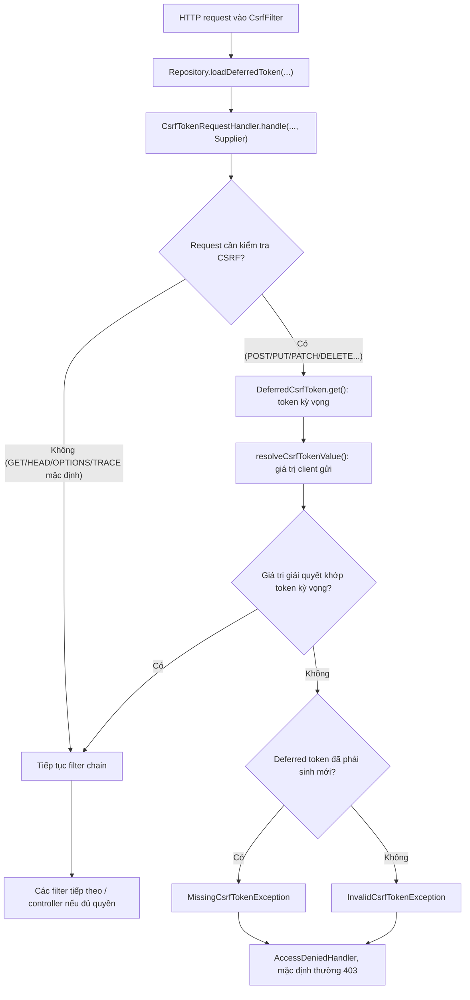

# `MissingCsrfTokenException`, `InvalidCsrfTokenException` và phản hồi

Trong **Spring Security Servlet**, một request không vượt qua kiểm tra CSRF thường bị từ chối trước khi controller xử lý. Hai exception quan trọng để hiểu nguyên nhân là **`MissingCsrfTokenException`** và **`InvalidCsrfTokenException`**. Tên gọi dễ gây hiểu nhầm: *“missing” không đơn giản đồng nghĩa request thiếu header*, còn *“invalid” không chỉ có nghĩa header chứa chuỗi sai*. Trong luồng `CsrfFilter` hiện đại, việc phân loại còn phụ thuộc vào **repository có đọc được token kỳ vọng đã lưu hay phải tạo token mới**.

Bài này thuộc chương **CSRF trên Servlet** của module **SPRING_SECURITY_HTTP_PROTECTION**. Module cung cấp kiến thức về các lớp phòng vệ HTTP/trình duyệt — CSRF, CORS, security headers, CSP, HSTS, HTTP firewall và session protection — với phạm vi Servlet lẫn Reactive, kiểm thử kịch bản tấn công và chẩn đoán xung đột bảo mật trong triển khai. Nội dung bên dưới dùng **API Spring Security Servlet 6.x**; WebFlux có các lớp và pipeline Reactive riêng.

**Sau bài học, bạn có thể:** giải thích hai exception, xác định bước nào trong filter phát hiện lỗi, phân biệt tình trạng token được lưu và giá trị client gửi, hiểu vì sao status thường là HTTP 403, thiết kế phản hồi JSON an toàn, kiểm thử với `MockMvc` và `CsrfFilter`, đồng thời khắc phục xung đột cookie–header, raw/masked token, session hoặc CORS mà không tắt bảo vệ CSRF.

## 1. Tình huống thực tế: cả hai lỗi đều có thể trả `403`

Giả sử trình duyệt đang dùng ứng dụng quản lý hồ sơ có endpoint:

```http
POST /api/profile HTTP/1.1
Host: app.example
Cookie: JSESSIONID=...
Content-Type: application/json

{"displayName":"Learner"}
```

Request này có thể bị từ chối vì thiếu CSRF token client gửi, ngay cả khi đã có cookie đăng nhập hợp lệ. Một request khác gửi header như:

```http
POST /api/profile HTTP/1.1
Host: app.example
Cookie: JSESSIONID=...
X-CSRF-TOKEN: token-cu-hoac-sai
Content-Type: application/json

{"displayName":"Learner"}
```

cũng có thể nhận cùng status:

```http
HTTP/1.1 403 Forbidden
```

Nhưng tên exception **không được quyết định chỉ bằng việc request có hoặc thiếu header**. Cần hỏi: **“Repository đã có token kỳ vọng được lưu từ trước chưa?”** Khi `CsrfFilter` lấy token kỳ vọng bằng `DeferredCsrfToken`, Spring Security có thể phân biệt token mới phải sinh với token đã được đọc từ kho lưu trữ.

| Trạng thái token kỳ vọng | Token client gửi | Kết quả thường gặp |
| --- | --- | --- |
| Repository **chưa có token**, phải tạo token mới | Không có header/form token | `MissingCsrfTokenException`, HTTP 403 |
| Repository **chưa có token**, phải tạo token mới | Có giá trị cũ hoặc sai | Vẫn có thể là `MissingCsrfTokenException`, HTTP 403 |
| Repository **đã có token** | Không có header/form token | `InvalidCsrfTokenException`, HTTP 403 |
| Repository **đã có token** | Có nhưng giá trị không khớp | `InvalidCsrfTokenException`, HTTP 403 |
| Repository **đã có token** | Giá trị được giải quyết đúng và khớp | Qua bước CSRF; vẫn có thể bị chặn bởi authorization |

Trong bảng, “token đã có” nghĩa là **token kỳ vọng mà repository đọc được từ request hiện tại** — không phải “JavaScript từng nhìn thấy một giá trị token ở đâu đó”. Một token bị xóa, cookie không được gửi hay session mới có thể khiến repository coi như chưa có token.

## 2. Exception thuộc nhóm nào trong Spring Security?

Các lớp Servlet cần nhận diện:

```java
import org.springframework.security.web.csrf.CsrfException;
import org.springframework.security.web.csrf.MissingCsrfTokenException;
import org.springframework.security.web.csrf.InvalidCsrfTokenException;
import org.springframework.security.access.AccessDeniedException;
```

Quan hệ kiểu:

```text
AccessDeniedException
  └── CsrfException
        ├── MissingCsrfTokenException
        └── InvalidCsrfTokenException
```

Chúng là lỗi **kiểm tra CSRF**, không phải lỗi JavaScript, lỗi parser JSON hoặc `AuthenticationException`. Trong cấu hình Servlet thông dụng, `CsrfFilter` xử lý sai token bằng một `AccessDeniedHandler`, thường đặt status `403 Forbidden`.

### `MissingCsrfTokenException`

Exception biểu thị trường hợp **không có token kỳ vọng được lưu** theo kết quả kiểm tra của filter. Trong Spring Security 6.x, khi deferred token được giải quyết và phải sinh mới (`isGenerated()`), nếu giá trị client cung cấp không khớp token kỳ vọng thì filter có thể dùng `MissingCsrfTokenException`.

**Điểm bất ngờ:** client hoàn toàn có thể đã gửi header `X-CSRF-TOKEN`, nhưng repository không đọc được token kỳ vọng của session/cookie hiện tại. Khi đó lỗi vẫn thuộc trường hợp “missing expected token”, thay vì “không gửi header”.

### `InvalidCsrfTokenException`

Exception thường biểu thị trường hợp **repository đọc được token kỳ vọng đã có**, nhưng giá trị mà request handler giải quyết từ request **không khớp**. Điều này bao gồm:

- Header đúng tên nhưng token sai hoặc đã hết vòng đời.
- Header/parameter hoàn toàn không được gửi dù repository còn token.
- Header sai tên nên request handler không thấy token.
- Header mang raw token trong khi handler chờ masked token, hoặc ngược lại.
- Token từ session/cookie khác với token kỳ vọng của request hiện tại.

Không phải cứ thấy chuỗi `InvalidCsrfTokenException` là có bằng chứng kẻ tấn công cố ý gửi token giả. Nó cũng có thể là **lỗi tích hợp**, browser không gửi cookie hoặc client giữ token cũ.

## 3. `CsrfFilter` phát hiện và phân loại lỗi như thế nào?

Trong Servlet, `FilterChainProxy` chọn `SecurityFilterChain` khớp request. Nếu chain có CSRF, `CsrfFilter` phối hợp với repository và request handler:



Đây là luồng khái quát cho Spring Security Servlet 6.x. Matcher mặc định không đòi CSRF trên các method an toàn `GET`, `HEAD`, `OPTIONS`, `TRACE` và áp dụng cho các method còn lại. Dù được miễn, **không thiết kế GET để thực hiện thao tác thay đổi dữ liệu**.

Một đoạn **mã giả** cô đọng nhằm giải thích quyết định, không phải mã nguồn để sao chép vào ứng dụng:

```java
DeferredCsrfToken deferred =
    repository.loadDeferredToken(request, response);

requestHandler.handle(request, response, deferred::get);

if (requiresCsrfProtection(request)) {
    CsrfToken expected = deferred.get();
    String actual =
        requestHandler.resolveCsrfTokenValue(request, expected);

    if (!constantTimeEquals(expected.getToken(), actual)) {
        AccessDeniedException error = deferred.isGenerated()
            ? new MissingCsrfTokenException(actual)
            : new InvalidCsrfTokenException(expected, actual);

        accessDeniedHandler.handle(request, response, error);
        return;
    }
}

chain.doFilter(request, response);
```

Chú ý bốn điều:

1. **So sánh diễn ra sau khi handler giải quyết biểu diễn token.** Filter không tự quyết định raw/masked token có cùng chuỗi với cookie hay không.
2. **`deferred.isGenerated()` nói về token kỳ vọng**; không phải kiểm tra `actual == null`.
3. **Khi không khớp, request bị chặn trước khi controller xử lý.** Nó không được “đi tiếp rồi báo lỗi”.
4. **Không dùng mã giả làm bản thay thế `CsrfFilter`.** Spring Security đã xử lý so sánh an toàn và quản lý exception; ta chỉ dùng mô hình này để chẩn đoán.

### Vì sao deferred token có thể sinh token ngay khi POST bị từ chối?

Khi repository chưa có token, filter cần một giá trị kỳ vọng để xác minh. Việc gọi `deferred.get()` có thể làm repository tạo và lưu token mới, ví dụ tạo session hoặc phát cookie `XSRF-TOKEN`. Nhưng request POST đang gửi **không có** token client hợp lệ đó, nên filter vẫn trả `403`.

```text
POST /api/profile, không có session/token CSRF kỳ vọng
  -> DeferredCsrfToken.get()
  -> Repository loadToken() không tìm thấy
  -> generateToken() và saveToken() có thể chạy
  -> isGenerated() == true
  -> Request client không khớp token vừa tạo
  -> MissingCsrfTokenException + HTTP 403
```

Vì vậy thấy `Set-Cookie` trên một response `403` **không chứng minh request đã thành công**, và cũng không có nghĩa frontend có thể dùng token mới trong **chính** request đã gửi. Browser cần nhận response rồi thực hiện bước lấy/gửi token đúng ở request sau.

## 4. Phân biệt “thiếu token client” và “thiếu token kỳ vọng”

Hai cụm từ này khác nhau:

| Khái niệm | Ý nghĩa | Quan sát ở đâu? |
| --- | --- | --- |
| **Token client gửi** (*actual*) | Header hoặc form parameter request handler đọc được | Request Headers/Form Data |
| **Token kỳ vọng** (*expected*) | Token repository đọc từ session/cookie hiện tại hoặc mới tạo | Phía server/repository, test và trạng thái session |
| **Token bị che** (*masked*) | Biểu diễn client nhận từ XOR handler; phải giải quyết về raw | Form HTML, API bootstrap |
| **Token gốc** (*raw*) | Giá trị repository dùng để xác minh | `CsrfTokenRepository`, `CsrfFilter` |

Ví dụ:

```http
POST /change-email HTTP/1.1
Cookie: JSESSIONID=<session-con-token>
Content-Type: application/json

{"email":"learner@example.com"}
```

Repository vẫn có token kỳ vọng, nhưng request client không có header hoặc parameter phù hợp. Trong luồng phân loại nêu trên, đây thường là **`InvalidCsrfTokenException`** chứ không phải `MissingCsrfTokenException`.

Ngược lại:

```http
POST /change-email HTTP/1.1
X-CSRF-TOKEN: <token-tu-phien-da-het-han>
Content-Type: application/json

{"email":"learner@example.com"}
```

Nếu session/token kỳ vọng không còn được repository đọc thấy, filter có thể phải sinh token mới và phân loại thành **`MissingCsrfTokenException`** dù header client vẫn có mặt.

**Quy tắc chẩn đoán:** luôn kiểm tra **cả expected lẫn actual** và bối cảnh session/cookie; đừng phân loại chỉ bằng việc request có header hay không.

## 5. HTTP 403 được tạo ở đâu và khác HTTP 401 thế nào?

CSRF là bước bảo vệ thao tác dùng credentials do trình duyệt có thể tự gửi, không phải thủ tục đăng nhập mới. Trong cấu hình Spring Security Servlet thông dụng, khi token thiếu hoặc sai, `CsrfFilter` chuyển exception tới `AccessDeniedHandler`. Handler mặc định thường gửi:

```http
HTTP/1.1 403 Forbidden
```

Nội dung body có thể là trang lỗi của container, một trang error tùy biến hoặc thông điệp do hạ tầng xử lý. **Không nên hứa response luôn là JSON** nếu ứng dụng chưa cấu hình handler xuất JSON cho lỗi CSRF.

Phân biệt ý nghĩa HTTP:

| Status | Thường biểu thị | Chú ý |
| --- | --- | --- |
| `401 Unauthorized` | Client chưa cung cấp hoặc cung cấp credentials không hợp lệ trong một cơ chế xác thực thích hợp | Có thể kèm `WWW-Authenticate`; thường gắn với authentication entry point |
| `403 Forbidden` | Server từ chối request; trong bài này thường do CSRF check, cũng có thể do thiếu quyền | Chỉ status code không đủ phân biệt CSRF và authorization |
| `302` đến login | Một số luồng web điều hướng khi chưa xác thực | Không phải phản hồi mặc định bảo đảm cho lỗi CSRF |
| `400 Bad Request` | Cú pháp request hoặc validation không phù hợp, tùy ứng dụng | Không nên đổi lỗi CSRF thành `400` chỉ vì header thiếu |

**Đối với `CsrfFilter`, mặc định thường là `403` ngay cả khi người dùng chưa đăng nhập**, vì filter xử lý việc thiếu/sai token theo handler riêng. Một `403` từ `AuthorizationFilter` hoặc endpoint cũng có thể có cùng status, nhưng nguyên nhân và cách khắc phục khác nhau.

### Không bật `permitAll()` để “chữa 403”

`permitAll()` thuộc lớp authorization. Nó không loại bỏ bước kiểm tra CSRF trước đó. Một `POST /login` hoặc `POST /register` được phép truy cập công khai vẫn có thể cần CSRF token theo matcher mặc định.

```java
http.authorizeHttpRequests(auth -> auth
    .requestMatchers("/login", "/register").permitAll()
    .anyRequest().authenticated());
```

Đoạn cấu hình trên chỉ nói về **quyền truy cập**, không thay đổi việc `CsrfFilter` xác minh `POST`. Nếu form login bị `403`, hãy kiểm tra token của form và vòng đời phiên, thay vì tiếp tục mở rộng matcher `permitAll()`.

## 6. `AccessDeniedHandler`: phản hồi chung nhưng giữ nguyên nhân trong server

Ứng dụng web render HTML có thể muốn hiển thị trang lỗi, còn SPA gọi JSON API thường muốn nhận một **mã lỗi ổn định**. Cả hai exception CSRF đều kế thừa `AccessDeniedException`, vì vậy có thể được xử lý qua `AccessDeniedHandler` của `CsrfFilter`.

Điều cần tránh là trả nguyên exception message cho client. Thông điệp của exception bảo mật có thể chứa thông tin về token đã gửi hoặc token kỳ vọng, hoặc khiến client nhìn thấy chi tiết nội bộ không cần thiết. **Hãy trả thông điệp công khai chung** và chỉ ghi nhận thông tin chẩn đoán an toàn ở phía server.

Một phản hồi JSON gợi ý:

```http
HTTP/1.1 403 Forbidden
Content-Type: application/json;charset=UTF-8
Cache-Control: no-store

{"code":"CSRF_VALIDATION_FAILED","message":"CSRF token is missing or invalid"}
```

Đây là **hợp đồng API ví dụ**, không phải body mặc định của Spring Security. Không phân biệt công khai `MISSING` với `INVALID` nếu client không thực sự cần: phân biệt như vậy có thể tiết lộ trạng thái repository/session và làm frontend phụ thuộc vào chi tiết triển khai của filter.

### Ví dụ `AccessDeniedHandler` cho API JSON

```java
import jakarta.servlet.ServletException;
import jakarta.servlet.http.HttpServletRequest;
import jakarta.servlet.http.HttpServletResponse;
import java.io.IOException;
import java.nio.charset.StandardCharsets;
import org.springframework.http.HttpHeaders;
import org.springframework.http.MediaType;
import org.springframework.security.access.AccessDeniedException;
import org.springframework.security.web.access.AccessDeniedHandler;

public final class JsonCsrfAccessDeniedHandler
        implements AccessDeniedHandler {

    @Override
    public void handle(
            HttpServletRequest request,
            HttpServletResponse response,
            AccessDeniedException exception)
            throws IOException, ServletException {

        response.setStatus(HttpServletResponse.SC_FORBIDDEN);
        response.setContentType(MediaType.APPLICATION_JSON_VALUE);
        response.setCharacterEncoding(StandardCharsets.UTF_8.name());
        response.setHeader(HttpHeaders.CACHE_CONTROL, "no-store");
        response.getWriter().write(
            "{\"code\":\"CSRF_VALIDATION_FAILED\","
          + "\"message\":\"CSRF token is missing or invalid\"}");
    }
}
```

Code cố ý **không xuất** `exception.getMessage()`, raw token, masked token, session ID hay tên cookie. Mọi lỗi đi vào handler này từ `CsrfFilter` được trình bày bằng cùng một payload đơn giản, tránh rò rỉ thông tin nhạy cảm.

Nếu dùng cùng ứng dụng cho cả HTML form và JSON API, handler có thể dựa vào **route được quản lý rõ ràng** để chọn nội dung HTML/JSON phù hợp. Không nên dựa hoàn toàn vào `Accept` header khi muốn kiểm soát phân vùng API, vì header do client tự cung cấp.

### Gắn handler vào chính `CsrfFilter`

`CsrfFilter` có `setAccessDeniedHandler(...)`. Trong cấu hình Servlet có thể dùng object post-processor để chỉnh handler của filter được Spring Security tạo, ví dụ API DSL Spring Security 6.x:

```java
import org.springframework.context.annotation.Bean;
import org.springframework.context.annotation.Configuration;
import org.springframework.security.config.annotation.ObjectPostProcessor;
import org.springframework.security.config.annotation.web.builders.HttpSecurity;
import org.springframework.security.web.SecurityFilterChain;
import org.springframework.security.web.csrf.CsrfFilter;

@Configuration
class SecurityConfiguration {

    @Bean
    SecurityFilterChain securityFilterChain(HttpSecurity http)
            throws Exception {

        http
            .authorizeHttpRequests(auth -> auth
                .requestMatchers("/csrf", "/login").permitAll()
                .anyRequest().authenticated())
            .csrf(csrf -> csrf
                .withObjectPostProcessor(
                    new ObjectPostProcessor<CsrfFilter>() {
                        @Override
                        public <O extends CsrfFilter> O postProcess(O filter) {
                            filter.setAccessDeniedHandler(
                                new JsonCsrfAccessDeniedHandler());
                            return filter;
                        }
                    }));

        return http.build();
    }
}
```

Đoạn cấu hình minh họa cách gắn vào **filter CSRF**, giả định `JsonCsrfAccessDeniedHandler` đã được khai báo ở trên. Khi dự án dùng nhiều `SecurityFilterChain`, cần gắn cấu hình ở chain tương ứng, không nghĩ rằng một cấu hình duy nhất tự ảnh hưởng mọi chain.

**Lưu ý:** Cấu hình `exceptionHandling(...)` cho lỗi authorization **không đồng nghĩa chắc chắn đã thay response của `CsrfFilter`** trong mọi phiên bản/cấu hình. `CsrfFilter` tự nắm giữ `AccessDeniedHandler` cho lỗi CSRF. Nếu đã thay đổi phản hồi chung của Spring Security, hãy viết test xác nhận chính request thiếu/sai token đi vào handler bạn mong đợi.

### `@RestControllerAdvice` có bắt lỗi này không?

Thông thường **không**. `@RestControllerAdvice` xử lý lỗi trong chuỗi thực thi Spring MVC controller, còn `CsrfFilter` có thể chặn request **trước khi controller được gọi**. Trả JSON cho lỗi CSRF nên được xử lý tại tầng Servlet filter phù hợp; đừng dựa vào một `@ExceptionHandler(CsrfException.class)` trong controller advice để bảo đảm bắt mọi trường hợp.

## 7. Lỗi CSRF và lỗi phân quyền có thể cùng HTTP status

`403 Forbidden` chỉ mô tả kết quả HTTP, không chỉ ra chính xác nguồn gốc:

```text
POST /api/profile
      |
      v
CsrfFilter
  |-- Thiếu/sai CSRF token -> xử lý 403 tại đây
  |
  +-- CSRF hợp lệ
         |
         v
Authentication/Authorization filters
  |-- Chưa đăng nhập hoặc không đủ quyền -> 401/403/redirect tùy cơ chế
  |
  +-- Được phép
         |
         v
Controller / business logic
  |-- Có thể có lỗi nghiệp vụ riêng
  +-- Hoàn tất thao tác
```

Không nên viết frontend theo logic “mọi `403` đều gọi `GET /csrf` rồi thử lại”. Nếu người dùng thực sự thiếu quyền, cách xử lý đó không giúp được gì; còn nếu request ghi dữ liệu có thể đã được xử lý ở một lớp khác trước khi client mất kết nối, retry vô điều kiện có thể gây tác động lặp.

Với API có hợp đồng phản hồi ổn định, frontend có thể nhận diện **mã ứng dụng** `CSRF_VALIDATION_FAILED`, hiển thị thông báo hợp lý, bootstrap token khi cần và chỉ thực hiện lại thao tác theo chính sách an toàn/idempotency rõ ràng.

### Có nên phân biệt exception bằng message gửi cho browser?

Thường không cần. Một lỗi CSRF có thể bắt nguồn từ session hết hạn, tab cũ, cookie bị chặn, raw/masked token hoặc hành vi tấn công. Chi tiết như tên exception, token kỳ vọng hay trạng thái repository phù hợp hơn cho **telemetry nội bộ được bảo vệ**. Client chỉ cần biết request không được chấp nhận và có thể hướng dẫn tải lại biểu mẫu hoặc khôi phục phiên.

## 8. Form MVC: thiếu hidden field và token sau khi session đổi

Trong trang HTML form render bằng Spring MVC/Thymeleaf, token thường xuất hiện trong hidden field:

```html
<form method="post" action="/account/email">
  <label for="email">Email mới</label>
  <input name="email" id="email" type="email" required>

  <input type="hidden"
         th:name="${_csrf.parameterName}"
         th:value="${_csrf.token}">

  <button type="submit">Lưu</button>
</form>
```

Với Spring Security 6.x mặc định, `XorCsrfTokenRequestAttributeHandler` thường công bố **masked token** nhằm giảm nguy cơ BREACH khi render trong phản hồi HTML có nén. Form gửi chính chuỗi masked qua parameter `_csrf`, handler giải quyết về token gốc rồi filter so sánh.

Hai tình huống dễ gây nhầm:

**Form không có field `_csrf`:** repository vẫn có raw token kỳ vọng trong `HttpSession`, nhưng request không có giá trị do client gửi để handler giải quyết. Kết quả thường thuộc nhánh `InvalidCsrfTokenException`.

**Form được mở từ trước khi session hết hạn:** HTML vẫn chứa masked token gắn với raw token của phiên cũ. Khi người dùng bấm gửi, browser có thể không còn session cũ, repository phải tạo token kỳ vọng mới; lỗi có thể thuộc nhánh `MissingCsrfTokenException` dù form đã gửi field hợp lệ về mặt cú pháp.

Đừng thay mã ứng dụng bằng cách tự gọi `repository.generateToken()` ở mỗi render nếu không kiểm soát được vòng đời và session. Hãy dùng đối tượng `_csrf` mà request handler đã công bố; nếu token hết hiệu lực, xây dựng luồng tải lại form hoặc cấp lại token.

### Nếu Thymeleaf tự thêm hidden field

Một số tích hợp Spring MVC/Thymeleaf có thể tự chèn CSRF hidden input khi form dùng `th:action`. Khi debug, **xem HTML đã render và request form data thực tế**. Không thêm hai field `_csrf` khác nhau chỉ vì chưa thấy một input trong template nguồn.

## 9. SPA: raw cookie, masked token và exception

Với SPA, hai cách cấp token thường gặp:

| Cách cấp | Token client nhận | Client thường gửi | Handler tương thích |
| --- | --- | --- | --- |
| `HttpSessionCsrfTokenRepository` + endpoint JSON lấy `_csrf.token` từ XOR handler | **Masked token** | Header `X-CSRF-TOKEN` chứa masked token | XOR resolver |
| `CookieCsrfTokenRepository` + `withHttpOnlyFalse()` | **Raw token** trong `XSRF-TOKEN` | Header `X-XSRF-TOKEN` chứa raw token | Plain resolver hoặc handler kết hợp |
| HTML form dùng XOR handler | Masked token trong hidden field | Parameter `_csrf` | XOR resolver |

Giả sử SPA dùng cookie–header:

```http
Cookie: XSRF-TOKEN=RAW_T
X-XSRF-TOKEN: RAW_T
```

Nếu `XorCsrfTokenRequestAttributeHandler` cố giải mã `RAW_T` như masked token, giá trị giải quyết có thể không đúng raw token kỳ vọng. Nếu repository **đã** đọc được `RAW_T` từ cookie, `CsrfFilter` có thể phân loại lỗi thành **`InvalidCsrfTokenException`**. Đây không phải bằng chứng cookie đã sai; có thể chính **request handler đang mong định dạng khác**.

Ngược lại, request `POST` chỉ có header raw mà **không có cookie `XSRF-TOKEN` được gửi tới backend** có thể khiến repository không thấy token kỳ vọng. Lúc đó filter có thể sinh mới và phân loại **`MissingCsrfTokenException`**.

### Tên header hoặc cookie bị đổi

`CookieCsrfTokenRepository` mặc định thường dùng cookie `XSRF-TOKEN` và header `X-XSRF-TOKEN`. Nếu server đổi sang `APP-XSRF`/`X-APP-CSRF` mà frontend vẫn dùng tên cũ:

- Cookie cũ có thể vẫn nằm trong browser, nhưng repository đang tìm **cookie tên mới**.
- Header cũ có thể vẫn xuất hiện trên Network panel, nhưng request handler đang đọc **header tên mới**.
- Exception phụ thuộc repository có đọc được token kỳ vọng hay không, không chỉ phụ thuộc có header nào trong request.

Khi gặp lỗi, hãy kiểm tra cả hai đường: **cookie/session cho expected** và **header/form cho actual**, rồi mới xét raw/masked.

## 10. Login, logout, session timeout và hai loại exception

Trạng thái token kỳ vọng không cố định qua mọi giai đoạn đăng nhập. Trong các cấu hình Spring Security phổ biến:

- `CsrfAuthenticationStrategy` có thể xóa token CSRF khi xác thực thành công.
- `CsrfLogoutHandler` có thể xóa token khi logout.
- Session hết hạn hoặc bị invalidate khiến `HttpSessionCsrfTokenRepository` không còn đọc được token đã lưu.
- `CookieCsrfTokenRepository` có thể phát `Set-Cookie` hết hạn khi xóa token.
- Client giữ token trong biến JavaScript hoặc form HTML cũ **không biết ngay** server đã xóa token.

Một tình huống:

```mermaid
sequenceDiagram
    participant App as Frontend SPA
    participant Security as Spring Security
    participant Browser as Browser/cookie jar
    App->>Security: GET /csrf
    Security-->>App: Token T1 cho phiên hiện tại
    App->>Security: POST /login + T1
    Security->>Security: Đăng nhập thành công; có thể xóa T1
    Security-->>Browser: Response login, cập nhật session/cookie
    App->>Security: POST /api/profile + T1 cũ
    Security->>Security: Repository không còn T1
    Security-->>App: HTTP 403 (loại exception tùy trạng thái token)
    App->>Security: GET /csrf để lấy token hiện hành T2
    Security-->>App: Token T2
    App->>Security: POST /api/profile + T2, đúng cookie/session
    Security-->>App: Tiếp tục nếu xác thực và phân quyền hợp lệ
```

Điểm quan trọng là **không suy loại exception chỉ từ việc trước đó vừa login/logout**:

| Trạng thái sau biến cố | Có thể quan sát |
| --- | --- |
| Repository không còn token kỳ vọng và phải tạo lại | `MissingCsrfTokenException` ở request sai token đầu tiên |
| Repository đã được bootstrap token mới `T2`, nhưng client vẫn gửi `T1` | `InvalidCsrfTokenException` |
| Client lấy `T2` và dùng đúng phiên/cookie | Có thể qua CSRF; các lớp phân quyền vẫn còn |
| Cookie session/authentication hết hạn nhưng token cookie CSRF vẫn khớp | Có thể qua CSRF nhưng bị từ chối ở lớp authentication |

Một quy trình frontend hợp lý là **lấy lại token sau khi thay đổi trạng thái xác thực**. Đừng lưu một raw/masked token như giá trị bất biến trong `localStorage` qua nhiều phiên. Với hành động có side effect, chỉ retry theo quy tắc rõ ràng; nếu không biết request ban đầu đã được xử lý đến đâu, không tự động gửi lại thao tác nhạy cảm vô hạn.

### Hai tab và session rotation

Hai tab dùng chung session có thể cùng giữ biểu diễn masked khác nhau cho cùng token gốc. Điều này bình thường. Nhưng khi một tab logout hoặc xác thực lại khiến token gốc bị xóa, token đã render trong tab kia có thể hết hiệu lực. Nên hướng dẫn người dùng tải lại form hoặc bootstrap token sau khi xác nhận trạng thái phiên, thay vì hiển thị “bạn đang bị tấn công”.

### Nhiều node và session không đồng bộ

Nếu request GET cấp token ở node A rồi POST được chuyển tới node B không thấy session tương ứng, repository có thể coi là thiếu token kỳ vọng. Trong một số trường hợp, exception là `MissingCsrfTokenException` mặc dù frontend đã gửi token đúng theo trang mà node A cấp. Hãy kiểm tra session sharing, sticky sessions, reverse proxy và đường đi cookie trước khi thay đổi request handler.

## 11. Test trực tiếp `CsrfFilter`: phân loại missing và invalid

Không cần toàn bộ Spring Boot để chứng minh quyết định phân loại. Ta có thể tạo `CsrfFilter`, dùng `HttpSessionCsrfTokenRepository`, và một `AccessDeniedHandler` thử nghiệm ghi lại **kiểu exception**. Test không xuất token thật và không sửa logic filter.

```java
import java.util.concurrent.atomic.AtomicReference;
import org.junit.jupiter.api.BeforeEach;
import org.junit.jupiter.api.Test;
import org.springframework.mock.web.MockFilterChain;
import org.springframework.mock.web.MockHttpServletRequest;
import org.springframework.mock.web.MockHttpServletResponse;
import org.springframework.mock.web.MockHttpSession;
import org.springframework.security.access.AccessDeniedException;
import org.springframework.security.web.csrf.CsrfFilter;
import org.springframework.security.web.csrf.HttpSessionCsrfTokenRepository;
import org.springframework.security.web.csrf.InvalidCsrfTokenException;
import org.springframework.security.web.csrf.MissingCsrfTokenException;
import org.springframework.security.web.csrf.DeferredCsrfToken;

import static org.junit.jupiter.api.Assertions.*;

class CsrfFailureClassificationTest {

    private final HttpSessionCsrfTokenRepository repository =
        new HttpSessionCsrfTokenRepository();

    private final CsrfFilter filter = new CsrfFilter(repository);
    private final AtomicReference<AccessDeniedException> captured =
        new AtomicReference<>();

    @BeforeEach
    void setUp() {
        captured.set(null);
        filter.setAccessDeniedHandler((req, res, ex) -> {
            captured.set(ex);
            res.setStatus(403);
        });
    }

    @Test
    void postWithoutStoredTokenIsClassifiedAsMissing() throws Exception {
        var request = new MockHttpServletRequest("POST", "/api/profile");
        var response = new MockHttpServletResponse();
        var chain = new MockFilterChain();

        filter.doFilter(request, response, chain);

        assertEquals(403, response.getStatus());
        assertInstanceOf(MissingCsrfTokenException.class, captured.get());
        assertNull(chain.getRequest()); // Controller/chain chưa được gọi.

        // Repository có thể đã tạo token trong lúc xác minh.
        assertNotNull(request.getSession(false));
    }

    @Test
    void postWithoutHeaderButWithStoredTokenIsInvalid() throws Exception {
        var bootstrap = new MockHttpServletRequest("GET", "/csrf");
        DeferredCsrfToken issued = repository.loadDeferredToken(
            bootstrap, new MockHttpServletResponse());
        issued.get(); // Tạo và lưu token kỳ vọng ở session.

        MockHttpSession session =
            (MockHttpSession) bootstrap.getSession(false);
        assertNotNull(session);

        var request = new MockHttpServletRequest("POST", "/api/profile");
        request.setSession(session);
        var response = new MockHttpServletResponse();
        var chain = new MockFilterChain();

        // Request KHÔNG có header/parameter CSRF dù session có token.
        filter.doFilter(request, response, chain);

        assertEquals(403, response.getStatus());
        assertInstanceOf(InvalidCsrfTokenException.class, captured.get());
        assertNull(chain.getRequest());
    }
}
```

Test đầu thể hiện nhánh **repository chưa có expected token**. Test thứ hai thể hiện nhánh **repository đã có expected token nhưng actual token vắng mặt**. Đây là bằng chứng thực hành rằng tên exception không chỉ dựa trên sự hiện diện của header.

Một số điểm cần lưu ý khi đọc test:

- `HttpSessionCsrfTokenRepository` tạo session khi lưu token mới, nhưng các thành phần khác trong ứng dụng thật cũng có thể tạo session.
- `MockFilterChain.getRequest()` dùng để biết request có được đi tiếp qua filter không; khi bị chặn, chain chưa nhận request.
- Test dùng filter riêng, **không** kiểm tra JSON response custom hoặc toàn bộ authorization chain. Điều đó sẽ được kiểm thử ở phần sau.
- `setAccessDeniedHandler(...)` ở test giúp quan sát exception mà không phải parse thông điệp chứa token hoặc phụ thuộc container error page.

### Test thứ ba: header sai khi expected token đã tồn tại

Có thể bổ sung vào cùng class:

```java
@Test
void wrongHeaderWithExistingTokenIsInvalid() throws Exception {
    var first = new MockHttpServletRequest("GET", "/form");
    repository.loadDeferredToken(
        first, new MockHttpServletResponse()).get();

    var session = (MockHttpSession) first.getSession(false);
    var post = new MockHttpServletRequest("POST", "/api/profile");
    post.setSession(session);
    post.addHeader("X-CSRF-TOKEN", "incorrect-client-value");

    var response = new MockHttpServletResponse();
    filter.doFilter(post, response, new MockFilterChain());

    assertEquals(403, response.getStatus());
    assertInstanceOf(InvalidCsrfTokenException.class, captured.get());
}
```

Đây là **phương thức bổ sung vào class test phía trên**, nên dùng lại các field `repository`, `filter`, `captured` và các import sẵn có. Mục tiêu là kiểm tra trường hợp actual token có mặt nhưng không hợp lệ khi repository đã lưu expected token.

## 12. Test một request hợp lệ: bảo đảm handler và filter thực sự cho đi tiếp

Các test trước chỉ kiểm tra lỗi. Cũng phải chứng minh **một token hợp lệ có thể vượt qua `CsrfFilter`**, tránh tình trạng cấu hình khiến mọi POST đều thất bại.

Với session repository và XOR handler mặc định, ví dụ sau có thể được thêm vào class test mục 11:

```java
import org.springframework.security.web.csrf.CsrfToken;
import org.springframework.security.web.csrf.XorCsrfTokenRequestAttributeHandler;

@Test
void correctMaskedTokenReachesNextFilter() throws Exception {
    filter.setRequestHandler(new XorCsrfTokenRequestAttributeHandler());

    // Bước 1: GET render form, lấy biểu diễn masked từ request attribute.
    var form = new MockHttpServletRequest("GET", "/form");
    var formResponse = new MockHttpServletResponse();
    filter.doFilter(form, formResponse, new MockFilterChain());

    CsrfToken exposed =
        (CsrfToken) form.getAttribute("_csrf");
    assertNotNull(exposed);
    String masked = exposed.getToken();

    MockHttpSession session =
        (MockHttpSession) form.getSession(false);
    assertNotNull(session);

    // Bước 2: POST cùng session, gửi masked token đã nhận.
    var post = new MockHttpServletRequest("POST", "/api/profile");
    post.setSession(session);
    post.addHeader(exposed.getHeaderName(), masked);
    var response = new MockHttpServletResponse();
    var chain = new MockFilterChain();

    captured.set(null);
    filter.doFilter(post, response, chain);

    assertNull(captured.get());
    assertNotNull(chain.getRequest());
    assertEquals(200, response.getStatus()); // Response mô phỏng mặc định.
}
```

Đây là **một phương thức test bổ sung** với các import mới được đặt ở đầu file Java, không chèn import giữa các method khi copy. `MockFilterChain` không tự chứa controller trả `204` hay `201`; status `200` ở đây chỉ phản ánh response giả mặc định và việc filter không chặn. Với kiểm thử tích hợp controller thật, assert status theo API.

Không nên lấy một token raw trực tiếp từ `HttpSessionCsrfTokenRepository` rồi gửi vào XOR handler dưới header và kỳ vọng hợp lệ. Nếu handler mong biểu diễn masked, hãy lấy **giá trị đã được công bố** bằng `_csrf.token` đúng cách như test này.

## 13. MockMvc: kiểm thử hợp đồng phản hồi JSON của API

Một hệ thống thực tế cần kiểm tra **cả loại exception ở tầng filter và HTTP response mà client nhận**. Unit test ở mục 11 xác minh phân loại. `MockMvc` giúp kiểm tra `status`, `Content-Type`, header cache và body JSON sau khi security chain xử lý request.

Giả sử đã áp dụng `SecurityConfiguration` có `JsonCsrfAccessDeniedHandler` ở mục 6, và tạo hai endpoint mẫu:

```java
import org.springframework.http.CacheControl;
import org.springframework.http.ResponseEntity;
import org.springframework.security.web.csrf.CsrfToken;
import org.springframework.web.bind.annotation.GetMapping;
import org.springframework.web.bind.annotation.PostMapping;
import org.springframework.web.bind.annotation.RequestAttribute;
import org.springframework.web.bind.annotation.RestController;

@RestController
class ProfileController {

    @GetMapping("/csrf")
    ResponseEntity<CsrfPayload> csrf(
            @RequestAttribute("_csrf") CsrfToken csrfToken) {
        CsrfPayload payload = new CsrfPayload(
            csrfToken.getHeaderName(), csrfToken.getToken());
        return ResponseEntity.ok()
            .cacheControl(CacheControl.noStore())
            .body(payload);
    }

    @PostMapping("/api/profile")
    ResponseEntity<Void> updateProfile() {
        return ResponseEntity.noContent().build();
    }

    record CsrfPayload(String headerName, String token) {}
}
```

Controller dùng `_csrf.token` do request handler công bố. Với handler XOR mặc định, token trong JSON có thể là **masked token**. Khi dùng token này trong request header, client phải gửi biểu diễn mà request handler tương ứng biết giải quyết.

Test Spring Boot với `spring-boot-starter-test` và `spring-security-test`:

```java
import org.junit.jupiter.api.Test;
import org.springframework.beans.factory.annotation.Autowired;
import org.springframework.boot.test.autoconfigure.web.servlet.AutoConfigureMockMvc;
import org.springframework.boot.test.context.SpringBootTest;
import org.springframework.mock.web.MockHttpSession;
import org.springframework.security.test.context.support.WithMockUser;
import org.springframework.test.web.servlet.MockMvc;
import org.springframework.test.web.servlet.MvcResult;

import static org.junit.jupiter.api.Assertions.*;
import static org.springframework.test.web.servlet.request.MockMvcRequestBuilders.*;
import static org.springframework.test.web.servlet.result.MockMvcResultMatchers.*;

@SpringBootTest
@AutoConfigureMockMvc
@WithMockUser(username = "learner")
class CsrfJsonResponseTest {

    @Autowired
    MockMvc mvc;

    @Test
    void postWithoutStoredCsrfTokenReturnsSafeJsonError()
            throws Exception {

        mvc.perform(post("/api/profile"))
            .andExpect(status().isForbidden())
            .andExpect(header().string("Cache-Control", "no-store"))
            .andExpect(content().contentTypeCompatibleWith(
                "application/json"))
            .andExpect(jsonPath("$.code")
                .value("CSRF_VALIDATION_FAILED"))
            .andExpect(jsonPath("$.message")
                .value("CSRF token is missing or invalid"));
    }

    @Test
    void postWithStoredTokenButMissingHeaderHasSamePublicError()
            throws Exception {
        MvcResult issued = mvc.perform(get("/csrf"))
            .andExpect(status().isOk())
            .andReturn();

        MockHttpSession session = (MockHttpSession)
            issued.getRequest().getSession(false);
        assertNotNull(session);

        mvc.perform(post("/api/profile").session(session))
            .andExpect(status().isForbidden())
            .andExpect(jsonPath("$.code")
                .value("CSRF_VALIDATION_FAILED"));
    }
}
```

**Điều kiện:** ứng dụng có đúng controller và security chain minh họa; handler JSON đã được gắn vào `CsrfFilter`; endpoint `/api/profile` cần authentication, và mock user đã được cấp. Trong dự án khác, phải điều chỉnh đường dẫn, status và quyền truy cập theo cấu hình thật.

Hai test này cố ý yêu cầu **cùng mã lỗi công khai** cho hai trạng thái khác nhau. Để chứng minh chính xác class exception nào đã được tạo, dùng unit test ghi lại exception ở mục 11; không ép `MockMvc` phụ thuộc vào chi tiết nội bộ của body thông báo.

### Một test dương để tránh cấu hình chặn mọi POST

Với endpoint `/csrf` trả masked token, có thể dùng Jackson để parse response rồi gửi lại token cùng session:

```java
import com.fasterxml.jackson.databind.JsonNode;
import com.fasterxml.jackson.databind.ObjectMapper;

// Phần bổ sung vào class CsrfJsonResponseTest:
@Autowired
ObjectMapper objectMapper;

@Test
void validTokenCanReachController() throws Exception {
    MvcResult issued = mvc.perform(get("/csrf"))
        .andExpect(status().isOk())
        .andReturn();

    JsonNode payload = objectMapper.readTree(
        issued.getResponse().getContentAsString());
    String headerName = payload.path("headerName").asText();
    String token = payload.path("token").asText();

    MockHttpSession session = (MockHttpSession)
        issued.getRequest().getSession(false);
    assertNotNull(session);
    assertFalse(token.isBlank());

    mvc.perform(post("/api/profile")
            .session(session)
            .header(headerName, token))
        .andExpect(status().isNoContent());
}
```

Đây là **đoạn bổ sung** cùng lớp test, với import đặt ở đầu file Java. Nó giả định request handler hiện hành giải quyết đúng biểu diễn token mà controller `/csrf` cấp. Nếu server đã tùy biến handler để coi mọi header là **raw**, không thể gửi một token **masked** qua header mà giữ nguyên kỳ vọng; phải đồng bộ giao ước server/client.

### Vì sao không chỉ dùng `.with(csrf())`?

Helper `spring-security-test`:

```java
import static org.springframework.security.test.web.servlet.request
    .SecurityMockMvcRequestPostProcessors.csrf;

// Trong test đã có MockMvc:
mockMvc.perform(post("/api/profile").with(csrf()));
mockMvc.perform(post("/api/profile")
    .with(csrf().useInvalidToken()));
```

giúp kiểm thử request hợp lệ hoặc sai token rất nhanh. Tuy nhiên nó **không đủ** để chứng minh browser nhận cookie/session, lấy token qua endpoint nào và gửi lại đúng raw/masked token như sản phẩm thật. Khi bài toán là `MissingCsrfTokenException`/`InvalidCsrfTokenException`, hãy kiểm thử **trạng thái token kỳ vọng trước POST** và HTTP response thực tế.

## 14. Thiết kế phản hồi frontend: an toàn và hữu ích cho người dùng

Với SPA, có thể xây dựng giao ước:

```json
{
  "code": "CSRF_VALIDATION_FAILED",
  "message": "CSRF token is missing or invalid"
}
```

Frontend nên phân biệt lỗi này với mã lỗi khác **theo field `code` do server chủ động trả về**, không chỉ theo HTTP status `403`. Luồng xử lý có thể là:

1. Dừng thao tác hiện tại; không coi response là thành công.
2. Kiểm tra có phải trang/phiên đã cũ hoặc vừa login/logout không.
3. Nếu vẫn có ngữ cảnh đăng nhập phù hợp, gọi endpoint `GET /csrf` để nhận token mới; bảo đảm cookie/session được gửi đúng.
4. Cho người dùng thử lại thao tác qua UI, hoặc dùng cơ chế retry **được thiết kế an toàn** cho thao tác idempotent và không gây side effect lặp.
5. Nếu vẫn thất bại, hiển thị hướng dẫn khôi phục phiên và ghi mã sự cố an toàn để hỗ trợ chẩn đoán.

Ví dụ JavaScript chỉ hiển thị thông báo, **không tự retry một POST ghi dữ liệu**:

```javascript
async function saveProfile(displayName, csrf) {
  const response = await fetch("/api/profile", {
    method: "POST",
    credentials: "same-origin",
    headers: {
      "Content-Type": "application/json",
      [csrf.headerName]: csrf.token
    },
    body: JSON.stringify({ displayName })
  });

  if (response.ok) {
    return { success: true };
  }

  if (response.status === 403) {
    const problem = await response.json().catch(() => null);
    if (problem?.code === "CSRF_VALIDATION_FAILED") {
      return {
        success: false,
        action: "refresh-csrf",
        message: "Phiên biểu mẫu đã thay đổi. Vui lòng lấy token mới."
      };
    }
  }

  return {
    success: false,
    action: "show-error",
    message: `Không thể lưu dữ liệu (HTTP ${response.status}).`
  };
}
```

Hàm giả định client đã nhận `csrf.headerName` và `csrf.token` từ một endpoint hợp lệ. Đừng áp dụng `response.json()` vô điều kiện cho **mọi** `403`, vì HTML form hoặc proxy có thể trả trang lỗi HTML chứ không phải JSON. Trong sản phẩm thật, nên kiểm tra `Content-Type` hoặc xử lý parse lỗi như ví dụ.

### Trường hợp form HTML

Với form server-rendered, một trang lỗi thân thiện có thể nói “Biểu mẫu hoặc phiên đã hết hiệu lực, vui lòng tải lại trang”. Không nên ghi rõ token kỳ vọng, token đã gửi hoặc session ID. Hãy tránh làm mất dữ liệu người dùng không nhạy cảm khi có thể, nhưng **không tự động thực hiện lại hành động** bằng cách bypass CSRF.

### Giám sát server-side

Telemetry nội bộ nên dùng những trường như:

| Trường nên ghi | Lợi ích |
| --- | --- |
| Thời điểm lỗi, route/method | Xác định luồng nào lỗi nhiều |
| Security chain đã chọn | Phân biệt web chain và API chain |
| Loại exception (`Missing`/`Invalid`) | Phân biệt trạng thái kho token |
| Tên header/parameter được kỳ vọng | Phát hiện client dùng quy ước cũ |
| Header/parameter có mặt hay không (**không ghi value**) | Tìm lỗi client |
| Phiên bản frontend / deployment (nếu sẵn có và được phép) | Nhận diện lỗi sau rollout |
| ID tương quan ngẫu nhiên không nhạy cảm | Tra cứu log giữa các lớp |

Không log raw token, masked token, giá trị cookie xác thực, `Authorization` header hoặc nguyên `exception.getMessage()` nếu có thể chứa token. Cũng không biến token thành mã lỗi hoặc nhúng vào URL truy vấn để “tiện debug”.

## 15. Bảng chẩn đoán khi gặp `403` trên Spring Security Servlet

| Hiện tượng | Giả thuyết cần kiểm tra | Gợi ý phân biệt |
| --- | --- | --- |
| `POST` đầu tiên, không có session/token từ trước | Repository phải sinh token kỳ vọng mới | Có thể là `MissingCsrfTokenException`; đừng suy từ header vắng mặt |
| Session có raw token nhưng `POST` không có header/form | Request handler không tìm thấy actual token | Thường là `InvalidCsrfTokenException` |
| Session còn nhưng `POST` gửi token sai | Actual token không khớp expected token | `InvalidCsrfTokenException` |
| `POST` kèm token của session đã hết hạn | Repository không tìm thấy expected token cũ | Có thể sinh mới và là `MissingCsrfTokenException` |
| `XSRF-TOKEN` cookie và `X-XSRF-TOKEN` header giống nhau, vẫn `403` | SPA gửi raw token tới XOR resolver | Kiểm tra request handler và biểu diễn raw/masked |
| Có cookie CSRF nhưng browser không gửi header | Frontend chưa đọc/gắn header | Cookie tự gửi không thay thế actual token |
| Client gửi `X-CSRF-TOKEN`, server chờ `X-XSRF-TOKEN` | Sai tên header theo repository | `csrfToken.getHeaderName()` và Network panel |
| HTML có `_csrf` nhưng server chờ parameter `csrf_value` | Form parameter đã được tùy chỉnh nhưng template còn tên cũ | `getParameterName()` và form data thực tế |
| `POST /login` trả 403 dù `permitAll()` | `CsrfFilter` từ chối trước authorization | Form login có token đúng không? |
| `POST` lỗi ngay sau login/logout | Token cũ bị xóa hoặc phiên đã đổi | Bootstrap/làm mới token |
| Chỉ lỗi trên nhiều node | Token session không chia sẻ hoặc cookie route sai | Sticky session, session store, reverse proxy |
| `OPTIONS` thất bại trước POST | CORS preflight bị chặn | Allowed headers/methods/origins/credentials |
| CSRF đã hợp lệ nhưng status vẫn 403 | Authorization hoặc filter khác từ chối | Xác định exception/filter thực tế |
| API trả trang HTML thay vì JSON | Handler JSON chưa gắn đúng chain, hoặc lỗi tới từ tầng khác | Response headers/body và cấu hình `CsrfFilter` |

### Quy trình điều tra theo từng lớp

1. **Xác định URL, method và `SecurityFilterChain`.** Nếu có nhiều chain, mỗi chain có thể sử dụng matcher, repository hoặc handler khác nhau.
2. **Xác định token kỳ vọng của request hiện tại.** Session còn không? Cookie CSRF có được gửi tới backend không? Repository có phải tạo token mới không?
3. **Xác định token client gửi.** HTTP header, form parameter hay không có; tên phải khớp metadata trong `CsrfToken`.
4. **Xác định biểu diễn token.** Header raw từ cookie hay masked từ form/endpoint JSON? Request handler hiện tại có giải quyết đúng dạng đó không?
5. **Xác định biến cố vòng đời.** Token vừa bị xóa sau login/logout? Session hết hạn? Request chuyển sang node khác? Frontend vẫn còn assets cũ?
6. **Xác định filter phát sinh 403.** Lỗi CSRF, authorization, firewall, CORS hay logic nghiệp vụ đều có thể dùng cùng status.
7. **Xác nhận lại bằng test.** Test trạng thái thiếu expected token và trạng thái có expected token nhưng sai actual riêng biệt, sau đó test request hợp lệ đi qua filter.

Trong môi trường phát triển có thể bật log tạm thời:

```properties
logging.level.org.springframework.security.web.FilterChainProxy=DEBUG
logging.level.org.springframework.security.web.csrf=TRACE
```

Chỉ bật mức chi tiết cần thiết trong thời gian điều tra. Các bản Spring Security khác nhau có thể log thông điệp khác nhau; không dùng một đoạn message duy nhất làm tiêu chí nhận diện lỗi. Tránh phát tán log chứa token hoặc session ID, kể cả trong ticket hỗ trợ.

## 16. Lỗi CSRF trong mối quan hệ với các lớp phòng vệ HTTP khác

Hai exception trong bài chỉ nói về **kiểm tra token CSRF**. Một hệ thống an toàn còn cần các cơ chế của module:

| Cơ chế | Mối quan hệ với phản hồi lỗi CSRF |
| --- | --- |
| **CORS** | Quy định một số tương tác JavaScript cross-origin, bao gồm preflight cho header CSRF; CORS không thay thế CSRF |
| **SameSite của cookie** | Giảm một số trường hợp browser gửi cookie cross-site; không phải mọi tình huống giả mạo đều bị chặn chỉ nhờ SameSite |
| **CSP và chống XSS** | Hạn chế mã không tin cậy chạy cùng origin; XSS có thể đọc hoặc dùng token mà trang hợp lệ truy cập |
| **Security headers** | Điều khiển hành vi trình duyệt; không tự quyết định `Missing` hay `Invalid` token |
| **HTTPS/HSTS/cookie Secure** | Bảo vệ đường truyền và cookie khi triển khai phù hợp; không sửa được lỗi gửi sai header |
| **HTTP firewall** | Có thể loại request bất thường ở giai đoạn khác, đôi khi trước khi cần kiểm tra CSRF |
| **Session management** | Quyết định session timeout/invalidation và repository có còn expected token |
| **Authentication/Authorization** | Quyết định danh tính và quyền truy cập sau các bước bảo vệ cần thiết; cũng có thể trả 401/403 |

### Vì sao CORS có thể gây nhầm?

Một SPA ở origin khác gửi header `X-XSRF-TOKEN` có thể kích hoạt **CORS preflight**. Nếu preflight bị chặn, browser không gửi request POST chính thức và frontend thấy lỗi mạng/CORS, chứ không nhất thiết là exception CSRF. Với matcher mặc định, `OPTIONS` thường được miễn kiểm tra CSRF, nhưng các bộ lọc và chính sách CORS vẫn có thể từ chối.

Một cấu hình CORS quá mở không sửa được token sai và có thể tăng rủi ro. Hãy cho phép đúng những origin, method, header và credentials cần thiết, đồng thời giữ bảo vệ CSRF khi browser tự gửi cookie xác thực.

### Vì sao XSS có thể làm vô hiệu giả định chống CSRF?

Mục tiêu CSRF là chống thao tác giả mạo xuất phát từ nguồn khác mà browser tự gửi credentials. Nếu kẻ tấn công chạy được script **cùng origin** (XSS), script đó có thể đọc token mà trang hợp lệ truy cập, hoặc gửi request trực tiếp trong ngữ cảnh người dùng. Vì vậy phản hồi JSON lỗi CSRF **không thay thế** kiểm soát output encoding, CSP hoặc phòng chống XSS.

### Cookie–header không phải bảo đảm gắn với danh tính

`HttpSessionCsrfTokenRepository` lưu expected token theo session; `CookieCsrfTokenRepository` lưu expected token trong cookie theo mẫu double-submit. Mô hình cookie cần đánh giá phạm vi `Domain`, subdomain không đáng tin và khả năng cookie injection. Một token raw xuất hiện trong cookie và được phản hồi lại qua header **không tự chứng minh ràng buộc cryptographic với session**.

Không làm toàn bộ API mất CSRF chỉ vì chuyển sang kiểu JSON hoặc “stateless”. Nếu browser vẫn tự gửi credentials dưới dạng cookie (kể cả cookie mang JWT), vẫn cần đánh giá nguy cơ CSRF. Nếu API chỉ dùng bearer token do client chủ động gắn header, threat model có thể khác và phải được xem xét riêng.

### Servlet khác Reactive

Các tên `CsrfFilter`, `HttpServletRequest`, `HttpSessionCsrfTokenRepository`, `MissingCsrfTokenException` và `InvalidCsrfTokenException` trong bài là phần giải thích theo **Servlet**. WebFlux dùng `CsrfWebFilter`, các repository/handler trên `ServerWebExchange` và xử lý lỗi trong pipeline Reactive. Không sao chép nguyên cấu hình `HttpSecurity` hoặc một `AccessDeniedHandler` Servlet vào `ServerHttpSecurity`; hãy dùng API phù hợp với stack Reactive.

## 17. Bài tập thực hành

**Bài tập A — Missing expected token:** Tạo một request `POST /api/profile` mới, chưa có session/token CSRF. Ghi nhận exception bằng một `AccessDeniedHandler` dùng riêng cho test. Quan sát có thể có session mới hoặc `Set-Cookie` trên response 403. Giải thích vì sao tạo token kỳ vọng mới không làm POST cũ hợp lệ.

**Bài tập B — Existing expected token nhưng thiếu header:** Gọi một endpoint GET có chủ động truy cập `_csrf.token`, giữ nguyên session, rồi POST không gửi form parameter/header CSRF. Kiểm tra loại exception và chứng minh tại sao trường hợp này không được gọi là “missing expected token”.

**Bài tập C — Raw/masked mismatch:** Dùng `CookieCsrfTokenRepository` và XOR handler mặc định; gửi raw token đọc từ cookie qua header. Tìm nguyên nhân request không vượt qua CSRF. Sau đó cấu hình handler giải quyết raw header nhưng vẫn giữ masked token cho form HTML.

**Bài tập D — API JSON an toàn:** Gắn `JsonCsrfAccessDeniedHandler` vào `CsrfFilter`. Viết MockMvc test chứng minh mọi lỗi CSRF chỉ trả `403`, `Cache-Control: no-store` và mã `CSRF_VALIDATION_FAILED` chung. Kiểm tra body **không chứa** token kỳ vọng hoặc giá trị cookie.

**Bài tập E — Lỗi không phải CSRF:** Giữ token CSRF hợp lệ nhưng thay người dùng mock thành người dùng không đủ quyền. Xác định status và filter từ chối; chứng minh frontend không thể chữa lỗi quyền truy cập bằng cách lấy CSRF token mới.

**Bài tập F — Chuyển đổi frontend:** Đổi quy ước `XSRF-TOKEN`/`X-XSRF-TOKEN` sang tên riêng khi một tab vẫn dùng bundle JavaScript cũ. Thiết kế cách phát hiện client sai tên header, xử lý token mới an toàn và kế hoạch rollout không cần tắt CSRF.

## 18. Câu hỏi tự kiểm tra

1. Vì sao `MissingCsrfTokenException` không đơn giản có nghĩa “client quên gửi header”?
2. Tình huống repository có expected token nhưng actual token vắng mặt thường được phân loại như thế nào?
3. `DeferredCsrfToken.isGenerated()` đóng vai trò gì trong việc chọn exception?
4. Vì sao một request POST trả 403 vẫn có thể làm server tạo `HttpSession` hoặc phát cookie CSRF?
5. `CsrfTokenRequestHandler.resolveCsrfTokenValue(...)` có nhiệm vụ gì trước khi `CsrfFilter` so sánh token?
6. Phân biệt lỗi raw token gửi vào XOR resolver với lỗi raw token kỳ vọng đã thay đổi sau login/logout.
7. Tại sao response lỗi CSRF không nên trả `exception.getMessage()` hoặc token kỳ vọng?
8. Nếu API trả `403`, làm sao xác định đó là lỗi CSRF thay vì authorization?
9. Vì sao `@RestControllerAdvice` không phải nơi bảo đảm xử lý mọi lỗi phát sinh trong `CsrfFilter`?
10. Hãy viết JUnit test tạo `MissingCsrfTokenException` khi chưa có token kỳ vọng, và test khác tạo `InvalidCsrfTokenException` khi session đã lưu token nhưng request thiếu header.
11. Hãy viết test dương gửi masked token được công bố trong form/JSON rồi xác nhận request qua được `CsrfFilter`.
12. Vì sao CORS preflight lỗi không nhất thiết liên quan `MissingCsrfTokenException`?
13. Sau logout hoặc session timeout, frontend nên làm gì trước khi gửi một thao tác ghi dữ liệu mới?
14. Vì sao một API stateless dùng cookie làm credentials vẫn có thể cần bảo vệ CSRF?
15. Những thông tin nào nên và không nên xuất hiện trong log dùng để chẩn đoán lỗi CSRF?

**Ghi nhớ:** **`MissingCsrfTokenException` thường xuất hiện khi repository chưa có token kỳ vọng và `DeferredCsrfToken` phải sinh mới; `InvalidCsrfTokenException` thường xuất hiện khi đã có expected token nhưng giá trị client gửi không khớp**, kể cả khi header hoàn toàn vắng mặt. `CsrfFilter` quyết định lỗi, `AccessDeniedHandler` tạo phản hồi (thường HTTP 403), còn frontend cần xử lý an toàn và giữ đúng vòng đời token. Luôn xem **expected token → actual token → raw/masked resolver → session/cookie → filter trả lỗi** trước khi thay đổi chính sách bảo vệ.
