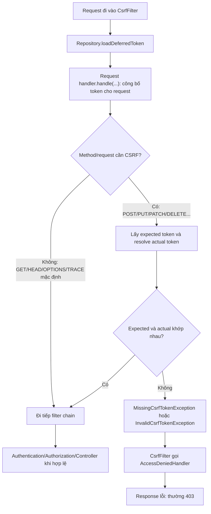
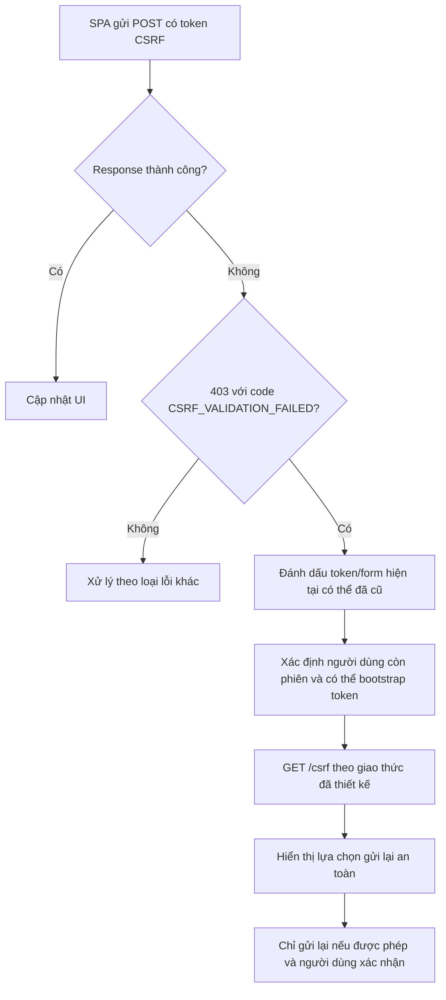

# `AccessDeniedHandler` cho lỗi CSRF

Khi một HTTP request không vượt qua kiểm tra **Cross-Site Request Forgery (CSRF)**, Spring Security Servlet thông thường trả **`403 Forbidden`** trước khi controller xử lý. Đối với một trang HTML, phản hồi mặc định có thể là trang lỗi; đối với SPA hoặc JSON API, frontend thường mong một JSON body ổn định. **`AccessDeniedHandler`** là điểm mở rộng để quyết định *phản hồi lỗi CSRF được tạo ra như thế nào*, nhưng cần gắn nó đúng chỗ: **`CsrfFilter` có handler xử lý lỗi riêng**.

Bài thuộc chương **CSRF trên Servlet** của module **SPRING_SECURITY_HTTP_PROTECTION**. Toàn module áp dụng phòng vệ HTTP và trình duyệt trong Spring Security: CSRF, CORS, security headers, CSP, HSTS, HTTP firewall và bảo vệ session; người học cấu hình cho cả Servlet lẫn Reactive, kiểm thử kịch bản tấn công và chẩn đoán xung đột triển khai. Phạm vi ở đây là **Spring Security Servlet 6.x** với `CsrfFilter`, `HttpSecurity`, `HttpServletRequest` và `AccessDeniedHandler`. Với WebFlux, cần dùng các API reactive tương ứng.

**Mục tiêu học tập:** hiểu chính xác đường đi của hai lỗi CSRF tới handler; phân biệt handler của `CsrfFilter` với cơ chế xử lý authorization; thiết kế JSON response và HTML response không lộ token; cấu hình handler trong `SecurityFilterChain`; viết unit test và MockMvc; chẩn đoán lỗi `403` mà không vô hiệu hóa CSRF.

## 1. Lỗi CSRF cần phản hồi thế nào?

Giả sử một ứng dụng có form đổi mật khẩu và endpoint JSON đổi thông tin cá nhân:

```http
POST /api/profile HTTP/1.1
Host: app.example
Cookie: JSESSIONID=...
Content-Type: application/json

{"displayName":"Learner"}
```

Browser có thể tự gửi cookie xác thực, nhưng request trên **không mang CSRF token do client chủ động gửi**. Nếu `CsrfFilter` yêu cầu token cho `POST` và request không hợp lệ, request phải dừng ở lớp bảo vệ, không được gọi controller để thực hiện cập nhật.

Một SPA thường cần thông báo có cấu trúc:

```http
HTTP/1.1 403 Forbidden
Content-Type: application/json;charset=UTF-8
Cache-Control: no-store

{"code":"CSRF_VALIDATION_FAILED","message":"Yêu cầu không hợp lệ hoặc phiên biểu mẫu đã thay đổi."}
```

Đây là **phản hồi tự thiết kế**, không phải JSON mặc định mà Spring Security bảo đảm trả. Mặc định, `CsrfFilter` thường dùng handler gửi `403`, còn body do handler, container hoặc cấu hình lỗi quyết định.

Một phản hồi lỗi có chất lượng phải đáp ứng đồng thời:

1. **Không cho request sai token đi tiếp** tới controller hoặc logic nghiệp vụ.
2. **Giữ HTTP status phù hợp**, thường là `403` cho lỗi CSRF.
3. **Ổn định cho client**, ví dụ mã lỗi ứng dụng không phụ thuộc nội dung exception.
4. **Không tiết lộ token** kỳ vọng, token client gửi, cookie xác thực hoặc session ID trong response.
5. **Không hướng dẫn frontend retry vô hạn** các thao tác ghi dữ liệu.
6. **Phân biệt đúng nguồn lỗi**, tránh gọi mọi phản hồi `403` là lỗi CSRF.

## 2. `CsrfFilter`, exception và `AccessDeniedHandler`

Trong Servlet, Spring Security dùng `FilterChainProxy` chọn `SecurityFilterChain` phù hợp với request. Nếu chain bật CSRF, `CsrfFilter` quản lý việc xác minh token kỳ vọng.



`CsrfFilter` dùng `CsrfTokenRepository` làm **nguồn token kỳ vọng**, `CsrfTokenRequestHandler` để **giải quyết giá trị client gửi** (raw hoặc masked), rồi so sánh. Nếu không khớp, filter gọi `AccessDeniedHandler` và **không đi tiếp** tới controller.

Hai exception thường gặp:

```java
import org.springframework.security.web.csrf.CsrfException;
import org.springframework.security.web.csrf.MissingCsrfTokenException;
import org.springframework.security.web.csrf.InvalidCsrfTokenException;
import org.springframework.security.access.AccessDeniedException;
```

```text
AccessDeniedException
  └── CsrfException
        ├── MissingCsrfTokenException
        └── InvalidCsrfTokenException
```

Với luồng `DeferredCsrfToken` trong Spring Security Servlet 6.x:

- **`MissingCsrfTokenException`** thường được chọn khi repository **không có token kỳ vọng từ trước** và phải sinh token mới trong khi kiểm tra request.
- **`InvalidCsrfTokenException`** thường được chọn khi repository **đã có token kỳ vọng**, nhưng token client gửi bị thiếu, sai, hết hiệu lực hoặc không giải quyết được đúng biểu diễn.

Vì vậy, **request thiếu header CSRF không tự động đồng nghĩa `MissingCsrfTokenException`**. Nếu repository đã có token kỳ vọng, thiếu header có thể là `InvalidCsrfTokenException`. Ngược lại, nếu frontend gửi token cũ mà session không còn token kỳ vọng, có thể nhận `MissingCsrfTokenException`.

Trong ứng dụng thông thường, cả hai đều có thể đi vào **cùng một handler phản hồi công khai**. Client không cần biết chi tiết repository đang thiếu token hay đã có token, trừ khi hệ thống có một giao thức phục hồi được thiết kế và kiểm thử rõ ràng.

## 3. Handler của `CsrfFilter` không đồng nhất handler phân quyền chung

Spring Security có nhiều vị trí xử lý access denied; nhầm vị trí thường khiến cấu hình có vẻ đúng nhưng lỗi CSRF vẫn trả body khác mong đợi.

| Nơi xử lý | Đối tượng tiêu biểu | Loại lỗi chủ yếu |
| --- | --- | --- |
| **Tại `CsrfFilter`** | `CsrfFilter.setAccessDeniedHandler(...)` | Token CSRF thiếu hoặc không hợp lệ |
| **Tại `ExceptionTranslationFilter`** | Handler thiết lập qua `http.exceptionHandling(...)` | Các `AccessDeniedException` từ những phần phía sau của filter chain, thường là authorization |
| **Tại Spring MVC** | `@RestControllerAdvice` / `@ExceptionHandler` | Exception được xử lý trong luồng controller/MVC |
| **Tại container/proxy** | Servlet error page, reverse proxy/WAF | Lỗi do container hoặc hạ tầng quyết định |

Ví dụ cấu hình:

```java
http.exceptionHandling(exceptions -> exceptions
    .accessDeniedHandler(myHandler));
```

được dùng cho nhiều lỗi truy cập tại phần xử lý exception chung, nhưng **không nên mặc định rằng nó thay handler nội bộ của `CsrfFilter`**. Filter CSRF có thể tự gọi `AccessDeniedHandler` của mình ngay lúc kiểm tra token thất bại.

Tương tự, `@RestControllerAdvice` **không phải nơi đáng tin cậy để bắt lỗi CSRF**: request có thể bị chặn trước khi tới `DispatcherServlet` hoặc controller. Một `@ExceptionHandler(CsrfException.class)` trong controller advice không thay thế được cấu hình ở tầng filter.

### Vì sao cùng `403` vẫn phải biết filter nào từ chối?

```text
POST /api/profile
   |
   v
CsrfFilter
   |-- CSRF sai -> 403 tại handler của CsrfFilter
   |
   +-- CSRF hợp lệ
         |
         v
Authentication / Authorization
   |-- Không đủ quyền -> có thể 403, theo handler khác
   |
   +-- Đủ quyền -> Controller
```

Nếu frontend coi **mọi** `403` là lỗi CSRF và tự lấy token mới, một người thiếu quyền vẫn không thể thành công. Việc retry không kiểm soát còn có thể tạo trải nghiệm rối rắm hoặc gây thao tác lặp trong hệ thống có side effect.

## 4. Hợp đồng `AccessDeniedHandler` trong Servlet

Giao diện nằm ở package:

```java
org.springframework.security.web.access.AccessDeniedHandler
```

Phương thức chính:

```java
void handle(
    HttpServletRequest request,
    HttpServletResponse response,
    AccessDeniedException accessDeniedException)
    throws IOException, ServletException;
```

Handler nhận **request đang bị từ chối**, **response có thể ghi** và **exception**. Nó có thể đặt status, content type, header, body hoặc chuyển hướng/forward tùy mục tiêu. Trong trường hợp CSRF, filter đã quyết định việc xác minh thất bại: nhiệm vụ handler là **tạo response**, không sửa token để request đi tiếp.

Một số lựa chọn:

| Cách xử lý | Phù hợp với | Cân nhắc |
| --- | --- | --- |
| Gửi `403` với body tối thiểu | API hoặc ứng dụng không cần mô tả thêm | Đơn giản, ít nguy cơ lộ thông tin |
| Trả JSON gồm `code` và message chung | SPA / REST API | Cần bảo vệ body, cache và hợp đồng client |
| Trả trang HTML lỗi với HTTP `403` | MVC server-rendered | HTML phải escape đúng, không tiết lộ token |
| `sendError(403)` để container xử lý | Ứng dụng muốn dùng error page có sẵn | Body thực tế phụ thuộc container |
| Forward tới trang lỗi | MVC cần layout thống nhất | Tránh luồng forward bị chặn vòng lặp hoặc ghi response hai lần |
| Redirect tới trang login | Thường là hành vi authentication, không phải lỗi CSRF | Dễ đánh mất nguyên nhân và gây vòng lặp; không dùng như mặc định |

**Tránh `response.setStatus(200)` cho lỗi CSRF.** HTTP success sẽ làm client, cache và hệ thống giám sát hiểu sai kết quả bảo mật. Đồng thời, không thay đổi trạng thái tài khoản hoặc thực hiện side effect bên trong handler báo lỗi.

## 5. Phản hồi JSON nên chứa gì và không chứa gì?

Đối với API, có thể chọn body:

```json
{
  "code": "CSRF_VALIDATION_FAILED",
  "message": "Yêu cầu không hợp lệ hoặc phiên biểu mẫu đã thay đổi."
}
```

Ở bên ngoài, **không cần tiết lộ** tên exception `MissingCsrfTokenException` hay `InvalidCsrfTokenException`. Hai trạng thái vốn có thể được xử lý tương tự: không thực hiện thao tác và hướng dẫn client bootstrap token mới khi thích hợp.

| Dữ liệu | Có nên đưa vào response lỗi? | Lý do |
| --- | --- | --- |
| Status HTTP `403` | **Có** | Thể hiện request bị từ chối |
| Mã lỗi ứng dụng không tiết lộ bí mật | **Có** | Cho frontend phân biệt với lỗi authorization |
| Thông điệp chung, an toàn | **Có** | Phục vụ UI |
| `Cache-Control: no-store` | **Nên** | Tránh cache nhầm response lỗi gắn với phiên |
| Raw token kỳ vọng | **Không** | Dữ liệu bảo mật |
| Masked token đã gửi | **Không** | Không cần thiết; có thể bị khai thác hoặc ghi log |
| `JSESSIONID`/cookie xác thực | **Không** | Không được làm lộ thông tin phiên |
| `exception.getMessage()` nguyên văn | **Không** | Có thể chứa thông tin token hoặc chi tiết nội bộ |
| Stack trace | **Không** | Tiết lộ cấu trúc hệ thống |
| Correlation ID không nhạy cảm | **Có thể** | Tra cứu log mà không lộ bí mật |

Một nguyên tắc quan trọng: **đừng dùng response lỗi CSRF để cấp raw token kỳ vọng mới**. Client nên lấy token qua một endpoint hoặc form bootstrap có chính sách cache, xác thực, CORS và vòng đời phù hợp; không trộn cơ chế cấp token vào một lỗi bất kỳ.

## 6. Cài đặt handler riêng cho lỗi CSRF

Ta thiết kế một `AccessDeniedHandler` có hai cách phản hồi:

- Với request API thuộc `/api/**`: trả JSON thống nhất, HTTP `403`, không cache.
- Với request MVC còn lại: gửi lỗi `403` để container hoặc cơ chế error page hiện hành hiển thị trang lỗi.

Trong dự án dùng nhiều chain hoặc reverse proxy, nên xác định đường dẫn API từ **routing contract đáng tin cậy** (ví dụ chain riêng cho `/api/**`) thay vì tin vào một header `Accept` tùy ý do client đặt.

### `CsrfFailureAccessDeniedHandler.java`

```java
import jakarta.servlet.ServletException;
import jakarta.servlet.http.HttpServletRequest;
import jakarta.servlet.http.HttpServletResponse;
import java.io.IOException;
import java.nio.charset.StandardCharsets;
import org.springframework.http.HttpHeaders;
import org.springframework.http.MediaType;
import org.springframework.security.access.AccessDeniedException;
import org.springframework.security.web.access.AccessDeniedHandler;
import org.springframework.security.web.access.AccessDeniedHandlerImpl;
import org.springframework.security.web.csrf.CsrfException;

public final class CsrfFailureAccessDeniedHandler
        implements AccessDeniedHandler {

    private static final String ERROR_JSON =
        "{\"code\":\"CSRF_VALIDATION_FAILED\","
      + "\"message\":\"Yêu cầu không hợp lệ hoặc phiên biểu mẫu đã thay đổi.\"}";

    private final AccessDeniedHandler fallback =
        new AccessDeniedHandlerImpl();

    @Override
    public void handle(
            HttpServletRequest request,
            HttpServletResponse response,
            AccessDeniedException exception)
            throws IOException, ServletException {

        // Tách lỗi CSRF khỏi một AccessDeniedException loại khác
        // nếu handler được tái sử dụng tại vị trí khác.
        if (!(exception instanceof CsrfException)) {
            fallback.handle(request, response, exception);
            return;
        }

        response.setHeader(HttpHeaders.CACHE_CONTROL, "no-store");

        if (isApiRequest(request)) {
            response.setStatus(HttpServletResponse.SC_FORBIDDEN);
            response.setContentType(MediaType.APPLICATION_JSON_VALUE);
            response.setCharacterEncoding(
                StandardCharsets.UTF_8.name());
            response.getWriter().write(ERROR_JSON);
            return;
        }

        // Với MVC, để container/error page hiển thị lỗi 403.
        response.sendError(HttpServletResponse.SC_FORBIDDEN);
    }

    private boolean isApiRequest(HttpServletRequest request) {
        String servletPath = request.getServletPath();
        return "/api".equals(servletPath)
            || servletPath.startsWith("/api/");
    }
}
```

Ví dụ trên giả định các API được ánh xạ dưới servlet path `/api/**` bằng cách định tuyến thông thường. Trong hệ thống có servlet mapping đặc biệt, context path, gateway hoặc path rewrite, cần **kiểm thử `getServletPath()` thực tế**. Nếu phân vùng API bằng `SecurityFilterChain` riêng, có thể chọn handler JSON trực tiếp cho chain API, tránh phân nhánh đường dẫn trong handler.

**Những bảo đảm chính của implementation:**

1. Không trả token hoặc `exception.getMessage()` cho client.
2. Duy trì HTTP `403` khi token CSRF không hợp lệ.
3. Đặt `Cache-Control: no-store` cho phản hồi lỗi.
4. Chỉ định `Content-Type` và UTF-8 khi trả JSON.
5. Không chuyển request về controller, không tự sinh token và không thay đổi trạng thái nghiệp vụ.
6. Giữ đường xử lý dự phòng nếu đối tượng handler được tái sử dụng cho một `AccessDeniedException` không phải CSRF.

`sendError(403)` có thể khiến container tiếp tục thực hiện **error dispatch** hoặc áp dụng trang lỗi đã cấu hình. Không giả định response MVC cuối cùng luôn là HTML, cũng không render trực tiếp nội dung do người dùng gửi trong trang lỗi. Nếu cần template lỗi tùy biến, cấu hình trang lỗi ở lớp phù hợp và kiểm tra xem error dispatch có vòng lặp security hay không.

### Vì sao không `response.sendRedirect("/login")`?

Thiếu/sai CSRF token **không luôn có nghĩa người dùng chưa đăng nhập**. Redirect có thể đánh mất thông tin lỗi và khiến API nhận `302`/HTML thay vì `403` JSON. Nó cũng có thể gây vòng lặp nếu login form tự thiếu CSRF token. Nếu cần đưa người dùng trở lại trang form, hãy hiển thị hướng dẫn hoặc link rõ ràng trong giao diện, giữ status lỗi thích hợp tại request bị từ chối.

### Nên xử lý response đã được commit thế nào?

Trong luồng filter chuẩn, lỗi CSRF thường được phát hiện trước khi controller ghi response. Nếu một filter tùy biến ghi body hoặc commit response **trước** `CsrfFilter`, lúc này handler không thể bảo đảm đổi status/body thành `403` hợp lệ. Hãy kiểm tra thứ tự filter và tránh việc ghi response sớm; không cố ghi thêm JSON vào một response đã được commit.

## 7. Gắn handler vào `CsrfFilter` trong `SecurityFilterChain`

Không nên tự tạo một `CsrfFilter` mới ngoài security chain chỉ để thay response. Giữ cơ chế cấu hình `HttpSecurity` của Spring Security và tùy chỉnh instance `CsrfFilter` mà framework quản lý.

### Ví dụ với `ObjectPostProcessor<CsrfFilter>`

```java
import org.springframework.context.annotation.Bean;
import org.springframework.context.annotation.Configuration;
import org.springframework.security.config.annotation.ObjectPostProcessor;
import org.springframework.security.config.annotation.web.builders.HttpSecurity;
import org.springframework.security.web.SecurityFilterChain;
import org.springframework.security.web.csrf.CsrfFilter;

@Configuration
class SecurityConfiguration {

    @Bean
    SecurityFilterChain securityFilterChain(HttpSecurity http)
            throws Exception {

        http
            .authorizeHttpRequests(auth -> auth
                .requestMatchers("/login", "/csrf", "/assets/**")
                    .permitAll()
                .anyRequest().authenticated())
            .csrf(csrf -> csrf
                .withObjectPostProcessor(
                    new ObjectPostProcessor<CsrfFilter>() {
                        @Override
                        public <O extends CsrfFilter> O postProcess(
                                O filter) {
                            filter.setAccessDeniedHandler(
                                new CsrfFailureAccessDeniedHandler());
                            return filter;
                        }
                    }));

        return http.build();
    }
}
```

Ví dụ minh họa API Spring Security Servlet 6.x, giả định class `CsrfFailureAccessDeniedHandler` ở mục 6 có trong project. `ObjectPostProcessor` được dùng để cấu hình chính instance `CsrfFilter` của chain. Phương thức trả về filter đã được tùy chỉnh, **không cần add thêm một `CsrfFilter` thứ hai**.

Trong dự án Spring Boot có nhiều `SecurityFilterChain`, chain đầu tiên khớp URL có thể xử lý request. Một cấu hình đặt ở web chain **không tự áp dụng cho API chain khác**. Nếu API chain cũng cần JSON lỗi CSRF, cấu hình handler tương ứng tại chain đó và kiểm thử.

### Đừng nhầm với `exceptionHandling(...)`

Hai đoạn cấu hình hướng tới vị trí khác nhau:

```java
// Vị trí A: handler xử lý access denied do tầng dịch exception
http.exceptionHandling(ex -> ex
    .accessDeniedHandler(applicationAccessDeniedHandler));

// Vị trí B: handler được gắn trực tiếp vào CsrfFilter
http.csrf(csrf -> csrf.withObjectPostProcessor(
    new ObjectPostProcessor<CsrfFilter>() {
        @Override
        public <O extends CsrfFilter> O postProcess(O filter) {
            filter.setAccessDeniedHandler(
                new CsrfFailureAccessDeniedHandler());
            return filter;
        }
    }));
```

Đây là **hai mảnh cấu hình minh họa** đặt trong phương thức có `HttpSecurity http`, với import và các biến handler phù hợp; không phải một file Java chạy độc lập. Cần hiểu thứ tự filter và phạm vi mỗi handler thay vì suy rằng một handler toàn cục chắc chắn được dùng cho mọi `403`.

Khi xây dựng hệ thống thực tế, có thể cấu hình handler access denied chung cho authorization và handler riêng cho CSRF nhưng dùng **hai mã lỗi công khai khác nhau**. Điều này giúp frontend không cố làm mới token khi thực chất người dùng không đủ quyền.

## 8. Có nên dùng một handler cho cả API và form?

Tùy cấu trúc ứng dụng:

| Kiến trúc | Cách tổ chức đề xuất | Điểm kiểm tra |
| --- | --- | --- |
| Một `SecurityFilterChain`, cả `/api/**` và HTML MVC | Handler phân nhánh theo route được xác minh | `servletPath`, context path và error dispatch |
| Nhiều chain tách API và web | Gắn handler JSON ở API chain, handler HTML ở web chain | Chain nào khớp route đầu tiên |
| API thuần JSON | Handler JSON thống nhất | Client nhận `403`, JSON và no-store |
| MVC thuần HTML | `sendError(403)` hoặc trang lỗi 403 tùy biến | Không lộ token, form lỗi xử lý rõ ràng |
| API có gateway/WAF | Xác nhận response đi tới browser không bị gateway thay | Header, status và body sau proxy |

**Không dựa vào `Accept: application/json` làm dấu hiệu duy nhất** để chọn phản hồi an toàn: header `Accept` do client gửi, có thể không phản ánh route nào cần JSON. Dùng route/chain hoặc một hợp đồng API đã xác minh rõ sẽ ổn định hơn.

Một request bị `CsrfFilter` từ chối có thể chưa tới MVC, vì vậy **không gọi service nghiệp vụ hay database từ handler lỗi CSRF**. Nếu cần đánh dấu sự kiện bảo mật, dùng log/metrics được cấu hình không tiết lộ token, không tạo side effect có thể ảnh hưởng người dùng.

## 9. Unit test trực tiếp `AccessDeniedHandler`

Trước khi khởi động ứng dụng web, nên test độc lập handler để chứng minh **body/status** không phụ thuộc cấu trúc của exception và không đưa raw token ra response. Dùng JUnit 5 và `MockHttpServletRequest`/`MockHttpServletResponse` từ `spring-test`.

### Test JSON cho `MissingCsrfTokenException`

```java
import java.nio.charset.StandardCharsets;
import org.junit.jupiter.api.Test;
import org.springframework.mock.web.MockHttpServletRequest;
import org.springframework.mock.web.MockHttpServletResponse;
import org.springframework.security.web.csrf.MissingCsrfTokenException;

import static org.junit.jupiter.api.Assertions.*;

class CsrfFailureAccessDeniedHandlerTest {

    private final CsrfFailureAccessDeniedHandler handler =
        new CsrfFailureAccessDeniedHandler();

    @Test
    void missingTokenReturnsSafeJsonForApi() throws Exception {
        var request = new MockHttpServletRequest("POST", "/api/save");
        request.setServletPath("/api/save");
        var response = new MockHttpServletResponse();

        handler.handle(
            request, response,
            new MissingCsrfTokenException("client-supplied-secret"));

        assertEquals(403, response.getStatus());
        assertEquals("no-store",
            response.getHeader("Cache-Control"));
        assertTrue(response.getContentType()
            .startsWith("application/json"));

        String body = response.getContentAsString(
            StandardCharsets.UTF_8);

        assertTrue(body.contains("CSRF_VALIDATION_FAILED"));
        assertFalse(body.contains("client-supplied-secret"));
        assertFalse(body.contains("MissingCsrfTokenException"));
    }
}
```

Chuỗi `"client-supplied-secret"` chỉ dùng trong unit test để chứng minh không lộ dữ liệu client gửi. Test không hề cần token thực từ môi trường production.

### Test JSON cho `InvalidCsrfTokenException`

Thêm một test vào cùng class (các import đặt ở đầu file Java):

```java
import org.springframework.security.web.csrf.CsrfToken;
import org.springframework.security.web.csrf.DefaultCsrfToken;
import org.springframework.security.web.csrf.InvalidCsrfTokenException;

@Test
void invalidTokenGetsSamePublicError() throws Exception {
    CsrfToken expected = new DefaultCsrfToken(
        "X-CSRF-TOKEN", "_csrf", "server-only-test-secret");

    var request = new MockHttpServletRequest("POST", "/api/profile");
    request.setServletPath("/api/profile");
    var response = new MockHttpServletResponse();

    handler.handle(request, response,
        new InvalidCsrfTokenException(
            expected, "different-client-secret"));

    String body = response.getContentAsString(
        StandardCharsets.UTF_8);
    assertEquals(403, response.getStatus());
    assertTrue(body.contains("CSRF_VALIDATION_FAILED"));
    assertFalse(body.contains("server-only-test-secret"));
    assertFalse(body.contains("different-client-secret"));
    assertFalse(body.contains("InvalidCsrfTokenException"));
}
```

**Giá trị test:** cho dù exception chứa thông tin về token kỳ vọng hoặc token client gửi, handler không xuất chúng ra response. Nó cũng không cần trả hai message khác nhau, giảm khả năng tiết lộ trạng thái session/token qua body lỗi.

### Test route HTML và path boundary

```java
@Test
void htmlRouteReturnsForbiddenWithoutApiJson() throws Exception {
    var request = new MockHttpServletRequest("POST", "/account/email");
    request.setServletPath("/account/email");
    var response = new MockHttpServletResponse();

    handler.handle(
        request, response, new MissingCsrfTokenException(null));

    assertEquals(403, response.getStatus());
    assertFalse(response.getContentAsString()
        .contains("CSRF_VALIDATION_FAILED"));
}

@Test
void apiLikePrefixIsNotNecessarilyAnApiRoute() throws Exception {
    var request = new MockHttpServletRequest("POST", "/apiary/save");
    request.setServletPath("/apiary/save");
    var response = new MockHttpServletResponse();

    handler.handle(
        request, response, new MissingCsrfTokenException(null));

    assertEquals(403, response.getStatus());
    assertFalse(response.getContentAsString()
        .contains("CSRF_VALIDATION_FAILED"));
}
```

Hai method này cũng là **phần bổ sung vào class test ở trên**. `sendError(403)` của `MockHttpServletResponse` chỉ mô phỏng hành vi Servlet, không chứng minh trang lỗi cuối cùng của container sẽ có HTML. Test path `/apiary/save` bảo vệ khỏi lỗi định tuyến khi dùng `startsWith("/api")` mà không kiểm tra ranh giới `/`.

## 10. Test trực tiếp `CsrfFilter`: handler chỉ được gọi khi CSRF thất bại

Test handler riêng chưa chứng minh request đi qua filter có được chuyển vào handler bạn cấu hình hay không. Để kiểm chứng, tạo `CsrfFilter` cùng repository session và dùng handler tùy chỉnh. Đây là test Servlet thuần, không cần Spring Boot.

### Request chưa có expected token: bị chặn và ghi nhận exception

```java
import java.util.concurrent.atomic.AtomicReference;
import org.junit.jupiter.api.Test;
import org.springframework.mock.web.MockFilterChain;
import org.springframework.mock.web.MockHttpServletRequest;
import org.springframework.mock.web.MockHttpServletResponse;
import org.springframework.security.access.AccessDeniedException;
import org.springframework.security.web.csrf.CsrfFilter;
import org.springframework.security.web.csrf.HttpSessionCsrfTokenRepository;
import org.springframework.security.web.csrf.MissingCsrfTokenException;

import static org.junit.jupiter.api.Assertions.*;

class CsrfFilterAndErrorHandlerTest {

    @Test
    void missingExpectedTokenCallsHandlerAndStopsChain()
            throws Exception {
        var repository = new HttpSessionCsrfTokenRepository();
        var filter = new CsrfFilter(repository);
        var captured = new AtomicReference<AccessDeniedException>();
        var jsonHandler = new CsrfFailureAccessDeniedHandler();

        filter.setAccessDeniedHandler((request, response, ex) -> {
            captured.set(ex);
            jsonHandler.handle(request, response, ex);
        });

        var request =
            new MockHttpServletRequest("POST", "/api/profile");
        request.setServletPath("/api/profile");
        var response = new MockHttpServletResponse();
        var chain = new MockFilterChain();

        filter.doFilter(request, response, chain);

        assertInstanceOf(
            MissingCsrfTokenException.class, captured.get());
        assertEquals(403, response.getStatus());
        assertTrue(response.getContentAsString()
            .contains("CSRF_VALIDATION_FAILED"));
        assertNull(chain.getRequest());
    }
}
```

Trong test này, `HttpSessionCsrfTokenRepository` chưa có expected token. Khi filter cần xác minh request POST, deferred token có thể sinh/lưu token mới, nhưng request vẫn không cung cấp token client hợp lệ. Filter gọi handler rồi dừng, **không chạy `MockFilterChain` kế tiếp**.

### Có expected token nhưng client gửi sai: `InvalidCsrfTokenException`

```java
import org.springframework.mock.web.MockHttpSession;
import org.springframework.security.web.csrf.InvalidCsrfTokenException;

@Test
void existingExpectedTokenAndWrongHeaderIsInvalid()
        throws Exception {
    var repository = new HttpSessionCsrfTokenRepository();

    var initial = new MockHttpServletRequest("GET", "/csrf");
    repository.loadDeferredToken(
        initial, new MockHttpServletResponse()).get();
    MockHttpSession session =
        (MockHttpSession) initial.getSession(false);
    assertNotNull(session);

    var filter = new CsrfFilter(repository);
    var captured = new AtomicReference<AccessDeniedException>();
    filter.setAccessDeniedHandler((req, res, ex) -> {
        captured.set(ex);
        new CsrfFailureAccessDeniedHandler()
            .handle(req, res, ex);
    });

    var post = new MockHttpServletRequest("POST", "/api/profile");
    post.setServletPath("/api/profile");
    post.setSession(session);
    post.addHeader("X-CSRF-TOKEN", "wrong-token");
    var response = new MockHttpServletResponse();
    var chain = new MockFilterChain();

    filter.doFilter(post, response, chain);

    assertInstanceOf(
        InvalidCsrfTokenException.class, captured.get());
    assertEquals(403, response.getStatus());
    assertTrue(response.getContentAsString()
        .contains("CSRF_VALIDATION_FAILED"));
    assertNull(chain.getRequest());
}
```

Đây là **test bổ sung trong class `CsrfFilterAndErrorHandlerTest`**, dùng lại những import phù hợp ở đầu file. Nó chứng minh trạng thái **expected token đã tồn tại**, nhưng giá trị client gửi sai. Từ phía frontend, cả hai lỗi vẫn nhận mã công khai chung, trong khi ở unit test server ta có thể phân biệt class exception.

### Request hợp lệ phải đi tiếp và không gọi handler lỗi

Để tránh chỉ kiểm thử chiều bị chặn, thêm test dương sử dụng **plain request handler** với token raw; cách này tách riêng việc kiểm tra vị trí handler lỗi khỏi chi tiết XOR masking:

```java
import org.springframework.security.web.csrf.CsrfToken;
import org.springframework.security.web.csrf.CsrfTokenRequestAttributeHandler;

@Test
void validTokenContinuesWithoutCallingErrorHandler()
        throws Exception {
    var repository = new HttpSessionCsrfTokenRepository();
    var get = new MockHttpServletRequest("GET", "/form");
    CsrfToken token = repository.loadDeferredToken(
        get, new MockHttpServletResponse()).get();
    MockHttpSession session =
        (MockHttpSession) get.getSession(false);

    var filter = new CsrfFilter(repository);
    filter.setRequestHandler(
        new CsrfTokenRequestAttributeHandler());
    filter.setAccessDeniedHandler((req, res, ex) ->
        fail("Không được gọi handler lỗi khi token hợp lệ"));

    var post = new MockHttpServletRequest("POST", "/api/profile");
    post.setSession(session);
    post.addHeader(token.getHeaderName(), token.getToken());
    var response = new MockHttpServletResponse();
    var chain = new MockFilterChain();

    filter.doFilter(post, response, chain);

    assertSame(post, chain.getRequest());
    assertEquals(200, response.getStatus()); // Mock response mặc định.
}
```

Test dương dùng handler plain **có chủ đích** cho kịch bản đơn vị, không phải khuyến nghị chuyển ứng dụng sản xuất sang plain handler. Với form HTML nén, Spring Security thường dùng XOR handler để giảm nguy cơ BREACH. Muốn test XOR, lấy biểu diễn masked từ request attribute `_csrf` của GET rồi gửi chính giá trị đó ở POST cùng session.

**Ranh giới của các test:** `MockFilterChain` xác nhận filter cho request đi tiếp hay không. Nó không chạy một REST controller thật, không chứng minh status thành công nghiệp vụ và không mô phỏng đầy đủ browser cookie policy.

## 11. MockMvc: xác nhận JSON response trong security chain thật

Unit test có thể kiểm tra một handler hoạt động khi **được gọi**, nhưng không bảo đảm bean/configurer đã gắn handler vào đúng `CsrfFilter`. `MockMvc` với Spring Security filter chain giúp phát hiện cấu hình sai vị trí.

### Endpoint mẫu cho ứng dụng Servlet

Ví dụ controller nhận token mà request handler công bố, cùng một endpoint POST thay đổi trạng thái:

```java
import org.springframework.http.CacheControl;
import org.springframework.http.ResponseEntity;
import org.springframework.security.web.csrf.CsrfToken;
import org.springframework.web.bind.annotation.GetMapping;
import org.springframework.web.bind.annotation.PostMapping;
import org.springframework.web.bind.annotation.RequestAttribute;
import org.springframework.web.bind.annotation.RestController;

@RestController
class ExampleProfileController {

    @GetMapping("/csrf")
    ResponseEntity<CsrfInfo> csrf(
            @RequestAttribute("_csrf") CsrfToken token) {

        CsrfInfo body = new CsrfInfo(
            token.getHeaderName(),
            token.getToken());

        return ResponseEntity.ok()
            .cacheControl(CacheControl.noStore())
            .body(body);
    }

    @PostMapping("/api/profile")
    ResponseEntity<Void> saveProfile() {
        // Chỉ thực hiện khi request đã vượt qua security filters.
        return ResponseEntity.noContent().build();
    }

    record CsrfInfo(String headerName, String token) {}
}
```

`GET /csrf` dùng `token.getToken()` để **giải quyết deferred token khi cần**. Trong cấu hình Spring Security Servlet 6.x với XOR handler, `token` trả cho client có thể là **masked token**. Khi request sau gửi token này theo đúng tên header, XOR handler sẽ giải quyết nó về raw token để `CsrfFilter` so sánh.

**Lưu ý về scope:** nếu đã gắn `CsrfFailureAccessDeniedHandler` ở mục 7 và dùng repository session mặc định, test không cần thay CSRF token repository. `@WithMockUser` giúp loại yếu tố đăng nhập khi kiểm tra hành vi CSRF; quyền của controller phải cho phép user test.

### Test response khi chưa có token kỳ vọng

```java
import org.junit.jupiter.api.Test;
import org.springframework.beans.factory.annotation.Autowired;
import org.springframework.boot.test.autoconfigure.web.servlet.AutoConfigureMockMvc;
import org.springframework.boot.test.context.SpringBootTest;
import org.springframework.security.test.context.support.WithMockUser;
import org.springframework.test.web.servlet.MockMvc;

import static org.springframework.test.web.servlet.request.MockMvcRequestBuilders.*;
import static org.springframework.test.web.servlet.result.MockMvcResultMatchers.*;

@SpringBootTest
@AutoConfigureMockMvc
@WithMockUser(username = "learner")
class CsrfApiResponseIntegrationTest {

    @Autowired
    MockMvc mvc;

    @Test
    void missingCsrfOnApiReturnsJson403() throws Exception {
        mvc.perform(post("/api/profile"))
            .andExpect(status().isForbidden())
            .andExpect(header().string("Cache-Control", "no-store"))
            .andExpect(content().contentTypeCompatibleWith(
                "application/json"))
            .andExpect(jsonPath("$.code")
                .value("CSRF_VALIDATION_FAILED"));
    }
}
```

Nếu test nhận một trang HTML container thay vì JSON, có thể handler đã được gắn nhầm vào `exceptionHandling(...)`, request vào chain khác hoặc đường phân nhánh API không khớp `getServletPath()`. Nếu dùng MockMvc với servlet mapping đặc biệt, hãy cấu hình/kiểm tra chính xác servlet path mà handler phân loại.

### Test expected token có sẵn nhưng actual token thiếu

Thêm method vào class test phía trên, với import `MockHttpSession`, `MvcResult` ở đầu file:

```java
import org.springframework.mock.web.MockHttpSession;
import org.springframework.test.web.servlet.MvcResult;
import static org.junit.jupiter.api.Assertions.assertNotNull;

@Test
void existingSessionStillGetsSameSafeJsonForMissingHeader()
        throws Exception {

    MvcResult issued = mvc.perform(get("/csrf"))
        .andExpect(status().isOk())
        .andReturn();

    MockHttpSession session = (MockHttpSession)
        issued.getRequest().getSession(false);
    assertNotNull(session);

    mvc.perform(post("/api/profile").session(session))
        .andExpect(status().isForbidden())
        .andExpect(jsonPath("$.code")
            .value("CSRF_VALIDATION_FAILED"));
}
```

Ở bước này repository đã có expected token trong session, còn client không gửi CSRF header/parameter. Loại exception phía server có thể khác test thiếu token ban đầu, nhưng **body công khai vẫn giống nhau**. Để kiểm tra chính xác loại exception, sử dụng test trực tiếp `CsrfFilter` ở mục 10.

### Test dương: token hợp lệ vẫn tới controller

Ví dụ tiếp theo dùng Jackson để lấy token do server cấp, duy trì **cùng session** rồi gửi lại qua header:

```java
import com.fasterxml.jackson.databind.JsonNode;
import com.fasterxml.jackson.databind.ObjectMapper;
import static org.junit.jupiter.api.Assertions.*;

// Phần thêm vào class CsrfApiResponseIntegrationTest:
@Autowired
ObjectMapper mapper;

@Test
void validCsrfTokenCanReachEndpoint() throws Exception {
    MvcResult issued = mvc.perform(get("/csrf"))
        .andExpect(status().isOk())
        .andReturn();

    JsonNode tokenInfo = mapper.readTree(
        issued.getResponse().getContentAsString());
    String headerName = tokenInfo.path("headerName").asText();
    String tokenValue = tokenInfo.path("token").asText();
    assertFalse(headerName.isBlank());
    assertFalse(tokenValue.isBlank());

    MockHttpSession session = (MockHttpSession)
        issued.getRequest().getSession(false);
    assertNotNull(session);

    mvc.perform(post("/api/profile")
            .session(session)
            .header(headerName, tokenValue))
        .andExpect(status().isNoContent());
}
```

Đoạn mã giả định:

- Các `import` của test nằm ở **đầu file**, không giữa các method.
- Repository là `HttpSessionCsrfTokenRepository` theo session.
- Request handler của `CsrfFilter` giải quyết được biểu diễn token mà endpoint `/csrf` công bố (mặc định thường là masked/XOR).
- `POST /api/profile` có trong ứng dụng, trả `204` và user test có quyền truy cập.

Nếu ứng dụng sử dụng `CookieCsrfTokenRepository`, cách giữ token kỳ vọng cần mô phỏng **cookie** thay vì chỉ giữ session; nếu handler SPA đọc raw cookie qua header, phải gửi **raw token** đúng quy ước, không giả định token JSON masked tương thích với mọi handler.

### Một test với token sai

```java
@Test
void wrongTokenDoesNotBecomeAnAuthorizationError()
        throws Exception {
    MvcResult issued = mvc.perform(get("/csrf"))
        .andExpect(status().isOk())
        .andReturn();

    MockHttpSession session = (MockHttpSession)
        issued.getRequest().getSession(false);

    mvc.perform(post("/api/profile")
            .session(session)
            .header("X-CSRF-TOKEN", "invalid-client-token"))
        .andExpect(status().isForbidden())
        .andExpect(jsonPath("$.code")
            .value("CSRF_VALIDATION_FAILED"));
}
```

Đây là test bổ sung vào class phía trên. Trong trường hợp repository/handler đã đổi tên header, thay `X-CSRF-TOKEN` bằng metadata đúng từ token; mục tiêu là **giá trị sai** chứ không phải kiểm tra lỗi đặt tên header.

## 12. Kiểm thử lỗi authorization mà không nhầm thành lỗi CSRF

Một ca test thực sự hữu ích là **request có CSRF token hợp lệ nhưng user không đủ quyền**. Khi đó không nên nhận `CSRF_VALIDATION_FAILED` từ `CsrfFilter`.

Ví dụ trong một ứng dụng có route `/api/admin/reports` yêu cầu quyền `ROLE_ADMIN`:

```java
http.authorizeHttpRequests(auth -> auth
    .requestMatchers("/csrf").permitAll()
    .requestMatchers("/api/admin/**").hasRole("ADMIN")
    .anyRequest().authenticated());
```

Test dùng một user thông thường, **gửi token hợp lệ** rồi xác minh response thuộc quy tắc authorization của ứng dụng:

```text
1. GET /csrf và giữ session, token được công bố.
2. POST /api/admin/reports kèm token hợp lệ.
3. CsrfFilter cho request qua.
4. AuthorizationFilter từ chối vì thiếu ROLE_ADMIN.
5. Frontend không được mặc định xử lý lỗi này như CSRF.
```

Status có thể vẫn là `403`, nhưng response từ handler authorization có thể khác JSON mà ta đã cài trong handler CSRF. Nếu muốn contract API chặt chẽ, cấu hình `exceptionHandling(...)` cho authorization **bằng mã lỗi khác** như `ACCESS_DENIED`, rồi kiểm thử trực tiếp để bảo đảm frontend phân biệt được.

**Không dùng test này để chứng minh thiếu CSRF**, vì khi thiếu CSRF request có thể đã bị chặn trước khi quyền admin được xét.

## 13. Nếu frontend dùng `spring-security-test` helper `.with(csrf())`

Các test controller thường viết:

```java
import static org.springframework.security.test.web.servlet.request
    .SecurityMockMvcRequestPostProcessors.csrf;

// Minh họa bên trong test có MockMvc:
mockMvc.perform(post("/api/profile").with(csrf()));
mockMvc.perform(post("/api/profile")
    .with(csrf().useInvalidToken()));
```

Helper này hữu ích khi kiểm tra endpoint yêu cầu CSRF, nhưng **không chứng minh** luồng trình duyệt nhận token từ `GET /csrf`, giữ cookie/session, rồi gửi raw/masked token đúng kênh. Với bài học về `AccessDeniedHandler`, test nên kiểm tra thêm **status, `Content-Type`, mã lỗi JSON và việc handler được gọi ở đúng security chain**.

Một test `.with(csrf().useInvalidToken())` có thể kiểm tra request bị từ chối, nhưng không tự chứng minh lỗi đó đi vào handler của `CsrfFilter` thay vì một bộ lọc khác. Hãy kiểm tra `code` và/hoặc ghi nhận exception bằng handler thử nghiệm ở tầng filter.

## 14. Frontend nên làm gì khi nhận `CSRF_VALIDATION_FAILED`?

API đã trả một mã lỗi ổn định, nhưng frontend **không nên tự động lặp lại mọi POST** ngay khi thấy `403`. Request có side effect như đặt hàng, thanh toán hay thay đổi tài khoản cần chính sách retry riêng để tránh thao tác lặp nếu client không xác định được kết quả thực tế của request trước.

Với ứng dụng SPA dùng token do endpoint `GET /csrf` cấp:



Ví dụ JavaScript dùng một helper lấy phản hồi lỗi mà không giả định mọi `403` đều là JSON:

```javascript
async function readApplicationError(response) {
  const type = response.headers.get("Content-Type") ?? "";
  if (!type.includes("application/json")) {
    return null;
  }
  return response.json().catch(() => null);
}

async function submitProfile(displayName, csrf) {
  const response = await fetch("/api/profile", {
    method: "POST",
    credentials: "same-origin",
    headers: {
      "Content-Type": "application/json",
      [csrf.headerName]: csrf.token
    },
    body: JSON.stringify({ displayName })
  });

  if (response.ok) {
    return { ok: true };
  }

  if (response.status === 403) {
    const error = await readApplicationError(response);
    if (error?.code === "CSRF_VALIDATION_FAILED") {
      return {
        ok: false,
        reason: "csrf",
        nextAction: "request-new-csrf-and-confirm-resubmit"
      };
    }
  }

  return {
    ok: false,
    reason: "other",
    status: response.status
  };
}
```

`csrf.headerName` và `csrf.token` trong ví dụ phải đến từ nguồn cấp token mà server đã thiết kế. Với `HttpSessionCsrfTokenRepository` + XOR handler, JSON token có thể là **masked**. Với `CookieCsrfTokenRepository` và raw header SPA, token có thể được đọc từ cookie. **Không tự chuyển đổi raw/masked ở browser** nếu giao thức chưa yêu cầu.

Khi người dùng đăng nhập hoặc đăng xuất, chiến lược CSRF có thể xóa token cũ. Hãy thiết kế một bước `GET /csrf` rõ ràng để lấy token hiện hành trước request unsafe tiếp theo. Đừng kỳ vọng mọi GET công khai đều phát token vì cơ chế `DeferredCsrfToken` có thể nạp lười.

### HTML form nên thông báo thế nào?

Với form MVC server-rendered, thay vì trả token hoặc stack trace, trang lỗi có thể giải thích:

> Biểu mẫu hoặc phiên của bạn có thể đã hết hiệu lực. Vui lòng tải lại trang và thử gửi lại.

Không nên khẳng định “tài khoản bị tấn công” chỉ từ một request sai token: nguyên nhân có thể là session timeout, tab cũ, cookie bị chặn, đổi tên header hoặc lỗi tích hợp raw/masked token.

## 15. Chẩn đoán khi lỗi CSRF không đi vào handler mong đợi

| Triệu chứng | Giả thuyết cần kiểm tra | Hành động |
| --- | --- | --- |
| API trả `403` nhưng body HTML thay vì JSON | Handler chưa được gắn vào đúng `CsrfFilter`, route không được nhận diện là API, hoặc proxy thay body | Kiểm tra chain, `servletPath`, test MockMvc và gateway |
| Body chứa mã `ACCESS_DENIED` thay vì `CSRF_VALIDATION_FAILED` | Lỗi do authorization hoặc handler chung | Xem filter và exception thực tế |
| Controller vẫn chạy sau POST thiếu token | CSRF bị tắt, URL bị ignore, matcher không yêu cầu hoặc vào chain khác | Kiểm tra `SecurityFilterChain` đầu tiên khớp và `CsrfFilter` |
| POST thiếu token nhận `302` | Authentication entry point hoặc redirect tùy biến | Kiểm tra `Location`, chain và thứ tự filter |
| GET không cần token nhận JSON lỗi CSRF | Method matcher tùy biến hoặc request được biến đổi thành unsafe method | Kiểm tra method thực tế và CSRF matcher |
| POST có token hợp lệ nhưng vẫn `403` | Authorization hoặc filter khác chặn | Gửi request hợp lệ trong test và so mã lỗi |
| `OPTIONS` preflight thất bại | CORS từ chối trước POST thực tế | Xem allowed origins, methods, headers, credentials |
| JSON lỗi lộ token hoặc tên exception | Handler dùng `exception.getMessage()`/serialization exception | Trả body cố định, dùng test kiểm tra không lộ secret |
| Response lỗi được cache | Handler/container/proxy cache sai | Kiểm tra `Cache-Control: no-store` và gateway |
| HTML form lỗi sau khi phiên hết hạn | Token kỳ vọng trong session đã mất | Lấy form mới, kiểm tra cookie/session và login/logout |
| Cookie `XSRF-TOKEN` và header giống nhau vẫn lỗi | Handler mong masked trong khi SPA gửi raw | Xem request handler và giao ước token |
| Chỉ lỗi sau deploy/cân bằng tải | Session state không chia sẻ, client cũ vẫn dùng tên header | Kiểm tra session store, sticky session, frontend assets |

### Trình tự gỡ lỗi hữu ích

1. **URL, method và security chain:** request đi qua `SecurityFilterChain` nào? `CsrfFilter` nào được tạo?
2. **Expected token:** repository lấy từ `HttpSession`, cookie `XSRF-TOKEN` hay kho khác? Có được đọc thấy cho request này không?
3. **Actual token:** có header hoặc form parameter theo `CsrfToken.getHeaderName()`/`getParameterName()` không?
4. **Biểu diễn token:** client gửi raw token hay masked token? `CsrfTokenRequestHandler` hiện tại dùng plain hay XOR resolver?
5. **Exception và filter phát sinh:** là `MissingCsrfTokenException`, `InvalidCsrfTokenException`, authorization hay lỗi khác?
6. **Handler và response:** handler đã gắn tại `CsrfFilter` chưa, route API có đúng không, response đã bị commit hoặc gateway viết lại chưa?
7. **Vòng đời:** login/logout, token bị xóa, session timeout, cookie scope, CORS, reverse proxy và nhiều node.

Có thể bật logging có kiểm soát tại môi trường phát triển:

```properties
logging.level.org.springframework.security.web.FilterChainProxy=DEBUG
logging.level.org.springframework.security.web.csrf=TRACE
```

Hãy xem log để tìm dấu hiệu filter xử lý request và loại exception; **không sao chép giá trị token, cookie phiên hay `Authorization` header vào ticket hỗ trợ**. Một số exception message trong thư viện có thể chứa giá trị token hoặc thông tin từ client; tránh in nguyên message và stack trace ra nơi truy cập rộng.

### Telemetry an toàn

Một sự kiện đo lường CSRF có thể ghi:

```text
event=csrf_rejected
route=/api/profile
method=POST
reason_class=InvalidCsrfTokenException
has_csrf_header=false
chain=api
correlation_id=<random-non-secret-id>
```

Đây là dữ liệu minh họa **không chứa token thật**. Trong production, giới hạn cardinality và chuẩn hóa route, không đưa toàn bộ URI/query string do client kiểm soát vào nhãn metrics hoặc log để tránh rò rỉ dữ liệu và log injection. Nếu dùng correlation ID, bảo đảm đó không phải session ID hoặc token xác thực.

## 16. Những sai lầm triển khai cần tránh

| Cách làm dễ sai | Vì sao không ổn | Cách làm phù hợp hơn |
| --- | --- | --- |
| Trả `exception.getMessage()` trong JSON | Có thể lộ raw/actual token và chi tiết nội bộ | Dùng mã lỗi và message chung |
| Bắt `CsrfException` trong `@RestControllerAdvice` rồi cho rằng đã đủ | CSRF thường chặn request trước MVC | Cấu hình handler tại `CsrfFilter` |
| Chỉ thiết lập `http.exceptionHandling(...)` | Không bảo đảm thay handler riêng của CSRF filter | Gắn và kiểm thử `CsrfFilter.setAccessDeniedHandler(...)` |
| Redirect mọi lỗi CSRF về `/login` | Che giấu nguyên nhân, gây vòng lặp và sai hợp đồng API | Trả HTTP 403 và hướng dẫn refresh token/form |
| Tắt `.csrf(...)` để API hết `403` | Bỏ hàng rào với request dùng credentials tự gửi | Sửa cookie/header/request handler |
| Đưa token kỳ vọng vào response lỗi | Có thể giúp client/tác nhân không tin cậy lấy secret sai ngữ cảnh | Cấp token qua luồng bootstrap được kiểm soát |
| Trả status `200` kèm `success=false` | HTTP semantics và telemetry sai | Giữ `403` |
| Tự retry tất cả POST sau `403` | Nguy cơ lặp side effect và che lỗi phân quyền | Nhận diện mã lỗi; retry theo thiết kế an toàn |
| Dùng chung handler cho nhiều chain mà không test | API và MVC có thể nhận body sai | Test từng route và chain |
| Log nguyên exception message/body request | Có thể chứa token và thông tin nhạy cảm | Log class, presence, route chuẩn hóa, correlation ID |
| Đọc token từ JSON body trong handler mà không đánh giá | Body parsing trong filter có thể ảnh hưởng controller | Dùng header/form theo hợp đồng thông thường |

**Đặc biệt:** Không tự cho phép request sai token tiếp tục trong một handler lỗi. Mục tiêu của `AccessDeniedHandler` là viết **phản hồi từ chối**, không “thử xử lý lại” qua controller.

## 17. Quan hệ với CORS, CSP, HSTS, session và các lớp bảo vệ khác

`AccessDeniedHandler` cho CSRF không thay thế những hàng rào khác của module:

| Lớp phòng vệ | Quan hệ với lỗi CSRF |
| --- | --- |
| **CORS** | Browser có thể chặn preflight trước POST; đó không nhất thiết là lỗi từ `CsrfFilter` |
| **CSP và chống XSS** | Script độc hại cùng origin có thể lấy và sử dụng token; handler lỗi không ngăn XSS |
| **Security headers** | Giúp trình duyệt áp dụng chính sách phòng vệ; handler không nên vô hiệu hóa header đã cấu hình |
| **HTTPS/HSTS** | Bảo vệ kênh truyền, giảm nguy cơ lộ token/cookie; không sửa lỗi sai tên header |
| **Cookie `Secure`/`HttpOnly`/`SameSite`** | Ảnh hưởng browser giữ, gửi và cho JS đọc cookie; phải xét cookie CSRF và cookie xác thực riêng |
| **HTTP firewall** | Có thể từ chối request bất thường trước hoặc ngoài nhánh CSRF; status/body có thể khác |
| **Session management** | Session timeout, logout, token invalidation có thể làm token client cũ mất hiệu lực |
| **Authentication và authorization** | Cũng có thể sinh `401`/`403`, nhưng cần mã lỗi khác nếu client phải phân biệt |

### Vì sao `OPTIONS` lỗi không được gán ngay cho CSRF?

Với matcher mặc định, `CsrfFilter` miễn `GET`, `HEAD`, `OPTIONS`, `TRACE`. Một request `OPTIONS` có header `Access-Control-Request-Headers: X-XSRF-TOKEN` có thể bị **CORS** từ chối do origin hoặc header không được cho phép. Khi preflight thất bại, browser có thể **không gửi POST thật**, nên handler lỗi CSRF không hề được gọi.

### Có cần tắt `HttpOnly` của session cookie để xử lý 403?

Không. Một SPA có thể cần JavaScript đọc cookie **CSRF** (`XSRF-TOKEN`) khi dùng `CookieCsrfTokenRepository.withHttpOnlyFalse()`. Cookie xác thực như `JSESSIONID` nên được quản lý và bảo vệ độc lập; JavaScript không cần đọc session ID để gửi CSRF header.

### Không làm mất security headers trong response lỗi

Khi handler trả JSON hoặc `sendError`, đừng vô tình xóa các header bảo mật đã được filter/proxy cấu hình như `X-Content-Type-Options`, CSP hoặc HSTS ở kết nối HTTPS. Việc header nào hiện diện phụ thuộc route, scheme, chain, proxy và các policy của dự án. **Kiểm thử trên HTTP/HTTPS thật** trước khi kết luận response lỗi có đầy đủ các header.

### Servlet khác Reactive

Mã bài này dành cho Servlet: `HttpServletRequest`, `CsrfFilter`, `HttpSecurity` và `org.springframework.security.web.access.AccessDeniedHandler`. Ở WebFlux, cần dùng `ServerHttpSecurity`, `CsrfWebFilter`, các kiểu reactive và cách xử lý lỗi tương ứng. Không thể đưa nguyên `CsrfFilter` hay Servlet `AccessDeniedHandler` vào `ServerHttpSecurity`.

## 18. Bài tập thực hành theo tình huống

### Bài tập A — JSON 403 ổn định

Tạo một ứng dụng Spring Boot Servlet có endpoint `POST /api/profile`, bật CSRF và gắn `CsrfFailureAccessDeniedHandler` cho `CsrfFilter`. Gửi ba request:

1. POST không có token khi repository chưa lưu token.
2. POST cùng session đã có expected token nhưng không gửi actual token.
3. POST cùng session đã có expected token nhưng gửi actual token sai.

**Yêu cầu:** cả ba request đều trả HTTP `403`, cùng `code = CSRF_VALIDATION_FAILED`; response không chứa raw token, masked token, session ID hay exception message. Dùng unit test ghi nhận loại exception để thấy ba tình huống **không nhất thiết cùng class exception**.

### Bài tập B — Phân biệt CSRF và authorization

Thêm endpoint `POST /api/admin/report` cần role admin. Lấy token hợp lệ, rồi gửi request bằng tài khoản không có `ROLE_ADMIN`. Xác định filter nào từ chối và thiết kế mã lỗi công khai của authorization **khác** `CSRF_VALIDATION_FAILED`. Không thay đổi token CSRF để thử “sửa quyền”.

### Bài tập C — MVC form và API dùng chung chain

Tạo form `POST /account/email` và JSON endpoint `POST /api/profile`. Cả hai đều thiếu CSRF token:

- API phải nhận `403` với JSON như đã cam kết.
- Form phải nhận `403` và trang lỗi phù hợp, không bị chuyển thành response `200` hoặc redirect login tùy tiện.
- Chứng minh controller không thực hiện side effect.
- Kiểm tra `getServletPath()` và cách ứng dụng phân vùng `/api/**`.

### Bài tập D — Token hợp lệ vẫn hoạt động

Tạo `GET /csrf` chủ động truy cập `_csrf.token`, giữ session, sau đó POST kèm token được cấp. Kiểm tra request hợp lệ **đi tới controller** và không gọi handler lỗi. Lặp lại với token sai để bảo đảm handler vẫn hoạt động ở request xấu.

### Bài tập E — Client cũ sau thay đổi tên cookie/header

Chuyển `XSRF-TOKEN`/`X-XSRF-TOKEN` sang tên riêng trong một SPA. Giả lập một tab có JavaScript cũ vẫn gửi header cũ, một tab đã cập nhật. Thiết kế:

- Telemetry chỉ ghi **tên header kỳ vọng và có/không có header**, không ghi token.
- Response lỗi `403` chung, không tiết lộ cookie/token.
- Giao diện hướng dẫn tải lại và bootstrap token thích hợp.
- Kế hoạch rollout để giảm gián đoạn mà không vô hiệu hóa CSRF.

### Bài tập F — CORS preflight với lỗi CSRF

Từ frontend khác origin, gửi request POST có custom CSRF header. Cố ý làm cấu hình CORS thiếu header này để quan sát preflight thất bại. Sau đó sửa CORS cho origin/header cụ thể. Chứng minh tình huống đầu **không phải** lỗi `InvalidCsrfTokenException` vì POST chính thức có thể chưa được gửi.

## 19. Câu hỏi tự kiểm tra

1. `AccessDeniedHandler` có nhiệm vụ gì sau khi `CsrfFilter` phát hiện token không hợp lệ?
2. Vì sao cùng status `403` không đủ để kết luận một request thất bại vì CSRF?
3. `MissingCsrfTokenException` và `InvalidCsrfTokenException` khác nhau về trạng thái **expected token** như thế nào?
4. Tại sao thiếu HTTP header CSRF vẫn có thể là `InvalidCsrfTokenException`?
5. Vì sao `http.exceptionHandling(...).accessDeniedHandler(...)` không bảo đảm thay response của `CsrfFilter`?
6. Tại sao `@RestControllerAdvice` không phải nơi đáng tin cậy để xử lý lỗi phát sinh ở `CsrfFilter`?
7. Trong ví dụ handler JSON, tại sao không được xuất `exception.getMessage()`?
8. Vì sao API nên trả `code = CSRF_VALIDATION_FAILED` thay vì yêu cầu frontend phân tích nội dung thông điệp lỗi?
9. Vì sao handler lỗi CSRF không nên tự tạo hoặc trả raw token mới trong JSON response?
10. Cách tổ chức response khác nhau giữa form MVC và API JSON khi dùng chung chain nên dựa vào tiêu chí nào?
11. Làm sao unit test chứng minh handler không lộ token trong response? Cần kiểm tra cả missing và invalid như thế nào?
12. Làm sao dùng `MockFilterChain` chứng minh request sai token không đi tiếp?
13. Khi nào nên viết test MockMvc thay vì chỉ test `AccessDeniedHandler` trực tiếp?
14. Nếu test `POST` hợp lệ vẫn nhận mã `CSRF_VALIDATION_FAILED`, bạn kiểm tra repository, request handler và session theo thứ tự nào?
15. Tại sao frontend không nên retry tự động mọi POST khi gặp lỗi CSRF?
16. Sau login/logout hoặc session timeout, cơ chế cấp lại CSRF token nên hoạt động ra sao?
17. Một request `OPTIONS` bị CORS từ chối có nhất thiết đã đi vào `AccessDeniedHandler` của `CsrfFilter` không?
18. Làm sao kiểm thử phản hồi lỗi CSRF không mất những security headers cần có qua HTTPS/reverse proxy?

## 20. Checklist trước khi triển khai

| Hạng mục | Cần xác nhận |
| --- | --- |
| Vị trí handler | Đã gắn vào `CsrfFilter` thực sự xử lý route cần bảo vệ |
| Security chain | Cả API và MVC sử dụng chain/config đúng |
| HTTP status | Request CSRF lỗi trả `403`, không trả `200` |
| API body | Mã lỗi ổn định, thông điệp chung, `Content-Type: application/json` |
| Rò rỉ dữ liệu | Không có token, session ID, stack trace, exception message |
| Cache | Response lỗi có `Cache-Control: no-store` |
| MVC error page | Không lộ token; không redirect login sai mục đích |
| Quy tắc token | Raw/masked token và cookie/header/form parameter tương thích |
| Test âm | Token thiếu kỳ vọng, actual token thiếu/sai, token cũ |
| Test dương | Token hợp lệ đi tiếp tới controller |
| Phân biệt phân quyền | `403` do authorization không bị gán nhầm mã lỗi CSRF |
| CORS và cookie | Browser thực sự gửi cookie/CSRF header; preflight hoạt động |
| Login/logout | Client có luồng lấy token mới sau thay đổi trạng thái xác thực |
| Production logging | Không ghi giá trị bí mật; có correlation ID và route chuẩn hóa |
| Servlet/Reactive | Không dùng nhầm handler/filter của hai stack |

**Ghi nhớ:** **`AccessDeniedHandler` cho lỗi CSRF là thành phần tạo phản hồi sau khi `CsrfFilter` đã xác định request thiếu hoặc sai token**. Nó phải trả status và body an toàn, **không cho request đi tiếp và không lộ token**. Để cấu hình đúng trong Spring Security Servlet, hãy gắn handler vào **chính `CsrfFilter`**, xác minh bằng unit test và MockMvc, phân biệt lỗi CSRF với authorization, đồng thời bảo toàn các lớp phòng vệ CORS, CSP, HTTPS, security headers và session.
