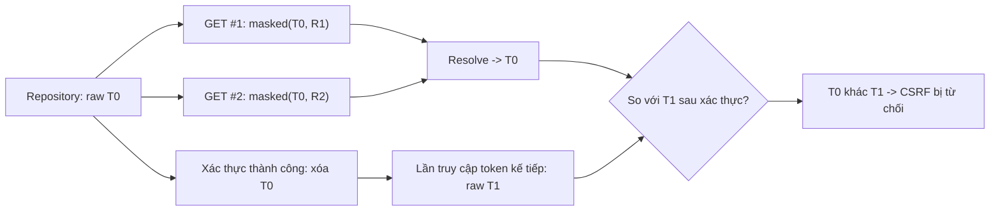
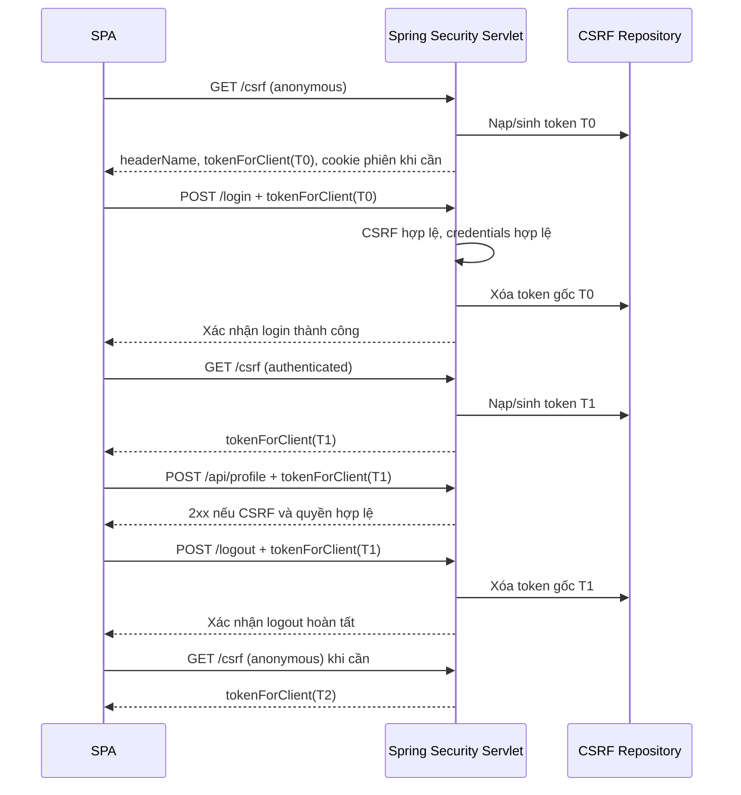

# Kiểm tra thời điểm token được xóa hoặc thay sau xác thực

Trong **Spring Security Servlet**, một CSRF token đã sử dụng để gửi form đăng nhập **không nhất thiết còn hợp lệ ngay sau khi đăng nhập thành công**. Với cấu hình xác thực và CSRF thông dụng, `CsrfAuthenticationStrategy` xóa token cũ sau khi xác thực, còn `CsrfLogoutHandler` xóa token khi đăng xuất. Token mới có thể **chưa được sinh ra ngay tại thời điểm xóa**: cơ chế `DeferredCsrfToken` thường trì hoãn việc đọc hoặc tạo token cho tới khi một request thực sự yêu cầu nó. Hiểu đúng hai thời điểm *xóa* và *cấp lại* giúp giải thích vì sao request đầu tiên của SPA sau login/logout có thể bị HTTP `403`, dù token của form đăng nhập trước đó là hợp lệ.

Bài thuộc chương **CSRF trên Servlet**, module **SPRING_SECURITY_HTTP_PROTECTION**. Phạm vi module là các lớp phòng vệ HTTP/trình duyệt của Spring Security: CSRF, CORS, security headers, CSP, HSTS, HTTP firewall, bảo vệ session, cấu hình cho Servlet lẫn Reactive và kiểm thử các kịch bản tấn công web. Bài này tập trung vào **Servlet** (`HttpSecurity`, `CsrfFilter`, `CsrfTokenRepository`, session authentication strategy và logout handler); với WebFlux cần chuyển sang các API reactive tương ứng.

**Sau bài học, bạn có thể:** chỉ ra thời điểm token CSRF cũ bị xóa trong vòng đời xác thực; phân biệt việc vô hiệu hóa token với việc sinh token mới; xác minh hành vi ở `HttpSessionCsrfTokenRepository` và `CookieCsrfTokenRepository`; thiết kế luồng token trước/sau login và logout cho MVC/SPA; viết JUnit/MockMvc test; chẩn đoán lỗi do token cũ, session fixation, cookie hoặc raw/masked token mà không tắt CSRF.

## 1. Một chu kỳ đăng nhập có thể có hai token khác nhau

Giả sử ứng dụng dùng session và form login. Trước khi đăng nhập, server đã cấp token gốc `T0` để form có thể gửi `POST /login`. Token này chứng minh browser đã nhận dữ liệu từ ứng dụng trong ngữ cảnh phù hợp; nó **không phải token xác thực danh tính**.

Khi đăng nhập thành công, chiến lược xác thực có thể **xóa `T0` khỏi repository**. Ở request tiếp theo, nếu controller, view hoặc `CsrfFilter` cần CSRF token, repository có thể sinh token gốc mới `T1`. Sau đó, request ghi dữ liệu phải dùng token tương ứng với trạng thái hiện hành.

```text
GET /login
    Repository chưa có token -> sinh/lưu T0 khi form cần nó
    Form nhận masked(T0) hoặc T0 tùy request handler

POST /login + token của form
    CsrfFilter xác minh với T0 -> hợp lệ
    Authentication xử lý credentials -> thành công
    CsrfAuthenticationStrategy -> xóa T0
    Response login hoàn tất; chưa bắt buộc đã có T1

GET /csrf hoặc GET /form sau login
    Repository không còn T0
    Có thành phần cần token -> sinh/lưu T1

POST /api/profile
    Token T1 -> có thể qua CSRF
    Token T0 -> không còn hợp lệ đối với repository hiện tại
```

Ở đây `T0` và `T1` là ký hiệu, không phải giá trị thật. Token được sinh từ nguồn ngẫu nhiên phù hợp; **không suy ra token mới bằng cách cộng số, biến đổi chuỗi hoặc tự tạo ở frontend**.

### Ba thời điểm không được gộp làm một

| Thời điểm | Chuyện gì xảy ra? | Có chắc token gốc mới đã được cấp cho client không? |
| --- | --- | --- |
| `CsrfFilter` kiểm tra `POST /login` | So sánh token client gửi với token kỳ vọng trước bước xử lý đăng nhập | **Không**; đây là kiểm tra token hiện tại |
| Chiến lược xác thực xóa token | Repository được yêu cầu xóa token cũ | **Không**; xóa không tự đồng nghĩa cấp token mới |
| Một request sau đó thực sự truy cập token | Deferred token được giải quyết; nếu thiếu, repository có thể sinh/lưu token mới | **Có**, khi cơ chế công bố token cho client được hoàn thành |

Vì thế, một SPA giữ nguyên header CSRF trong bộ nhớ sau khi nhận login thành công có thể gửi **token đã bị vô hiệu hóa** ở request kế tiếp. Đừng cố giải quyết lỗi bằng cách `permitAll()` cho endpoint ghi dữ liệu hoặc tắt `csrf()`.

## 2. Token gốc, token được che và trạng thái repository

Nên tách ít nhất bốn đối tượng khái niệm:

| Khái niệm | Ví dụ | Vai trò |
| --- | --- | --- |
| **Raw token kỳ vọng** | `T0`, rồi `T1` | `CsrfTokenRepository` giữ để `CsrfFilter` so sánh |
| **Masked token** | `mask(T0, R)` | `XorCsrfTokenRequestAttributeHandler` có thể công bố cho form để giảm nguy cơ BREACH |
| **Token client gửi** | Header CSRF hoặc form parameter | Request handler giải quyết giá trị này về raw token |
| **Session/cookie chứa token** | `HttpSession` hoặc `XSRF-TOKEN` | Nguồn state để repository tìm token hiện hành |

**Một lần thay đổi masked token không chứng minh raw token đã bị xóa hoặc thay.** Nếu `XorCsrfTokenRequestAttributeHandler` công bố lại cùng raw token với một mặt nạ ngẫu nhiên khác, hai lần GET có thể đưa ra hai chuỗi masked khác nhau trong khi token kỳ vọng vẫn nguyên vẹn. Ngược lại, sau khi chiến lược xác thực xóa raw token, một masked token cũ vẫn có thể được giải mã về `T0`, nhưng filter sẽ từ chối vì repository không còn kỳ vọng `T0`.



**Không so sánh hai giá trị `${_csrf.token}` ở HTML để kết luận có rotation.** Muốn kiểm tra việc xóa/thay, hãy quan sát giá trị raw lưu trong repository, việc repository báo thiếu token sau chiến lược, và lần materialize token mới.

## 3. Những thành phần quyết định vòng đời token

Trong Servlet, các lớp sau phối hợp:

| Thành phần | Nhiệm vụ và ảnh hưởng tới thời điểm token |
| --- | --- |
| `CsrfFilter` | Bắt buộc xác minh CSRF trên request cần bảo vệ, gồm `POST /login` theo matcher mặc định |
| `CsrfTokenRepository` | `loadToken`, `generateToken`, `saveToken`; quyết định nơi lưu/xóa token kỳ vọng |
| `DeferredCsrfToken` | Cho phép trì hoãn việc truy xuất/sinh token tới lúc cần; `get()` và `isGenerated()` |
| `CsrfTokenRequestHandler` | Công bố token lên request và giải quyết raw/masked token do client gửi |
| **`CsrfAuthenticationStrategy`** | Trong đường xác thực sử dụng session-authentication strategy, gọi repository xóa token cũ khi xác thực |
| **`CsrfLogoutHandler`** | Xóa token cũ trong đường logout có handler này |
| `SessionAuthenticationStrategy` khác | Có thể thay session ID hoặc session state để chống session fixation; không tự đồng nghĩa thay CSRF token |
| Frontend/form | Nhận token trước unsafe request, làm mới khi login/logout thay đổi trạng thái và gửi token đúng kênh |

**Phạm vi quan trọng:** không khẳng định mọi cách xác thực tùy biến, HTTP Basic hoặc API bearer-token đều gọi `CsrfAuthenticationStrategy`. Trong các luồng xác thực do Spring Security quản lý với cấu hình CSRF/session thông dụng, chiến lược được tích hợp để xóa token. Nếu ứng dụng tự viết filter hoặc chỉ gọi `AuthenticationManager` rồi lưu `SecurityContext`, cần kiểm tra chiến lược đã được gọi hay chưa thay vì mặc định có rotation.

### Phân biệt CSRF và session fixation

`SessionAuthenticationStrategy` có thể chứa nhiều chiến lược liên quan đến session: bảo vệ session fixation, giới hạn session đồng thời, lưu session, và xóa CSRF token. Chẳng hạn **thay đổi session ID** (`changeSessionId()`) có thể giữ các session attribute tùy triển khai. **Xóa CSRF token là hành động riêng** do chiến lược CSRF phụ trách; không thể kết luận token đã thay chỉ vì `JSESSIONID` thay.

Trong một ứng dụng session-based, **nên kiểm tra cả hai**: session ID/instance sau login được xử lý đúng chính sách fixation, và CSRF token cũ đã bị loại bỏ theo chiến lược. Cũng không dùng việc token được xóa để thay cho phòng vệ session fixation.

## 4. Thứ tự tổng quát: CSRF được kiểm tra trước khi xác thực hoàn tất

Một luồng form login thông dụng của Spring Security Servlet có trình tự:

```mermaid
sequenceDiagram
    participant B as Browser
    participant F as CsrfFilter
    participant A as Authentication Filter
    participant S as CsrfAuthenticationStrategy
    participant R as CsrfTokenRepository
    B->>F: POST /login + token T0 + cookie phiên
    F->>R: loadDeferredToken().get()
    R-->>F: Token kỳ vọng T0
    F->>F: So sánh token đã resolve với T0
    alt Token sai
        F-->>B: 403; không xử lý đăng nhập
    else Token đúng
        F->>A: Request đi tiếp
        A->>A: Xác thực username/password
        alt Credentials sai
            A-->>B: Xử lý đăng nhập thất bại
        else Credentials đúng, chiến lược được tích hợp
            A->>S: onAuthentication(...)
            S->>R: saveToken(null, request, response)
            R-->>S: T0 đã bị xóa khỏi kho
            A-->>B: Login thành công / redirect
        end
    end
```

Sơ đồ chỉ mô tả trách nhiệm chính, không cam kết thứ tự chính xác giữa *mọi* session strategy, success handler và response header của từng bản Spring Security hoặc ứng dụng tùy biến. Điểm cần xác minh là: **request login cần vượt qua CSRF trước**, còn **việc xóa token cũ diễn ra trên nhánh xác thực thành công khi `CsrfAuthenticationStrategy` được gọi**.

Đăng nhập thất bại **không mặc nhiên** gọi chiến lược xác thực thành công để xóa CSRF token. Tuy nhiên một ứng dụng có failure handler hoặc logic session tùy biến vẫn có thể thay session/token; phải kiểm thử đường lỗi của chính ứng dụng.

### Form login với `permitAll()` có còn yêu cầu CSRF?

Có, theo matcher CSRF thông thường:

```java
http
    .authorizeHttpRequests(auth -> auth
        .requestMatchers("/login", "/csrf").permitAll()
        .anyRequest().authenticated())
    .formLogin(form -> form.permitAll());
```

`permitAll()` là quy tắc **authorization**, không loại `POST /login` khỏi `CsrfFilter`. Nếu login thiếu token sẽ bị từ chối trước khi đến bước xác minh mật khẩu. Không sửa vấn đề bằng cách cho phép mọi unsafe request không cần CSRF token.

## 5. `CsrfAuthenticationStrategy`: xóa token chứ không tự bảo đảm cấp token mới

Đường dẫn API:

```java
org.springframework.security.web.csrf.CsrfAuthenticationStrategy
```

Lớp tham gia hợp đồng `SessionAuthenticationStrategy` và có thể được khởi tạo với repository:

```java
import org.springframework.security.web.csrf.CsrfAuthenticationStrategy;
import org.springframework.security.web.csrf.CsrfTokenRepository;

CsrfAuthenticationStrategy strategy =
    new CsrfAuthenticationStrategy(csrfTokenRepository);
```

Khi được gọi trong nhánh xác thực thành công, `onAuthentication(...)` yêu cầu repository loại token cũ khỏi trạng thái lưu trữ (về bản chất là hành vi `saveToken(null, ...)`). Vì vậy sau khi chiến lược chạy, `repository.loadToken(...)` có thể trả `null`, tùy cách lưu và request hiện tại.

Điều đó khác với lời gọi:

```java
// Mã minh họa riêng, không nằm trong implementation chiến lược:
CsrfToken newToken = csrfTokenRepository.generateToken(request);
csrfTokenRepository.saveToken(newToken, request, response);
```

Đoạn thứ hai **tự sinh/lưu token** và chỉ được dùng khi ứng dụng có lý do rõ ràng; không nên thêm vào login handler một cách tùy tiện. Trong mô hình deferred, request tiếp theo khi cần token mới sẽ làm repository nạp/tạo/lưu theo luồng chuẩn.

**Quy ước hữu ích:** gọi giai đoạn sau xác thực thành công là **invalidation/clearing** (xóa token cũ). Gọi giai đoạn request GET `/csrf` tiếp theo là **generation/issuing** (cấp token mới). Nếu hai hành động xảy ra ở các request khác nhau, chúng là **hai sự kiện riêng**.

## 6. `CsrfLogoutHandler`: xóa token khi logout

Lớp:

```java
org.springframework.security.web.csrf.CsrfLogoutHandler
```

tham gia hợp đồng `LogoutHandler`. Khi logout flow thực sự chạy handler này, nó yêu cầu repository xóa token hiện hành:

```java
import org.springframework.security.web.csrf.CsrfLogoutHandler;
import org.springframework.security.web.csrf.CsrfTokenRepository;

CsrfLogoutHandler logoutHandler =
    new CsrfLogoutHandler(csrfTokenRepository);
```

`CsrfLogoutHandler.logout(request, response, authentication)` được gọi trong luồng logout phù hợp; nó không phải một endpoint controller. **Logout thành công không nhất thiết trả về token CSRF mới.** Một GET tới trang đăng nhập hoặc endpoint bootstrap token sau logout mới có thể tạo/phát token kế tiếp.

```text
Trước logout: repository giữ T1 (đang đăng nhập)
POST /logout + token hợp lệ T1
    CsrfFilter kiểm tra T1
    LogoutFilter thực hiện logout
    CsrfLogoutHandler xóa T1
    Session logout có thể bị invalidate
Sau logout: repository không còn token cũ
GET /login hoặc GET /csrf (nếu render/cấp token)
    Repository tạo token T2 cho ngữ cảnh ẩn danh khi cần
```

Với cấu hình Servlet mặc định có CSRF, logout thường được thực hiện qua **POST** thay vì GET để tránh một website khác kích hoạt logout bằng một request điều hướng đơn giản. Đừng thêm `GET /logout` chỉ để frontend gọi tiện hơn mà chưa đánh giá tác động CSRF.

### Không gộp xóa CSRF token với hủy session

Logout có thể thực hiện nhiều hành động: xóa `SecurityContext`, invalidate `HttpSession`, xóa cookie đăng nhập và xóa token CSRF. Những hành động này có phạm vi khác nhau:

- Khi token nằm trong session, session invalidate làm trạng thái token cũ biến mất, nhưng `CsrfLogoutHandler` vẫn thể hiện **ý định vô hiệu hóa CSRF token** ở cấp cơ chế.
- Khi token nằm trong cookie riêng `XSRF-TOKEN`, invalidate session **không tự xóa cookie CSRF**. Repository cần phát response xóa cookie nếu muốn browser bỏ giá trị này.
- Một hệ thống dùng custom logout handler có thể không gọi đúng các handler mặc định; phải kiểm thử chuỗi logout thực tế thay vì chỉ nhìn tên endpoint.

### Login thất bại và logout request sai token

`POST /login` không qua CSRF thì authentication filter chưa xử lý credentials; token cũ không nhất thiết đã bị xóa vì “đăng nhập thất bại”. Tương tự, `POST /logout` thiếu CSRF token có thể bị `CsrfFilter` chặn **trước khi** `LogoutFilter` xử lý, nên chưa chắc logout được thực hiện. Một request `403` **không phải** bằng chứng phiên đã đăng xuất.

## 7. `DeferredCsrfToken` và khoảng trống giữa lúc xóa và lúc sinh lại

Sau khi token bị xóa khỏi repository, ứng dụng thường chưa cần token mới cho tới khi có view hoặc controller yêu cầu nó. `CsrfTokenRepository.loadDeferredToken(request, response)` cung cấp khả năng nạp token theo nhu cầu; `DeferredCsrfToken.get()` kích hoạt đọc token kỳ vọng, và nếu repository không tìm thấy token thì có thể sinh/lưu giá trị mới.

```java
import org.springframework.security.web.csrf.CsrfToken;
import org.springframework.security.web.csrf.CsrfTokenRepository;
import org.springframework.security.web.csrf.DeferredCsrfToken;

DeferredCsrfToken deferred =
    csrfTokenRepository.loadDeferredToken(request, response);

// Chưa nhất thiết đã gọi loadToken/generateToken/saveToken.
CsrfToken current = deferred.get(); // Nạp/tạo/lưu khi cần.
boolean generated = deferred.isGenerated();
```

Đây là đoạn minh họa trong một phương thức đã có `request`, `response`, `csrfTokenRepository`; không phải chỉ dẫn để tự thay thế `CsrfFilter`. Cần chú ý **`isGenerated()` cũng có thể kích hoạt việc giải quyết** để biết token có được sinh mới không. Khi đo tính lazy, kiểm tra trạng thái trước khi gọi `get()` hoặc `isGenerated()`.

| Sự kiện | Repository theo session | Repository theo cookie |
| --- | --- | --- |
| Trước xác thực | Token gốc `T0` trong session | Token gốc `T0` trong cookie `XSRF-TOKEN` |
| Xác thực thành công, chiến lược CSRF chạy | Xóa session attribute lưu `T0` | Phát `Set-Cookie` hết hạn để xóa `XSRF-TOKEN` |
| Response xác thực hoàn tất | Không bắt buộc có `T1` | Browser cần áp dụng phản hồi xóa cookie |
| GET không sử dụng `_csrf` | Có thể không tạo token mới | Có thể không phát cookie mới |
| GET `/csrf` đọc `getToken()` | Nếu thiếu, sinh và lưu `T1` trong session | Nếu thiếu, sinh và phát cookie token mới |
| Request unsafe dùng `T0` sau đó | Token cũ có thể bị từ chối | Token cũ có thể bị từ chối nếu không còn là expected token |

**Nếu client dùng token cũ ngay khi repository vừa bị xóa**, `CsrfFilter` có thể phải sinh một expected token mới trong lúc kiểm tra request unsafe và trả HTTP `403`. Response lỗi có thể chứa cookie/session mới, nhưng điều này **không biến request bị từ chối thành request thành công**.

### Tại sao `GET /home` không chắc cấp token mới?

`CsrfFilter` có thể công bố request attribute `_csrf` qua handler mà chưa truy cập token gốc. Nếu template `/home` không đọc `${_csrf.token}`, hoặc controller không gọi `CsrfToken.getToken()`, deferred loading có thể **không tạo token mới**. Với SPA, cần một **bước cấp token xác định** thay vì giả định mọi GET đã phát token.

## 8. Hai repository có cơ chế xóa khác nhau

### 8.1. `HttpSessionCsrfTokenRepository`

Repository này giữ raw CSRF token trong một attribute của `HttpSession` phía server. Khi chiến lược xác thực gọi `saveToken(null, request, response)`, repository loại bỏ attribute tương ứng. Nếu request sau vẫn giữ cùng session, `loadToken()` có thể trả `null` cho tới khi token được tạo lại.

```text
Session S, trước đăng nhập:
    [CSRF attribute] = T0

CsrfAuthenticationStrategy.onAuthentication(...):
    repository.saveToken(null, ...)

Session S hoặc session sau xử lý fixation:
    [CSRF attribute] = absent

GET /csrf:
    repository.loadDeferredToken(...).get()
    [CSRF attribute] = T1
```

Không phải mọi login đều giữ nguyên object `HttpSession`: session fixation protection có thể đổi ID hoặc tạo session mới. Điều cần đo là **repository có còn trả về raw token cũ không**, không phải chỉ so ID của session hoặc masked token trên form.

### 8.2. `CookieCsrfTokenRepository`

Repository cookie giữ raw token trong cookie, mặc định là `XSRF-TOKEN`. Khi xóa token, repository thường ghi **`Set-Cookie` với `Max-Age=0`** và phạm vi cookie được cấu hình.

```http
HTTP/1.1 302 Found
Location: /
Set-Cookie: XSRF-TOKEN=; Path=/; Max-Age=0; ...
```

Đây là response **minh họa**; thứ tự cookie attributes và status khác nhau tùy ứng dụng. Quan trọng:

1. `Set-Cookie` xóa cookie nằm ở **response**, không làm cookie biến mất khỏi `request.getCookies()` trong cùng lượt Servlet.
2. Browser áp dụng việc xóa khi nhận response; request tiếp theo cần phản ánh cookie mới.
3. Cookie xóa phải khớp tên, `Path` và `Domain` cần thiết. Nếu đổi tên/phạm vi cookie trong lúc triển khai, browser có thể còn cookie cũ.
4. Nếu repository tạo token mới ở GET sau logout/login, response đó có thể phát **một `Set-Cookie` mới** với token `T1`.

Vì vậy **đừng so sánh trực tiếp cookie request đang xử lý với response sau khi `saveToken(null)`** để kết luận xóa thất bại. Test nên mô phỏng ít nhất hai request và quan sát `Set-Cookie`/cookie jar.

### Cookie CSRF và cookie xác thực

Cookie `XSRF-TOKEN` không tự chứng minh user đang đăng nhập. `JSESSIONID` hoặc cookie xác thực khác quản lý danh tính/phiên. `CookieCsrfTokenRepository.withHttpOnlyFalse()` có thể cần thiết nếu SPA đọc raw token qua JavaScript, **không** phải lý do tắt `HttpOnly` của cookie xác thực.

## 9. Cấu hình Servlet cơ bản để quan sát luồng xác thực

Một cấu hình minh họa Spring Security Servlet 6.x dùng form login, session repository và XOR handler:

```java
import org.springframework.context.annotation.Bean;
import org.springframework.context.annotation.Configuration;
import org.springframework.security.config.Customizer;
import org.springframework.security.config.annotation.web.builders.HttpSecurity;
import org.springframework.security.web.SecurityFilterChain;
import org.springframework.security.web.csrf.HttpSessionCsrfTokenRepository;
import org.springframework.security.web.csrf.XorCsrfTokenRequestAttributeHandler;

@Configuration
class SecurityConfiguration {

    @Bean
    HttpSessionCsrfTokenRepository csrfRepository() {
        return new HttpSessionCsrfTokenRepository();
    }

    @Bean
    SecurityFilterChain webSecurity(
            HttpSecurity http,
            HttpSessionCsrfTokenRepository csrfRepository)
            throws Exception {

        http
            .authorizeHttpRequests(auth -> auth
                .requestMatchers("/login", "/csrf", "/css/**")
                    .permitAll()
                .anyRequest().authenticated())
            .formLogin(Customizer.withDefaults())
            .logout(Customizer.withDefaults())
            .csrf(csrf -> csrf
                .csrfTokenRepository(csrfRepository)
                .csrfTokenRequestHandler(
                    new XorCsrfTokenRequestAttributeHandler()));

        return http.build();
    }
}
```

Ví dụ dùng một repository bean duy nhất để test có thể quan sát `loadToken()`. Trong cấu hình Spring Security Servlet thông dụng, `CsrfAuthenticationStrategy` và `CsrfLogoutHandler` được tích hợp vào các đường xác thực/logout được framework quản lý khi CSRF bật. **Không cần tự đăng ký thêm handler xóa token lần thứ hai** chỉ để theo hướng dẫn bài; điều quan trọng là xác minh đường tích hợp thực tế.

Đặc biệt nếu ứng dụng thay thế toàn bộ session authentication strategy, viết custom `UsernamePasswordAuthenticationFilter`, `AuthenticationSuccessHandler` hoặc tự triển khai logout, cần kiểm tra các cơ chế xóa token còn được gọi không. Có thể mất hành vi mặc định nếu bỏ qua cấu hình phối hợp của Spring Security.

### Endpoint cấp token sau login/logout

Thêm một endpoint mà frontend có thể gọi **khi cần token**:

```java
import org.springframework.http.CacheControl;
import org.springframework.http.ResponseEntity;
import org.springframework.security.web.csrf.CsrfToken;
import org.springframework.web.bind.annotation.GetMapping;
import org.springframework.web.bind.annotation.RequestAttribute;
import org.springframework.web.bind.annotation.RestController;

@RestController
class CsrfBootstrapController {

    @GetMapping("/csrf")
    ResponseEntity<CsrfPayload> csrf(
            @RequestAttribute("_csrf") CsrfToken token) {

        CsrfPayload payload = new CsrfPayload(
            token.getHeaderName(),
            token.getParameterName(),
            token.getToken());

        return ResponseEntity.ok()
            .cacheControl(CacheControl.noStore())
            .body(payload);
    }

    record CsrfPayload(
        String headerName, String parameterName, String token) {}
}
```

`token.getToken()` giúp materialize token; với XOR handler, giá trị endpoint trả về thường là **masked token**. Với repository theo session, token gốc được lưu vào session; cookie phiên phải đi kèm những request sau. Endpoint công khai hay yêu cầu authentication tùy mục đích cấp token trước login; ví dụ trên cho phép `/csrf` để có thể bootstrap cả trước login.

**Không ghi CSRF token trong log hoặc URL**, và không cache chung response token giữa những người dùng. `no-store` hỗ trợ hạn chế cache, nhưng không thay kiểm soát origin, CORS, xác thực và cookie scope.

## 10. Form MVC: token trước và sau đăng nhập

Trong form login được render qua Spring MVC/Thymeleaf, token CSRF là một hidden field:

```html
<form action="/login" method="post">
  <label for="username">Tài khoản</label>
  <input id="username" name="username" autocomplete="username">

  <label for="password">Mật khẩu</label>
  <input id="password" type="password" name="password"
         autocomplete="current-password">

  <input type="hidden"
         th:name="${_csrf.parameterName}"
         th:value="${_csrf.token}">

  <button type="submit">Đăng nhập</button>
</form>
```

Với `XorCsrfTokenRequestAttributeHandler`, `${_csrf.token}` là biểu diễn masked của raw token `T0`. Server sẽ giải quyết về `T0` và đối chiếu trước khi xử lý credentials. Nếu xác thực thành công, `CsrfAuthenticationStrategy` có thể xóa token `T0`.

Sau khi browser nhận redirect login, một trang form khác như `/account/settings` sẽ đọc `_csrf.token` và làm repository tạo/lưu raw token mới `T1` nếu cần. Form này nên dùng giá trị **đã render cho trạng thái sau login**, không tái sử dụng hidden field từ trang login trước đó.

**Chú ý tích hợp Thymeleaf:** Spring MVC có thể tự chèn CSRF hidden field với một số cách cấu hình `th:action`. Hãy xem HTML sau render và dữ liệu request thực, tránh chèn hai field CSRF trùng tên nhưng khác giá trị.

## 11. SPA: bootstrap trước login, refresh sau login, refresh sau logout

Với SPA, token trong state JavaScript có thể tồn tại lâu hơn cookie/session và dễ bị sử dụng lại khi xác thực thay đổi. Hãy thiết kế rõ **ba thời điểm**:

1. **Trước đăng nhập:** lấy token `T0` phù hợp với session/CSRF repository để gửi request login.
2. **Sau khi đăng nhập được server xác nhận thành công:** bỏ token cũ trong state và lấy token hiện hành `T1` trước request unsafe tiếp theo.
3. **Sau khi logout hoàn tất:** bỏ token `T1`; nếu còn cần gửi một form/login mới trong ngữ cảnh ẩn danh, bootstrap token mới `T2`.



**Lưu ý:** phản hồi thành công của login và logout trong sơ đồ là **hợp đồng ứng dụng**. Với `formLogin()` mặc định, Spring Security thường redirect và `fetch` tự theo redirect; kiểm tra `response.ok` sau `fetch("/login")` **không đủ** để biết login thành công hay thất bại, vì cả hai nhánh có thể kết thúc ở trang HTML `200`. Một SPA sử dụng login qua `fetch` nên cấu hình success/failure handler trả status/JSON rõ ràng, hoặc dùng luồng điều hướng form thông thường rồi bootstrap token khi ứng dụng tải lại.

### Client mẫu cho một JSON/SPA authentication contract đã được thiết kế

Giả định server có endpoint `/csrf` trả `{headerName, parameterName, token}` theo mục 9, và API login/logout có cơ chế xác nhận thành công rõ ràng **không dựa vào redirect HTML**:

```javascript
async function fetchCsrf() {
  const response = await fetch("/csrf", {
    method: "GET",
    credentials: "same-origin",
    cache: "no-store"
  });
  if (!response.ok) {
    throw new Error("Không cấp được CSRF token");
  }
  return response.json();
}

async function doLogin(username, password) {
  const before = await fetchCsrf();
  const body = new URLSearchParams({ username, password });

  const login = await fetch("/login", {
    method: "POST",
    credentials: "same-origin",
    headers: {
      "Content-Type": "application/x-www-form-urlencoded",
      [before.headerName]: before.token
    },
    body
  });

  // Chỉ dùng điều kiện này nếu backend có success/failure contract
  // phân biệt rõ (vd 204 thành công, 401 thất bại, không redirect).
  if (login.status !== 204) {
    throw new Error("Đăng nhập chưa được xác nhận thành công");
  }

  // Không dùng lại token có trước xác thực.
  return fetchCsrf();
}

async function saveProfile(csrf, displayName) {
  return fetch("/api/profile", {
    method: "POST",
    credentials: "same-origin",
    headers: {
      "Content-Type": "application/json",
      [csrf.headerName]: csrf.token
    },
    body: JSON.stringify({ displayName })
  });
}

async function doLogout(csrf) {
  const response = await fetch("/logout", {
    method: "POST",
    credentials: "same-origin",
    headers: {
      [csrf.headerName]: csrf.token
    }
  });

  // Giả định server đã cấu hình logout success trả 204.
  if (response.status !== 204) {
    throw new Error("Đăng xuất chưa được xác nhận hoàn tất");
  }

  // Xóa state phía client rồi cấp lại token ẩn danh nếu cần.
  return fetchCsrf();
}
```

Đây là **ví dụ phía client có điều kiện**. Khi dùng `formLogin()` và logout mặc định với redirect, phải điều chỉnh success/failure/logout handlers hoặc thay đổi flow trình duyệt; **không được** coi status `204` là phản hồi mặc định của Spring Security. Không lưu mật khẩu hoặc token CSRF vào URL/log và không dùng `localStorage` như một “kho token dùng được mãi” qua nhiều phiên.

### Lỗi do request đồng thời sau login

Một SPA có thể gửi `POST /login` và đồng thời gửi `POST /api/profile` với token `T0`. Nếu request cập nhật tới sau thời điểm server đã xóa `T0`, nó có thể bị `403`. Hãy **chặn các request unsafe phụ thuộc xác thực** cho tới khi login thành công và bước bootstrap token mới hoàn tất; đừng cố cứu một request chưa xác thực bằng cách bỏ kiểm tra CSRF.

## 12. SPA dùng `CookieCsrfTokenRepository` cần xử lý cookie bị xóa

Với cookie repository, một SPA thường đọc cookie raw `XSRF-TOKEN` (khi `HttpOnly=false`) và gửi giá trị đó qua header `X-XSRF-TOKEN`. Handler cần hiểu **raw header**, trong khi form HTML có thể dùng **masked token**.

Đặt repository:

```java
import org.springframework.security.web.csrf.CookieCsrfTokenRepository;

CookieCsrfTokenRepository repository =
    CookieCsrfTokenRepository.withHttpOnlyFalse();

repository.setCookieCustomizer(cookie -> cookie
    .path("/")
    .sameSite("Lax")
    .secure(true));
```

`setCookieCustomizer(...)` là API Spring Security 6.1+; `secure(true)` giả định HTTPS. Các cookie scope cần phù hợp host, path và deployment thực tế.

Một handler Servlet để công bố masked token cho HTML, đồng thời chấp nhận raw header của SPA:

```java
import jakarta.servlet.http.HttpServletRequest;
import jakarta.servlet.http.HttpServletResponse;
import java.util.function.Supplier;
import org.springframework.security.web.csrf.CsrfToken;
import org.springframework.security.web.csrf.CsrfTokenRequestAttributeHandler;
import org.springframework.security.web.csrf.CsrfTokenRequestHandler;
import org.springframework.security.web.csrf.XorCsrfTokenRequestAttributeHandler;
import org.springframework.util.StringUtils;

final class SpaCsrfTokenRequestHandler
        implements CsrfTokenRequestHandler {

    private final CsrfTokenRequestHandler plain =
        new CsrfTokenRequestAttributeHandler();

    private final CsrfTokenRequestHandler xor =
        new XorCsrfTokenRequestAttributeHandler();

    @Override
    public void handle(
            HttpServletRequest request,
            HttpServletResponse response,
            Supplier<CsrfToken> csrfToken) {
        xor.handle(request, response, csrfToken);
    }

    @Override
    public String resolveCsrfTokenValue(
            HttpServletRequest request,
            CsrfToken csrfToken) {
        String rawHeader = request.getHeader(csrfToken.getHeaderName());
        CsrfTokenRequestHandler resolver =
            StringUtils.hasText(rawHeader) ? plain : xor;
        return resolver.resolveCsrfTokenValue(request, csrfToken);
    }
}
```

Sử dụng trong `SecurityFilterChain`:

```java
http.csrf(csrf -> csrf
    .csrfTokenRepository(repository)
    .csrfTokenRequestHandler(new SpaCsrfTokenRequestHandler()));
```

Ở đây handler **không gọi `csrfToken.get()` trên mọi GET**. Một endpoint bootstrap cần chủ động truy cập token để cookie CSRF được tạo khi còn thiếu:

```java
import org.springframework.http.CacheControl;
import org.springframework.http.ResponseEntity;
import org.springframework.security.web.csrf.CsrfToken;
import org.springframework.web.bind.annotation.GetMapping;
import org.springframework.web.bind.annotation.RequestAttribute;
import org.springframework.web.bind.annotation.RestController;

@RestController
class CookieCsrfBootstrapController {

    @GetMapping("/csrf")
    ResponseEntity<Void> bootstrap(
            @RequestAttribute("_csrf") CsrfToken token) {
        token.getToken(); // Giải quyết deferred token.
        return ResponseEntity.noContent()
            .cacheControl(CacheControl.noStore())
            .build();
    }
}
```

Khi login thành công, `CsrfAuthenticationStrategy` có thể phát response xóa `XSRF-TOKEN`. Sau khi browser áp dụng cookie deletion, `GET /csrf` sẽ tạo/phát cookie raw token mới khi cần. SPA đọc cookie mới và gửi header raw.

**Đừng giả định cookie mới sẽ tồn tại ngay khi nhận response login.** Xóa cookie và tạo cookie mới là hai bước có thể xảy ra trên hai request khác nhau. Nếu frontend đọc cookie quá sớm, token có thể `null`; cần gọi bootstrap đúng thời điểm, đợi response và kiểm tra cookie được browser chấp nhận.

### Giới hạn quan trọng của handler kết hợp

Trong ví dụ trên, **có CSRF header → plain resolver**, còn không có header → XOR resolver cho form. Client gửi **masked token trong header** sẽ bị coi là raw, nên không phù hợp. Đây là một **hợp đồng ứng dụng**, không phải khả năng tự nhận dạng mọi token. Khi dùng JSON endpoint trả masked token, nên dùng XOR resolver tương ứng thay vì trộn hai giao thức.

## 13. Logout: token trước logout không nên dùng cho login tiếp theo

Trong một trang form, `POST /logout` có thể đi qua `CsrfFilter` để xác minh token đang dùng `T1`; sau đó `CsrfLogoutHandler` loại `T1`. Form đăng nhập mới sau logout cần token mới:

```html
<form action="/logout" method="post">
  <input type="hidden"
         th:name="${_csrf.parameterName}"
         th:value="${_csrf.token}">
  <button type="submit">Đăng xuất</button>
</form>
```

**Không chuyển hidden field của form logout sang form login mới**. Một thiết kế đúng nên render lại login form sau logout, hoặc gọi endpoint bootstrap CSRF trong ngữ cảnh ẩn danh để lấy token mới.

Với SPA, nếu `POST /logout` trả redirect mặc định và browser theo redirect, không thể chỉ nhìn `response.ok` rồi kết luận logout hoàn tất. Nên dùng logout success handler có hợp đồng HTTP rõ ràng khi thực hiện qua `fetch`, hoặc để browser điều hướng đến trang login rồi lấy token theo cách MVC.

### Nếu token cũ vẫn “được chấp nhận” sau logout thì sao?

Trước hết cần xác minh **request có thực sự đi qua đúng `CsrfFilter` và repository/chain không**. Nếu token của cookie repository vẫn được browser gửi dưới cùng cookie sau một luồng logout tùy biến bỏ qua `CsrfLogoutHandler`, raw token cũ có thể vẫn là expected token. Đây là lỗi đường tích hợp cần điều tra, không phải lý do kết luận Spring Security “không xoay token”.

Một hệ thống dùng JWT trong cookie hoặc custom bearer authentication có thể có vòng đời khác, vì các authentication/logout strategies mặc định không nhất thiết chạy. Muốn áp dụng invalidation theo yêu cầu, phải tích hợp và kiểm thử đúng điểm trong luồng xác thực.

## 14. Sai lầm về thời điểm: những kết luận dễ nhầm

| Quan sát | Không được kết luận vội | Cách xác minh |
| --- | --- | --- |
| `JSESSIONID` đổi sau login | CSRF token chắc chắn đã xoay | Đọc raw token trong repository hoặc test invalidation |
| Hai masked token HTML khác nhau | Raw token đã bị xóa | So sánh expected token gốc; XOR masking tạo chuỗi ngẫu nhiên |
| `POST /login` trả `302` | Token mới chắc chắn đã được sinh | Xem `loadToken()` sau chiến lược và GET bootstrap |
| Response login có `Set-Cookie` xóa XSRF token | JavaScript đang đọc cookie mới | Chờ browser xử lý response, gọi GET `/csrf` |
| `GET /home` thành công | Đã có token mới cho SPA | View/controller có thực sự gọi `getToken()` không? |
| `POST` đầu tiên sau login trả `403` | Login chắc chắn thất bại | Xem login success/session và token refresh |
| `POST /logout` nhận `403` | Đã logout thành công | Xem LogoutFilter có được chạy không; CSRF có chặn trước không? |
| Token không hợp lệ sau login | Bất cứ token nào cũng phải mất hiệu lực | Phân biệt CSRF token với access token/remember-me token |
| Token cũ vẫn khớp sau login tùy biến | Tất cả cấu hình Spring Security đều sai | Xác minh custom authentication flow có gọi `CsrfAuthenticationStrategy` không |
| `MissingCsrfTokenException` | Client nhất định không gửi header | Repository có thể thiếu expected token ngay cả khi header cũ tồn tại |

Một cách đặt câu hỏi thực dụng hơn: **“Tại request nào raw token `T0` còn đọc được? Request nào xóa nó? Request nào lần đầu materialize `T1`?”** Đây là thông tin cần test, không thể suy từ masked string hoặc status code đơn lẻ.

## 15. JUnit: chứng minh `CsrfAuthenticationStrategy` xóa token session

Để đo **thời điểm xóa** mà không bị nhiễu bởi form login, cookie của browser hoặc controller, bắt đầu bằng test đơn vị trực tiếp `CsrfAuthenticationStrategy` với `HttpSessionCsrfTokenRepository`.

Đoạn dưới dùng JUnit 5, `spring-test` và `spring-security-web`:

```java
import java.util.List;
import org.junit.jupiter.api.Test;
import org.springframework.mock.web.MockHttpServletRequest;
import org.springframework.mock.web.MockHttpServletResponse;
import org.springframework.security.authentication.UsernamePasswordAuthenticationToken;
import org.springframework.security.core.Authentication;
import org.springframework.security.core.authority.SimpleGrantedAuthority;
import org.springframework.security.web.csrf.CsrfAuthenticationStrategy;
import org.springframework.security.web.csrf.CsrfToken;
import org.springframework.security.web.csrf.DeferredCsrfToken;
import org.springframework.security.web.csrf.HttpSessionCsrfTokenRepository;

import static org.junit.jupiter.api.Assertions.*;

class AuthenticationCsrfResetTest {

    @Test
    void clearsStoredTokenAtAuthenticationThenCreatesOnlyWhenNeeded()
            throws Exception {
        var repository = new HttpSessionCsrfTokenRepository();
        var request = new MockHttpServletRequest("POST", "/login");
        var response = new MockHttpServletResponse();

        // Chuẩn bị token đã lưu trước xác thực.
        CsrfToken before =
            repository.loadDeferredToken(request, response).get();
        assertEquals(before.getToken(),
            repository.loadToken(request).getToken());

        Authentication authentication =
            UsernamePasswordAuthenticationToken.authenticated(
                "learner",
                null,
                List.of(new SimpleGrantedAuthority("ROLE_USER")));

        new CsrfAuthenticationStrategy(repository)
            .onAuthentication(authentication, request, response);

        // Kiểm tra ngay SAU chiến lược, TRƯỚC khi yêu cầu token mới.
        assertNull(repository.loadToken(request));

        DeferredCsrfToken deferred =
            repository.loadDeferredToken(request, response);
        assertNull(repository.loadToken(request));

        // Mới ở thời điểm get() này, token tiếp theo được tạo/lưu.
        CsrfToken after = deferred.get();
        assertTrue(deferred.isGenerated());
        assertNotEquals(before.getToken(), after.getToken());
        assertEquals(after.getToken(),
            repository.loadToken(request).getToken());
    }
}
```

Test xác định rõ **điểm chuyển trạng thái**:

```text
loadDeferredToken(...).get() ban đầu -> T0 được lưu
CsrfAuthenticationStrategy.onAuthentication(...) -> không còn T0
loadDeferredToken(...) tiếp theo -> vẫn chưa bắt buộc có T1
deferred.get() -> T1 được tạo và lưu
```

Test dùng cùng `MockHttpServletRequest` để tách ảnh hưởng của CSRF strategy khỏi **session fixation**. Nó không chứng minh một form login hoàn chỉnh gọi strategy đúng thời điểm; phần đó cần test tích hợp thực sự.

### Đừng kiểm tra lazy bằng cách gọi `isGenerated()` trước

Trong implementation deferred, `isGenerated()` có thể khiến token phải được giải quyết để biết có sinh mới hay không. Nếu mục tiêu chứng minh *sau khi xóa chưa có token mới*, hãy gọi `repository.loadToken(request)` **trước khi** kiểm tra `deferred.get()` hoặc `deferred.isGenerated()`.

### Test xác thực thất bại cần thiết kế thế nào?

`CsrfAuthenticationStrategy` được gọi theo giao thức **xác thực thành công**. Trong unit test, chỉ cần **không gọi `onAuthentication(...)`** thì token hiện hành vẫn do repository giữ; nhưng điều này chưa chứng minh mọi authentication failure handler trong ứng dụng thật đều giữ nguyên token. Hãy kiểm thử nhánh mật khẩu sai qua MockMvc để phát hiện custom failure handler có thể vô hiệu hóa session hoặc token.

## 16. JUnit: `CsrfLogoutHandler` xóa token session mà không tự đăng xuất user

`CsrfLogoutHandler` chỉ xử lý CSRF token. Nó **không phải** implementation thay thế toàn bộ quá trình logout (không nên coi nó là bước duy nhất để xóa `SecurityContext` hay invalidate session).

```java
import java.util.List;
import org.junit.jupiter.api.Test;
import org.springframework.mock.web.MockHttpServletRequest;
import org.springframework.mock.web.MockHttpServletResponse;
import org.springframework.security.authentication.UsernamePasswordAuthenticationToken;
import org.springframework.security.core.Authentication;
import org.springframework.security.core.authority.SimpleGrantedAuthority;
import org.springframework.security.web.csrf.CsrfLogoutHandler;
import org.springframework.security.web.csrf.CsrfToken;
import org.springframework.security.web.csrf.HttpSessionCsrfTokenRepository;

import static org.junit.jupiter.api.Assertions.*;

class LogoutCsrfResetTest {

    @Test
    void logoutHandlerRemovesSessionToken() {
        var repository = new HttpSessionCsrfTokenRepository();
        var request = new MockHttpServletRequest("POST", "/logout");
        var response = new MockHttpServletResponse();
        CsrfToken old =
            repository.loadDeferredToken(request, response).get();

        Authentication authentication =
            UsernamePasswordAuthenticationToken.authenticated(
                "learner",
                null,
                List.of(new SimpleGrantedAuthority("ROLE_USER")));

        new CsrfLogoutHandler(repository)
            .logout(request, response, authentication);

        assertNull(repository.loadToken(request));

        // Chỉ gọi CsrfLogoutHandler, KHÔNG có nghĩa session đã bị hủy.
        assertNotNull(request.getSession(false));

        CsrfToken current =
            repository.loadDeferredToken(request, response).get();
        assertNotEquals(old.getToken(), current.getToken());
    }
}
```

Khi triển khai một logout flow thật, nhiều `LogoutHandler` có thể được gọi nối tiếp: handler xóa CSRF, handler xóa context và handler quản lý session/cookies. Test đơn vị này cố ý chỉ cô lập **CSRF token** để chứng minh cơ chế xóa, không kết luận toàn bộ trạng thái xác thực đã được xóa.

## 17. JUnit: cookie bị xóa ở response, token mới ở request kế tiếp

Với `CookieCsrfTokenRepository`, một test chỉ gọi `repository.loadToken()` trên **cùng request sau khi xóa** có thể gây hiểu nhầm: request ban đầu vẫn mang cookie cũ. Cần quan sát response xóa cookie và dựng request mới mô phỏng browser đã áp dụng `Set-Cookie`.

```java
import jakarta.servlet.http.Cookie;
import java.util.List;
import org.junit.jupiter.api.Test;
import org.springframework.mock.web.MockHttpServletRequest;
import org.springframework.mock.web.MockHttpServletResponse;
import org.springframework.security.authentication.UsernamePasswordAuthenticationToken;
import org.springframework.security.core.Authentication;
import org.springframework.security.core.authority.SimpleGrantedAuthority;
import org.springframework.security.web.csrf.CookieCsrfTokenRepository;
import org.springframework.security.web.csrf.CsrfAuthenticationStrategy;
import org.springframework.security.web.csrf.CsrfToken;
import org.springframework.security.web.csrf.DeferredCsrfToken;

import static org.junit.jupiter.api.Assertions.*;

class CookieAuthenticationCsrfResetTest {

    @Test
    void authenticationDeletesCookieAndNextBootstrapIssuesNewToken()
            throws Exception {
        var repository =
            CookieCsrfTokenRepository.withHttpOnlyFalse();
        repository.setCookieCustomizer(cookie -> cookie.path("/"));

        // Giá trị trước xác thực vốn đã nằm trong cookie browser.
        var initial = new MockHttpServletRequest("GET", "/csrf");
        CsrfToken before = repository.generateToken(initial);

        var login = new MockHttpServletRequest("POST", "/login");
        login.setCookies(
            new Cookie("XSRF-TOKEN", before.getToken()));
        var loginResponse = new MockHttpServletResponse();

        Authentication authentication =
            UsernamePasswordAuthenticationToken.authenticated(
                "learner",
                null,
                List.of(new SimpleGrantedAuthority("ROLE_USER")));

        new CsrfAuthenticationStrategy(repository)
            .onAuthentication(authentication, login, loginResponse);

        String deletion = loginResponse.getHeaders("Set-Cookie")
            .stream()
            .filter(value -> value.startsWith("XSRF-TOKEN="))
            .findFirst()
            .orElseThrow();
        assertTrue(deletion.contains("Max-Age=0"));
        assertTrue(deletion.contains("Path=/"));

        // Request login vẫn mang cookie cũ: cookie jar không đổi giữa request.
        assertEquals(before.getToken(),
            repository.loadToken(login).getToken());

        // Giả lập request TIẾP THEO sau khi browser áp dụng deletion.
        var next = new MockHttpServletRequest("GET", "/csrf");
        var nextResponse = new MockHttpServletResponse();
        assertNull(repository.loadToken(next));

        DeferredCsrfToken pending =
            repository.loadDeferredToken(next, nextResponse);
        assertNull(nextResponse.getHeader("Set-Cookie"));

        CsrfToken after = pending.get();
        assertTrue(pending.isGenerated());
        assertNotEquals(before.getToken(), after.getToken());
        assertTrue(nextResponse.getHeaders("Set-Cookie")
            .stream()
            .anyMatch(value -> value.startsWith("XSRF-TOKEN=")));
    }
}
```

Test này chứng minh **xóa cookie ở response không tự xóa cookie đã đến trong request**. Do đó, khi phân tích login/logout, hãy theo dõi chuỗi **response xóa cookie → browser cập nhật cookie jar → request GET bootstrap → response cấp cookie mới**.

Một test tương tự cho logout chỉ cần gọi:

```java
// Đoạn minh họa trong test đã khởi tạo repository, request, response:
new org.springframework.security.web.csrf.CsrfLogoutHandler(repository)
    .logout(request, response, authentication);
```

và xác minh response có `Set-Cookie` hết hạn. Khi dùng cookie tên riêng, ví dụ `APP-XSRF`, assertion phải kiểm tra **tên mới** và đúng cookie scope. `MockHttpServletRequest` không mô phỏng đầy đủ chính sách cookie thực của browser, nên vẫn cần test với HTTPS và client thực tế.

## 18. MockMvc: kiểm tra vòng login thật và token sau xác thực

Unit test gọi trực tiếp `CsrfAuthenticationStrategy` chứng minh hành vi **của chiến lược**, nhưng chưa bảo đảm form login thật trong `SecurityFilterChain` đã tích hợp chiến lược đó. Để kiểm thử điểm tích hợp, cần tạo một request **đăng nhập thật** qua `MockMvc`, không dùng `@WithMockUser` cho bước login vì annotation đó bỏ qua quá trình xác thực dựa trên credentials.

Ví dụ dưới giả định:

- Đã có `SecurityConfiguration` và bean `HttpSessionCsrfTokenRepository` ở mục 9.
- Có `GET /csrf` trả `{headerName, parameterName, token}` theo controller mục 9.
- Có một controller test `POST /api/profile` trả `204` khi request đủ quyền.
- `formLogin()` nhận `username`/`password` qua `POST /login`, và login success dùng redirect kiểu mặc định.

Controller POST minh họa:

```java
import org.springframework.http.ResponseEntity;
import org.springframework.web.bind.annotation.PostMapping;
import org.springframework.web.bind.annotation.RestController;

@RestController
class ProfileController {

    @PostMapping("/api/profile")
    ResponseEntity<Void> updateProfile() {
        return ResponseEntity.noContent().build();
    }
}
```

Test sử dụng tài khoản **chỉ dành cho môi trường test**, không phải cấu hình password cho production:

```java
import com.fasterxml.jackson.databind.JsonNode;
import com.fasterxml.jackson.databind.ObjectMapper;
import org.junit.jupiter.api.Test;
import org.springframework.beans.factory.annotation.Autowired;
import org.springframework.boot.test.autoconfigure.web.servlet.AutoConfigureMockMvc;
import org.springframework.boot.test.context.SpringBootTest;
import org.springframework.boot.test.context.TestConfiguration;
import org.springframework.context.annotation.Bean;
import org.springframework.context.annotation.Import;
import org.springframework.mock.web.MockHttpSession;
import org.springframework.security.core.userdetails.User;
import org.springframework.security.core.userdetails.UserDetailsService;
import org.springframework.security.provisioning.InMemoryUserDetailsManager;
import org.springframework.security.web.csrf.CsrfToken;
import org.springframework.security.web.csrf.HttpSessionCsrfTokenRepository;
import org.springframework.test.web.servlet.MockMvc;
import org.springframework.test.web.servlet.MvcResult;

import static org.junit.jupiter.api.Assertions.*;
import static org.springframework.test.web.servlet.request.MockMvcRequestBuilders.*;
import static org.springframework.test.web.servlet.result.MockMvcResultMatchers.*;

@SpringBootTest
@AutoConfigureMockMvc
@Import(LoginCsrfLifecycleTest.TestUsers.class)
class LoginCsrfLifecycleTest {

    @Autowired MockMvc mvc;
    @Autowired ObjectMapper json;
    @Autowired HttpSessionCsrfTokenRepository repository;

    @TestConfiguration
    static class TestUsers {
        @Bean
        UserDetailsService testUserDetailsService() {
            return new InMemoryUserDetailsManager(
                User.withUsername("learner")
                    .password("{noop}test-password-only")
                    .roles("USER")
                    .build());
        }
    }

    @Test
    void loginClearsOldTokenAndNextGetIssuesFreshOne()
            throws Exception {
        // Bước A: bootstrap token T0 cho phiên ẩn danh.
        MvcResult before = mvc.perform(get("/csrf"))
            .andExpect(status().isOk())
            .andReturn();

        JsonNode issued = json.readTree(
            before.getResponse().getContentAsString());
        String header = issued.path("headerName").asText();
        String maskedBefore = issued.path("token").asText();
        MockHttpSession anonymousSession = (MockHttpSession)
            before.getRequest().getSession(false);

        assertNotNull(anonymousSession);
        assertFalse(maskedBefore.isBlank());

        CsrfToken expectedBefore =
            repository.loadToken(before.getRequest());
        assertNotNull(expectedBefore);
        String rawBefore = expectedBefore.getToken();

        // Bước B: POST login dùng token được cấp trước xác thực.
        MvcResult login = mvc.perform(post("/login")
                .session(anonymousSession)
                .header(header, maskedBefore)
                .param("username", "learner")
                .param("password", "test-password-only"))
            .andExpect(status().is3xxRedirection())
            .andReturn();

        assertNotEquals("/login?error",
            login.getResponse().getRedirectedUrl());

        // Bước C: sau login, khi CHƯA GET token mới, raw T0 đã bị xóa.
        assertNull(repository.loadToken(login.getRequest()));

        MockHttpSession signedInSession = (MockHttpSession)
            login.getRequest().getSession(false);
        assertNotNull(signedInSession);

        // Bước D: GET sau login mới yêu cầu token hiện hành T1.
        MvcResult after = mvc.perform(
                get("/csrf").session(signedInSession))
            .andExpect(status().isOk())
            .andReturn();

        JsonNode newPayload = json.readTree(
            after.getResponse().getContentAsString());
        String maskedAfter = newPayload.path("token").asText();
        String rawAfter =
            repository.loadToken(after.getRequest()).getToken();

        assertNotEquals(rawBefore, rawAfter);
        assertFalse(maskedAfter.isBlank());

        // Bước E: token T0 cũ không còn hợp lệ.
        mvc.perform(post("/api/profile")
                .session(signedInSession)
                .header(header, maskedBefore))
            .andExpect(status().isForbidden());

        // Bước F: token T1 mới đi qua CsrfFilter.
        mvc.perform(post("/api/profile")
                .session(signedInSession)
                .header(header, maskedAfter))
            .andExpect(status().isNoContent());
    }
}
```

Trong test này, `"{noop}"` chỉ cho phép lưu password giả không băm để **trình bày cách test**; tuyệt đối không đưa tài khoản hoặc cấu hình kiểu này vào production. Nếu project đã có `UserDetailsService`/security beans khác, cần điều chỉnh cấu hình test để tránh xung đột bean, và kiểm tra login route/status tương ứng.

**Điểm mạnh của test** là quan sát **raw token trong repository trước login → không còn raw token ngay sau login → raw token mới khi GET `/csrf` → POST với token cũ thất bại, token mới thành công**. Khác biệt giữa hai masked token HTML đơn thuần **không đủ** để chứng minh token gốc đã được xóa; bài test cố ý dùng `repository.loadToken()` để xác minh.

### Trường hợp login dùng custom authentication flow

Nếu login route là `/api/auth/login` và tự xác thực JSON, test trên không thể tự áp dụng nguyên vẹn. Cần xác minh:

1. Request được kiểm tra CSRF theo matcher phù hợp.
2. Authentication success path có gọi `SessionAuthenticationStrategy` chứa `CsrfAuthenticationStrategy` hoặc có cơ chế invalidation tương đương.
3. Sau khi xác thực thành công, repository không còn token cũ.
4. Sau lần bootstrap, token mới thực sự được cấp cho đúng browser/session.

Nếu custom flow tự lưu `SecurityContext` mà bỏ qua chiến lược auth, việc token CSRF cũ còn trong repository có thể là lỗi tích hợp **của custom flow**, không phải hành vi mong muốn chỉ vì tên framework là Spring Security.

## 19. Kịch bản nhiều tab, request đồng thời và session hết hạn

Các lỗi về thời điểm thường xuất hiện khi một người dùng mở nhiều tab hoặc nhiều request bất đồng bộ. Cần phân biệt:

| Kịch bản | Điều có thể xảy ra | Cách xử lý |
| --- | --- | --- |
| Tab A login, Tab B giữ form cũ | Tab B vẫn gửi masked token của raw token trước login | Tải lại form/GET CSRF sau khi session thay đổi |
| Tab A logout, Tab B vẫn gửi POST | Token cũ đã bị xóa; session có thể bị invalidate | Chặn thao tác và điều hướng phù hợp, không tự retry |
| SPA POST ngay khi login vừa thành công | Token trong bộ nhớ vẫn là `T0` | Chờ bootstrap `T1` rồi mới gửi unsafe request |
| SPA gửi đồng thời nhiều request trong lúc login | Một số request tới trước/sau bước xóa | Thiết kế hàng rào state chuyển xác thực để tránh race |
| Session timeout trước khi submit | Repository không đọc được token phiên cũ | Nhận diện phiên hết hạn, lấy form/token mới |
| Session fixation protection đổi ID | Cookie phiên thay đổi, token có thể bị xóa qua chiến lược | Kiểm tra raw token, không so riêng session ID |
| Load balancer chuyển node | Node mới không tìm được session/token kỳ vọng | Kiểm tra shared session, routing, cookie |
| Cookie `XSRF-TOKEN` bị xóa nhưng frontend vẫn cache chuỗi token | Header từ JS vẫn có `T0`, expected token không còn | Đọc cookie mới sau bootstrap, xóa state cũ |

### Token cũ “giải mã được” vẫn không hợp lệ

Với `XorCsrfTokenRequestAttributeHandler`, masked token cũ có thể được giải quyết thành raw `T0` bình thường. Nhưng nếu repository hiện kỳ vọng `T1`, phép so sánh `T0 != T1` thất bại. Đây là lỗi **vòng đời**, không phải lỗi encoding XOR.

Ngược lại, khi token gốc chưa đổi mà hai lần render masked khác nhau, đó **không** phải lỗi rotation. Các bài kiểm thử nên phân biệt rõ ba trạng thái: *raw token còn được lưu*, *raw token đã bị xóa*, *raw token mới đã được cấp*.

### Không dùng vòng retry vô hạn khi nhận `403`

Một giao thức client hợp lý là:

```text
Request unsafe trả 403 với mã lỗi CSRF riêng của ứng dụng
    -> Tạm ngừng thao tác
    -> Xác minh trạng thái phiên và thông báo cho người dùng
    -> GET /csrf để lấy token hiện hành nếu phù hợp
    -> Chỉ thử lại theo quy tắc idempotency và sự đồng ý cần thiết
```

Đừng phân loại mọi HTTP `403` là CSRF: authorization có thể trả cùng status. Không tự động gửi lại các thao tác nhạy cảm như chuyển tiền, mua hàng hoặc xóa dữ liệu chỉ vì nhận được token mới, đặc biệt nếu client không xác định được server đã xử lý bước nào trước lỗi mạng.

## 20. Chẩn đoán lỗi CSRF xuất hiện ngay sau login/logout

| Triệu chứng | Giả thuyết cần kiểm tra | Cách xác nhận |
| --- | --- | --- |
| `POST /login` nhận `403` | Token **trước login** bị thiếu, sai tên hoặc sai raw/masked format | Kiểm tra `CsrfFilter` của login POST, form/header và cookie phiên |
| Login thành công, `POST /api/profile` đầu tiên nhận `403` | `CsrfAuthenticationStrategy` đã xóa token `T0`, SPA vẫn gửi `T0` | Đo `loadToken()` sau login và bootstrap token mới |
| Sau login response chưa có cookie `XSRF-TOKEN` mới | Login có thể chỉ xóa token, chưa có request tạo mới | Xem `Set-Cookie` xóa, rồi GET `/csrf` |
| Mở GET sau login mà vẫn không có token | Trang GET không truy cập `_csrf.token` do deferred loading | Dùng endpoint bootstrap chủ động `getToken()` |
| `POST /logout` trả `403` và user vẫn còn đăng nhập | Token logout request thiếu/sai; `LogoutFilter` chưa chạy | Test login state và exception của `CsrfFilter` |
| Logout thành công nhưng cookie CSRF cũ còn trong browser | Cookie deletion sai tên/Path/Domain, hoặc custom logout thiếu `CsrfLogoutHandler` | Response `Set-Cookie` và cookie scope |
| Token `T0` vẫn còn trong session sau login tùy biến | Authentication success path không gọi chiến lược CSRF | Test đường gọi `SessionAuthenticationStrategy` |
| `JSESSIONID` đổi sau login nhưng token chưa đổi | Session fixation rotation và CSRF invalidation là hai cơ chế khác | Quan sát raw expected token và strategy |
| Hai masked token khác nhau dù chưa login | XOR masking mỗi lần công bố | Kiểm tra raw token lưu trong repository |
| Ngay sau GET `/csrf`, POST còn `403` | Client thiếu cookie/session, dùng sai header name hoặc raw/masked | So request headers/cookies và request handler |
| Thất bại chỉ trên một node | Session không được chia sẻ hoặc LB route sai | Sticky session, shared session store, session cookie |
| HTTP `403` sau POST với token đúng | Có thể là lỗi authorization, không phải CSRF | Xác định filter/exception tạo response |

### Trình tự xác minh an toàn

1. **Bắt đầu từ request login/logout:** kiểm tra method, URL và `SecurityFilterChain` đã được chọn; xác nhận request có thực sự hoàn tất xác thực/logout hay bị CSRF từ chối trước.
2. **Quan sát token gốc trước biến cố:** trong test, gọi `repository.loadToken(request)` để biết `T0` đã được lưu hay chưa; không xuất giá trị này ra log production.
3. **Xác nhận chiến lược chạy:** dùng unit test riêng của `CsrfAuthenticationStrategy`/`CsrfLogoutHandler`, rồi kiểm tra tích hợp form login/logout theo `SecurityFilterChain`.
4. **Quan sát trạng thái ngay sau biến cố:** với session repository, expected token đã bị xóa chưa? Với cookie repository, response có `Set-Cookie` hết hạn đúng scope chưa?
5. **Tách bước cấp mới:** xác minh request nào đầu tiên chủ động truy cập token (`GET /csrf`, render HTML form); sau bước này repository có token mới không?
6. **Kiểm tra request kế tiếp:** frontend gửi token mới hay còn cache token cũ? Cookie/session còn khớp với lượt cấp token không?
7. **Tìm nguyên nhân thật của `403`:** CSRF, authorization, session expiry, CORS, HTTP firewall hoặc controller đều có thể ảnh hưởng.

### Đo mà không làm thay đổi thời điểm nạp token

Khi kiểm thử tính lazy, một lệnh quan sát có thể **tự tạo token**:

```java
DeferredCsrfToken deferred =
    repository.loadDeferredToken(request, response);

// Không gọi deferred.get()/isGenerated() trước thời điểm muốn đo.
// Có thể kiểm tra loadToken() riêng ở unit test repository
// để quan sát trạng thái lưu trữ trước khi materialize.
```

Nếu gọi `deferred.get()` ngay sau khi xóa token rồi thấy một token mới, ta **không thể kết luận token đã tự động được sinh trong login handler**. Chính lệnh `get()` vừa gọi có thể là nguyên nhân tạo token. Khi thiết kế test, đánh dấu rõ **trước** và **sau** thao tác materialize.

### Log và quan sát hệ thống

Trong môi trường phát triển có thể tạm bật:

```properties
logging.level.org.springframework.security.web.FilterChainProxy=DEBUG
logging.level.org.springframework.security.web.csrf=TRACE
```

Không ghi nguyên raw/masked token, `JSESSIONID`, cookie đăng nhập, `Authorization` header hoặc exception message có thể chứa token. Dữ liệu telemetry hữu ích là **route/method, chain, loại exception, sự hiện diện của header/parameter, trạng thái login/logout và correlation ID không nhạy cảm**.

Ví dụ ghi sự kiện đã chuẩn hóa:

```text
event=csrf_rejected
route=/api/profile
method=POST
phase=after_login
expected_token_present=true
client_token_present=true
reason=InvalidCsrfTokenException
correlation_id=<random-non-secret-id>
```

Đây là ví dụ mô tả schema log, không phải log thực tế. Không đặt token hay session ID trong correlation ID; không dùng nguyên query string chứa dữ liệu cá nhân làm nhãn metrics.

## 21. Vòng đời CSRF trong hệ phòng vệ HTTP và trình duyệt

Xóa token CSRF sau xác thực là **một lớp phòng vệ** trong chương trình Spring Security HTTP Protection, không phải toàn bộ chiến lược bảo mật.

| Cơ chế | Liên hệ với việc xóa/cấp lại CSRF token |
| --- | --- |
| **CSRF token và `CsrfFilter`** | Kiểm tra request unsafe có token client gửi khớp token hiện hành |
| **`CsrfAuthenticationStrategy`** | Xóa token cũ khi đường xác thực thành công gọi chiến lược |
| **`CsrfLogoutHandler`** | Xóa token cũ trong logout flow có handler |
| **Session fixation protection** | Đổi session ID/session state theo chính sách; không đồng nghĩa CSRF token đã đổi |
| **CORS** | Điều khiển tương tác JavaScript cross-origin và custom CSRF header; preflight lỗi không nhất thiết do CSRF |
| **CSP và chống XSS** | Giảm nguy cơ script cùng origin đọc hoặc dùng token; xóa CSRF token không ngăn XSS |
| **Security headers** | Bảo vệ trình duyệt theo các chính sách khác, không thay việc cập nhật token |
| **HTTPS/HSTS/cookie `Secure`** | Bảo vệ kết nối và cookie trong triển khai phù hợp |
| **`SameSite`/`HttpOnly`** | Chi phối việc browser gửi cookie và JS có đọc được CSRF cookie; không thay quy tắc kiểm tra token |
| **HTTP firewall** | Từ chối request bất thường; không phải thành phần xoay CSRF token sau login |

### CORS preflight có liên quan tới chiến lược xóa token không?

Một SPA ở origin khác gửi custom CSRF header có thể cần request `OPTIONS` preflight. Với matcher mặc định, `OPTIONS` thường được miễn kiểm tra CSRF; nếu preflight thất bại, browser có thể không gửi `POST` chính thức. Khi đó không được quy nguyên nhân cho `CsrfAuthenticationStrategy` hoặc `CsrfLogoutHandler` — chúng chưa chắc đã chạy. Phải kiểm tra CORS allowed origins, headers, methods và credentials riêng.

### XSS có thể vượt qua ý tưởng bảo vệ CSRF ra sao?

Khi script độc hại chạy được **cùng origin**, nó có thể truy cập token công bố trên trang hoặc thực hiện các request như script hợp lệ. Việc xóa/cấp lại CSRF token không thay cho encoding đầu ra, CSP và phòng chống XSS. XOR masking giảm nguy cơ BREACH khi token xuất hiện trong HTML nén, **không phải** cơ chế giấu token khỏi mã độc chạy cùng origin.

### Nếu sử dụng OAuth2/OIDC, HTTP Basic hoặc custom token authentication?

Đừng suy từ tên phương thức xác thực mà `CsrfAuthenticationStrategy` chắc chắn đã chạy. Luồng OAuth2 login, remember-me, HTTP Basic, authentication bearer token hoặc filter tùy biến có cách quản lý session/context khác nhau. Với một auth flow cụ thể, phải xác định nó có sử dụng session-authentication strategy chứa cơ chế CSRF invalidation hay không.

Với API chỉ nhận bearer token **do client chủ động đặt trong header**, threat model CSRF có thể khác ứng dụng dùng cookie xác thực tự động. Nhưng nếu JWT hoặc thông tin đăng nhập nằm trong **cookie tự gửi theo browser**, nguy cơ CSRF vẫn có thể tồn tại; không tuyên bố ứng dụng “stateless” thì mặc nhiên bỏ được CSRF.

### WebFlux không dùng trực tiếp các class Servlet

Trong Reactive, Spring Security sử dụng `CsrfWebFilter`, `ServerCsrfTokenRepository`, `ServerCsrfTokenRequestHandler` và các cơ chế xác thực/đăng xuất phù hợp với `ServerWebExchange`. Bài này sử dụng API Servlet như `HttpServletRequest`, `HttpSecurity`, `CsrfAuthenticationStrategy` và `CsrfLogoutHandler`; không đưa nguyên code Servlet vào `ServerHttpSecurity`. Tư duy về **xóa expected token và cấp lại khi cần** có thể tái sử dụng, nhưng phải kiểm tra vòng đời trong stack Reactive riêng.

## 22. Bài tập thực hành

**Bài A — đo chính xác lúc xóa token sau login.** Dùng `HttpSessionCsrfTokenRepository`, cấp `T0`, chạy `CsrfAuthenticationStrategy.onAuthentication(...)`, kiểm tra `loadToken()` trả `null` **trước khi** gọi `DeferredCsrfToken.get()`. Sau đó cấp `T1`, chứng minh `T1` khác `T0`.

**Bài B — xác thực bằng MockMvc.** Thực hiện `GET /csrf` → `POST /login` với masked token hợp lệ → kiểm tra token gốc đã bị xóa → `GET /csrf` mới → `POST /api/profile` với token mới thành công. Gửi token cũ ở cùng trạng thái sau login và xác nhận bị chặn.

**Bài C — logout và request sau logout.** Đăng nhập, lấy token cho authenticated session, `POST /logout` đúng token, kiểm tra `CsrfLogoutHandler` xóa token. Thử gửi request trước và sau GET cấp token ẩn danh; không đánh đồng trạng thái logout với trạng thái CSRF.

**Bài D — cookie repository.** Dùng cookie `XSRF-TOKEN`, kiểm tra response xóa cookie có `Max-Age=0`, rồi giả lập browser gửi request **không có cookie cũ** để tạo token mới. Đánh giá vì sao không thể dùng lại `request.getCookies()` của lượt login khi kiểm tra việc xóa.

**Bài E — trang có hai tab.** Tab A login/logout, Tab B giữ form cũ. Giải thích vì sao Tab B có thể nhận HTTP 403, và thiết kế hành vi UI giúp tải lại form/token mà không gửi lại thao tác nhạy cảm vô hạn.

**Bài F — xác thực tùy biến.** Tạo một test so sánh form login do Spring Security quản lý với endpoint auth tùy biến. Xác minh đường auth tùy biến có gọi cơ chế xóa CSRF token hay không; nếu không, sửa đường tích hợp thay vì chỉ thay matcher CSRF.

**Bài G — session fixation.** Bật cấu hình bảo vệ session fixation phù hợp, quan sát ID session trước/sau login. Tách assertion **session ID đã đổi** khỏi assertion **token CSRF gốc đã bị xóa** và **token mới được cấp khi GET**.

## 23. Câu hỏi tự kiểm tra

1. Vì sao form đăng nhập vẫn cần CSRF token trước khi xác thực hoàn tất?
2. `CsrfAuthenticationStrategy` thường được gọi ở nhánh nào của quá trình xác thực? Nó trực tiếp tạo token mới hay chủ yếu xóa token cũ?
3. `CsrfLogoutHandler` khác handler xóa `SecurityContext` hoặc invalidate `HttpSession` như thế nào?
4. Sau `saveToken(null, ...)`, vì sao `GET /home` không nhất thiết cấp token mới?
5. `DeferredCsrfToken.get()` và `isGenerated()` ảnh hưởng thế nào tới test đo thời điểm tạo token?
6. Vì sao việc `JSESSIONID` thay đổi sau login không đủ để chứng minh CSRF token đã xoay?
7. Hai masked token khác nhau có thể cùng giải quyết về một raw token không? Điều này liên quan thế nào tới BREACH?
8. Với `CookieCsrfTokenRepository`, vì sao `Set-Cookie: XSRF-TOKEN=...; Max-Age=0` ở response không xóa ngay cookie trong request hiện tại?
9. Vì sao SPA cần một bước bootstrap token mới sau khi server xác nhận login thành công?
10. Nếu dùng `fetch` với form login mặc định và redirect, vì sao `response.ok` có thể không xác nhận chính xác login thành công?
11. Request đầu tiên sau login dùng token cũ thường có thể nhận lỗi loại nào khi repository chưa có expected token?
12. Nếu repository đã tạo token mới `T1` mà client gửi `T0`, nguyên nhân lỗi khác gì so với trường hợp repository hoàn toàn thiếu expected token?
13. Trong một cluster, vì sao request sau login chuyển sang node không có session có thể trông giống lỗi rotation?
14. Vì sao một custom authentication filter có thể bỏ qua hành vi CSRF invalidation của đường form login chuẩn?
15. Một request `POST /logout` bị `CsrfFilter` từ chối có chứng minh user đã logout không?
16. Những lớp bảo vệ nào vẫn cần thiết ngoài CSRF token invalidation để chống XSS, cookie theft và cross-origin abuse?

## 24. Checklist trước khi bàn giao

| Kiểm tra | Tiêu chí PASS |
| --- | --- |
| CSRF trước login | Form/SPA có token hợp lệ trước `POST /login` |
| Login thành công | Đường xác thực thực sự gọi chiến lược xóa CSRF token khi được thiết kế như vậy |
| Thời điểm xóa | Repository không còn raw token cũ **trước** khi chủ động materialize token mới |
| Thời điểm cấp lại | GET form hoặc `/csrf` có truy cập token và cấp raw/masked token đúng giao thức |
| Session fixation | Kiểm tra riêng ID/session state và CSRF invalidation |
| Cookie repository | Response xóa cookie đúng tên/Path/Domain, browser không gửi cookie cũ ở request sau |
| Logout | `POST /logout` được kiểm tra CSRF, handler logout xóa token và các logout steps khác chạy đúng |
| API/SPA | Token JS state được làm mới sau login/logout, không giữ raw/masked token cũ qua phiên |
| Test âm | Token cũ bị từ chối sau invalidation |
| Test dương | Token mới đi qua `CsrfFilter` với đúng session/cookie và quyền |
| Multi-tab/concurrency | Có UX khôi phục token/form, không retry ghi dữ liệu vô hạn |
| Production observability | Log trạng thái/loại lỗi, không in token, cookie, session ID |
| Security layers | Giữ CORS, CSP, HTTPS/HSTS, cookie policy và authorization |
| Custom authentication | Đã kiểm tra đường xác thực thực sự có CSRF invalidation nếu cần |

**Ghi nhớ:** **Sau xác thực thành công, `CsrfAuthenticationStrategy` có thể xóa CSRF token cũ; `CsrfLogoutHandler` xóa token khi logout. Xóa token cũ và sinh token mới là hai thời điểm khác nhau.** Với deferred loading, token mới thường chỉ xuất hiện khi một view/controller hoặc `CsrfFilter` thực sự cần token. Hãy kiểm tra tuần tự **trước xác thực → ngay sau chiến lược xóa → request cấp token mới → request unsafe kế tiếp**, so sánh raw expected token trong repository thay vì chỉ nhìn hai chuỗi masked token hoặc session ID.
