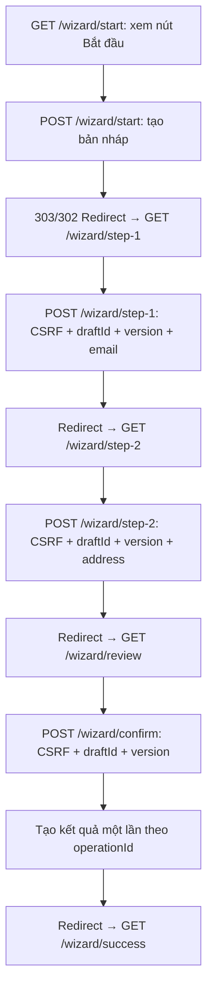

# Form nhiều bước, quay lại và gửi lại trang cũ

Trong module `SPRING_SECURITY_HTTP_PROTECTION`, bảo vệ biểu mẫu nhiều bước (*wizard*) cần phối hợp **CSRF**, quản lý phiên và trạng thái nghiệp vụ. Người dùng có thể đi từ bước nhập thông tin đến bước xác nhận, bấm **Back**, mở cùng biểu mẫu ở nhiều tab hoặc gửi lại request cũ sau khi đăng nhập, đăng xuất hay hết phiên. Những tình huống này rất dễ bị hiểu nhầm là “CSRF token hết hạn”, dù nguyên nhân thật có thể là dữ liệu bản nháp đã thay đổi hoặc một thao tác đã hoàn tất.

Bài học thuộc chương **CSRF và biểu mẫu**, tập trung vào Spring Security trên **Servlet/Spring MVC**, sau đó đối chiếu cách xử lý trên **Reactive/WebFlux**. Mục tiêu là bảo đảm request có nguồn gốc hợp lệ, mỗi bước chỉ thao tác trên trạng thái phù hợp và các hành động như tạo đơn hàng, đăng ký, thanh toán không bị thực hiện lặp ngoài ý muốn.

## 1. Sau bài học, người học làm được gì?

- Giải thích sự khác nhau giữa **CSRF token**, **mã nhận diện bản nháp**, **số phiên bản dữ liệu** và **idempotency key**.
- Thiết kế luồng GET/POST/Redirect/GET (PRG) cho biểu mẫu nhiều bước và biết cách áp dụng token trong từng form POST.
- Phân tích các trường hợp bấm Back, refresh, mở nhiều tab, submit lại request và xem lại HTML có token cũ.
- Phân biệt lỗi **403 do CSRF** với **409 do phiên bản bản nháp không còn phù hợp**, lỗi xác thực và phiên đã kết thúc.
- Tạo controller, template Thymeleaf, cấu hình Spring Security và kiểm thử MockMvc cho một wizard mẫu.
- Nêu chiến lược xử lý session timeout, đăng nhập/đăng xuất giữa chừng và triển khai Reactive.
- Chọn biện pháp phù hợp để ngăn gửi lặp nghiệp vụ, đồng thời không nhầm mục tiêu đó với chức năng CSRF.

## 2. Bốn khái niệm cần tách biệt

Giả sử biểu mẫu đặt hàng có ba bước: **Địa chỉ liên hệ → Địa chỉ giao hàng → Xác nhận**. Người dùng giữ tab cũ trong một giờ rồi gửi lại. Có ít nhất bốn vấn đề có thể xảy ra:

| Cơ chế | Câu hỏi bảo vệ | Giá trị thường được gửi | Hệ quả nếu không hợp lệ |
| --- | --- | --- | --- |
| **CSRF token** | Request thay đổi trạng thái có mang token hợp lệ của ngữ cảnh bảo mật hiện tại không? | Hidden field `_csrf` hoặc header được cấu hình | Spring Security thường trả **403 Forbidden** trước khi tới controller. |
| **Draft ID** | Request này thuộc bản nháp nào? | `draftId` | Server có thể báo **409 Conflict** nếu bản nháp khác với bản trong phiên. |
| **Version / bước hiện hành** | Người dùng có đang gửi dữ liệu dựa trên trạng thái mới nhất không? | `version`, đôi khi kèm mã bước | Server có thể từ chối hoặc yêu cầu tải lại trang, ví dụ **409 Conflict**. |
| **Idempotency key** | Lệnh tạo đơn/thu tiền này đã được xử lý chưa? | `operationId` / khóa gửi lặp | Server trả lại kết quả đã có hoặc bảo đảm không thực hiện nghiệp vụ hai lần. |

**CSRF token không thay thế idempotency key.** Hai POST liên tiếp có cùng CSRF token hợp lệ vẫn có thể tạo hai đơn hàng nếu ứng dụng không chống thực hiện lặp. Ngược lại, request có idempotency key chưa từng dùng vẫn phải vượt qua CSRF nếu thuộc phạm vi CSRF protection.

**Version không phải bí mật.** Người dùng có thể sửa hidden input trong DevTools, nên server phải đối chiếu phiên bản với trạng thái do server lưu. Không dùng mỗi giá trị `version` trong trình duyệt làm căn cứ quyết định.

CSRF token cũng **không nhất thiết là token dùng một lần cho mỗi bước**. Với repository mặc định của Servlet, token kỳ vọng được lưu trong session; nó có thể được sử dụng qua nhiều bước khi phiên vẫn hợp lệ. Spring Security 6 mặc định che token khi đưa vào trang để giảm rủi ro BREACH; chuỗi hiển thị giữa hai lượt GET có thể khác dù token gốc lưu trong session vẫn giống nhau.

## 3. Mô hình luồng HTTP cho wizard

### 3.1. Mỗi bước cần GET đọc trạng thái và POST ghi trạng thái

Một luồng hợp lý:



Trong luồng này, chỉ **POST** tạo hoặc cập nhật trạng thái nghiệp vụ. GET dùng để xem trạng thái, có thể xác định bước phù hợp và chuyển hướng nếu người dùng không còn ở bước đó. Không tạo đơn, xóa dữ liệu hoặc tự ý reset bản nháp khi trình duyệt tải một trang GET.

Mỗi form POST cần token CSRF hợp lệ, kể cả nút “Bắt đầu” nếu nó **tạo bản nháp trên server**. Trong Spring MVC + Thymeleaf, `th:action` được tích hợp với `RequestDataValueProcessor` để tự thêm hidden field CSRF khi cấu hình đúng.

### 3.2. PRG (Post/Redirect/Get) giúp gì?

Nếu controller trả về HTML trực tiếp sau một POST thành công, người dùng refresh trang có thể nhận hộp thoại **Confirm Form Resubmission** và vô tình gửi lại POST. Với mẫu **Post/Redirect/Get**, POST ghi trạng thái rồi trả redirect đến một URL GET; trình duyệt sau đó đang ở trang GET, vì vậy refresh thông thường chỉ lặp lại GET.

Ví dụ:

```text
POST /wizard/step-1
  → 302 Location: /wizard/step-2
GET /wizard/step-2
  → 200 HTML có form bước 2 và token CSRF hiện tại

F5 tại bước 2 → GET /wizard/step-2 (không lặp lại POST bước 1)
```

Với HTTP, mã **303 See Other** thể hiện rõ hành vi chuyển sang GET sau POST; Spring MVC `return "redirect:/..."` thường tạo redirect phù hợp theo cấu hình framework. PRG **giảm khả năng submit lại do refresh**, nhưng **không bảo đảm idempotency** trước double click, hai tab hoặc retry của client/proxy.

### 3.3. Một bảng hành vi mẫu

| Người dùng làm gì? | Có cần CSRF? | Kiểm tra bổ sung |
| --- | --- | --- |
| Mở lại trang bước 1 bằng Back (GET) | GET mặc định không yêu cầu CSRF | Kiểm tra bản nháp và bước hợp lệ, có thể hiển thị dữ liệu hiện tại. |
| Gửi lại bước 1 từ HTML cũ (POST) | Có | Kiểm tra draft ID, version và quy tắc quay lại bước. |
| Refresh trang GET sau redirect | Không | Đọc lại trạng thái mới nhất, không thay đổi dữ liệu. |
| Refresh/retry trực tiếp một POST | Có | Kiểm tra version; với hành động cuối cần idempotency. |
| Submit form sau khi session hết hạn | Có | Thường bị CSRF chặn do không còn token tương ứng; dữ liệu nháp cũng có thể đã mất. |
| Mở hai tab cùng wizard và sửa ở cả hai | Có với mỗi POST | Cần kiểm tra version/điều khiển đồng thời, không chỉ kiểm tra CSRF. |
| Gửi lại xác nhận tạo đơn sau khi đã thành công | Có | Phải có cơ chế chống tạo đơn trùng ở tầng nghiệp vụ. |

## 4. Vòng đời CSRF token khi quay lại trang cũ

### 4.1. Vì sao token cũ *có thể vẫn hợp lệ*?

Xét cùng một session:

```text
GET bước 1 → form chứa CSRF A → POST bước 1 thành công
GET bước 2 → form chứa CSRF B → POST bước 2 thành công
Back về HTML bước 1 → POST với CSRF A
```

Trong Spring Security Servlet thông thường, chuỗi `A` và `B` có thể khác do cách che token, **không nhất thiết vì token repository đã xoay vòng**. Nếu session và token kỳ vọng vẫn còn, bộ lọc CSRF vẫn có thể chấp nhận `A`. Khi đó chính **version / trạng thái bản nháp** phải quyết định POST từ bước cũ có được phép sửa dữ liệu hay không.

Cần phân biệt hai mức:

1. **CSRF layer:** “Request có token hợp lệ?” Nếu không, mặc định trả **403**.
2. **Business/state layer:** “Dữ liệu mà request định cập nhật còn hợp lệ không?” Nếu không, ví dụ trả **409** và hướng dẫn tải lại bước hiện hành.

Không giải quyết lỗi xử lý wizard bằng cách đổi cấu hình `csrf.disable()`. Đó là hai trách nhiệm khác nhau.

### 4.2. Khi nào CSRF token cũ thường không còn hợp lệ?

- Người dùng **đăng nhập thành công**: `CsrfAuthenticationStrategy` trong cấu hình Servlet mặc định có thể xóa token CSRF cũ để nhận token mới.
- Người dùng **đăng xuất**: `CsrfLogoutHandler` có thể xóa token; việc logout thường đồng thời thay đổi hoặc vô hiệu hóa session.
- **Session hết hạn, bị xóa hoặc chuyển ngữ cảnh:** token gắn với session cũ không còn khớp.
- Ứng dụng đổi `CsrfTokenRepository`, handler, cookie/session hoặc cấu hình security giữa các request.
- Trình duyệt gửi POST nhưng **không gửi cookie phiên phù hợp** hoặc token được lấy từ phiên khác.

Không có quy tắc “mọi CSRF token mặc định hết hạn sau 5 phút” áp dụng chung cho Spring Security. Với session repository, tuổi thọ gắn với vòng đời session và chính sách ứng dụng. Cũng không nên giả định bấm Back luôn làm token hết hạn.

### 4.3. Back/forward cache và HTML đã cache

Trình duyệt có thể khôi phục trang từ lịch sử hoặc **back/forward cache (bfcache)** mà không thực hiện GET mới. Khi đó hidden CSRF token, `draftId`, `version` và các trường nhập hiển thị có thể là **ảnh chụp trạng thái trước đó**. Dù CSRF token còn hợp lệ, dữ liệu nghiệp vụ vẫn có thể đã cũ.

Với trang chứa dữ liệu nhạy cảm, cân nhắc header `Cache-Control: no-store` và kiểm tra chính sách cache thực tế; Spring Security có mặc định một số security cache headers, nhưng cấu hình hoặc proxy có thể thay đổi chúng. Không giả định một header luôn vô hiệu hóa bfcache trên mọi trình duyệt. **Tầng server vẫn phải kiểm tra trạng thái** ở mỗi POST.

Khi cần tải lại view lúc khôi phục từ bfcache, có thể áp dụng cho những trang được thiết kế phù hợp:

```html
<script>
  window.addEventListener("pageshow", (event) => {
    if (event.persisted) {
      window.location.reload();
    }
  });
</script>
```

Cách này sẽ **mất dữ liệu chưa lưu trên form**. Chỉ dùng khi nghiệp vụ ưu tiên luôn render dữ liệu mới, có hướng dẫn rõ cho người dùng. Với quy trình cho phép chỉnh sửa, lựa chọn tốt hơn có thể là kiểm tra version ở server rồi giải quyết xung đột khi POST.

## 5. Ví dụ Spring MVC: lưu bản nháp có ID và version trên session

Ví dụ minh họa sử dụng Spring Boot 3/Spring Security 6, Java 17+, Spring MVC và Thymeleaf. Mục tiêu chính là thể hiện chỗ đặt CSRF token và xác nhận phiên bản; ví dụ lưu bản nháp và kết quả trong bộ nhớ để dễ đọc. Trong ứng dụng phân tán hoặc xử lý đơn hàng thật, dùng kho lưu bền vững và transaction thay vì dựa riêng vào session trong RAM.

### 5.1. Cấu hình filter chain

```java
import org.springframework.context.annotation.Bean;
import org.springframework.context.annotation.Configuration;
import org.springframework.security.config.Customizer;
import org.springframework.security.config.annotation.web.builders.HttpSecurity;
import org.springframework.security.web.SecurityFilterChain;

@Configuration
public class SecurityConfig {
    @Bean
    SecurityFilterChain filterChain(HttpSecurity http) throws Exception {
        return http
                .authorizeHttpRequests(auth -> auth
                        .requestMatchers("/wizard/**").permitAll()
                        .anyRequest().authenticated())
                .csrf(Customizer.withDefaults())
                .formLogin(Customizer.withDefaults())
                .build();
    }
}
```

`permitAll()` cho wizard là **lựa chọn đơn giản hóa dành cho bài thực hành**; wizard thật có thông tin người dùng hoặc giao dịch nên yêu cầu đăng nhập và kiểm tra quyền. Dù cho phép truy cập ẩn danh, **POST vẫn được CSRF bảo vệ** vì request vẫn đi qua security filter chain.

Cần các dependency tương ứng: `spring-boot-starter-web`, `spring-boot-starter-security`, `spring-boot-starter-thymeleaf`; để kiểm thử dùng `spring-boot-starter-test` và `spring-security-test`.

### 5.2. Định nghĩa bản nháp có trạng thái server-side

Tạo `SignupDraft.java`. Dùng một `record` bất biến để mỗi lần cập nhật có bản nháp mới và tăng version; mã ID riêng giúp nhận biết form từ wizard trước đó:

```java
import java.io.Serializable;
import java.util.UUID;

public record SignupDraft(
        String id,
        long version,
        String email,
        String address
) implements Serializable {

    public static SignupDraft fresh() {
        return new SignupDraft(UUID.randomUUID().toString(), 0L, null, null);
    }

    public SignupDraft withEmail(String newEmail) {
        // Đổi bước 1 có thể làm mất hiệu lực dữ liệu bước 2.
        return new SignupDraft(id, version + 1, newEmail, null);
    }

    public SignupDraft withAddress(String newAddress) {
        return new SignupDraft(id, version + 1, email, newAddress);
    }
}
```

Những giá trị nào đến từ trình duyệt đều không đáng tin cậy. `draftId` và `version` do client gửi chỉ là **dữ liệu đề nghị**; server phải đối chiếu chúng với `SignupDraft` đang lưu trong session. Dữ liệu email và address cũng phải được validate, giới hạn độ dài và áp dụng quy tắc nghiệp vụ của ứng dụng thực.

### 5.3. Controller triển khai luồng GET/POST/Redirect

Tạo `SignupWizardController.java`:

```java
import jakarta.servlet.http.HttpSession;
import org.springframework.http.HttpStatus;
import org.springframework.stereotype.Controller;
import org.springframework.ui.Model;
import org.springframework.web.bind.annotation.GetMapping;
import org.springframework.web.bind.annotation.PostMapping;
import org.springframework.web.bind.annotation.RequestMapping;
import org.springframework.web.bind.annotation.RequestParam;
import org.springframework.web.server.ResponseStatusException;

@Controller
@RequestMapping("/wizard")
public class SignupWizardController {
    private static final String KEY = "SIGNUP_DRAFT";

    private final DemoSubmissionService service;

    public SignupWizardController(DemoSubmissionService service) {
        this.service = service;
    }

    @GetMapping("/start")
    String startPage() {
        return "wizard/start";
    }

    @PostMapping("/start")
    String start(HttpSession session) {
        session.setAttribute(KEY, SignupDraft.fresh());
        return "redirect:/wizard/step-1";
    }

    @GetMapping("/step-1")
    String stepOne(HttpSession session, Model model) {
        SignupDraft draft = readDraft(session);
        if (draft == null) {
            return "redirect:/wizard/start";
        }
        model.addAttribute("draft", draft);
        return "wizard/step-1";
    }

    @PostMapping("/step-1")
    String saveStepOne(@RequestParam String draftId,
                       @RequestParam long version,
                       @RequestParam String email,
                       HttpSession session) {
        SignupDraft draft = requireCurrentDraft(session, draftId, version);
        if (email.isBlank()) {
            throw new ResponseStatusException(HttpStatus.BAD_REQUEST,
                    "Email không được bỏ trống");
        }
        session.setAttribute(KEY, draft.withEmail(email.trim()));
        return "redirect:/wizard/step-2";
    }

    @GetMapping("/step-2")
    String stepTwo(HttpSession session, Model model) {
        SignupDraft draft = readDraft(session);
        if (draft == null) {
            return "redirect:/wizard/start";
        }
        if (draft.email() == null) {
            return "redirect:/wizard/step-1";
        }
        model.addAttribute("draft", draft);
        return "wizard/step-2";
    }

    @PostMapping("/step-2")
    String saveStepTwo(@RequestParam String draftId,
                       @RequestParam long version,
                       @RequestParam String address,
                       HttpSession session) {
        SignupDraft draft = requireCurrentDraft(session, draftId, version);
        if (draft.email() == null || address.isBlank()) {
            throw new ResponseStatusException(HttpStatus.BAD_REQUEST,
                    "Bản nháp chưa đủ thông tin");
        }
        session.setAttribute(KEY, draft.withAddress(address.trim()));
        return "redirect:/wizard/review";
    }

    @GetMapping("/review")
    String review(HttpSession session, Model model) {
        SignupDraft draft = readDraft(session);
        if (draft == null) {
            return "redirect:/wizard/start";
        }
        if (draft.email() == null || draft.address() == null) {
            return "redirect:/wizard/step-1";
        }
        model.addAttribute("draft", draft);
        return "wizard/review";
    }

    @PostMapping("/confirm")
    String confirm(@RequestParam String draftId,
                   @RequestParam long version,
                   HttpSession session) {
        SignupDraft draft = requireCurrentDraft(session, draftId, version);
        if (draft.email() == null || draft.address() == null) {
            throw new ResponseStatusException(HttpStatus.CONFLICT,
                    "Bản nháp chưa hoàn tất");
        }

        service.createOnce(draft);
        session.removeAttribute(KEY);
        return "redirect:/wizard/success";
    }

    @GetMapping("/success")
    String success() {
        return "wizard/success";
    }

    private SignupDraft readDraft(HttpSession session) {
        return (SignupDraft) session.getAttribute(KEY);
    }

    private SignupDraft requireCurrentDraft(HttpSession session,
                                            String draftId,
                                            long version) {
        SignupDraft draft = readDraft(session);
        if (draft == null) {
            throw new ResponseStatusException(HttpStatus.GONE,
                    "Phiên bản nháp đã kết thúc; mở lại wizard");
        }
        if (!draft.id().equals(draftId) || draft.version() != version) {
            throw new ResponseStatusException(HttpStatus.CONFLICT,
                    "Trang đã cũ; tải lại bước hiện tại");
        }
        return draft;
    }
}
```

**Quy ước HTTP trong ví dụ:**

- **403**: `CsrfFilter` mặc định từ chối request thiếu/sai token, nên có thể **không vào controller**.
- **409**: controller đã nhận request qua CSRF nhưng `draftId`/`version` không khớp bản nháp server.
- **410**: bản nháp không còn trong session ở thời điểm controller xử lý, ví dụ đã kết thúc.
- **302/redirect**: POST hợp lệ được áp dụng thành công rồi chuyển sang GET bước kế tiếp.

Đây là các lựa chọn phản hồi của bài thực hành. Spring Security **không tự kiểm tra `draftId` hay `version`** và cũng không mặc định trả 409/410 cho wizard của ứng dụng.

Để minh họa chống thực thi lặp, tạo `DemoSubmissionService.java`:

```java
import java.util.Map;
import java.util.concurrent.ConcurrentHashMap;
import org.springframework.stereotype.Service;

@Service
public class DemoSubmissionService {
    private final Map<String, SignupDraft> completed =
            new ConcurrentHashMap<>();

    public void createOnce(SignupDraft draft) {
        // ID của wizard đóng vai trò operation ID trong bản demo.
        completed.putIfAbsent(draft.id(), draft);
    }
}
```

Hàm này chỉ lưu trong RAM để **minh họa** idempotency theo `draft.id()`. Nó **không đủ cho giao dịch thật**, vì dữ liệu sẽ mất khi restart, các node không dùng chung bộ nhớ và việc tạo order/thanh toán cần gắn với cùng một transaction. Trong sản phẩm thật, nên dùng khóa idempotency bền vững, unique constraint trong database hoặc API idempotent của cổng thanh toán và lưu kết quả giao dịch để trả lại khi retry.

**Giới hạn đồng thời của ví dụ:** Hai POST song song có thể cùng đọc một version trước khi session kịp cập nhật. `requireCurrentDraft` trong RAM là minh họa kiểm tra phiên bản cho request tuần tự; muốn đảm bảo an toàn khi có tranh chấp thực sự, thao tác kiểm tra và tăng version phải **nguyên tử** (optimistic locking trong cơ sở dữ liệu, compare-and-swap hoặc khóa phù hợp phạm vi triển khai). Không xem việc có `long version` trong HTML là cơ chế khóa đồng thời hoàn chỉnh.

## 6. Render bốn form Thymeleaf với token CSRF

### 6.1. Form bắt đầu

File `templates/wizard/start.html` (trích phần nội dung body):

```html
<h1>Bắt đầu đăng ký</h1>

<form th:action="@{/wizard/start}" method="post">
    <button type="submit">Tạo bản nháp</button>
</form>
```

Bấm nút này tạo bản nháp mới bằng **POST**, vì vậy nó phải có CSRF token. Nếu dùng Thymeleaf/Spring Security tích hợp đúng, `th:action` khiến hidden input được thêm khi render; không cần tự viết `_csrf`.

### 6.2. Bước 1: nhập email

File `templates/wizard/step-1.html`:

```html
<h1>Bước 1 — Thông tin liên hệ</h1>

<form th:action="@{/wizard/step-1}" method="post">
    <input type="hidden" name="draftId" th:value="${draft.id()}">
    <input type="hidden" name="version" th:value="${draft.version()}">

    <label for="email">Email</label>
    <input id="email" type="email" name="email"
           th:value="${draft.email()}" required>

    <button type="submit">Tiếp tục</button>
</form>
```

Khi render thành HTML, form cần có **ba loại dữ liệu ẩn khác nhau**:

```html
<form action="/wizard/step-1" method="post">
    <input type="hidden" name="draftId" value="draft-uuid-tu-server">
    <input type="hidden" name="version" value="0">
    <input name="email" type="email" value="a@example.test">
    <button type="submit">Tiếp tục</button>
    <input type="hidden" name="_csrf" value="csrf-token-duoc-render">
</form>
```

Trong ví dụ, `draftId` và `version` do controller truyền từ bản nháp; `_csrf` do Spring Security và tích hợp template cung cấp. **Cả ba đều cần được kiểm tra đúng trách nhiệm** khi nhận POST.

### 6.3. Bước 2: nhập địa chỉ

File `templates/wizard/step-2.html`:

```html
<h1>Bước 2 — Địa chỉ nhận</h1>

<form th:action="@{/wizard/step-2}" method="post">
    <input type="hidden" name="draftId" th:value="${draft.id()}">
    <input type="hidden" name="version" th:value="${draft.version()}">

    <label for="address">Địa chỉ</label>
    <input id="address" name="address"
           th:value="${draft.address()}" required>

    <button type="submit">Tiếp tục</button>
</form>

<a th:href="@{/wizard/step-1}">Quay lại bước 1</a>
```

Liên kết **Quay lại** là một GET **đọc** bước 1. Nếu người dùng sửa và gửi lại bước 1, controller sẽ tạo bản nháp mới với version tăng và xóa địa chỉ cũ để tránh dùng dữ liệu bước 2 chưa được xác nhận với thông tin liên hệ vừa thay đổi. Điều này khác với việc dùng một link GET để tự động xóa/sửa dữ liệu, vốn vi phạm tính an toàn của GET.

Nếu trình duyệt khôi phục một bản HTML bước 2 cũ với `version=1` sau khi bản nháp đã ở `version=2`, request vẫn có thể vượt CSRF nhưng controller trả **409**. Đây là kết quả mong muốn để tránh **lost update**.

### 6.4. Bước xác nhận: nút hoàn tất phải gửi POST

File `templates/wizard/review.html`:

```html
<h1>Kiểm tra thông tin</h1>
<p>Email: <span th:text="${draft.email()}"></span></p>
<p>Địa chỉ: <span th:text="${draft.address()}"></span></p>

<form th:action="@{/wizard/confirm}" method="post">
    <input type="hidden" name="draftId" th:value="${draft.id()}">
    <input type="hidden" name="version" th:value="${draft.version()}">
    <button type="submit">Xác nhận đăng ký</button>
</form>

<a th:href="@{/wizard/step-2}">Sửa địa chỉ</a>
```

Nút **Xác nhận** gửi một POST có CSRF token. Đừng dùng `<a href="/wizard/confirm">` để tạo giao dịch bằng GET. Dùng `th:text` để HTML-escape dữ liệu hiển thị. `templates/wizard/success.html` có thể là trang thông báo thành công tĩnh, chỉ hiển thị bằng GET sau redirect.

**Chú ý:** Các đoạn trên là phần body của template; cần đặt trong trang HTML hoàn chỉnh khi xây dựng dự án. Nếu dùng JSP, có thể thay `th:action` bằng Spring MVC `<form:form>` hoặc hidden input từ `_csrf`; với JSP `<sec:csrfInput />` cũng có thể dùng trên form thuần nếu dự án có Spring Security taglib. Mỗi form phải chứa đúng một token được Spring Security cung cấp; tránh chèn trùng khi engine đã tự thêm.

## 7. Quay lại bước cũ và nhiều tab: quyết định ở tầng nghiệp vụ

### 7.1. Chính sách quay lại cần nhất quán

Không phải wizard nào cũng cấm quay lại. Có ba chính sách thường gặp:

| Chính sách | Cách vận hành | Ưu điểm / điều kiện |
| --- | --- | --- |
| Cho sửa mọi bước đã qua | GET bước cũ hiển thị giá trị hiện tại; POST sửa bước cũ làm invalid các bước phụ thuộc và tăng version. | Phù hợp biểu mẫu đăng ký, nhưng phải kiểm tra điều kiện khi hoàn tất. |
| Chỉ cho sửa bước hiện hành | Server lưu `currentStep`; POST từ bước khác bị từ chối hoặc chuyển về bước hiện hành. | Phù hợp quy trình pháp lý, xác nhận từng bước. |
| Cho xem nhưng không cho submit lại | GET cũ ở trạng thái chỉ đọc hoặc hiển thị thông báo đã hoàn tất. | Phù hợp trạng thái đã ký, đã thanh toán hoặc giao dịch không thể sửa. |

Ví dụ controller ở mục 5 minh họa **kiểm tra ID/version** và cho phép tải lại các bước đã tồn tại; một ứng dụng nghiêm ngặt cần bổ sung `currentStep` và ràng buộc chuyển bước tương ứng. Không phụ thuộc vào thứ tự nút trong frontend để quyết định tính hợp lệ của thao tác.

### 7.2. Hai tab cùng một session

Ví dụ:

```text
Tab A: GET bước 2 → version 1
Tab B: GET bước 2 → version 1

Tab A: POST địa chỉ mới, CSRF hợp lệ, version 1
       → bản nháp server lên version 2

Tab B: POST địa chỉ cũ, CSRF hợp lệ, version 1
       → server từ chối 409 và yêu cầu tải lại
```

Cả hai request có thể mang **CSRF token hợp lệ**. CSRF không biết yêu cầu nào mới hơn. Nếu muốn hỗ trợ mỗi tab có bản nháp độc lập, phải dùng **draft ID riêng cho từng tab** và lưu nhiều bản nháp phía server (ví dụ keyed by draft ID, có quyền sở hữu và thời hạn), thay vì chỉ một khóa `SIGNUP_DRAFT` trong session.

### 7.3. Tránh mất dữ liệu khi có xung đột

Trả 409 là quyết định an toàn nhưng có thể khiến người dùng mất trường đã nhập. Các phương án cải thiện UX:

- Cho phép tải phiên bản mới và nhập lại phần đã thay đổi, giải thích trường nào bị xung đột.
- Lưu bản nháp hợp lệ theo phiên bản ở server; yêu cầu người dùng xác nhận việc ghi đè rõ ràng nếu nghiệp vụ cho phép.
- Với dữ liệu quan trọng, xây endpoint kiểm tra version/etag và cơ chế hợp nhất có kiểm soát.
- Nếu hỗ trợ tự lưu, mỗi request autosave thay đổi trạng thái cũng phải qua CSRF và kiểm tra phiên bản.

**Không** tin `version` do client tự tăng mà không đối chiếu server; kẻ tấn công có thể sửa giá trị đó. Cũng không biến một GET thành thao tác lưu tự động để “sửa lỗi Back”.

## 8. Gửi lại trang cũ, double click và idempotency

### 8.1. Các trường hợp dễ tạo lệnh trùng

- Người dùng nhấn nút Xác nhận hai lần liên tiếp.
- Mạng chậm, client gửi lại POST vì không nhận được phản hồi.
- Hai tab cùng mở trang Review và gửi lệnh gần như đồng thời.
- Trình duyệt khôi phục bản HTML Review cũ sau khi đơn hàng đã hoàn tất.
- Ứng dụng nhận request mới cùng dữ liệu nhưng do người dùng **chủ ý** tạo giao dịch mới.

Một CSRF token hợp lệ chỉ xác minh điều kiện CSRF, **không phân biệt đâu là retry và đâu là giao dịch mới**. Vì vậy, với lệnh tạo đơn/thanh toán, cần một mã thao tác **ổn định theo ý định nghiệp vụ** (ví dụ `operationId`) và bảo đảm xử lý đúng một lần theo mã đó.

### 8.2. Vì sao idempotency cần bền vững?

Giả sử hai POST `/wizard/confirm` đến cùng lúc:

```text
POST X: operationId=abc123, CSRF hợp lệ ──┐
                                          ├──> Transaction / unique key
POST Y: operationId=abc123, CSRF hợp lệ ──┘         |
                                                     v
                                               Chỉ 1 kết quả nghiệp vụ
```

Thực thi ở server cần bảo vệ tính nguyên tử: ví dụ database có **unique constraint** trên `operation_id`, giao dịch tạo record và trạng thái xử lý, rồi khi gặp request lặp có thể trả kết quả đã lưu. Nếu gọi cổng thanh toán, dùng cơ chế idempotency do cổng hỗ trợ cùng transaction/outbox phù hợp. Một biến Boolean trong session hoặc việc disable nút trên giao diện không đủ để chống race condition.

`operationId` có thể chính là `draftId` trong wizard đơn giản. Ứng dụng phức tạp có thể phát hành khóa riêng khi mở bước xác nhận, ràng buộc nó với tài khoản, phiên bản bản nháp và loại thao tác để ngăn nhầm giao dịch. Không dùng CSRF token làm idempotency key: token có thể dùng xuyên nhiều form và cũng có thể được xoay vòng độc lập với ý định nghiệp vụ.

### 8.3. Frontend chỉ hỗ trợ giảm submit lặp

```html
<form id="confirmForm" th:action="@{/wizard/confirm}" method="post">
    <input type="hidden" name="draftId" th:value="${draft.id()}">
    <input type="hidden" name="version" th:value="${draft.version()}">
    <button id="confirmButton" type="submit">Xác nhận</button>
</form>

<script>
  const form = document.getElementById("confirmForm");
  form.addEventListener("submit", () => {
    document.getElementById("confirmButton").disabled = true;
  });
</script>
```

Đoạn JavaScript chỉ giảm double click trong cùng giao diện. Nếu JavaScript tắt, trang cũ vẫn đang mở hoặc có retry ở mạng, yêu cầu vẫn có thể được gửi lặp. Tầng server vẫn phải dùng cơ chế idempotency.

## 9. Kiểm thử có ý nghĩa với MockMvc

Thêm `spring-security-test`. Dưới đây là các kiểm thử cho **CSRF**, **version cũ** và **PRG** trên controller mẫu. Với Spring Boot 3, có thể dùng:

```java
import static org.hamcrest.Matchers.containsString;
import static org.springframework.security.test.web.servlet.request.SecurityMockMvcRequestPostProcessors.csrf;
import static org.springframework.test.web.servlet.request.MockMvcRequestBuilders.get;
import static org.springframework.test.web.servlet.request.MockMvcRequestBuilders.post;
import static org.springframework.test.web.servlet.result.MockMvcResultMatchers.*;

import org.junit.jupiter.api.Test;
import org.springframework.beans.factory.annotation.Autowired;
import org.springframework.boot.test.autoconfigure.web.servlet.AutoConfigureMockMvc;
import org.springframework.boot.test.context.SpringBootTest;
import org.springframework.mock.web.MockHttpSession;
import org.springframework.test.web.servlet.MockMvc;

@SpringBootTest
@AutoConfigureMockMvc
class WizardCsrfTests {

    @Autowired
    MockMvc mvc;

    @Test
    void startPageRendersCsrfToken() throws Exception {
        mvc.perform(get("/wizard/start"))
                .andExpect(status().isOk())
                .andExpect(content().string(containsString("name=\"_csrf\"")));
    }

    @Test
    void postWithoutCsrfIsRejectedBeforeDraftCreation() throws Exception {
        mvc.perform(post("/wizard/start"))
                .andExpect(status().isForbidden());
    }

    @Test
    void validPostAdvancesStepButOldVersionIsRejected() throws Exception {
        MockHttpSession session = new MockHttpSession();

        mvc.perform(post("/wizard/start")
                        .session(session).with(csrf()))
                .andExpect(status().is3xxRedirection())
                .andExpect(redirectedUrl("/wizard/step-1"));

        SignupDraft original = (SignupDraft) session
                .getAttribute("SIGNUP_DRAFT");

        mvc.perform(get("/wizard/step-1").session(session))
                .andExpect(status().isOk())
                .andExpect(content().string(containsString("name=\"_csrf\"")));

        mvc.perform(post("/wizard/step-1")
                        .session(session).with(csrf())
                        .param("draftId", original.id())
                        .param("version", "0")
                        .param("email", "a@example.test"))
                .andExpect(status().is3xxRedirection())
                .andExpect(redirectedUrl("/wizard/step-2"));

        mvc.perform(post("/wizard/step-2")
                        .session(session).with(csrf())
                        .param("draftId", original.id())
                        .param("version", "1")
                        .param("address", "Ha Noi"))
                .andExpect(status().is3xxRedirection())
                .andExpect(redirectedUrl("/wizard/review"));

        // Gửi lại form bước 2 đã cũ: token CSRF vẫn hợp lệ,
        // nhưng draft version trong session hiện là 2.
        mvc.perform(post("/wizard/step-2")
                        .session(session).with(csrf())
                        .param("draftId", original.id())
                        .param("version", "1")
                        .param("address", "Dia chi cu"))
                .andExpect(status().isConflict());
    }

    @Test
    void missingCsrfIs403EvenIfDraftVersionIsCorrect() throws Exception {
        MockHttpSession session = new MockHttpSession();

        mvc.perform(post("/wizard/start")
                        .session(session).with(csrf()))
                .andExpect(status().is3xxRedirection());

        SignupDraft draft = (SignupDraft) session
                .getAttribute("SIGNUP_DRAFT");

        mvc.perform(post("/wizard/step-1")
                        .session(session)
                        .param("draftId", draft.id())
                        .param("version", "0")
                        .param("email", "a@example.test"))
                .andExpect(status().isForbidden());
    }
}
```

Phân biệt hai bài kiểm thử:

- `.with(csrf())` tạo token hợp lệ cho request MockMvc, **không chứng minh template đã render token**. Vì vậy test GET kiểm tra HTML là cần thiết.
- Test `isConflict()` gửi token CSRF hợp lệ nhưng **version cũ**. Nó chứng minh 409 không phải lỗi CSRF.
- Test 403 có `draftId` và `version` đúng nhưng bỏ token. Nó chứng minh bảo vệ CSRF xảy ra trước logic cập nhật bản nháp.

Với việc xác nhận tạo đơn, bổ sung kiểm thử concurrent/retry ở tầng service và database để xác minh cùng `operationId` chỉ sinh **một kết quả**, kể cả khi hai request chạy song song hoặc qua hai node. Test MockMvc tuần tự không đủ thay thế kiểm thử ràng buộc duy nhất và transaction.

## 10. Xử lý khi người dùng quay lại sau login, logout hoặc session timeout

### 10.1. Khi session đã hết hạn

Một trang wizard cũ có thể còn trong lịch sử nhưng session tương ứng đã biến mất. Với `HttpSessionCsrfTokenRepository` mặc định, POST dùng token của session cũ thường bị **CsrfFilter từ chối 403 trước khi controller có cơ hội lưu bản nháp**.

Hướng khắc phục phù hợp:

1. Giữ **403** cho request không vượt CSRF; không tự cho phép POST thiếu token chỉ vì muốn phục hồi wizard.
2. Hiển thị thông báo chung và đường dẫn **GET** an toàn để tải lại trang hoặc bắt đầu phiên mới; có thể tùy biến trang lỗi mà vẫn giữ đúng chính sách CSRF.
3. Nếu nghiệp vụ cần khôi phục bản nháp sau hết phiên, lưu bản nháp ở kho riêng có xác thực và quyền sở hữu phù hợp; đừng phụ thuộc hoàn toàn vào session mất hạn.
4. Không tự phát lại một POST cũ chứa dữ liệu nhạy cảm từ localStorage hoặc cache khi chưa kiểm tra lại ngữ cảnh xác thực và quyền thao tác.

Lưu ý: phiên đã hết hạn còn có thể dẫn đến redirect trang login, lỗi phân quyền hoặc thay đổi cookie. Không gắn nhãn mọi 403 là session timeout; cần xem log `CsrfFilter`, cookie và lỗi `MissingCsrfTokenException` / `InvalidCsrfTokenException` khi có trong ngữ cảnh chẩn đoán.

### 10.2. Đăng nhập/đăng xuất giữa lúc đang làm wizard

Ở Servlet, Spring Security mặc định có cơ chế `CsrfAuthenticationStrategy` và `CsrfLogoutHandler` để xóa token CSRF sau những chuyển trạng thái tương ứng. Điều đó có thể khiến form render trước login/logout mang token không còn hợp lệ.

Vì thế:

- Sau đăng nhập, chuyển đến **GET** render form theo phiên/token mới; không tái sử dụng nguyên HTML đã render trước login.
- Sau đăng xuất, không tiếp tục gửi POST wizard đã yêu cầu authentication. Nếu cho bắt đầu lại, phải hiển thị trang mới và token phù hợp.
- Nếu yêu cầu tiếp tục bản nháp qua quá trình login, cần cơ chế chuyển trạng thái bản nháp có kiểm soát, ràng buộc với đúng người dùng sau khi xác thực. Tránh gắn nhầm bản nháp ẩn danh của một người với tài khoản của người khác.
- Với trang nhiều tab, một tab login/logout có thể thay đổi session/token của các tab còn lại; UI cần thông báo tải lại khi nhận lỗi phù hợp.

### 10.3. Chẩn đoán theo mã phản hồi và nguồn lỗi

| Kết quả | Khả năng cao | Việc cần làm |
| --- | --- | --- |
| **403** trước controller | CSRF token thiếu, không khớp hoặc request bị policy bảo mật chặn. | Kiểm tra POST payload, cookie phiên, security chain và thông tin lỗi, phân biệt CSRF với authorization. |
| **409** trong controller mẫu | `draftId` / `version` không phù hợp trạng thái hiện tại. | Tải lại GET bước hiện hành, cho người dùng xem dữ liệu server và giải quyết xung đột. |
| **410** trong controller mẫu | Bản nháp server đã mất hoặc được kết thúc. | Mở phiên wizard mới hoặc phục hồi bản nháp từ kho bền vững nếu nghiệp vụ hỗ trợ. |
| **302** về login | Người dùng chưa/không còn xác thực với route được bảo vệ. | Đăng nhập lại, sau đó render form/token mới; xác minh quyền sở hữu bản nháp. |
| **2xx/3xx nhưng có kết quả trùng** | Thiếu idempotency ở tầng nghiệp vụ. | Dùng operation ID ổn định, unique constraint và xử lý retry. |
| **Refresh GET tạo thêm đơn** | GET đang gây thay đổi trạng thái. | Chuyển hành động nghiệp vụ sang POST có CSRF và áp dụng PRG. |

## 11. Tích hợp với Reactive/WebFlux

Mô hình bảo vệ vẫn giống về ý nghĩa: request thay đổi trạng thái cần CSRF token; wizard cần bản nháp/version riêng; lệnh hoàn tất cần idempotency. Nhưng stack Reactive khác:

| Thành phần | Servlet/Spring MVC | Reactive/WebFlux |
| --- | --- | --- |
| CSRF filter | `CsrfFilter` | `CsrfWebFilter` |
| Token repository mặc định | `HttpSessionCsrfTokenRepository` | `WebSessionServerCsrfTokenRepository` |
| Giá trị token khi render | `CsrfToken` từ request attribute | `Mono<CsrfToken>` từ `ServerWebExchange` |
| Bản nháp phiên | `HttpSession` | `WebSession`, hoặc kho Reactive/bền vững |
| Kiểm thử | `MockMvc` + `csrf()` | `WebTestClient` + `SecurityMockServerConfigurers.csrf()` |

Với Thymeleaf Reactive đã tích hợp Spring Security, có thể dùng cách tạo form `th:action` và kiểm tra HTML đã render. Với renderer tùy biến, cần giải quyết publisher trước khi đưa token vào model, ví dụ:

```java
import org.springframework.security.web.server.csrf.CsrfToken;
import org.springframework.stereotype.Controller;
import org.springframework.ui.Model;
import org.springframework.web.bind.annotation.GetMapping;
import org.springframework.web.server.ServerWebExchange;
import reactor.core.publisher.Mono;

@Controller
public class ReactiveWizardPageController {

    @GetMapping("/wizard/step-1")
    Mono<String> viewStep(ServerWebExchange exchange, Model model) {
        Mono<CsrfToken> csrfPublisher =
                exchange.getAttribute(CsrfToken.class.getName());

        if (csrfPublisher == null) {
            return Mono.error(new IllegalStateException(
                    "Không tìm thấy CSRF token publisher"));
        }

        return csrfPublisher.map(csrf -> {
            model.addAttribute("csrfParameterName", csrf.getParameterName());
            model.addAttribute("csrfTokenValue", csrf.getToken());
            return "wizard/step-1";
        });
    }
}
```

Đoạn này minh họa cách expose token cho **template không tự tích hợp CSRF**; nếu engine đã tự chèn thì không chèn trùng. Logic quản lý `WebSession`, draft/version cần bổ sung phù hợp ứng dụng. Không cast `Mono<CsrfToken>` thành `CsrfToken` hoặc dùng `block()` trong event loop để “sửa” form.

Kiểm thử WebFlux có thể xác minh:

- GET template trả HTML có token ở từng form POST.
- POST không có CSRF token bị chặn (mặc định 403).
- POST có token hợp lệ nhưng version cũ được controller/service từ chối theo quy tắc nghiệp vụ (ví dụ 409).
- Retry operation ID không tạo thêm kết quả, kể cả khi requests đồng thời.

Lưu ý `SecurityMockServerConfigurers.csrf()` hỗ trợ tạo request hợp lệ trong WebTestClient, nhưng không thay thế kiểm tra token được render vào HTML của view.

## 12. Bài tập tình huống

**Bối cảnh:** Người dùng đang đăng ký dịch vụ qua ba bước, dùng cookie phiên và trình duyệt. Họ mở hai tab của cùng wizard, sau đó đăng nhập lại ở tab thứ ba và quay lại tab cũ.

Thực hiện theo thứ tự:

1. Xây wizard 3 bước với GET hiển thị, POST ghi dữ liệu và redirect sau mỗi POST. Kiểm tra tất cả form POST, gồm nút Bắt đầu và Xác nhận, đều có hidden CSRF input.
2. Mở hai tab ở bước 2; gửi địa chỉ mới từ tab A, rồi gửi địa chỉ cũ từ tab B. Ghi lại **mã phản hồi và lý do**. Bảo đảm POST thứ hai không âm thầm ghi đè dữ liệu mới.
3. Dùng Back quay lại bước 1, sửa email và submit. Định nghĩa rõ dữ liệu địa chỉ có cần nhập lại hay không; kiểm tra version tăng đúng.
4. Sau khi xác nhận thành công, thử gửi lại cùng request bằng DevTools. Chứng minh tầng nghiệp vụ chỉ xử lý một lần theo `operationId`.
5. Khi session hết hạn hoặc người dùng logout/login ở tab khác, thử POST từ HTML trước đó; phân biệt lỗi 403 CSRF, redirect do authentication và lỗi bản nháp không còn.
6. Đặt bộ kiểm thử cho ít nhất bốn trường hợp: CSRF thiếu → 403; CSRF hợp lệ + version hiện tại → redirect; CSRF hợp lệ + version cũ → 409; cùng operation ID gửi lặp → một kết quả nghiệp vụ.
7. Nếu triển khai bản Reactive, giải thích cách kết hợp `WebSession`, `Mono<CsrfToken>` và persistence/idempotency mà không block luồng Reactor.

**Đạt yêu cầu** khi người học chỉ ra chính xác trách nhiệm của CSRF token, kiểm soát trạng thái bản nháp và idempotency; biết tại sao một HTML form cũ có thể vẫn vượt qua CSRF nhưng bị từ chối bởi version, và bảo vệ được luồng wizard khi người dùng quay lại, mở nhiều tab hoặc gửi lại request.

## Tài liệu tham khảo

- [Spring Security — CSRF cho Servlet](https://docs.spring.io/spring-security/reference/servlet/exploits/csrf.html): filter, deferred token, BREACH, handler và các thay đổi token quanh authentication/logout.
- [Spring Security — Kiểm thử CSRF với MockMvc](https://docs.spring.io/spring-security/reference/servlet/test/mockmvc/csrf.html): request có token đúng và sai.
- [Spring Security — CSRF cho Reactive](https://docs.spring.io/spring-security/reference/reactive/exploits/csrf.html): `CsrfWebFilter`, `WebSession` và token publisher.
- [Spring Security — Kiểm thử CSRF WebFlux](https://docs.spring.io/spring-security/reference/reactive/test/web/csrf.html): `WebTestClient` và `csrf()`.
- [MDN — HTTP request methods](https://developer.mozilla.org/en-US/docs/Web/HTTP/Reference/Methods): ý nghĩa GET/POST và các phương thức HTTP.
- [MDN — Back/forward cache](https://developer.mozilla.org/en-US/docs/Web/Performance/Guides/bfcache): cách trình duyệt khôi phục trang khi Back/Forward.
- [RFC 9110 — HTTP Semantics](https://www.rfc-editor.org/rfc/rfc9110): safe/idempotent methods và redirect semantics.
