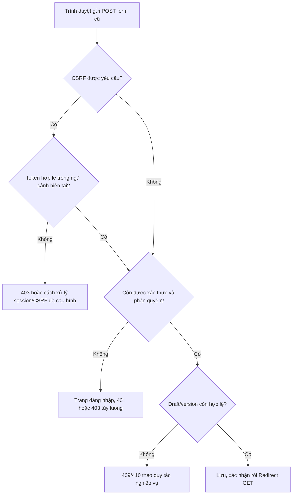

# Session hết hạn trong lúc người dùng đang nhập liệu

Trong các ứng dụng web sử dụng Spring Security và cookie phiên, người dùng có thể mở một biểu mẫu, nhập dữ liệu trong thời gian dài rồi nhấn **Lưu** sau khi phiên đăng nhập đã hết hạn. Khi đó, HTML vẫn còn trên màn hình nhưng phía máy chủ không còn nhận ra phiên trước đó hoặc không còn CSRF token đã gắn với phiên. Nếu xử lý thiếu cẩn thận, request bị từ chối, người dùng mất dữ liệu hoặc ứng dụng vô tình nới lỏng chính sách bảo mật để tránh thông báo lỗi.

Bài thuộc chương **CSRF và biểu mẫu** của module `SPRING_SECURITY_HTTP_PROTECTION`. Mục tiêu là phối hợp **CSRF, session, trải nghiệm người dùng, quản lý bản nháp và kiểm thử** trong Spring MVC/Servlet và WebFlux/Reactive. Đây là vấn đề khác với trường hợp người dùng chỉ bấm nút gửi hai lần hoặc sửa nội dung từ trang cũ: cần xác định chính xác **trạng thái phiên**, **token hợp lệ** và **trạng thái dữ liệu nghiệp vụ** trước khi quyết định cho lưu.

## 1. Kết quả học tập

Sau khi học, người đọc có thể:

- Mô tả nguyên nhân trang HTML vẫn hiển thị dù `HttpSession` hoặc `WebSession` đã hết hạn trên server.
- Giải thích quan hệ giữa session timeout, `HttpSessionCsrfTokenRepository`, CSRF token và quyền truy cập một POST.
- Phân biệt **403 do CSRF**, redirect về trang đăng nhập, **401** từ API và **409** do xung đột bản nháp; không suy luận một mã phản hồi luôn có duy nhất một nguyên nhân.
- Thiết kế cách cảnh báo trước hết phiên, giữ dữ liệu nhập và khôi phục bản nháp sau khi đăng nhập lại.
- Cấu hình session timeout mà không dùng hoạt động “giữ phiên sống” vô hạn làm mất ý nghĩa của idle timeout.
- Triển khai form Thymeleaf, ví dụ Spring Security, kiểm thử MockMvc và phác thảo luồng Reactive tương ứng.
- Chẩn đoán cookie, filter chain, CSRF token, session repository và vấn đề khi ứng dụng chạy nhiều máy chủ.

## 2. Tình huống: một form dài 20 phút, session 15 phút

Giả sử người dùng đăng nhập vào hệ thống tuyển dụng, mở trang `GET /application/edit` lúc 10:00 rồi nhập phần giới thiệu. Ứng dụng cấu hình **session idle timeout 15 phút**. Không có HTTP request nào khác sử dụng phiên trong lúc người dùng đang gõ. Đến 10:20, họ nhấn **Lưu**:

```text
10:00   GET /application/edit
        ├── Server trả HTML chứa form và CSRF token A
        ├── Cookie JSESSIONID gắn với session S
        └── Trình duyệt vẫn hiển thị trang

10:01 ─ 10:19
        Người dùng nhập vào textarea
        (Gõ phím thường KHÔNG gửi HTTP request đến server)

~10:15  Session S không còn hợp lệ do idle timeout
        (Thời điểm/chi tiết dọn dẹp phụ thuộc container/store)

10:20   POST /application/submit
        ├── Trình duyệt có thể vẫn gửi JSESSIONID cũ
        ├── Body chứa nội dung vừa nhập + CSRF token A
        └── Server không tìm được trạng thái session S / token kỳ vọng
                 │
                 ├── CSRF filter từ chối, thường HTTP 403
                 ├── Cơ chế invalid-session có thể redirect
                 └── Nếu xử lý khác, security có thể yêu cầu đăng nhập

        Không có xác nhận lưu thành công → giữ nội dung trên form
        và hướng dẫn tải lại token / đăng nhập để lưu an toàn.
```

**Người dùng vẫn nhìn thấy trang không có nghĩa server còn giữ phiên.** HTML là dữ liệu đã tải trước đó; trình duyệt không tự xóa DOM khi `HttpSession` mất hiệu lực. Ngược lại, bàn phím đang hoạt động cũng không tự gia hạn phiên, trừ khi ứng dụng có autosave/polling hoặc request khác.

### 2.1. “Hết hạn” có nhiều nghĩa

| Loại hết hạn/thay đổi | Trạng thái bị ảnh hưởng | Điều có thể xảy ra khi POST |
| --- | --- | --- |
| Session idle timeout | Phiên server, security context và dữ liệu lưu trong session không còn dùng được | Token session cũ không khớp; CSRF 403 hoặc cơ chế session/authentication xử lý theo cấu hình. |
| Người dùng logout ở tab khác | Security context/session thay đổi; CSRF token cũ có thể bị xóa | Form tab cũ bị từ chối; cần login lại và render token mới. |
| Đăng nhập lại / xoay vòng session | Token và phiên xác thực có thể khác trước | Form cũ chứa token hoặc phiên không còn phù hợp. |
| Bản nháp nghiệp vụ hết hạn | Nội dung lưu nháp không còn hoặc quá thời hạn | Có thể trả 404/409/410 theo API, ngay cả khi CSRF vẫn hợp lệ. |
| Access token hết hạn (kiến trúc token riêng) | Quyền gọi API bị mất, có thể trả 401 | Phụ thuộc loại xác thực; không đồng nghĩa `HttpSession` hay CSRF token session hết hạn. |
| Trang được khôi phục từ history / bfcache | HTML, hidden input và dữ liệu form có thể cũ | Request cần kiểm tra lại phiên/token và phiên bản bản nháp. |

Các giá trị **15 phút** trong bài là cấu hình minh họa. Không có thời lượng hết hạn chung mặc định cho mọi Spring Boot/Spring Security, nhất là khi có Spring Session, load balancer hoặc session store riêng.

## 3. Spring Security xử lý CSRF thế nào khi session hết hạn?

### 3.1. Cơ chế mặc định của Servlet

Spring Security bật CSRF theo mặc định trong cấu hình web thông thường. Bộ lọc `CsrfFilter` yêu cầu token đối với các method không an toàn như `POST`, `PUT`, `PATCH` và `DELETE`. `GET` chỉ được dùng để đọc, không để tạo lệnh lưu hoặc xác nhận giao dịch.

Với Servlet, `HttpSessionCsrfTokenRepository` là repository mặc định: token kỳ vọng nằm trong `HttpSession`. Template Thymeleaf hoặc Spring MVC form tags có thể tích hợp với `CsrfRequestDataValueProcessor` để xuất một hidden input:

```html
<form action="/application/submit" method="post">
    <textarea name="about"></textarea>
    <button type="submit">Lưu</button>
    <input type="hidden"
           name="_csrf"
           value="gia-tri-do-spring-security-render">
</form>
```

Trình duyệt gửi cookie phiên và token đã render. Khi session biến mất, server có thể tạo hoặc tải token kỳ vọng trong **ngữ cảnh phiên mới**. Token từ form cũ không khớp với token kỳ vọng: trong luồng mặc định, CSRF filter thường trả **403 Forbidden**, có thể thông qua `MissingCsrfTokenException` hoặc `InvalidCsrfTokenException` tùy nguyên nhân và cách cấu hình.

Spring Security sử dụng cơ chế **lazy/deferred token** và handler che token (XOR/BREACH protection) trong các phiên bản hiện đại. Hai lần render cùng một phiên có thể tạo hai **chuỗi input khác nhau**, mà token repository chưa hề đổi. Khi điều tra lỗi, đừng kết luận token “hết hạn” chỉ vì chuỗi `_csrf` trên hai trang không giống nhau.

### 3.2. CSRF, xác thực và phiên là ba bước khác nhau



Đây là mô hình **logic** để chẩn đoán, không phải cam kết thứ tự tuyệt đối của mọi filter chain tùy chỉnh. Một cấu hình `InvalidSessionStrategy` có thể xử lý request có session ID không hợp lệ; các entry point cho request chưa xác thực cũng khác nhau giữa form login và REST API.

**Không dựa riêng vào HTTP 403 để khẳng định session đã hết hạn.** 403 cũng xảy ra khi người dùng thiếu quyền hoặc CSRF token bị sửa. Ngược lại, việc chuyển về `/login` chỉ chứng minh một luồng yêu cầu xác thực; phải xem cookie, trạng thái phiên và log để xác định nguyên nhân.

### 3.3. Vì sao không nên tắt CSRF để “cứu” form?

Các cách như `csrf.disable()`, cho phép mọi POST không cần token hoặc chuyển lệnh lưu sang GET đều làm suy yếu bảo vệ request trình duyệt dùng cookie. CORS hay cookie `SameSite` là những lớp bảo vệ bổ sung, không mặc nhiên thay thế CSRF token trong mô hình đồng bộ token.

Nếu phiên đã hết hạn, cách xử lý an toàn là **giữ dữ liệu chưa gửi ở phía người dùng theo chính sách ứng dụng, yêu cầu đăng nhập/tạo phiên hợp lệ rồi lấy token mới**. Chỉ thực hiện lưu sau khi request mới được xác thực và qua bảo vệ CSRF.

## 4. Cấu hình timeout và bảo vệ form trên Spring MVC

Các ví dụ tập trung Spring Boot 3.x, Spring Security 6.x và Java 17+ với Spring MVC/Servlet. Cách gọi lambda cấu hình cũng dùng được ở nhiều phiên bản mới, nhưng cần đối chiếu version thực tế của dự án.

### 4.1. Cấu hình timeout cho Servlet

Trong `application.properties`:

```properties
# Chỉ là thời gian minh họa cho bài thực hành
server.servlet.session.timeout=15m

# Các thiết lập cookie cơ bản cho ứng dụng dùng HTTPS
server.servlet.session.cookie.http-only=true
server.servlet.session.cookie.secure=true
server.servlet.session.cookie.same-site=lax
```

**Ý nghĩa:** `server.servlet.session.timeout` đặt thời gian không hoạt động của session theo cấu hình Servlet container. Các request HTTP hợp lệ dùng phiên có thể làm thay đổi thời điểm truy cập cuối. Không đồng nhất nó với đồng hồ đếm từ khi form hiển thị; các tab khác, polling và autosave có thể gia hạn phiên dù người dùng không bấm vào form này.

`cookie.secure=true` giả định ứng dụng truy cập qua HTTPS. Khi deploy sau reverse proxy, phải bảo đảm proxy/container hiểu thông tin giao thức và cookie có thuộc tính mong muốn. Với hệ thống dùng Spring Session và store riêng, còn cần xét cơ chế timeout/TTL của **session repository**, tránh nghĩ rằng chỉ một thuộc tính của container quyết định toàn bộ vòng đời.

### 4.2. SecurityFilterChain tối thiểu

Ví dụ bảo vệ khu vực `/application/**`, dùng trang đăng nhập mặc định để không phải viết lại phần xác thực:

```java
import org.springframework.context.annotation.Bean;
import org.springframework.context.annotation.Configuration;
import org.springframework.security.config.Customizer;
import org.springframework.security.config.annotation.web.builders.HttpSecurity;
import org.springframework.security.web.SecurityFilterChain;

@Configuration
public class SecurityConfig {

    @Bean
    SecurityFilterChain securityFilterChain(HttpSecurity http) throws Exception {
        return http
                .authorizeHttpRequests(auth -> auth
                        .requestMatchers("/session-expired").permitAll()
                        .requestMatchers("/application/**").authenticated()
                        .anyRequest().authenticated())
                .formLogin(Customizer.withDefaults())
                .csrf(Customizer.withDefaults())
                .build();
    }
}
```

Trong đoạn này:

- `formLogin` cung cấp luồng đăng nhập cho người chưa xác thực.
- `/application/**` yêu cầu authenticated user.
- `csrf` vẫn được bật, vì thế một POST cần có CSRF token đúng phiên.
- `/session-expired` được chuẩn bị như đường dẫn GET công khai có thể dùng khi ứng dụng muốn giải thích nguyên nhân và hướng dẫn mở form mới; controller/view tùy chọn cần được tạo riêng.

Các dependency cho ví dụ gồm `spring-boot-starter-web`, `spring-boot-starter-security`, `spring-boot-starter-thymeleaf`; kiểm thử dùng `spring-boot-starter-test` và `spring-security-test`.

### 4.3. Controller và template form cơ bản

Tạo controller nhỏ để minh họa POST thành công:

```java
import org.springframework.stereotype.Controller;
import org.springframework.ui.Model;
import org.springframework.web.bind.annotation.GetMapping;
import org.springframework.web.bind.annotation.PostMapping;
import org.springframework.web.bind.annotation.RequestParam;
import org.springframework.web.servlet.mvc.support.RedirectAttributes;

@Controller
public class ApplicationFormController {

    @GetMapping("/application/edit")
    String edit(Model model) {
        model.addAttribute("about", "");
        return "application-edit";
    }

    @PostMapping("/application/submit")
    String submit(@RequestParam String about,
                  RedirectAttributes attributes) {
        // Ví dụ: sau khi đi qua SecurityFilterChain,
        // service thực tế còn phải kiểm tra quyền, validate và lưu dữ liệu.
        attributes.addFlashAttribute("notice", "Đã nhận biểu mẫu");
        return "redirect:/application/edit";
    }
}
```

Tạo `src/main/resources/templates/application-edit.html`:

```html
<!DOCTYPE html>
<html lang="vi" xmlns:th="http://www.thymeleaf.org">
<head>
    <meta charset="UTF-8">
    <title>Chỉnh sửa hồ sơ</title>
</head>
<body>
    <h1>Chỉnh sửa hồ sơ</h1>
    <p th:if="${notice}" th:text="${notice}"></p>

    <form th:action="@{/application/submit}" method="post">
        <label for="about">Giới thiệu</label>
        <textarea id="about"
                  name="about"
                  th:text="${about}"
                  rows="8"></textarea>
        <button type="submit">Lưu</button>
    </form>
</body>
</html>
```

Khi Thymeleaf tích hợp với Spring MVC/Spring Security đúng cách, `th:action` cho form POST tự thêm hidden input CSRF. Kiểm tra **HTML đã render** trong Network/Response, vì mã template không chứa dòng `_csrf` tường minh. Nếu form viết bằng JSP thuần, có thể dùng `<sec:csrfInput />` của `spring-security-taglibs` hoặc thuộc tính request `_csrf`; chỉ dùng một cơ chế chèn token trong mỗi form.

### 4.4. Tùy chọn chuyển hướng khi session ID không hợp lệ

Spring Security Servlet hỗ trợ cấu hình `invalidSessionUrl`:

```java
// Chèn vào SecurityFilterChain nếu ứng dụng có trang GET /session-expired:
.sessionManagement(session ->
        session.invalidSessionUrl("/session-expired"))
```

Đây là **tùy chọn** cho tình huống request mang session ID không còn hợp lệ. Nó không thay thế xử lý CSRF, không bao phủ mọi trường hợp hết authentication và cũng không bảo đảm tất cả POST hết phiên luôn redirect cùng một URL. Trang `/session-expired` nên đưa ra thông báo và liên kết GET an toàn để người dùng đăng nhập/lấy form mới.

Tài liệu Spring Security cảnh báo một trường hợp đặc biệt: sau logout/login, browser có thể còn gửi cookie session ID cũ và bị báo invalid session dù đó không phải một lần idle timeout. Nếu dùng cơ chế này, kiểm tra cách xóa cookie `JSESSIONID` khi logout trên container/proxy thực tế.

## 5. Thiết kế UX để người dùng không mất bài đang nhập

### 5.1. Thông báo trung thực về thời gian còn lại

Một cảnh báo như “Bạn đã không hoạt động 14 phút, phiên có thể hết hạn; hãy lưu bản nháp” hữu ích hơn là để lỗi 403 xuất hiện đột ngột. Nhưng frontend **không tự biết chắc** session còn bao lâu chỉ từ `Date.now()`: phiên có thể được gia hạn bởi tab khác, do HTTP request nền hoặc bị hủy chủ động.

Hai hướng thiết kế:

1. **Cảnh báo ước lượng cục bộ:** Server trả về chính sách thời gian không hoạt động; trình duyệt hiển thị lời nhắc sau một khoảng không có tương tác, nhưng không khẳng định đó là thời điểm hết hạn thật.
2. **Kiểm tra trạng thái phiên có kiểm soát:** Backend cung cấp trạng thái/ước lượng hết hạn, frontend gọi khi thực sự cần, có xử lý 401/403/redirect. Bản thân request kiểm tra có thể làm mới thời điểm truy cập session, nên cần cân nhắc chính sách idle timeout.

Không gửi request `setInterval` mỗi vài giây chỉ để giữ session sống: việc này có thể làm **idle timeout không bao giờ xảy ra**, trái mục đích bảo mật. Nếu nghiệp vụ yêu cầu kéo dài phiên, hãy dùng **hành động gia hạn do người dùng chủ động xác nhận**, kiểm tra lại authentication và áp dụng CSRF cho POST gia hạn nếu nó thay đổi trạng thái.

### 5.2. Giữ nội dung trong DOM cho đến khi lưu thành công

Giả sử form dùng nút Lưu hoặc một thao tác `fetch`. Khi nhận lỗi, **đừng gọi `form.reset()`, xóa textarea hoặc tự động chuyển trang làm mất dữ liệu**. Có thể giữ nội dung trong DOM, hiện banner dễ hiểu, mở luồng đăng nhập lại trong cùng tab hoặc tab mới tùy UX, rồi yêu cầu người dùng xác nhận gửi lại với token mới.

Nếu POST dùng **HTML form truyền thống**, browser có thể chuyển đến trang lỗi trước khi ứng dụng có cơ hội giữ nội dung. Với biểu mẫu dài, nên có cơ chế bản nháp đáng tin cậy ở server hoặc giải pháp lưu tạm có đánh giá rủi ro dữ liệu. Chỉ trông chờ nút Back của trình duyệt là không đủ: bfcache, tải lại, đăng nhập lại hoặc chế độ riêng tư có thể làm mất trạng thái.

**Phân biệt lưu bản nháp và gia hạn phiên:** Một lần autosave được xác thực sẽ tạo HTTP request, và request đó có thể đồng thời cập nhật thời điểm truy cập session. Vì vậy cần thiết kế sao cho chính sách session phản ánh đúng yêu cầu bảo mật, có thể kết hợp **thời hạn xác thực tối đa** hoặc bắt đăng nhập lại trước bước nhạy cảm.

### 5.3. Ba cách giữ dữ liệu và đánh đổi

| Cách lưu | Ưu điểm | Nguy cơ / giới hạn | Khi phù hợp |
| --- | --- | --- | --- |
| Chỉ giữ trong DOM | Đơn giản, không lưu thêm dữ liệu | Mất khi điều hướng, reload, crash hoặc bị thay trang lỗi | Form ngắn hoặc thao tác ít quan trọng. |
| Lưu tạm trong `sessionStorage` | Có thể khôi phục sau reload trong cùng tab | Dữ liệu hiện diện phía client, JavaScript/XSS có thể đọc; không bảo đảm giữ sau mọi sự kiện và không dùng để lưu mật khẩu/thông tin nhạy cảm | Dữ liệu không nhạy cảm, có thời hạn xóa và thông báo phù hợp. |
| Lưu bản nháp ở server/database | Có thể tiếp tục sau đăng nhập lại, dùng được đa thiết bị nếu thiết kế | Cần xác thực, phân quyền chủ sở hữu, version, thời hạn lưu, chống submit lặp và chính sách xóa | Form dài hoặc nghiệp vụ có giá trị cao. |

`localStorage` giữ dữ liệu qua nhiều phiên trình duyệt nên mức độ rò rỉ trên thiết bị dùng chung cao hơn. Không mặc định lưu thông tin sức khỏe, tài chính, giấy tờ, mật khẩu, token xác thực hoặc dữ liệu cá nhân nhạy cảm trong Web Storage. Nếu cần lưu phía client, giới hạn field, TTL, xóa khi gửi thành công/logout và áp dụng phòng chống XSS; Web Storage không phải kho bí mật.

## 6. Lưu bản nháp trên server mà không phụ thuộc session còn sống mãi

Một phương án phù hợp hơn cho biểu mẫu dài là **lưu bản nháp gắn với người dùng đã xác thực**, tách khỏi `HttpSession`. Sau session timeout, người dùng đăng nhập lại và tải bản nháp từ database bằng identity mới. Bản nháp không tự trở thành bằng chứng xác thực hay CSRF token.

### 6.1. Hợp đồng endpoint

| Endpoint | Method | Vai trò | Điều kiện |
| --- | --- | --- | --- |
| `GET /application/drafts/{id}` | GET | Tải bản nháp của người dùng hiện tại | Đăng nhập; kiểm tra người dùng sở hữu id. |
| `POST /application/drafts/{id}` | POST | Ghi bản nháp, tăng version | Đăng nhập; CSRF hợp lệ; version đúng; validate payload. |
| `POST /application/submit` | POST | Xác nhận dữ liệu cuối | Đăng nhập; CSRF hợp lệ; dữ liệu đủ; chống gửi lặp nếu nghiệp vụ cần. |
| `GET /application/edit?id=...` | GET | Render form với dữ liệu bản nháp và CSRF mới | Đăng nhập; kiểm tra quyền và draft ID. |

Bản nháp trong database cần có `draftId`, `ownerId`, `version`, `updatedAt`, `expiresAt`, dữ liệu được phép lưu và trạng thái (ví dụ `EDITING` / `SUBMITTED`). Có thể thêm optimistic locking bằng `@Version` của JPA hoặc cập nhật SQL có điều kiện:

```sql
UPDATE application_draft
SET content = :new_content,
    version = version + 1,
    updated_at = CURRENT_TIMESTAMP
WHERE id = :draft_id
  AND owner_id = :current_user_id
  AND version = :expected_version
  AND status = 'EDITING';
```

Nếu số dòng cập nhật bằng 0, xác minh bản nháp còn tồn tại/quyền sở hữu và trả lỗi phù hợp (ví dụ **409 Conflict** với bản nháp cũ). Tài liệu này chỉ minh họa câu SQL; cách bind tham số và mapping thực tế tùy JPA/JDBC. Không tin `ownerId` do client tự gửi, phải lấy từ principal đã xác thực.

### 6.2. Controller lưu bản nháp sau khi CSRF đã được kiểm tra

Ví dụ API trả JSON để frontend biết version mới. Định nghĩa các kiểu nhỏ trước:

```java
public record DraftSaveRequest(long expectedVersion, String content) {}

public record DraftSaveResponse(long version, String status) {}

// DraftService là hợp đồng minh họa.
// Implementation phải dùng database, kiểm soát owner và atomic version update.
public interface DraftService {
    DraftSaveResponse save(String username, String draftId,
                           DraftSaveRequest request);
}
```

Controller:

```java
import org.springframework.http.MediaType;
import org.springframework.security.core.annotation.AuthenticationPrincipal;
import org.springframework.security.core.userdetails.UserDetails;
import org.springframework.web.bind.annotation.PathVariable;
import org.springframework.web.bind.annotation.PostMapping;
import org.springframework.web.bind.annotation.RequestBody;
import org.springframework.web.bind.annotation.RequestMapping;
import org.springframework.web.bind.annotation.RestController;

@RestController
@RequestMapping("/application/drafts")
public class DraftController {
    private final DraftService service;

    public DraftController(DraftService service) {
        this.service = service;
    }

    @PostMapping(value = "/{id}", consumes = MediaType.APPLICATION_JSON_VALUE)
    DraftSaveResponse save(@AuthenticationPrincipal UserDetails user,
                           @PathVariable String id,
                           @RequestBody DraftSaveRequest request) {
        // SecurityFilterChain yêu cầu authentication và CSRF;
        // service kiểm soát owner, validate và concurrency.
        return service.save(user.getUsername(), id, request);
    }
}
```

Đây là **mẫu hợp đồng API**, cần implementation của `DraftService` để chạy thật. Endpoint POST vẫn phải gửi CSRF token trong header hoặc trường form phù hợp. Không thêm `csrf.ignoringRequestMatchers("/application/drafts/**")` chỉ để autosave chạy được.

### 6.3. Gọi autosave có CSRF token và giữ dữ liệu khi lỗi

Từ trang Thymeleaf đã render, có thể expose token vào meta tag:

```html
<meta name="_csrf" th:content="${_csrf.token}">
<meta name="_csrf_header" th:content="${_csrf.headerName}">

<form th:action="@{/application/submit}" method="post">
    <textarea id="about" name="about"></textarea>
    <button type="submit">Gửi chính thức</button>
</form>

<button id="saveDraft" type="button">Lưu bản nháp</button>
<p id="saveMessage" role="status"></p>

<script th:inline="javascript">
    const draftUrl = /*[[@{/application/drafts/123}]]*/ "/application/drafts/123";
    let draftVersion = 0;

    document.getElementById("saveDraft").addEventListener("click", async () => {
        const message = document.getElementById("saveMessage");
        const content = document.getElementById("about").value;
        const csrf = document.querySelector('meta[name="_csrf"]').content;
        const header = document.querySelector('meta[name="_csrf_header"]').content;

        try {
            const result = await fetch(draftUrl, {
                method: "POST",
                credentials: "same-origin",
                headers: {
                    "Content-Type": "application/json",
                    "Accept": "application/json",
                    [header]: csrf
                },
                body: JSON.stringify({
                    expectedVersion: draftVersion,
                    content
                })
            });

            // Form login HTML có thể đến qua redirect sau khi session hết hạn.
            if (result.redirected || result.status === 401 ||
                result.status === 403) {
                message.textContent =
                    "Phiên có thể đã kết thúc. Nội dung vẫn ở trên trang; " +
                    "hãy đăng nhập lại rồi tải token mới trước khi lưu.";
                return;
            }
            if (result.status === 409) {
                message.textContent =
                    "Bản nháp đã thay đổi ở nơi khác. Hãy tải bản mới và so sánh.";
                return;
            }
            if (!result.ok) {
                throw new Error("Không thể lưu: " + result.status);
            }

            const saved = await result.json();
            draftVersion = saved.version;
            message.textContent = "Đã lưu bản nháp.";
        } catch (error) {
            message.textContent =
                "Chưa lưu được. Nội dung vẫn ở trên trang.";
        }
    });
</script>
```

Trong mã trên, URL `123` và version `0` chỉ là **dữ liệu minh họa**. Ứng dụng thật phải cấp `draftId` và version đã đọc từ database, kiểm tra chủ sở hữu rồi render chúng vào template. Nếu người dùng sửa textarea trong lúc request đang chạy, không được đánh dấu các thay đổi mới ấy là đã lưu chỉ vì request trước hoàn tất; cần quản lý revision/dirty state trên frontend nếu triển khai autosave liên tục.

**Không tự động gửi lại request POST cũ ngay sau một redirect login.** Sau khi đăng nhập, cần lấy HTML/token mới, kiểm tra bản nháp và cho người dùng xác nhận lưu lại. Một trang được trả về bởi `fetch` có thể là HTML login với status cuối 200; vì vậy ví dụ có kiểm tra `result.redirected` thay vì chỉ dựa trên `result.ok`. Ứng dụng API thực tế nên có cơ chế trả **401 JSON** cho endpoint API khi chưa xác thực để frontend xử lý rõ ràng.

### 6.4. Khi dùng sessionStorage như bản lưu tạm

Nếu nghiệp vụ cho phép dữ liệu không nhạy cảm được lưu ở client, phiên bản đơn giản:

```javascript
const input = document.getElementById("about");
const key = "draft:application:about";

// Chỉ với dữ liệu được phép lưu phía client.
const previous = sessionStorage.getItem(key);
if (previous !== null && input.value === "") {
    input.value = previous;
}

input.addEventListener("input", () => {
    sessionStorage.setItem(key, input.value);
});

// Chỉ xóa sau khi server xác nhận lưu/thao tác thành công.
// sessionStorage.removeItem(key);
```

Cần giải thích rõ cho người dùng cách lưu/khôi phục, giới hạn thời hạn và loại dữ liệu; bản tạm trong `sessionStorage` không có xác thực/ủy quyền server và có thể bị XSS đọc. Tránh lưu CSRF token, session cookie hoặc credential trong Web Storage để “tái sử dụng” khi session đã hết hạn.

## 7. Khi muốn xử lý lỗi CSRF thân thiện

### 7.1. Nguyên tắc

Một thông báo 403 mặc định thường không giải thích đủ cho người dùng. Ứng dụng có thể cung cấp trang lỗi với nội dung:

> **Không thể lưu biểu mẫu.** Phiên của bạn có thể đã kết thúc hoặc yêu cầu không còn hợp lệ. Hãy đăng nhập lại, mở form mới và khôi phục bản nháp nếu có.

Đừng khẳng định “đã hết phiên” khi chỉ quan sát 403: đây cũng có thể là một request giả mạo. Việc xử lý lỗi cần:

- Giữ **HTTP 403** cho CSRF invalid/missing hoặc xử lý response rõ ràng; không coi một token sai là token đúng chỉ để tiếp tục thao tác.
- Không phản hồi lại CSRF token kỳ vọng trong log, URL hoặc thông báo lỗi.
- Không gửi thông tin form nhạy cảm qua query string khi điều hướng đến trang lỗi.
- Không tự ghi dữ liệu POST vào database trong error handler khi request chưa vượt qua CSRF.
- Hỗ trợ luồng GET an toàn để tải form mới, lấy token mới và khôi phục dữ liệu theo quyền sở hữu bản nháp.

### 7.2. Ví dụ AccessDeniedHandler chỉ minh họa thông báo CSRF

Spring Security Servlet có thể dùng `AccessDeniedHandler` để tùy chỉnh phản hồi. Nếu muốn hiển thị thông báo đặc biệt với lỗi CSRF, phải phân biệt lỗi CSRF với các lỗi từ chối truy cập khác:

```java
import jakarta.servlet.http.HttpServletResponse;
import org.springframework.security.access.AccessDeniedException;
import org.springframework.security.web.access.AccessDeniedHandler;
import org.springframework.security.web.csrf.InvalidCsrfTokenException;
import org.springframework.security.web.csrf.MissingCsrfTokenException;
import org.springframework.stereotype.Component;

@Component
public class FriendlyAccessDeniedHandler implements AccessDeniedHandler {

    @Override
    public void handle(jakarta.servlet.http.HttpServletRequest request,
                       HttpServletResponse response,
                       AccessDeniedException exception)
            throws java.io.IOException {

        if (exception instanceof InvalidCsrfTokenException ||
            exception instanceof MissingCsrfTokenException) {
            response.sendError(HttpServletResponse.SC_FORBIDDEN,
                    "Biểu mẫu không còn hợp lệ. Hãy mở lại trang.");
            return;
        }

        response.sendError(HttpServletResponse.SC_FORBIDDEN);
    }
}
```

Gắn vào cấu hình `HttpSecurity` bằng `exceptionHandling`:

```java
// Tham số handler được inject vào phương thức tạo SecurityFilterChain.
.exceptionHandling(exceptions ->
        exceptions.accessDeniedHandler(friendlyAccessDeniedHandler))
```

Đây là đoạn tùy chọn, cần tích hợp bean handler vào `SecurityFilterChain` đúng cách. `sendError` có thể được container map tới trang lỗi; hãy kiểm tra cách ứng dụng render trang lỗi. Tên ngoại lệ và luồng có thể chịu ảnh hưởng cấu hình filter, vì vậy **không thay thế chẩn đoán log và thử nghiệm thật**.

Trong môi trường SPA/JSON, có thể tùy chỉnh phản hồi lỗi phù hợp API, nhưng vẫn phải giữ trạng thái bị từ chối và không tự replay POST trên một phiên khác.

### 7.3. Cookie repository không phải phương án khôi phục phiên

Spring Security còn có `CookieCsrfTokenRepository`. Việc chuyển token repository từ session sang cookie có thể giải quyết một khía cạnh **CSRF token bị mất cùng session**, nhưng **không khôi phục authentication**, dữ liệu bản nháp trong session hay quyền xử lý POST. Khi dùng JavaScript/SPA và cookie CSRF, cần đặc biệt lưu ý cơ chế handler che token (BREACH), deferred token và xoay vòng token sau login/logout.

Vì vậy, không đổi repository chỉ để làm biến mất thông báo 403 mà không phân tích đầy đủ bảo mật và vòng đời dữ liệu.

## 8. Kiểm thử có và không có session hợp lệ trên Servlet

Để xác minh hành vi, sử dụng `spring-security-test` và `MockMvc`. Các phép thử nên tách riêng **render token**, **POST hợp lệ**, **thiếu token** và **token của phiên cũ**.

### 8.1. Test form render token và POST bình thường

Ví dụ dùng controller `/application/edit` / `/application/submit` ở mục 4 và mô phỏng user đã xác thực:

```java
import static org.hamcrest.Matchers.containsString;
import static org.springframework.security.test.web.servlet.request.SecurityMockMvcRequestPostProcessors.csrf;
import static org.springframework.security.test.web.servlet.request.SecurityMockMvcRequestPostProcessors.user;
import static org.springframework.test.web.servlet.request.MockMvcRequestBuilders.get;
import static org.springframework.test.web.servlet.request.MockMvcRequestBuilders.post;
import static org.springframework.test.web.servlet.result.MockMvcResultMatchers.*;

import org.junit.jupiter.api.Test;
import org.springframework.beans.factory.annotation.Autowired;
import org.springframework.boot.test.autoconfigure.web.servlet.AutoConfigureMockMvc;
import org.springframework.boot.test.context.SpringBootTest;
import org.springframework.test.web.servlet.MockMvc;

@SpringBootTest
@AutoConfigureMockMvc
class ApplicationSessionCsrfTests {

    @Autowired
    MockMvc mvc;

    @Test
    void getFormRendersHiddenCsrfInput() throws Exception {
        mvc.perform(get("/application/edit").with(user("learner")))
                .andExpect(status().isOk())
                .andExpect(content().string(containsString("name=\"_csrf\"")));
    }

    @Test
    void postMissingCsrfFails() throws Exception {
        mvc.perform(post("/application/submit")
                        .with(user("learner"))
                        .param("about", "Nội dung dài"))
                .andExpect(status().isForbidden());
    }

    @Test
    void postWithValidCsrfReachesController() throws Exception {
        mvc.perform(post("/application/submit")
                        .with(user("learner"))
                        .with(csrf())
                        .param("about", "Nội dung dài"))
                .andExpect(status().is3xxRedirection());
    }
}
```

`csrf()` từ `spring-security-test` tạo request có token hợp lệ cho kiểm thử, **không xác minh Thymeleaf thực sự tự chèn token**; test GET là phần độc lập để bao phủ đúng yêu cầu giao diện.

### 8.2. Mô phỏng token thuộc session cũ

Không cần chờ 15 phút trong bộ kiểm thử. Có thể render form để lấy token ở ngữ cảnh thứ nhất, sau đó gửi token ấy trên request có **session khác**:

```java
import org.springframework.mock.web.MockHttpSession;
import org.springframework.security.web.csrf.CsrfToken;
import org.springframework.test.web.servlet.MvcResult;

@Test
void csrfFromOldSessionCannotBeUsedInNewSession() throws Exception {
    MvcResult initialPage = mvc.perform(
            get("/application/edit").with(user("learner")))
            .andExpect(status().isOk())
            .andReturn();

    CsrfToken oldToken = (CsrfToken) initialPage.getRequest()
            .getAttribute(CsrfToken.class.getName());

    // Session khác tượng trưng ngữ cảnh sau khi phiên ban đầu đã mất.
    MockHttpSession anotherSession = new MockHttpSession();

    mvc.perform(post("/application/submit")
                    .with(user("learner"))
                    .session(anotherSession)
                    .param(oldToken.getParameterName(), oldToken.getToken())
                    .param("about", "Nội dung đang nhập"))
            .andExpect(status().isForbidden());
}
```

Bổ sung method này vào class test ở mục 8.1. Nó mô phỏng **token cũ được gửi trong một session khác**, chứ không tạo timeout thực bằng đồng hồ container. `.with(user("learner"))` giữ test tập trung vào CSRF; một request thật sau session timeout còn có thể mất authentication và đi vào luồng redirect/login khác. Nếu ứng dụng cấu hình `invalidSessionUrl`, cần có integration test riêng với cookie session ID không hợp lệ để kiểm tra response đúng môi trường triển khai.

### 8.3. Ma trận kiểm thử tích hợp

| Trường hợp | Dữ liệu | Kỳ vọng |
| --- | --- | --- |
| GET form khi authenticated | User hợp lệ, session đang sống | HTML có hidden CSRF token. |
| POST form thiếu CSRF | Authenticated mock user, không có token | 403 mặc định. |
| POST form token sai | `csrf().useInvalidToken()` | 403 mặc định. |
| POST form token hợp lệ | `csrf()` | Controller chạy, redirect hoặc kết quả nghiệp vụ phù hợp. |
| POST form có token từ session cũ | Token từ GET trước, gửi với session khác | Thường 403 với repository session mặc định. |
| GET form khi chưa xác thực | Không có principal | Redirect login hoặc phản hồi theo entry point đã cấu hình. |
| Truy cập bằng session ID đã hết hạn | Cookie ID cũ; container/store đã bỏ session | Kiểm tra luồng invalid-session, CSRF và authentication thực tế. |
| Autosave sau hết phiên | POST JSON + token cũ | Không lưu; frontend hiển thị thông báo và giữ dữ liệu. |
| Autosave sau đăng nhập lại | Token mới, identity hợp lệ, version mới nhất | Có thể tiếp tục lưu draft sau kiểm tra quyền và xung đột. |
| Gửi đồng thời hai bản nháp cùng version | Cùng draft ID/owner/version | Chỉ một cập nhật hợp lệ nếu persistence đảm bảo atomic version check. |

Nếu request có CSRF token hợp lệ nhưng thiếu quyền, phản hồi vẫn có thể là 403. Kiểm thử phải xem log lỗi hoặc loại exception để phân biệt nguyên nhân, không chỉ nhìn status code.

## 9. Spring WebFlux/Reactive: WebSession cũng có thể hết hạn

Trên WebFlux, Spring Security áp dụng `CsrfWebFilter`; repository mặc định là `WebSessionServerCsrfTokenRepository`, lưu token trong `WebSession`. Spring WebFlux đưa token cho view dưới dạng **`Mono<CsrfToken>`** trong thuộc tính `ServerWebExchange` mang khóa `CsrfToken.class.getName()`.

| Nội dung | Servlet / Spring MVC | Reactive / WebFlux |
| --- | --- | --- |
| Bộ lọc | `CsrfFilter` | `CsrfWebFilter` |
| Session | `HttpSession` | `WebSession` |
| Repository mặc định | `HttpSessionCsrfTokenRepository` | `WebSessionServerCsrfTokenRepository` |
| Expose token cho view | Request attribute `_csrf` / `CsrfToken` | Exchange attribute `Mono<CsrfToken>` |
| Tích hợp template | Thymeleaf/Spring MVC form tags | Thymeleaf Reactive hoặc renderer có thể resolve publisher |
| Kiểm thử | `MockMvc` + `csrf()` | `WebTestClient` + `SecurityMockServerConfigurers.csrf()` |

### 9.1. Cấu hình Reactive riêng

```java
import org.springframework.context.annotation.Bean;
import org.springframework.context.annotation.Configuration;
import org.springframework.security.config.Customizer;
import org.springframework.security.config.web.server.ServerHttpSecurity;
import org.springframework.security.web.server.SecurityWebFilterChain;

@Configuration
public class ReactiveSecurityConfig {

    @Bean
    SecurityWebFilterChain securityWebFilterChain(ServerHttpSecurity http) {
        return http
                .authorizeExchange(exchanges -> exchanges
                        .pathMatchers("/login").permitAll()
                        .pathMatchers("/application/**").authenticated()
                        .anyExchange().authenticated())
                .formLogin(Customizer.withDefaults())
                .csrf(Customizer.withDefaults())
                .build();
    }
}
```

Ví dụ dành cho **ứng dụng WebFlux**, không ghép vào cùng runtime với `SecurityFilterChain` Servlet của ví dụ trước. Nếu dùng view tự tạo, controller Reactive lấy token bất đồng bộ:

```java
import org.springframework.security.web.server.csrf.CsrfToken;
import org.springframework.stereotype.Controller;
import org.springframework.ui.Model;
import org.springframework.web.bind.annotation.GetMapping;
import org.springframework.web.server.ServerWebExchange;
import reactor.core.publisher.Mono;

@Controller
public class ReactiveFormPageController {

    @GetMapping("/application/edit")
    Mono<String> edit(ServerWebExchange exchange, Model model) {
        Mono<CsrfToken> tokenPublisher =
                exchange.getAttribute(CsrfToken.class.getName());

        if (tokenPublisher == null) {
            return Mono.error(new IllegalStateException(
                    "CSRF token publisher chưa được expose"));
        }

        return tokenPublisher.map(token -> {
            model.addAttribute("csrfParameterName", token.getParameterName());
            model.addAttribute("csrfTokenValue", token.getToken());
            return "application-edit";
        });
    }
}
```

Nếu Thymeleaf Reactive đã tự sinh CSRF input, không thêm thủ công lần nữa. Đoạn controller này phù hợp khi **template cần nhận token trong model thủ công**. Không cast `Mono<CsrfToken>` thành `CsrfToken`, cũng không gọi `block()` trong event loop.

### 9.2. Timeout của WebSession và kiểm thử

`WebSession` có khả năng cấu hình `maxIdleTime`; thiết lập ở mức `WebSessionManager` hoặc thành phần quản lý session phù hợp kiến trúc (có thể là Spring Session), ví dụ khi đã có `WebSession`:

```java
import java.time.Duration;
import org.springframework.web.server.WebSession;

// Khi cấu hình session tại lớp quản lý phù hợp:
session.setMaxIdleTime(Duration.ofMinutes(15));
```

Đây là ví dụ về **API chỉnh idle timeout của một WebSession**, không phải một controller đầy đủ. Cách đặt timeout toàn cục phụ thuộc runtime WebFlux, cấu hình Boot và store thực tế; đừng chuyển nguyên thuộc tính `server.servlet.session.timeout` của Servlet sang WebFlux mà giả định có hiệu lực.

Trong kiểm thử Reactive, dùng `WebTestClient` kết hợp `SecurityMockServerConfigurers.csrf()` để gửi request hợp lệ. Muốn tái hiện timeout, cần kiểm tra WebSession store hoặc mô phỏng session/token đã bị thay thế; thêm các bài test không có token, token sai và có token nhưng chưa authenticated. Cũng cần xác nhận form HTML thực sự render token, vì mutator kiểm thử không kiểm tra template.

## 10. Chẩn đoán trong môi trường triển khai thực

| Dấu hiệu | Giả thuyết ưu tiên | Cách xác minh và xử lý |
| --- | --- | --- |
| Người dùng nhập lâu rồi POST trả 403 | Session/CSRF token không còn phù hợp hoặc request thiếu token | Kiểm tra thời điểm truy cập phiên, cookie, payload `_csrf`, log `CsrfFilter` và exception. |
| GET sau idle redirect về login | Security context đã hết hiệu lực | Xác nhận thời hạn session và cấu hình authentication entry point; tải form mới sau login. |
| POST 302 tới `/session-expired` | Có `InvalidSessionStrategy` xử lý session ID không hợp lệ | Kiểm tra cookie session cũ, vị trí filter và trang nhận redirect. |
| Autosave trả HTML login status 200 | `fetch` đã theo redirect và nhận trang login | Kiểm tra `response.redirected` và Content-Type; API nên trả 401 JSON cho unauthenticated request. |
| Form cũ 403 sau khi đăng nhập lại | CSRF token đã bị xóa/đổi ở authentication transition | Render lại form hoặc lấy token mới trước khi submit. |
| Đã lưu nháp rồi đăng nhập lại không tìm thấy | Nháp chỉ lưu trong `HttpSession` / `WebSession` cũ | Dùng persistent draft store với owner và TTL phù hợp. |
| Session hết hạn nhanh hơn cấu hình | Session store TTL khác, logout/tab khác, mất route affinity hoặc reverse proxy/cookie sai | So sánh TTL store, session ID, sticky session/distributed sessions và proxy headers. |
| Session “không bao giờ” hết hạn | Polling hoặc autosave liên tục truy cập session | Rà request nền; cân nhắc idle timeout cộng giới hạn tuổi thọ tối đa. |
| Một số POST 403, GET vẫn chạy | Token không được render/sent, cookie khác phiên, repository/handler không khớp | Đối chiếu request HTML và Network payload, kiểm tra từng security chain. |
| 409 sau đăng nhập lại | Bản nháp trên server đã được sửa ở thiết bị/tab khác | Đối chiếu `version`, hỗ trợ người dùng tải lại và giải quyết xung đột. |

Cần kiểm tra đặc biệt nếu ứng dụng chạy sau load balancer: các request phải tới môi trường có thể truy xuất cùng session, thông qua **sticky sessions** hoặc session repository chia sẻ. Mất trạng thái giữa hai node có thể biểu hiện gần giống timeout. Với Spring Session/Redis, kiểm tra TTL/session serialization và khả năng hạ tầng hoạt động trước khi quy kết mọi lỗi cho CSRF.

Về mặt phòng vệ tổng thể, CSRF phối hợp cùng HTTPS/HSTS, cookie `Secure`/`HttpOnly`/`SameSite`, CSP và encode output để giảm XSS, CORS đúng origin, HTTP firewall và chính sách session. XSS có thể đọc DOM/token dù CSRF đang bật; do đó việc đưa nội dung người dùng trở lại form cần escape phù hợp, không dùng `innerHTML` cho nội dung tùy ý.

## 11. Bài thực hành cuối bài

**Tình huống:** Trang ứng tuyển có textarea dài. Session timeout 15 phút, CSRF mặc định, người dùng thường mất 20–30 phút để viết nội dung và nhiều người mở hai tab.

Thực hiện:

1. Tạo `/application/edit` và `/application/submit` bằng Spring MVC + Thymeleaf; xác minh HTML GET chứa hidden CSRF token.
2. Đặt `server.servlet.session.timeout=15m` cho môi trường thử nghiệm và giải thích vì sao việc gõ phím liên tục không nhất thiết làm mới session.
3. Gửi POST đúng token khi session đang sống; ghi nhận status và redirect từ controller.
4. Dùng MockMvc gửi token của phiên cũ trong phiên mới; kiểm tra request bị từ chối. Phân biệt bài test này với test timeout thật.
5. Dùng browser thử với session hết hạn hoặc logout ở tab khác; kiểm tra response là 403, redirect hay lỗi khác theo cấu hình hiện hành.
6. Thêm thông báo sắp hết phiên theo cách không dùng polling giữ phiên sống liên tục. Khi lưu thất bại, bảo đảm textarea chưa bị xóa.
7. Thiết kế autosave bản nháp trong database với `ownerId` và `version`; sau đăng nhập lại, tải bản nháp bằng GET và lấy CSRF token mới trước khi tiếp tục.
8. Thử hai tab sửa cùng bản nháp, dùng optimistic locking để một update không vô tình ghi đè update còn lại.
9. Nếu dùng WebFlux, giải thích cách `WebSession` và `Mono<CsrfToken>` ảnh hưởng quá trình render, kiểm thử lại request bằng WebTestClient.

**Tiêu chí hoàn thành:** Người học có thể tái hiện và phân biệt lỗi CSRF khi session không còn, không tắt bảo vệ POST để khắc phục, giữ dữ liệu theo chính sách phù hợp và phục hồi bản nháp với xác thực, CSRF token và version mới.

## Tài liệu tham khảo

- [Spring Security Reference — Servlet CSRF](https://docs.spring.io/spring-security/reference/servlet/exploits/csrf.html): `HttpSessionCsrfTokenRepository`, lỗi token, tương tác session timeout và hướng xử lý.
- [Spring Security Reference — Authentication Persistence and Session Management](https://docs.spring.io/spring-security/reference/servlet/authentication/session-management.html): `invalidSessionUrl`, `InvalidSessionStrategy` và các tình huống session hết hạn.
- [Spring Security Reference — Reactive CSRF](https://docs.spring.io/spring-security/reference/reactive/exploits/csrf.html): `CsrfWebFilter`, `WebSession`, token publisher và CSRF form.
- [Spring Security Reference — MockMvc CSRF Testing](https://docs.spring.io/spring-security/reference/servlet/test/mockmvc/csrf.html): `csrf()` và `useInvalidToken()`.
- [Spring Security Reference — WebFlux CSRF Testing](https://docs.spring.io/spring-security/reference/reactive/test/web/csrf.html): `WebTestClient` cùng `SecurityMockServerConfigurers.csrf()`.
- [Spring Framework Javadoc — WebSession](https://docs.spring.io/spring-framework/docs/current/javadoc-api/org/springframework/web/server/WebSession.html): `getLastAccessTime()`, `getMaxIdleTime()` và `setMaxIdleTime()` trong WebFlux.
- [OWASP — Cross-Site Request Forgery Prevention Cheat Sheet](https://cheatsheetseries.owasp.org/cheatsheets/Cross-Site_Request_Forgery_Prevention_Cheat_Sheet.html): mẫu bảo vệ CSRF và lưu ý cho ứng dụng web.
