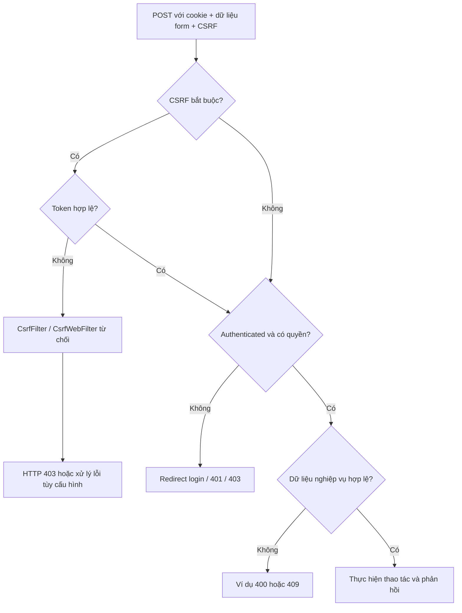

# Hiển thị lỗi và cách lấy token mới khi cần

Trong module `SPRING_SECURITY_HTTP_PROTECTION`, Spring Security phòng vệ HTTP và trình duyệt bằng CSRF, CORS, security headers/CSP/HSTS, HTTP firewall và quản lý phiên. Khi người dùng gửi biểu mẫu nhưng CSRF token thiếu hoặc không hợp lệ, bộ lọc có thể chặn request trước controller. Ứng dụng cần **hiển thị thông báo đủ rõ để người dùng tiếp tục**, đồng thời **cấp lại token theo đúng phiên và trạng thái xác thực** khi cần thiết.

Bài thuộc chương **CSRF và biểu mẫu**, tập trung hai nhiệm vụ: giải thích lỗi một cách an toàn và thiết kế luồng lấy token mới cho form render phía máy chủ hoặc request JavaScript. Phần chính dùng **Spring MVC/Servlet**, sau đó đối chiếu **Spring WebFlux/Reactive**. Ví dụ theo phong cách Spring Boot 3.x, Spring Security 6.x và Java 17+.

## 1. Kết quả cần đạt

Sau bài học, người đọc có thể:

- Phân biệt **thiếu token**, **token sai**, **hết phiên**, **chưa đăng nhập** và **không có quyền** khi nhận phản hồi 403/401/redirect.
- Tạo thông báo lỗi phù hợp cho HTML và API JSON, không tiết lộ CSRF token kỳ vọng, cookie hay dữ liệu nhạy cảm.
- Giải thích cơ chế `CsrfFilter`, `CsrfTokenRepository` và `CsrfTokenRequestHandler` khi biểu mẫu bị từ chối.
- Biết khi nào nên **GET render lại form** và khi nào có thể **GET endpoint token** cho AJAX.
- Giữ dữ liệu đang nhập, không tự phát lại các lệnh ghi có nguy cơ tạo tác động lặp.
- Kiểm thử missing/invalid token, token cũ qua phiên mới, token GET hợp lệ và luồng WebFlux.

## 2. Hiểu đúng phản hồi lỗi

Spring Security thông thường yêu cầu CSRF đối với HTTP method thay đổi trạng thái như `POST`, `PUT`, `PATCH` và `DELETE`. Trình duyệt gửi cookie phiên tự động; đồng thời form hoặc JavaScript cần mang token riêng được server cấp. Nếu không có token hoặc token không khớp, mặc định request bị từ chối **403 Forbidden**.

Tuy nhiên, không phải mọi 403 đều có nghĩa “token đã hết hạn”:

| Tình huống | Dấu hiệu | Nguồn lỗi | Người dùng cần làm |
| --- | --- | --- | --- |
| Form quên chèn token | POST không có trường `_csrf` / header tương ứng; 403 | Tích hợp template/CSRF | Mở lại form sau khi sửa view. |
| Token bị sửa hoặc sai phiên | POST mang token nhưng 403 | CSRF filter, repository/handler | Đảm bảo cookie cùng phiên, lấy token phù hợp. |
| Session mất do timeout/logout | Tab cũ vẫn có token nhưng session cũ không còn | CSRF, authentication hoặc session strategy | Đăng nhập nếu cần, GET lại form và khôi phục bản nháp. |
| Chưa authenticated | Redirect tới login hoặc API 401; POST cũng có thể bị CSRF chặn trước | Authentication/CSRF | Xác thực rồi nhận token của ngữ cảnh mới. |
| Đã authenticated nhưng thiếu role | 403 dù CSRF hợp lệ | Authorization | Kiểm tra quyền, không refresh token liên tục. |
| Bản nháp đã đổi phiên bản | Ví dụ 409 Conflict | Tầng nghiệp vụ | Tải bản mới, xử lý xung đột. |
| Lệnh ghi được gửi lặp | Có thể tạo nhiều kết quả | Tầng nghiệp vụ/idempotency | Kiểm tra kết quả, dùng khóa chống xử lý lặp. |

Trong Servlet, `MissingCsrfTokenException` và `InvalidCsrfTokenException` là những loại lỗi liên quan CSRF cần quan sát; ứng dụng có thể tùy biến cách chúng được trả về. Nhưng **chỉ dựa vào status code** thì không đủ để phân biệt chính xác mọi nguyên nhân.

### 2.1. Đường đi của request bị từ chối



Đây là sơ đồ **logic chẩn đoán**; thứ tự thực tế phụ thuộc filter chain. `CsrfFilter` có thể từ chối trước controller, do đó `@ControllerAdvice` dành cho ngoại lệ MVC không phải cơ chế bắt tất cả lỗi CSRF.

### 2.2. “Token mới” có hai ý nghĩa

Spring Security 6 mặc định có cơ chế deferred token và `XorCsrfTokenRequestAttributeHandler` trên Servlet, giúp che biểu diễn token trong HTML nhằm giảm nguy cơ BREACH. Khi GET lại một trang, giá trị hidden input có thể **khác chuỗi trước đó nhưng token kỳ vọng trong session vẫn giữ nguyên**.

Ngược lại, khi người dùng đăng nhập, đăng xuất hoặc session bị hủy, token ở repository có thể bị xóa hoặc tạo mới. Form cũ vì vậy có thể không còn phù hợp.

**Không so sánh chuỗi `_csrf.token` từ hai lần GET để kết luận session đã hết hạn.** Hãy kiểm tra bằng một POST gửi token được server render trong ngữ cảnh hiện tại, cùng cookie/credentials phù hợp.

## 3. Nguyên tắc phục hồi an toàn

Sau khi một POST bị từ chối, luồng được khuyến nghị:

1. Giữ nguyên **trạng thái đã nhập** nếu giao diện còn giữ được, hiển thị lỗi dễ hiểu.
2. Xác định đây có phải lỗi CSRF hay lỗi xác thực/phân quyền bằng response có mã lỗi ổn định và log server phù hợp.
3. Nếu cần login, cho người dùng **đăng nhập lại**. Token cho phiên ẩn danh không phục hồi được quyền của người đã đăng nhập.
4. **GET trang form mới** hoặc gọi endpoint token thuộc phiên hiện tại.
5. Khôi phục bản nháp được phép giữ, kiểm tra version và quyền sở hữu nếu có.
6. Cho người dùng **xem lại và chủ động gửi lại**. Với giao dịch có tác động không thể đảo ngược, xác minh kết quả/idempotency trước khi retry.

Không tắt CSRF để “sửa” một form 403. Không chuyển lệnh ghi dữ liệu sang GET để tránh hidden input. Không tự động replay request có tác động cao như thanh toán, xóa dữ liệu hoặc tạo đơn chỉ vì đã có token mới.

### 3.1. Nội dung thông báo dành cho người dùng

Một mẫu phù hợp:

> **Chưa thể lưu biểu mẫu.** Phiên hoặc yêu cầu bảo mật có thể đã thay đổi. Hãy đăng nhập lại nếu cần, mở lại biểu mẫu để lấy thông tin bảo mật mới, rồi kiểm tra dữ liệu trước khi gửi lại.

Thông báo này không khẳng định “session đã hết hạn” khi chỉ biết POST 403; nó cũng không phơi bày token, user ID, cookie hoặc chi tiết validation nội bộ. Với form quan trọng, bổ sung nút “Mở lại biểu mẫu” và lời nhắc khôi phục bản nháp.

Một trang lỗi HTML nên giữ nguyên mã 403 cho request bị từ chối, có đường dẫn GET an toàn về form hoặc trang đăng nhập, tránh đưa POST body vào URL. Trong luồng `fetch`/API, trả JSON có mã lỗi ổn định để frontend phân biệt CSRF với authorization.

Ví dụ JSON ứng dụng có thể trả:

```http
HTTP/1.1 403 Forbidden
Content-Type: application/problem+json
Cache-Control: no-store

{
  "type": "about:blank",
  "title": "Yêu cầu không được chấp nhận",
  "status": 403,
  "code": "CSRF_REJECTED"
}
```

Chỉ trả mã lỗi và thông điệp an toàn; **không trả token kỳ vọng trong response lỗi** và không đưa vào log.

## 4. Cấu hình ví dụ Spring MVC/Servlet

Ứng dụng mẫu dùng `spring-boot-starter-web`, `spring-boot-starter-security` và `spring-boot-starter-thymeleaf`. Với kiểm thử bổ sung `spring-boot-starter-test` và `spring-security-test`.

Security chain minh họa:

```java
import org.springframework.context.annotation.Bean;
import org.springframework.context.annotation.Configuration;
import org.springframework.http.HttpMethod;
import org.springframework.security.config.Customizer;
import org.springframework.security.config.annotation.web.builders.HttpSecurity;
import org.springframework.security.web.SecurityFilterChain;

@Configuration
public class SecurityConfig {

    @Bean
    SecurityFilterChain securityFilterChain(HttpSecurity http) throws Exception {
        return http
                .authorizeHttpRequests(auth -> auth
                        .requestMatchers(HttpMethod.GET, "/login").permitAll()
                        .requestMatchers("/profile/**", "/api/**").authenticated()
                        .anyRequest().authenticated())
                .formLogin(Customizer.withDefaults())
                .csrf(Customizer.withDefaults())
                .build();
    }
}
```

`GET /login` cho phép người chưa đăng nhập xem form, nhưng POST đăng nhập vẫn cần CSRF token theo cấu hình bình thường. `/profile/**` và `/api/**` cần authentication; nếu ứng dụng chưa đăng nhập, GET endpoint token có thể bị redirect tới login.

Phân quyền thật còn cần quy tắc theo vai trò và tài nguyên; ví dụ chỉ tập trung CSRF. Không thêm `csrf.disable()` hoặc `ignoringRequestMatchers("/profile/**")` để che lỗi form.

### 4.1. Form Thymeleaf tự sinh hidden input

Controller:

```java
import org.springframework.stereotype.Controller;
import org.springframework.web.bind.annotation.GetMapping;
import org.springframework.web.bind.annotation.PostMapping;
import org.springframework.web.bind.annotation.RequestParam;
import org.springframework.web.servlet.mvc.support.RedirectAttributes;

@Controller
public class ProfileFormController {

    @GetMapping("/profile/edit")
    String edit() {
        return "profile-edit";
    }

    @PostMapping("/profile/update")
    String save(@RequestParam String displayName,
                RedirectAttributes redirects) {
        // Ví dụ: cần kiểm tra dữ liệu, owner và lưu thật tại service.
        redirects.addFlashAttribute("notice", "Đã nhận dữ liệu");
        return "redirect:/profile/edit";
    }
}
```

Template `src/main/resources/templates/profile-edit.html`:

```html
<!doctype html>
<html lang="vi" xmlns:th="http://www.thymeleaf.org">
<head>
    <meta charset="utf-8">
    <title>Chỉnh sửa hồ sơ</title>
</head>
<body>
    <h1>Chỉnh sửa hồ sơ</h1>
    <p th:if="${notice}" th:text="${notice}"></p>
    <form th:action="@{/profile/update}" method="post">
        <label for="displayName">Tên hiển thị</label>
        <input id="displayName" name="displayName" required>
        <button type="submit">Lưu</button>
    </form>
</body>
</html>
```

Với Thymeleaf tích hợp Spring MVC/Spring Security đúng cách, `th:action` làm việc cùng `CsrfRequestDataValueProcessor` để chèn CSRF token vào HTML trả về:

```html
<form action="/profile/update" method="post">
    <input id="displayName" name="displayName" required>
    <button type="submit">Lưu</button>
    <input type="hidden" name="_csrf" value="token-do-server-render">
</form>
```

Ví dụ giá trị token chỉ mang tính minh họa. Nếu người dùng mở lại `GET /profile/edit` sau khi xác thực lại, view được render với token của ngữ cảnh hiện tại. Không cần viết JavaScript để gọi endpoint token chỉ nhằm làm mới một form server-rendered bình thường.

Với JSP, form sử dụng `<form:form>` có thể tự thêm token qua tích hợp Spring MVC. Với JSP form HTML thuần, dùng `<sec:csrfInput />` hoặc input từ request attribute `_csrf`. Chỉ chọn **một cách chèn** để tránh hai field có cùng tên.

## 5. Tùy chỉnh phản hồi lỗi của CsrfFilter

Spring Security Servlet có `AccessDeniedHandler` riêng được `CsrfFilter` gọi khi từ chối CSRF request. Cần phân biệt với handler trong `ExceptionTranslationFilter`; chỉ cài `exceptionHandling().accessDeniedHandler(...)` không bảo đảm thay thế mọi response do `CsrfFilter` tạo.

Một handler minh họa trả JSON cho `/api/**` và HTTP 403 cho form HTML:

```java
import jakarta.servlet.http.HttpServletRequest;
import jakarta.servlet.http.HttpServletResponse;
import java.io.IOException;
import org.springframework.security.access.AccessDeniedException;
import org.springframework.security.web.access.AccessDeniedHandler;

public class CsrfFailureHandler implements AccessDeniedHandler {

    @Override
    public void handle(HttpServletRequest request,
                       HttpServletResponse response,
                       AccessDeniedException exception) throws IOException {
        response.setHeader("Cache-Control", "no-store");

        if (request.getRequestURI().startsWith(
                request.getContextPath() + "/api/")) {
            response.setStatus(HttpServletResponse.SC_FORBIDDEN);
            response.setContentType("application/problem+json");
            response.setCharacterEncoding("UTF-8");
            response.getWriter().write(
                    "{\"type\":\"about:blank\","
                    + "\"title\":\"Yêu cầu không được chấp nhận\","
                    + "\"status\":403,\"code\":\"CSRF_REJECTED\"}");
            return;
        }

        response.sendError(HttpServletResponse.SC_FORBIDDEN,
                "Biểu mẫu không còn hợp lệ; hãy mở lại trang.");
    }
}
```

Trong Spring Security 6, có thể đăng ký postprocessor cho `CsrfFilter` để gắn handler này; đoạn bên dưới thay thế phần `csrf(...)` trong SecurityFilterChain ở mục 4:

```java
import org.springframework.security.config.annotation.ObjectPostProcessor;
import org.springframework.security.web.csrf.CsrfFilter;

// Bên trong chuỗi cấu hình HttpSecurity:
.csrf(csrf -> csrf.addObjectPostProcessor(
        new ObjectPostProcessor<CsrfFilter>() {
            @Override
            public <O extends CsrfFilter> O postProcess(O filter) {
                filter.setAccessDeniedHandler(new CsrfFailureHandler());
                return filter;
            }
        }))
```

Đây là **đoạn cấu hình thay thế**, không thêm một `SecurityFilterChain` thứ hai. Nếu không cần JSON custom, có thể dùng phản hồi mặc định của Spring Security và thiết kế trang lỗi 403 của ứng dụng.

**Không viết lại POST body vào error page**, không log token/cookie/password và không gọi controller ghi dữ liệu khi request chưa vượt kiểm tra CSRF. Handler này chỉ định dạng phản hồi lỗi, không cấp token hay sửa authentication.

## 6. Khi nào lấy token mới?

| Sự kiện | Cách xử lý |
| --- | --- |
| GET trang form mới bình thường | Dùng hidden token được server render, không cần GET token riêng. |
| Người dùng refresh trang GET | Render lại token từ request hiện hành; chuỗi masking có thể đổi. |
| Đăng nhập thành công | GET trang sau login/token của ngữ cảnh xác thực mới. |
| Đăng xuất rồi mở login | GET trang login mới và dùng token được render tại đó. |
| Session hết hạn | Đăng nhập lại nếu route yêu cầu authentication, sau đó GET form/token mới. |
| POST bị CSRF từ chối | Giữ dữ liệu, xác minh session, GET token/form mới và để người dùng chủ động retry. |
| POST bị authorization 403 | Kiểm tra quyền; việc refresh token không thêm quyền. |
| Bản nháp đã đổi version (409) | Lấy bản nháp mới và xử lý xung đột; token mới không sửa được version. |
| Lệnh tạo đơn đã gửi nhưng response thất lạc | Kiểm tra transaction/idempotency trước khi gửi lại. |

Với Servlet, `CsrfAuthenticationStrategy` và `CsrfLogoutHandler` có thể xóa token sau login/logout, khiến form render trước đó không còn phù hợp. Với repository mặc định `HttpSessionCsrfTokenRepository`, session timeout cũng có thể làm mất token kỳ vọng. **GET endpoint lấy token không khôi phục quyền đăng nhập** đã mất.

Không có quy tắc Spring Security mặc định yêu cầu gọi GET token mới trước **mọi POST**. Làm thế mỗi lần có thể tạo request dư thừa và ảnh hưởng idle timeout. Lấy token khi trang được render, khi authentication/session đổi hoặc khi luồng recovery thực sự cần.

## 7. GET endpoint cấp CSRF token cho API/AJAX

Với ứng dụng JavaScript, đôi khi không muốn reload form chỉ để nhận token. Có thể cung cấp endpoint **GET /api/csrf** trên cùng origin và yêu cầu authentication.

### 7.1. Servlet: lấy từ request attribute

```java
import jakarta.servlet.http.HttpServletRequest;
import org.springframework.http.CacheControl;
import org.springframework.http.ResponseEntity;
import org.springframework.security.web.csrf.CsrfToken;
import org.springframework.web.bind.annotation.GetMapping;
import org.springframework.web.bind.annotation.RestController;

@RestController
public class CsrfTokenEndpoint {

    public record CsrfResponse(
            String parameterName,
            String headerName,
            String token) {}

    @GetMapping("/api/csrf")
    public ResponseEntity<CsrfResponse> current(HttpServletRequest request) {
        CsrfToken csrf = (CsrfToken) request.getAttribute(
                CsrfToken.class.getName());

        if (csrf == null) {
            throw new IllegalStateException(
                    "Request chưa có thuộc tính CSRF");
        }

        CsrfResponse body = new CsrfResponse(
                csrf.getParameterName(),
                csrf.getHeaderName(),
                csrf.getToken());

        return ResponseEntity.ok()
                .cacheControl(CacheControl.noStore())
                .body(body);
    }
}
```

`getToken()` yêu cầu token hiện tại khi Spring Security đang dùng cơ chế deferred loading. Với token masking, hãy trả **giá trị được request handler expose** thay vì tự gọi repository lấy raw token rồi đưa lên frontend.

Một phản hồi JSON có thể trông như sau:

```json
{
  "parameterName": "_csrf",
  "headerName": "X-CSRF-TOKEN",
  "token": "gia-tri-duoc-server-cap"
}
```

Đừng hardcode tên parameter/header trong frontend nếu ứng dụng có thể tùy chỉnh repository. Đặt `Cache-Control: no-store` để token không bị cache dùng chung; cấu hình CORS chặt chẽ, không để origin ngoài ý muốn đọc response có credentials.

Nếu người dùng chưa authenticated, GET endpoint có thể redirect đến trang login. JavaScript phải kiểm tra **redirect, status và Content-Type**, không coi HTML login status 200 là token JSON.

### 7.2. API POST minh họa

Để phân biệt HTML form POST ở mục 4 với request JSON, tạo endpoint API riêng:

```java
import org.springframework.http.ResponseEntity;
import org.springframework.web.bind.annotation.PostMapping;
import org.springframework.web.bind.annotation.RequestBody;
import org.springframework.web.bind.annotation.RestController;

@RestController
public class ProfileApiController {

    public record ProfileUpdate(String displayName) {}

    @PostMapping("/api/profile/update")
    ResponseEntity<Void> update(@RequestBody ProfileUpdate payload) {
        // Cần thêm validation, kiểm tra owner và lưu dữ liệu thật.
        return ResponseEntity.noContent().build();
    }
}
```

Đây là endpoint JSON để thử `fetch`; trong hệ thống thật, HTML form và API có thể gọi chung một service.

### 7.3. JavaScript đọc token và gửi header

```javascript
async function loadCsrf() {
    const response = await fetch("/api/csrf", {
        method: "GET",
        credentials: "same-origin",
        cache: "no-store",
        headers: { "Accept": "application/json" }
    });

    const type = response.headers.get("Content-Type") || "";
    if (response.redirected || !response.ok ||
        !type.includes("application/json")) {
        throw new Error("Cần đăng nhập lại hoặc tải lại trang.");
    }

    const csrf = await response.json();
    if (!csrf.headerName || !csrf.token) {
        throw new Error("Phản hồi token thiếu dữ liệu.");
    }
    return csrf;
}

async function saveProfile(displayName, csrf) {
    return fetch("/api/profile/update", {
        method: "POST",
        credentials: "same-origin",
        headers: {
            "Content-Type": "application/json",
            "Accept": "application/json",
            [csrf.headerName]: csrf.token
        },
        body: JSON.stringify({ displayName })
    });
}
```

`fetch` sử dụng `same-origin` vì ví dụ phục vụ từ cùng origin. Nếu client chạy khác origin, preflight/CORS, credentials/cookie và chính sách session phải được phân tích riêng; không mở wildcard CORS để sửa lỗi. Với Spring Security 6, cách truyền token cookie thô có thể đòi hỏi handler dành cho SPA vì request token dùng masking; đừng tùy tiện chuyển sang `CookieCsrfTokenRepository.withHttpOnlyFalse()` nếu chưa hiểu threat model.

## 8. Giữ dữ liệu và cho người dùng chủ động thử lại

Một frontend nhận `CSRF_REJECTED` cần tránh mất dữ liệu hoặc gửi lại một nghiệp vụ không rõ kết quả.

Ví dụ giao diện:

```html
<form id="profileForm">
    <label for="displayName">Tên hiển thị</label>
    <input id="displayName" name="displayName" required>
    <button type="submit">Lưu</button>
</form>

<p id="saveMessage" role="status" aria-live="polite"></p>
<button id="reloadCsrf" type="button" hidden>
    Lấy thông tin bảo mật mới
</button>
```

JavaScript xử lý không reset input và không tự POST lại:

```javascript
const form = document.getElementById("profileForm");
const message = document.getElementById("saveMessage");
const reloadButton = document.getElementById("reloadCsrf");
let currentCsrf = null;

async function initSecurity() {
    try {
        currentCsrf = await loadCsrf();
        message.textContent = "";
    } catch {
        currentCsrf = null;
        reloadButton.hidden = false;
        message.textContent =
            "Cần đăng nhập hoặc tải lại trang trước khi lưu.";
    }
}

form.addEventListener("submit", async (event) => {
    event.preventDefault();
    const value = document.getElementById("displayName").value;

    if (!currentCsrf) {
        message.textContent =
            "Chưa có token hợp lệ. Hãy lấy thông tin bảo mật mới.";
        reloadButton.hidden = false;
        return;
    }

    try {
        const response = await saveProfile(value, currentCsrf);

        if (response.status === 401 || response.status === 403 ||
            response.redirected) {
            currentCsrf = null;
            reloadButton.hidden = false;
            message.textContent =
                "Chưa lưu được; dữ liệu vẫn còn. Nếu cần, hãy đăng nhập " +
                "lại rồi lấy token mới trước khi thử tiếp.";
            return;
        }

        if (!response.ok) {
            message.textContent =
                "Không thể lưu. Hãy kiểm tra lại dữ liệu.";
            return;
        }

        message.textContent = "Đã lưu thành công.";
        reloadButton.hidden = true;
    } catch {
        message.textContent =
            "Không rõ kết quả do mất kết nối. Hãy kiểm tra trước khi gửi lại.";
    }
});

reloadButton.addEventListener("click", async () => {
    try {
        currentCsrf = await loadCsrf();
        reloadButton.hidden = true;
        message.textContent =
            "Đã cập nhật token. Kiểm tra lại dữ liệu và bấm Lưu.";
    } catch {
        message.textContent =
            "Chưa thể lấy token; có thể cần đăng nhập lại.";
    }
});

initSecurity();
```

Đoạn code này dùng `fetch` với API JSON ở mục 7. Nó **không thay thế form server-rendered tự submit**; khi chọn cách này, frontend chịu trách nhiệm xử lý response và hiển thị lỗi. Trong sản phẩm thực tế nên disable nút khi request đang diễn ra để giảm double-submit, phân biệt rõ mã `CSRF_REJECTED` với 403 authorization, và xử lý trường hợp đã lưu thành công nhưng response bị mất.

**Không phát lại POST nhạy cảm tự động** sau khi GET được token mới. Với giao dịch đặt hàng, chuyển tiền hay gửi hồ sơ cuối cùng, cần kiểm tra kết quả theo operation ID và dùng cơ chế idempotency ở service/database. CSRF token không bảo đảm request chỉ được xử lý một lần.

### 8.1. Trường hợp dùng HTML form truyền thống

Nếu form gửi trực tiếp và trình duyệt chuyển sang trang lỗi, nội dung đang nhập có thể biến mất. Với form dài, có thể:

- Lưu bản nháp **ở server** theo user/draft ID, có quyền sở hữu, version và thời hạn lưu.
- Với dữ liệu không nhạy cảm và chính sách cho phép, lưu bản tạm theo tab bằng `sessionStorage`, có thời hạn và xóa sau khi lưu thành công.
- Sau đăng nhập lại, GET form mới và khôi phục bản nháp, để server render CSRF token của session hiện tại.

Đừng dùng sessionStorage/localStorage làm nơi lưu password, CSRF token, session cookie hay thông tin nhạy cảm để cố “vượt qua” lỗi 403. Trang quay lại bằng Back/bfcache có thể giữ HTML và token cũ; dữ liệu hiển thị trên trang không bảo đảm session còn sống.

## 9. Một số lỗi chỉ trông giống CSRF

### 9.1. GET token trả HTML login

Với `formLogin`, endpoint `GET /api/csrf` yêu cầu authenticated user có thể redirect tới `/login`. `fetch` thường theo redirect, cuối cùng nhận status 200 và `text/html`. Code chỉ kiểm tra `response.ok` sẽ hiểu sai.

Giải pháp: kiểm tra `response.redirected`, Content-Type và status; hoặc cấu hình authentication entry point riêng cho `/api/**` trả **401 JSON**. Người dùng cần đăng nhập, sau đó GET token trong phiên mới.

### 9.2. GET token mới nhưng POST vẫn 403

Kiểm tra theo thứ tự:

1. Cookie và session ID của GET token và POST có tương ứng không?
2. POST có gửi đúng token vào **headerName** hoặc **parameterName** do server cung cấp?
3. Repository và request handler trên GET/POST có giống nhau không, đặc biệt khi có nhiều `SecurityFilterChain`?
4. Có dùng raw token với handler XOR mặc định và bị từ chối không?
5. Form đã bị chèn hai input `_csrf` hoặc không qua Thymeleaf/Spring form tags đúng cách?
6. Browser có chặn cookies hoặc CORS preflight/credentials không?
7. Proxy/WAF có loại bỏ header CSRF?
8. 403 là CSRF thật hay từ quy tắc authorization?

Với ứng dụng có nhiều node, kiểm tra session sharing/sticky session và store TTL. Token lưu trong session sẽ bị ảnh hưởng khi GET và POST đến các node không truy cập được cùng trạng thái. Đừng sửa bằng cách nới CORS, bỏ firewall hoặc tắt CSRF.

### 9.3. Token mới không đồng nghĩa với phiên mới đã xác thực

Một GET an toàn có thể tạo CSRF token cho session ẩn danh. Token đó giúp request phù hợp **về mặt CSRF** nhưng không tạo principal hay cấp quyền. Khi session cũ hết hạn, luồng đúng thường là login trước, render lại trang/token sau. Đồng thời form có dữ liệu cũ cần được kiểm tra version, owner và trạng thái nghiệp vụ.

## 10. Kiểm thử với MockMvc (Servlet)

Bài thực hành cần kiểm tra cả **HTML đã render** và **hành vi filter**. `csrf()` trong `spring-security-test` thêm token hợp lệ vào test request; nó **không chứng minh** Thymeleaf/JSP tự chèn hidden input, nên cần kiểm tra GET riêng.

Các test dưới đây áp dụng cho controller ở mục 4 và API ở mục 7, dùng mock user để tập trung vào CSRF:

```java
import static org.hamcrest.Matchers.containsString;
import static org.springframework.security.test.web.servlet.request.SecurityMockMvcRequestPostProcessors.csrf;
import static org.springframework.security.test.web.servlet.request.SecurityMockMvcRequestPostProcessors.user;
import static org.springframework.test.web.servlet.request.MockMvcRequestBuilders.get;
import static org.springframework.test.web.servlet.request.MockMvcRequestBuilders.post;
import static org.springframework.test.web.servlet.result.MockMvcResultMatchers.*;

import org.junit.jupiter.api.Test;
import org.springframework.beans.factory.annotation.Autowired;
import org.springframework.boot.test.autoconfigure.web.servlet.AutoConfigureMockMvc;
import org.springframework.boot.test.context.SpringBootTest;
import org.springframework.http.MediaType;
import org.springframework.test.web.servlet.MockMvc;

@SpringBootTest
@AutoConfigureMockMvc
class CsrfErrorAndRecoveryTests {

    @Autowired
    MockMvc mvc;

    @Test
    void freshFormRendersToken() throws Exception {
        mvc.perform(get("/profile/edit").with(user("learner")))
                .andExpect(status().isOk())
                .andExpect(content().string(containsString("name=\"_csrf\"")));
    }

    @Test
    void apiRejectsMissingToken() throws Exception {
        mvc.perform(post("/api/profile/update")
                        .with(user("learner"))
                        .contentType(MediaType.APPLICATION_JSON)
                        .content("{\"displayName\":\"An\"}"))
                .andExpect(status().isForbidden());
    }

    @Test
    void apiRejectsInvalidToken() throws Exception {
        mvc.perform(post("/api/profile/update")
                        .with(user("learner"))
                        .with(csrf().useInvalidToken())
                        .contentType(MediaType.APPLICATION_JSON)
                        .content("{\"displayName\":\"An\"}"))
                .andExpect(status().isForbidden());
    }

    @Test
    void csrfEndpointReturnsCurrentToken() throws Exception {
        mvc.perform(get("/api/csrf").with(user("learner")))
                .andExpect(status().isOk())
                .andExpect(jsonPath("$.parameterName").isNotEmpty())
                .andExpect(jsonPath("$.headerName").isNotEmpty())
                .andExpect(jsonPath("$.token").isNotEmpty());
    }

    @Test
    void validCsrfAllowsPostToReachController() throws Exception {
        mvc.perform(post("/api/profile/update")
                        .with(user("learner"))
                        .with(csrf())
                        .contentType(MediaType.APPLICATION_JSON)
                        .content("{\"displayName\":\"An\"}"))
                .andExpect(status().isNoContent());
    }
}
```

Nếu cấu hình `CsrfFailureHandler` ở mục 5, thêm assertion `jsonPath("$.code").value("CSRF_REJECTED")` cho POST `/api/**`. Nếu dùng handler mặc định, chỉ nên kỳ vọng status 403; đừng gắn cố định mã lỗi JSON chưa được cấu hình.

### 10.1. Mô phỏng token thuộc session cũ

Có thể thêm method sau vào class test để gửi token của một request GET từ phiên cũ trong một phiên mới:

```java
import org.springframework.mock.web.MockHttpSession;
import org.springframework.security.web.csrf.CsrfToken;
import org.springframework.test.web.servlet.MvcResult;

@Test
void oldSessionTokenIsRejectedInNewSession() throws Exception {
    MvcResult first = mvc.perform(get("/profile/edit")
                    .with(user("learner")))
            .andExpect(status().isOk())
            .andReturn();

    CsrfToken old = (CsrfToken) first.getRequest()
            .getAttribute(CsrfToken.class.getName());

    mvc.perform(post("/profile/update")
                    .session(new MockHttpSession())
                    .with(user("learner"))
                    .param(old.getParameterName(), old.getToken())
                    .param("displayName", "An"))
            .andExpect(status().isForbidden());
}
```

Đây là test **đổi session**, không phải mô phỏng bộ đếm idle timeout của servlet container. Test dùng session repository mặc định; nếu dùng `CookieCsrfTokenRepository` thì kết quả/phương pháp phải điều chỉnh theo chính sách thực tế.

### 10.2. Kiểm thử từ trình duyệt

- Mở GET form và xác nhận hidden input được render đúng.
- Submit bình thường bằng token hợp lệ, kiểm tra status/redirect.
- Dùng DevTools sao chép POST, lần lượt bỏ token và thay token sai, giữ cookie phù hợp; xác nhận request không vào controller.
- Đăng xuất ở tab khác hoặc thay session, gửi lại POST từ form cũ; quan sát 403/redirect.
- Đăng nhập lại, GET form/token mới; thử POST với cookie hiện tại.
- Với `fetch`, kiểm tra khi bị 403 input không bị xóa, nút lấy token mới hoạt động và lần gửi lại phải do người dùng xác nhận.
- Với lệnh quan trọng, kiểm tra idempotency/retry ở tầng nghiệp vụ thay vì chỉ test CSRF.

Không ghi token hoặc cookie thật trong ảnh chụp và báo cáo kiểm thử.

## 11. Đối chiếu Spring WebFlux/Reactive

Spring WebFlux dùng `CsrfWebFilter` và `WebSessionServerCsrfTokenRepository`. Token được expose dưới dạng **`Mono<CsrfToken>`** qua `ServerWebExchange` với khóa `CsrfToken.class.getName()`; khác Servlet có thể lấy `CsrfToken` trực tiếp từ request attribute.

| Nội dung | Servlet / MVC | Reactive / WebFlux |
| --- | --- | --- |
| CSRF filter | `CsrfFilter` | `CsrfWebFilter` |
| Repository mặc định | `HttpSessionCsrfTokenRepository` | `WebSessionServerCsrfTokenRepository` |
| Thuộc tính view | `CsrfToken` từ request | `Mono<CsrfToken>` từ exchange |
| Test POST | `MockMvc` + `csrf()` | `WebTestClient` + `SecurityMockServerConfigurers.csrf()` |
| GET token | Lấy trực tiếp từ request, trả response | Tiêu thụ publisher rồi trả JSON |
| Tùy biến lỗi | Servlet `AccessDeniedHandler` trong CSRF filter | Cấu hình xử lý access denied tương ứng trong reactive filter chain |

Ví dụ GET endpoint token Reactive:

```java
import org.springframework.http.CacheControl;
import org.springframework.http.ResponseEntity;
import org.springframework.security.web.server.csrf.CsrfToken;
import org.springframework.web.bind.annotation.GetMapping;
import org.springframework.web.bind.annotation.RestController;
import org.springframework.web.server.ServerWebExchange;
import reactor.core.publisher.Mono;

@RestController
public class ReactiveCsrfEndpoint {

    public record CsrfResponse(
            String parameterName,
            String headerName,
            String token) {}

    @GetMapping("/api/csrf")
    Mono<ResponseEntity<CsrfResponse>> current(ServerWebExchange exchange) {
        Mono<CsrfToken> publisher =
                exchange.getAttribute(CsrfToken.class.getName());

        if (publisher == null) {
            return Mono.error(new IllegalStateException(
                    "CSRF publisher chưa được expose"));
        }

        return publisher.map(csrf -> ResponseEntity.ok()
                .cacheControl(CacheControl.noStore())
                .body(new CsrfResponse(
                        csrf.getParameterName(),
                        csrf.getHeaderName(),
                        csrf.getToken())));
    }
}
```

Đoạn code thuộc **ứng dụng WebFlux riêng**, cần cấu hình `ServerHttpSecurity` với CSRF và authorization phù hợp. Không copy cấu hình `HttpSecurity` hay postprocessor của `CsrfFilter` sang `CsrfWebFilter`. Không cast `Mono<CsrfToken>` thành token đồng bộ và không gọi `block()` trên Reactor event loop.

Trong WebFlux, view engine Thymeleaf Reactive tích hợp phù hợp có thể tự render CSRF hidden input. Khi tự viết renderer, cần giải quyết publisher và đưa token vào model trước khi xuất HTML. Kiểm thử WebFlux có thể dùng `SecurityMockServerConfigurers.csrf()` và `WebTestClient`, đồng thời cần test GET HTML thực sự chứa token.

## 12. Bảng chẩn đoán khi triển khai

| Quan sát | Nguyên nhân cần xác minh | Hành động |
| --- | --- | --- |
| Form HTML không thấy `_csrf` | Không qua tích hợp Thymeleaf/Spring MVC, JSP tag sai | Kiểm tra HTML trả về, sử dụng `th:action` hoặc tag/hidden input đúng. |
| POST bị 403 sau khi để tab lâu | Session/CSRF token cũ hoặc quyền thay đổi | Đăng nhập nếu cần, GET form mới rồi dùng token hiện tại. |
| GET /api/csrf trả HTML login | Auth entry point redirect và `fetch` theo redirect | Kiểm tra Content-Type/redirect hoặc dùng API 401 JSON. |
| Token mỗi lần GET có chuỗi khác | Cơ chế masking chống BREACH | Không tự kết luận token gốc đổi. |
| Token vừa GET nhưng POST vẫn 403 | Cookie khác phiên, header sai, chain/repository khác, reverse proxy | Đối chiếu Network/log; không bỏ CSRF. |
| POST bị 403 vì role thiếu | Authorization | Kiểm tra quyền, không refresh token vòng lặp. |
| Form cũ vẫn có token nhưng bản nháp 409 | Version data cũ | Tải bản nháp mới và xử lý xung đột. |
| Request AJAX lỗi sau logout | Token/authentication đã thay đổi | Login lại, GET token mới, kiểm tra trước khi retry. |
| POST quan trọng bị gửi lại nhiều lần | Thiếu idempotency hoặc không rõ kết quả | Dùng operation ID và transaction/unique constraint. |
| CORS preflight thất bại | Origin/header/credentials không được chấp nhận | Chỉnh allowlist CORS và cookie phù hợp; không mở wildcard credentials. |

## 13. Bài thực hành

**Bối cảnh:** Một ứng dụng quản lý hồ sơ dùng cookie session, CSRF mặc định, có trang Thymeleaf và nút Lưu sử dụng JSON API. Người dùng giữ trang qua đăng nhập/đăng xuất ở tab khác.

1. Tạo trang form `GET /profile/edit` và xác minh hidden CSRF input trong HTML được render.
2. Tạo `POST /api/profile/update` có CSRF protection; thử token đúng, thiếu và sai để ghi nhận kết quả.
3. Thiết kế trang lỗi 403 và phản hồi API `CSRF_REJECTED` an toàn, không lộ token kỳ vọng.
4. Cấp endpoint `GET /api/csrf` với `Cache-Control: no-store`, trả tên header/parameter và token cho đúng user/session.
5. Cho frontend giữ giá trị input khi POST bị từ chối; hiển thị nút lấy token mới và yêu cầu người dùng bấm Lưu lại.
6. Thử login/logout trong tab khác; chứng minh khi quyền/phiên đổi cần nhận token mới, nhưng GET token không thể tự cấp lại authentication.
7. Phân biệt 403 CSRF với 403 authorization, và 409 do bản nháp thay đổi.
8. Với thao tác có tác động lớn, bổ sung kiểm tra idempotency trước khi retry.
9. Nếu có WebFlux, viết GET token dựa trên `Mono<CsrfToken>` và kiểm thử WebTestClient tương ứng.

**Đạt yêu cầu:** Request CSRF sai bị chặn; thông báo lỗi hướng dẫn được người dùng, token mới được lấy qua ngữ cảnh phiên hiện tại, dữ liệu chưa lưu không bị xóa vô cớ, và không tự phát lại lệnh ghi nguy hiểm.

## Tài liệu tham khảo

- [Spring Security Reference — Servlet CSRF](https://docs.spring.io/spring-security/reference/servlet/exploits/csrf.html): repository, request handler, deferred token, BREACH, tích hợp form.
- [Spring Security Reference — Session Management](https://docs.spring.io/spring-security/reference/servlet/authentication/session-management.html): invalid session, authentication và timeout.
- [Spring Security Reference — MockMvc CSRF](https://docs.spring.io/spring-security/reference/servlet/test/mockmvc/csrf.html): kiểm thử token đúng/sai.
- [Spring Security Reference — Reactive CSRF](https://docs.spring.io/spring-security/reference/reactive/exploits/csrf.html): `CsrfWebFilter` và `Mono<CsrfToken>`.
- [Spring Security Reference — WebFlux CSRF Testing](https://docs.spring.io/spring-security/reference/reactive/test/web/csrf.html): kiểm thử CSRF bằng `WebTestClient`.
- [OWASP — CSRF Prevention Cheat Sheet](https://cheatsheetseries.owasp.org/cheatsheets/Cross-Site_Request_Forgery_Prevention_Cheat_Sheet.html): đồng bộ token, SPA, cookie và các giới hạn.
- [MDN — HTTP 403 Forbidden](https://developer.mozilla.org/en-US/docs/Web/HTTP/Status/403): ý nghĩa phản hồi 403.
