# Multipart upload và thứ tự phân tích nội dung

Trong module `SPRING_SECURITY_HTTP_PROTECTION`, các lớp bảo vệ HTTP và trình duyệt gồm CSRF, CORS, security headers, CSP, HSTS, HTTP firewall và quản lý phiên. Khi biểu mẫu có **upload file**, CSRF xuất hiện một vấn đề đặc biệt: **muốn đọc token từ multipart body, server thường phải phân tích body; nhưng phân tích body có thể tạo file tạm trước khi request được kiểm tra bảo mật**.

Nếu ứng dụng bắt Spring Security kiểm tra trước khi đọc multipart body, hidden input `_csrf` có thể chưa truy cập được dưới dạng request parameter. Nếu đặt bộ phân tích multipart chạy trước security chain, người chưa đăng nhập vẫn có thể gửi dữ liệu để chiếm dung lượng tạm trước khi bị từ chối.

Bài học thuộc chương **CSRF và biểu mẫu**, giải thích thứ tự filter/reader, hai phương án gửi token trên Spring MVC/Servlet, khác biệt trong WebFlux/Reactive, hệ quả tài nguyên và cách kiểm thử thực tế.

## 1. Mục tiêu

Sau bài này, người học có thể:

- Phân biệt **tiếp nhận HTTP body**, **parse multipart**, **ghi file tạm**, **kiểm tra CSRF** và **thực hiện upload nghiệp vụ**.
- Giải thích tại sao `Content-Type: multipart/form-data` cần cấu hình cẩn thận khi CSRF token nằm trong body.
- Dùng `MultipartFilter` trước Spring Security nếu bắt buộc phải lấy `_csrf` từ hidden field của form HTML thuần.
- Dùng **CSRF header** với `fetch + FormData` để Spring Security không phải parse multipart chỉ để lấy token.
- Nhận biết nhược điểm của CSRF query parameter trong form action và lý do không ưu tiên phương án đó.
- Cấu hình giới hạn file/request, tài nguyên tạm, kiểm soát loại file và quyền lưu; chẩn đoán 400/403/413.
- Kiểm thử Servlet bằng MockMvc và container thật; đối chiếu Reactive với `setTokenFromMultipartDataEnabled`.

## 2. Multipart body chứa gì?

Biểu mẫu thông thường thường gửi `application/x-www-form-urlencoded`, còn form có file sử dụng `multipart/form-data`. Body được chia thành nhiều phần bằng một `boundary`:

```http
POST /files/upload HTTP/1.1
Cookie: JSESSIONID=<cookie-phien>
Content-Type: multipart/form-data; boundary=----DemoBoundary

------DemoBoundary
Content-Disposition: form-data; name="description"

Báo cáo dự án
------DemoBoundary
Content-Disposition: form-data; name="_csrf"

<token-tu-HTML>
------DemoBoundary
Content-Disposition: form-data; name="document"; filename="report.pdf"
Content-Type: application/pdf

<du-lieu-file-nhi-phan>
------DemoBoundary--
```

Trong HTTP headers, server thấy `Content-Type` và cookie. Nhưng `_csrf` nằm **bên trong một part của body**. Để biến part này thành tham số `request.getParameter("_csrf")`, ứng dụng có thể cần `MultipartResolver`/`MultipartFilter` hoặc chức năng parse multipart tương ứng của container.

Nếu đưa token vào HTTP header như `X-CSRF-TOKEN`, `CsrfFilter` có thể đọc header trước khi bộ giải mã multipart của ứng dụng chạy.

### 2.1. Trình tự xử lý

```mermaid
flowchart TB
    subgraph Body["A. Token ở multipart body"]
      A1["POST multipart"] --> A2["MultipartFilter parse multipart"]
      A2 --> A3["Có thể tạo file tạm"]
      A3 --> A4["CsrfFilter kiểm tra token"]
      A4 --> A5["Xác thực / phân quyền"]
      A5 --> A6["Controller upload"]
    end
    subgraph Header["B. Token ở HTTP header"]
      B1["POST multipart + header CSRF"] --> B2["CsrfFilter kiểm tra header"]
      B2 --> B3["Xác thực / phân quyền"]
      B3 --> B4["Multipart resolver đọc file"]
      B4 --> B5["Controller upload"]
    end
```



Sơ đồ mô tả thứ tự **bên trong ứng dụng**. Reverse proxy, API gateway hoặc servlet container có thể buffer request body trước filter chain tùy cách triển khai; cần giới hạn upload từ phía ingress bất kể lựa chọn CSRF.

### 2.2. Không đánh đồng file tạm với file được chấp nhận

| Bước | Có thể làm gì? | Trạng thái bảo mật |
| --- | --- | --- |
| Nhận request từ mạng | Dùng bandwidth, proxy buffer | Chưa chắc CSRF/authentication được kiểm tra. |
| Parse multipart | Tạo part objects, đọc RAM, ghi file tạm | Có thể diễn ra **trước** Spring Security. |
| Kiểm tra CSRF | Đối chiếu token trong request với repository | Sai token: thông thường 403. |
| Authentication / authorization | Kiểm tra user, role và quyền với tài nguyên | Thiếu quyền: 401/redirect/403 tùy cấu hình. |
| Controller/service | Kiểm tra file và ghi kho bền vững | Chỉ thực hiện khi security cho phép. |

Một request thiếu CSRF có thể tạo file **tạm** nếu multipart đã parse, nhưng controller không nên lưu file **bền vững** khi filter từ chối. Điều này tạo rủi ro chiếm CPU, RAM, disk hoặc cạn inode dù nghiệp vụ không xử lý request.

## 3. Chọn phương án theo giao diện

| Trường hợp | Nơi gửi CSRF token | Thứ tự đọc phù hợp | Lưu ý |
| --- | --- | --- | --- |
| Trình duyệt có JavaScript | **HTTP header** chứa token từ request hiện tại | Spring Security kiểm tra header trước ứng dụng parse multipart | Thường nên ưu tiên; phải xử lý `fetch` và errors. |
| Form HTML thuần không dùng JavaScript | Hidden field `_csrf` trong multipart body | `MultipartFilter` chạy trước Spring Security để expose form parameter | File tạm có thể được tạo trước CSRF/authentication. |
| Form thuần nhưng không muốn parse sớm | Token trong query của form action (được tài liệu chính thức nhắc như trade-off) | Security đọc URL trước body | Dễ rò rỉ token trong log và URL; không ưu tiên. |
| WebFlux có JavaScript | CSRF header | `CsrfWebFilter` đọc header; reader multipart ở bước sau | Vẫn phải giới hạn body/part/codec. |
| WebFlux form HTML chỉ có hidden token | Multipart form field | Bật tùy chọn đọc token từ multipart data | Mặc định tắt và cần đánh giá tác động tài nguyên. |

**Tự thêm input không tự giải quyết thứ tự filter.** Thymeleaf có thể render hidden input đúng nhưng POST vẫn 403 nếu bộ lọc bảo mật chạy trước khi request parameter multipart được expose.

## 4. Ví dụ Spring MVC/Servlet có trang upload

Các dependency chính (Spring Boot):

```groovy
implementation 'org.springframework.boot:spring-boot-starter-web'
implementation 'org.springframework.boot:spring-boot-starter-security'
implementation 'org.springframework.boot:spring-boot-starter-thymeleaf'

testImplementation 'org.springframework.boot:spring-boot-starter-test'
testImplementation 'org.springframework.security:spring-security-test'
```

### 4.1. Cấu hình security

```java
import org.springframework.context.annotation.Bean;
import org.springframework.context.annotation.Configuration;
import org.springframework.security.config.Customizer;
import org.springframework.security.config.annotation.web.builders.HttpSecurity;
import org.springframework.security.web.SecurityFilterChain;

@Configuration
public class SecurityConfig {

    @Bean
    SecurityFilterChain securityFilterChain(HttpSecurity http) throws Exception {
        return http
                .authorizeHttpRequests(auth -> auth
                        .requestMatchers("/files/**").authenticated()
                        .anyRequest().authenticated())
                .formLogin(Customizer.withDefaults())
                .csrf(Customizer.withDefaults())
                .build();
    }
}
```

Ví dụ chỉ cho người đã đăng nhập truy cập upload. CSRF vẫn bật; không thêm `csrf.disable()` hoặc `ignoringRequestMatchers("/files/**")` để khắc phục lỗi tích hợp multipart.

### 4.2. Controller

```java
import org.springframework.http.HttpStatus;
import org.springframework.http.MediaType;
import org.springframework.http.ResponseEntity;
import org.springframework.stereotype.Controller;
import org.springframework.web.bind.annotation.GetMapping;
import org.springframework.web.bind.annotation.PostMapping;
import org.springframework.web.bind.annotation.RequestParam;
import org.springframework.web.bind.annotation.ResponseBody;
import org.springframework.web.multipart.MultipartFile;
import org.springframework.web.server.ResponseStatusException;

@Controller
public class FileUploadController {

    public record UploadReceipt(long receivedBytes) {}

    @GetMapping("/files/upload")
    String form() {
        return "file-upload";
    }

    @PostMapping(value = "/files/upload",
                 consumes = MediaType.MULTIPART_FORM_DATA_VALUE)
    @ResponseBody
    ResponseEntity<UploadReceipt> upload(
            @RequestParam("document") MultipartFile document) {
        if (document.isEmpty()) {
            throw new ResponseStatusException(HttpStatus.BAD_REQUEST,
                    "Vui lòng chọn tệp");
        }

        // Ví dụ chỉ xác nhận đã nhận file; chưa lưu tệp bền vững.
        // Hệ thống thật phải kiểm tra loại file, chủ sở hữu,
        // nội dung thực tế, giới hạn và kho lưu trữ.
        return ResponseEntity.status(HttpStatus.CREATED)
                .body(new UploadReceipt(document.getSize()));
    }
}
```

Controller chỉ được gọi sau security chain nếu mọi thành phần được cấu hình đúng. `MultipartFile` có thể tham chiếu dữ liệu trong RAM/file tạm; nó không phải xác nhận tệp đã được kiểm tra an toàn hay lưu lâu dài.

### 4.3. HTML + Thymeleaf

Tạo `src/main/resources/templates/file-upload.html`:

```html
<!DOCTYPE html>
<html lang="vi" xmlns:th="http://www.thymeleaf.org">
<head>
    <meta charset="UTF-8">
    <title>Tải tài liệu</title>
</head>
<body>
    <h1>Tải tài liệu</h1>
    <form id="uploadForm"
          th:action="@{/files/upload}"
          method="post"
          enctype="multipart/form-data">
        <label for="document">Tài liệu</label>
        <input id="document"
               name="document"
               type="file"
               required>
        <button type="submit">Tải lên</button>
    </form>
</body>
</html>
```

Với Thymeleaf tích hợp Spring Security đúng cách, `th:action` trên form POST tự chèn token thông qua `CsrfRequestDataValueProcessor`. HTML **đã render** có thể có thêm:

```html
<input type="hidden" name="_csrf" value="token-do-server-render">
```

Không hardcode token thật; thuộc tính `_csrf.parameterName` và `_csrf.token` đến từ Spring Security. Từ Spring Security 6, handler XOR/BREACH mặc định có thể làm chuỗi token hiển thị khác nhau qua các lượt GET dù token lưu trong session không đổi.

**Quan trọng:** Hidden input trên chỉ đưa token vào multipart body. Nó không bảo đảm `CsrfFilter` đọc được input nếu multipart chưa được parse. Nếu browser submit form này mà không dùng JavaScript, cần chiến lược `MultipartFilter` tại mục 5.

## 5. Phương án HTML thuần: MultipartFilter đứng trước Spring Security

### 5.1. Cơ chế

Trong Servlet, `MultipartFilter` có thể wrap request thành multipart-aware request. Khi chạy **trước** `springSecurityFilterChain`, nó cho phép Spring Security đọc CSRF parameter từ request body đã phân tích:

```text
POST /files/upload
    |
    v
MultipartFilter (đọc multipart, có thể ghi file tạm)
    |
    v
CsrfFilter (đọc parameter _csrf, so sánh token)
    |
    +-- token thiếu/sai -> 403, controller KHÔNG chạy
    |
    +-- token hợp lệ -> authentication/authorization
                           |
                           v
                       Controller
```

Spring Security có tài liệu chính thức về lựa chọn này và rủi ro file tạm phát sinh trước khi request được cấp quyền.

### 5.2. Ứng dụng Servlet dùng Security initializer truyền thống

Nếu ứng dụng tự cấu hình `AbstractSecurityWebApplicationInitializer`:

```java
import jakarta.servlet.ServletContext;
import org.springframework.security.web.context.AbstractSecurityWebApplicationInitializer;
import org.springframework.web.multipart.support.MultipartFilter;

public class SecurityApplicationInitializer
        extends AbstractSecurityWebApplicationInitializer {

    @Override
    protected void beforeSpringSecurityFilterChain(
            ServletContext servletContext) {
        insertFilters(servletContext, new MultipartFilter());
    }
}
```

Ví dụ này dành cho mô hình Servlet initializer. Với Spring Boot đã đăng ký security filter, không tạo thêm initializer chỉ để copy đoạn code.

### 5.3. Spring Boot: đặt thứ tự bằng FilterRegistrationBean

```java
import org.springframework.boot.autoconfigure.security.SecurityProperties;
import org.springframework.boot.web.servlet.FilterRegistrationBean;
import org.springframework.context.annotation.Bean;
import org.springframework.context.annotation.Configuration;
import org.springframework.web.multipart.support.MultipartFilter;

@Configuration
public class MultipartFilterConfig {

    @Bean
    FilterRegistrationBean<MultipartFilter> multipartBeforeSecurity() {
        FilterRegistrationBean<MultipartFilter> registration =
                new FilterRegistrationBean<>(new MultipartFilter());

        registration.setName("multipartFilterBeforeSecurity");
        registration.addUrlPatterns("/*");
        registration.setOrder(
                SecurityProperties.DEFAULT_FILTER_ORDER - 1);
        return registration;
    }
}
```

Mục đích của `setOrder` là để multipart filter sớm hơn thứ tự security filter mặc định của Boot. Nếu dự án tự chỉnh thứ tự, chạy nhiều filter chain hoặc dùng custom servlet registrations, hãy xác minh **order thực tế**. Đừng kết luận đúng chỉ dựa trên code.

`MultipartFilter` tìm resolver tương ứng hoặc dùng `StandardServletMultipartResolver` trong môi trường phù hợp. Khi sử dụng Servlet Part API, container cần multipart configuration. Spring Boot thông thường cấp cấu hình đó từ `spring.servlet.multipart.*`; cần tránh đăng ký filter trùng lặp và kiểm tra bộ resolver hiện có.

Trong `application.properties`, giới hạn minh họa:

```properties
spring.servlet.multipart.enabled=true
spring.servlet.multipart.max-file-size=5MB
spring.servlet.multipart.max-request-size=6MB
spring.servlet.multipart.file-size-threshold=0B
```

`file-size-threshold` ảnh hưởng khi dữ liệu được đưa ra file tạm; ví dụ 0B cho thấy rõ tác động tạm trên disk. Con số 5 MB/6 MB dành cho bài thực hành; sản phẩm phải chọn giới hạn theo nghiệp vụ, cấu hình ingress tương ứng và giới hạn cả số lượng request.

### 5.4. Đánh đổi: ai cũng có thể tạo áp lực lên vùng tạm

Khi MultipartFilter chạy trước Spring Security, một người chưa đăng nhập có thể gửi các request multipart mà filter phải tiếp nhận/parse trước khi biết token có hợp lệ hay không. Nếu chúng tạo temporary files, người gửi có thể làm đầy disk hay tăng CPU/IO dù controller không chạy.

Biện pháp cần phối hợp:

- Giới hạn `max-file-size`, `max-request-size`, số parts và độ dài headers tại container và proxy.
- Rate limit/concurrency limit ở ingress, kết hợp kết nối và thời gian truyền tối đa.
- Đặt temporary upload directory ở phân vùng/quota giới hạn, quyền truy cập hẹp; giám sát dung lượng và inode.
- Đảm bảo cleanup cho request thành công, lỗi CSRF, lỗi parse, timeout và client ngắt giữa chừng.
- Không ghi tệp vào thư mục public trước khi xác thực/quét/nội dung được phê duyệt.

**Không** xem HTTP 403 là bằng chứng không có file tạm. Chỉ có thể khẳng định controller không được xử lý request khi CSRF thất bại; tài nguyên trước filter có thể đã bị tiêu tốn.

## 6. Phương án nên ưu tiên khi có JavaScript: CSRF trong header

Spring Security khuyến nghị dùng token trong HTTP header khi JavaScript sẵn có, vì header có thể được đọc mà không cần mở multipart body để tìm token. Trong thiết kế này có thể để multipart parsing đến bước xử lý sau security.

### 6.1. Expose token trong template

Thêm hai meta tag vào `head` của `file-upload.html`:

```html
<meta name="_csrf" th:content="${_csrf.token}">
<meta name="_csrf_header" th:content="${_csrf.headerName}">
```

Giữ form có `th:action="@{/files/upload}"` để action có context path phù hợp. Không hardcode CSRF token hoặc header nếu repository có thể được cấu hình khác.

### 6.2. Gửi multipart FormData bằng fetch

Đặt thông báo và JavaScript ở dưới form:

```html
<p id="uploadMessage" role="status" aria-live="polite"></p>
<script>
  const form = document.getElementById("uploadForm");
  const message = document.getElementById("uploadMessage");

  form.addEventListener("submit", async (event) => {
    event.preventDefault();

    const token = document.querySelector('meta[name="_csrf"]').content;
    const headerName =
        document.querySelector('meta[name="_csrf_header"]').content;
    const payload = new FormData(form);
    const button = form.querySelector('button[type="submit"]');

    button.disabled = true;
    message.textContent = "Đang tải lên...";

    try {
      const response = await fetch(form.action, {
        method: "POST",
        credentials: "same-origin",
        headers: { [headerName]: token },
        body: payload
      });

      if (response.status === 401 || response.status === 403 ||
          response.redirected) {
        message.textContent =
            "Phiên hoặc yêu cầu bảo mật không hợp lệ. " +
            "Hãy đăng nhập lại nếu cần và mở trang upload mới.";
        return;
      }

      if (!response.ok) {
        message.textContent =
            "Tải lên chưa thành công: HTTP " + response.status;
        return;
      }

      message.textContent = "Đã tiếp nhận tài liệu.";
    } catch {
      message.textContent =
          "Mất kết nối; cần kiểm tra trạng thái upload trước khi thử lại.";
    } finally {
      button.disabled = false;
    }
  });
</script>
```

**Không đặt `Content-Type: multipart/form-data` thủ công.** Trình duyệt cần tự sinh `boundary` tương ứng với `FormData`; ghi Content-Type mà thiếu boundary thường dẫn tới lỗi parse.

`new FormData(form)` có thể mang cả hidden `_csrf` do Thymeleaf tự thêm; trong mẫu này, **header** được Spring Security đọc trước. Nếu đổi CSRF handler tùy chỉnh, phải kiểm tra xem header yêu cầu dạng token đã masking hay raw token, đặc biệt với bảo vệ BREACH từ Spring Security 6.

JavaScript nên xử lý 401/403 mà không tự động phát lại yêu cầu lưu quan trọng. Nếu request timeout sau khi server xử lý, cần tra trạng thái file/operation ID trước khi retry để tránh tạo tệp trùng.

### 6.3. CORS không phải CSRF

Cùng origin, `credentials:"same-origin"` là thiết lập phù hợp. Nếu UI khác origin, header CSRF tùy chỉnh có thể kích hoạt **CORS preflight**; browser cần policy rõ ràng về origin, headers và credentials. Một preflight thất bại thường không phải response 403 từ `CsrfFilter`. Đừng đặt CORS wildcard có credentials hoặc tắt CSRF để khắc phục.

## 7. Token trong URL: biết để đánh giá, không ưu tiên

Tài liệu Spring Security nêu một lựa chọn khác: để MultipartFilter **sau** Spring Security, đưa CSRF token lên query của form action để filter đọc trước khi multipart body được xử lý.

Ví dụ JSP minh họa rủi ro:

```jsp
<!-- Không khuyến nghị trong thiết kế ưu tiên -->
<form method="post"
      action="./upload?${_csrf.parameterName}=${_csrf.token}"
      enctype="multipart/form-data">
    <input type="file" name="document">
    <button type="submit">Tải lên</button>
</form>
```

URL có thể lộ trong access log, reverse proxy, tracing, dashboard và bản ghi người dùng chia sẻ. CSRF token nên nằm trong body hoặc header khi có thể. Nếu không chấp nhận parse body trước security, hãy cân nhắc JavaScript header hoặc thiết kế upload khác phù hợp hơn, thay vì dùng query token làm lựa chọn mặc định.

## 8. Phòng vệ riêng cho upload

CSRF chỉ xác minh một điều kiện của request, **không chứng minh file hợp lệ hoặc user có quyền lưu nó**. Phải kiểm tra riêng:

| Vấn đề | Phòng vệ |
| --- | --- |
| Dữ liệu lớn làm đầy memory/disk | Giới hạn size, quota, request count/concurrency và timeout ở proxy/container. |
| Rất nhiều parts nhỏ | Giới hạn số parts, chiều dài multipart headers và parsing resources. |
| File giả dạng PDF/JPG | Kiểm tra extension, MIME được khai báo, **magic bytes** và nội dung thật theo nghiệp vụ. |
| Filename `../../x` | Không dùng `getOriginalFilename()` để dựng path trực tiếp; cấp storage ID riêng. |
| Tệp lưu vào web root | Lưu ngoài vùng static/public hoặc object storage có private ACL; trả file qua endpoint kiểm tra quyền. |
| Tệp HTML/SVG chứa mã thực thi | Cấu hình content type, disposition, CSP/sandbox và quét theo chính sách. |
| Upload vào tài nguyên người khác | Kiểm tra quyền sở hữu/role trong service sau authentication. |
| File tạm không được dọn | Cleanup khi thành công, lỗi parse, timeout, hủy kết nối, request sai CSRF. |
| Gửi lệnh upload hai lần | Theo dõi upload ID/idempotency ở tầng nghiệp vụ nếu cần tránh lặp. |

Một middleware đã nhận body trước khi CSRF kiểm tra cũng cần rate limit và giới hạn lưu trữ. Cần đo cả **temporary bytes** lẫn **files saved** để hiểu đúng chi phí của request bị từ chối.

## 9. Kiểm thử với MockMvc

`MockMvcRequestBuilders.multipart` cho phép dựng request multipart trong memory; `spring-security-test` cung cấp `csrf()` và `csrf().useInvalidToken()`.

### 9.1. Test CSRF đúng, sai và thiếu

```java
import static org.hamcrest.Matchers.is;
import static org.springframework.security.test.web.servlet.request.SecurityMockMvcRequestPostProcessors.csrf;
import static org.springframework.security.test.web.servlet.request.SecurityMockMvcRequestPostProcessors.user;
import static org.springframework.test.web.servlet.request.MockMvcRequestBuilders.multipart;
import static org.springframework.test.web.servlet.result.MockMvcResultMatchers.*;

import java.nio.charset.StandardCharsets;
import org.junit.jupiter.api.Test;
import org.springframework.beans.factory.annotation.Autowired;
import org.springframework.boot.test.autoconfigure.web.servlet.AutoConfigureMockMvc;
import org.springframework.boot.test.context.SpringBootTest;
import org.springframework.mock.web.MockMultipartFile;
import org.springframework.test.web.servlet.MockMvc;

@SpringBootTest
@AutoConfigureMockMvc
class MultipartCsrfTests {

    @Autowired
    MockMvc mvc;

    private MockMultipartFile sample() {
        return new MockMultipartFile(
                "document",
                "report.txt",
                "text/plain",
                "demo".getBytes(StandardCharsets.UTF_8));
    }

    @Test
    void missingTokenReturns403() throws Exception {
        mvc.perform(multipart("/files/upload")
                        .file(sample())
                        .with(user("learner")))
                .andExpect(status().isForbidden());
    }

    @Test
    void invalidTokenReturns403() throws Exception {
        mvc.perform(multipart("/files/upload")
                        .file(sample())
                        .with(user("learner"))
                        .with(csrf().useInvalidToken()))
                .andExpect(status().isForbidden());
    }

    @Test
    void validTokenReachesController() throws Exception {
        mvc.perform(multipart("/files/upload")
                        .file(sample())
                        .with(user("learner"))
                        .with(csrf()))
                .andExpect(status().isCreated())
                .andExpect(jsonPath("$.receivedBytes", is(4)));
    }
}
```

Các test này chứng minh logic CSRF hoạt động ở mức MockMvc và controller nhận file khi token đúng. **MockMvc có thể cung cấp sẵn multipart data mà không dùng servlet container thật**, nên nó **không chứng minh** `MultipartFilter` chạy đúng thứ tự hay file tạm được tạo/cleanup đúng.

### 9.2. Kiểm tra HTML render token

Thêm method vào class test ở trên:

```java
import static org.hamcrest.Matchers.containsString;
import static org.springframework.test.web.servlet.request.MockMvcRequestBuilders.get;

@Test
void uploadFormHasHiddenCsrfField() throws Exception {
    mvc.perform(get("/files/upload").with(user("learner")))
            .andExpect(status().isOk())
            .andExpect(content().string(containsString("name=\"_csrf\"")));
}
```

Nếu form dùng token header với JavaScript, kiểm tra thêm meta tag và action. `with(csrf())` không kiểm tra HTML, vì nó thêm token trực tiếp vào test request.

### 9.3. Bài kiểm thử tích hợp trên server thật

Chạy ứng dụng trong embedded Servlet container hoặc môi trường thử nghiệm có filter order đúng và dùng trình duyệt/cURL:

1. GET trang upload bằng session đã đăng nhập. Quan sát hidden CSRF, cookie và method/enctype.
2. Với phương án **body token**, submit form HTML thuần. Nếu 403, kiểm tra `MultipartFilter` có thực sự chạy trước `springSecurityFilterChain` không.
3. Với **header token**, submit qua `fetch + FormData`. Xác minh Network có header đúng và `Content-Type` chứa boundary.
4. Thử bỏ hoặc sửa token nhưng vẫn gửi file. Kỳ vọng controller **không xử lý** khi CSRF thất bại; theo dõi temp disk để biết liệu body đã parse trước security.
5. Thử file/request quá giới hạn, nhiều parts và file có tên bất thường. Mã trả về có thể do proxy/container/multipart resolver quyết định (400/413/5xx tùy cấu hình), không phải mọi trường hợp đều trả 403.
6. Kiểm tra dọn file tạm sau lỗi parse, thiếu CSRF, client ngắt kết nối và thành công.

Mẫu request minh họa; không đăng cookie/token thật lên log hoặc issue tracker:

```bash
curl -i -X POST "https://app.example.test/files/upload" \
  -H "Cookie: JSESSIONID=<session-dang-nhap>" \
  -H "X-CSRF-TOKEN: <token-render-boi-server>" \
  -F "document=@./report.txt"
```

`curl -F` tự thêm boundary. Thay thông tin ví dụ bằng dữ liệu của một phiên test hợp lệ. Dùng bản sao request bỏ CSRF header để kiểm chứng 403 và không có ghi bền vững.

### 9.4. Ma trận tình huống

| Request | CSRF | User | Kết quả cần xác minh |
| --- | --- | --- | --- |
| GET form | Không yêu cầu cho GET mặc định | Đã đăng nhập | 200; render token. |
| POST multipart | Thiếu | Đã đăng nhập | 403; controller không chạy. |
| POST multipart | Sai | Đã đăng nhập | 403; controller không chạy. |
| POST multipart | Đúng trong body | Đã đăng nhập | Thành công khi multipart parameter được expose đúng. |
| POST multipart | Đúng trong header | Đã đăng nhập | Security đọc token từ header rồi controller nhận multipart. |
| POST multipart | Đúng | Chưa authenticated | Bị yêu cầu login/authorization tùy cấu hình; token không cấp quyền. |
| POST quá giới hạn | Bất kỳ | Bất kỳ | Parser/proxy từ chối theo giới hạn; đo tiêu thụ tài nguyên. |
| POST sai CSRF nhưng parse multipart trước | Sai | Chưa authenticated | Có thể phát sinh file tạm, controller vẫn bị chặn. |

## 10. WebFlux/Reactive: khác biệt quan trọng

Trong WebFlux, CSRF filter là `CsrfWebFilter`, repository mặc định là `WebSessionServerCsrfTokenRepository` và token được expose dưới dạng `Mono<CsrfToken>` trong `ServerWebExchange`. `MultipartFilter` của Servlet **không dùng cho WebFlux**.

Spring Security Reactive có lớp `ServerCsrfTokenRequestAttributeHandler` và lớp con `XorServerCsrfTokenRequestAttributeHandler`. Phương thức `setTokenFromMultipartDataEnabled(boolean)` điều khiển việc đọc CSRF token từ multipart body, và **mặc định là false**. Vì vậy form HTML multipart chỉ chứa hidden token **không mặc nhiên hoạt động** trong WebFlux nếu không có cách gửi token phù hợp.

### 10.1. Cách ưu tiên: dùng CSRF header

Ví dụ một chain Reactive:

```java
import org.springframework.context.annotation.Bean;
import org.springframework.context.annotation.Configuration;
import org.springframework.security.config.Customizer;
import org.springframework.security.config.web.server.ServerHttpSecurity;
import org.springframework.security.web.server.SecurityWebFilterChain;

@Configuration
public class ReactiveSecurityConfig {

    @Bean
    SecurityWebFilterChain securityWebFilterChain(ServerHttpSecurity http) {
        return http
                .authorizeExchange(auth -> auth
                        .pathMatchers("/files/**").authenticated()
                        .anyExchange().authenticated())
                .formLogin(Customizer.withDefaults())
                .csrf(Customizer.withDefaults())
                .build();
    }
}
```

Với view Reactive hoặc endpoint token phù hợp, frontend có thể lấy token rồi gửi qua header cùng `FormData`. Khi đó không cần bật đọc token từ multipart body chỉ để phục vụ CSRF.

### 10.2. Khi bắt buộc đọc multipart body

Nếu hệ thống cần form HTML thuần có hidden field CSRF, có thể bật tùy chọn trên handler XOR để giữ masking/BREACH protection:

```java
import org.springframework.context.annotation.Bean;
import org.springframework.context.annotation.Configuration;
import org.springframework.security.config.Customizer;
import org.springframework.security.config.web.server.ServerHttpSecurity;
import org.springframework.security.web.server.SecurityWebFilterChain;
import org.springframework.security.web.server.csrf.XorServerCsrfTokenRequestAttributeHandler;

@Configuration
public class ReactiveMultipartCsrfConfig {

    @Bean
    SecurityWebFilterChain webFilterChain(ServerHttpSecurity http) {
        XorServerCsrfTokenRequestAttributeHandler handler =
                new XorServerCsrfTokenRequestAttributeHandler();

        handler.setTokenFromMultipartDataEnabled(true);

        return http
                .authorizeExchange(auth -> auth
                        .pathMatchers("/files/**").authenticated()
                        .anyExchange().authenticated())
                .formLogin(Customizer.withDefaults())
                .csrf(csrf -> csrf.csrfTokenRequestHandler(handler))
                .build();
    }
}
```

Đây là chain **thay thế** ví dụ ở mục 10.1, không đăng ký cả hai bean chain toàn cục trong một ứng dụng minh họa. Bật tùy chọn này có thể khiến handler phải đọc multipart data trước khi request vượt CSRF, tạo đánh đổi về memory/file storage tương tự Servlet. Không vô hiệu hóa XOR để tránh vấn đề parse; cấu hình cách đọc token đúng và kiểm tra tác động tài nguyên.

### 10.3. Kiểm thử Reactive

Dùng `WebTestClient` và `SecurityMockServerConfigurers.csrf()` cho POST có token hợp lệ, nhưng cần thêm kiểm thử:

- POST không có token hoặc có token sai bị 403 theo cấu hình.
- POST multipart có token **trong header** hoạt động với handler mặc định và user hợp lệ.
- POST chỉ có token **trong multipart body** cho kết quả khác khi tùy chọn đọc body tắt/bật.
- Đọc file lớn, nhiều parts hoặc client ngắt kết nối không làm cạn tài nguyên.
- GET form/endpoint thực sự expose token từ `Mono<CsrfToken>`; test mutator không chứng minh view có hidden input.

Giới hạn multipart của WebFlux nằm trong cấu hình codecs/part readers/WebFlux server và ingress; **`spring.servlet.multipart.*` dành cho Servlet**, không nên áp dụng nguyên vào WebFlux rồi cho rằng nó kiểm soát memory/disk của Reactor.

## 11. Chẩn đoán nhanh

| Hiện tượng | Nguyên nhân có thể | Hướng xử lý |
| --- | --- | --- |
| Form thường POST được, upload file 403 | CSRF token nằm trong multipart body nhưng chưa được expose | Gửi header hoặc đặt MultipartFilter trước security. |
| HTML có hidden CSRF nhưng upload vẫn 403 | Sai filter order, cookie khác phiên, handler tùy chỉnh | Kiểm tra Network và runtime filter registration. |
| `fetch` upload 400/415 | Tự đặt multipart Content-Type thiếu boundary | Bỏ Content-Type thủ công, cho browser sinh. |
| File tạm xuất hiện dù POST 403 | Multipart parse trước CSRF | Đây là trade-off; kiểm soát disk/rate/cleanup. |
| Upload lớn báo 413/5xx | Vượt limits của proxy, container, resolver | Rà kích thước file/request và error handling. |
| Một số file bị từ chối sau 201 | Logic validation/scan/storage sau controller hoặc downstream | Kiểm tra pipeline nghiệp vụ, không quy kết cho CSRF. |
| Header CSRF không tới server | CORS preflight, proxy strip header hoặc browser credentials | Rà CORS/cookie/header forwarding. |
| Token đúng nhưng 403 | Thiếu quyền tài nguyên hoặc user chưa đăng nhập | Chẩn đoán authorization/owner; CSRF không cấp quyền. |
| WebFlux body-only form 403 | Reactive handler mặc định không đọc multipart body | Dùng header hoặc `setTokenFromMultipartDataEnabled(true)`. |
| File không thấy sau request thành công | Chỉ đọc `MultipartFile` chưa lưu bền vững | Xây service lưu, quét, cấp storage key và transaction. |
| Temporary directory đầy | Upload bất thường hoặc cleanup không hoạt động | Giới hạn quota, đồng thời, số parts và theo dõi metrics. |

## 12. Bài thực hành cuối bài

**Bối cảnh:** Ứng dụng nội bộ có form tải PDF tối đa 5 MB, đăng nhập bằng session. Cần hỗ trợ cả HTML thuần và JavaScript, bảo vệ CSRF và không để upload giả mạo làm cạn disk.

1. Cấu hình Spring MVC, Thymeleaf, SecurityFilterChain và controller `GET/POST /files/upload`. Xác minh HTML GET chứa `enctype="multipart/form-data"` và token.
2. Cho HTML form thuần submit token trong multipart body. Đăng ký MultipartFilter trước Spring Security, kiểm thử token hợp lệ thành công, thiếu/sai token bị 403.
3. Quan sát tệp tạm và kiểm tra tài nguyên khi request bị từ chối. Giải thích vì sao temporary file có thể được tạo trước khi controller chạy.
4. Gửi cùng form qua `FormData + fetch` và CSRF header. Không set Content-Type thủ công, quan sát browser tự sinh boundary.
5. Thử body/file quá giới hạn, nhiều parts và filename có ký tự nguy hiểm; kiểm tra response, quota, cleanup, owner và nội dung file.
6. Viết MockMvc tests cho token đúng/sai/thiếu, rồi kiểm tra filter order trong embedded container để phân biệt mock với runtime thật.
7. Nếu có WebFlux, so sánh handler Reactive khi `setTokenFromMultipartDataEnabled` tắt/bật; thử header token và multipart body token.
8. Chọn phương án triển khai production, nêu rõ đánh đổi giữa **CSRF header** và **parsing multipart trước security**.

**Đạt yêu cầu** khi người học chứng minh được thứ tự parse quyết định khả năng đọc token trong multipart body, lựa chọn đúng giải pháp cho Servlet/Reactive và giữ được kiểm soát tài nguyên ngay cả khi request bị 403.

## Tài liệu tham khảo

- [Spring Security — Servlet CSRF, Multipart (file upload)](https://docs.spring.io/spring-security/reference/servlet/exploits/csrf.html): `MultipartFilter` trước security, header token và trade-off.
- [Spring Security — Reactive CSRF](https://docs.spring.io/spring-security/reference/reactive/exploits/csrf.html): `CsrfWebFilter` và cách lấy token trong WebFlux.
- [Spring Security API — ServerCsrfTokenRequestAttributeHandler](https://docs.spring.io/spring-security/reference/api/java/org/springframework/security/web/server/csrf/ServerCsrfTokenRequestAttributeHandler.html): tùy chọn `setTokenFromMultipartDataEnabled`.
- [Spring Framework — MultipartFilter Javadoc](https://docs.spring.io/spring-framework/docs/current/javadoc-api/org/springframework/web/multipart/support/MultipartFilter.html): triển khai multipart filter trong Servlet.
- [Spring Framework — MVC Multipart Resolver](https://docs.spring.io/spring-framework/reference/web/webmvc/mvc-servlet/multipart.html): multipart configuration và resolver.
- [Spring Security — MockMvc CSRF Testing](https://docs.spring.io/spring-security/reference/servlet/test/mockmvc/csrf.html): `csrf()` và invalid token.
- [OWASP — File Upload Cheat Sheet](https://cheatsheetseries.owasp.org/cheatsheets/File_Upload_Cheat_Sheet.html): file type, storage, size, filename và content security.
