# Gửi token qua header khi tải tệp bằng JavaScript

Trong module `SPRING_SECURITY_HTTP_PROTECTION`, việc tải tệp từ trình duyệt phải phối hợp giữa **CSRF protection**, xác thực qua phiên, phân quyền, giới hạn tài nguyên và kiểm tra nội dung tệp. Khi dùng JavaScript để upload bằng `fetch` hoặc `XMLHttpRequest`, ta có thể đặt **CSRF token trong một HTTP header** thay vì chỉ trông chờ hidden input nằm trong multipart body. Lựa chọn này có lợi thế quan trọng: Spring Security có thể kiểm tra token từ header **trước khi bộ giải mã multipart ở tầng ứng dụng cần đọc file**.

Bài thuộc chương **CSRF và biểu mẫu**, tập trung vào quy trình thực hành trên **Spring MVC/Servlet**, với ví dụ WebFlux/Reactive tương ứng. Mục tiêu không phải tắt CSRF để upload hoạt động, mà là gửi token đúng cách, giữ được các lớp bảo vệ HTTP khác như CORS, security headers/CSP/HSTS, HTTP firewall và quản lý session, đồng thời kiểm thử các trường hợp lỗi một cách có kiểm soát.

## 1. Mục tiêu học tập

Sau bài này, người học có thể:

- Giải thích tại sao CSRF token trong HTTP header thuận lợi hơn token chỉ có trong multipart body khi tải file bằng JavaScript.
- Render đúng `_csrf.token` và `_csrf.headerName` từ Spring Security, hoặc lấy chúng qua GET endpoint cùng origin.
- Tạo `FormData` từ biểu mẫu, dùng `fetch` với CSRF header và cookie phiên, **không tự khai báo multipart Content-Type**.
- Phân biệt lỗi CSRF 403, chưa đăng nhập/redirect, thiếu quyền, CORS preflight, lỗi multipart 400/415 và vượt giới hạn kích thước 413.
- Tích hợp tiến trình upload bằng `XMLHttpRequest` khi cần hiển thị phần trăm dữ liệu đã gửi.
- Kiểm thử header CSRF bằng MockMvc, kiểm tra HTML render và xác minh thứ tự xử lý trong servlet container thực.
- Triển khai nguyên tắc tương tự trên WebFlux và đánh giá việc upload chia phần, retry, idempotency và lưu trữ an toàn.

## 2. Vì sao phải chuyển token vào header?

Một form HTML có file sử dụng `enctype="multipart/form-data"`. Request chứa các phần (*part*) cho trường văn bản, file và có thể cả CSRF token:

```http
POST /upload HTTP/1.1
Cookie: JSESSIONID=<session-cookie>
Content-Type: multipart/form-data; boundary=----example

------example
Content-Disposition: form-data; name="description"

Báo cáo
------example
Content-Disposition: form-data; name="_csrf"

<csrf-token-trong-body>
------example
Content-Disposition: form-data; name="document"; filename="report.txt"
Content-Type: text/plain

<noi-dung-tep>
------example--
```

Vấn đề: `CsrfFilter` cần kiểm tra CSRF trước khi chấp nhận POST. Nhưng để lấy `_csrf` từ **part trong body**, hệ thống có thể phải phân tích multipart trước. Nếu `MultipartFilter` được đặt trước Spring Security, một request sai CSRF vẫn có thể tiêu thụ disk/RAM và tạo temporary file trước khi bị trả 403.

Khi JavaScript gửi token qua header:

```http
POST /upload HTTP/1.1
Cookie: JSESSIONID=<session-cookie>
X-CSRF-TOKEN: <token-do-spring-security-render>
Content-Type: multipart/form-data; boundary=----example

------example
Content-Disposition: form-data; name="document"; filename="report.txt"
Content-Type: text/plain

<noi-dung-tep>
------example--
```

`CsrfFilter` có thể kiểm tra header trước khi ứng dụng đọc body để tìm `_csrf`. **Tên header có thể được tùy chỉnh**, vì vậy nên lấy qua `CsrfToken.getHeaderName()` thay vì mặc định viết cố định `X-CSRF-TOKEN`.

### 2.1. Hai đường đi HTTP

```mermaid
flowchart TB
    subgraph Body["Token chỉ nằm trong multipart body"]
      A1["POST multipart"] --> A2["Bộ giải mã multipart đọc body"]
      A2 --> A3["Có thể dùng RAM / tạo file tạm"]
      A3 --> A4["CsrfFilter đọc tham số _csrf"]
      A4 --> A5["Authentication / authorization"]
      A5 --> A6["Controller upload"]
    end
    subgraph Header["Token được gửi qua header"]
      B1["POST + CSRF header"] --> B2["CsrfFilter đọc header"]
      B2 --> B3["Authentication / authorization"]
      B3 --> B4["Multipart resolver / controller đọc file"]
    end
```



Thứ tự ở phần **Header** là mục tiêu khi không có multipart filter chạy sớm. Nếu ứng dụng **đã đăng ký `MultipartFilter` trước Spring Security**, việc bổ sung CSRF header **không tự đảo ngược** thứ tự đó: filter vẫn có thể parse multipart trước. Khi chuyển thiết kế sang header, hãy rà soát đăng ký filter và bỏ cấu hình parsing sớm nếu không còn cần cho các form HTML thuần.

Ngoài ra, ingress proxy, API gateway và servlet container có thể buffer body trước khi request tới Spring Security. Header CSRF giúp tối ưu điểm kiểm tra trong ứng dụng, **không loại bỏ nhu cầu giới hạn upload tại proxy/container**.

### 2.2. CSRF, authentication và kiểm tra file là ba tầng riêng

| Tầng | Kiểm tra | CSRF header có giải quyết không? |
| --- | --- | --- |
| CSRF | Request thay đổi trạng thái có token hợp lệ của ngữ cảnh bảo mật? | **Có** — đây là mục đích của header. |
| Authentication | Request có người dùng/phiên hợp lệ? | **Không** — token không phải thông tin đăng nhập. |
| Authorization | Người dùng được phép upload vào tài nguyên đích? | **Không** — cần kiểm tra role/owner. |
| Multipart decoding | Body đúng định dạng/boundary và trong giới hạn? | **Không** — dùng parser và cấu hình giới hạn. |
| File validation | Loại file, kích thước, nội dung, tên file, virus? | **Không** — thực hiện ở service/storage. |
| Idempotency | Request lặp có tạo tài nguyên trùng không? | **Không** — dùng operation/upload ID và persistence. |

Kẻ tấn công không cần CSRF token để tiêu tốn băng thông ở mạng hoặc gửi request lớn tới ingress. Vì vậy, rate limit và size limit phải tồn tại độc lập với CSRF.

## 3. Chuẩn bị ứng dụng Spring MVC/Servlet

Giả sử dự án Spring Boot có những dependency:

```groovy
implementation 'org.springframework.boot:spring-boot-starter-web'
implementation 'org.springframework.boot:spring-boot-starter-security'
implementation 'org.springframework.boot:spring-boot-starter-thymeleaf'

testImplementation 'org.springframework.boot:spring-boot-starter-test'
testImplementation 'org.springframework.security:spring-security-test'
```

### 3.1. SecurityFilterChain

```java
import org.springframework.context.annotation.Bean;
import org.springframework.context.annotation.Configuration;
import org.springframework.security.config.Customizer;
import org.springframework.security.config.annotation.web.builders.HttpSecurity;
import org.springframework.security.web.SecurityFilterChain;

@Configuration
public class UploadSecurityConfig {

    @Bean
    SecurityFilterChain securityFilterChain(HttpSecurity http) throws Exception {
        return http
                .authorizeHttpRequests(authorize -> authorize
                        .requestMatchers("/upload", "/api/csrf")
                        .authenticated()
                        .anyRequest().authenticated())
                .formLogin(Customizer.withDefaults())
                .csrf(Customizer.withDefaults())
                .build();
    }
}
```

`/upload` yêu cầu đã đăng nhập ở cả GET và POST. Spring Security tiếp tục yêu cầu CSRF token cho POST. `/api/csrf` được chuẩn bị cho lựa chọn endpoint GET ở phần sau; nó cũng cần authentication. Trong ví dụ dùng form login mặc định nên không cần tự viết controller xác thực.

Đây là cấu hình **dành cho Servlet**. Khi ứng dụng thật có nhiều `SecurityFilterChain`, cần kiểm tra GET render token và POST upload đi qua chain/repository/handler tương ứng; không nên để GET thuộc chain này nhưng POST thuộc chain khác mà không có thiết kế rõ ràng.

### 3.2. Controller nhận multipart

```java
import org.springframework.http.HttpStatus;
import org.springframework.http.MediaType;
import org.springframework.http.ResponseEntity;
import org.springframework.stereotype.Controller;
import org.springframework.web.bind.annotation.GetMapping;
import org.springframework.web.bind.annotation.PostMapping;
import org.springframework.web.bind.annotation.RequestParam;
import org.springframework.web.bind.annotation.ResponseBody;
import org.springframework.web.multipart.MultipartFile;
import org.springframework.web.server.ResponseStatusException;

@Controller
public class UploadController {

    public record UploadReceipt(long receivedBytes, String state) {}

    @GetMapping("/upload")
    String form() {
        return "upload";
    }

    @PostMapping(value = "/upload",
                 consumes = MediaType.MULTIPART_FORM_DATA_VALUE)
    @ResponseBody
    ResponseEntity<UploadReceipt> upload(
            @RequestParam("document") MultipartFile document,
            @RequestParam(name = "description", defaultValue = "")
            String description) {

        if (document.isEmpty()) {
            throw new ResponseStatusException(HttpStatus.BAD_REQUEST,
                    "Cần chọn một file");
        }

        // Đây chỉ là demo tiếp nhận multipart, chưa lưu tệp lâu dài.
        // Hệ thống thật cần validate MIME, magic bytes, giới hạn,
        // quyền thao tác và storage an toàn trước khi chấp nhận.
        return ResponseEntity.status(HttpStatus.CREATED)
                .body(new UploadReceipt(document.getSize(), "RECEIVED"));
    }
}
```

Trong ví dụ, `name="document"` trên input phải khớp tham số `@RequestParam("document")`. Controller trả HTTP 201 để xác minh request đã qua security và được ánh xạ tới controller. **Trạng thái RECEIVED không chứng minh file an toàn hoặc đã được lưu bền vững**.

### 3.3. Giới hạn upload ngay từ cấu hình

Ví dụ `application.properties`:

```properties
spring.servlet.multipart.enabled=true
spring.servlet.multipart.max-file-size=5MB
spring.servlet.multipart.max-request-size=6MB
```

Các giới hạn 5 MB/6 MB là ví dụ cho bài học; production phải chọn theo nghiệp vụ, dung lượng máy, proxy và số lượng request đồng thời. Không tăng kích thước lên vô hạn chỉ để tránh lỗi. Với các hệ thống dùng S3 hoặc object storage, cần xem thêm quota, giới hạn presigned upload và chính sách ghi file.

## 4. Render token và tên header bằng Thymeleaf

Với Spring MVC và Spring Security, thuộc tính request `_csrf` thường cung cấp `CsrfToken`. Ta đưa **token** và **header name** ra HTML để JavaScript đọc:

Tạo `src/main/resources/templates/upload.html`:

```html
<!DOCTYPE html>
<html lang="vi" xmlns:th="http://www.thymeleaf.org">
<head>
    <meta charset="UTF-8">
    <title>Tải tài liệu</title>

    <!-- Giá trị từ CsrfToken của request hiện tại -->
    <meta name="_csrf" th:content="${_csrf.token}">
    <meta name="_csrf_header" th:content="${_csrf.headerName}">
</head>
<body>
    <h1>Tải tài liệu</h1>

    <form id="uploadForm"
          th:action="@{/upload}"
          method="post"
          enctype="multipart/form-data">
        <label for="description">Mô tả</label>
        <input id="description" name="description" type="text">

        <label for="document">Tệp đính kèm</label>
        <input id="document" name="document" type="file" required>

        <button type="submit">Tải lên</button>
    </form>

    <p id="uploadMessage" role="status" aria-live="polite"></p>

    <script defer th:src="@{/js/upload.js}"></script>
</body>
</html>
```

`th:action="@{/upload}"` tính URL đúng context path, còn `th:content` render token/header từ Spring Security. Đặt JavaScript thành file tĩnh `src/main/resources/static/js/upload.js` là cách tổ chức được mô tả trong bài; **đây chỉ là đường dẫn của ví dụ, không yêu cầu tạo file đó trong repository hiện tại**.

Với template server-rendered và CSP chặn inline script, sử dụng external script (và chỉ cho phép nguồn tin cậy) giúp duy trì chính sách CSP hợp lý. Tuy nhiên, **CSP không thay thế CSRF**; đồng thời lỗi XSS có thể đọc token trong DOM và thực hiện request với quyền của người dùng.

Khi render đúng, HTML có thể tương tự:

```html
<meta name="_csrf" content="<gia-tri-token-hien-tai>">
<meta name="_csrf_header" content="X-CSRF-TOKEN">

<form id="uploadForm"
      action="/upload"
      method="post"
      enctype="multipart/form-data">
    <!-- các trường dữ liệu -->
    <input type="hidden" name="_csrf" value="<token-auto-tu-thymeleaf>">
</form>
```

Dòng hidden input có thể được Thymeleaf tự thêm qua `CsrfRequestDataValueProcessor` bởi form POST sử dụng `th:action`. **Không cần xóa input đó để header hoạt động**. Khi request mang CSRF header hợp lệ, bộ lọc có thể đọc header trước khi parse multipart body, miễn là không có filter khác đã parse body trước.

Không hardcode giá trị token. Với Spring Security 6, giá trị token được expose qua request có thể được **mask** nhằm giảm nguy cơ BREACH. Hai lần GET cùng session có thể cho hai chuỗi khác nhau mà token kỳ vọng tại repository chưa đổi.

## 5. Gửi upload bằng fetch và FormData

### 5.1. Bốn điểm bắt buộc

1. `event.preventDefault()` ngăn browser tự submit form qua một request thứ hai.
2. `new FormData(form)` lấy toàn bộ field (gồm file) và tạo body multipart thích hợp.
3. `headers: { [csrfHeaderName]: csrfToken }` đặt token **vào request header**.
4. **Không đặt `Content-Type` thủ công**; browser cần tự tạo `multipart/form-data; boundary=...` chính xác.

Đối với cùng origin, `fetch` dùng `credentials: "same-origin"` để gửi cookie phiên. Đừng gửi session cookie hoặc CSRF token trong URL.

### 5.2. JavaScript hoàn chỉnh

Nội dung dự kiến cho `/js/upload.js`:

```javascript
const form = document.getElementById("uploadForm");
const statusNode = document.getElementById("uploadMessage");
const submitButton = form.querySelector('button[type="submit"]');
const fileInput = document.getElementById("document");

let uploading = false;

function readCsrfFromPage() {
    const token = document.querySelector(
        'meta[name="_csrf"]')?.content;
    const headerName = document.querySelector(
        'meta[name="_csrf_header"]')?.content;

    if (!token || !headerName) {
        throw new Error("Trang chưa có thông tin CSRF hợp lệ");
    }

    return { token, headerName };
}

form.addEventListener("submit", async (event) => {
    event.preventDefault();

    if (uploading || !form.reportValidity()) {
        return;
    }

    const file = fileInput.files?.[0];
    if (!file) {
        statusNode.textContent = "Hãy chọn tệp để tải lên.";
        return;
    }

    // Kiểm tra này chỉ hỗ trợ UX; server vẫn phải giới hạn size.
    const maxBytes = 5 * 1024 * 1024;
    if (file.size > maxBytes) {
        statusNode.textContent = "Tệp vượt giới hạn 5 MB.";
        return;
    }

    let csrf;
    try {
        csrf = readCsrfFromPage();
    } catch {
        statusNode.textContent =
            "Thông tin bảo mật không có sẵn. Hãy mở lại trang.";
        return;
    }

    // FormData giữ nguyên file và các trường form.
    const body = new FormData(form);

    uploading = true;
    submitButton.disabled = true;
    statusNode.textContent = "Đang tải lên...";

    try {
        const response = await fetch(form.action, {
            method: "POST",
            credentials: "same-origin",
            headers: {
                [csrf.headerName]: csrf.token
            },
            body
            // Không tự đặt Content-Type.
        });

        if (response.redirected || response.status === 401) {
            statusNode.textContent =
                "Có thể bạn cần đăng nhập lại rồi mở trang upload mới.";
            return;
        }

        if (response.status === 403) {
            statusNode.textContent =
                "Yêu cầu bị từ chối. Hãy kiểm tra quyền hoặc " +
                "mở trang mới để lấy CSRF token phù hợp.";
            return;
        }

        if (response.status === 413) {
            statusNode.textContent =
                "Tệp hoặc toàn bộ request vượt giới hạn server.";
            return;
        }

        if (response.status === 400 || response.status === 415) {
            statusNode.textContent =
                "Dữ liệu file hoặc định dạng request không hợp lệ.";
            return;
        }

        if (!response.ok) {
            statusNode.textContent =
                "Tải lên thất bại, HTTP " + response.status;
            return;
        }

        const receipt = await response.json();
        statusNode.textContent =
            "Server đã tiếp nhận " + receipt.receivedBytes + " byte.";
    } catch {
        statusNode.textContent =
            "Mất kết nối. Chưa xác định được kết quả tải lên; " +
            "hãy kiểm tra trước khi gửi lại.";
    } finally {
        uploading = false;
        submitButton.disabled = false;
    }
});
```

Đoạn code tránh double submit trong cùng trang khi một request đang chạy; **nó không bảo đảm upload chỉ được thực hiện một lần trên server**. Với retry sau timeout, cần upload ID, trạng thái giao dịch và idempotency nếu nghiệp vụ đòi hỏi.

Trạng thái HTTP 403 có thể do **CSRF** hoặc **authorization**. Không gọi endpoint cấp token liên tục cho mọi 403; chỉ làm điều đó khi xác định nguyên nhân liên quan CSRF/session, đồng thời không mất dữ liệu đã chọn nếu người dùng còn trong cùng trang.

### 5.3. Vì sao không đặt Content-Type?

Đây là ví dụ **sai**:

```javascript
// Sai: thiếu boundary của multipart.
await fetch("/upload", {
    method: "POST",
    headers: {
        "Content-Type": "multipart/form-data",
        "X-CSRF-TOKEN": "<token>"
    },
    body: new FormData(document.querySelector("form"))
});
```

Với multipart, Content-Type cần chứa `boundary` trùng với chuỗi phân cách do browser tạo ra. Khi dùng `FormData`, để browser đặt header này. Nếu tự gán `multipart/form-data` không có boundary, multipart parser có thể trả 400/415 hoặc lỗi body.

Đây là cách **đúng**:

```javascript
const payload = new FormData(form);
const csrf = readCsrfFromPage();

await fetch(form.action, {
    method: "POST",
    credentials: "same-origin",
    headers: { [csrf.headerName]: csrf.token },
    body: payload
});
```

Không cần chuyển file thành Base64 hay JSON để gửi qua `fetch`; `FormData` cho phép browser gửi file theo chuẩn multipart.

### 5.4. Nếu chỉ muốn gửi file mà không có form HTML

`FormData` cũng có thể tạo thủ công:

```javascript
const payload = new FormData();
payload.append("document", fileInput.files[0]);
payload.append("description", "Tài liệu của người dùng");

const { token, headerName } = readCsrfFromPage();

const result = await fetch("/upload", {
    method: "POST",
    credentials: "same-origin",
    headers: { [headerName]: token },
    body: payload
});
```

Trong trường hợp này CSRF token chỉ cần nằm ở header, không cần thêm part `_csrf`. Nhưng GET trang phải thực sự cung cấp token hợp lệ theo request handler/repository của ứng dụng.

## 6. Upload progress bằng XMLHttpRequest

`fetch` trong trình duyệt không cung cấp API tiến độ **upload** đơn giản và nhất quán như `xhr.upload.onprogress`. Nếu cần thanh tiến trình, có thể sử dụng `XMLHttpRequest`. Nguyên tắc CSRF vẫn vậy: đặt tên header/token trước `send(FormData)`.

Ví dụ đoạn code có thể thay cho listener `fetch` (không cài đồng thời hai listener submit):

```javascript
function uploadWithProgress(form, onProgress, onComplete) {
    const csrf = readCsrfFromPage();
    const body = new FormData(form);

    const xhr = new XMLHttpRequest();
    xhr.open("POST", form.action);
    xhr.setRequestHeader(csrf.headerName, csrf.token);

    // Với cùng origin, cookie được gửi theo cơ chế bình thường.
    xhr.upload.addEventListener("progress", (event) => {
        if (!event.lengthComputable) return;

        const percent = Math.round(
            (event.loaded / event.total) * 100
        );
        onProgress(percent);
    });

    xhr.addEventListener("load", () => {
        const contentType =
            xhr.getResponseHeader("Content-Type") || "";

        // Tránh hiểu nhầm HTML login sau redirect là upload thành công.
        const successfulJson =
            xhr.status >= 200 &&
            xhr.status < 300 &&
            contentType.includes("application/json");

        onComplete({
            ok: successfulJson,
            status: xhr.status,
            body: xhr.responseText
        });
    });

    xhr.addEventListener("error", () => {
        onComplete({ ok: false, status: 0 });
    });

    xhr.addEventListener("abort", () => {
        onComplete({ ok: false, status: 0 });
    });

    xhr.send(body);
    return xhr;
}
```

`event.loaded / event.total` phản ánh **dữ liệu đã gửi từ client**, không nhất thiết là file đã được quét, kiểm tra hoặc lưu bền vững ở server. Đạt 100% upload network không đồng nghĩa nghiệp vụ đã hoàn thành. Muốn hiển thị tiến độ xử lý ở backend, cần endpoint trạng thái riêng theo upload ID.

Nếu upload qua origin khác, `xhr.withCredentials`, CORS và cookie có yêu cầu riêng; không bật cross-origin credentials tùy tiện. Với ví dụ cùng origin, browser tự đính kèm cookie phù hợp.

## 7. Lấy CSRF token qua endpoint GET khi không có Thymeleaf HTML

Một ứng dụng SPA hoặc một trang không render trực tiếp `_csrf` có thể cần endpoint **GET /api/csrf**. Endpoint này không thực hiện upload hoặc thay đổi dữ liệu; nó cấp thông tin token hiện tại cho JavaScript. Trong ví dụ, endpoint yêu cầu user đã xác thực.

### 7.1. Servlet: đọc token từ request

```java
import jakarta.servlet.http.HttpServletRequest;
import org.springframework.http.CacheControl;
import org.springframework.http.ResponseEntity;
import org.springframework.security.web.csrf.CsrfToken;
import org.springframework.web.bind.annotation.GetMapping;
import org.springframework.web.bind.annotation.RestController;

@RestController
public class CsrfEndpoint {

    public record CsrfResponse(
            String parameterName,
            String headerName,
            String token) {}

    @GetMapping("/api/csrf")
    public ResponseEntity<CsrfResponse> current(HttpServletRequest request) {
        CsrfToken token = (CsrfToken) request.getAttribute(
                CsrfToken.class.getName());

        if (token == null) {
            throw new IllegalStateException(
                    "Không có CSRF token trong request");
        }

        return ResponseEntity.ok()
                .cacheControl(CacheControl.noStore())
                .body(new CsrfResponse(
                        token.getParameterName(),
                        token.getHeaderName(),
                        token.getToken()));
    }
}
```

`getToken()` sẽ kích hoạt việc lấy token khi Spring Security sử dụng **deferred token loading**. Token phải lấy từ request hiện hành do handler expose; không tự truy vấn repository rồi gửi **raw token** vào header nếu cấu hình handler đang đòi giá trị đã được masking.

Phản hồi mẫu:

```json
{
  "parameterName": "_csrf",
  "headerName": "X-CSRF-TOKEN",
  "token": "token-cho-request-hien-tai"
}
```

Đây chỉ là dữ liệu minh họa, không phải token dùng được. Response nên có `Cache-Control: no-store` và không để shared proxy/CDN cache kết quả theo URL chung.

### 7.2. JavaScript nhận token trước upload

```javascript
async function loadCsrf() {
    const response = await fetch("/api/csrf", {
        method: "GET",
        credentials: "same-origin",
        cache: "no-store",
        headers: { "Accept": "application/json" }
    });

    const type = response.headers.get("Content-Type") || "";
    if (!response.ok || response.redirected ||
        !type.includes("application/json")) {
        throw new Error("Chưa thể lấy token; có thể cần đăng nhập.");
    }

    const result = await response.json();
    if (!result.headerName || !result.token) {
        throw new Error("Token response không đầy đủ.");
    }
    return result;
}

async function uploadFile(file, csrf) {
    const payload = new FormData();
    payload.append("document", file);

    return fetch("/upload", {
        method: "POST",
        credentials: "same-origin",
        headers: { [csrf.headerName]: csrf.token },
        body: payload
    });
}
```

Hàm `loadCsrf()` có thể được gọi khi khởi tạo UI hoặc sau khi authentication/session thay đổi. Không cần lấy token mới trước **mỗi** request nếu repository và phiên vẫn phù hợp; polling GET token quá thường xuyên có thể làm tăng traffic hoặc ảnh hưởng idle timeout.

**Cảnh báo:** Nếu GET endpoint bị redirect tới trang login, `fetch` có thể theo redirect và nhận HTML status 200. Vì vậy cần kiểm tra Content-Type/`response.redirected`, không chỉ `response.ok`. Sau login, lấy token cho phiên mới rồi mới thử lại.

### 7.3. CookieCsrfTokenRepository và SPA handler

Một số SPA dùng `CookieCsrfTokenRepository` để client đọc cookie `XSRF-TOKEN` và gửi qua `X-XSRF-TOKEN`. Trong Spring Security 6, cơ chế token request handler mặc định có thể áp dụng XOR/BREACH masking cho token expose ở request. **Giá trị cookie thô không nhất thiết tương thích trực tiếp với cách handler mặc định giải token từ header**.

Nếu muốn triển khai double-submit cookie/SPA theo tài liệu Spring Security, cần xem mẫu `SpaCsrfTokenRequestHandler` cùng cách xử lý token sau authentication/logout. Không chuyển sang `CookieCsrfTokenRepository.withHttpOnlyFalse()` chỉ để “hết 403” khi chưa đánh giá XSS và cách JavaScript đọc cookie. Với ứng dụng server-rendered, token trong meta hoặc GET endpoint như trên thường là đường tích hợp dễ kiểm soát hơn.

## 8. Trường hợp session đổi trong lúc upload

CSRF token trong header gắn với **ngữ cảnh bảo mật** mà server mong đợi. Ví dụ:

```text
Tab A: GET /upload → render token A, session S
Tab B: logout hoặc session S hết hạn
Tab A: POST /upload, header token A + cookie cũ
       → Có thể bị CSRF 403 hoặc xử lý session/auth khác
User login lại → GET /upload hoặc GET /api/csrf → token thích hợp
User kiểm tra trạng thái upload rồi chủ động gửi request mới
```

Nếu upload thất bại, **đừng tự động thử lại chỉ vì token cũ bị 403**. Cần xác định request bị chặn trước controller hay đã đi vào xử lý (đặc biệt khi lỗi mạng/timeout xảy ra lúc server đang ghi file). Với upload lớn hoặc thao tác tốn phí, server nên có upload ID để truy vấn kết quả trước khi retry.

| Kết quả | Ý nghĩa khả dĩ | Xử lý |
| --- | --- | --- |
| 403 | CSRF sai/thiếu hoặc authorization từ chối | Dựa trên log/mã lỗi phân biệt nguồn từ chối; không refresh vô hạn. |
| 401 hoặc redirect login | Chưa đăng nhập/phiên đã thay đổi | Login lại và GET token mới trước POST. |
| 400 | Thiếu `document`, multipart malformed, validation lỗi | Kiểm tra FormData, boundary, file và thông báo server. |
| 413 | File/request quá lớn với giới hạn server/proxy | Chọn file phù hợp; không nới limits vô hạn. |
| 415 | Content-Type không được hỗ trợ | Kiểm tra `multipart/form-data` và mapping controller. |
| 5xx | Xử lý backend/storage có lỗi | Kiểm tra log, trạng thái upload; không tự retry nếu chưa xác định kết quả. |
| Lỗi mạng (status không có) | Response thất lạc, server có thể đã xử lý | Tra upload ID/transaction trước khi gửi lại. |

## 9. CORS, cookie, CSP và các lớp bảo vệ khác

### 9.1. Same-origin nên là mặc định

Khi trang và API upload ở cùng origin:

- `fetch(..., credentials:"same-origin")` gửi cookie đúng ngữ cảnh.
- Header CSRF được đọc từ meta/endpoint có cùng origin.
- Không cần thêm CORS policy chỉ để upload cùng origin.
- Form action dùng `th:action` để xử lý đúng context path.

Nếu frontend ở origin khác, custom CSRF header thường làm browser phát **CORS preflight OPTIONS**. Preflight có thể bị chặn nếu security chain không cấu hình CORS trước authentication phù hợp. Khi đó request upload POST có thể chưa được gửi tới server, khác với CSRF 403.

Một cấu hình CORS Servlet minh họa cho **origin đáng tin cậy cụ thể**:

```java
import java.util.List;
import org.springframework.context.annotation.Bean;
import org.springframework.context.annotation.Configuration;
import org.springframework.web.cors.CorsConfiguration;
import org.springframework.web.cors.CorsConfigurationSource;
import org.springframework.web.cors.UrlBasedCorsConfigurationSource;

@Configuration
public class UploadCorsConfig {

    @Bean
    CorsConfigurationSource corsConfigurationSource() {
        CorsConfiguration config = new CorsConfiguration();
        config.setAllowedOrigins(List.of("https://frontend.example.test"));
        config.setAllowedMethods(List.of("GET", "POST"));
        config.setAllowedHeaders(List.of(
                "Content-Type", "Accept", "X-CSRF-TOKEN"));
        config.setAllowCredentials(true);

        UrlBasedCorsConfigurationSource source =
                new UrlBasedCorsConfigurationSource();
        source.registerCorsConfiguration("/upload", config);
        source.registerCorsConfiguration("/api/csrf", config);
        return source;
    }
}
```

Để sử dụng bean này, security chain cần gọi `http.cors(Customizer.withDefaults())`. Đây là mẫu tối thiểu để hiểu allowlist, **không phải lời khuyên mặc định bật cross-origin credentialed upload**: nếu origin khác site, cookie `SameSite`/`Secure`, browser restrictions và authentication strategy cũng phải tương thích. Không đặt `allowedOrigins("*")` cùng credentials, không mở rộng origin cho một frontend chưa được tin cậy.

### 9.2. CSRF header không thay thế các lớp bảo vệ khác

Cần phối hợp:

- **HTTPS + HSTS:** tránh gửi cookie và nội dung tệp qua HTTP không mã hóa.
- **Cookie flags:** `Secure`, `HttpOnly`, `SameSite` theo threat model và proxy.
- **CSP + HTML encoding:** giảm XSS; XSS trong trang có thể đọc CSRF token trong DOM và chủ động gửi upload.
- **HTTP firewall:** chặn request bất thường, path/encoding không hợp lệ tùy cấu hình.
- **Authorization:** xác nhận người dùng có quyền với thư mục/đối tượng lưu đích.
- **File security:** kiểm tra loại file thực tế, tên file, nội dung độc hại, quota, retention và quyền tải về.
- **Session management:** timeout, login/logout token lifecycle và nhiều tab.

Không lưu CSRF token vào URL/query, log, localStorage hoặc nơi chia sẻ rộng để frontend tiện truy cập. Token đưa vào meta tag chỉ nên phục vụ script đáng tin trong trang, và chính sách chống XSS phải được áp dụng đầy đủ.

## 10. Multipart upload qua WebFlux/Reactive

Trong WebFlux, Spring Security sử dụng `CsrfWebFilter` thay vì `CsrfFilter`. Repository mặc định thường dựa trên `WebSession`; token được expose dưới dạng `Mono<CsrfToken>` trong `ServerWebExchange`.

Phương pháp **CSRF header cùng FormData** vẫn áp dụng về nguyên tắc: nếu token được gửi qua header và CSRF handler đọc từ header, hệ thống không cần parse multipart chỉ để tìm hidden CSRF field.

### 10.1. Reactive security chain

```java
import org.springframework.context.annotation.Bean;
import org.springframework.context.annotation.Configuration;
import org.springframework.security.config.Customizer;
import org.springframework.security.config.web.server.ServerHttpSecurity;
import org.springframework.security.web.server.SecurityWebFilterChain;

@Configuration
public class ReactiveUploadSecurityConfig {

    @Bean
    SecurityWebFilterChain securityWebFilterChain(ServerHttpSecurity http) {
        return http
                .authorizeExchange(auth -> auth
                        .pathMatchers("/upload", "/api/csrf")
                        .authenticated()
                        .anyExchange().authenticated())
                .formLogin(Customizer.withDefaults())
                .csrf(Customizer.withDefaults())
                .build();
    }
}
```

Đây là cấu hình cho **ứng dụng WebFlux riêng**, không ghép tùy tiện với `HttpSecurity` Servlet ở mục 3. Các lớp multipart của WebFlux khác Servlet: không dùng `MultipartFilter` hay `spring.servlet.multipart.*` để điều khiển parser Reactive.

### 10.2. Endpoint lấy token Reactive

```java
import org.springframework.http.CacheControl;
import org.springframework.http.ResponseEntity;
import org.springframework.security.web.server.csrf.CsrfToken;
import org.springframework.web.bind.annotation.GetMapping;
import org.springframework.web.bind.annotation.RestController;
import org.springframework.web.server.ServerWebExchange;
import reactor.core.publisher.Mono;

@RestController
public class ReactiveCsrfEndpoint {

    public record CsrfResponse(String headerName, String token) {}

    @GetMapping("/api/csrf")
    Mono<ResponseEntity<CsrfResponse>> csrf(ServerWebExchange exchange) {
        Mono<CsrfToken> tokenPublisher =
                exchange.getAttribute(CsrfToken.class.getName());

        if (tokenPublisher == null) {
            return Mono.error(new IllegalStateException(
                    "CSRF token publisher chưa được expose"));
        }

        return tokenPublisher.map(token -> ResponseEntity.ok()
                .cacheControl(CacheControl.noStore())
                .body(new CsrfResponse(
                        token.getHeaderName(), token.getToken())));
    }
}
```

Không cast `Mono<CsrfToken>` sang token đồng bộ hoặc gọi `block()` trong event loop. Endpoint chỉ cung cấp token; nó không xác thực lại một user đã hết phiên.

### 10.3. Endpoint upload WebFlux (minh họa)

```java
import org.springframework.http.HttpStatus;
import org.springframework.http.MediaType;
import org.springframework.http.ResponseEntity;
import org.springframework.http.codec.multipart.FilePart;
import org.springframework.web.bind.annotation.PostMapping;
import org.springframework.web.bind.annotation.RequestPart;
import org.springframework.web.bind.annotation.RestController;
import reactor.core.publisher.Mono;

@RestController
public class ReactiveUploadController {

    public record UploadReceipt(String state) {}

    @PostMapping(value = "/upload",
                 consumes = MediaType.MULTIPART_FORM_DATA_VALUE)
    Mono<ResponseEntity<UploadReceipt>> upload(
            @RequestPart("document") FilePart document) {

        // Minh họa endpoint đã vượt security và được route.
        // Chưa tiêu thụ, kiểm tra hay lưu nội dung FilePart.
        return Mono.just(ResponseEntity.status(HttpStatus.CREATED)
                .body(new UploadReceipt("ROUTED")));
    }
}
```

Trong ứng dụng thật, phải **tiêu thụ và xử lý `FilePart` một cách Reactive** (chẳng hạn truyền đến storage pipeline hỗ trợ backpressure), giới hạn codec/part memory/disk, kiểm tra nội dung và chỉ xác nhận upload thành công sau khi đã lưu thật. Không trả 201 như demo nếu nghiệp vụ vẫn chưa tiếp nhận thành công.

WebFlux có `ServerCsrfTokenRequestAttributeHandler.setTokenFromMultipartDataEnabled(true)` nếu ứng dụng bắt buộc đọc CSRF hidden field từ multipart body. **Mặc định tùy chọn này tắt**; khi dùng header thì không cần bật. Nếu bật, hệ thống có thể phải parse multipart body trước khi CSRF được chấp nhận, gây đánh đổi tài nguyên. Đó là một phương án riêng, không phải yêu cầu của luồng gửi header.

## 11. Kiểm thử CSRF header với MockMvc

`spring-security-test` có `csrf().asHeader()` để thêm token vào **header** của test request. Điều này đặc biệt phù hợp để kiểm chứng controller upload không cần token trong body.

### 11.1. Test Servlet

```java
import static org.hamcrest.Matchers.containsString;
import static org.hamcrest.Matchers.is;
import static org.springframework.security.test.web.servlet.request.SecurityMockMvcRequestPostProcessors.csrf;
import static org.springframework.security.test.web.servlet.request.SecurityMockMvcRequestPostProcessors.user;
import static org.springframework.test.web.servlet.request.MockMvcRequestBuilders.get;
import static org.springframework.test.web.servlet.request.MockMvcRequestBuilders.multipart;
import static org.springframework.test.web.servlet.result.MockMvcResultMatchers.*;

import java.nio.charset.StandardCharsets;
import org.junit.jupiter.api.Test;
import org.springframework.beans.factory.annotation.Autowired;
import org.springframework.boot.test.autoconfigure.web.servlet.AutoConfigureMockMvc;
import org.springframework.boot.test.context.SpringBootTest;
import org.springframework.mock.web.MockMultipartFile;
import org.springframework.test.web.servlet.MockMvc;

@SpringBootTest
@AutoConfigureMockMvc
class UploadHeaderCsrfTests {

    @Autowired
    MockMvc mvc;

    private MockMultipartFile sampleFile() {
        return new MockMultipartFile(
                "document",
                "sample.txt",
                "text/plain",
                "demo".getBytes(StandardCharsets.UTF_8));
    }

    @Test
    void uploadWithoutCsrfHeaderIsRejected() throws Exception {
        mvc.perform(multipart("/upload")
                        .file(sampleFile())
                        .with(user("learner")))
                .andExpect(status().isForbidden());
    }

    @Test
    void uploadWithInvalidCsrfHeaderIsRejected() throws Exception {
        mvc.perform(multipart("/upload")
                        .file(sampleFile())
                        .with(user("learner"))
                        .with(csrf().asHeader().useInvalidToken()))
                .andExpect(status().isForbidden());
    }

    @Test
    void uploadWithValidCsrfHeaderWorks() throws Exception {
        mvc.perform(multipart("/upload")
                        .file(sampleFile())
                        .with(user("learner"))
                        .with(csrf().asHeader()))
                .andExpect(status().isCreated())
                .andExpect(jsonPath("$.receivedBytes", is(4)));
    }

    @Test
    void pageRendersCsrfMetaTags() throws Exception {
        mvc.perform(get("/upload").with(user("learner")))
                .andExpect(status().isOk())
                .andExpect(content().string(
                        containsString("name=\"_csrf_header\"")))
                .andExpect(content().string(
                        containsString("name=\"_csrf\"")));
    }
}
```

Trong test này, `.with(csrf().asHeader())` tạo token hợp lệ được Spring Security Test đưa vào header. Nó **không chứng minh** JavaScript của người dùng đã đọc meta tag đúng hay browser tạo boundary chính xác. Test GET kiểm tra view có metadata CSRF; để xác minh toàn bộ luồng upload, cần dùng trình duyệt hoặc integration test với HTTP server thật.

### 11.2. Phân biệt header test với test field body

So sánh hai cách trong MockMvc:

```java
// CSRF ở parameter body (mặc định của test postprocessor)
mvc.perform(multipart("/upload")
        .file(sampleFile())
        .with(user("learner"))
        .with(csrf()));

// CSRF ở HTTP header
mvc.perform(multipart("/upload")
        .file(sampleFile())
        .with(user("learner"))
        .with(csrf().asHeader()));
```

Cả hai có thể vượt kiểm tra CSRF khi MockMvc đã dựng sẵn multipart request. Chúng kiểm tra **cách Spring Security đọc token từ test request**, không tự kiểm tra thứ tự `MultipartFilter` trong container. Đó là lý do phải thử request HTTP thực tế khi bài toán chính là **tránh parse multipart trước security**.

### 11.3. Kiểm tra end-to-end với trình duyệt

Thử trong môi trường phát triển:

1. Đăng nhập, mở `GET /upload`; kiểm tra HTML response có meta `_csrf` và `_csrf_header`.
2. Submit bằng `fetch`. Trong DevTools Network, xác nhận POST có cookie phiên, header CSRF và body multipart với boundary.
3. Đảm bảo `Content-Type` do browser sinh có `boundary=...`, không phải chuỗi do JavaScript tự đặt.
4. Tắt header CSRF rồi submit. Kỳ vọng 403 mặc định và không ghi file nghiệp vụ.
5. Thay header bằng token sai, giữ cookie; kỳ vọng 403.
6. Đăng xuất ở tab khác hoặc để session hết hạn, thử upload từ trang cũ; xác minh lỗi rồi GET form/token mới sau đăng nhập.
7. Gửi file quá `max-file-size`; xem response từ proxy/container/MultipartResolver. Nó có thể là 400, 413 hoặc mã khác theo hệ thống, không mặc định là 403.
8. Nếu từng cấu hình `MultipartFilter` trước security, kiểm tra lại filter registration và tài nguyên tạm để xác minh đường header không bị parser sớm ngoài ý muốn.
9. Thử mất kết nối khi upload; kiểm tra trạng thái lưu file trước khi retry.

Không đưa cookie, token thật hoặc nội dung file nhạy cảm vào issue tracker và log kiểm thử.

## 12. Xử lý upload lớn, chia phần và retry

### 12.1. Mỗi request thay đổi trạng thái đều cần CSRF

Với upload chia chunk:

```text
POST /upload-sessions       + CSRF header  → cấp uploadId
PATCH /upload-sessions/{id} + CSRF header  → gửi từng chunk
POST /upload-sessions/{id}/finish + CSRF header → hoàn tất
GET /upload-sessions/{id}  (đọc trạng thái, thường không cần CSRF)
```

Các method `POST`/`PATCH` vẫn thuộc phạm vi CSRF mặc định khi endpoint có cookie session, ngay cả khi mỗi chunk chỉ là một phần của file. Hãy bảo đảm mỗi request gửi token phù hợp với **phiên hiện tại**, và khi login/logout/session đổi thì không tiếp tục gửi chunk bằng token cũ.

### 12.2. Không dùng CSRF token làm upload ID

CSRF token dùng để chống request giả mạo; nó không đại diện cho một phiên upload cụ thể. Upload server-side cần `uploadId`/operation ID riêng, gắn với principal, quyền truy cập, file metadata, số chunk, version và thời hạn hết hiệu lực. Nếu client retry chunk, service phải nhận biết đã xử lý chunk đó để không ghi trùng.

Việc disable nút trong UI và gửi header đúng không thay thế **idempotency** ở tầng lưu trữ. Với multipart upload tới object storage bằng URL đã ký, request **trực tiếp đến bên cung cấp storage** có cơ chế xác thực khác với request tới ứng dụng Spring Security; không gửi session cookie/CSRF token của ứng dụng tới một origin storage bên thứ ba trừ khi kiến trúc đã được thiết kế rõ. Hạn chế thời gian sống, kích thước, method và quyền của presigned URL.

### 12.3. Trạng thái khi mạng thất bại

Khi `fetch` ném lỗi vì mạng, không thể chắc server có lưu tệp hay chưa. Nếu request đã qua CSRF và bắt đầu ghi object, response có thể bị mất sau khi xử lý thành công. Trước khi retry, nên GET trạng thái bằng upload ID, sau đó quyết định gửi lại chunk hoặc hoàn tất. Với chunk streaming, nên dùng checksum/content hash và đối chiếu kích thước để phát hiện hỏng dữ liệu.

## 13. File security và giới hạn tài nguyên

Gửi CSRF qua header giúp filter không phải parse multipart **để tìm token**, nhưng không đủ để ngăn tệp độc hại hay upload quá lớn.

| Nguy cơ | Biện pháp bổ sung |
| --- | --- |
| Nhiều upload đồng thời làm đầy RAM/disk | Giới hạn file/request size ở gateway/container, giới hạn concurrency và quota tạm. |
| File name chứa `../` hoặc ký tự điều khiển | Sinh storage key trên server; không dùng `getOriginalFilename()` làm đường dẫn trực tiếp. |
| File giả PDF/ảnh | Kiểm tra extension, MIME khai báo và signature/magic bytes; quét nội dung nếu cần. |
| Upload script/HTML/SVG độc hại | Không phục vụ file từ cùng origin một cách không kiểm soát; dùng download disposition, CSP/sandbox và kiểm tra nội dung. |
| Người dùng upload vào tài nguyên không thuộc quyền | Kiểm tra chủ sở hữu ở service, không chỉ user đã authenticated. |
| Tệp tạm tồn tại sau lỗi | Xác minh cleanup ở multipart resolver/container với lỗi parse, CSRF, timeout và client disconnect. |
| Upload retry tạo bản sao trùng | Upload ID/idempotency key và transaction/storage constraints. |
| Người dùng rời trang khi upload | UX xác nhận chưa hoàn tất, endpoint trạng thái và TTL cleanup. |

Đặc biệt, không nên lưu trực tiếp file do người dùng gửi vào web root hoặc thư mục static. Dùng vùng private storage với metadata/quyền rõ ràng. Nếu có tải tệp về, endpoint download phải kiểm soát quyền và trả `Content-Type`/`Content-Disposition` phù hợp.

## 14. Bảng chẩn đoán

| Triệu chứng | Nguyên nhân có thể | Cách kiểm tra / sửa |
| --- | --- | --- |
| HTML upload được render nhưng JavaScript POST 403 | Thiếu header CSRF, token cũ hoặc cookie khác phiên | Kiểm tra meta tags, Network Request Headers và cookie; làm mới phiên khi cần. |
| Header có mặt nhưng server vẫn 403 | Handler/repository không khớp, token raw với XOR, quyền thiếu | So sánh handler cấu hình, principal và log CSRF (không ghi token). |
| Form thuần với hidden input hoạt động, fetch lại không | JS không đọc đúng headerName/token | Đọc `_csrf.headerName` / `_csrf.token` từ server, không hardcode. |
| Fetch trả 400/415 | Set `Content-Type: multipart/form-data` thủ công thiếu boundary | Để browser tạo multipart boundary tự động. |
| Fetch trả HTML login status 200 | Browser theo redirect sau khi session hết hạn | Kiểm tra `response.redirected`/Content-Type; login và lấy token mới. |
| POST từ origin khác không gửi được | CORS preflight bị chặn hoặc credentials/cookie không phù hợp | Kiểm tra OPTIONS và allowlist CORS; không tắt CSRF. |
| GET token trả chuỗi khác mỗi lần | XOR masking/BREACH protection | Không kết luận repository đã đổi token; test POST thật. |
| Upload có header nhưng vẫn ghi file tạm trước 403 | MultipartFilter hoặc proxy/container parse/buffer trước security | Rà filter order và ingress; áp size/rate/quota limits. |
| Upload lỗi 413 | File/request vượt giới hạn | Kiểm tra size policy ở proxy/container/Spring. |
| XHR báo 100% nhưng file chưa có | 100% chỉ là byte đã gửi, backend xử lý chưa xong | Truy vấn trạng thái nghiệp vụ/upload ID. |
| Upload lặp file sau retry | Không có idempotency/upload state | Bổ sung operation ID và đối chiếu server. |
| Reactive multipart body-only 403 | WebFlux mặc định không đọc token từ multipart body | Với JavaScript gửi header; khi cần body-only cấu hình handler và kiểm thử tài nguyên. |

## 15. Bài thực hành tổng hợp

**Bối cảnh:** Hệ thống nội bộ dùng Spring MVC, Thymeleaf, session cookie và Spring Security. Người dùng upload tài liệu tối đa 5 MB bằng nút JavaScript. Ứng dụng cần chặn CSRF mà không phải parse multipart body trước security chỉ để đọc token.

1. Tạo trang `GET /upload` hiển thị file input, meta `_csrf` và `_csrf_header` do server render.
2. Tạo `POST /upload` nhận `MultipartFile`, giữ CSRF và authentication bật.
3. Viết `fetch + FormData`, đặt header động theo `_csrf.headerName`. Không tự gán multipart Content-Type.
4. Xác minh request trong DevTools có CSRF header, cookie phiên và Content-Type với boundary.
5. Thử bỏ/sửa header khi upload một file hợp lệ: POST bị từ chối 403, controller không chạy.
6. Thử upload quá 5 MB, file rỗng, file có tên bất thường; kiểm tra thông báo và giới hạn phía server.
7. Thêm hiển thị tiến độ bằng `XMLHttpRequest` nếu cần, giải thích vì sao 100% bytes sent chưa chứng minh xử lý thành công.
8. Thử logout ở tab khác rồi upload từ tab cũ; hướng dẫn đăng nhập lại, GET token mới và chủ động gửi lại.
9. Viết MockMvc tests có `csrf().asHeader()`, thiếu token và token sai, đồng thời test HTML có meta tags.
10. Nếu dùng WebFlux, viết endpoint token bất đồng bộ với `Mono<CsrfToken>`, giữ CSRF header và không bật phân tích body chỉ để tìm token.
11. Phác thảo upload chunk: mỗi POST/PATCH mang CSRF header, server có upload ID và idempotency riêng.

**Đạt yêu cầu** khi người học chứng minh được header giúp Spring Security kiểm tra CSRF trước khi ứng dụng cần phân tích multipart, xử lý đúng cookie và boundary, kiểm thử được luồng bình thường/lỗi, và không nhầm CSRF với phân quyền hay kiểm tra nội dung tệp.

## Tài liệu tham khảo

- [Spring Security — Servlet CSRF (Multipart và JavaScript)](https://docs.spring.io/spring-security/reference/servlet/exploits/csrf.html): cách đặt token trong header, multipart form và đánh đổi `MultipartFilter`.
- [Spring Security — Servlet CSRF Testing](https://docs.spring.io/spring-security/reference/servlet/test/mockmvc/csrf.html): `csrf().asHeader()` và `useInvalidToken()` trong MockMvc.
- [Spring Security — Reactive CSRF](https://docs.spring.io/spring-security/reference/reactive/exploits/csrf.html): `CsrfWebFilter`, `Mono<CsrfToken>` và cơ chế xử lý token.
- [Spring Security — WebFlux CSRF Testing](https://docs.spring.io/spring-security/reference/reactive/test/web/csrf.html): test request CSRF với `WebTestClient`.
- [Spring Framework — Multipart Resolver](https://docs.spring.io/spring-framework/reference/web/webmvc/mvc-servlet/multipart.html): xử lý multipart trên Servlet.
- [MDN — FormData](https://developer.mozilla.org/en-US/docs/Web/API/FormData): gửi file qua JavaScript.
- [MDN — Using FormData Objects](https://developer.mozilla.org/en-US/docs/Web/API/XMLHttpRequest_API/Using_FormData_Objects): multipart boundary và gửi FormData bằng Fetch/XHR.
- [OWASP — File Upload Cheat Sheet](https://cheatsheetseries.owasp.org/cheatsheets/File_Upload_Cheat_Sheet.html): kiểm tra file, storage, file size và an toàn tải tệp.
