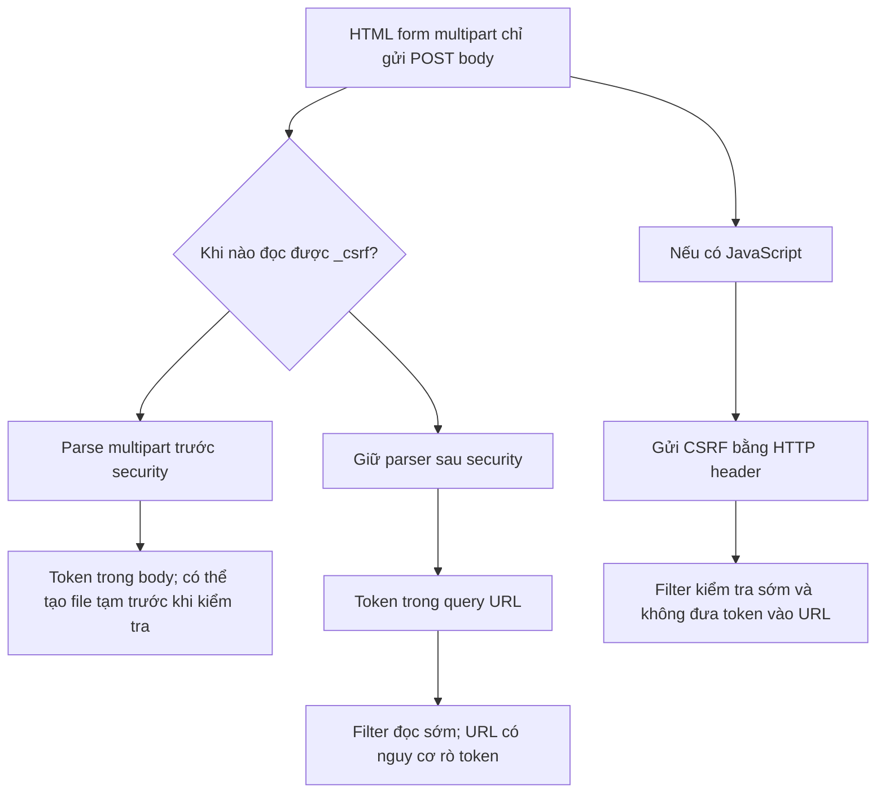

# Đánh đổi khi đặt token trong tham số URL

Trong module `SPRING_SECURITY_HTTP_PROTECTION`, Spring Security phối hợp bảo vệ CSRF, CORS, security headers/CSP/HSTS, HTTP firewall và session để ngăn các request trình duyệt gây thay đổi trạng thái ngoài ý muốn. Ở chương **CSRF và biểu mẫu**, một quyết định tưởng như nhỏ — gửi CSRF token trong **tham số URL** thay vì body/header — có thể ảnh hưởng đến cách request được xử lý, khả năng vận hành và mức độ rò rỉ dữ liệu bảo mật.

Có trường hợp kỹ thuật khiến cách này hấp dẫn: **file upload bằng HTML form thuần**, khi CSRF token nằm trong `multipart/form-data` nhưng server muốn kiểm tra CSRF *trước* khi phân tích multipart body. Gắn token vào query của **URL nhận POST** giúp bộ lọc đọc nó sớm hơn. Đổi lại, URL có thể bị ghi trong nhiều nơi mà body hoặc header nhạy cảm thường không xuất hiện.

**Kết luận định hướng:** Đưa CSRF token vào URL là một **đánh đổi cần nhận biết, không phải lựa chọn mặc định**. Với JavaScript, ưu tiên gửi trong **HTTP header**; với form thường, ưu tiên hidden input trong **POST body** khi thứ tự xử lý phù hợp. Không nhầm CSRF token với session ID, access token hay URL ký sẵn (presigned URL).

## 1. Mục tiêu học tập

Sau bài học, người đọc có thể:

- Phân biệt CSRF token trong **query string**, **POST body** và **HTTP header**, hiểu tác động lên `CsrfFilter` và luồng Servlet/WebFlux.
- Giải thích tại sao một URL chứa token dễ lan vào **access log, reverse proxy, hệ thống quan sát, browser history, Referer và công cụ analytics**.
- Phân tích trường hợp file upload HTML thuần: chọn parse multipart trước security, token query hoặc chuyển sang JavaScript gửi header.
- Thiết kế form POST không rò token qua URL; phân biệt **GET đọc dữ liệu** với **POST thay đổi trạng thái**.
- Dùng Spring MVC/Servlet và JavaScript để thay URL token bằng header/body token mà không tắt CSRF.
- Chẩn đoán 403 do CSRF so với 401/login redirect, lỗi CORS, thiếu quyền hoặc multipart parsing.
- Viết kiểm thử MockMvc cho token trong parameter và header, đồng thời đánh giá rủi ro log/URL trong môi trường thử nghiệm.
- Đối chiếu lựa chọn trên Spring WebFlux/Reactive và thiết kế phương án giảm thiểu khi hệ thống cũ chưa thể chuyển đổi.

## 2. CSRF token có phải một thành phần của URL không?

**Không bắt buộc.** CSRF token là dữ liệu mà server cấp cho một ngữ cảnh bảo mật để kiểm tra request thay đổi trạng thái có được khởi tạo theo luồng mong đợi hay không. Với ứng dụng trình duyệt xác thực bằng cookie, request có thể mang **session cookie** và **CSRF token** cùng lúc:

- **Cookie phiên** giúp server nhận diện trạng thái authentication/session; trình duyệt thường tự gửi cho origin phù hợp.
- **CSRF token** được form hoặc JavaScript chủ động đính kèm, ví dụ một trường `_csrf` trong POST body hoặc header `X-CSRF-TOKEN`.
- **`CsrfTokenRepository`** lưu/tải token kỳ vọng; **`CsrfTokenRequestHandler`** quyết định cách expose/đọc giá trị trong request.
- **`CsrfFilter`** trên Servlet kiểm tra token cho các HTTP method được xem là cần bảo vệ (thông thường POST, PUT, PATCH, DELETE).

Đối với Spring Security Servlet, repository mặc định thường là `HttpSessionCsrfTokenRepository`. Token kỳ vọng được gắn với session, không nhất thiết được cấp lại sau từng POST. Spring Security 6 mặc định có deferred CSRF token và cơ chế che token chống BREACH qua `XorCsrfTokenRequestAttributeHandler`: chuỗi token đã render có thể khác giữa các lần GET dù token kỳ vọng trong session vẫn như cũ.

### 2.1. Ba vị trí có thể gửi token

```http
# Cách A — Query string trên URL của request POST
POST /orders/confirm?_csrf=<token-duoc-render> HTTP/1.1
Cookie: JSESSIONID=<session-cookie>

# Cách B — Trường trong POST body
POST /orders/confirm HTTP/1.1
Cookie: JSESSIONID=<session-cookie>
Content-Type: application/x-www-form-urlencoded

orderId=42&_csrf=<token-duoc-render>

# Cách C — HTTP header
POST /orders/confirm HTTP/1.1
Cookie: JSESSIONID=<session-cookie>
X-CSRF-TOKEN: <token-duoc-render>
Content-Type: application/json

{"orderId":42}
```

Các ví dụ chỉ mô tả vị trí token, **không phải request có token thật**. Header name và parameter name có thể khác nếu ứng dụng tùy biến repository/handler; lấy chúng từ `CsrfToken.getHeaderName()` và `CsrfToken.getParameterName()` khi cần.

`CsrfFilter` có thể nhận token được gửi theo header hoặc request parameter. Trong Servlet, request parameter có thể đến từ query string hoặc form body đã được parser cung cấp. Chính khả năng này khiến query parameter có vẻ là phương án xử lý nhanh cho multipart body. **Nhưng “Spring Security đọc được token” khác với “vị trí ấy an toàn để chứa token”.**

### 2.2. POST có query string vẫn là POST

Khi HTML form có:

```html
<form method="post"
      action="/orders/confirm?_csrf=<token>"
      enctype="application/x-www-form-urlencoded">
    <button type="submit">Xác nhận</button>
</form>
```

request gửi đi là **POST**, vì `method="post"`; query chỉ là một phần của URL nhận request. **Không phải** vì có query token mà GET trở thành hành động an toàn để thay đổi dữ liệu. Một link `<a href="/orders/confirm?_csrf=...">` tạo GET và không nên dùng để xác nhận/xóa/đăng xuất.

Chính sách CSRF mặc định của Spring Security thường **không kiểm tra token cho GET/HEAD/OPTIONS/TRACE**, bởi các method này phải được ứng dụng dùng theo đúng tính chất an toàn của HTTP. Token trong URL GET không làm cho một handler GET thay đổi trạng thái trở nên đúng thiết kế.

## 3. Vì sao đặt token vào URL đôi khi được lựa chọn?

Trường hợp có lý do kỹ thuật rõ nhất là **file upload bằng HTML form thuần**, đặc biệt khi không có JavaScript.

Với request multipart:

```http
POST /files/upload HTTP/1.1
Cookie: JSESSIONID=<session-cookie>
Content-Type: multipart/form-data; boundary=----demo

------demo
Content-Disposition: form-data; name="_csrf"

<token-trong-multipart-body>
------demo
Content-Disposition: form-data; name="document"; filename="report.pdf"
Content-Type: application/pdf

<du-lieu-file>
------demo--
```

Trước khi server giải mã multipart body, `_csrf` có thể chưa khả dụng dưới dạng request parameter. Nếu filter kiểm tra CSRF muốn đọc hidden input, cần giải mã multipart **trước khi** kiểm tra token. Với Servlet, một cách là đặt `MultipartFilter` trước Spring Security.

Một số hệ thống muốn **giữ multipart parsing sau security** để giảm việc tạo file tạm bởi request không có quyền. Tài liệu Spring Security nêu lựa chọn gửi CSRF token qua query của **action URL** để filter có thể đọc token mà không phải parse multipart body.



**Lợi ích của query:** Token có sẵn ở URL của request POST; filter có thể đọc nó mà không cần parse multipart body chỉ để tìm token. **Chi phí:** Token nằm trong vị trí mà rất nhiều lớp hệ thống **mặc định ghi nhận** và có thể chia sẻ.

Lưu ý: reverse proxy, WAF, CDN hoặc servlet container vẫn có thể **buffer toàn bộ HTTP body trước khi security filter chạy**. Gửi token trong query hoặc header không loại bỏ nhu cầu giới hạn request ở ingress.

## 4. Các kênh rò rỉ khi token xuất hiện trong URL

Không có chuyện token nằm trên URL là “mã hóa” chỉ vì website chạy HTTPS. HTTPS bảo vệ nội dung trên đường truyền, nhưng nhiều thành phần hợp lệ **nhìn thấy URL đã giải mã** và có thể lưu nó.

| Kênh | Vì sao query token có thể đi vào? | Rủi ro thực tế |
| --- | --- | --- |
| **Web server access logs** | Log request line hoặc `request_uri` thường chứa cả query. | Token nằm trong log có vòng đời lưu dài, nhiều người hoặc hệ thống được quyền đọc. |
| **Reverse proxy, CDN, WAF** | Hệ thống bảo vệ/định tuyến lưu URI để chẩn đoán và phân tích traffic. | Token bị nhân bản sang nhiều hệ thống và nhà cung cấp dịch vụ. |
| **APM, distributed tracing, error monitoring** | Instrumentation tự ghi request URL/attributes khi xử lý lỗi. | Token lọt vào traces, spans, dashboards, alert và báo cáo sự cố. |
| **Analytics / RUM** | Công cụ quan sát có thể thu thập URL hiện tại hoặc URL của action/request. | Token vượt khỏi phạm vi ứng dụng và chính sách retention ban đầu. |
| **Browser history/bookmark, copy link, screenshot** | URL có query có thể tồn tại trong history hoặc được người dùng/extension sao chép. | Token lộ trên thiết bị chung, nội dung hỗ trợ khách hàng hoặc bản ghi trình duyệt. |
| **Referer header** | Khi URL chứa token trở thành URL của trang và phát sinh điều hướng/subrequest, URL ấy có thể được đưa vào Referer tùy chính sách. | Có thể rò sang hệ thống khác cùng origin và trong một số cấu hình sang origin bên ngoài. |
| **Cache key, log từ cache** | Cache/proxy thường dùng URL làm phần của khóa và metadata. | Token có thể tồn tại ở metadata cache ngay cả khi response không được lưu. |
| **Redirect / URL nối tiếp** | App hoặc middleware có thể giữ nguyên query khi redirect hoặc tạo link. | Token đi xa hơn endpoint dự kiến, xuất hiện trong URL của các trang kế tiếp. |

**Phân biệt mức độ chắc chắn:** Không phải mọi trình duyệt luôn lưu mọi POST action URL vào lịch sử, và không phải mọi trang luôn gửi toàn bộ query cho site khác trong `Referer`. Với chính sách hiện đại như `strict-origin-when-cross-origin`, request cross-origin HTTPS→HTTPS thường chỉ gửi *origin*, nhưng request **same-origin** vẫn có thể truyền đường dẫn/query đầy đủ. Rủi ro URL query nằm ở **tổng hợp nhiều kênh**, đặc biệt server/proxy logs, chứ không chỉ ở Referer.

### 4.1. Mô hình rò rỉ token qua hệ thống quan sát

```text
Browser gửi:
POST /files/upload?_csrf=MASKED_TOKEN (cookie phiên đi kèm)
                  |
                  v
Reverse proxy  -----> access.log: "POST /files/upload?_csrf=..."
                  |
                  v
APM/Tracing  ------> span.http.url: "/files/upload?_csrf=..."
                  |
                  v
Spring Security -> CSRF hợp lệ -> Controller

Token được ghi vào log/traces có thể sống lâu hơn phiên.
```

Khi token của một phiên bị lộ, bên khác **không tự có session cookie chỉ từ CSRF token**. Nhưng trong tấn công CSRF, mục tiêu là khiến **chính trình duyệt nạn nhân** gửi cookie có sẵn. Nếu kẻ tấn công lấy được CSRF token phù hợp với phiên của nạn nhân, một lớp bảo vệ có thể bị vô hiệu hóa trong ngữ cảnh đó. Mức độ khai thác còn phụ thuộc repository, thời hạn token, session, SameSite, các lớp bảo vệ khác và khả năng tạo request.

Không nên lập luận rằng token vô hại vì “nó chỉ là CSRF, không phải mật khẩu”. Nó vẫn là **giá trị cần tránh phát tán**.

### 4.2. HTTPS, SameSite và Referrer-Policy có đủ không?

Không. Các lớp này có vai trò riêng:

- **HTTPS + HSTS** giảm nguy cơ nghe lén/tấn công downgrade trên đường truyền, không ngăn máy chủ và proxy hợp lệ ghi request URL vào log.
- **`Referrer-Policy: no-referrer`** có thể ngăn gửi Referer từ tài liệu, nhưng không xóa token khỏi URL request đang được phục vụ và không loại bỏ log/proxy/APM.
- **`Cache-Control: no-store`** hạn chế lưu nội dung response trong cache, nhưng không bảo đảm mọi công cụ log/request tracing không ghi URL.
- **Cookie `SameSite`** giúp giảm một số tình huống trình duyệt gửi cookie cross-site; không thay thế hoàn toàn CSRF protection.
- **CSP và chống XSS** giảm việc mã trái phép đọc DOM/token. Nếu có XSS, kẻ tấn công có thể đọc token ở cả hidden input hoặc meta, nên CSP vẫn quan trọng nhưng không “hợp pháp hóa” URL token.
- **CORS** quyết định quyền đọc response cross-origin của JavaScript; nó không mặc nhiên chặn một form cross-site gửi request.

Nếu thiết kế có thể loại bỏ token khỏi URL, **loại bỏ tại nguồn** là biện pháp tốt hơn dựa vào các lớp giảm thiểu về sau.

## 5. So sánh URL, body và header

| Tiêu chí | Query URL | Hidden input trong POST body | Header do JavaScript gửi |
| --- | --- | --- | --- |
| Dùng được với HTML form thuần | Có | Có | Không nếu không có JavaScript hoặc cơ chế client đặc biệt. |
| `CsrfFilter` đọc trước multipart parse | Có thể | Có thể **không**, phụ thuộc filter/multipart parser | Có thể, nếu không có parser đặt trước security. |
| Xuất hiện trong request URI và access log mặc định | **Có nguy cơ cao** | Thông thường không, nếu log không thu body | Thông thường không, nếu log không thu header; vẫn cần redaction. |
| Có thể bị sao chép qua link/redirect/URL analytics | **Có nguy cơ** | Ít liên quan hơn | Ít liên quan hơn. |
| Phụ thuộc xử lý boundary multipart | Không để đọc token | Có nếu token ở multipart body | Không để đọc token. |
| Tính thuận tiện với Thymeleaf server-rendered | Cần cố ý cấu hình action/query | Tích hợp `th:action` thường tự chèn hidden field | Render meta hoặc GET token endpoint và JS. |
| Có thể khắc phục lỗi session/token cũ bằng vị trí token? | **Không** | **Không** | **Không**. |
| Khuyến nghị | Tránh; chỉ cân nhắc với ràng buộc legacy rõ ràng | Ưu tiên cho form thường | Ưu tiên với upload JavaScript. |

Chú ý: **Header không phải nơi tuyệt đối không thể log**. Nếu APM thu toàn bộ request headers hoặc debug proxy bật log nhạy cảm, header CSRF cũng có thể bị ghi. Vì thế cần cấu hình **redaction** bất kể vị trí. Khác biệt là URI thường được nhiều lớp log mặc định hơn body/header.

## 6. Ví dụ minh họa Servlet: form upload và URL token

Giả sử ứng dụng Spring Boot 3 với Spring MVC, Spring Security, Thymeleaf hoặc JSP. Controller và filter chain minh họa:

```java
import org.springframework.context.annotation.Bean;
import org.springframework.context.annotation.Configuration;
import org.springframework.security.config.Customizer;
import org.springframework.security.config.annotation.web.builders.HttpSecurity;
import org.springframework.security.web.SecurityFilterChain;

@Configuration
public class SecurityConfig {

    @Bean
    SecurityFilterChain filterChain(HttpSecurity http) throws Exception {
        return http
                .authorizeHttpRequests(auth -> auth
                        .requestMatchers("/files/**").authenticated()
                        .anyRequest().authenticated())
                .formLogin(Customizer.withDefaults())
                .csrf(Customizer.withDefaults())
                .build();
    }
}
```

`/files/**` cần authenticated user; POST `/files/upload` còn yêu cầu CSRF. `permitAll()` không tự tắt CSRF và một CSRF token đúng **không cấp quyền upload**.

Controller tối giản:

```java
import org.springframework.http.HttpStatus;
import org.springframework.http.MediaType;
import org.springframework.http.ResponseEntity;
import org.springframework.stereotype.Controller;
import org.springframework.web.bind.annotation.GetMapping;
import org.springframework.web.bind.annotation.PostMapping;
import org.springframework.web.bind.annotation.RequestParam;
import org.springframework.web.bind.annotation.ResponseBody;
import org.springframework.web.multipart.MultipartFile;
import org.springframework.web.server.ResponseStatusException;

@Controller
public class FileUploadController {
    public record UploadReceipt(long bytesReceived) {}

    @GetMapping("/files/upload")
    String form() {
        return "file-upload";
    }

    @PostMapping(value = "/files/upload",
                 consumes = MediaType.MULTIPART_FORM_DATA_VALUE)
    @ResponseBody
    ResponseEntity<UploadReceipt> upload(
            @RequestParam("document") MultipartFile document) {
        if (document.isEmpty()) {
            throw new ResponseStatusException(
                    HttpStatus.BAD_REQUEST, "Chưa chọn tệp");
        }

        // Demo: chỉ cho biết file đã được parser/controller tiếp nhận.
        // Chưa kiểm tra nội dung và chưa lưu file bền vững.
        return ResponseEntity.status(HttpStatus.CREATED)
                .body(new UploadReceipt(document.getSize()));
    }
}
```

### 6.1. Cách dùng query token: ví dụ có chủ đích để thấy đánh đổi

Trong JSP (Servlet), có thể tạo URL chứa CSRF parameter bằng taglib để escape giá trị query phù hợp:

```jsp
<%@ taglib prefix="c" uri="jakarta.tags.core" %>

<!-- Chỉ minh họa workaround khi không thể parse multipart trước security.
     KHÔNG khuyến nghị làm mẫu mặc định cho sản phẩm. -->
<c:url var="unsafeUploadAction" value="/files/upload">
    <c:param name="${_csrf.parameterName}" value="${_csrf.token}" />
</c:url>

<form method="post"
      action="<c:out value='${unsafeUploadAction}'/>"
      enctype="multipart/form-data">
    <label for="document">Tài liệu</label>
    <input id="document" name="document" type="file" required>
    <button type="submit">Tải lên</button>
</form>
```

**Lưu ý:** Ví dụ này dùng JSP/JSTL tương ứng với Jakarta; môi trường Java EE/JSP cũ có URI taglib khác. `<c:url>` hỗ trợ xây URL có context path và encode tham số, `<c:out>` escape khi xuất vào HTML attribute. Tuy nhiên, **encode đúng không giải quyết rủi ro lộ token do nó vẫn nằm trong URL**.

Nếu server nhận POST `/files/upload?_csrf=...` và request handler đọc token từ parameter, `CsrfFilter` có thể xác minh trước khi parser cần đọc multipart body để tìm `_csrf`. Điều này chỉ đúng khi **không có middleware/multipart filter sớm** đã đọc body. Không dùng request action URL này như một link GET để thay đổi trạng thái; request vẫn phải là POST.

Một biểu diễn tương đương để **nhận diện nguy cơ** (không dùng trong production):

```html
<!-- URL token có thể lọt vào log hoặc tracing của ứng dụng. -->
<form method="post"
      action="/files/upload?_csrf=TOKEN_DA_DUOC_RENDER"
      enctype="multipart/form-data">
    <input type="file" name="document">
    <button type="submit">Tải lên</button>
</form>
```

Không dùng `TOKEN_DA_DUOC_RENDER` làm token cố định hoặc coi đó là giá trị thật.

### 6.2. Nếu query token bị lộ thì chuyện gì xảy ra?

Giả sử mỗi request POST từ trang của người dùng có URI:

```text
/files/upload?_csrf=masked-value...
```

Một reverse proxy có thể lưu chính xác URI này. `masked-value` không nên bị xem là vô hại: nó là biểu diễn request token mà Spring Security có thể xác minh trong ngữ cảnh phù hợp. Nó có thể còn dùng được cho đến khi token kỳ vọng ở repository/phiên thay đổi; cơ chế XOR nhằm giảm nguy cơ BREACH khi phản hồi nén, **không biến token đã lộ thành an toàn để công khai**.

Với hệ thống log có nhiều người dùng, một người có quyền truy cập log có thể vô tình hoặc cố ý thấy token từ request của người khác. Trong thực tế còn có những yếu tố bảo vệ như thời gian sống phiên và quyền truy cập log; song thiết kế không nên tăng bề mặt lộ token nếu có đường thay thế.

## 7. Phương án thay thế A: hidden token trong POST body

Đây là cách tự nhiên cho form thường trên Spring MVC + Thymeleaf:

```html
<!DOCTYPE html>
<html lang="vi" xmlns:th="http://www.thymeleaf.org">
<head>
    <meta charset="UTF-8">
    <title>Tải tài liệu</title>
</head>
<body>
    <form method="post"
          th:action="@{/files/upload}"
          enctype="multipart/form-data">
        <label for="document">Tài liệu</label>
        <input id="document" name="document" type="file" required>
        <button type="submit">Tải lên</button>
    </form>
</body>
</html>
```

Khi Spring MVC và Spring Security tích hợp đúng, `th:action` của form POST sử dụng `CsrfRequestDataValueProcessor` để chèn hidden input vào HTML đã render:

```html
<form method="post"
      action="/files/upload"
      enctype="multipart/form-data">
    <input id="document" name="document" type="file">
    <button type="submit">Tải lên</button>
    <input type="hidden" name="_csrf" value="token-tu-request">
</form>
```

**Điểm mạnh:** URL sạch, token không nằm trong request line. **Điểm khó với multipart:** Nếu token chỉ có trong multipart body, server có thể phải parse body trước `CsrfFilter`. Trên Servlet, giải pháp thường được Spring Security thảo luận là cấu hình `MultipartFilter` chạy trước `springSecurityFilterChain`:

```java
import jakarta.servlet.ServletContext;
import org.springframework.security.web.context.AbstractSecurityWebApplicationInitializer;
import org.springframework.web.multipart.support.MultipartFilter;

// Ví dụ cho ứng dụng tự dùng Security initializer truyền thống.
public class SecurityInitializer
        extends AbstractSecurityWebApplicationInitializer {

    @Override
    protected void beforeSpringSecurityFilterChain(
            ServletContext servletContext) {
        insertFilters(servletContext, new MultipartFilter());
    }
}
```

Ví dụ này dành cho kiểu ứng dụng dùng initializer. **Không thêm initializer này một cách máy móc vào Spring Boot** đã tự quản lý filter registration; với Boot cần cấu hình thứ tự `FilterRegistrationBean` phù hợp và kiểm chứng runtime.

Đánh đổi chuyển từ **rò token qua URL** sang **tiêu tốn tài nguyên trước security**: multipart parser có thể ghi file tạm dù token sai hoặc request chưa authenticated. Phải giới hạn kích thước, số parts, concurrency, thời gian truyền và dung lượng vùng tạm, đồng thời kiểm tra cleanup ở các đường lỗi.

### 7.1. Giới hạn tài nguyên là điều kiện bắt buộc

Ví dụ Spring Boot Servlet:

```properties
spring.servlet.multipart.enabled=true
spring.servlet.multipart.max-file-size=5MB
spring.servlet.multipart.max-request-size=6MB
```

Các giá trị 5 MB/6 MB mang tính minh họa. Ứng dụng thật còn cần giới hạn tại reverse proxy, disk quotas, file count/concurrency và monitoring. `MultipartFile` chỉ biểu diễn file được request cung cấp; muốn lưu lâu dài cần service với quyền sở hữu, kiểm tra MIME/magic bytes, tên file an toàn và kho lưu trữ private.

Một request CSRF sai trả 403 **không chứng minh** multipart parser chưa ghi temporary file nếu nó được cấu hình chạy trước security.

## 8. Phương án thay thế B: gửi CSRF qua HTTP header

Nếu trang có JavaScript, header thường là cách tốt hơn: `CsrfFilter` có thể đọc token mà không cần query và không cần giải mã multipart body **chỉ để tìm token**.

### 8.1. Expose token trong HTML

Thêm các meta tag vào trang Thymeleaf:

```html
<meta name="_csrf" th:content="${_csrf.token}">
<meta name="_csrf_header" th:content="${_csrf.headerName}">

<form id="fileForm" method="post"
      th:action="@{/files/upload}"
      enctype="multipart/form-data">
    <input type="file" name="document" required>
    <button type="submit">Tải lên</button>
</form>
<p id="uploadStatus" role="status"></p>
```

Token và tên header được render bởi Spring Security từ request hiện tại. Không hardcode `X-CSRF-TOKEN` nếu handler/repository có thể được tùy chỉnh. Không lấy raw token trực tiếp từ session repository rồi tự gắn header khi dùng XOR request handler mặc định.

### 8.2. fetch + FormData

```javascript
const form = document.getElementById("fileForm");
const statusNode = document.getElementById("uploadStatus");

form.addEventListener("submit", async (event) => {
    event.preventDefault();

    const token = document.querySelector(
        'meta[name="_csrf"]').content;
    const headerName = document.querySelector(
        'meta[name="_csrf_header"]').content;

    const body = new FormData(form);

    try {
        const response = await fetch(form.action, {
            method: "POST",
            credentials: "same-origin",
            headers: { [headerName]: token },
            body
        });

        if (response.redirected || response.status === 401) {
            statusNode.textContent =
                "Cần đăng nhập lại và mở trang tải tệp mới.";
            return;
        }
        if (response.status === 403) {
            statusNode.textContent =
                "Yêu cầu không được chấp nhận. Hãy kiểm tra phiên và quyền.";
            return;
        }
        if (!response.ok) {
            statusNode.textContent =
                "Tải lên thất bại: HTTP " + response.status;
            return;
        }

        statusNode.textContent = "Server đã tiếp nhận yêu cầu.";
    } catch {
        statusNode.textContent =
            "Mất kết nối; hãy kiểm tra kết quả trước khi gửi lại.";
    }
});
```

**Tuyệt đối không tự gán `Content-Type: multipart/form-data` khi dùng `FormData`.** Trình duyệt cần tự thêm `boundary` khớp body. Nếu set Content-Type thiếu boundary, parser có thể trả 400/415 hoặc lỗi giải mã multipart.

`FormData(form)` có thể vẫn chứa hidden `_csrf` tự chèn từ Thymeleaf; điều này không có nghĩa request URL phải chứa token. Filter có thể dùng token ở header trước khi cần parse body, **miễn là không có `MultipartFilter` hoặc middleware khác đã được đặt trước security**.

### 8.3. Khi không có template server-rendered

Một SPA có thể GET token từ endpoint cùng origin có kiểm soát:

```java
import jakarta.servlet.http.HttpServletRequest;
import org.springframework.http.CacheControl;
import org.springframework.http.ResponseEntity;
import org.springframework.security.web.csrf.CsrfToken;
import org.springframework.web.bind.annotation.GetMapping;
import org.springframework.web.bind.annotation.RestController;

@RestController
public class CsrfEndpoint {
    public record CsrfResponse(String headerName, String token) {}

    @GetMapping("/api/csrf")
    ResponseEntity<CsrfResponse> current(HttpServletRequest request) {
        CsrfToken csrf = (CsrfToken) request.getAttribute(
                CsrfToken.class.getName());
        if (csrf == null) {
            throw new IllegalStateException(
                    "CSRF token chưa có trong request");
        }

        return ResponseEntity.ok()
                .cacheControl(CacheControl.noStore())
                .body(new CsrfResponse(
                        csrf.getHeaderName(), csrf.getToken()));
    }
}
```

Nếu dùng security chain ví dụ ở mục 6 và muốn thêm endpoint này, cần cấu hình authorization tương ứng cho `/api/csrf`. Endpoint đọc token theo **request hiện tại**; không bỏ qua security filter chain và không biến người chưa authenticated thành user đã đăng nhập. Sau logout/login hoặc session timeout, cần lấy token trong ngữ cảnh mới.

Nếu `fetch` bị redirect sang login, frontend có thể nhận HTML status 200 sau redirect. Kiểm tra `response.redirected` và `Content-Type` thay vì xem mọi 200 là JSON hợp lệ.

## 9. Chọn phương án theo khả năng và rủi ro

Dùng bảng này khi thiết kế hoặc review hệ thống:

| Ràng buộc | Lựa chọn ưu tiên | Lý do |
| --- | --- | --- |
| Form POST thông thường, không có file | Hidden token trong body | Không cần parse multipart; tránh đặt token trên URL. |
| Upload có JavaScript | CSRF header từ request hoặc GET token endpoint | Security có thể đọc trước multipart parse, URL sạch. |
| Upload HTML thuần không JavaScript, giới hạn file nhỏ, môi trường kiểm soát | Hidden token + MultipartFilter trước security | Tránh URL leak; phải chấp nhận/giới hạn temporary files trước CSRF. |
| Upload HTML thuần, yêu cầu không parse multipart trước security | Cân nhắc thay đổi kiến trúc; query token chỉ là ngoại lệ có kiểm soát | Không có lựa chọn vừa giữ mọi ràng buộc vừa loại bỏ toàn bộ đánh đổi. |
| Hạ tầng log tất cả URL, không thể redaction | **Không đặt token trong query** | Rủi ro lộ token qua logs/tracing quá lớn. |
| Giao dịch quan trọng (thanh toán, đổi quyền, xóa dữ liệu) | Body/header + authorization + idempotency | Token URL tăng bề mặt lộ; CSRF không bảo đảm lệnh chỉ thực hiện một lần. |
| Client khác origin | Thiết kế CORS/credentials rõ ràng, ưu tiên API header nếu hợp lý | CORS preflight là cơ chế khác CSRF, không tắt CSRF chỉ để bỏ lỗi preflight. |

**Chỉ cân nhắc ngoại lệ URL khi** đã xác nhận không thể dùng header hoặc body một cách chấp nhận được; đã xác định điểm ghi log/query, policy, giới hạn thời gian sống và kế hoạch thay thế. Nếu thiếu các điều kiện này, không “đổi bảo mật lấy tiện lợi” bằng cách thêm `?_csrf=...` vào mọi action.

## 10. Nếu phải duy trì URL token: giảm thiểu và kế hoạch rút bỏ

Với hệ thống cũ chưa thể thay ngay, có thể triển khai các biện pháp giảm thiểu nhưng **không xem chúng tương đương với loại bỏ token khỏi URL**.

### 10.1. Lập bản đồ nơi URL được quan sát

Kiểm tra các lớp sau bằng **dữ liệu giả hoặc canary**, không dùng token sản xuất thật trong báo cáo:

1. Ingress/load balancer có log request target hoặc query string không?
2. Reverse proxy/WAF/CDN có lưu full request URI trong sự kiện 403/413/5xx không?
3. Tracing/APM có thu `http.url`, `url.full` hoặc request attributes chứa query không?
4. Analytics có lấy URL đang hiển thị hoặc URL action của form không?
5. Error reporting, support tooling, alert payload có gắn full URL không?
6. Redirect, template link và response 3xx có vô tình giữ lại query token không?
7. Trình duyệt hoặc extension có thể lưu/chụp/copy URL chứa token không?

Khi một điểm ghi token, thay đổi cách thu thập hoặc làm sạch query **trước khi lưu**. Không chỉ ẩn token khi hiển thị dashboard; dữ liệu thô vẫn có thể tồn tại trong storage.

### 10.2. Ví dụ nguyên tắc redaction

Giả sử hệ thống nhận:

```text
POST /files/upload?folder=reports&_csrf=MASKED_VALUE&mode=replace
```

Đối với log, chỉ ghi URI **đã loại hoặc che query nhạy cảm**, ví dụ:

```text
POST /files/upload?folder=reports&_csrf=[REDACTED]&mode=replace
```

Hoặc chỉ log đường dẫn ổn định `/files/upload` cùng request ID. Khi chọn allowlist, chỉ giữ những tên parameter thực sự cần; **không dựa vào danh sách denylist duy nhất** nếu còn tên token khác như `csrfToken`, `XSRF-TOKEN` hoặc khóa tùy biến.

Cần thực hiện redaction ở **mọi tầng** được quyền nhận URI. Thay đổi log của ứng dụng không có tác dụng với một proxy nằm trước nó đang ghi full URL. Nếu token từng bị phát tán, xử lý theo quy trình incident/retention của tổ chức, cân nhắc vô hiệu hóa phiên/token bị ảnh hưởng khi đánh giá thực tế cho thấy cần thiết.

### 10.3. Các biện pháp không đủ nếu đứng một mình

| Biện pháp | Có ích gì? | Không giải quyết được gì? |
| --- | --- | --- |
| `Referrer-Policy: no-referrer` | Giảm gửi Referer từ trang | Không xóa query trong access log hoặc request URI. |
| `Cache-Control: no-store` | Giảm lưu response trong cache | Không xóa request URI trong APM/CDN traces. |
| HTTPS/HSTS | Bảo vệ đường truyền và chống downgrade | Proxy/server hợp lệ vẫn nhìn thấy URL. |
| Token có thời hạn ngắn hơn | Giảm cửa sổ hiệu lực nếu token bị lộ | Không ngăn lộ; có thể tăng lỗi với form mở lâu. |
| Ẩn tham số khỏi thanh địa chỉ sau redirect | Giảm một số trường hợp người dùng sao chép URL | POST action URL vẫn có thể đã bị log trước redirect. |
| Thêm CSP | Giảm một số con đường khai thác XSS | Không làm query token bí mật trong logs. |

Nếu chuyển URL token sang header/body, còn phải kiểm tra logs có vô tình ghi **toàn bộ headers/body** không. Nên áp dụng redaction đồng thời với nguyên tắc thu thập dữ liệu tối thiểu.

## 11. Reactive/WebFlux: lựa chọn tương đương nhưng cơ chế khác

Spring Security Reactive dùng `CsrfWebFilter`, repository mặc định thường là `WebSessionServerCsrfTokenRepository` và token được expose dưới dạng `Mono<CsrfToken>` trong `ServerWebExchange`. Không mang `MultipartFilter` Servlet sang WebFlux.

Cũng như Servlet, token nằm trong multipart body có thể cần đọc body để lấy tham số. Trên WebFlux, `ServerCsrfTokenRequestAttributeHandler` có tùy chọn `setTokenFromMultipartDataEnabled(boolean)`, **mặc định false**. Nếu sử dụng `XorServerCsrfTokenRequestAttributeHandler` và muốn form HTML thuần body-only hoạt động, cần bật tương ứng và đánh giá tiêu thụ tài nguyên.

### 11.1. WebFlux ưu tiên header khi JavaScript có sẵn

Ví dụ Reactive security chain:

```java
import org.springframework.context.annotation.Bean;
import org.springframework.context.annotation.Configuration;
import org.springframework.security.config.Customizer;
import org.springframework.security.config.web.server.ServerHttpSecurity;
import org.springframework.security.web.server.SecurityWebFilterChain;

@Configuration
public class ReactiveSecurityConfig {

    @Bean
    SecurityWebFilterChain securityWebFilterChain(ServerHttpSecurity http) {
        return http
                .authorizeExchange(exchange -> exchange
                        .pathMatchers("/files/**", "/api/csrf")
                        .authenticated()
                        .anyExchange().authenticated())
                .formLogin(Customizer.withDefaults())
                .csrf(Customizer.withDefaults())
                .build();
    }
}
```

Một endpoint GET có thể đưa token đến frontend mà không đưa nó vào query:

```java
import org.springframework.http.CacheControl;
import org.springframework.http.ResponseEntity;
import org.springframework.security.web.server.csrf.CsrfToken;
import org.springframework.web.bind.annotation.GetMapping;
import org.springframework.web.bind.annotation.RestController;
import org.springframework.web.server.ServerWebExchange;
import reactor.core.publisher.Mono;

@RestController
public class ReactiveCsrfEndpoint {
    public record CsrfResponse(String headerName, String token) {}

    @GetMapping("/api/csrf")
    Mono<ResponseEntity<CsrfResponse>> current(ServerWebExchange exchange) {
        Mono<CsrfToken> publisher =
                exchange.getAttribute(CsrfToken.class.getName());

        if (publisher == null) {
            return Mono.error(new IllegalStateException(
                    "Chưa có CSRF publisher trong exchange"));
        }

        return publisher.map(token -> ResponseEntity.ok()
                .cacheControl(CacheControl.noStore())
                .body(new CsrfResponse(
                        token.getHeaderName(), token.getToken())));
    }
}
```

Đây là cấu hình **của một ứng dụng WebFlux riêng**. Không ép `Mono<CsrfToken>` thành `CsrfToken` hay gọi `block()` trong event loop. Khi frontend nhận được token, POST upload gửi qua header giống như ví dụ `FormData` ở mục 8. Chú ý session cookie, authentication và CORS nếu client khác origin.

### 11.2. Nếu bắt buộc đọc token từ multipart body

Ví dụ minh họa cấu hình handler Reactive:

```java
import org.springframework.security.web.server.csrf.XorServerCsrfTokenRequestAttributeHandler;

// Trong cấu hình ServerHttpSecurity dành cho WebFlux:
XorServerCsrfTokenRequestAttributeHandler handler =
        new XorServerCsrfTokenRequestAttributeHandler();

handler.setTokenFromMultipartDataEnabled(true);

// Gắn trong builder:
// http.csrf(csrf -> csrf.csrfTokenRequestHandler(handler));
```

Việc bật đọc token từ multipart body có thể khiến WebFlux phải phân tích dữ liệu multipart trước khi xác minh CSRF, tạo đánh đổi memory/disk tương tự Servlet. Nếu upload có JavaScript gửi header, không cần bật chỉ để tìm token trong body. Với WebFlux, cấu hình codec limits và multipart readers khác `spring.servlet.multipart.*` của Servlet.

### 11.3. Token query ở WebFlux có làm mất rủi ro URL không?

Không. Nếu hệ thống cho phép handler đọc token từ request parameter trong URL, các rủi ro logs, tracing, Referer và analytics **vẫn nguyên vẹn**. Đừng suy rằng đổi từ Servlet sang WebFlux làm token query an toàn hơn. Cần kiểm tra hành vi đọc token query trong **phiên bản request handler thực tế** trước khi chọn workaround; không tự giả định toàn bộ cơ chế parameter parsing giống Servlet.

## 12. Kiểm thử: vừa kiểm tra chức năng, vừa kiểm tra không rò token

### 12.1. MockMvc — CSRF ở parameter và header

Với Spring Security Test, `csrf()` mặc định thêm token hợp lệ vào request parameter; `csrf().asHeader()` đặt token trong HTTP header. Hai cách này giúp chứng minh filter nhận dữ liệu từ các vị trí tương ứng, **nhưng `csrf()` không chứng minh token thật đã được nhúng vào URL action**.

Ví dụ cho controller upload `/files/upload` ở mục 6:

```java
import static org.hamcrest.Matchers.is;
import static org.springframework.security.test.web.servlet.request.SecurityMockMvcRequestPostProcessors.csrf;
import static org.springframework.security.test.web.servlet.request.SecurityMockMvcRequestPostProcessors.user;
import static org.springframework.test.web.servlet.request.MockMvcRequestBuilders.multipart;
import static org.springframework.test.web.servlet.result.MockMvcResultMatchers.*;

import java.nio.charset.StandardCharsets;
import org.junit.jupiter.api.Test;
import org.springframework.beans.factory.annotation.Autowired;
import org.springframework.boot.test.autoconfigure.web.servlet.AutoConfigureMockMvc;
import org.springframework.boot.test.context.SpringBootTest;
import org.springframework.mock.web.MockMultipartFile;
import org.springframework.test.web.servlet.MockMvc;

@SpringBootTest
@AutoConfigureMockMvc
class CsrfTokenPlacementTests {

    @Autowired
    MockMvc mvc;

    private MockMultipartFile document() {
        return new MockMultipartFile(
                "document", "report.txt", "text/plain",
                "demo".getBytes(StandardCharsets.UTF_8));
    }

    @Test
    void missingCsrfIsForbidden() throws Exception {
        mvc.perform(multipart("/files/upload")
                        .file(document())
                        .with(user("learner")))
                .andExpect(status().isForbidden());
    }

    @Test
    void invalidCsrfParameterIsForbidden() throws Exception {
        mvc.perform(multipart("/files/upload")
                        .file(document())
                        .with(user("learner"))
                        .with(csrf().useInvalidToken()))
                .andExpect(status().isForbidden());
    }

    @Test
    void parameterTokenIsAcceptedByFilter() throws Exception {
        mvc.perform(multipart("/files/upload")
                        .file(document())
                        .with(user("learner"))
                        .with(csrf()))
                .andExpect(status().isCreated())
                .andExpect(jsonPath("$.bytesReceived", is(4)));
    }

    @Test
    void headerTokenIsAcceptedByFilter() throws Exception {
        mvc.perform(multipart("/files/upload")
                        .file(document())
                        .with(user("learner"))
                        .with(csrf().asHeader()))
                .andExpect(status().isCreated());
    }

    @Test
    void invalidHeaderIsForbidden() throws Exception {
        mvc.perform(multipart("/files/upload")
                        .file(document())
                        .with(user("learner"))
                        .with(csrf().asHeader().useInvalidToken()))
                .andExpect(status().isForbidden());
    }
}
```

`MockMultipartFile` trong MockMvc dựng sẵn dữ liệu multipart. Vì vậy, những test trên **không khẳng định** `MultipartFilter` đã chạy đúng thứ tự hoặc temp file thực tế đã được tạo/cleanup. Ngoài MockMvc cần test embedded servlet container nếu đánh đổi về phân tích multipart là trọng tâm.

### 12.2. Kiểm thử cụ thể token trong query URL

Nếu phải chứng minh một hệ thống cũ nhận token ở **query** chứ không phải body, làm integration test bằng HTTP request thật:

1. GET form đã xác thực trong cùng session.
2. Trích CSRF token của form test hoặc response token endpoint **theo request hiện hành**; không ghi giá trị token vào kết quả test.
3. Dựng POST multipart với `_csrf` chỉ trong **query string** và **không gửi thêm token trong body/header**.
4. Giữ cookie/session giống khi GET, xác nhận 201/2xx phù hợp controller nếu handler cho phép query token.
5. Thử thay query token sai, kỳ vọng 403 theo cấu hình mặc định.
6. Kiểm tra access logs/tracing của **môi trường test** xem URL chứa marker nhạy cảm có bị ghi lại không; cấu hình redaction nếu phát hiện.
7. Đối chiếu với request gửi token qua header và URL sạch, sau đó ghi lại phương án được chọn.

Không sao chép CSRF token thật vào câu lệnh terminal, test report hoặc ảnh chụp công khai. Nên dùng client test tự giữ token trong bộ nhớ và ghi **chỉ** kết quả status cùng URL đã được redaction.

### 12.3. Kiểm thử bảo mật vận hành

| Ca kiểm thử | Điều cần quan sát | Điều kiện đạt |
| --- | --- | --- |
| POST thiếu CSRF | Status và controller side effect | 403 mặc định, không chạy nghiệp vụ upload. |
| POST token sai trong query | CSRF validation | 403 mặc định, không có ghi file bền vững. |
| POST token đúng trong query | Request URI/logs, status | Chức năng hoạt động trong test; ghi nhận rủi ro logs để quyết định có dùng hay không. |
| POST token đúng trong header | Request header, body, status | Thành công, URL không chứa token. |
| POST multipart body-only | Filter order và temp disk | Thành công khi có parser phù hợp; kiểm tra file tạm và cleanup. |
| Session bị logout/timeout | Token cũ và cookie | Request cũ bị từ chối hoặc yêu cầu login theo cấu hình. |
| Không đủ quyền | Authentication/authorization | Token CSRF đúng vẫn không đủ cấp quyền. |
| Log/APM thu URI | Query redaction | Không có token thật trong log, traces, alert hoặc analytics thuộc phạm vi kiểm soát. |
| File quá lớn hoặc nhiều parts | Proxy/container size limits | Bị chặn theo chính sách; không làm cạn disk/inode. |
| Retry sau lỗi mạng | Trạng thái file/upload ID | Không tạo upload trùng ngoài ý muốn. |

### 12.4. Giới hạn của kiểm thử đơn vị

Một test `.with(csrf())` có thể pass ngay cả khi HTML thực tế **không có hidden input**. Một test HTTP nhận 201 có thể pass dù proxy **đã log token**. Do đó cần các tầng kiểm tra riêng:

- **View test:** HTML đã render có token ở vị trí mong muốn và không tự đưa vào URL nếu policy cấm.
- **Filter test:** POST thiếu/sai token bị từ chối; token header/body đúng được chấp nhận.
- **Container test:** thứ tự multipart parsing và tài nguyên tạm được quan sát.
- **Operations test:** logs, APM, tracing, proxy và cache không lưu giá trị token ngoài policy.
- **Business test:** owner, file validation và idempotency hoạt động độc lập với CSRF.

## 13. Lỗi thường gặp và cách chẩn đoán

| Dấu hiệu | Nguyên nhân có thể | Hướng xử lý |
| --- | --- | --- |
| Form multipart có hidden `_csrf` nhưng POST 403 | Filter chưa đọc được parameter từ multipart body | Dùng header khi có JS hoặc cấu hình multipart parser trước security với giới hạn tài nguyên. |
| Thêm `?_csrf=...` vào action thì hết 403 | Query token giúp filter đọc trước body, nhưng tăng rủi ro URL leak | Không coi là bản vá hoàn tất; đánh giá logs và ưu tiên chuyển sang header/body. |
| GET trang chứa token bị ghi vào analytics | Token được đưa vào URL của tài liệu hoặc link | Xóa token khỏi URL; rà luồng redirect và công cụ quan sát. |
| Token query vẫn bị 403 | Token khác phiên, handler/repository không khớp, URL encode sai | Kiểm tra token của request hiện tại, cookie, handler, URL encoding và security chain. |
| Giá trị token hiển thị khác mỗi lần GET | XOR masking/BREACH protection | Không kết luận token repository đã xoay vòng. |
| Token được redact ở app log nhưng vẫn xuất hiện trong proxy | Redaction chỉ triển khai tại một tầng | Xử lý URI ở ingress/CDN/WAF và APM trước khi persist. |
| POST upload có CSRF header nhưng vẫn tạo temp file trước 403 | Middleware/MultipartFilter đã chạy trước security | Kiểm tra filter order hoặc buffering tầng proxy/container. |
| CORS preflight thất bại khi dùng header | Header tùy chỉnh cần origin/headers/credentials phù hợp | Chỉnh allowlist CORS; không tắt CSRF. |
| Sau logout form cũ POST 403 | Token/phiên đã bị xóa hoặc thay đổi | Đăng nhập lại và GET form/token mới. |
| 403 dù token hợp lệ | Authorization/ownership từ chối | Kiểm tra quyền và loại lỗi; CSRF không cấp quyền. |
| Token query nằm trong URL của redirect | App giữ query khi điều hướng | Không propagate query nhạy cảm; redirect về URL sạch. |
| Log chứa session ID cùng CSRF token | Log cả cookie/query hoặc request dump | Khẩn trương rà quyền truy cập log, redaction và xử lý theo quy trình sự cố. |

## 14. Bài tập tình huống

**Bối cảnh:** Ứng dụng nội bộ nhận tài liệu PDF qua `POST /files/upload`. Frontend hiện tại là JSP form HTML thuần. Nhóm phát triển gặp lỗi CSRF 403 khi upload và đề xuất sửa ngay thành `/files/upload?_csrf=...`. Hệ thống có reverse proxy, APM và một số trang còn dùng analytics.

Thực hiện:

1. Mô tả vì sao POST multipart hidden token có thể 403 khi security filter chạy trước multipart parser.
2. Lập bảng so sánh ba lựa chọn: `MultipartFilter` trước security, CSRF token trong query và JavaScript gửi header. Nêu rõ **lợi ích** và **đánh đổi** của mỗi lựa chọn.
3. Dùng tài liệu JSP để tạo URL query token **trong môi trường thử nghiệm**, không ghi secret vào log/report. Ghi nhận query xuất hiện ở những hệ thống nào.
4. Thiết kế bản thay thế sử dụng Thymeleaf/JSP nhận token từ request và `fetch + FormData` gửi qua header. Chứng minh không cần viết token vào query.
5. Nếu bắt buộc hỗ trợ trình duyệt không dùng JavaScript, chọn chiến lược parse multipart trước security cùng giới hạn file size, request size, concurrency và temp quotas; giải thích rủi ro DoS.
6. Viết MockMvc tests cho token thiếu/sai, token parameter đúng, token header đúng. Giải thích vì sao test ấy chưa kiểm tra proxy logs hoặc filter order thật.
7. Kiểm tra `Referrer-Policy`, `Cache-Control`, redaction APM, proxy logs và redirect. Đánh giá biện pháp nào chỉ giảm thiểu, biện pháp nào **loại bỏ nguồn phát tán**.
8. Với ứng dụng WebFlux, chỉ ra khác biệt của `CsrfWebFilter`, `Mono<CsrfToken>` và tùy chọn `setTokenFromMultipartDataEnabled`.
9. Viết quyết định kiến trúc: phương án nào được dùng trong production, cách triển khai và rollback, rủi ro còn lại và tiêu chí xác minh sau triển khai.

**Đạt yêu cầu** khi người học hiểu token trong URL có thể giải quyết vấn đề thứ tự multipart parsing nhưng không phải đường truyền token ưu tiên; có thể thiết kế phương án an toàn hơn cho Servlet và Reactive; và kiểm tra được cả chức năng lẫn bề mặt rò token qua vận hành.

## Tài liệu tham khảo

- [Spring Security Reference — Servlet CSRF](https://docs.spring.io/spring-security/reference/servlet/exploits/csrf.html): cách xử lý multipart, chiến lược CSRF token, deferred token và BREACH.
- [Spring Security Reference — Servlet CSRF Testing](https://docs.spring.io/spring-security/reference/servlet/test/mockmvc/csrf.html): `csrf()`, `csrf().asHeader()` và token sai.
- [Spring Security Reference — Reactive CSRF](https://docs.spring.io/spring-security/reference/reactive/exploits/csrf.html): `CsrfWebFilter` và repository/handler.
- [Spring Security API — ServerCsrfTokenRequestAttributeHandler](https://docs.spring.io/spring-security/reference/api/java/org/springframework/security/web/server/csrf/ServerCsrfTokenRequestAttributeHandler.html): tùy chọn đọc multipart body trên WebFlux.
- [Spring Framework — MultipartFilter](https://docs.spring.io/spring-framework/docs/current/javadoc-api/org/springframework/web/multipart/support/MultipartFilter.html): trách nhiệm và vị trí servlet filter.
- [MDN — Referrer-Policy](https://developer.mozilla.org/en-US/docs/Web/HTTP/Headers/Referrer-Policy): ý nghĩa các chính sách Referer và giới hạn.
- [OWASP — CSRF Prevention Cheat Sheet](https://cheatsheetseries.owasp.org/cheatsheets/Cross-Site_Request_Forgery_Prevention_Cheat_Sheet.html): bảo vệ CSRF và không đưa token vào URL/log.
- [OWASP — Information Exposure Through Query Strings in URL](https://owasp.org/www-community/vulnerabilities/Information_exposure_through_query_strings_in_url): những kênh phát tán thông tin nhạy cảm từ query.
