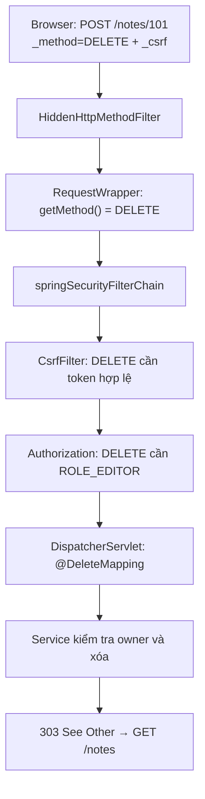

# HiddenHttpMethodFilter và phương thức thực sự được kiểm tra

Trong chương **CSRF và biểu mẫu** thuộc module `SPRING_SECURITY_HTTP_PROTECTION`, trình duyệt có thể gửi một biểu mẫu qua mạng bằng HTTP **POST**, nhưng Spring MVC lại chọn controller có `@DeleteMapping`, `@PutMapping` hoặc `@PatchMapping`. Điều này xảy ra khi **`HiddenHttpMethodFilter`** đọc hidden field `_method` và bọc request để các thành phần chạy sau nhìn thấy một **phương thức hiệu lực** (*effective HTTP method*) khác phương thức thực tế trên kết nối.

Đổi phương thức không chỉ ảnh hưởng đến routing. Trong Spring Security, nhiều quyết định dựa trên HTTP method: **CSRF**, authorization `requestMatchers(HttpMethod...)`, session/authentication và các request matchers tùy chỉnh. Nếu filter đổi phương thức chạy sau Spring Security, **security có thể phân quyền theo POST trong khi controller thực hiện DELETE**. Ngược lại, khi đặt trước security, cả bộ lọc bảo mật và MVC thấy cùng phương thức hiệu lực.

Bài đi sâu về thứ tự bộ lọc, mã mẫu trên **Spring MVC/Servlet**, kiểm thử MockMvc và cách làm tương ứng với **Spring WebFlux/Reactive**. CSRF là một lớp trong phạm vi bảo vệ HTTP/trình duyệt của module, bên cạnh CORS, security headers, CSP, HSTS, HTTP firewall và session protection; `_method` không thay thế các lớp này.

## 1. Mục tiêu

Sau bài học, người đọc có thể:

- Phân biệt **HTTP method trên dây** với method mà `HttpServletRequest.getMethod()` trả về sau `HiddenHttpMethodFilter`.
- Nêu điều kiện override: **request ban đầu là POST**, hidden parameter mặc định `_method` và những method được hỗ trợ **PUT, PATCH, DELETE**.
- Giải thích vì sao `_method` hoàn toàn khác `_csrf`: một trường đổi method để routing, trường kia là token bảo vệ request.
- Đặt filter trước Spring Security để CSRF matcher và authorization matcher nhìn đúng method hiệu lực.
- Chỉ ra vì sao đổi filter order thường **không tự bỏ qua CSRF mặc định**, nhưng vẫn có thể gây sai authorization hoặc sai custom CSRF matcher.
- Bật filter trong Spring Boot MVC, dùng Thymeleaf render form, bảo vệ DELETE bằng CSRF/role/owner và test MockMvc.
- Đánh giá riêng multipart upload khi cần đọc `_method`, kể cả đánh đổi parse body trước security.
- Nhận biết WebFlux dùng `org.springframework.web.filter.reactive.HiddenHttpMethodFilter` dạng `WebFilter` và thứ tự filter cũng quan trọng.

## 2. Vì sao cần method override?

HTML form truyền thống chỉ hỗ trợ `method="get"` và `method="post"`. Nhưng ứng dụng REST có thể dùng:

| HTTP method | Ngữ nghĩa phổ biến | Form HTML thuần gửi trực tiếp được? |
| --- | --- | --- |
| GET | Đọc dữ liệu; không thay đổi trạng thái | Có |
| POST | Tạo lệnh/tài nguyên hoặc xử lý nghiệp vụ | Có |
| PUT | Thay thế trạng thái tài nguyên | Không |
| PATCH | Chỉnh sửa một phần tài nguyên | Không |
| DELETE | Xóa tài nguyên | Không |

Muốn một nút **Xóa** HTML hoạt động với `@DeleteMapping("/notes/{id}")`, trình duyệt vẫn gửi POST nhưng thêm hidden field:

```html
<form action="/notes/101" method="post">
    <input type="hidden" name="_method" value="DELETE">
    <input type="hidden" name="_csrf" value="token-duoc-server-render">
    <button type="submit">Xóa ghi chú</button>
</form>
```

HTTP request **trên kết nối** có dạng:

```http
POST /notes/101 HTTP/1.1
Cookie: JSESSIONID=<cookie-phien>
Content-Type: application/x-www-form-urlencoded

_method=DELETE&_csrf=<token-csrf>
```

Proxy, CDN hoặc access log phía ngoài Spring vẫn có thể thấy POST. Sau khi HiddenHttpMethodFilter xử lý, `HttpServletRequestWrapper.getMethod()` trả **DELETE**, nên controller có thể match `@DeleteMapping`.

### 2.1. Filter thực hiện chính xác những gì?

Trên Servlet, `org.springframework.web.filter.HiddenHttpMethodFilter`:

1. Chỉ xem xét override nếu method ban đầu là **POST**.
2. Đọc `request.getParameter("_method")` từ request; tên parameter có thể đổi bằng `setMethodParam(...)`.
3. Chỉ chấp nhận override thành **PUT**, **PATCH** hoặc **DELETE**.
4. Dùng wrapper để thay đổi phương thức hiệu lực trả về từ `getMethod()`.
5. Chuyển request đã được bọc tới những bộ lọc và controller phía sau.

Điều này **không chuyển byte HTTP POST đã gửi thành DELETE thật** ở proxy. Nó cũng không làm GET có `?_method=DELETE` thành lệnh xóa, và không tự bật hỗ trợ `X-HTTP-Method-Override` header. Nếu không có filter, hidden field chỉ là dữ liệu form thông thường.

### 2.2. Đừng nhầm `_method` và `_csrf`

| Trường | Được dùng bởi | Ý nghĩa | Có phải bí mật? |
| --- | --- | --- | --- |
| `_method=DELETE` | `HiddenHttpMethodFilter` | Yêu cầu server diễn giải POST như DELETE | Không |
| `_csrf=<token>` | `CsrfFilter` + request handler/repository | Kiểm tra request thay đổi trạng thái có token hợp lệ | Cần tránh để lộ |
| `noteId` trong path/form | Controller/service | Chỉ ra tài nguyên cần thao tác | Không phải chứng cứ quyền sở hữu |
| Session cookie | Security/session infrastructure | Gắn request với trạng thái session/authentication | Nhạy cảm |

**Token CSRF không cấp quyền DELETE.** Ngay cả khi `_csrf` đúng, ứng dụng vẫn phải kiểm tra user có role hợp lệ và được phép xóa đúng tài nguyên được yêu cầu.

## 3. Phương thức nào được Spring Security kiểm tra?

Thứ tự khuyến nghị:



Nếu HiddenHttpMethodFilter chạy **sau** security:

```text
POST /notes/101, body: _method=DELETE, _csrf=...
       |
       v
Spring Security: getMethod() = POST
    - CSRF matcher thấy POST
    - Authorization matcher thấy POST
       |
       v
HiddenHttpMethodFilter: đổi POST thành DELETE
       |
       v
Spring MVC: @DeleteMapping("/{id}") được chọn
```

Đây là sai lệch giữa phương thức dùng để **phân quyền** và phương thức dùng để **thực thi nghiệp vụ**.

### 3.1. Sai lệch authorization có thể nguy hiểm

Xét một policy **cố tình cấu hình sai để minh họa**:

```java
// KHÔNG dùng cấu hình này cho production.
.authorizeHttpRequests(auth -> auth
    .requestMatchers(HttpMethod.DELETE, "/admin/notes/**")
        .hasRole("ADMIN")
    .requestMatchers(HttpMethod.POST, "/admin/notes/**")
        .permitAll()
    .anyRequest().authenticated())
```

Nếu Hidden chạy sau security, bộ lọc authorization thấy **POST** và chọn `permitAll()`, nhưng Spring MVC phía sau lại nhận **DELETE**. Khi đó rule dành riêng cho DELETE có thể bị bỏ qua.

**Phân biệt rõ:** `permitAll()` không tự tắt CSRF. Với CSRF mặc định, POST vẫn cần token hợp lệ. Một người có token của **chính phiên mình** không vì thế có role ADMIN, nhưng cấu hình lọt qua matcher POST có thể khiến quyền xóa bị kiểm tra sai. Đây là rủi ro **authorization mismatch**, không phải khẳng định filter mặc định bypass CSRF.

### 3.2. Mặc định CSRF vẫn yêu cầu token cho POST và DELETE

`CsrfFilter` mặc định xem các method không an toàn như **POST, PUT, PATCH, DELETE** là cần CSRF token. Vì thế:

| Thứ tự | CsrfFilter nhìn thấy | Có cần token theo mặc định? | Authorization nhìn thấy |
| --- | --- | --- | --- |
| Hidden trước Security | DELETE | Có | DELETE |
| Hidden sau Security | POST | Có | POST |

Với default CSRF matcher, cả hai trường hợp trên đều có CSRF protection. Vấn đề là **method-specific authorization**, các request matchers tùy biến và khả năng đồng nhất chính sách.

Không tự thay CSRF matcher thành “chỉ POST mới cần token”. Nếu Hidden chạy trước và đổi POST thành DELETE, một matcher chỉ kiểm tra POST có thể **bỏ sót lệnh DELETE** — đó là lỗi cấu hình CSRF của ứng dụng.

### 3.3. Method trên dây và method hiệu lực khác nhau ở đâu?

| Thành phần | Phương thức thường quan sát |
| --- | --- |
| Trình duyệt / Network tab | POST |
| Reverse proxy / gateway trước ứng dụng | POST |
| Servlet filter chạy trước Hidden | POST |
| Servlet filter chạy sau Hidden | DELETE |
| Spring Security đặt sau Hidden | DELETE |
| Spring MVC controller sau Hidden | DELETE |

Đừng tin rằng rule ở proxy “chặn mọi DELETE” sẽ tự bao phủ POST với `_method=DELETE`. Khi cần quản lý hành động xóa, **application authorization** phải biết method hiệu lực và resource cụ thể, không chỉ dựa vào giới hạn ở ingress.

## 4. Ví dụ Spring Boot MVC có kiểm tra quyền thực sự

Các ví dụ tương ứng với Spring Boot 3.x, Spring Framework 6.x, Spring Security 6.x và Java 17+, sử dụng dependency:

```groovy
implementation 'org.springframework.boot:spring-boot-starter-web'
implementation 'org.springframework.boot:spring-boot-starter-security'
implementation 'org.springframework.boot:spring-boot-starter-thymeleaf'
testImplementation 'org.springframework.boot:spring-boot-starter-test'
testImplementation 'org.springframework.security:spring-security-test'
```

### 4.1. Bật filter trong Boot

Trong `application.properties`:

```properties
spring.mvc.hiddenmethod.filter.enabled=true
```

Trên Spring Boot 3.x thông dụng, property này **mặc định false**. Nếu không bật, form POST có `_method=DELETE` sẽ vẫn là POST đối với handler mapping và thường trả 405 khi chỉ có `@DeleteMapping`.

Boot có auto-configuration và thứ tự filter riêng. Sau khi bật, **vẫn phải kiểm tra security thấy method hiệu lực** trong runtime và test; không cho rằng chỉ thay property là đã hoàn thành kiểm thử authorization.

### 4.2. SecurityFilterChain theo method hiệu lực

```java
import org.springframework.context.annotation.Bean;
import org.springframework.context.annotation.Configuration;
import org.springframework.http.HttpMethod;
import org.springframework.security.config.Customizer;
import org.springframework.security.config.annotation.web.builders.HttpSecurity;
import org.springframework.security.web.SecurityFilterChain;

@Configuration
public class NoteSecurityConfig {

    @Bean
    SecurityFilterChain securityFilterChain(HttpSecurity http)
            throws Exception {
        return http
                .authorizeHttpRequests(auth -> auth
                        .requestMatchers(HttpMethod.GET,
                                "/notes", "/notes/**").authenticated()
                        .requestMatchers(HttpMethod.DELETE,
                                "/notes/*").hasRole("EDITOR")
                        // Cố ý deny POST nhằm phát hiện sai thứ tự override.
                        .requestMatchers(HttpMethod.POST,
                                "/notes/**").denyAll()
                        .anyRequest().authenticated())
                .formLogin(Customizer.withDefaults())
                .csrf(Customizer.withDefaults())
                .build();
    }
}
```

Trong chain này, user đã đăng nhập có thể GET danh sách, nhưng DELETE từng ghi chú chỉ dành cho role `EDITOR`. Rule POST bị deny **để kiểm thử**: khi Hidden chạy sau security, security sẽ thấy POST và không chấp nhận dù controller có thể hỗ trợ DELETE.

Nếu ứng dụng còn tạo ghi chú bằng POST, không thể giữ matcher deny rộng như ví dụ. Hãy thiết kế endpoint cụ thể và phân quyền POST tương ứng, nhưng vẫn phải giữ bảo vệ DELETE chặt chẽ.

### 4.3. Service kiểm tra chủ sở hữu

Ví dụ lưu hai ghi chú trong RAM để minh họa, **không dùng như kho dữ liệu production**:

```java
import java.util.List;
import java.util.Map;
import java.util.concurrent.ConcurrentHashMap;
import org.springframework.http.HttpStatus;
import org.springframework.stereotype.Service;
import org.springframework.web.server.ResponseStatusException;

@Service
public class DemoNoteService {
    public record Note(long id, String owner, String label) {}

    private final Map<Long, Note> notes = new ConcurrentHashMap<>(
            Map.of(
                    101L, new Note(101L, "learner", "Ghi chú 101"),
                    102L, new Note(102L, "learner", "Ghi chú 102")
            ));

    public List<Note> forUser(String username) {
        return notes.values().stream()
                .filter(note -> note.owner().equals(username))
                .toList();
    }

    public void deleteOwned(long id, String username) {
        Note note = notes.get(id);
        if (note == null || !note.owner().equals(username)) {
            throw new ResponseStatusException(
                    HttpStatus.NOT_FOUND, "Không thấy ghi chú");
        }

        if (!notes.remove(id, note)) {
            throw new ResponseStatusException(
                    HttpStatus.CONFLICT, "Ghi chú đã thay đổi");
        }
    }
}
```

Trong hệ thống thật, kiểm tra role và owner phải kết hợp persistence/transaction/optimistic locking phù hợp, không lấy owner từ hidden input gửi lên. Trả 404 khi tài nguyên không thuộc sở hữu là một lựa chọn nhằm tránh tiết lộ thông tin; không phải behavior tự động của Spring Security.

### 4.4. Controller GET và DELETE

```java
import java.net.URI;
import java.security.Principal;
import org.springframework.http.HttpStatus;
import org.springframework.http.ResponseEntity;
import org.springframework.stereotype.Controller;
import org.springframework.ui.Model;
import org.springframework.web.bind.annotation.DeleteMapping;
import org.springframework.web.bind.annotation.GetMapping;
import org.springframework.web.bind.annotation.PathVariable;
import org.springframework.web.bind.annotation.RequestMapping;

@Controller
@RequestMapping("/notes")
public class NoteController {
    private final DemoNoteService service;

    public NoteController(DemoNoteService service) {
        this.service = service;
    }

    @GetMapping
    String list(Principal principal, Model model) {
        model.addAttribute("notes",
                service.forUser(principal.getName()));
        return "notes/list";
    }

    @DeleteMapping("/{id}")
    ResponseEntity<Void> delete(@PathVariable long id,
                                Principal principal) {
        service.deleteOwned(id, principal.getName());

        // 303 See Other buộc lần điều hướng tiếp theo là GET.
        return ResponseEntity.status(HttpStatus.SEE_OTHER)
                .location(URI.create("/notes"))
                .build();
    }
}
```

`@DeleteMapping` chỉ được chọn nếu `getMethod()` là DELETE ở điểm Spring MVC mapping. Sau thành công, **303 See Other** hướng về GET danh sách; trong ứng dụng có context path, cần tạo Location tương ứng thay vì hardcode `/notes`.

### 4.5. Thymeleaf có hai hidden field với vai trò khác nhau

Template `src/main/resources/templates/notes/list.html`:

```html
<!doctype html>
<html lang="vi" xmlns:th="http://www.thymeleaf.org">
<head>
    <meta charset="utf-8">
    <title>Quản lý ghi chú</title>
</head>
<body>
    <h1>Ghi chú của bạn</h1>
    <ul>
        <li th:each="note : ${notes}">
            <span th:text="${note.label()}"></span>
            <form method="post"
                  th:action="@{/notes/{id}(id=${note.id()})}">
                <input type="hidden"
                       name="_method"
                       value="DELETE">
                <button type="submit">Xóa ghi chú</button>
            </form>
        </li>
    </ul>
</body>
</html>
```

Với Thymeleaf/Spring Security tích hợp đúng, `th:action` có thể khiến `CsrfRequestDataValueProcessor` tự thêm hidden CSRF input cho form POST. HTML thực tế cần có đủ:

```html
<form method="post" action="/notes/101">
    <input type="hidden" name="_method" value="DELETE">
    <button type="submit">Xóa ghi chú</button>
    <input type="hidden" name="_csrf" value="token-do-server-render">
</form>
```

`_method` **không phải bí mật**; nó yêu cầu đổi method. `_csrf` là token được cung cấp bởi Spring Security, **không hardcode**. Kiểm tra HTML **đã render**, không chỉ mã Thymeleaf. Giá trị token có thể được mask theo cơ chế chống BREACH; hai lần GET có thể cho chuỗi token khác dù repository giữ cùng giá trị kỳ vọng.

### 4.6. Đường đi sau khi nhấn Xóa

```text
POST /notes/101
Body: _method=DELETE&_csrf=TOKEN
      |
      v
HiddenHttpMethodFilter -> getMethod() = DELETE
      |
      v
CsrfFilter -> DELETE cần token -> hợp lệ
      |
      v
Authorization -> DELETE /notes/101 cần ROLE_EDITOR
      |
      v
NoteController @DeleteMapping("/{id}")
      |
      v
DemoNoteService kiểm tra owner và xóa
      |
      v
303 See Other, Location: /notes
      |
      v
Browser GET /notes
```

**Ba điều kiện độc lập:** request có CSRF token đúng, user có role cần thiết và user sở hữu ghi chú. Không có điều kiện nào được thay thế bởi hidden `_method`.


## 5. Kiểm soát thứ tự filter trong Spring Boot

### 5.1. Bật bằng property là lựa chọn đơn giản

Với Spring Boot MVC, `spring.mvc.hiddenmethod.filter.enabled=true` bật tính năng trong cấu hình phù hợp. Tuy nhiên, trong ứng dụng thực tế có thể có:

- Một `FilterRegistrationBean` riêng do team viết.
- `DelegatingFilterProxy` của Spring Security được đặt thứ tự khác mặc định.
- Middleware ghi log/caching body, multipart parsing hoặc filter của thư viện bên thứ ba.
- Hệ thống được đóng gói WAR và tự đăng ký filters trong servlet container.

Vì vậy, cần kiểm tra **thứ tự ở runtime**. Chỉ nhìn thấy bean HiddenHttpMethodFilter trong application context chưa đủ để kết luận rằng security đã đánh giá **DELETE**.

### 5.2. Cách đăng ký thủ công thay cho auto-configuration

Khi cần kiểm soát thứ tự, sử dụng `FilterRegistrationBean`. **Chỉ chọn cách này thay cho property tự động**; ví dụ để `spring.mvc.hiddenmethod.filter.enabled=false` để không có hai filter cùng chức năng:

```java
import org.springframework.boot.autoconfigure.security.SecurityProperties;
import org.springframework.boot.web.servlet.FilterRegistrationBean;
import org.springframework.context.annotation.Bean;
import org.springframework.context.annotation.Configuration;
import org.springframework.web.filter.HiddenHttpMethodFilter;

@Configuration
public class HiddenMethodFilterConfig {

    @Bean
    FilterRegistrationBean<HiddenHttpMethodFilter> hiddenBeforeSecurity() {
        FilterRegistrationBean<HiddenHttpMethodFilter> registration =
                new FilterRegistrationBean<>(new HiddenHttpMethodFilter());

        registration.setName("hiddenHttpMethodBeforeSecurity");
        registration.addUrlPatterns("/*");
        registration.setOrder(
                SecurityProperties.DEFAULT_FILTER_ORDER - 1);
        return registration;
    }
}
```

Ví dụ tính order từ `SecurityProperties.DEFAULT_FILTER_ORDER` **chỉ khi Spring Security đang dùng order mặc định tương ứng**. Nếu hệ thống chỉnh order filter hoặc chứa nhiều servlet registrations, hãy xác minh thứ tự chứ không phụ thuộc vào công thức. Bật property và đăng ký thủ công đồng thời có thể gây xử lý trùng hoặc làm khó chẩn đoán.

### 5.3. HiddenHttpMethodFilter khác FormContentFilter

| Thành phần | Công việc chính |
| --- | --- |
| `HiddenHttpMethodFilter` | Đọc `_method` trong POST rồi bọc request để `getMethod()` trả PUT/PATCH/DELETE. |
| `FormContentFilter` | Expose parameters từ `application/x-www-form-urlencoded` body của request PUT/PATCH/DELETE vào Servlet API. |
| `CsrfFilter` | Đọc và xác minh CSRF token theo request matcher; không tự đổi HTTP method. |
| `AuthorizationFilter` | Kiểm tra quyền của request được security quan sát. |
| `DispatcherServlet` | Chọn handler/controller theo phương thức và đường dẫn ở thời điểm MVC routing. |

`spring.mvc.formcontent.filter.enabled=true` không phải cách thay thế `spring.mvc.hiddenmethod.filter.enabled=true`. Với form POST có hidden `_method`, phương thức đổi là việc của Hidden; với client thực sự gửi PUT/PATCH form-urlencoded, FormContentFilter có vai trò khác.

### 5.4. Servlet initializer truyền thống

Trong ứng dụng Servlet không dùng Spring Boot auto-registration, có thể đăng ký `HiddenHttpMethodFilter` trước `springSecurityFilterChain` qua cấu hình `web.xml` hoặc `AbstractSecurityWebApplicationInitializer`. Ví dụ về ý tưởng thứ tự:

```text
<filter-mapping> HiddenHttpMethodFilter </filter-mapping>
<filter-mapping> springSecurityFilterChain </filter-mapping>
<servlet-mapping> DispatcherServlet </servlet-mapping>
```

Thứ tự filter mappings và các điều kiện dispatcher types/url patterns phải được thiết lập đúng. Đây là minh họa vị trí, **không phải đoạn `web.xml` hoàn chỉnh**. Với Boot, ưu tiên cơ chế cấu hình Boot và test ứng dụng thật thay vì thêm initializer riêng.

## 6. CSRF matcher tùy biến có thể tạo lỗi nghiêm trọng

### 6.1. Matcher chỉ kiểm tra POST là sai nếu có method override

Một cấu hình có vẻ hợp lý nhưng nguy hiểm:

```java
// KHÔNG ÁP DỤNG: chỉ để minh họa sai lầm.
.csrf(csrf -> csrf.requireCsrfProtectionMatcher(request ->
        "POST".equalsIgnoreCase(request.getMethod())))
```

Khi `HiddenHttpMethodFilter` chạy trước Security và đổi POST thành DELETE, matcher này chỉ thấy `DELETE` nên **không đòi CSRF token**. Lệnh xóa có thể bị bỏ khỏi bảo vệ CSRF của ứng dụng.

Đây là hậu quả của **custom matcher thiếu các unsafe methods**, không phải hành vi mặc định Spring Security. Cách sửa tốt nhất là giữ matcher CSRF mặc định nếu không có yêu cầu đặc biệt. Nếu buộc phải tùy chỉnh, phải nghĩ đến POST, PUT, PATCH, DELETE và các method không an toàn khác theo HTTP semantics, đồng thời kiểm thử cả phương thức sau override.

### 6.2. Không dùng hidden `_method` làm bằng chứng quyền truy cập

Một request có `_method=DELETE` hoàn toàn do client tạo. Ứng dụng chỉ nên hiểu nó như chỉ dẫn cách định tuyến; role và ownership vẫn phải lấy từ principal/policy và database.

Nếu security chỉ chặn native DELETE ở proxy nhưng lại cho phép POST đi qua, browser form có thể đi theo đường POST, sau đó đổi thành DELETE trong ứng dụng. **Đừng dùng kiểm tra ở proxy thay cho authorization ở tầng ứng dụng.** Gateway và ứng dụng cần chia sẻ threat model rõ ràng về method override.

### 6.3. Lỗi 403 không phải lúc nào cũng là CSRF

Với security chain ở mục 4:

- POST thiếu `_csrf` thường bị `CsrfFilter` từ chối 403.
- POST có CSRF đúng nhưng user role VIEWER có thể bị `AuthorizationFilter` từ chối 403.
- POST có CSRF đúng và role EDITOR nhưng service thấy owner không khớp có thể trả 404.
- POST có CSRF đúng nhưng Hidden chưa chạy trước Security có thể trúng rule `POST denyAll`, dẫn đến 403 do authorization.

Để chẩn đoán đúng, cần biết **filter nào trả lỗi và phương thức mà filter đó nhìn thấy**, không suy từ status đơn lẻ.

## 7. PUT và PATCH qua form: vẫn là POST trên dây

`HiddenHttpMethodFilter` hỗ trợ cả PUT và PATCH từ POST form:

| Nội dung form | Effective method | MVC mapping | Điều kiện bảo vệ |
| --- | --- | --- | --- |
| POST không có `_method` | POST | `@PostMapping` | CSRF + quyền POST |
| POST với `_method=PUT` | PUT | `@PutMapping` | CSRF + quyền PUT |
| POST với `_method=PATCH` | PATCH | `@PatchMapping` | CSRF + quyền PATCH |
| POST với `_method=DELETE` | DELETE | `@DeleteMapping` | CSRF + quyền DELETE |
| GET với `?_method=DELETE` | GET | `@GetMapping` nếu có | GET chỉ được đọc, không dùng để xóa |

Ví dụ nâng cao, nếu đã bổ sung method `renameOwned` trong service và rule PATCH cho EDITOR:

```java
@PatchMapping("/{id}")
ResponseEntity<Void> rename(@PathVariable long id,
                            @RequestParam String label,
                            Principal principal) {
    service.renameOwned(id, principal.getName(), label);
    return ResponseEntity.status(HttpStatus.SEE_OTHER)
            .location(URI.create("/notes"))
            .build();
}
```

Form tương ứng:

```html
<form method="post" action="/notes/101">
    <input type="hidden" name="_method" value="PATCH">
    <input type="text" name="label" value="Nhãn mới">
    <input type="hidden" name="_csrf" value="token-cua-phien-hien-tai">
    <button type="submit">Đổi nhãn</button>
</form>
```

**Đây là ví dụ mở rộng, chưa chạy nguyên vẹn với DemoNoteService ban đầu.** Cần triển khai `renameOwned` và bổ sung authorization matcher `HttpMethod.PATCH` (và tương tự cho PUT) theo nghiệp vụ. Không để endpoint PATCH rơi vào `anyRequest().authenticated()` nếu nó đòi role cụ thể.

### 7.1. Nếu client dùng JavaScript thì không cần `_method`

Một client có thể gửi native HTTP DELETE:

```javascript
const response = await fetch("/notes/101", {
    method: "DELETE",
    credentials: "same-origin",
    headers: {
        "X-CSRF-TOKEN": csrfTokenFromCurrentPage
    }
});
```

Ở đây proxy, security và controller thường đều nhìn thấy DELETE ngay từ đầu, không cần HiddenHttpMethodFilter. Nhưng token phải phù hợp CSRF request handler (đặc biệt nếu ứng dụng tùy chỉnh repository/cookie handler); user vẫn phải được phân quyền và sở hữu tài nguyên.

Nếu frontend chạy khác origin, DELETE với header tùy chỉnh thường kích hoạt **CORS preflight OPTIONS**. CORS khác CSRF, không tắt CSRF chỉ vì preflight bị chặn. HTTP method override qua form POST có thể phù hợp cho progressive enhancement, nhưng không phải yêu cầu của mọi API REST.

## 8. Trường hợp đặc biệt: multipart form có `_method`

Khi POST vừa upload file bằng `multipart/form-data` vừa chứa `_method=PATCH`, filter chuyển phương thức có thể phải **đọc multipart body** trước khi nhận được parameter. Spring Framework lưu ý: `HiddenHttpMethodFilter` trên Servlet cần chạy **sau multipart parsing** nếu method parameter nằm trong multipart body.

Thứ tự cho body-only form:

```text
POST multipart, parts:
  _method=PATCH
  _csrf=TOKEN
  document=<file>
        |
        v
MultipartFilter
  - parse body, có thể tạo temporary file
        |
        v
HiddenHttpMethodFilter
  - getParameter("_method") -> PATCH
        |
        v
springSecurityFilterChain
  - CSRF với method PATCH
  - authorization với method PATCH
        |
        v
DispatcherServlet @PatchMapping
```

Tuy nhiên **file tạm có thể được tạo trước khi CSRF và authorization chạy**, khiến request chưa hợp lệ vẫn tiêu thụ RAM/disk/CPU. Cần giới hạn kích thước file/request, số parts, request concurrency, TTL, dung lượng thư mục tạm và dọn file khi xảy ra lỗi.

### 8.1. Vì sao thêm CSRF header chưa giải quyết hết?

CSRF header giúp `CsrfFilter` đọc token **không cần parse multipart body chỉ để tìm `_csrf`**. Nhưng nếu ứng dụng vẫn muốn `HiddenHttpMethodFilter` đổi method **dựa trên `_method` nằm trong multipart body**, Hidden vẫn cần truy cập parameter đó trước security. Vì vậy, yêu cầu parse sớm có thể **vẫn tồn tại**.

Các lựa chọn thay thế:

- Dùng JavaScript gửi **PATCH/PUT/DELETE thật**, không cần `_method`; đính CSRF trong header nếu dùng cookie session.
- Tách POST upload file khỏi thao tác PATCH/DELETE metadata để kiểm soát từng request rõ hơn.
- Nếu phải hỗ trợ form HTML thuần, đặt MultipartFilter trước Hidden và Security, đồng thời bảo vệ tài nguyên tạm bằng quota/rate/limits.

Không dùng query URL chứa **CSRF token** như cách mặc định để né multipart parsing: token trong URL có thể rò qua proxy/access log/tracing. `_method` không phải secret, nhưng mọi request vẫn cần chính sách phân quyền đúng theo method hiệu lực.

### 8.2. Ví dụ giới hạn upload của Servlet

```properties
spring.servlet.multipart.enabled=true
spring.servlet.multipart.max-file-size=5MB
spring.servlet.multipart.max-request-size=6MB
```

Các giá trị là minh họa. Một 403 CSRF không chứng minh không có file tạm nếu multipart parser chạy trước bộ lọc bảo mật.

## 9. Kiểm thử MockMvc đúng với HTML form POST

Bài test cần mô phỏng **POST có `_method=DELETE`**, không chỉ gọi trực tiếp `MockMvcRequestBuilders.delete(...)`. Nó cũng cần phân biệt CSRF và authorization.

Ví dụ dùng các lớp ở mục 4; giả định ghi chú 101 và 102 thuộc owner `learner`:

```java
import static org.hamcrest.Matchers.containsString;
import static org.springframework.security.test.web.servlet.request.SecurityMockMvcRequestPostProcessors.csrf;
import static org.springframework.security.test.web.servlet.request.SecurityMockMvcRequestPostProcessors.user;
import static org.springframework.test.web.servlet.request.MockMvcRequestBuilders.get;
import static org.springframework.test.web.servlet.request.MockMvcRequestBuilders.post;
import static org.springframework.test.web.servlet.result.MockMvcResultMatchers.*;

import org.junit.jupiter.api.Test;
import org.springframework.beans.factory.annotation.Autowired;
import org.springframework.boot.test.autoconfigure.web.servlet.AutoConfigureMockMvc;
import org.springframework.boot.test.context.SpringBootTest;
import org.springframework.test.web.servlet.MockMvc;

@SpringBootTest(properties = {
        "spring.mvc.hiddenmethod.filter.enabled=true"
})
@AutoConfigureMockMvc
class HiddenMethodCsrfTests {

    @Autowired
    MockMvc mvc;

    @Test
    void htmlFormContainsMethodOverrideAndCsrf() throws Exception {
        mvc.perform(get("/notes")
                        .with(user("learner").roles("EDITOR")))
                .andExpect(status().isOk())
                .andExpect(content().string(
                        containsString("name=\"_method\"")))
                .andExpect(content().string(
                        containsString("name=\"_csrf\"")));
    }

    @Test
    void missingCsrfIs403() throws Exception {
        mvc.perform(post("/notes/102")
                        .param("_method", "DELETE")
                        .with(user("learner").roles("EDITOR")))
                .andExpect(status().isForbidden());
    }

    @Test
    void invalidCsrfIs403() throws Exception {
        mvc.perform(post("/notes/102")
                        .param("_method", "DELETE")
                        .with(user("learner").roles("EDITOR"))
                        .with(csrf().useInvalidToken()))
                .andExpect(status().isForbidden());
    }

    @Test
    void viewerCannotDeleteDespiteValidCsrf() throws Exception {
        mvc.perform(post("/notes/102")
                        .param("_method", "DELETE")
                        .with(user("viewer").roles("VIEWER"))
                        .with(csrf()))
                .andExpect(status().isForbidden());
    }

    @Test
    void editorDeletesOwnedNoteViaPostOverride() throws Exception {
        mvc.perform(post("/notes/101")
                        .param("_method", "DELETE")
                        .with(user("learner").roles("EDITOR"))
                        .with(csrf()))
                .andExpect(status().isSeeOther())
                .andExpect(header().string("Location", "/notes"));
    }
}
```

Ý nghĩa:

- `post()` mô phỏng phương thức thật của HTML form; `.param("_method", "DELETE")` mô phỏng hidden parameter.
- `.with(csrf())` đưa CSRF token hợp lệ vào request test, **không chứng minh template đã render token**, vì thế cần test GET riêng.
- User VIEWER có token đúng mà vẫn phải nhận 403 authorization.
- User EDITOR thành công chỉ khi method được chuyển đủ sớm và rule DELETE được áp dụng đúng theo setup này.
- Test thành công xóa ghi chú 101, các test còn lại dùng ghi chú 102 nhằm giảm phụ thuộc vào thứ tự chạy của tests.

### 9.1. GET không được biến thành DELETE

Method bổ sung vào test class:

```java
@Test
void getQueryWithMethodOverrideStillStaysGet() throws Exception {
    mvc.perform(get("/notes")
                    .param("_method", "DELETE")
                    .with(user("learner").roles("EDITOR")))
            .andExpect(status().isOk());
}
```

HiddenHttpMethodFilter mặc định chỉ override POST. Nhưng ứng dụng **vẫn phải tránh mọi side effect trong GET**: không dùng link GET để xóa, dù có hoặc không có `_method`.

### 9.2. Kiểm thử khi filter tắt hoặc đặt sai thứ tự

Trong môi trường test riêng:

1. Tắt `spring.mvc.hiddenmethod.filter.enabled`, thực hiện POST `_method=DELETE`; security/MVC sẽ nhìn POST nếu không có filter khác.
2. Bật filter nhưng cố ý đăng ký **sau** security; quan sát security chọn rule POST còn MVC chọn `@DeleteMapping`.
3. Trả filter về vị trí đúng trước security; xác minh rule DELETE áp dụng cho role EDITOR.
4. Đặt custom CSRF matcher chỉ kiểm tra POST trong môi trường test, thử request bị override DELETE; chứng minh đó là cấu hình có thể bỏ sót CSRF.
5. Khôi phục default CSRF và filter order đúng. Không đưa cấu hình test lỗi lên production.

Một `MockMvc` tự dựng bằng `standaloneSetup` có thể thiếu filters. Nếu chỉ dùng `@WebMvcTest` hoặc cấu hình mock riêng, phải đảm bảo HiddenHttpMethodFilter, security chain và các filter cần thiết thực sự có mặt. **Test native `delete("/notes/101")` không thay thế test POST body `_method=DELETE`.**

### 9.3. Kiểm thử embedded servlet container

Nên bổ sung integration test với browser hoặc HTTP client thực:

- Xác minh browser Network gửi POST và form body chứa `_method=DELETE` cùng CSRF token.
- Xác minh proxy/server log nhận POST thật; ở điểm security sau Hidden, method hiệu lực là DELETE.
- Bỏ CSRF: request bị từ chối mặc định 403.
- User VIEWER với CSRF hợp lệ: bị từ chối quyền.
- User EDITOR với CSRF hợp lệ: xóa thành công và trả 303.
- Không có Hidden: method không đổi, có thể bị 403 ở POST deny hoặc 405 tại MVC tùy policy.
- Kiểm tra request GET, PATCH, PUT và multipart riêng.
- Không ghi `_csrf`, cookie phiên hoặc nội dung form nhạy cảm vào log điều tra.


## 10. WebFlux/Reactive: method override là một WebFilter khác

Trên WebFlux, lớp cần dùng là **`org.springframework.web.filter.reactive.HiddenHttpMethodFilter`** — một `WebFilter`. Nó không phải Servlet `OncePerRequestFilter`. Khi nhận POST form data có `_method`, filter Reactive thay đổi request qua `ServerWebExchange.mutate()` để thành phần phía sau nhìn thấy method hiệu lực.

Spring Security WebFlux sử dụng `SecurityWebFilterChain`, `CsrfWebFilter` và repository mặc định gắn với `WebSession`. Khác nhau về API nhưng **nguyên tắc nhất quán**: một policy `pathMatchers(HttpMethod.DELETE, ...)` phải nhìn thấy DELETE nếu controller sẽ nhận DELETE.

### 10.1. SecurityWebFilterChain với DELETE role

```java
import org.springframework.context.annotation.Bean;
import org.springframework.context.annotation.Configuration;
import org.springframework.http.HttpMethod;
import org.springframework.security.config.Customizer;
import org.springframework.security.config.web.server.ServerHttpSecurity;
import org.springframework.security.web.server.SecurityWebFilterChain;

@Configuration
public class ReactiveNoteSecurityConfig {

    @Bean
    SecurityWebFilterChain securityWebFilterChain(ServerHttpSecurity http) {
        return http
                .authorizeExchange(auth -> auth
                        .pathMatchers(HttpMethod.DELETE, "/notes/**")
                            .hasRole("EDITOR")
                        .pathMatchers(HttpMethod.GET,
                                "/notes", "/notes/**")
                            .authenticated()
                        .anyExchange().authenticated())
                .formLogin(Customizer.withDefaults())
                .csrf(Customizer.withDefaults())
                .build();
    }
}
```

Đây là cấu hình **cho ứng dụng WebFlux riêng**. Không ghép trực tiếp `SecurityWebFilterChain` với `HttpSecurity` Servlet trong cùng một ví dụ rồi kỳ vọng hai hệ thống filter hoạt động giống nhau.

### 10.2. Đăng ký Reactive HiddenHttpMethodFilter

Với WebFlux, có thể đăng ký `WebFilter` bằng bean và dùng `@Order` để quyết định thứ tự:

```java
import org.springframework.context.annotation.Bean;
import org.springframework.context.annotation.Configuration;
import org.springframework.core.Ordered;
import org.springframework.core.annotation.Order;
import org.springframework.web.filter.reactive.HiddenHttpMethodFilter;
import org.springframework.web.server.WebFilter;

@Configuration
public class ReactiveHiddenMethodConfig {

    @Bean
    @Order(Ordered.HIGHEST_PRECEDENCE)
    WebFilter hiddenHttpMethodWebFilter() {
        return new HiddenHttpMethodFilter();
    }
}
```

Ví dụ đặt độ ưu tiên rất sớm; khi tích hợp ứng dụng thật, hãy xác minh **filter này được gọi trước Spring Security WebFilterChainProxy** và không có WebFilter khác cùng chức năng đăng ký trùng. Không lấy property `spring.mvc.hiddenmethod.filter.enabled` hoặc `FilterRegistrationBean` của Servlet làm cấu hình cho Reactive.

### 10.3. Phân tích form body và giới hạn tài nguyên

Trên WebFlux, HiddenHttpMethodFilter cần đọc form data của POST. Phương thức `getFormData()` làm việc với body form URL-encoded, nên có thể có công việc parse trước một số bước security nếu Hidden đứng sớm. Cần lưu ý giới hạn form data, body size, codec memory và ingress rate/size limit.

Không mặc định `getFormData()` giống với `getMultipartData()`. Nếu `_method` nằm **trong một multipart body**, phải kiểm thử cách filter và decoder thực tế cung cấp parameter, không sao chép giả định của Servlet.

Trong Reactive CSRF, `ServerCsrfTokenRequestAttributeHandler.setTokenFromMultipartDataEnabled(true)` chỉ ảnh hưởng **khả năng lấy CSRF token từ multipart body**, không phải cơ chế đổi phương thức. Với `fetch` gửi native DELETE và CSRF header, có thể tránh cả hai nhu cầu body-only đó.

### 10.4. Bộ kiểm thử WebTestClient cần bao phủ gì?

Nếu dùng `spring-security-test`, request POST form URL-encoded có thể được tạo bằng WebTestClient:

```java
import static org.springframework.security.test.web.reactive.server
        .SecurityMockServerConfigurers.csrf;

import org.springframework.http.MediaType;
import org.springframework.util.LinkedMultiValueMap;
import org.springframework.util.MultiValueMap;

// Giả sử WebTestClient đã được tích hợp Security + Hidden WebFilter
// và user ROLE_EDITOR đã được thiết lập bằng test support.
MultiValueMap<String, String> body = new LinkedMultiValueMap<>();
body.add("_method", "DELETE");

webTestClient.mutateWith(csrf())
        .post()
        .uri("/notes/101")
        .contentType(MediaType.APPLICATION_FORM_URLENCODED)
        .bodyValue(body)
        .exchange();
```

Đây là khung yêu cầu test, **chưa phải một test tự chạy**: cần Reactive controller, mock user, assertions status và side effects. Bộ test đầy đủ phải xác minh:

- POST `_method=DELETE` có CSRF hợp lệ, user ROLE_EDITOR được router nhận thành DELETE.
- Thiếu hoặc sai CSRF token bị từ chối mặc định 403.
- Có CSRF token đúng nhưng ROLE_VIEWER không được xóa.
- GET chứa query `_method=DELETE` không thành DELETE.
- Request native DELETE cũng phải được CSRF/authorization bảo vệ.
- Khi filter bị tắt hoặc order sai, method-specific rule không được áp dụng theo ý muốn.

Nếu test chỉ gọi `webTestClient.delete()`, bạn **chưa kiểm thử** cơ chế override của POST HTML form.

## 11. Các xung đột bảo mật thường gặp

### 11.1. 403 có thể đến từ CSRF hoặc authorization

| Dấu hiệu | Thành phần có thể từ chối | Cách xác minh |
| --- | --- | --- |
| POST `_method=DELETE` không có `_csrf` | `CsrfFilter` | Kiểm tra form đã render và request payload, token repository. |
| Token đúng nhưng user chỉ có ROLE_VIEWER | Authorization | Kiểm tra principal, rule `HttpMethod.DELETE` và method hiệu lực. |
| Token đúng, user ROLE_EDITOR nhưng không sở hữu tài nguyên | Service/business authorization | Kiểm tra owner và thông báo 404/403 tùy thiết kế. |
| Token đúng nhưng form vẫn 403 khi `POST denyAll` | Authorization thấy POST vì filter chưa đổi hoặc sai order | Xác minh HiddenHttpMethodFilter đã được gọi trước security. |
| POST `_method=DELETE` trả 405 | Chưa bật Hidden hoặc không có `@DeleteMapping` | Kiểm tra Boot property, handler mapping và filter registration. |
| POST `_method=PATCH` trả 405 | Chưa có controller PATCH, Content-Type khác hoặc override thất bại | Kiểm tra endpoint, body form URL-encoded và `_method`. |
| POST sau logout/session timeout trả 403 hoặc redirect login | CSRF token hoặc authentication đã thay đổi | Render lại form/token và xác thực trước khi thao tác. |
| API JavaScript DELETE trả lỗi CORS | Preflight/origin/credentials | Kiểm tra OPTIONS, CORS allowlist và cookie; không tắt CSRF. |

### 11.2. Kiểm tra lại HTTP firewall và reverse proxy

Reverse proxy, WAF hoặc HTTP firewall có thể được đặt trước bộ lọc method override. Vì vậy chúng có thể nhìn thấy **POST**, không phải DELETE, và không tự hiểu hidden `_method`.

Trong các hệ thống có quy định đặc biệt cho DELETE, không dựa riêng vào rule proxy “deny DELETE” để bảo vệ tài nguyên. Áp dụng authorization tại nơi biết **phương thức hiệu lực**, resource ID và principal hiện tại.

Nếu cần audit, ghi phương thức ở **tầng được kiểm chứng**:

```text
requestId=abc
transportMethod=POST
effectiveMethod=DELETE
route=/notes/{id}
principal=learner
decision=ROLE_EDITOR_REQUIRED
```

Không lấy mỗi giá trị `_method` do client gửi rồi coi đó là action đã thực hiện. Không log CSRF token, session cookie, body form nhạy cảm hoặc thông tin cá nhân không cần thiết.

### 11.3. Logout/login, session và bfcache

Form HTML cũ có thể còn trên màn hình sau khi session hết hạn hoặc user logout/login ở tab khác. Khi nhấn nút xóa, request mang `_method=DELETE` và CSRF token cũ có thể bị từ chối.

Đổi phương thức **không khôi phục session và không cấp token mới**. Hãy GET trang hiện hành sau khi xác thực, dùng token mới đúng phiên và kiểm tra trạng thái tài nguyên trước khi gửi lại. Với hành động xóa, không tự động retry khi không xác định được server đã thực hiện hay chưa; use case cần xem lại trạng thái hoặc idempotency phù hợp.

### 11.4. CORS preflight không phải HiddenHttpMethodFilter

OPTIONS preflight không bị HiddenHttpMethodFilter chuyển đổi vì filter chỉ xử lý POST. Khi client dùng JavaScript gửi native DELETE/PUT/PATCH với CSRF header, trình duyệt có thể gửi OPTIONS trước nếu khác origin.

CORS và CSRF có chức năng khác nhau: cấu hình origin/headers/credentials chính xác, cho phép preflight theo yêu cầu triển khai, không biến GET thành thao tác ghi và không tắt CSRF để bỏ qua lỗi CORS.

### 11.5. Đừng dùng form `method="delete"`

HTML không chuẩn hóa `delete` như một giá trị của thuộc tính `method`. Cách tích hợp đã được Spring hỗ trợ là:

```html
<form method="post" action="/notes/101">
    <input type="hidden" name="_method" value="DELETE">
    <input type="hidden" name="_csrf" value="token-hien-tai">
    <button type="submit">Xóa</button>
</form>
```

Hoặc dùng JavaScript `fetch` gửi DELETE thật. Không phụ thuộc vào cách một trình duyệt cụ thể xử lý giá trị `method` không hợp lệ.

## 12. Checklist trước khi triển khai production

- [ ] Đã xác định chính xác endpoint nào dùng POST form và `_method`, endpoint nào nhận native DELETE/PATCH/PUT.
- [ ] `HiddenHttpMethodFilter` được bật ở stack đang chạy; không đăng ký trùng qua property, bean, FilterRegistrationBean hoặc initializer.
- [ ] Filter đổi method chạy **trước Spring Security**, và thứ tự thực đã được kiểm chứng bằng integration test.
- [ ] Request matchers trong security phân quyền theo **method hiệu lực**, không có fallback POST quá rộng.
- [ ] CSRF được giữ mặc định hoặc custom matcher bao phủ đủ unsafe methods; test POST, PUT, PATCH và DELETE.
- [ ] Form server-rendered có cả `_method` lẫn CSRF token, không hardcode CSRF token trong template hoặc URL.
- [ ] Service kiểm tra owner/tài nguyên, dữ liệu đầu vào và quyền, không chỉ role dựa trên path.
- [ ] GET không gây thay đổi trạng thái; sau DELETE/PATCH có xử lý redirect/response giúp tránh gửi lặp không chủ ý.
- [ ] Với multipart body chứa `_method`, đã cân nhắc MultipartFilter và giới hạn dung lượng, parts, rate/concurrency cùng cleanup file tạm.
- [ ] Với WebFlux, dùng `WebFilter` Reactive thay vì Servlet filter, xác minh order và body decoding.
- [ ] Có đủ test thiếu CSRF, token sai, token đúng nhưng role thiếu, user không sở hữu tài nguyên, filter tắt và filter order sai.
- [ ] Logs và tracing chỉ ghi dữ liệu chẩn đoán cần thiết, không ghi token hoặc cookie phiên.

## 13. Bài thực hành tổng hợp

**Bối cảnh:** Một ứng dụng quản lý tài liệu có nút “Xóa” bằng HTML form POST. Controller dùng `@DeleteMapping("/documents/{id}")`, security policy chỉ cho ROLE_EDITOR xóa, nhưng nhóm phát triển gặp lúc thì HTTP 405, lúc thì 403 dù token hợp lệ.

Thực hiện:

1. Vẽ chuỗi HTTP POST → HiddenHttpMethodFilter → Spring Security → DispatcherServlet. Ghi rõ POST **trên dây** và DELETE **hiệu lực**.
2. Bật `spring.mvc.hiddenmethod.filter.enabled=true` và tạo form Thymeleaf `method="post"` với hai hidden field `_method=DELETE` và CSRF.
3. Cấu hình rule DELETE cần ROLE_EDITOR, rule POST tương ứng bị deny trong bản demo. Xác minh user EDITOR có token đúng sẽ xóa được tài nguyên thuộc sở hữu.
4. Xác minh user VIEWER có token đúng vẫn bị từ chối. Giải thích tại sao đây là authorization, không phải CSRF.
5. Gỡ hoặc tắt Hidden trong môi trường test, quan sát security/controller nhìn POST và lỗi phát sinh.
6. Đặt Hidden sau security trong môi trường thử nghiệm cô lập; quan sát mismatch giữa security thấy POST và MVC thấy DELETE, rồi trả filter đúng thứ tự.
7. Thử custom CSRF matcher chỉ kiểm tra POST và mô tả tình huống bị bỏ sót DELETE sau override. Khôi phục matcher mặc định ngay sau test.
8. Thêm PATCH hoặc PUT khi có endpoint và role phù hợp, kiểm chứng method override không mở rộng quyền ngoài dự định.
9. Tạo một form multipart có `_method` và xác định trade-off khi cần parse multipart trước Hidden và security.
10. Với WebFlux, dùng Reactive HiddenHttpMethodFilter và WebTestClient để thử POST form URL-encoded có `_method=DELETE`.
11. Ghi tài liệu chẩn đoán: 403 từ CSRF hay authorization, 405 do routing, session đã hết hạn, CORS preflight và trường hợp owner khác.

**Đạt yêu cầu** khi người học có thể giải thích **phương thức thực sự được kiểm tra bởi security**, không đánh đồng `_method` với CSRF, thiết lập đúng filter order và kiểm thử được bảo vệ PUT/PATCH/DELETE cả ở Servlet lẫn Reactive.

## Tài liệu tham khảo

- [Spring Security — CSRF Servlet](https://docs.spring.io/spring-security/reference/servlet/exploits/csrf.html): CSRF filter, request handler và HiddenHttpMethodFilter trong Servlet.
- [Spring Security — CSRF Features, HiddenHttpMethodFilter](https://docs.spring.io/spring-security/reference/features/exploits/csrf.html): ví dụ hidden `_method` và khuyến nghị chạy trước security.
- [Spring Framework — HiddenHttpMethodFilter Servlet Javadoc](https://docs.spring.io/spring-framework/docs/6.2.x/javadoc-api/org/springframework/web/filter/HiddenHttpMethodFilter.html): override POST thành PUT/PATCH/DELETE và thứ tự với multipart.
- [Spring Boot — Common Application Properties](https://docs.spring.io/spring-boot/3.5/appendix/application-properties/): thuộc tính `spring.mvc.hiddenmethod.filter.enabled`.
- [Spring Framework — HiddenHttpMethodFilter Reactive Javadoc](https://docs.spring.io/spring-framework/docs/6.2.x/javadoc-api/org/springframework/web/filter/reactive/HiddenHttpMethodFilter.html): WebFilter đổi phương thức trong WebFlux.
- [Spring Framework — Reactive Core, WebFilters](https://docs.spring.io/spring-framework/reference/web/webflux/reactive-spring.html): đăng ký và order cho WebFilter.
- [Spring Security — MockMvc CSRF Testing](https://docs.spring.io/spring-security/reference/servlet/test/mockmvc/csrf.html): `csrf()`, token sai, kiểm thử unsafe methods.
- [Spring Security — Reactive CSRF](https://docs.spring.io/spring-security/reference/reactive/exploits/csrf.html): `CsrfWebFilter` và token của WebSession.
- [OWASP — CSRF Prevention Cheat Sheet](https://cheatsheetseries.owasp.org/cheatsheets/Cross-Site_Request_Forgery_Prevention_Cheat_Sheet.html): bảo vệ request thay đổi trạng thái và các lớp phòng vệ bổ sung.
