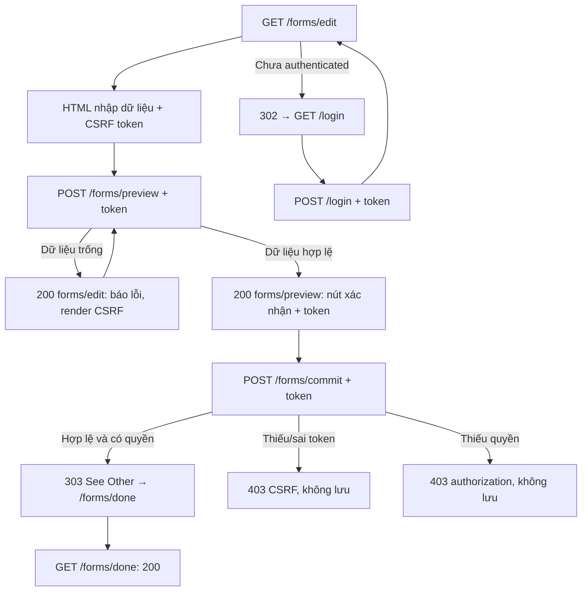

# Kiểm thử các nhánh điều hướng mà vẫn giữ CSRF hoạt động

Trong module `SPRING_SECURITY_HTTP_PROTECTION`, Spring Security bảo vệ các request HTTP và trình duyệt bằng CSRF, CORS, security headers, CSP, HSTS, HTTP firewall và quản lý phiên. Một form có thể dẫn người dùng đi qua nhiều nhánh: **mở trang, nhập sai, xem trước, xác nhận, chuyển sang trang thành công, đăng nhập lại, đăng xuất, quay lại hoặc mở nhiều tab**. Những nhánh này tạo ra nhiều HTTP request độc lập, mỗi request cần được xử lý đúng theo **method, cookie, authentication, authorization và CSRF token**.

Bài thuộc chương **CSRF và biểu mẫu**, tập trung cách **kiểm thử các nhánh điều hướng** chứ không chỉ kiểm thử “form POST thành công”. Mục tiêu là khẳng định đồng thời hai điều:

1. **Request ghi dữ liệu không hợp lệ vẫn bị chặn**, dù người dùng tới endpoint qua redirect, từ một trang cũ hoặc từ một nhánh sau login.
2. **Người dùng có request hợp lệ vẫn đi tiếp đúng luồng**, không bị mất CSRF token vì render sai form, chuyển session hoặc hiểu nhầm HTTP 302/303.

Phần chính dùng **Spring MVC/Servlet + MockMvc**. Cuối bài có ví dụ **Spring WebFlux/Reactive + WebTestClient**, cùng kịch bản kiểm tra bằng trình duyệt. Các đoạn mã dùng phong cách Spring Boot 3.x, Spring Security 6.x, Java 17+; những khác biệt theo version và cấu hình tùy chỉnh cần được kiểm chứng trong dự án thật.

## 1. Kết quả học tập

Sau bài này, người học có thể:

- Vẽ được sơ đồ điều hướng **GET form → POST preview → POST confirm → 303 GET thành công** và chỉ ra request nào cần CSRF.
- Phân biệt **302 Found, 303 See Other, 307 Temporary Redirect, 308 Permanent Redirect** cùng ảnh hưởng của chúng lên method/body ở request kế tiếp.
- Kiểm thử nhánh **validation lỗi trả lại cùng view**, bảo đảm view mới vẫn có CSRF token cho lần POST tiếp theo.
- Kiểm thử **redirect đến login**, đăng nhập bằng POST có CSRF, token sau authentication và sự khác nhau giữa redirect GET với việc phát lại POST.
- Xác minh **logout bằng POST có CSRF** và form cũ từ tab khác không được tiếp tục dùng như thể session vẫn hợp lệ.
- Dùng MockMvc kiểm tra **thiếu token, token sai, token đúng, role thiếu, method sai và side effect không xảy ra**.
- Hiểu test `csrf()` chỉ hỗ trợ request, chưa chứng minh template HTML chứa token; kết hợp view tests, session tests và browser tests.
- Áp dụng ý tưởng tương tự trong WebFlux bằng `SecurityMockServerConfigurers.csrf()` và WebTestClient.

## 2. Mỗi nhánh điều hướng tạo ra request riêng

Giả sử người dùng cập nhật một bản tóm tắt hồ sơ:



Điều quan trọng: **CSRF không phải một bước đã làm một lần rồi được bỏ qua cho mọi bước sau**. Mỗi request thay đổi trạng thái cần token hợp lệ theo security chain, ngay cả khi nó được gửi từ một trang do ứng dụng vừa render.

### 2.1. Ma trận request/method/token

| Nhánh | Request thực | CSRF mặc định? | Kỳ vọng |
| --- | --- | --- | --- |
| Xem trang nhập liệu | GET `/forms/edit` | Không yêu cầu token trong request GET | 200 nếu authenticated; HTML trả về có token cho các POST. |
| Xem form login | GET `/login` | GET không yêu cầu token | Trang login render form POST có token. |
| Gửi thông tin đăng nhập | POST `/login` | **Có** | Token hợp lệ: xác thực; token thiếu/sai: thông thường 403. |
| Xem trước | POST `/forms/preview` | **Có** | Validation lỗi: 200 cùng form; hợp lệ: 200 trang preview. |
| Xác nhận lưu | POST `/forms/commit` | **Có** | Token, quyền và dữ liệu đúng: lưu rồi 303. |
| Đến trang thành công | GET `/forms/done` sau 303 | Không yêu cầu token ở GET | 200; không thực hiện thao tác lưu lần hai. |
| Quay lại để sửa | GET `/forms/edit` | Không yêu cầu token ở GET | 200; tải lại dữ liệu/bản nháp và render token hiện hành. |
| Đăng xuất | POST `/logout` | **Có** khi CSRF bật theo cấu hình thường dùng | Xóa trạng thái phiên và redirect theo logout success handler. |
| Gửi form cũ từ tab khác | POST + token của ngữ cảnh cũ | **Có** | Có thể 403 hoặc luồng session/authentication riêng; không tự động lưu. |
| Gửi DELETE thật qua JavaScript | DELETE `/api/...` | **Có** | CSRF + authorization vẫn được kiểm tra. |

**Không dùng GET làm đường vòng để lưu/xóa dữ liệu.** Spring Security thường không yêu cầu CSRF cho GET vì ứng dụng phải giữ GET có tính chất đọc. Chuyển POST sang GET chỉ để tránh 403 sẽ phá vỡ giả định bảo mật này.

### 2.2. Token không tự đi theo redirect

Response 303 hoặc 302 chỉ hướng trình duyệt thực hiện một request tiếp theo. **CSRF token không phải một “vé” được chuyển tự động từ POST trước sang mọi POST tương lai**. Browser vẫn gửi session cookie theo quy tắc cookie; form ở trang mới cần được render với token của ngữ cảnh hiện tại.

Nếu redirect dẫn đến GET view mới, Spring Security có thể expose token qua request/view để Thymeleaf chèn hidden input cho form tiếp theo. Nếu redirect đi qua login/logout hoặc phiên mới, token kỳ vọng có thể đã thay đổi; không dùng lại hidden token từ HTML cũ.

## 3. Redirect, forward và Post/Redirect/Get (PRG)

### 3.1. Những mã chuyển hướng cần phân biệt

| Status | Tên | Ảnh hưởng khi response của POST | Phù hợp cho form lưu xong? |
| --- | --- | --- | --- |
| **302** | Found | Trình duyệt thường chuyển POST sang GET theo hành vi phổ biến, nhưng semantics lịch sử có khác biệt | Có thể gặp trong Spring MVC; nếu cần ràng buộc GET rõ ràng, ưu tiên 303. |
| **303** | See Other | Client theo redirect bằng GET đối với POST | **Phù hợp PRG** khi muốn mở trang kết quả. |
| **307** | Temporary Redirect | Client phải giữ method/body khi theo redirect | Thường **không** dùng để đưa POST thành GET kết quả. |
| **308** | Permanent Redirect | Giữ method/body; còn mang nghĩa redirect lâu dài | Không phù hợp cho PRG thông thường. |

Ví dụ luồng mong muốn:

```http
POST /forms/commit HTTP/1.1
Content-Type: application/x-www-form-urlencoded
Cookie: JSESSIONID=<session>
    
summary=Nội+dung&_csrf=<token>

HTTP/1.1 303 See Other
Location: /forms/done

GET /forms/done HTTP/1.1
Cookie: JSESSIONID=<session>

HTTP/1.1 200 OK
Content-Type: text/html
```

POST đầu **phải vượt qua CSRF và authorization** trước khi server lưu. GET theo sau chỉ hiển thị trạng thái; nó không gửi lại cùng lệnh lưu. Khi refresh trang kết quả, người dùng refresh GET, không vô ý lặp POST.

### 3.2. Vì sao không dùng 307/308 cho nhánh thành công?

Nếu response của POST là `307 Location: /forms/done`, client tuân thủ chuẩn có thể gửi **POST /forms/done** với cùng body. Điều này vừa không khớp `@GetMapping("/forms/done")`, vừa có thể làm rò nội dung body tới endpoint không dự kiến nếu Location bị cấu hình sai. Với redirect sang origin khác, vấn đề còn nghiêm trọng hơn.

Vì vậy:

- **Sau POST ghi dữ liệu thành công:** thường dùng 303 tới URL GET an toàn.
- **Nếu cần trả lỗi validation:** có thể trả lại view với 200/422 tùy kiến trúc, nhưng view phải có token cho thao tác tiếp theo.
- **Nếu request CSRF sai:** trả lỗi 403 hoặc xử lý lỗi tương ứng; không tự thực hiện nghiệp vụ trước khi redirect.
- **Nếu chưa đăng nhập:** chuyển qua trang login, sau đó điều hướng đến URL GET an toàn; không tự động phát lại một POST cũ.

### 3.3. Forward không phải redirect

Spring MVC có thể trả `forward:/path` để chuyển xử lý **bên trong server**, không phát sinh request GET mới từ trình duyệt. Request gốc vẫn có method/body, và hành vi security đối với dispatcher type `FORWARD` phụ thuộc filter registration/configuration.

Đừng xem forward là cách “bỏ qua lỗi CSRF”: request POST ban đầu vẫn phải được bảo vệ. Với form muốn đổi trang sau thành công, PRG rõ ràng hơn, còn forward nên được kiểm thử riêng khi thực sự cần.

### 3.4. Open redirect và dữ liệu nhạy cảm

Không xây `Location` bằng tham số `next` do client tùy ý cung cấp:

```java
// KHÔNG dùng: next do client điều khiển có thể trỏ ra ngoài ứng dụng.
// return "redirect:" + request.getParameter("next");
```

Với ứng dụng thật, chỉ redirect tới URL **được allowlist** hoặc route server xác định. Không đưa `_csrf`, session ID, password, nội dung textarea nhạy cảm vào query string của Location. HTTPS và `Referrer-Policy` là các lớp bổ sung, không làm query token trở nên an toàn để phát tán.

## 4. Ứng dụng MVC mẫu có ba nhánh POST

Để kiểm thử được side effect, bài dùng một service đếm số lần thực sự lưu. Service này chỉ minh họa kiểm thử, không thay thế persistence, transaction hoặc kiểm tra quyền truy cập thật.

Dependency cho Spring Boot Servlet:

```groovy
implementation 'org.springframework.boot:spring-boot-starter-web'
implementation 'org.springframework.boot:spring-boot-starter-security'
implementation 'org.springframework.boot:spring-boot-starter-thymeleaf'

testImplementation 'org.springframework.boot:spring-boot-starter-test'
testImplementation 'org.springframework.security:spring-security-test'
```

### 4.1. SecurityFilterChain giữ CSRF bật

```java
import org.springframework.context.annotation.Bean;
import org.springframework.context.annotation.Configuration;
import org.springframework.http.HttpMethod;
import org.springframework.security.config.Customizer;
import org.springframework.security.config.annotation.web.builders.HttpSecurity;
import org.springframework.security.core.userdetails.User;
import org.springframework.security.core.userdetails.UserDetailsService;
import org.springframework.security.crypto.bcrypt.BCryptPasswordEncoder;
import org.springframework.security.crypto.password.PasswordEncoder;
import org.springframework.security.provisioning.InMemoryUserDetailsManager;
import org.springframework.security.web.SecurityFilterChain;

@Configuration
public class FormSecurityConfig {

    @Bean
    SecurityFilterChain securityFilterChain(HttpSecurity http)
            throws Exception {
        return http
                .authorizeHttpRequests(auth -> auth
                        .requestMatchers(HttpMethod.POST, "/forms/commit")
                            .hasRole("EDITOR")
                        .requestMatchers("/forms/**").authenticated()
                        .anyRequest().authenticated())
                .formLogin(Customizer.withDefaults())
                .logout(Customizer.withDefaults())
                .csrf(Customizer.withDefaults())
                .build();
    }

    // Tài khoản thử nghiệm duy nhất, không dùng secret này ở production.
    @Bean
    UserDetailsService users(PasswordEncoder passwordEncoder) {
        return new InMemoryUserDetailsManager(
                User.withUsername("editor")
                    .password(passwordEncoder.encode("demo-pass"))
                    .roles("EDITOR").build()
        );
    }

    @Bean
    PasswordEncoder passwordEncoder() {
        return new BCryptPasswordEncoder();
    }
}
```

Quy tắc quan trọng:

- POST `/forms/commit` yêu cầu `ROLE_EDITOR`, dù CSRF token đã hợp lệ.
- Nhóm `/forms/**` yêu cầu authenticated user để xem/preview.
- Form login và logout vẫn được Spring Security quản lý; CSRF mặc định áp dụng cho POST `/login` và POST `/logout`.
- Không gọi `csrf.disable()` và không dùng `permitAll()` cho mọi endpoint chỉ để test redirect chạy.

Tài khoản `editor/demo-pass` chỉ phục vụ học tập. Ứng dụng thật phải dùng cơ chế identity và secret management phù hợp. Trong các test tập trung CSRF, ta có thể dùng `spring-security-test` tạo mock principal thay vì đăng nhập thật ở từng test.

### 4.2. Service ghi nhận side effect

```java
import java.util.concurrent.atomic.AtomicInteger;
import org.springframework.stereotype.Service;

@Service
public class DemoSubmissionStore {
    private final AtomicInteger committed = new AtomicInteger();

    public void save(String summary) {
        // Demo đếm lần xử lý; production phải validate/authorize
        // và ghi vào database bằng transaction.
        committed.incrementAndGet();
    }

    public int count() {
        return committed.get();
    }
}
```

Khi một POST bị CSRF hoặc authorization từ chối, controller **không được gọi**, số đếm không được tăng. Đây là assertion tốt hơn việc chỉ kiểm tra response 403 mà không nhìn side effect.

### 4.3. Controller: nhập lại, xem trước, xác nhận rồi redirect

```java
import java.net.URI;
import org.springframework.http.HttpStatus;
import org.springframework.http.ResponseEntity;
import org.springframework.stereotype.Controller;
import org.springframework.ui.Model;
import org.springframework.web.bind.annotation.GetMapping;
import org.springframework.web.bind.annotation.PostMapping;
import org.springframework.web.bind.annotation.RequestMapping;
import org.springframework.web.bind.annotation.RequestParam;
import org.springframework.web.server.ResponseStatusException;

@Controller
@RequestMapping("/forms")
public class FormFlowController {

    private final DemoSubmissionStore store;

    public FormFlowController(DemoSubmissionStore store) {
        this.store = store;
    }

    @GetMapping("/edit")
    String edit(Model model) {
        model.addAttribute("summary", "");
        return "forms/edit";
    }

    @PostMapping("/preview")
    String preview(@RequestParam(defaultValue = "") String summary,
                   Model model) {
        model.addAttribute("summary", summary);

        if (summary.isBlank()) {
            model.addAttribute("error", "Vui lòng nhập nội dung.");
            return "forms/edit";
        }

        return "forms/preview";
    }

    @PostMapping("/commit")
    ResponseEntity<Void> commit(@RequestParam String summary) {
        if (summary.isBlank()) {
            throw new ResponseStatusException(
                    HttpStatus.BAD_REQUEST, "Nội dung không được để trống");
        }

        store.save(summary);

        // Explicit PRG: POST thành công -> 303 -> GET trang kết quả.
        return ResponseEntity.status(HttpStatus.SEE_OTHER)
                .location(URI.create("/forms/done"))
                .build();
    }

    @GetMapping("/done")
    String done() {
        return "forms/done";
    }
}
```

Các method POST xử lý như sau:

- `/forms/preview` kiểm tra dữ liệu, không lưu bền vững. Tuy vậy, vì HTTP method là **POST**, CSRF mặc định vẫn yêu cầu token.
- `/forms/commit` mới có side effect trong service và chỉ chạy nếu qua CSRF và phân quyền.
- `/forms/done` là **GET thuần**, không thực hiện lưu lần hai.
- Khi dữ liệu sai, controller render lại form có lỗi; phải tiếp tục có hidden CSRF input để người dùng sửa và gửi lại.

Ứng dụng thật cần validation sâu hơn, ownership, chống double submit, version/idempotency và lưu bản nháp khi form dài. Demo không đại diện một hệ thống có transaction thật.

### 4.4. Template GET form và form lỗi validation

Tạo `src/main/resources/templates/forms/edit.html`:

```html
<!doctype html>
<html lang="vi" xmlns:th="http://www.thymeleaf.org">
<head>
    <meta charset="UTF-8">
    <title>Nhập nội dung</title>
</head>
<body>
    <h1>Nhập nội dung</h1>
    <p th:if="${error}" th:text="${error}" role="alert"></p>

    <form th:action="@{/forms/preview}" method="post">
        <label for="summary">Tóm tắt</label>
        <textarea id="summary" name="summary"
                  required th:text="${summary}"></textarea>
        <button type="submit">Xem trước</button>
    </form>

    <form th:action="@{/logout}" method="post">
        <button type="submit">Đăng xuất</button>
    </form>
</body>
</html>
```

Với Thymeleaf tích hợp Spring MVC/Spring Security, `th:action` trên POST form sẽ phối hợp với `CsrfRequestDataValueProcessor` để render **hidden CSRF input**. Vì trang có hai form POST, cần kiểm tra **cả form preview và form logout** đều có token, không chỉ kiểm tra một chuỗi `name="_csrf"` ở bất kỳ đâu trong HTML.

Mã template không chứa token hardcode. Ở Spring Security 6, biểu diễn token được mask để giảm nguy cơ BREACH; token đã render có thể đổi chuỗi giữa hai lần GET ngay cả khi token kỳ vọng vẫn gắn với cùng session.

### 4.5. Template preview có form POST mới

Tạo `src/main/resources/templates/forms/preview.html`:

```html
<!doctype html>
<html lang="vi" xmlns:th="http://www.thymeleaf.org">
<head>
    <meta charset="UTF-8">
    <title>Xem trước</title>
</head>
<body>
    <h1>Xem trước trước khi lưu</h1>
    <p th:text="${summary}"></p>

    <form th:action="@{/forms/commit}" method="post">
        <input type="hidden" name="summary" th:value="${summary}">
        <button type="submit">Xác nhận lưu</button>
    </form>

    <a th:href="@{/forms/edit}">Quay lại trang nhập</a>
</body>
</html>
```

Đây là **request POST mới**, không phải phần tiếp tục của token đã được kiểm tra ở bước preview. Form xác nhận cần token hợp lệ độc lập.

`th:value` và `th:text` của Thymeleaf escape giá trị theo ngữ cảnh. Dù nội dung đã xuất hiện trong preview, backend vẫn phải kiểm tra lại dữ liệu ở bước commit; input hidden `summary` có thể bị sửa bởi client và không phải nguồn tin cậy.

Link “Quay lại” chỉ GET trang edit. **Trong demo, GET edit đặt nội dung rỗng**; do đó link này không tự giữ text cũ. Với sản phẩm thật, cần bản nháp phía server hoặc giải pháp lưu tạm đã được cho phép để khôi phục dữ liệu và quản lý version. Không cho rằng browser Back hoặc history luôn giữ nội dung khi session đã thay đổi.

### 4.6. Trang kết quả sau PRG

Tạo `src/main/resources/templates/forms/done.html`:

```html
<!doctype html>
<html lang="vi" xmlns:th="http://www.thymeleaf.org">
<head>
    <meta charset="UTF-8">
    <title>Hoàn tất</title>
</head>
<body>
    <h1>Đã xử lý yêu cầu</h1>
    <p>Trang này chỉ hiển thị kết quả, không thực hiện lệnh lưu.</p>
    <a th:href="@{/forms/edit}">Nhập nội dung khác</a>
</body>
</html>
```

**Lưu ý:** Demo trả lời “đã xử lý” sau khi bộ đếm tăng. Ứng dụng thật nên hiển thị mã giao dịch/trạng thái đã xác nhận từ persistence, nhất là khi POST có thể gặp lỗi mạng hoặc được xử lý bất đồng bộ.

## 5. Các ranh giới bảo mật phải giữ nguyên khi điều hướng

### 5.1. Một POST hợp lệ không “ủy quyền” cho POST khác

Khi POST `/forms/preview` thành công, không có nghĩa POST `/forms/commit` được bỏ qua CSRF. Đó là hai request khác nhau với hai hành động khác nhau. Spring Security sẽ đánh giá lại request mới bằng method, token, principal và quyền tương ứng.

### 5.2. Redirect qua login không phát lại POST

Khi user chưa authenticated truy cập GET trang được bảo vệ, form login có thể lưu **SavedRequest** và sau login điều hướng về URL người dùng muốn mở. Đây là **điều hướng tới một URL**, không phải lời hứa Spring Security sẽ lặp lại body của một POST trước đó.

Ngay cả khi request cache có dữ liệu về request ban đầu, hãy thiết kế hành động an toàn: sau xác thực tải GET form/token mới, cho user kiểm tra dữ liệu, **không tự động replay thao tác ghi**. Với luồng có bản nháp, khôi phục theo user/owner và version.

### 5.3. Logout bằng POST và session cũ

`POST /logout` mặc định trong cấu hình Spring Security có CSRF protection. `CsrfLogoutHandler` có thể xóa token, còn logout/session invalidation có thể xóa authentication và session.

Một tab khác vẫn hiển thị HTML cũ không chứng minh token cũ còn hợp lệ. Sau logout/login, trang mới cần nhận token của ngữ cảnh mới, không gửi một POST cũ có token trước logout mà kỳ vọng luôn thành công.

### 5.4. CSRF 403 khác role 403

CSRF token đúng chỉ xác minh một lớp chống request giả mạo. Nó **không cấp quyền** lưu. Trong ví dụ này, user ROLE_VIEWER có thể vượt CSRF nhưng vẫn bị `HttpMethod.POST /forms/commit` từ chối vì yêu cầu ROLE_EDITOR.

Không thiết kế handler lỗi để tự lấy token mới rồi retry mọi request 403. Phải phân biệt exception/response của CSRF với authorization, và tránh phát lại giao dịch không rõ kết quả.

### 5.5. GET kết quả phải không có side effect

PRG chỉ an toàn về mặt tránh submit lại nếu GET `/forms/done` **không lưu/xóa**. Không chuyển việc lưu từ POST sang GET chỉ để làm redirect dễ hơn. Thao tác ghi phải đi qua đúng method không an toàn và các kiểm tra CSRF/authorization tương ứng.


## 6. MockMvc: kiểm thử từng nhánh thay vì chỉ một happy path

Thêm `spring-security-test` để dùng `csrf()`, `csrf().useInvalidToken()` và `user(...)`. Các ví dụ tiếp theo giả định `FormSecurityConfig`, `FormFlowController`, `DemoSubmissionStore` và ba Thymeleaf templates ở mục 4 đã có trong application context.

### 6.1. Bộ kiểm thử form, validation và PRG

```java
import static org.hamcrest.Matchers.containsString;
import static org.junit.jupiter.api.Assertions.assertEquals;
import static org.springframework.security.test.web.servlet.request
        .SecurityMockMvcRequestPostProcessors.csrf;
import static org.springframework.security.test.web.servlet.request
        .SecurityMockMvcRequestPostProcessors.user;
import static org.springframework.test.web.servlet.request.MockMvcRequestBuilders.get;
import static org.springframework.test.web.servlet.request.MockMvcRequestBuilders.post;
import static org.springframework.test.web.servlet.result.MockMvcResultMatchers.*;

import org.junit.jupiter.api.Test;
import org.springframework.beans.factory.annotation.Autowired;
import org.springframework.boot.test.autoconfigure.web.servlet.AutoConfigureMockMvc;
import org.springframework.boot.test.context.SpringBootTest;
import org.springframework.test.web.servlet.MockMvc;

@SpringBootTest
@AutoConfigureMockMvc
class FormNavigationCsrfTests {

    @Autowired
    MockMvc mvc;

    @Autowired
    DemoSubmissionStore store;

    @Test
    void getEditFormRendersCsrf() throws Exception {
        mvc.perform(get("/forms/edit")
                        .with(user("editor").roles("EDITOR")))
                .andExpect(status().isOk())
                .andExpect(view().name("forms/edit"))
                .andExpect(content().string(
                        containsString("name=\"_csrf\"")));
    }

    @Test
    void previewWithEmptySummaryReturnsEditWithCsrf() throws Exception {
        int before = store.count();

        mvc.perform(post("/forms/preview")
                        .with(user("editor").roles("EDITOR"))
                        .with(csrf())
                        .param("summary", ""))
                .andExpect(status().isOk())
                .andExpect(view().name("forms/edit"))
                .andExpect(content().string(
                        containsString("Vui lòng nhập nội dung")))
                .andExpect(content().string(
                        containsString("name=\"_csrf\"")));

        assertEquals(before, store.count());
    }

    @Test
    void previewValidRendersSecondPostFormWithCsrf() throws Exception {
        int before = store.count();

        mvc.perform(post("/forms/preview")
                        .with(user("editor").roles("EDITOR"))
                        .with(csrf())
                        .param("summary", "Ghi chú hợp lệ"))
                .andExpect(status().isOk())
                .andExpect(view().name("forms/preview"))
                .andExpect(content().string(
                        containsString("action=\"/forms/commit\"")))
                .andExpect(content().string(
                        containsString("name=\"_csrf\"")));

        // Xem trước chưa ghi dữ liệu.
        assertEquals(before, store.count());
    }

    @Test
    void confirmWithValidCsrfUses303ToGet() throws Exception {
        int before = store.count();

        mvc.perform(post("/forms/commit")
                        .with(user("editor").roles("EDITOR"))
                        .with(csrf())
                        .param("summary", "Nội dung hợp lệ"))
                .andExpect(status().isSeeOther())
                .andExpect(header().string("Location", "/forms/done"));

        assertEquals(before + 1, store.count());

        mvc.perform(get("/forms/done")
                        .with(user("editor").roles("EDITOR")))
                .andExpect(status().isOk())
                .andExpect(view().name("forms/done"));

        // GET sau 303 không được kích hoạt lưu thêm lần nữa.
        assertEquals(before + 1, store.count());
    }
}
```

Test đầu xác nhận **HTML render** có field CSRF. Test preview và nhánh validation xác nhận form được tạo ở request tiếp theo vẫn có token. Test confirm kiểm tra chính xác **303 + Location** và đo side effect, sau đó gọi **GET độc lập** để chứng minh PRG không lưu hai lần.

Điều cần lưu ý:

- MockMvc **không tự theo 303 thành GET**. Ta phải tạo thêm `mvc.perform(get(...))` nếu muốn kiểm tra request tiếp theo.
- `csrf()` trong Spring Security Test đưa token hợp lệ vào request kiểm thử; nó **không xác minh form thật đã render token**. Do đó cần các assertion HTML riêng.
- `DemoSubmissionStore` là bean singleton và có thể giữ số đếm giữa các tests; so sánh **before/after** thay vì giả định count luôn bằng 0. Nếu test suite chạy song song, cần cô lập state hoặc dùng spy/mock service theo chuẩn dự án.
- Test preview có `summary` được escape bởi Thymeleaf; service vẫn phải validate lại ở bước commit vì hidden input có thể bị sửa.

### 6.2. Nhánh lỗi CSRF: không vào controller và không lưu

Bổ sung các method sau vào class `FormNavigationCsrfTests`:

```java
@Test
void previewWithoutCsrfIsForbidden() throws Exception {
    mvc.perform(post("/forms/preview")
                    .with(user("editor").roles("EDITOR"))
                    .param("summary", "Nội dung"))
            .andExpect(status().isForbidden());
}

@Test
void confirmWithoutCsrfCannotSave() throws Exception {
    int before = store.count();

    mvc.perform(post("/forms/commit")
                    .with(user("editor").roles("EDITOR"))
                    .param("summary", "Nội dung"))
            .andExpect(status().isForbidden());

    assertEquals(before, store.count());
}

@Test
void confirmWithInvalidCsrfCannotSave() throws Exception {
    int before = store.count();

    mvc.perform(post("/forms/commit")
                    .with(user("editor").roles("EDITOR"))
                    .with(csrf().useInvalidToken())
                    .param("summary", "Nội dung"))
            .andExpect(status().isForbidden());

    assertEquals(before, store.count());
}
```

Với cấu hình mặc định, thiếu/sai CSRF token bị từ chối 403. Nếu ứng dụng có `AccessDeniedHandler`, `InvalidSessionStrategy` hoặc nhiều filter chains được tùy biến, body/redirect có thể khác; vẫn phải bảo đảm request bị từ chối **không tạo side effect**.

Không dùng `csrf().useInvalidToken()` như một cách “mô phỏng session hết hạn hoàn toàn”; nó chỉ kiểm tra đường token sai. Để kiểm tra session thật, cần test khác về session/authentication, token repository và cookie.

### 6.3. Nhánh 403 do thiếu quyền, dù CSRF hợp lệ

```java
@Test
void viewerHasValidCsrfButCannotCommit() throws Exception {
    int before = store.count();

    mvc.perform(post("/forms/commit")
                    .with(user("viewer").roles("VIEWER"))
                    .with(csrf())
                    .param("summary", "Không được phép lưu"))
            .andExpect(status().isForbidden());

    assertEquals(before, store.count());
}
```

Test này giúp phân biệt:

- **CSRF 403:** token sai hoặc không có token.
- **Authorization 403:** token hợp lệ nhưng principal không đủ role.

Đừng viết giao diện tự lấy token mới và retry khi mọi response 403; điều đó có thể tạo vòng lặp vô ích hoặc che lỗi phân quyền.

### 6.4. Nhánh method sai: GET không được chạy lệnh ghi

```java
@Test
void commitDoesNotHaveGetHandler() throws Exception {
    int before = store.count();

    mvc.perform(get("/forms/commit")
                    .with(user("editor").roles("EDITOR")))
            .andExpect(status().isMethodNotAllowed());

    assertEquals(before, store.count());
}
```

Test này xác minh application chỉ có `@PostMapping("/commit")` và không chấp nhận GET để tạo side effect. Dựa vào cấu hình MVC cụ thể, method mismatch thông thường trả **405 Method Not Allowed**; trong một số ứng dụng, security hoặc route khác có thể từ chối sớm hơn. Đừng biến lệnh POST thành GET chỉ để tránh CSRF.

### 6.5. Ma trận coverage MockMvc

| Nhánh | Dữ liệu / principal | Assertion tối thiểu | Assertion side effect |
| --- | --- | --- | --- |
| GET edit | EDITOR | 200, template edit, có token | Không lưu |
| POST preview hợp lệ | EDITOR + CSRF | 200, template preview, có form commit + token | Không lưu |
| POST preview dữ liệu rỗng | EDITOR + CSRF | 200, template edit + lỗi + token | Không lưu |
| POST preview thiếu token | EDITOR, không CSRF | 403 | Không lưu |
| POST commit thiếu token | EDITOR, không CSRF | 403 | Không lưu |
| POST commit sai token | EDITOR + invalid CSRF | 403 | Không lưu |
| POST commit thiếu role | VIEWER + CSRF đúng | 403 | Không lưu |
| POST commit hợp lệ | EDITOR + CSRF đúng | 303, Location GET | Tăng đúng một |
| GET done sau 303 | EDITOR | 200 | Không tăng thêm |
| GET commit | EDITOR | 405 trong ví dụ | Không lưu |

Kiểm thử chỉ status mà không kiểm tra side effect có thể bỏ sót lỗi trong service hoặc filter chain tùy chỉnh. Với persistence thật, nên xác minh số dòng được tạo/sửa hoặc thông qua service mock được kiểm soát; không trông chờ bộ đếm in-memory như một cơ chế nghiệp vụ.

## 7. Kiểm thử điều hướng qua login và SavedRequest

### 7.1. Người dùng chưa đăng nhập mở GET được bảo vệ

Trên cấu hình form login mặc định:

```text
GET /forms/edit
    └── chưa authenticated
         → 302 Location: /login

GET /login
    └── Spring Security render form login với CSRF token

POST /login (username + password + CSRF token)
    └── xác thực hợp lệ
         → 302 tới URL GET đã yêu cầu trước đó (nếu SavedRequest phù hợp)

GET /forms/edit
    └── HTML mới có CSRF token của ngữ cảnh đã authenticated
```

Điểm cần kiểm tra: request POST login **cũng là unsafe method**, nên CSRF phải được kiểm tra. Spring Security có `CsrfAuthenticationStrategy` có thể xóa token cũ trong khi xác thực; sau login, form được GET lại và lấy token phù hợp.

### 7.2. MockMvc test login thiếu token và login đúng

```java
@Test
void loginWithoutCsrfIsRejected() throws Exception {
    mvc.perform(post("/login")
                    .param("username", "editor")
                    .param("password", "demo-pass"))
            .andExpect(status().isForbidden());
}

@Test
void validLoginWithCsrfRedirects() throws Exception {
    mvc.perform(post("/login")
                    .with(csrf())
                    .param("username", "editor")
                    .param("password", "demo-pass"))
            .andExpect(status().is3xxRedirection());
}
```

Vì ví dụ ở mục 4 cấu hình user `editor/demo-pass`, test login có thể xác thực với `UserDetailsService` thực của demo. **Không sử dụng demo password trong sản phẩm thật** và không ghi password thật vào kết quả kiểm thử.

### 7.3. Kiểm thử redirect tới SavedRequest GET với cùng session

Khi muốn xác minh trọn luồng, phải giữ cùng `MockHttpSession` từ GET chưa authenticated tới POST login:

```java
import static org.hamcrest.Matchers.containsString;
import org.springframework.mock.web.MockHttpSession;

@Test
void loginReturnsToOriginallyRequestedGet() throws Exception {
    MockHttpSession session = new MockHttpSession();

    mvc.perform(get("/forms/edit").session(session))
            .andExpect(status().is3xxRedirection())
            .andExpect(header().string(
                    "Location", containsString("/login")));

    mvc.perform(post("/login")
                    .session(session)
                    .with(csrf())
                    .param("username", "editor")
                    .param("password", "demo-pass"))
            .andExpect(status().is3xxRedirection())
            .andExpect(header().string(
                    "Location", containsString("/forms/edit")));

    // Session sau login cần được bảo toàn để vào form.
    mvc.perform(get("/forms/edit").session(session))
            .andExpect(status().isOk())
            .andExpect(content().string(
                    containsString("name=\"_csrf\"")));
}
```

Đoạn này giả định **SavedRequestAwareAuthenticationSuccessHandler** mặc định và không cấu hình `alwaysUseDefaultTargetUrl=true`. `Location` có thể là URL tuyệt đối hoặc tương đối tùy redirect strategy; vì vậy test dùng `containsString` để kiểm tra đích thay vì hardcode schema/host.

Bài test cho phép kiểm tra **điều hướng trở lại GET sau login**, không có nghĩa Spring Security tự gửi lại body của một POST chưa đăng nhập. Với quy trình yêu cầu viết dữ liệu dài, nên dùng bản nháp an toàn và yêu cầu xác nhận gửi lại, không phát lại request cũ mà người dùng không biết.

### 7.4. Request cache, session và các giả định dễ sai

Những thay đổi sau có thể làm test saved-request thất bại dù CSRF vẫn hoạt động:

- Application đặt `defaultSuccessUrl(..., true)` nên luôn redirect về một đường cố định.
- Ứng dụng dùng authentication success handler tùy chỉnh.
- `RequestCache` được vô hiệu hóa hoặc đặt matcher khác.
- Session cookie bị mất, session timeout hoặc domain/path không khớp sau reverse proxy.
- Endpoint bị chuyển sang authentication bằng API 401 thay vì form login 302.

Vì vậy, phải kiểm tra **hợp đồng điều hướng mà ứng dụng thực sự chọn** chứ không áp một URL mặc định cho mọi dự án.

## 8. Kiểm thử logout và thay đổi session

### 8.1. Logout mặc định phải dùng POST khi CSRF bật

Form logout ở template edit dùng `method="post"` và `th:action="@{/logout}"`. Không thay nó bằng link GET `/logout` để “đơn giản hóa” việc logout khi đang giữ CSRF mặc định; GET có thể chỉ hiển thị trang xác nhận hoặc có hành vi khác theo cấu hình.

Test:

```java
@Test
void logoutWithoutCsrfIsRejected() throws Exception {
    mvc.perform(post("/logout")
                    .with(user("editor").roles("EDITOR")))
            .andExpect(status().isForbidden());
}

@Test
void logoutWithCsrfRedirectsToLogin() throws Exception {
    mvc.perform(post("/logout")
                    .with(user("editor").roles("EDITOR"))
                    .with(csrf()))
            .andExpect(status().is3xxRedirection())
            .andExpect(header().string(
                    "Location", containsString("/login?logout")));
}
```

Với cấu hình mặc định, Spring Security thường redirect tới `/login?logout` sau logout thành công. Nếu ứng dụng tùy chỉnh `logoutSuccessUrl` hoặc trả 204/JSON, cần sửa assertion theo hợp đồng thực tế; **CSRF cho logout vẫn phải được kiểm tra khi chính sách yêu cầu**.

### 8.2. Token từ session cũ phải bị từ chối trong session mới

Bài kiểm thử dưới đây mô phỏng **đổi session**, không cần chờ đồng hồ 15 phút:

```java
import org.springframework.mock.web.MockHttpSession;
import org.springframework.security.web.csrf.CsrfToken;
import org.springframework.test.web.servlet.MvcResult;
import static org.junit.jupiter.api.Assertions.assertNotNull;

@Test
void oldSessionTokenCannotBeUsedForCommitInNewSession()
        throws Exception {
    MvcResult first = mvc.perform(get("/forms/edit")
                    .with(user("editor").roles("EDITOR")))
            .andExpect(status().isOk())
            .andReturn();

    CsrfToken old = (CsrfToken) first.getRequest()
            .getAttribute(CsrfToken.class.getName());

    assertNotNull(old);
    int before = store.count();

    mvc.perform(post("/forms/commit")
                    .session(new MockHttpSession())
                    .with(user("editor").roles("EDITOR"))
                    .param(old.getParameterName(), old.getToken())
                    .param("summary", "Dữ liệu cũ"))
            .andExpect(status().isForbidden());

    assertEquals(before, store.count());
}
```

Test này áp dụng cho repository CSRF **gắn với HttpSession mặc định**. `.with(user(...))` cố tình tạo principal hợp lệ trong request mới để cô lập **CSRF** khỏi lỗi thiếu authentication. Nếu ứng dụng dùng `CookieCsrfTokenRepository` hoặc cơ chế tùy chỉnh, hành vi cần kiểm tra theo đúng repository và request handler.

Nó **không mô phỏng đầy đủ** idle timeout của servlet container, session ID rotation khi login, logout filter hay browser bfcache. Để kiểm tra các nhánh đó, dùng integration tests với cookie/session thực.

### 8.3. Lỗi do session và lỗi do CSRF có thể trả response khác nhau

Với POST từ tab cũ, có thể gặp:

| Hiện tượng | Giả thuyết ưu tiên | Điều cần xác minh |
| --- | --- | --- |
| 403 | Token sai/thiếu, hoặc authorization | Xem loại exception/log filter; không khẳng định timeout chỉ từ status. |
| 302 tới login | Authentication không còn; entry point redirect | Cookie/session, request cache và đường login. |
| 302 tới trang session-expired | Có `InvalidSessionStrategy` tùy biến | Cấu hình session handling và cookie ID cũ. |
| 401 JSON | Ứng dụng định hướng API thay vì form login | Response contract, không tự replay POST. |
| 409 | Bản nháp/business version khác | Xử lý optimistic locking; token mới không sửa được version. |

**Không tắt CSRF** chỉ để các POST từ tab cũ được nhận. Hướng đúng là đưa người dùng về form mới/token phù hợp, khôi phục dữ liệu theo policy, xác nhận lại trước khi gửi lệnh ghi.

## 9. Kiểm thử trên trình duyệt và cookie thật

MockMvc là công cụ hiệu quả cho logic controller/filter, nhưng không hoàn toàn mô phỏng lịch sử trình duyệt, bfcache, cookie policy, proxy, CORS và các quyết định redirect của browser. Cần ít nhất một đợt kiểm thử end-to-end bằng DevTools/HTTP client.

### 9.1. Kịch bản kiểm tra bằng Network

1. Mở DevTools Network, bật Preserve log nếu cần; đăng nhập vào ứng dụng thử nghiệm.
2. GET `/forms/edit`, kiểm tra HTML đã render có hidden CSRF ở **cả form preview và form logout**.
3. POST `/forms/preview` với nội dung hợp lệ: response 200, HTML preview có **form xác nhận và token**.
4. POST `/forms/preview` với nội dung trống bằng HTTP client/test: response chứa lỗi validation và token (browser `required` có thể chặn gửi form trống trước khi request tới server).
5. POST `/forms/commit`: response 303 + Location `/forms/done`; browser tiếp tục GET, refresh trang done không tạo thêm bản ghi.
6. Thử thiếu token hoặc thay token sai: nhận 403, số bản ghi lưu không tăng.
7. Đăng xuất trong tab B, thử gửi form từ tab A: quan sát 403/redirect theo cấu hình; đăng nhập lại rồi GET form mới.
8. Dùng user không đủ role nhưng token hợp lệ: 403 authorization, không ghi dữ liệu.
9. Thử HTTP GET `/forms/commit`: không có hành động lưu, kết quả routing phù hợp.
10. Nếu có frontend JavaScript, kiểm tra response sau redirect login không bị hiểu nhầm là lưu thành công.

### 9.2. Giữ dữ liệu khi navigation thất bại

Với form dài hoặc wizard nhiều bước, **redirect có thể làm mất dữ liệu người dùng đã nhập** nếu không có cơ chế dự phòng. Các lựa chọn phù hợp:

- **Bản nháp lưu ở server** theo user/draft ID, có owner, version và TTL; sau login tải lại qua GET.
- Dữ liệu không nhạy cảm có thể được lưu tạm trong `sessionStorage` nếu policy cho phép; XSS có thể đọc Web Storage, nên không lưu password, token hay dữ liệu nhạy cảm.
- Validation trả cùng view với dữ liệu đã nhập, kèm token được framework render cho request hiện tại.
- Khi bấm Back, kiểm tra token/session trước khi phát lệnh POST mới; bfcache giữ HTML không bảo đảm session còn sống.

Đừng đưa toàn bộ textarea, password hoặc CSRF token lên query string chỉ để redirect giữ dữ liệu. Với request có tác động quan trọng, còn phải kiểm tra **idempotency** trước khi retry sau lỗi mạng, vì response mất không chứng minh server chưa xử lý.


## 10. JavaScript fetch: redirect có thể làm UI hiểu nhầm thành công

Với HTML form truyền thống, browser thường xử lý 303 bằng cách điều hướng sang GET kết quả. Nhưng khi JavaScript dùng `fetch`, mặc định browser **theo redirect bên trong fetch** rồi trả cho JavaScript response cuối cùng.

Ví dụ một POST bị redirect sang login vì người dùng không còn authenticated:

```text
fetch POST /api/forms/commit
    → 302 Location: /login
    → fetch tự GET /login
    → response cuối: HTTP 200, Content-Type: text/html

Nếu code chỉ xét response.ok:
    "200" → nhầm là đã lưu thành công.
```

Đây là một lỗi UX và logic nghiêm trọng. Không được coi 200 HTML login sau redirect là xác nhận backend đã ghi dữ liệu.

### 10.1. Với API, ưu tiên phản hồi rõ ràng

Một API dành riêng cho frontend nên trả:

- **2xx JSON/204** khi nghiệp vụ đã thành công (kèm ID/trạng thái nếu cần).
- **401 JSON** khi authentication đã hết, nếu API sử dụng entry point riêng.
- **403 JSON** khi CSRF/authorization từ chối, với mã lỗi riêng nếu có thể phân biệt.
- **409** khi version của bản nháp đã bị thay đổi.
- **5xx/network error** khi trạng thái không chắc chắn; phải kiểm tra idempotency trước retry.

Đối với endpoint HTML theo PRG ở mục 4, vẫn có thể dùng `fetch` nhưng phải quan sát redirect và URL đích, không coi response cuối 200 là kết quả POST.

### 10.2. Mẫu phát hiện redirect an toàn hơn

```javascript
async function submitWithFetch(form) {
    const statusNode = document.getElementById("saveStatus");

    try {
        const response = await fetch(form.action, {
            method: "POST",
            credentials: "same-origin",
            body: new FormData(form)
        });

        if (response.redirected) {
            const finalUrl = new URL(response.url);
            const trusted = finalUrl.origin === location.origin;

            if (!trusted) {
                statusNode.textContent =
                    "Chuyển hướng tới nguồn không mong đợi; chưa xác nhận lưu.";
                return;
            }

            if (finalUrl.pathname === "/login") {
                statusNode.textContent =
                    "Bạn cần đăng nhập lại trước khi gửi.";
                return;
            }

            if (finalUrl.pathname === "/forms/done") {
                // Chỉ điều hướng khi đã nhận biết đúng luồng app.
                location.assign(finalUrl.href);
                return;
            }

            statusNode.textContent =
                "Chuyển hướng ngoài dự kiến; hãy kiểm tra trạng thái.";
            return;
        }

        if (response.status === 401 || response.status === 403) {
            statusNode.textContent =
                "Chưa thể lưu. Hãy kiểm tra phiên và quyền.";
            return;
        }

        if (!response.ok) {
            statusNode.textContent =
                "Không thể hoàn tất thao tác: HTTP " + response.status;
            return;
        }

        statusNode.textContent =
            "Server đã phản hồi; kiểm tra định dạng/trạng thái nghiệp vụ.";
    } catch {
        statusNode.textContent =
            "Mất kết nối. Chưa rõ yêu cầu đã được xử lý hay chưa.";
    }
}
```

Đây là **minh họa xử lý redirect cho cùng origin**, không tự đủ để xác minh nghiệp vụ lưu thành công. Trong API thực tế, nên trả ID/trạng thái đã xác nhận; với request có thể có side effect, chỉ dựa trên URL cuối sau redirect là chưa đủ cho mọi kiến trúc.

`FormData(form)` phải chứa CSRF hidden input do Thymeleaf render. Không tắt CSRF vì `fetch` bị 403; giải quyết đúng token/session. **Không tự set `Content-Type` cho FormData multipart** nếu form có file.

## 11. Phương án WebFlux/Reactive

Spring WebFlux không dùng Servlet `CsrfFilter` hay `HttpSessionCsrfTokenRepository`. Spring Security Reactive sử dụng `CsrfWebFilter`, repository mặc định theo `WebSession` và thường expose `Mono<CsrfToken>` trong `ServerWebExchange`. Nhưng **điều hướng GET/POST/303 và yêu cầu bảo vệ unsafe methods không thay đổi về nguyên tắc**.

### 11.1. Cấu hình bảo vệ nhánh commit ở WebFlux

Ví dụ ứng dụng WebFlux riêng, dùng `spring-boot-starter-webflux`, `spring-boot-starter-security` và `spring-security-test`:

```java
import org.springframework.context.annotation.Bean;
import org.springframework.context.annotation.Configuration;
import org.springframework.http.HttpMethod;
import org.springframework.security.config.Customizer;
import org.springframework.security.config.web.server.ServerHttpSecurity;
import org.springframework.security.web.server.SecurityWebFilterChain;

@Configuration
public class ReactiveFlowSecurityConfig {

    @Bean
    SecurityWebFilterChain securityWebFilterChain(ServerHttpSecurity http) {
        return http
                .authorizeExchange(auth -> auth
                        .pathMatchers(HttpMethod.POST, "/flow/commit")
                            .hasRole("EDITOR")
                        .pathMatchers("/flow/**").authenticated()
                        .anyExchange().authenticated())
                .formLogin(Customizer.withDefaults())
                .csrf(Customizer.withDefaults())
                .build();
    }
}
```

Đây là **cấu hình thay thế cho ứng dụng WebFlux**, không đặt chung với `FormSecurityConfig` của Servlet trong một bài chạy mẫu.

### 11.2. Controller trả 303 sau khi hoàn tất Publisher

```java
import java.net.URI;
import java.util.concurrent.atomic.AtomicInteger;
import org.springframework.http.HttpStatus;
import org.springframework.http.ResponseEntity;
import org.springframework.stereotype.Service;
import org.springframework.web.bind.annotation.*;
import org.springframework.web.server.ResponseStatusException;
import reactor.core.publisher.Mono;

@Service
class ReactiveDemoStore {
    private final AtomicInteger committed = new AtomicInteger();

    Mono<Void> save(String summary) {
        return Mono.fromRunnable(() -> committed.incrementAndGet())
                .then();
    }

    int count() {
        return committed.get();
    }
}

@RestController
@RequestMapping("/flow")
public class ReactiveFlowController {

    public record SubmitBody(String summary) {}

    private final ReactiveDemoStore store;

    public ReactiveFlowController(ReactiveDemoStore store) {
        this.store = store;
    }

    @GetMapping("/edit")
    Mono<String> edit() {
        return Mono.just("Trang nhập liệu (demo)");
    }

    @PostMapping("/commit")
    Mono<ResponseEntity<Void>> commit(@RequestBody SubmitBody input) {
        if (input.summary() == null || input.summary().isBlank()) {
            return Mono.error(new ResponseStatusException(
                    HttpStatus.BAD_REQUEST, "Thiếu nội dung"));
        }

        ResponseEntity<Void> redirect = ResponseEntity
                .status(HttpStatus.SEE_OTHER)
                .location(URI.create("/flow/done"))
                .build();

        return store.save(input.summary()).thenReturn(redirect);
    }

    @GetMapping("/done")
    Mono<String> done() {
        return Mono.just("Đã xử lý (demo)");
    }
}
```

Service chỉ đếm số lần để quan sát side effect, không lưu dữ liệu thật. `Mono.fromRunnable` được dùng để tạo một tác vụ đồng bộ rất nhỏ khi Publisher được subscribe; ứng dụng thật phải sử dụng database/storage theo đúng mô hình I/O và transaction, không thực hiện blocking I/O trong Reactor event loop.

`thenReturn(...)` chỉ trả 303 sau khi `save` hoàn tất. Đây là điểm quan trọng của **Reactive**: không tạo response “thành công” trước khi Publisher đại diện cho thao tác nghiệp vụ đã hoàn thành.

### 11.3. WebTestClient cho nhánh thành công và CSRF lỗi

Giả sử `webTestClient` đã được gắn vào application context WebFlux với Spring Security:

```java
import static org.junit.jupiter.api.Assertions.assertEquals;
import static org.springframework.security.test.web.reactive.server
        .SecurityMockServerConfigurers.csrf;
import static org.springframework.security.test.web.reactive.server
        .SecurityMockServerConfigurers.mockUser;

import org.springframework.http.MediaType;

// Thiếu token: phải từ chối và không chạy store.
int before = store.count();

webTestClient.mutateWith(mockUser("editor").roles("EDITOR"))
        .post()
        .uri("/flow/commit")
        .contentType(MediaType.APPLICATION_JSON)
        .bodyValue(new ReactiveFlowController.SubmitBody("Nội dung"))
        .exchange()
        .expectStatus().isForbidden();

assertEquals(before, store.count());

// Có token nhưng thiếu role: vẫn bị từ chối authorization.
webTestClient.mutateWith(mockUser("viewer").roles("VIEWER"))
        .mutateWith(csrf())
        .post()
        .uri("/flow/commit")
        .contentType(MediaType.APPLICATION_JSON)
        .bodyValue(new ReactiveFlowController.SubmitBody("Nội dung"))
        .exchange()
        .expectStatus().isForbidden();

assertEquals(before, store.count());

// Token + role hợp lệ: commit rồi redirect 303.
webTestClient.mutateWith(mockUser("editor").roles("EDITOR"))
        .mutateWith(csrf())
        .post()
        .uri("/flow/commit")
        .contentType(MediaType.APPLICATION_JSON)
        .bodyValue(new ReactiveFlowController.SubmitBody("Nội dung"))
        .exchange()
        .expectStatus().isSeeOther()
        .expectHeader().valueEquals("Location", "/flow/done");

assertEquals(before + 1, store.count());
```

Đây là **đoạn test method minh họa**: trong test class cần khai báo/inject `webTestClient` và `store`, thêm JUnit annotation, và bảo đảm client đã tích hợp WebFlux Spring Security (ví dụ test cấu hình `springSecurity()` hoặc Boot auto-configuration phù hợp).

### 11.4. Bổ sung trường hợp Reactive khác

Bộ test WebFlux thực tế cần bao phủ:

- GET `/flow/edit` với user đã authenticated: 200.
- POST commit không có token: 403; không có side effect.
- POST có CSRF token sai: 403; không có side effect.
- POST có token đúng nhưng user không có role: 403; không có side effect.
- POST hợp lệ: 303 + Location; GET `/flow/done` là request khác và không tạo thêm side effect.
- POST sau logout/WebSession timeout: kiểm tra token/session theo repository và entry point thực.
- Form HTML Reactive nếu có: kiểm tra **token thực sự được render** từ `Mono<CsrfToken>`; mutator `csrf()` không tự chứng minh template đúng.

Không cast `Mono<CsrfToken>` thành `CsrfToken` hay gọi `block()` trong handler; cần resolve publisher bất đồng bộ theo view/rendering pipeline của ứng dụng.

## 12. Bảng chẩn đoán nhánh điều hướng

| Hiện tượng | Lý do đáng kiểm tra | Cách khắc phục / kiểm thử |
| --- | --- | --- |
| POST preview thành công nhưng POST confirm 403 | Form preview thiếu hidden CSRF token, token cũ, cookie khác phiên | Kiểm tra HTML preview sau POST, xác nhận form commit chứa token đúng. |
| Validation lỗi rồi người dùng sửa nhưng lần gửi sau 403 | Controller trả lại view lỗi nhưng token không được render | Kiểm tra `th:action`, CSRF request attribute và HTML đã render. |
| POST commit bị 403 mặc dù có token | User thiếu ROLE_EDITOR hoặc CSRF thực sự sai | Phân biệt exception CSRF và authorization, đo side effect. |
| Login thành công nhưng không trở lại GET ban đầu | RequestCache hoặc success handler đã tùy biến | Test SavedRequest và cấu hình `defaultSuccessUrl` thực tế. |
| POST login thiếu CSRF trả 403 | Đúng chính sách CSRF mặc định | Render form login token và gửi đúng POST, không ignore route vô cớ. |
| POST logout thiếu CSRF trả 403 | Logout là unsafe request | Render token cho form POST logout; kiểm thử logout token sai. |
| GET trang done làm lưu thêm một lần | Side effect nằm sai ở GET hoặc controller redirect thiết kế sai | Chuyển side effect sang POST; GET chỉ đọc. |
| Refresh sau 307 phát lại POST | 307 giữ method/body | Dùng 303 cho PRG nếu muốn GET sau POST. |
| `fetch` báo 200 nhưng trang login hiện trong response | Fetch đã theo redirect 302 | Kiểm tra `response.redirected`, URL, Content-Type; API nên trả 401 JSON. |
| User gửi form sau timeout bị 403 | Session/token cũ hoặc authentication mất | Đăng nhập lại, GET form/token mới, khôi phục bản nháp an toàn. |
| MockMvc `with(csrf())` pass nhưng browser form thất bại | View không chèn hidden token | Viết test GET/HTML, không chỉ test mutator. |
| Role VIEWER vẫn commit được | Authorization matcher sai/bao quá rộng | Test token hợp lệ + role VIEWER, kiểm tra side effect. |
| POST → redirect sang website lạ | Location xây từ input không tin cậy | Allowlist redirect target, tránh open redirect và lộ dữ liệu. |
| Test MockMvc chạy nhưng browser khác | Cookie SameSite/Secure, proxy, CORS, bfcache, redirect | Integration/browser test với cookie và môi trường thật. |

### 12.1. Khi nào cần thêm test hơn mức cơ bản?

- **Wizard nhiều bước:** mỗi POST điều hướng sang GET bước kế tiếp, form bước mới có CSRF token, bản nháp/version vẫn nhất quán.
- **Hai tab:** một tab logout/login hoặc sửa bản nháp; tab kia POST không được vô tình dùng lại trạng thái cũ.
- **Multipart upload:** token có thể nằm trong body hoặc header; thứ tự multipart parsing và security filter phải được kiểm tra bằng server thật.
- **Method override:** HTML form POST có `_method=DELETE`; test security nhìn effective DELETE và CSRF vẫn bảo vệ.
- **Phần mềm SPA:** test network redirects và phản hồi API, không coi HTML login 200 là thành công.
- **Reverse proxy:** kiểm tra scheme/host/context path trong Location, cookie và HTTPS/HSTS để tránh redirect loop hoặc mất session.

Đây là phần mở rộng phù hợp phạm vi tổng thể `SPRING_SECURITY_HTTP_PROTECTION`: CORS, headers, CSP/HSTS, HTTP firewall và session có thể tác động đến đường đi của request, nhưng **không thay thế** việc kiểm thử CSRF trên mỗi unsafe method.

## 13. Bài thực hành cuối bài

**Tình huống:** Ứng dụng có form nhiều bước. Người dùng có thể xem trước, sửa nội dung, xác nhận lưu, đăng nhập lại giữa chừng hoặc logout ở tab khác. Security yêu cầu ROLE_EDITOR để commit và CSRF mặc định cho các request thay đổi trạng thái.

Hãy thực hiện:

1. Dựng luồng `GET /forms/edit → POST /forms/preview → POST /forms/commit → 303 GET /forms/done`.
2. Tạo test GET edit và POST preview hợp lệ, kiểm tra HTML render **đúng form** chứa CSRF token.
3. Tạo nhánh preview validation lỗi và xác nhận form render lại vẫn có token để người dùng sửa/submit.
4. Test POST commit thiếu/sai CSRF, test có token nhưng ROLE_VIEWER và xác nhận **số lần lưu không tăng**.
5. Test commit hợp lệ tăng số lưu đúng một lần, trả 303 + Location. GET done sau redirect không tăng số lưu.
6. Test GET commit không gọi controller ghi dữ liệu.
7. Test GET bảo vệ chưa authenticated redirect login; POST login thiếu token bị từ chối; login với token hợp lệ redirect về SavedRequest GET theo cấu hình.
8. Test POST logout thiếu/sai token và POST logout hợp lệ theo logout success handler thực tế.
9. Mô phỏng token của session cũ dùng trong session mới, xác nhận không lưu; phân biệt test này với idle timeout thật của container.
10. Dùng DevTools xem 302/303 và cookie; kiểm tra `fetch` không hiểu nhầm trang login HTML sau redirect là lưu thành công.
11. Bổ sung test role/owner, session timeout, bfcache, multipart upload hoặc `_method=DELETE` nếu ứng dụng có những nhánh đó.
12. Với ứng dụng WebFlux, viết `WebTestClient` test cho GET/POST/303 và `SecurityMockServerConfigurers.csrf()`.

**Tiêu chí hoàn thành:** Tất cả nhánh ghi dữ liệu chỉ được chạy khi request có authentication, authorization và CSRF hợp lệ; mọi nhánh bị từ chối không gây side effect; redirect sau POST mở **GET kết quả**; form render ở nhánh lỗi hoặc nhánh mới vẫn có CSRF token phù hợp.

## Tài liệu tham khảo

- [Spring Security Reference — Servlet CSRF](https://docs.spring.io/spring-security/reference/servlet/exploits/csrf.html): request handler, token repository, login/logout và vòng đời CSRF.
- [Spring Security Reference — MockMvc CSRF Testing](https://docs.spring.io/spring-security/reference/servlet/test/mockmvc/csrf.html): `csrf()`, `useInvalidToken()`.
- [Spring Security Reference — MockMvc Form Login](https://docs.spring.io/spring-security/reference/servlet/test/mockmvc/authentication.html): kiểm thử authentication.
- [Spring Security Reference — Servlet Session Management](https://docs.spring.io/spring-security/reference/servlet/authentication/session-management.html): session timeout và invalid session.
- [Spring Security Reference — Reactive CSRF](https://docs.spring.io/spring-security/reference/reactive/exploits/csrf.html): `CsrfWebFilter`, `WebSession` và token trong Reactive.
- [Spring Security Reference — WebFlux CSRF Testing](https://docs.spring.io/spring-security/reference/reactive/test/web/csrf.html): `WebTestClient` + `SecurityMockServerConfigurers.csrf()`.
- [Spring Framework Reference — Redirect Attributes](https://docs.spring.io/spring-framework/reference/web/webmvc/mvc-controller/ann-methods/redirecting-passing-data.html): điều hướng sau controller, redirect attributes và flash attributes.
- [MDN — HTTP 303 See Other](https://developer.mozilla.org/en-US/docs/Web/HTTP/Reference/Status/303): chuyển POST sang GET sau kết quả.
- [MDN — HTTP 307 Temporary Redirect](https://developer.mozilla.org/en-US/docs/Web/HTTP/Reference/Status/307): giữ method/body qua redirect.
- [OWASP — CSRF Prevention Cheat Sheet](https://cheatsheetseries.owasp.org/cheatsheets/Cross-Site_Request_Forgery_Prevention_Cheat_Sheet.html): đồng bộ token, unsafe methods và kiểm soát luồng trình duyệt.
