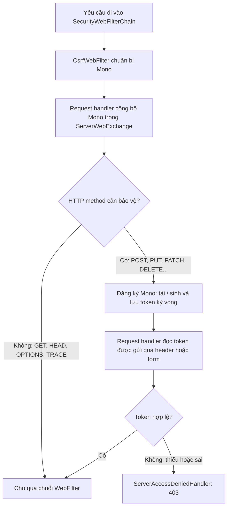

# CsrfWebFilter và luồng kiểm tra trong WebFlux

> **Chương:** CSRF trên Reactive  
> **Phạm vi:** Spring Security trên Spring WebFlux (Servlet dùng `CsrfFilter` và `HttpSecurity`, không dùng những API trong bài này).

Trong module `SPRING_SECURITY_HTTP_PROTECTION`, người học xây dựng nhiều lớp phòng vệ HTTP và trình duyệt: CSRF, CORS, security headers, CSP, HSTS, HTTP firewall và session. Bài này đi sâu vào **cách `CsrfWebFilter` ngăn yêu cầu giả mạo trên WebFlux**, từ lúc token được đưa vào `ServerWebExchange` đến khi yêu cầu thay đổi dữ liệu được cho qua hoặc bị trả `403 Forbidden`. Kiến thức này dùng được khi cấu hình ứng dụng Reactive, thử các kịch bản tấn công web và chẩn đoán lỗi bảo mật khi triển khai.

## 1. Vấn đề mà `CsrfWebFilter` giải quyết

**Cross-Site Request Forgery (CSRF)** xảy ra khi một trang do kẻ tấn công kiểm soát khiến trình duyệt của nạn nhân gửi yêu cầu đến ứng dụng mà nạn nhân đã đăng nhập. Trình duyệt có thể **tự đính kèm cookie phiên** (hoặc một số thông tin xác thực được gửi tự động), làm máy chủ tưởng yêu cầu đến từ người dùng hợp lệ.

Ví dụ: Alice đăng nhập `https://bank.example`, rồi mở một trang độc hại. Trang đó tạo biểu mẫu gửi `POST https://bank.example/transfer`; nếu máy chủ chỉ dựa vào cookie đăng nhập, yêu cầu có thể được xử lý dù Alice không hề muốn chuyển tiền.

Giải pháp **synchronizer token** yêu cầu một giá trị bí mật mà trang hợp lệ lấy từ ứng dụng và chủ động gửi trong **header** hoặc **trường form**. Trình duyệt không tự bổ sung trường này như cookie. `CsrfWebFilter` so sánh token khách gửi với token mà máy chủ trông đợi trước khi cho yêu cầu đi tiếp.

**Phân biệt rõ ba khái niệm:**

| Khái niệm | Vai trò |
| --- | --- |
| Xác thực (authentication) | Xác định người gọi là ai, chẳng hạn qua cookie phiên. |
| Phân quyền (authorization) | Xác định người gọi có quyền thực hiện thao tác không. |
| Chống CSRF | Xác nhận yêu cầu có nguồn gốc từ luồng giao diện hợp lệ, chống việc trang khác lợi dụng thông tin xác thực trình duyệt tự gửi. |

CSRF đặc biệt quan trọng với ứng dụng WebFlux dùng **session/cookie** để đăng nhập, kể cả khi các endpoint trả JSON. API chỉ chấp nhận bearer token do mã JavaScript chủ động đưa vào header `Authorization` và không dùng thông tin xác thực tự động từ trình duyệt có thể có mô hình rủi ro khác; phải đánh giá cách client xác thực trước khi quyết định bỏ CSRF.

## 2. Các thành phần phối hợp

| Thành phần Reactive | Trách nhiệm |
| --- | --- |
| `SecurityWebFilterChain` | Chuỗi filter bảo mật của WebFlux, được xây từ `ServerHttpSecurity`. |
| `CsrfWebFilter` | Thực hiện kiểm tra CSRF cho các HTTP method cần bảo vệ. |
| `ServerCsrfTokenRepository` | Tạo, tải và lưu token kỳ vọng; API Reactive trả `Mono`. |
| `WebSessionServerCsrfTokenRepository` | Repository mặc định, lưu token phía server trong `WebSession`. |
| `CookieServerCsrfTokenRepository` | Tùy chọn lưu token trong cookie `XSRF-TOKEN`, phù hợp một số SPA. |
| `ServerCsrfTokenRequestHandler` | Công bố token cho tầng giao diện và giải quyết giá trị token được gửi lên từ request. |
| `XorServerCsrfTokenRequestAttributeHandler` | Handler mặc định từ Spring Security 6, mã hóa/masking giá trị token công bố theo từng request nhằm giảm nguy cơ BREACH. |
| `ServerAccessDeniedHandler` | Xử lý trường hợp thiếu/sai token; mặc định trả `403 Forbidden`. |

**Hai token trong một lần kiểm tra:** *expected token* do repository cung cấp và *actual token* được lấy từ header hoặc tham số form. Giá trị mà view hiển thị có thể đã được XOR masking; request handler giải mã khi so sánh. Vì thế không nên tự lấy hai chuỗi từ các nguồn khác nhau rồi so trực tiếp.

## 3. Luồng xử lý một HTTP request

`CsrfWebFilter` là `WebFilter` trong hệ Reactive. Luồng dưới đây mô tả trách nhiệm chính, lược bỏ chi tiết nội bộ không ảnh hưởng đến cách dùng:



### Bước 1: Tạo nguồn token và công bố cho ứng dụng

Trong WebFlux, filter cung cấp một **`Mono<CsrfToken>`** dưới key `CsrfToken.class.getName()` (tên đầy đủ `org.springframework.security.web.server.csrf.CsrfToken`) trong `ServerWebExchange.getAttributes()`. Đây là publisher chứa token, **không phải một `CsrfToken` đã được tính sẵn**.

Repository mặc định kiểm tra token trong `WebSession`; khi chưa có token, nó có thể sinh và lưu một token mới. Công việc này diễn ra khi `Mono` được **subscribe**. Nếu một request `GET` chỉ đọc dữ liệu và không có view/handler nào tiêu thụ token thì thông thường không cần tạo session chỉ vì CSRF. Khi trang tạo form hoặc endpoint trả token được subscribe, token phải sẵn sàng để client gửi trong lần `POST` tiếp theo.

### Bước 2: Xác định request có cần CSRF hay không

Theo matcher mặc định, các method `GET`, `HEAD`, `OPTIONS` và `TRACE` không bị kiểm tra token; các method còn lại như `POST`, `PUT`, `PATCH` và `DELETE` phải có token hợp lệ.

Điều này **dựa vào HTTP method, không dựa vào tên URL**. Nếu một endpoint `GET /delete?id=10` thật sự xóa dữ liệu, filter mặc định không bảo vệ nó. Ứng dụng phải tuân thủ quy tắc **safe methods chỉ dùng để đọc**, không tạo tác dụng phụ có thể khai thác.

### Bước 3: Kiểm tra request làm thay đổi trạng thái

Với một yêu cầu `POST`:

1. Filter lấy **token kỳ vọng** từ repository trong ngữ cảnh request/session tương ứng.
2. Request handler tìm **token khách gửi** ở HTTP header hoặc trường form. Với cấu hình mặc định, trường form là `_csrf` và header là `X-CSRF-TOKEN`; repository cookie có quy ước `X-XSRF-TOKEN`.
3. Handler xử lý dạng token mà client gửi (ví dụ bỏ lớp XOR masking nếu đã bật).
4. Nếu thiếu, sai hoặc không khớp token kỳ vọng, filter gọi xử lý từ chối truy cập và kết thúc xử lý với `403`. Nếu hợp lệ, yêu cầu tiếp tục đến những filter và handler tiếp theo.

**`403` vì CSRF và `401` vì chưa đăng nhập là hai nguyên nhân khác nhau.** Một request có thể bị chặn CSRF trước khi mã controller hoặc nghiệp vụ chạy; không nên mặc định đổ lỗi cho phân quyền khi thấy `403`.

### Ba kịch bản minh họa

| Request | Token khách gửi | Kết quả ở lớp CSRF |
| --- | --- | --- |
| `GET /profile` | Không có | Bỏ qua kiểm tra CSRF; các lớp bảo mật khác vẫn chạy. |
| `POST /profile` với cookie phiên | Không có hoặc sai | `403 Forbidden`, không tới logic cập nhật hồ sơ. |
| `POST /profile` với cùng cookie/session | Token hợp lệ | Qua `CsrfWebFilter`, vẫn phải qua xác thực và phân quyền. |

## 4. Cấu hình WebFlux và lấy token cho client

Một cấu hình điển hình giữ nguyên CSRF mặc định:

```java
import org.springframework.context.annotation.Bean;
import org.springframework.context.annotation.Configuration;
import org.springframework.security.config.Customizer;
import org.springframework.security.config.annotation.web.reactive.EnableWebFluxSecurity;
import org.springframework.security.config.web.server.ServerHttpSecurity;
import org.springframework.security.web.server.SecurityWebFilterChain;

@Configuration
@EnableWebFluxSecurity
public class WebFluxSecurityConfig {

    @Bean
    SecurityWebFilterChain securityWebFilterChain(ServerHttpSecurity http) {
        return http
            .authorizeExchange(exchanges -> exchanges
                .pathMatchers("/assets/**", "/login", "/csrf").permitAll()
                .anyExchange().authenticated())
            .formLogin(Customizer.withDefaults())
            .csrf(Customizer.withDefaults()) // Mặc định đã bật; ghi rõ để dễ học.
            .build();
    }
}
```

Đây là **`ServerHttpSecurity` / `SecurityWebFilterChain` của Reactive**, không phải `HttpSecurity` / `SecurityFilterChain` của Servlet. Có thể bỏ dòng `csrf(Customizer.withDefaults())` mà CSRF vẫn bật theo mặc định.

Để thấy tính chất lazy của `Mono`, xem một endpoint ví dụ trả token cho client cùng origin:

```java
import java.util.Map;
import org.springframework.security.web.server.csrf.CsrfToken;
import org.springframework.web.bind.annotation.GetMapping;
import org.springframework.web.bind.annotation.RestController;
import org.springframework.web.server.ServerWebExchange;
import reactor.core.publisher.Mono;

@RestController
class CsrfTokenController {

    @GetMapping("/csrf")
    Mono<Map<String, String>> csrf(ServerWebExchange exchange) {
        Mono<CsrfToken> csrfToken =
            exchange.getAttribute(CsrfToken.class.getName());

        if (csrfToken == null) {
            return Mono.error(new IllegalStateException("CSRF filter chưa áp dụng"));
        }

        // map(...) khiến token được tải/sinh khi HTTP response được subscribe.
        return csrfToken.map(token -> Map.of(
            "headerName", token.getHeaderName(),
            "token", token.getToken()
        ));
    }
}
```

Nếu dùng repository session mặc định, trình duyệt cần giữ cùng cookie phiên khi gọi `GET /csrf` và `POST` tiếp theo. Ví dụ gọi từ JavaScript ở **cùng origin**:

```javascript
const { headerName, token } = await fetch("/csrf", {
  credentials: "same-origin"
}).then(response => response.json());

await fetch("/profile", {
  method: "POST",
  credentials: "same-origin",
  headers: {
    [headerName]: token,
    "Content-Type": "application/json"
  },
  body: JSON.stringify({ displayName: "Alice" })
});
```

Ở cấu hình mặc định, `token` endpoint trả về có thể là giá trị **đã masking**; hãy gửi nguyên giá trị đó theo `headerName`. Không tự đọc token thô của repository rồi ghép với một request handler yêu cầu token đã masking.

**Với form HTML dùng Thymeleaf:** Khi tích hợp Spring Security đúng cách, `RequestDataValueProcessor` có thể tự thêm hidden input vào các form POST. HTML render có dạng:

```html
<form action="/profile" method="post">
  <input type="hidden" name="_csrf" value="gia-tri-token-da-render">
  <input type="text" name="displayName">
  <button type="submit">Cập nhật</button>
</form>
```

Đoạn trên minh họa **HTML đầu ra**, không được hardcode token. Với view engine khác, phải đảm bảo tiêu thụ `Mono<CsrfToken>` và xuất token vào form/meta tag phù hợp.

## 5. Repository cookie, SPA và lớp XOR masking

Tùy chọn cookie thường gặp khi giao diện JavaScript đọc `XSRF-TOKEN`, rồi chủ động gửi giá trị trong header `X-XSRF-TOKEN`. Spring Security cung cấp `CookieServerCsrfTokenRepository`; cách bật cookie để JavaScript đọc được:

```java
import org.springframework.security.web.server.csrf.CookieServerCsrfTokenRepository;
import org.springframework.security.web.server.csrf.ServerCsrfTokenRequestAttributeHandler;

// Một đoạn cấu hình thay thế cho .csrf(Customizer.withDefaults()) bên trên:
.csrf(csrf -> csrf
    .csrfTokenRepository(CookieServerCsrfTokenRepository.withHttpOnlyFalse())
    .csrfTokenRequestHandler(new ServerCsrfTokenRequestAttributeHandler())
)
```

Vì mã JavaScript lấy **token thô** từ cookie, ví dụ này dùng `ServerCsrfTokenRequestAttributeHandler` để chấp nhận token thô trong header. **Đổi handler như vậy tắt lớp XOR masking chống BREACH**; đây là một lựa chọn có đánh đổi bảo mật, cần xem xét dữ liệu nào được phản chiếu vào nội dung nén. Giữ handler XOR mặc định và lấy giá trị đã masking qua trang/endpoint như ví dụ `GET /csrf` là cách khác.

Lưu ý với SPA:

- `withHttpOnlyFalse()` chỉ cần khi JavaScript phải đọc cookie. Nếu không phải đọc từ JavaScript, ưu tiên cookie `HttpOnly`.
- Token lưu trong cookie **không tự xuất hiện ở header**: client phải lấy cookie rồi đặt `X-XSRF-TOKEN` (hoặc dùng thư viện frontend có hỗ trợ). Gửi cookie một mình chưa vượt qua kiểm tra CSRF.
- Khi dùng phát token theo kiểu lazy, phải **subscribe** `Mono` (ví dụ gọi endpoint khởi tạo token) thì cookie/token mới chắc chắn được gửi đến client.
- Sau khi xác thực lại, đăng xuất, token bị xóa hoặc session hết hạn, client có thể phải lấy token mới. Tránh lưu vĩnh viễn giá trị token cũ trong bộ nhớ của SPA.
- CSRF **không thay thế** SameSite, CORS, HTTPS hay chống XSS. Cookie có thể bị client sửa; repository phía server cho phép liên kết token với phiên chặt hơn trong nhiều trường hợp.

## 6. Kiểm thử CSRF bằng `WebTestClient`

Giả sử ứng dụng có endpoint thử nghiệm dưới đây, trả `204 No Content` khi xử lý thành công:

```java
import org.springframework.http.ResponseEntity;
import org.springframework.web.bind.annotation.PostMapping;
import org.springframework.web.bind.annotation.RestController;
import reactor.core.publisher.Mono;

@RestController
class ChangeController {
    @PostMapping("/change")
    Mono<ResponseEntity<Void>> change() {
        return Mono.just(ResponseEntity.noContent().build());
    }
}
```

Với dependency test `spring-security-test`, `WebTestClient` có `SecurityMockServerConfigurers.csrf()` để mô phỏng token hợp lệ:

```java
import org.junit.jupiter.api.BeforeEach;
import org.junit.jupiter.api.Test;
import org.springframework.beans.factory.annotation.Autowired;
import org.springframework.boot.test.context.SpringBootTest;
import org.springframework.context.ApplicationContext;
import org.springframework.test.web.reactive.server.WebTestClient;

import static org.springframework.security.test.web.reactive.server.SecurityMockServerConfigurers.csrf;
import static org.springframework.security.test.web.reactive.server.SecurityMockServerConfigurers.mockUser;
import static org.springframework.security.test.web.reactive.server.SecurityMockServerConfigurers.springSecurity;

@SpringBootTest(webEnvironment = SpringBootTest.WebEnvironment.MOCK)
class ReactiveCsrfTest {
    @Autowired ApplicationContext applicationContext;
    WebTestClient client;

    @BeforeEach
    void setup() {
        client = WebTestClient.bindToApplicationContext(applicationContext)
            .apply(springSecurity())
            .configureClient()
            .build();
    }

    @Test
    void postWithoutCsrfIsForbidden() {
        client.mutateWith(mockUser())
            .post().uri("/change")
            .exchange()
            .expectStatus().isForbidden();
    }

    @Test
    void postWithValidCsrfIsAccepted() {
        client.mutateWith(mockUser()).mutateWith(csrf())
            .post().uri("/change")
            .exchange()
            .expectStatus().isNoContent();
    }

    @Test
    void postWithInvalidCsrfIsForbidden() {
        client.mutateWith(mockUser())
            .post().uri("/change")
            .header("X-CSRF-TOKEN", "token-sai")
            .exchange()
            .expectStatus().isForbidden();
    }
}
```

Thử nghiệm trên dùng **mock user** để tách vấn đề xác thực khỏi vấn đề CSRF. Chạy `WebTestClient` gắn với application context thật của bài thử để filter bảo mật được áp dụng. `mutateWith(csrf())` là tiện ích **kiểm thử**, không phải cú pháp client dùng trong production.

Ngoài các bài test này, nên thử `GET` không có token, `POST` có token của session khác, token cũ sau khi session timeout và yêu cầu `POST /logout` (nếu bật đăng xuất). Với request CORS, hãy phân biệt lỗi preflight (thường `OPTIONS`) với lỗi `403` do CSRF của request thật.

## 7. Các lỗi thường gặp và cách chẩn đoán

| Triệu chứng | Nguyên nhân cần kiểm tra | Hướng xử lý |
| --- | --- | --- |
| Form POST trả `403`, GET vẫn tải được | Form không chứa `_csrf` hoặc value đã cũ | Xem HTML thực tế, tích hợp view engine và nơi consume `Mono<CsrfToken>`. |
| Fetch POST trả `403` dù đã đăng nhập | Chỉ gửi cookie, thiếu header CSRF; hoặc header tên khác | Kiểm tra header thực trên Network tab và `CsrfToken.getHeaderName()`. |
| SPA đọc `XSRF-TOKEN` nhưng POST vẫn lỗi | Client gửi token thô trong khi handler mặc định mong giá trị XOR-masked | Đồng bộ chiến lược xuất/nhận token và request handler; cân nhắc đánh đổi BREACH. |
| Refresh trang mới hoạt động, lần đầu POST bị chặn | Token lazy chưa được subscribe/khởi tạo hoặc cookie phiên chưa đồng bộ | Render/đọc token trước thao tác ghi, giữ cùng session. |
| Sau đăng nhập hoặc session timeout, POST lỗi | Token đã bị thay thế, session/cookie/token phía client không đồng bộ | Lấy token mới, không tái sử dụng token cũ. |
| Endpoint thay đổi dữ liệu qua GET không bị CSRF chặn | GET nằm ngoài matcher mặc định | Sửa endpoint sang POST/PUT/PATCH/DELETE và bảo vệ bằng CSRF. |
| Thử với bearer token vẫn bị kiểm tra CSRF | Matcher mặc định kiểm tra theo HTTP method, không tự đoán cơ chế xác thực | Thiết kế security chain/matcher rõ ràng dựa trên yêu cầu thực tế; không tắt toàn bộ chỉ để vượt lỗi. |

**Điểm cần nhớ khi vận hành:**

1. CSRF được bật mặc định trên WebFlux; `CsrfWebFilter` gắn với `SecurityWebFilterChain`.
2. Request safe có thể đi tiếp mà không subscribe token; request unsafe cần giá trị khách gửi khớp token kỳ vọng.
3. `Mono<CsrfToken>` phải được tiêu thụ khi muốn render hoặc cung cấp token cho browser.
4. Handler XOR mặc định và cách phát token cho SPA phải **tương thích** với nhau.
5. `403` CSRF là dấu hiệu cần đối chiếu **HTTP method → session → repository → request handler → header/form**, trước khi sửa phân quyền.

## Tài liệu chính thức để tra cứu sâu hơn

- [Spring Security — CSRF for WebFlux](https://docs.spring.io/spring-security/reference/reactive/exploits/csrf.html)
- [Spring Security — Testing with CSRF (Reactive)](https://docs.spring.io/spring-security/reference/reactive/test/web/csrf.html)
- [API — CsrfWebFilter](https://docs.spring.io/spring-security/reference/api/java/org/springframework/security/web/server/csrf/CsrfWebFilter.html)
- [API — ServerHttpSecurity.CsrfSpec](https://docs.spring.io/spring-security/reference/api/java/org/springframework/security/config/web/server/ServerHttpSecurity.CsrfSpec.html)
