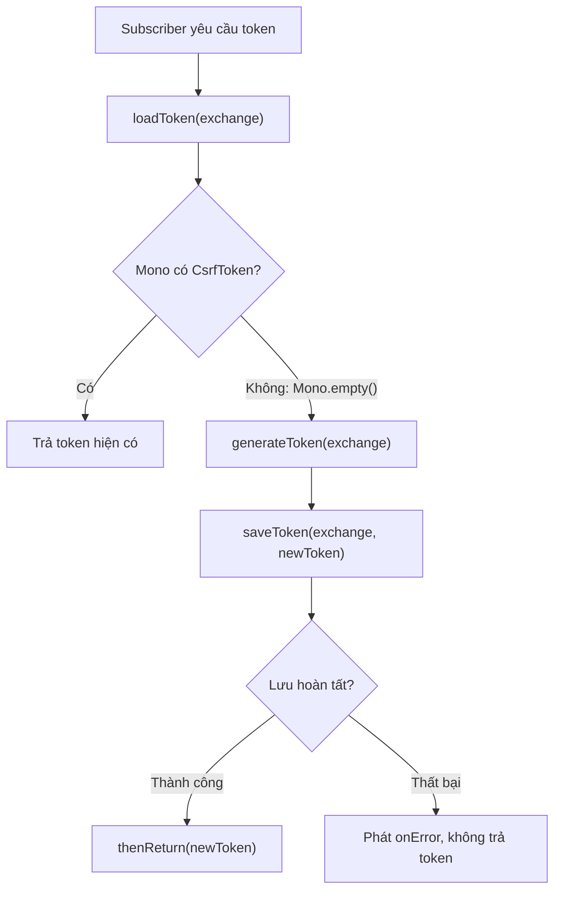

# ServerCsrfTokenRepository và các thao tác không chặn

> **Chương:** CSRF trên Reactive  
> **Mục tiêu:** Hiểu hợp đồng lưu trữ CSRF token của Spring Security WebFlux, sử dụng đúng các publisher `Mono` và thiết kế luồng sinh – lưu – tải – xóa token mà không chặn luồng xử lý request.

Trong module `SPRING_SECURITY_HTTP_PROTECTION`, chúng ta bảo vệ HTTP và trình duyệt bằng nhiều cơ chế phối hợp: CSRF, CORS, security headers, CSP, HSTS, HTTP firewall và session. Phần CSRF dành cho WebFlux có một điểm cần nắm riêng: **nguồn lưu token cũng tham gia vào luồng Reactive**. Bài này tập trung vào `ServerCsrfTokenRepository` và cách ghép các thao tác không chặn để bảo vệ ứng dụng dùng WebFlux, kiểm thử kịch bản tấn công, đồng thời chẩn đoán sự cố khi token, cookie và session không đồng bộ.

## 1. Repository giữ vai trò gì trong chống CSRF?

Khi trình duyệt đăng nhập bằng cookie/session, cookie có thể tự đi theo những yêu cầu HTTP đến cùng website. Vì vậy, một `POST` thay đổi dữ liệu cần chứng minh rằng client có **CSRF token** được ứng dụng hợp lệ cấp, thay vì chỉ dựa vào cookie đăng nhập.

Trong WebFlux, `CsrfWebFilter` quyết định yêu cầu có phải kiểm tra CSRF hay không và so sánh token mà client gửi với token kỳ vọng. **`ServerCsrfTokenRepository` chịu trách nhiệm vòng đời của *token kỳ vọng***: tạo mới, lưu ở đâu và lấy lại thế nào. Repository **không** tự đọc header khách gửi hay tự trả `403`; việc đó thuộc filter và request handler.

Ví dụ một vòng đời:

1. Người dùng mở trang có form cập nhật hồ sơ. Ứng dụng cần token để render form.
2. Repository tìm token trong `WebSession`. Nếu chưa có, token được sinh và lưu.
3. Trang gửi token trong hidden field `_csrf` hoặc header thích hợp khi người dùng bấm Lưu.
4. `CsrfWebFilter` lấy token kỳ vọng từ repository và xác minh token khách gửi. Thiếu hoặc không hợp lệ thì chặn trước khi gọi controller.
5. Khi token bị thu hồi, repository phải xóa nó; lần cấp sau sẽ dùng token mới.

Đừng nhầm `ServerCsrfTokenRepository` (Reactive, nhận `ServerWebExchange`, trả `Mono`) với `CsrfTokenRepository` của Servlet (nhận `HttpServletRequest`/`HttpServletResponse`, API đồng bộ).

## 2. Ba phương thức của `ServerCsrfTokenRepository`

Hợp đồng chính của `org.springframework.security.web.server.csrf.ServerCsrfTokenRepository`:

```java
public interface ServerCsrfTokenRepository {

    Mono<CsrfToken> generateToken(ServerWebExchange exchange);

    Mono<Void> saveToken(ServerWebExchange exchange, CsrfToken token);

    Mono<CsrfToken> loadToken(ServerWebExchange exchange);
}
```

Trong `saveToken`, tham số `token` **có thể là `null`** để yêu cầu xóa token. Đoạn khai báo rút gọn trên chỉ thể hiện chữ ký chính để dễ đọc; annotation nullable cụ thể phụ thuộc phiên bản thư viện.

| Phương thức | Ý nghĩa | Tín hiệu Reactive cần hiểu |
| --- | --- | --- |
| `generateToken(exchange)` | Tạo một `CsrfToken` mới, gồm tên header, tên tham số form và giá trị token. | `Mono<CsrfToken>` phát ra token khi được subscribe; **chưa nhất thiết đã lưu**. |
| `saveToken(exchange, token)` | Ghi token vào cơ chế lưu trữ được chọn. `token == null` nghĩa là xóa. | `Mono<Void>` hoàn tất khi thao tác lưu/xóa hoàn tất; cần **compose** vào pipeline. |
| `loadToken(exchange)` | Đọc token kỳ vọng gắn với exchange/session hiện tại. | `Mono<CsrfToken>` nếu tìm thấy; `Mono.empty()` khi không có; lỗi lưu trữ phải phát `onError`. |

`CsrfToken` có các getter thường dùng: `getToken()`, `getHeaderName()` và `getParameterName()`. Giá trị token cần được tạo với độ ngẫu nhiên đủ mạnh và giữ kín với người dùng/session khác. `generateToken()` **không tương đương** `loadToken()`: nếu ứng dụng tự tạo token nhưng không lưu, request sau không thể đối chiếu với token đó.

### `Mono.empty()` khác `null` và khác lỗi

- `loadToken()` không tìm thấy giá trị thì hoàn tất không có phần tử (`Mono.empty()`); không được phát `null` bằng `Mono.just(null)`.
- Lỗi I/O như Redis mất kết nối phải trở thành `Mono.error(...)` để hạ tầng nhận biết sự cố. Không nên nuốt lỗi rồi coi là `Mono.empty()`, vì như thế có thể tạo token mới ngoài ý muốn hoặc che giấu lỗi vận hành.
- `saveToken()` trả `Mono<Void>` nên khi lưu thành công ta chờ tín hiệu **completion**, không chờ một phần tử giá trị.

## 3. “Không chặn” trong WebFlux có nghĩa gì?

**Không chặn (non-blocking)** nói về cách thực hiện công việc trên luồng Reactor/Netty. Trong một pipeline đúng, khi cần đợi I/O, chương trình trả quyền sử dụng thread cho hệ thống, rồi tiếp tục khi có kết quả. Nó **không có nghĩa** là bỏ qua việc từ chối yêu cầu CSRF không hợp lệ.

Một lệnh trả về `Mono` thường chỉ **mô tả công việc**:

```java
Mono<CsrfToken> mono = repository.loadToken(exchange);
// Chưa thể suy ra load đã hoàn tất tại đây.
```

Spring WebFlux và `CsrfWebFilter` sẽ subscribe pipeline ở đúng nơi cần thiết. Khi **tự viết thành phần Reactive**, hãy kết hợp operator thay vì thực thi thủ công:

| Cách làm | Đánh giá | Lý do |
| --- | --- | --- |
| `repo.saveToken(exchange, token).thenReturn(token)` | Đúng | Chỉ phát token sau khi hoàn tất lưu. |
| `repo.loadToken(exchange).switchIfEmpty(...)` | Đúng | Rẽ nhánh khi chưa có token. |
| `repo.saveToken(exchange, token).subscribe()` trong handler | Sai trong trường hợp thông thường | Tách việc ghi ra khỏi request; kết quả/exception có thể bị bỏ qua và request chạy trước khi lưu xong. |
| `repo.loadToken(exchange).block()` trên event loop | Sai | Chặn thread xử lý Reactive, có thể gây nghẽn hoặc lỗi khi block trên non-blocking scheduler. |
| `repo.saveToken(exchange, token); return Mono.just(token);` | Sai | Bỏ rơi publisher, thao tác lưu có thể chưa từng chạy. |
| Gọi Redis/JDBC **đồng bộ** trong `Mono.fromCallable()` | Chưa đủ để không chặn | Chuyển lời gọi vào `Mono` không làm I/O đồng bộ trở nên bất đồng bộ. Ưu tiên client Reactive, hoặc cô lập tác vụ legacy trên scheduler phù hợp. |

### Ghép đúng thứ tự: tải → (sinh → lưu) → trả token

Ví dụ dưới đây giúp đọc ý nghĩa operator. Spring Security đã có cơ chế sinh/lưu token trong filter; **không cần tự gọi phương thức này cho mỗi request production**.

```java
import org.springframework.security.web.server.csrf.CsrfToken;
import org.springframework.security.web.server.csrf.ServerCsrfTokenRepository;
import org.springframework.web.server.ServerWebExchange;
import reactor.core.publisher.Mono;

final class CsrfTokenFlow {
    private final ServerCsrfTokenRepository repository;

    CsrfTokenFlow(ServerCsrfTokenRepository repository) {
        this.repository = repository;
    }

    Mono<CsrfToken> loadOrCreate(ServerWebExchange exchange) {
        return repository.loadToken(exchange)
            .switchIfEmpty(Mono.defer(() ->
                repository.generateToken(exchange)
                    .flatMap(newToken ->
                        repository.saveToken(exchange, newToken)
                            .thenReturn(newToken))
            ));
    }
}
```

Với token đã có, `switchIfEmpty` không chạy nhánh sinh mới. Nếu chưa có token, `Mono.defer` chỉ xây nhánh sinh/lưu **khi được yêu cầu**. `flatMap` chờ chuỗi thao tác bất đồng bộ `saveToken`; `thenReturn` chỉ trả token khi việc lưu thành công. Nếu lưu thất bại, pipeline phát lỗi thay vì phát token chưa được lưu.

**Lưu ý nhiều subscription:** `Mono` có thể thực hiện lại công việc mỗi lần có subscriber. Nếu bạn tự đưa một pipeline sinh/lưu vào nhiều nơi trong **cùng request**, cân nhắc dùng `.cache()` trên publisher có phạm vi request hoặc dùng cơ chế quản lý token do Spring Security cung cấp. Không dùng cache toàn cục cho token gắn với những phiên người dùng khác nhau.



## 4. Chọn repository có sẵn

Spring Security WebFlux cung cấp hai implementation phổ biến:

| Tiêu chí | `WebSessionServerCsrfTokenRepository` | `CookieServerCsrfTokenRepository` |
| --- | --- | --- |
| Lưu token kỳ vọng | Thuộc tính trong `WebSession` phía ứng dụng. | Cookie `XSRF-TOKEN` trong trình duyệt. |
| Mặc định sử dụng | **Có**. | Không, phải cấu hình rõ. |
| Tên header mặc định | `X-CSRF-TOKEN` | `X-XSRF-TOKEN` |
| Tên tham số form mặc định | `_csrf` | `_csrf` |
| Điểm mạnh | Token gắn với session, ít cần để lộ token lưu trữ cho JavaScript. | Tích hợp một số SPA có cơ chế đọc cookie và gửi header. |
| Điều cần chú ý | Đúng cookie/session ở các request; session hết hạn/đổi làm token cũ mất hiệu lực. | Cấu hình cookie, header, masking và chính sách trust của domain; cookie không tự biến thành header. |

### Cấu hình repository mặc định

```java
import org.springframework.context.annotation.Bean;
import org.springframework.context.annotation.Configuration;
import org.springframework.security.config.annotation.web.reactive.EnableWebFluxSecurity;
import org.springframework.security.config.web.server.ServerHttpSecurity;
import org.springframework.security.web.server.SecurityWebFilterChain;
import org.springframework.security.web.server.csrf.WebSessionServerCsrfTokenRepository;

@Configuration
@EnableWebFluxSecurity
class SecurityConfig {

    @Bean
    SecurityWebFilterChain securityWebFilterChain(ServerHttpSecurity http) {
        return http
            .authorizeExchange(exchanges -> exchanges
                .pathMatchers("/csrf").permitAll()
                .anyExchange().authenticated())
            .csrf(csrf -> csrf
                .csrfTokenRepository(new WebSessionServerCsrfTokenRepository()))
            .build();
    }
}
```

Đây là cấu hình **Reactive** (`ServerHttpSecurity`/`SecurityWebFilterChain`). Dòng `csrfTokenRepository(...)` chỉ viết tường minh repository mặc định; ứng dụng thông thường không cần cấu hình lại. Nếu ứng dụng cần form login, hãy thêm cấu hình xác thực phù hợp. `permitAll()` cho endpoint phát token **không tự tắt** bước kiểm tra CSRF ở các request unsafe.

### Cookie repository khi frontend cần token

```java
import org.springframework.security.web.server.csrf.CookieServerCsrfTokenRepository;

// Thay đoạn .csrf(...) trong SecurityWebFilterChain bằng:
.csrf(csrf -> csrf
    .csrfTokenRepository(CookieServerCsrfTokenRepository.withHttpOnlyFalse())
)
```

`withHttpOnlyFalse()` cho phép JavaScript đọc cookie. Đây là quyền mở rộng có chủ đích; nếu JavaScript không cần đọc cookie thì ưu tiên cấu hình giữ `HttpOnly`. Cần dùng HTTPS, cân nhắc `Secure`, `SameSite`, `Path` và `Domain` để không vô tình mở rộng vùng tin cậy của cookie.

**Tương thích với request handler:** Từ Spring Security 6, `XorServerCsrfTokenRequestAttributeHandler` mặc định công bố token có masking để giảm rủi ro BREACH. Token **thô** lấy trực tiếp từ cookie có thể không được handler XOR mặc định diễn giải như token đã masking từ form/view. Nếu frontend gửi token đọc từ cookie, cấu hình request handler phải khớp chiến lược đó; nếu giữ XOR, hãy lấy token đã masking từ view hoặc endpoint cung cấp token. Không nên vô hiệu hóa masking chỉ để làm hết lỗi `403` mà không đánh giá tác động.

## 5. Khi nào cần repository tùy chỉnh?

Chỉ viết `ServerCsrfTokenRepository` riêng khi nơi lưu trữ hoặc vòng đời token có yêu cầu đặc biệt: ví dụ hệ thống Reactive lưu dữ liệu qua Redis, tích hợp quy định thu hồi token hoặc theo dõi truy cập trong một hạ tầng nhiều node.

Đoạn dưới minh họa cách kết nối **Spring Data Redis Reactive** (phụ thuộc `spring-data-redis` với cấu hình `ReactiveStringRedisTemplate`). Ví dụ nhằm làm rõ *non-blocking composition*, chưa phải một giải pháp production hoàn chỉnh cho mọi kiểu session.

```java
import java.time.Duration;
import java.util.UUID;
import org.springframework.data.redis.core.ReactiveStringRedisTemplate;
import org.springframework.security.web.server.csrf.CsrfToken;
import org.springframework.security.web.server.csrf.DefaultCsrfToken;
import org.springframework.security.web.server.csrf.ServerCsrfTokenRepository;
import org.springframework.web.server.ServerWebExchange;
import reactor.core.publisher.Mono;

public final class RedisServerCsrfTokenRepository
        implements ServerCsrfTokenRepository {

    private static final String HEADER = "X-CSRF-TOKEN";
    private static final String PARAMETER = "_csrf";
    private static final Duration TTL = Duration.ofMinutes(30);

    private final ReactiveStringRedisTemplate redis;

    public RedisServerCsrfTokenRepository(ReactiveStringRedisTemplate redis) {
        this.redis = redis;
    }

    private Mono<String> key(ServerWebExchange exchange) {
        // Liên kết token với phiên, không dùng một khóa dùng chung toàn hệ thống.
        return exchange.getSession()
            .map(session -> "csrf:session:" + session.getId());
    }

    @Override
    public Mono<CsrfToken> generateToken(ServerWebExchange exchange) {
        return Mono.fromSupplier(() -> new DefaultCsrfToken(
            HEADER, PARAMETER, UUID.randomUUID().toString()
        ));
    }

    @Override
    public Mono<Void> saveToken(ServerWebExchange exchange, CsrfToken token) {
        return key(exchange)
            .flatMap(key -> token == null
                ? redis.delete(key).then()
                : redis.opsForValue().set(key, token.getToken(), TTL).then()
            )
            .then();
    }

    @Override
    public Mono<CsrfToken> loadToken(ServerWebExchange exchange) {
        return key(exchange)
            .flatMap(key -> redis.opsForValue().get(key))
            .map(value -> new DefaultCsrfToken(HEADER, PARAMETER, value));
    }
}
```

**Điểm đáng học trong ví dụ:** `redis.opsForValue().get/set` và `redis.delete` trả publisher bất đồng bộ. `flatMap` đợi chúng hoàn tất; `.then()` chuyển kết quả thành `Mono<Void>` như hợp đồng yêu cầu. Không có `block()`, `subscribe()` thủ công hay I/O đồng bộ trên event loop. Sinh UUID là công việc ngắn trong `Mono.fromSupplier`.

**Những việc cần hoàn thiện trước production:**

- Căn thời hạn Redis `TTL` với thời hạn của phiên; xác định cách dọn khóa khi session kết thúc, đổi ID hoặc đăng xuất. Nếu TTL hết trước session, token cần được cấp lại.
- Xử lý nhiều request đồng thời của cùng session khi token chưa tồn tại: thao tác tải-rồi-sinh-rồi-lưu có thể bị race, khiến token mà hai response gửi đi không còn cùng giá trị kỳ vọng. Cần chiến lược tạo một lần theo session hoặc cơ chế nguyên tử thích hợp.
- Cân nhắc session ID bị đổi khi đăng nhập; token liên kết khóa cũ không còn đúng. Kiểm tra hành vi xoay token theo chính sách bảo mật ứng dụng.
- Bảo vệ hệ thống Redis bằng TLS và quyền truy cập, không ghi token thô hay session ID vào log, không dùng một token cho nhiều người dùng.
- Chỉ đăng ký **một** repository nhất quán cho filter và các phần dùng token; nếu một service sinh theo session còn filter lại tải từ cookie thì kiểm tra sẽ thất bại.

Khi chưa có yêu cầu đặc biệt, `WebSessionServerCsrfTokenRepository` là lựa chọn ít rủi ro hơn. Nếu cần phân tán session giữa nhiều node, có thể dùng giải pháp session Reactive phù hợp mà vẫn giữ repository mặc định, thay vì tự viết cơ chế token.

## 6. Đưa token cho giao diện mà không tự truy cập repository

Repository giữ **token lưu trữ**. Spring Security còn có `ServerCsrfTokenRequestHandler` để cung cấp token cho giao diện, bao gồm lớp masking ở những phiên bản có bảo vệ BREACH mặc định. Vì thế, endpoint hiển thị token nên lấy `Mono<CsrfToken>` từ `ServerWebExchange` thay vì gọi thẳng `repository.loadToken()` rồi gửi token thô.

```java
import org.springframework.http.CacheControl;
import org.springframework.http.ResponseEntity;
import org.springframework.security.web.server.csrf.CsrfToken;
import org.springframework.web.bind.annotation.GetMapping;
import org.springframework.web.bind.annotation.RestController;
import org.springframework.web.server.ServerWebExchange;
import reactor.core.publisher.Mono;

@RestController
class CsrfEndpoint {

    record CsrfResponse(String headerName, String parameterName, String token) {}

    @GetMapping("/csrf")
    Mono<ResponseEntity<CsrfResponse>> csrf(ServerWebExchange exchange) {
        Mono<CsrfToken> publisher =
            exchange.getAttribute(CsrfToken.class.getName());

        if (publisher == null) {
            return Mono.error(
                new IllegalStateException("Không có CsrfWebFilter trong chain"));
        }

        return publisher.map(token -> ResponseEntity.ok()
            .cacheControl(CacheControl.noStore())
            .body(new CsrfResponse(
                token.getHeaderName(),
                token.getParameterName(),
                token.getToken()
            )));
    }
}
```

Endpoint `GET /csrf` chỉ dùng trong vùng truy cập tin cậy (thường cùng origin); cấu hình CORS không được để origin không tin cậy đọc token. Khi client gửi `POST`, cần dùng **cùng phiên/cookie** và đặt chính xác token được xuất từ handler vào tên header đã trả về. `Cache-Control: no-store` giúp tránh cache token trong trung gian. Đừng log toàn bộ JSON của endpoint này.

Ví dụ JavaScript cùng origin:

```javascript
const csrf = await fetch("/csrf", {
  credentials: "same-origin"
}).then(response => response.json());

await fetch("/profile", {
  method: "POST",
  credentials: "same-origin",
  headers: {
    "Content-Type": "application/json",
    [csrf.headerName]: csrf.token
  },
  body: JSON.stringify({ displayName: "Lan" })
});
```

## 7. Kiểm thử hợp đồng repository bằng Reactor Test

Với dependency `reactor-test` và `spring-test`, `StepVerifier` giúp xác minh thứ tự tín hiệu và trạng thái token. Ví dụ dùng implementation mặc định để kiểm thử vòng đời, không cần khởi chạy Redis:

```java
import org.junit.jupiter.api.Test;
import org.springframework.mock.http.server.reactive.MockServerHttpRequest;
import org.springframework.mock.web.server.MockServerWebExchange;
import org.springframework.security.web.server.csrf.CsrfToken;
import org.springframework.security.web.server.csrf.WebSessionServerCsrfTokenRepository;
import reactor.core.publisher.Mono;
import reactor.test.StepVerifier;

class ServerCsrfTokenRepositoryTest {

    private final WebSessionServerCsrfTokenRepository repository =
        new WebSessionServerCsrfTokenRepository();

    @Test
    void generatedTokenCanBeSavedAndLoaded() {
        var exchange = MockServerWebExchange.from(
            MockServerHttpRequest.get("/profile"));

        Mono<Boolean> roundTrip = repository.generateToken(exchange)
            .flatMap(created ->
                repository.saveToken(exchange, created)
                    .then(repository.loadToken(exchange))
                    .map(loaded ->
                        created.getToken().equals(loaded.getToken())));

        StepVerifier.create(roundTrip)
            .expectNext(true)
            .verifyComplete();
    }

    @Test
    void missingAndDeletedTokenAreEmpty() {
        var exchange = MockServerWebExchange.from(
            MockServerHttpRequest.get("/profile"));

        StepVerifier.create(repository.loadToken(exchange))
            .verifyComplete(); // Chưa lưu gì -> Mono.empty().

        Mono<Boolean> afterDelete = repository.generateToken(exchange)
            .flatMap(token -> repository.saveToken(exchange, token))
            .then(repository.saveToken(exchange, null))
            .then(repository.loadToken(exchange).hasElement());

        StepVerifier.create(afterDelete)
            .expectNext(false)
            .verifyComplete();
    }
}
```

Hai bài test trên xác nhận **thao tác lưu được thực hiện trước khi tải**, token không tồn tại biểu diễn bằng publisher rỗng, và `saveToken(exchange, null)` thực sự xóa token. Với custom Redis repository, hãy bổ sung kiểm thử repository gặp lỗi kết nối (không lén đổi lỗi thành `Mono.empty()`), TTL, hai session tách biệt và hai yêu cầu cùng session chạy đồng thời.

Để xác nhận bảo vệ HTTP thực tế, bổ sung test `WebTestClient` ở tầng `SecurityWebFilterChain`: `POST` thiếu token trả `403`; `POST` có `csrf()` từ `spring-security-test` tiếp tục qua filter; token của phiên khác phải bị từ chối. **Kiểm thử repository thành công không tự chứng minh toàn bộ cấu hình CSRF đúng**.

## 8. Bảng chẩn đoán lỗi thường gặp

| Biểu hiện | Nguyên nhân có thể | Cách kiểm tra và sửa |
| --- | --- | --- |
| Client nhận token rồi POST vẫn `403` | Token sinh nhưng chưa lưu, hoặc POST đi kèm session khác | Xem pipeline có `thenReturn` sau `saveToken` hay không; kiểm tra cookie/session hai request. |
| Chỉ request đầu tiên sau khi login lỗi | Token cũ bị thu hồi, hoặc token lazy chưa được cung cấp lại | Yêu cầu token mới sau khi phiên/xác thực thay đổi; đừng gửi token cache cũ. |
| Repository trả token ngẫu nhiên mỗi lần `GET` | Lỗi điều kiện `loadToken` hay tạo mới không kiểm tra token cũ | Phân biệt `Mono.empty()` với token tồn tại; lưu và tái sử dụng đúng lifecycle. |
| Có lúc lỗi khi hai tab cùng mở form | Sinh hai token cùng lúc và ghi đè token đang dùng | Kiểm thử concurrency; đồng bộ việc tạo token ở nơi lưu trữ. |
| Ứng dụng bị nghẽn dưới tải | Gọi client Redis/JDBC sync hoặc `block()` trong pipeline | Dùng driver Reactive và operator `flatMap`/`then`; kiểm tra thread và tracing. |
| `saveToken` chạy mà token không xuất hiện | `Mono` chưa từng được subscribe, hoặc lỗi bị tách khỏi request | Trả publisher hợp thành cho framework; tránh gọi `subscribe()` thủ công. |
| Cookie `XSRF-TOKEN` tồn tại nhưng request vẫn `403` | Cookie không tự tạo header; token thô không khớp chiến lược XOR | Kiểm tra header trên request và cách `ServerCsrfTokenRequestHandler` nhận token. |
| Nhiều node cho kết quả khác nhau | Token/session lưu cục bộ, hoặc repo của mỗi node khác cấu hình | Dùng session store phân tán/Reactive backend chung và thống nhất repository. |

### Những điểm cần nhớ

1. **`ServerCsrfTokenRepository` quản lý token kỳ vọng**, còn `CsrfWebFilter` và request handler xác minh yêu cầu HTTP.
2. `generateToken` tạo; `saveToken` lưu hoặc xóa; `loadToken` tải. `Mono.empty()` nghĩa là chưa có token, không phải đã xác minh thành công.
3. **Ghép pipeline** bằng `flatMap`, `switchIfEmpty`, `then` và `thenReturn` để xử lý tuần tự mà không chặn event loop.
4. Token sử dụng trong trình duyệt phải tương thích với cookie/session và cơ chế masking của handler.
5. Với custom repository, phải nghĩ thêm về TTL, xoay session, nhiều request đồng thời, lưu trữ an toàn và kiểm thử luồng thực tế.

## Tài liệu tham khảo chính thức

- [Spring Security — CSRF for WebFlux](https://docs.spring.io/spring-security/reference/reactive/exploits/csrf.html)
- [API — ServerCsrfTokenRepository](https://docs.spring.io/spring-security/reference/api/java/org/springframework/security/web/server/csrf/ServerCsrfTokenRepository.html)
- [API — WebSessionServerCsrfTokenRepository](https://docs.spring.io/spring-security/reference/api/java/org/springframework/security/web/server/csrf/WebSessionServerCsrfTokenRepository.html)
- [API — CookieServerCsrfTokenRepository](https://docs.spring.io/spring-security/reference/api/java/org/springframework/security/web/server/csrf/CookieServerCsrfTokenRepository.html)
- [Project Reactor — Mono](https://projectreactor.io/docs/core/release/api/reactor/core/publisher/Mono.html)
