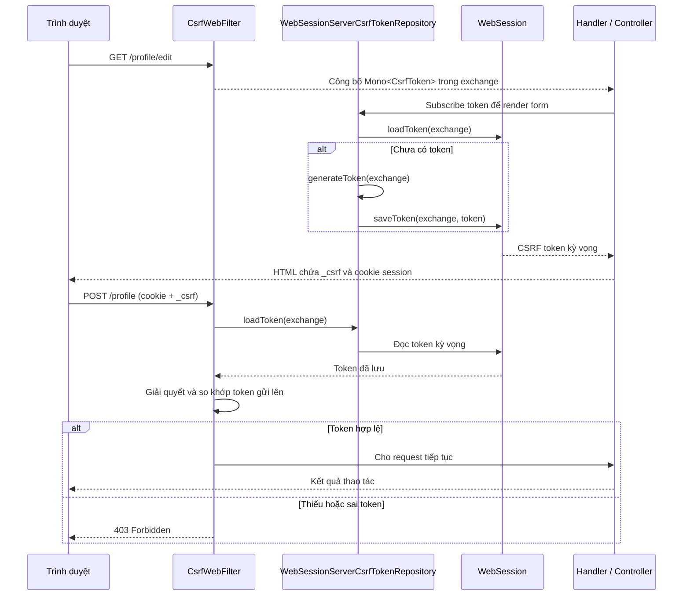

# WebSessionServerCsrfTokenRepository

> **Chương:** CSRF trên Reactive  
> **Bối cảnh:** Spring Security cho **Spring WebFlux**; các API chính trong bài thuộc package `org.springframework.security.web.server.csrf`.

Trong module `SPRING_SECURITY_HTTP_PROTECTION`, người học áp dụng các lớp phòng vệ HTTP và trình duyệt, bao gồm CSRF, CORS, security headers, CSP, HSTS, HTTP firewall và bảo vệ session. Với WebFlux, `WebSessionServerCsrfTokenRepository` là thành phần mặc định giúp ứng dụng lưu **CSRF token kỳ vọng** trong `WebSession`, để `CsrfWebFilter` kiểm tra những yêu cầu có thể thay đổi dữ liệu. Bài học đi sâu vào cách repository hoạt động, API và cấu hình, vòng đời session, kiểm thử Reactive và chẩn đoán lỗi khi triển khai.

## 1. Vì sao cần lưu CSRF token trong WebSession?

Giả sử trình duyệt của Lan đã đăng nhập `https://shop.example` bằng cookie phiên. Một trang độc hại có thể cố tạo yêu cầu `POST https://shop.example/account/email`. Khi trình duyệt tự gửi cookie đến `shop.example`, máy chủ chỉ dựa vào cookie đăng nhập có thể nhầm đây là một hành động có chủ đích của Lan.

CSRF protection yêu cầu thêm token mà giao diện hợp lệ lấy từ máy chủ rồi **chủ động** gửi trong header hoặc trường form. Với mô hình lưu bằng session:

- **Phía server:** Lưu CSRF token kỳ vọng trong thuộc tính của `WebSession` tương ứng người dùng/trình duyệt.
- **Phía browser:** Thường chỉ mang cookie **nhận diện session**, còn token cho form/header được đưa vào HTML hoặc trả qua một endpoint cùng origin. Cookie session tự gửi không đủ để vượt kiểm tra CSRF.
- **Khi gửi POST:** `CsrfWebFilter` lấy token kỳ vọng từ repository và kiểm tra token do client gửi. Token thiếu hoặc không khớp dẫn đến `403 Forbidden` trước khi controller xử lý.

CSRF bổ sung cho xác thực, phân quyền và bảo vệ session. Nó không thay thế SameSite cookie, HTTPS, CORS hay chống XSS: nếu có XSS, script độc hại trong cùng origin thường có thể lấy token hợp lệ.

### Phân biệt Servlet và Reactive

| Khía cạnh | Spring MVC/Servlet | Spring WebFlux/Reactive |
| --- | --- | --- |
| Kho session | `HttpSession` | `WebSession` |
| Repository session | `HttpSessionCsrfTokenRepository` | **`WebSessionServerCsrfTokenRepository`** |
| Filter kiểm tra | `CsrfFilter` | `CsrfWebFilter` |
| Đối tượng cấu hình | `HttpSecurity` | `ServerHttpSecurity` |
| Lấy/lưu token | API đồng bộ với Servlet request/response | `Mono<CsrfToken>` / `Mono<Void>` với `ServerWebExchange` |

Không dùng `HttpSessionCsrfTokenRepository` trong `SecurityWebFilterChain` của WebFlux; hai hệ có kiểu request và session khác nhau.

## 2. Repository mặc định và ba phương thức Reactive

Spring Security WebFlux bật CSRF theo mặc định và dùng `WebSessionServerCsrfTokenRepository` làm kho lưu token kỳ vọng khi bạn không chọn repository khác. Class này implements `ServerCsrfTokenRepository`:

```java
// Hợp đồng rút gọn để đọc hiểu, không phải mã cần tự định nghĩa lại.
public interface ServerCsrfTokenRepository {
    Mono<CsrfToken> generateToken(ServerWebExchange exchange);
    Mono<Void> saveToken(ServerWebExchange exchange, CsrfToken token);
    Mono<CsrfToken> loadToken(ServerWebExchange exchange);
}
```

| Phương thức | Chức năng | Lưu ý về `Mono` |
| --- | --- | --- |
| `generateToken(exchange)` | Sinh `CsrfToken` mới, chứa tên header, tên tham số và giá trị token. | **Sinh chưa đồng nghĩa đã lưu**; chỉ có hiệu lực trong pipeline khi được subscribe. |
| `saveToken(exchange, token)` | Đưa token vào thuộc tính `WebSession`. | Trả `Mono<Void>`; cần chờ hoàn tất khi muốn dùng token ở bước sau. |
| `loadToken(exchange)` | Lấy token đã lưu từ `WebSession`. | Nếu chưa có, trả `Mono.empty()`; không phải giá trị Java `null`. |
| `saveToken(exchange, null)` | Xóa token đã lưu. | Không xóa toàn bộ session, chỉ yêu cầu xóa thuộc tính CSRF của repository. |

Trong triển khai mặc định, repository lưu **đối tượng `CsrfToken`** vào map thuộc tính của `WebSession` dưới một key riêng. `loadToken` tìm key đó. Token mặc định được sinh dưới dạng chuỗi UUID ngẫu nhiên; ứng dụng không cần và không nên tự tạo token cố định.

**Tên mặc định** của token:

| Thuộc tính | Giá trị mặc định |
| --- | --- |
| Tên trường trong form | `_csrf` |
| Tên header client gửi | `X-CSRF-TOKEN` |
| Tên key lưu trong session | Key nội bộ của `WebSessionServerCsrfTokenRepository`, dựa trên tên class và hậu tố `.CSRF_TOKEN` |

Key lưu **trong session** khác với tên trường form và tên HTTP header. Việc đổi tên thuộc tính session không tự đổi tên header; việc đổi header cũng không đổi cách xác định phiên.

## 3. Dòng thời gian: từ GET form đến POST hợp lệ



### 3.1. GET không nhất thiết làm sinh token

`CsrfWebFilter` công bố một `Mono<CsrfToken>` cho những thành phần cần hiển thị token. `Mono` có thể được tải **lazy**: nếu GET trả nội dung tĩnh và không ai consume token, chưa cần tạo mới token trong session chỉ vì cơ chế CSRF tồn tại. Khi view hoặc endpoint token subscribe publisher, repository mới thực hiện đường đi tải – sinh – lưu nếu cần. Điều này giúp giảm công việc session không cần thiết.

`WebSession` cũng có tính chất đáng chú ý: **lấy được đối tượng session không đồng nghĩa session đã khởi động**. Theo Spring Framework, session có thể bắt đầu khi thêm thuộc tính hoặc gọi `start()`. Vì vậy lời gọi `exchange.getSession()` tự nó không đảm bảo cookie session đã được cấp cho trình duyệt; ghi token vào session là một hành động có thể khiến session bắt đầu.

### 3.2. POST phải giữ cùng session

Sau khi token được phát, client cần giữ cookie phiên do server trả về, rồi đưa **token hiện hành** vào trường `_csrf` hoặc header `X-CSRF-TOKEN` khi gửi request thay đổi trạng thái. Nếu POST không gửi đúng cookie session, repository có thể tải token từ session khác hoặc không tìm thấy token; gửi chuỗi token đúng của phiên cũ cũng không hợp lệ.

Với matcher CSRF mặc định, những method an toàn như `GET`, `HEAD`, `OPTIONS` và `TRACE` thường không bị kiểm tra token. Các method như `POST`, `PUT`, `PATCH`, `DELETE` cần token hợp lệ. Các endpoint GET không được có tác dụng phụ thay đổi dữ liệu.

### 3.3. Giá trị lưu trong session và giá trị xuất ra giao diện

Từ Spring Security 6, request handler mặc định `XorServerCsrfTokenRequestAttributeHandler` thêm lớp **XOR masking** để giảm rủi ro BREACH. Do đó:

- **Token lưu trong `WebSession`:** giá trị token kỳ vọng do repository quản lý.
- **Token form/endpoint hiển thị:** có thể là chuỗi *đã masking*, khác chuỗi thô trong session.
- **Token request gửi về:** được request handler giải quyết và bỏ masking (nếu áp dụng) trước khi so với token kỳ vọng.

Vì thế, đừng lấy thẳng `repository.loadToken()` rồi hiển thị token thô nếu ứng dụng đang dùng handler XOR. Hãy dùng publisher mà `CsrfWebFilter` đưa vào `ServerWebExchange` để render form hoặc trả token cho client. Không được suy luận rằng “token hiển thị thay đổi mỗi lần GET” nghĩa là repository luôn sinh token mới: giá trị có thể chỉ thay đổi ở **lớp masking**.

## 4. Cấu hình `WebSessionServerCsrfTokenRepository`

### 4.1. Dùng mặc định

Ví dụ ứng dụng WebFlux có form login và một endpoint đọc CSRF token:

```java
import org.springframework.context.annotation.Bean;
import org.springframework.context.annotation.Configuration;
import org.springframework.security.config.Customizer;
import org.springframework.security.config.annotation.web.reactive.EnableWebFluxSecurity;
import org.springframework.security.config.web.server.ServerHttpSecurity;
import org.springframework.security.web.server.SecurityWebFilterChain;

@Configuration
@EnableWebFluxSecurity
public class ReactiveSecurityConfig {
    @Bean
    SecurityWebFilterChain securityWebFilterChain(ServerHttpSecurity http) {
        return http
            .authorizeExchange(exchanges -> exchanges
                .pathMatchers("/assets/**", "/csrf").permitAll()
                .anyExchange().authenticated())
            .formLogin(Customizer.withDefaults())
            .csrf(Customizer.withDefaults())
            .build();
    }
}
```

`csrf(Customizer.withDefaults())` chỉ làm rõ ý đồ cấu hình: CSRF vốn **đã bật theo mặc định**. Spring Security sẽ dùng `WebSessionServerCsrfTokenRepository` nếu không chọn implementation khác. `permitAll()` đối với `GET /csrf` giúp client lấy token trước khi đăng nhập, nhưng **không bỏ qua** CSRF đối với yêu cầu `POST`.

### 4.2. Tùy chỉnh header, form parameter và session attribute

Trong một hệ thống tích hợp frontend cũ, có thể cần thay tên mặc định. Repository cung cấp ba setter: `setHeaderName`, `setParameterName` và `setSessionAttributeName`.

```java
import org.springframework.context.annotation.Bean;
import org.springframework.security.config.annotation.web.reactive.EnableWebFluxSecurity;
import org.springframework.security.config.web.server.ServerHttpSecurity;
import org.springframework.security.web.server.SecurityWebFilterChain;
import org.springframework.security.web.server.csrf.WebSessionServerCsrfTokenRepository;

@EnableWebFluxSecurity
class CustomCsrfNamesConfig {
    @Bean
    SecurityWebFilterChain securityWebFilterChain(ServerHttpSecurity http) {
        WebSessionServerCsrfTokenRepository repository =
            new WebSessionServerCsrfTokenRepository();

        repository.setHeaderName("X-APP-CSRF");
        repository.setParameterName("_app_csrf");
        repository.setSessionAttributeName("app.security.csrf");

        return http
            .authorizeExchange(exchanges -> exchanges
                .anyExchange().authenticated())
            .csrf(csrf -> csrf.csrfTokenRepository(repository))
            .build();
    }
}
```

Đây là **một cấu hình thay thế** ví dụ mặc định ở trên, không khai báo cả hai bean `SecurityWebFilterChain` nếu chưa chủ động thiết kế nhiều chain. Các setter phải được gọi trong giai đoạn xây dựng cấu hình, không thay đổi tên một cách động giữa các request.

Khi đổi tên:

1. Form phải gửi hidden input `_app_csrf` và JavaScript phải gửi header `X-APP-CSRF`. Dùng `CsrfToken.getParameterName()` / `getHeaderName()` sẽ giúp view không hardcode tên.
2. Mọi instance/node phục vụ cùng ứng dụng phải thống nhất tên thuộc tính `app.security.csrf`; nếu khác nhau, node này sẽ không đọc được token mà node kia đã lưu.
3. Token cũ lưu dưới tên session attribute trước đó sẽ không được tìm thấy sau khi đổi key. Khi triển khai cấu hình mới, hãy có kế hoạch làm mới form/token và xử lý session đang tồn tại.
4. Khi dùng cấu hình mặc định, không cần thay tên chỉ vì frontend muốn dùng header. Có thể giữ nguyên `X-CSRF-TOKEN` để giảm độ phức tạp.

### 4.3. Trả token đúng cho trình duyệt

Ví dụ endpoint trả token đã qua request handler, phù hợp với cấu hình mặc định và nguyên tắc lazy loading:

```java
import org.springframework.http.CacheControl;
import org.springframework.http.ResponseEntity;
import org.springframework.security.web.server.csrf.CsrfToken;
import org.springframework.web.bind.annotation.GetMapping;
import org.springframework.web.bind.annotation.RestController;
import org.springframework.web.server.ServerWebExchange;
import reactor.core.publisher.Mono;

@RestController
class CsrfTokenEndpoint {
    record TokenView(String headerName, String parameterName, String token) {}

    @GetMapping("/csrf")
    Mono<ResponseEntity<TokenView>> csrf(ServerWebExchange exchange) {
        Mono<CsrfToken> csrfToken =
            exchange.getAttribute(CsrfToken.class.getName());

        if (csrfToken == null) {
            return Mono.error(new IllegalStateException("CSRF filter chưa áp dụng"));
        }

        return csrfToken.map(value -> ResponseEntity.ok()
            .cacheControl(CacheControl.noStore())
            .body(new TokenView(
                value.getHeaderName(),
                value.getParameterName(),
                value.getToken())));
    }
}
```

`Mono.map(...)` giúp token được tính khi framework subscribe vào publisher trả từ controller. Bảo đảm endpoint chỉ có thể đọc từ origin tin cậy; không cho phép website bất kỳ đọc token qua cấu hình CORS quá rộng. Tránh log token vào access log hoặc telemetry. Với HTML form, có thể đưa token qua model/view rồi render trường hidden theo tên tham số trả từ `CsrfToken`.

JavaScript client cùng origin:

```javascript
const response = await fetch("/csrf", {
  credentials: "same-origin",
  cache: "no-store"
});
if (!response.ok) throw new Error("Không lấy được CSRF token");
const csrf = await response.json();

const result = await fetch("/profile", {
  method: "POST",
  credentials: "same-origin",
  headers: {
    [csrf.headerName]: csrf.token,
    "Content-Type": "application/json"
  },
  body: JSON.stringify({ displayName: "Lan" })
});
if (!result.ok) throw new Error("Cập nhật không thành công");
```

Request `GET /csrf` và `POST /profile` phải cùng sử dụng cookie session hợp lệ. Nếu ứng dụng đổi cơ chế xác thực, domain hoặc session store, cần kiểm tra lại luồng này.

## 5. Session lifecycle: hết hạn, xóa token và nhiều node

### 5.1. Khi session hết hạn hoặc bị vô hiệu hóa

Token ở `WebSession` gắn với vòng đời của phiên. Khi phiên hết hạn, bị invalidate hoặc không thể truy cập kho session, token lưu trước đó sẽ không còn được tìm thấy trong ngữ cảnh request mới. Lúc này, gửi token từ một form cũ có thể khiến `POST` trả `403`. Client cần mở lại trang form hoặc lấy token mới bằng endpoint `GET /csrf`.

Lưu ý: **xóa token CSRF không đồng nghĩa logout hoặc xóa authentication**. `saveToken(exchange, null)` chỉ xóa giá trị CSRF thuộc repository. Khi muốn đăng xuất, hãy dùng cơ chế logout chính thức của Spring Security và đảm bảo session/security context được xử lý phù hợp.

### 5.2. Thời điểm thay đổi session ID

`WebSession` có API `changeSessionId()` để đổi ID mà vẫn duy trì phiên. Một số phiên bản triển khai của `WebSessionServerCsrfTokenRepository` còn thực hiện thay đổi session ID trong pipeline `saveToken`. Đây là chi tiết implementation có thể thay đổi theo phiên bản; ứng dụng không nên giả định session ID giữ nguyên giữa các lần cấp/xóa CSRF token. Hãy dùng cookie phiên mới nhất trong phản hồi và kiểm thử với phiên bản Spring Security thực tế đang triển khai.

### 5.3. Chạy nhiều instance phía server

Mặc định repository lưu token trong `WebSession`, nhưng **nơi `WebSession` được lưu thật sự** do `WebSessionManager` và `WebSessionStore` quyết định. Trong triển khai một node, session in-memory có thể đủ cho môi trường học hoặc phát triển. Với nhiều instance và load balancer, phải bảo đảm request của cùng session truy cập được cùng trạng thái, chẳng hạn dùng Spring Session hỗ trợ Reactive với kho lưu trữ phân tán phù hợp.

`WebSessionServerCsrfTokenRepository` có thể vẫn giữ nguyên khi hệ thống đổi session store; thường không cần viết repository CSRF riêng chỉ để phân tán session. Ngược lại, nếu mỗi node lưu session cục bộ mà request chuyển qua node khác, lỗi CSRF `403` sẽ xuất hiện ngắt quãng.

### 5.4. Hai request đồng thời khi chưa có token

Nếu trình duyệt mở nhiều tab hoặc gửi nhiều request lần đầu với cùng session chưa có token, cần lưu ý kịch bản cùng lúc **load không thấy → mỗi request sinh một token → lưu đè**. Kết quả thực tế phụ thuộc session store và sự phối hợp của framework. Đây là một lý do nên kiểm thử đường đi nhiều request song song, đặc biệt với token được tải/sinh lazy qua một hạ tầng phân tán. Đừng mặc định thử nghiệm một request đơn lẻ chứng minh tính đúng đắn khi có concurrency.

### 5.5. Bảo vệ session cũng là bảo vệ CSRF

- Dùng HTTPS và cấu hình cookie session với `Secure`, `HttpOnly`, `SameSite` thích hợp; kiểm tra `Path` và `Domain` khi đi qua reverse proxy.
- Không đưa **session ID** hay token thô vào URL, log, analytics hoặc thông báo lỗi.
- Với nội dung chứa token, tránh cache dùng chung; ưu tiên `Cache-Control: no-store` cho endpoint phát token.
- Bảo vệ ứng dụng khỏi XSS: JavaScript độc hại chạy cùng origin có thể đọc token hiển thị trong trang hoặc phản hồi.
- Chẩn đoán CSRF tách biệt với CORS: yêu cầu preflight `OPTIONS` có thể bị chặn bởi CORS trước khi có request `POST` thật.

## 6. Kiểm thử riêng repository bằng Reactor `StepVerifier`

Kiểm thử hợp đồng repository là cách tốt để xác định token thật sự được lưu trong session, không chỉ được sinh trên request. Với `spring-test`, `spring-security-web` và `reactor-test`, có thể kiểm tra mà không cần server mạng:

```java
import org.junit.jupiter.api.Test;
import org.springframework.mock.http.server.reactive.MockServerHttpRequest;
import org.springframework.mock.web.server.MockServerWebExchange;
import org.springframework.security.web.server.csrf.WebSessionServerCsrfTokenRepository;
import reactor.core.publisher.Mono;
import reactor.test.StepVerifier;

class WebSessionCsrfRepositoryTest {
    private final WebSessionServerCsrfTokenRepository repository =
        new WebSessionServerCsrfTokenRepository();

    @Test
    void tokenDoesNotExistBeforeItIsSaved() {
        var exchange = MockServerWebExchange.from(
            MockServerHttpRequest.get("/form"));

        StepVerifier.create(repository.loadToken(exchange))
            .verifyComplete(); // Không phát onNext -> Mono.empty()
    }

    @Test
    void savedTokenCanBeLoadedFromSameSession() {
        var exchange = MockServerWebExchange.from(
            MockServerHttpRequest.get("/form"));

        Mono<Boolean> roundTrip = repository.generateToken(exchange)
            .flatMap(created ->
                repository.saveToken(exchange, created)
                    .then(repository.loadToken(exchange))
                    .map(loaded ->
                        created.getToken().equals(loaded.getToken())));

        StepVerifier.create(roundTrip)
            .expectNext(true)
            .verifyComplete();
    }

    @Test
    void passingNullToSaveDeletesCsrfToken() {
        var exchange = MockServerWebExchange.from(
            MockServerHttpRequest.get("/form"));

        Mono<Boolean> stillExists = repository.generateToken(exchange)
            .flatMap(token -> repository.saveToken(exchange, token))
            .then(repository.saveToken(exchange, null))
            .then(repository.loadToken(exchange).hasElement());

        StepVerifier.create(stillExists)
            .expectNext(false)
            .verifyComplete();
    }
}
```

**Vì sao dùng `then(...)`?** `saveToken` trả `Mono<Void>`: thành công chỉ phát tín hiệu hoàn tất. `then(repository.loadToken(...))` buộc đọc token xảy ra **sau khi** thao tác lưu/xóa hoàn tất. Không gọi `subscribe()` thủ công rồi lập tức đọc session; cách đó tạo ra race và có thể che giấu lỗi.

### Kiểm thử token không chia sẻ giữa các phiên

Có thể tạo **hai** `MockServerWebExchange` mới, sinh/lưu token cho exchange A và gọi `loadToken(exchangeB)`. Vì hai mock dùng session riêng, B phải nhận `Mono.empty()`; đây là đặc tính quan trọng của repository session. Lưu ý khi tự thiết kế mock: dùng hai exchange **thật sự có session khác nhau**; chỉ tạo hai URL không đủ chứng minh khác session.

Ngoài unit test repository, kiểm thử cả luồng bảo mật qua `WebTestClient` và `spring-security-test`:

```java
// client được bind với application context và apply(springSecurity()).
client.mutateWith(mockUser())
    .post().uri("/profile")
    .exchange().expectStatus().isForbidden();

client.mutateWith(mockUser()).mutateWith(csrf())
    .post().uri("/profile")
    .exchange().expectStatus().is2xxSuccessful();
```

Đoạn trên là **phần thân minh họa** của hai test, cần import static `mockUser`/`csrf` và có `POST /profile` trả 2xx ở ứng dụng thử nghiệm. `csrf()` là tiện ích mock để kiểm thử lớp filter; nó không thay thế kiểm thử HTTP thực với cookie jar khi bạn muốn khẳng định session được giữ giữa hai request qua reverse proxy hay load balancer.

### Ma trận kiểm thử tích hợp nên có

| Kịch bản | Kết quả kỳ vọng |
| --- | --- |
| GET trang thông thường không cần token | Có thể trả thành công mà không buộc tạo token mới. |
| GET form/`GET /csrf` lần đầu | Token được cung cấp; phiên được duy trì để dùng tiếp. |
| POST không có token, có cookie phiên | `403 Forbidden`. |
| POST token sai hoặc token của phiên B gửi với cookie phiên A | `403 Forbidden`. |
| POST có token hợp lệ và đúng phiên | Đi qua lớp CSRF; còn phụ thuộc xác thực, phân quyền và logic handler. |
| POST với token cũ sau khi session hết hạn | `403` hoặc lỗi xác thực phù hợp; client cần lấy token mới. |
| Hai request đầu cùng lúc và nhiều node | Không làm mất tính nhất quán token/session; quan sát theo session store thực tế. |

## 7. Chẩn đoán `403` và những hiểu lầm thường gặp

| Dấu hiệu | Nguyên nhân cần kiểm tra | Hướng xử lý |
| --- | --- | --- |
| Form hiển thị token nhưng POST `403` | Cookie phiên không được gửi, đã đổi hoặc session hết hạn | So sánh cookie hai request và kiểm tra thuộc tính cookie qua Network tab. |
| GET form lần đầu có token, sau refresh token **hiển thị** đổi | XOR masking thay đổi mỗi request | Phân biệt masked token hiển thị với token thô lưu trong session; không vội kết luận repository bị reset. |
| Ajax gửi JSON không có trường `_csrf` | JSON body không được handler đọc như form parameter | Gửi token trong header theo `CsrfToken.getHeaderName()`. |
| Header `X-CSRF-TOKEN` có giá trị nhưng vẫn `403` | Client dùng token của session khác, gửi token thô khi handler cần masked hoặc tên header không đúng | Dùng token đã qua request handler và tên header đúng cấu hình, giữ cookie cùng session. |
| Truy cập sau deploy/load balancer lúc được lúc lỗi | Session store không chia sẻ giữa các node, cookie/session affinity không phù hợp | Kiểm tra lưu trữ session Reactive và cấu hình load balancer; tái hiện request qua các node. |
| Tùy chỉnh `setSessionAttributeName` rồi phiên cũ lỗi | Key lưu CSRF trong session thay đổi | Làm mới token phía client và thống nhất cấu hình các instance. |
| Có `Mono<CsrfToken>` nhưng giao diện không có token | Chưa subscribe pipeline hoặc không đặt token vào model/response | Đảm bảo controller/view consume publisher và xuất token đã qua request handler. |
| Sau logout/login token cũ không dùng được | Vòng đời session/token đã thay đổi | Lấy token mới từ giao diện/endpoint tương ứng phiên mới; không giữ token cũ vô thời hạn. |
| Muốn xóa CSRF token nên dùng `session.invalidate()` | Nhầm việc xóa token với kết thúc toàn bộ session | Dùng `saveToken(exchange, null)` khi chỉ cần xóa CSRF; dùng logout/session invalidation khi thật sự cần kết thúc phiên. |

**Quy trình kiểm tra một lỗi POST `403`:** Xác định request có vào đúng `SecurityWebFilterChain` và có cần CSRF → xác nhận cookie phiên gửi về → kiểm tra token đã được phát từ request handler → đối chiếu tên header/form → xét session timeout/đổi ID/nhiều node → sau đó mới chẩn đoán phân quyền. Không ghi nguyên token hoặc session ID vào log khi thu thập bằng chứng.

## 8. Ghi nhớ và thực hành

1. **`WebSessionServerCsrfTokenRepository` là repository mặc định của Spring Security WebFlux**, lưu token kỳ vọng trong thuộc tính `WebSession`.
2. `generateToken`, `saveToken` và `loadToken` là các thao tác Reactive; **sinh token khác với lưu token**, và `saveToken(exchange, null)` nghĩa là xóa.
3. Browser cần **cùng session** ở lúc nhận token và lúc POST; cookie session tự gửi **không** thay thế token form/header.
4. Phân biệt **token thô trong repository** với **token có thể được XOR masking** khi đưa ra giao diện.
5. Các vấn đề session timeout, đổi ID, nhiều node và hai request đồng thời đều ảnh hưởng đến độ tin cậy của CSRF.

**Bài tập tự thực hiện:** Cấu hình `setHeaderName("X-APP-CSRF")`, tạo endpoint `GET /csrf` và một `POST /profile` được bảo vệ. Với một client có cookie jar, thử lần lượt POST thiếu header, header giả, header hợp lệ và header của phiên khác. Ghi lại HTTP status và giải thích sự khác biệt. Sau đó thử hai tab được mở đồng thời và quan sát hành vi khi phiên hết hạn. Không đưa token thật vào báo cáo kiểm thử.

## Tài liệu tham khảo

- [Spring Security — CSRF cho WebFlux](https://docs.spring.io/spring-security/reference/reactive/exploits/csrf.html)
- [Spring Security API — WebSessionServerCsrfTokenRepository](https://docs.spring.io/spring-security/reference/api/java/org/springframework/security/web/server/csrf/WebSessionServerCsrfTokenRepository.html)
- [Spring Security API — ServerCsrfTokenRepository](https://docs.spring.io/spring-security/reference/api/java/org/springframework/security/web/server/csrf/ServerCsrfTokenRepository.html)
- [Spring Framework API — WebSession](https://docs.spring.io/spring-framework/docs/current/javadoc-api/org/springframework/web/server/WebSession.html)
- [Spring Security — Testing with CSRF (Reactive)](https://docs.spring.io/spring-security/reference/reactive/test/web/csrf.html)
