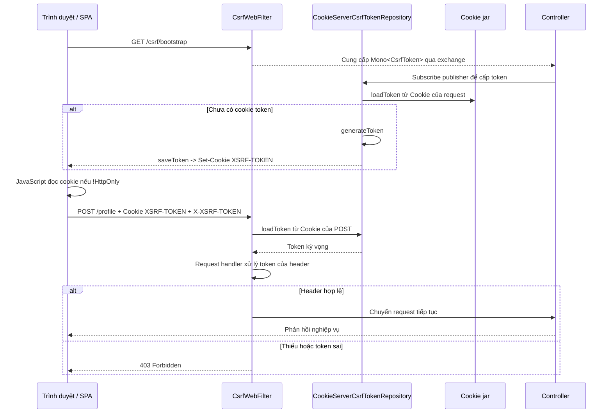

# CookieServerCsrfTokenRepository

> **Chương:** CSRF trên Reactive  
> **Trọng tâm:** Cấu hình, vận hành và kiểm thử `CookieServerCsrfTokenRepository` trong Spring Security WebFlux, đặc biệt với frontend JavaScript/SPA và cookie `XSRF-TOKEN`.

Trong module `SPRING_SECURITY_HTTP_PROTECTION`, người học áp dụng nhiều lớp phòng vệ HTTP và trình duyệt: CSRF, CORS, security headers, CSP, HSTS, HTTP firewall và bảo vệ session. Bài này đi sâu vào việc lưu CSRF token trong **cookie** bằng `CookieServerCsrfTokenRepository` trên **Spring WebFlux**, phối hợp với `CsrfWebFilter` và request handler, kiểm thử những request giả mạo, đồng thời chẩn đoán xung đột giữa cookie, CORS, session và cấu hình frontend. Các ví dụ dành cho stack **Reactive** (`ServerHttpSecurity`), không dùng API Servlet (`HttpSecurity`).

## 1. Vì sao chọn cookie repository?

Ứng dụng dùng cookie để đăng nhập có rủi ro **Cross-Site Request Forgery (CSRF)**: một trang của kẻ tấn công có thể khiến trình duyệt gửi request đến ứng dụng mà người dùng đã đăng nhập; trình duyệt có thể tự đính kèm cookie đăng nhập. CSRF token yêu cầu phía client **chủ động gửi một giá trị bổ sung** mà trang độc hại thường không thể lấy từ origin được bảo vệ.

Theo mặc định, Spring Security WebFlux lưu token kỳ vọng trong `WebSession` qua `WebSessionServerCsrfTokenRepository`. `CookieServerCsrfTokenRepository` là **lựa chọn thay thế**: lưu token kỳ vọng trong cookie HTTP `XSRF-TOKEN`. Cách này thuận tiện cho một số ứng dụng JavaScript, vì frontend có thể đọc cookie (khi được phép) rồi gửi lại token qua header.

Hai điều kiện vẫn phải xuất hiện **đồng thời** khi gửi request thay đổi dữ liệu:

1. Trình duyệt gửi **cookie `XSRF-TOKEN`** để repository biết token kỳ vọng.
2. Client chủ động gửi **header `X-XSRF-TOKEN`** (hoặc tham số form `_csrf`) mang token thực tế để request handler đối chiếu.

**Chỉ có cookie không đủ để vượt qua CSRF**: nếu chỉ cần cookie, một trang độc hại có thể lợi dụng việc trình duyệt tự gắn cookie vào request, khiến lớp bảo vệ mất tác dụng.

### So sánh với repository trong WebSession

| Tiêu chí | `WebSessionServerCsrfTokenRepository` | `CookieServerCsrfTokenRepository` |
| --- | --- | --- |
| Nơi lưu token kỳ vọng | Thuộc tính trong `WebSession` phía máy chủ | Cookie `XSRF-TOKEN` phía trình duyệt |
| Repository mặc định trong WebFlux | **Có** | Không, cần khai báo |
| Header gửi token mặc định | `X-CSRF-TOKEN` | **`X-XSRF-TOKEN`** |
| Form parameter mặc định | `_csrf` | `_csrf` |
| Frontend đọc token trực tiếp từ cookie | Không áp dụng | Có, nếu cookie không có `HttpOnly` |
| Mức độ ràng buộc token với phiên | Token gắn với session | Token cookie do client giữ, có thể bị client thay đổi |
| Phù hợp | Form/session truyền thống, mặc định an toàn và dễ kiểm soát hơn | SPA có chủ đích sử dụng mô hình cookie + header |

**Không nhầm cookie CSRF với cookie đăng nhập.** Cookie `XSRF-TOKEN` giữ **token dùng kiểm tra tính chủ động của request**, không phải bằng chứng người gọi đã xác thực. Ứng dụng vẫn phải xác thực, phân quyền, bảo vệ phiên, dùng HTTPS và kiểm soát CORS.

## 2. Hợp đồng API và các quy ước mặc định

`org.springframework.security.web.server.csrf.CookieServerCsrfTokenRepository` implements `ServerCsrfTokenRepository` với ba phương thức Reactive:

```java
// Chữ ký rút gọn của interface: không cần tự viết lại.
public interface ServerCsrfTokenRepository {
    Mono<CsrfToken> generateToken(ServerWebExchange exchange);
    Mono<Void> saveToken(ServerWebExchange exchange, CsrfToken token);
    Mono<CsrfToken> loadToken(ServerWebExchange exchange);
}
```

| Phương thức | Cookie repository làm gì? | Lưu ý |
| --- | --- | --- |
| `generateToken(exchange)` | Sinh token ngẫu nhiên, kèm tên header/form parameter | **Chưa lưu cookie**; cần `saveToken`. |
| `saveToken(exchange, token)` | Thêm cookie `XSRF-TOKEN` vào HTTP **response** qua `Set-Cookie` | Trả `Mono<Void>`; phải compose vào pipeline. |
| `loadToken(exchange)` | Đọc cookie `XSRF-TOKEN` có trong HTTP **request** | Trả `Mono<CsrfToken>` hoặc `Mono.empty()` khi không có cookie hợp lệ. |
| `saveToken(exchange, null)` | Yêu cầu browser xóa cookie bằng `Set-Cookie` hết hạn | Phải áp dụng đúng `Path`/`Domain` của cookie đang tồn tại. |

**Giá trị mặc định cần nhớ:**

| Thành phần | Mặc định |
| --- | --- |
| Tên cookie lưu token | `XSRF-TOKEN` |
| Tên header chứa token client gửi | `X-XSRF-TOKEN` |
| Tên form parameter | `_csrf` |
| `new CookieServerCsrfTokenRepository()` | Cookie có `HttpOnly=true` |
| `CookieServerCsrfTokenRepository.withHttpOnlyFalse()` | Cookie có `HttpOnly=false`, JavaScript có thể đọc |
| Request handler từ Spring Security 6 | `XorServerCsrfTokenRequestAttributeHandler`, có BREACH masking |

Tên cookie và tên header là **hai thứ khác nhau**. `XSRF-TOKEN` xuất hiện trong `Cookie`/`Set-Cookie`; `X-XSRF-TOKEN` là header riêng mà JavaScript, form adapter hoặc HTTP client phải tự thêm. Các thư viện kiểu Angular có thể hỗ trợ ánh xạ này, nhưng hành vi phụ thuộc cấu hình thư viện, origin và loại request.

### Cookie được đọc từ request, được ghi vào response

Một điểm rất dễ bỏ sót khi viết unit test:

- `saveToken(exchange, token)` tạo `Set-Cookie` cho **response hiện tại**.
- `loadToken(exchange)` đọc `Cookie` thuộc **request hiện tại**.
- Nếu gọi `saveToken` rồi `loadToken` trên **cùng một exchange chưa có cookie đầu vào**, không nên kỳ vọng `loadToken` nhìn thấy cookie vừa đặt ở response. Trình duyệt chỉ gửi lại cookie ấy ở request tiếp theo.

`Mono.empty()` từ `loadToken` nghĩa là không tìm thấy token kỳ vọng trong request. Nó không phải sự xác nhận CSRF đã thành công. Khi thao tác đọc/ghi trả `Mono`, không gọi `block()` trong WebFlux event loop hoặc `subscribe()` thủ công trong controller; hãy dùng `flatMap`, `then` và để framework quản lý subscription.

## 3. Cookie + header đi qua WebFlux như thế nào?



**Tách ba bước vận hành:**

1. **Bootstrap:** Trang/SPA làm một GET đủ để request handler subscribe `Mono<CsrfToken>`. Nếu repository chưa thấy cookie trong request, Spring Security có thể sinh và lưu token bằng `Set-Cookie`.
2. **Giữ cookie:** Browser lưu `XSRF-TOKEN` theo thuộc tính `Path`, `Domain`, `SameSite`, `Secure` và `HttpOnly`. Cookie được tự gửi về server trên các request phù hợp chính sách.
3. **Gửi token chủ động:** Với POST/PUT/PATCH/DELETE, frontend thêm token vào header hoặc form parameter. `CsrfWebFilter` kiểm tra token thực tế theo request handler, so với token kỳ vọng trong cookie; thiếu/sai trả `403`.

Với matcher mặc định, `GET`, `HEAD`, `OPTIONS`, `TRACE` không phải cung cấp CSRF token. Vì thế **GET phải là thao tác an toàn**, không được xóa/chuyển tiền/đổi thông tin người dùng. `OPTIONS` preflight CORS không có token là bình thường; lỗi CORS cần chẩn đoán độc lập với lỗi CSRF của POST.

## 4. Cấu hình cookie repository trong SecurityWebFilterChain

### 4.1. Giữ `HttpOnly` và lấy token qua server-rendered view hoặc endpoint

Khi JavaScript **không cần đọc cookie trực tiếp**, có thể giữ `HttpOnly=true`. Ví dụ này thay repository nhưng **giữ request handler XOR mặc định**:

```java
import org.springframework.context.annotation.Bean;
import org.springframework.context.annotation.Configuration;
import org.springframework.security.config.annotation.web.reactive.EnableWebFluxSecurity;
import org.springframework.security.config.web.server.ServerHttpSecurity;
import org.springframework.security.web.server.SecurityWebFilterChain;
import org.springframework.security.web.server.csrf.CookieServerCsrfTokenRepository;

@Configuration
@EnableWebFluxSecurity
class ReactiveSecurityConfig {
    @Bean
    SecurityWebFilterChain springSecurityFilterChain(ServerHttpSecurity http) {
        CookieServerCsrfTokenRepository repository =
            new CookieServerCsrfTokenRepository();

        return http
            .authorizeExchange(exchanges -> exchanges
                .pathMatchers("/csrf").permitAll()
                .anyExchange().authenticated())
            .csrf(csrf -> csrf.csrfTokenRepository(repository))
            .build();
    }
}
```

`new CookieServerCsrfTokenRepository()` giữ HttpOnly cho token cookie. View hoặc endpoint có thể lấy token **đã qua request handler** (có thể đã XOR masking) rồi đưa vào header hoặc trường form của request tiếp theo. Cách này giữ lớp BREACH masking mà không đòi JavaScript đọc cookie.

Endpoint để client cùng origin lấy token theo request handler:

```java
import org.springframework.http.CacheControl;
import org.springframework.http.ResponseEntity;
import org.springframework.security.web.server.csrf.CsrfToken;
import org.springframework.web.bind.annotation.GetMapping;
import org.springframework.web.bind.annotation.RestController;
import org.springframework.web.server.ServerWebExchange;
import reactor.core.publisher.Mono;

@RestController
class CsrfController {
    record CsrfPayload(String headerName, String parameterName, String token) {}

    @GetMapping("/csrf")
    Mono<ResponseEntity<CsrfPayload>> token(ServerWebExchange exchange) {
        Mono<CsrfToken> publisher =
            exchange.getAttribute(CsrfToken.class.getName());

        if (publisher == null) {
            return Mono.error(
                new IllegalStateException("CSRF filter không áp dụng cho request"));
        }

        return publisher.map(csrf -> ResponseEntity.ok()
            .cacheControl(CacheControl.noStore())
            .body(new CsrfPayload(
                csrf.getHeaderName(),
                csrf.getParameterName(),
                csrf.getToken())));
    }
}
```

Client dùng dữ liệu từ endpoint, **không phải token thô đọc từ cookie**:

```javascript
const response = await fetch("/csrf", {
  credentials: "same-origin",
  cache: "no-store"
});
if (!response.ok) throw new Error("Không lấy được token");
const csrf = await response.json();

const updated = await fetch("/profile", {
  method: "POST",
  credentials: "same-origin",
  headers: {
    [csrf.headerName]: csrf.token,
    "Content-Type": "application/json"
  },
  body: JSON.stringify({ displayName: "Lan" })
});
if (!updated.ok) throw new Error("Cập nhật thất bại");
```

**Khi `XorServerCsrfTokenRequestAttributeHandler` đang hoạt động**, token được trả qua endpoint này có thể là giá trị **đã masking**, nhưng handler sẽ giải mã khi xử lý request tiếp theo. Đừng ép token này bằng chuỗi thô đọc từ cookie rồi mong chúng bằng nhau.

### 4.2. SPA đọc `XSRF-TOKEN` trực tiếp từ cookie

Nhiều SPA chọn cookie đọc được từ JavaScript và chuyển giá trị thô sang header `X-XSRF-TOKEN`. Cấu hình tối thiểu để mô hình đó hoạt động với Spring Security 6+:

```java
import org.springframework.context.annotation.Bean;
import org.springframework.context.annotation.Configuration;
import org.springframework.security.config.annotation.web.reactive.EnableWebFluxSecurity;
import org.springframework.security.config.web.server.ServerHttpSecurity;
import org.springframework.security.web.server.SecurityWebFilterChain;
import org.springframework.security.web.server.csrf.CookieServerCsrfTokenRepository;
import org.springframework.security.web.server.csrf.ServerCsrfTokenRequestAttributeHandler;

@Configuration
@EnableWebFluxSecurity
class SpaRawCsrfConfig {
    @Bean
    SecurityWebFilterChain springSecurityFilterChain(ServerHttpSecurity http) {
        var repository = CookieServerCsrfTokenRepository.withHttpOnlyFalse();

        return http
            .authorizeExchange(exchanges -> exchanges
                .pathMatchers("/csrf/bootstrap").permitAll()
                .anyExchange().authenticated())
            .csrf(csrf -> csrf
                .csrfTokenRepository(repository)
                .csrfTokenRequestHandler(
                    new ServerCsrfTokenRequestAttributeHandler()))
            .build();
    }
}
```

**Đánh đổi:** `ServerCsrfTokenRequestAttributeHandler` cho phép nhận **token thô** trong header, nhưng cũng **tắt lớp XOR masking mặc định chống BREACH** khi ứng dụng xuất token vào HTML/response nén. Với SPA chủ yếu gọi API JSON, đây có thể là quyết định được đánh giá riêng; nếu hệ thống đồng thời có form server-rendered, hãy cân nhắc phương án handler hỗn hợp ở mục tiếp theo để giữ masking cho form.

GET bootstrap chỉ cần **consume publisher** để kích hoạt việc cấp cookie:

```java
import org.springframework.security.web.server.csrf.CsrfToken;
import org.springframework.web.bind.annotation.GetMapping;
import org.springframework.web.bind.annotation.RestController;
import org.springframework.web.server.ServerWebExchange;
import reactor.core.publisher.Mono;

@RestController
class CsrfBootstrapController {
    @GetMapping("/csrf/bootstrap")
    Mono<Void> bootstrap(ServerWebExchange exchange) {
        Mono<CsrfToken> token =
            exchange.getAttribute(CsrfToken.class.getName());

        if (token == null) {
            return Mono.error(
                new IllegalStateException("Không tìm thấy publisher CSRF"));
        }
        return token.then(); // Không bỏ quên Mono, không tự gọi subscribe().
    }
}
```

Frontend tải bootstrap trước khi POST:

```javascript
function readCookie(name) {
  const prefix = name + "=";
  const part = document.cookie.split(";")
    .map(item => item.trim())
    .find(item => item.startsWith(prefix));
  return part ? decodeURIComponent(part.slice(prefix.length)) : null;
}

const initialized = await fetch("/csrf/bootstrap", {
  credentials: "same-origin",
  cache: "no-store"
});
if (!initialized.ok) throw new Error("Không khởi tạo được CSRF");

const rawToken = readCookie("XSRF-TOKEN");
if (!rawToken) throw new Error("Cookie XSRF-TOKEN không tồn tại/không đọc được");

const result = await fetch("/profile", {
  method: "POST",
  credentials: "same-origin",
  headers: {
    "X-XSRF-TOKEN": rawToken,
    "Content-Type": "application/json"
  },
  body: JSON.stringify({ displayName: "Lan" })
});
if (!result.ok) throw new Error("Yêu cầu bị từ chối");
```

Ví dụ giả định frontend và backend cùng origin và cookie có `Path` phù hợp với trang hiện tại. Với frontend khác origin, `credentials`, CORS và phạm vi cookie cần thiết kế riêng; không tự mở `Access-Control-Allow-Origin: *` cùng với credential.

### 4.3. Handler hỗn hợp: form dùng XOR, SPA header dùng token thô

Nếu ứng dụng có cả HTML form và SPA, có thể tự viết handler **giữ masking khi hiển thị form**, đồng thời cho phép nhận token thô từ header `X-XSRF-TOKEN`:

```java
import org.springframework.security.web.server.csrf.CsrfToken;
import org.springframework.security.web.server.csrf.ServerCsrfTokenRequestAttributeHandler;
import org.springframework.security.web.server.csrf.ServerCsrfTokenRequestHandler;
import org.springframework.security.web.server.csrf.XorServerCsrfTokenRequestAttributeHandler;
import org.springframework.web.server.ServerWebExchange;
import reactor.core.publisher.Mono;

final class SpaCsrfTokenRequestHandler
        implements ServerCsrfTokenRequestHandler {

    private final ServerCsrfTokenRequestHandler plain =
        new ServerCsrfTokenRequestAttributeHandler();
    private final ServerCsrfTokenRequestHandler xor =
        new XorServerCsrfTokenRequestAttributeHandler();

    @Override
    public void handle(ServerWebExchange exchange, Mono<CsrfToken> token) {
        xor.handle(exchange, token); // Token xuất ra view có masking.
    }

    @Override
    public Mono<String> resolveCsrfTokenValue(
            ServerWebExchange exchange, CsrfToken token) {
        boolean headerPresent = exchange.getRequest().getHeaders()
            .containsKey(token.getHeaderName());
        return headerPresent
            ? plain.resolveCsrfTokenValue(exchange, token)
            : xor.resolveCsrfTokenValue(exchange, token);
    }
}
```

Trong cấu hình `SpaRawCsrfConfig`, thay dòng `new ServerCsrfTokenRequestAttributeHandler()` bằng `new SpaCsrfTokenRequestHandler()`. Handler lấy **token thô từ header** và **token đã masking từ form parameter**. Khi dùng cách này, tránh gửi masked token qua header vì nhánh header được hiểu là thô; client dùng endpoint `GET /csrf` với XOR token nên gửi token đó trong một form hoặc dùng chiến lược header phù hợp. Kiểm thử cả hai kiểu request để tránh kết hợp sai.

Đây là ví dụ tùy chỉnh dùng các API WebFlux; với bản Spring Security khác nhau, hãy đối chiếu Javadoc `ServerCsrfTokenRequestHandler` và chạy kiểm thử tích hợp trước khi triển khai.

## 5. Tùy chỉnh cookie an toàn: tên, đường dẫn, HTTPS và SameSite

`CookieServerCsrfTokenRepository` có các setter:

- `setCookieName(String)` đổi tên cookie chứa token kỳ vọng.
- `setHeaderName(String)` đổi tên header mang token khách gửi.
- `setParameterName(String)` đổi tên form parameter.
- `setCookiePath(String)` đổi `Path` của cookie.
- `setCookieCustomizer(Consumer<ResponseCookie.ResponseCookieBuilder>)` tùy chỉnh thuộc tính cookie ngay trước khi xây dựng response cookie; API khả dụng từ Spring Security **6.1**.

Một cấu hình ví dụ cho SPA chạy **HTTPS** tại root:

```java
CookieServerCsrfTokenRepository repository =
    CookieServerCsrfTokenRepository.withHttpOnlyFalse();

repository.setCookieName("XSRF-TOKEN");
repository.setHeaderName("X-XSRF-TOKEN");
repository.setParameterName("_csrf");
repository.setCookiePath("/");
repository.setCookieCustomizer(builder -> builder
    .secure(true)
    .sameSite("Lax"));

// Đưa repository này vào .csrf(csrf -> csrf.csrfTokenRepository(repository)).
```

**Giải thích chính sách:**

| Thuộc tính | Tác dụng | Khuyến nghị |
| --- | --- | --- |
| `HttpOnly` | Khi bật, ngăn JavaScript thông thường đọc cookie qua `document.cookie` | Giữ bật nếu frontend lấy token qua endpoint/view; chỉ tắt khi SPA thật sự đọc cookie. |
| `Secure` | Chỉ gửi cookie qua kết nối an toàn theo quy tắc trình duyệt | Bật trong môi trường HTTPS; chú ý reverse proxy và môi trường thử HTTP. |
| `SameSite=Lax` | Hạn chế cookie trong nhiều request cross-site | Lớp phòng vệ bổ sung; không thay CSRF token; đánh giá các luồng điều hướng/OAuth. |
| `SameSite=Strict` | Chặt hơn với điều hướng từ site khác | Cân nhắc nếu không ảnh hưởng luồng người dùng hợp lệ. |
| `SameSite=None` | Hỗ trợ tình huống cross-site cần cookie | Chỉ dùng khi có nhu cầu thực tế, yêu cầu `Secure` và CORS chặt chẽ. |
| `Path` | Quy định URL path nào nhận cookie | Khớp nơi API/SPA dùng; `/` giúp nhiều endpoint dùng chung nhưng tăng phạm vi cookie. |
| `Domain` | Quy định host/subdomain có thể nhận cookie | Tránh mở rộng sang mọi subdomain nếu không cần; ưu tiên cookie host-only. |
| `Max-Age` | Thời gian sống cookie | Đồng bộ với thiết kế session/token và logic xóa/khởi tạo lại. |

**Cảnh báo khi dùng `setCookieCustomizer`:** Callback áp dụng cả lúc tạo cookie lẫn lúc **xóa token**. Nếu bạn gán `maxAge(...)` cố định, không điều kiện, có thể vô tình ghi đè `Max-Age=0` mà repository đặt khi xóa cookie, khiến browser giữ token cũ. Cấu hình ví dụ chỉ đặt `Secure`/`SameSite`; nếu cần thay `Max-Age`, hãy kiểm thử kỹ response logout/xóa token và đảm bảo cookie xóa dùng cùng `Name`/`Path`/`Domain`.

**Cookie `XSRF-TOKEN` có thể bị client sửa**, vì nó nằm phía browser. Tránh để subdomain không tin cậy có thể đặt cookie trùng tên trên domain cha (cookie injection/cookie tossing). CSRF token dạng cookie + header dựa vào việc trang tấn công không thể đọc/ghi đúng token trong ngữ cảnh mục tiêu; cấu hình origin, subdomain, cookie scope và chống XSS đều quan trọng. Spring Security nêu lưu token trong session là lựa chọn ưu tiên khi không có nhu cầu dùng cookie.

## 6. Kiểm thử repository: kiểm tra `Set-Cookie` và request kế tiếp

Kiểm thử riêng `CookieServerCsrfTokenRepository` cần phản ánh đúng chiều lưu cookie: **response A cấp `Set-Cookie`**, rồi **request B gửi `Cookie`**. Không dùng cùng một `MockServerWebExchange` để ngầm coi response cookie đã nằm trong request.

Ví dụ với `spring-test`, `spring-security-web`, `reactor-test` và JUnit 5:

```java
import java.time.Duration;
import java.util.concurrent.atomic.AtomicReference;
import org.junit.jupiter.api.Test;
import org.springframework.http.HttpCookie;
import org.springframework.http.ResponseCookie;
import org.springframework.mock.http.server.reactive.MockServerHttpRequest;
import org.springframework.mock.web.server.MockServerWebExchange;
import org.springframework.security.web.server.csrf.CookieServerCsrfTokenRepository;
import reactor.test.StepVerifier;

import static org.junit.jupiter.api.Assertions.*;

class CookieCsrfRepositoryTest {
    private final CookieServerCsrfTokenRepository repository =
        CookieServerCsrfTokenRepository.withHttpOnlyFalse();

    @Test
    void newlySavedTokenIsSentAsCookieAndReadOnNextRequest() {
        var first = MockServerWebExchange.from(
            MockServerHttpRequest.get("/csrf/bootstrap"));

        AtomicReference<ResponseCookie> saved = new AtomicReference<>();

        StepVerifier.create(repository.generateToken(first)
            .flatMap(token -> repository.saveToken(first, token)
                .thenReturn(token)))
            .assertNext(token -> {
                var responseCookie = first.getResponse().getCookies()
                    .getFirst("XSRF-TOKEN");
                assertNotNull(responseCookie);
                assertEquals(token.getToken(), responseCookie.getValue());
                assertFalse(responseCookie.isHttpOnly());
                saved.set(responseCookie);
            })
            .verifyComplete();

        // Mô phỏng browser gửi cookie đã nhận ở request tiếp theo.
        var second = MockServerWebExchange.from(
            MockServerHttpRequest.post("/profile").cookie(
                new HttpCookie("XSRF-TOKEN", saved.get().getValue())));

        StepVerifier.create(repository.loadToken(second))
            .assertNext(token ->
                assertEquals(saved.get().getValue(), token.getToken()))
            .verifyComplete();
    }

    @Test
    void removingTokenSendsAnExpiredCookie() {
        var request = MockServerWebExchange.from(
            MockServerHttpRequest.post("/logout"));

        StepVerifier.create(repository.saveToken(request, null))
            .verifyComplete();

        var expired = request.getResponse().getCookies()
            .getFirst("XSRF-TOKEN");
        assertNotNull(expired);
        assertEquals(Duration.ZERO, expired.getMaxAge());
    }
}
```

Test thứ nhất kiểm tra **token được phát qua response** và có thể được đọc lại từ **request sau**, không chỉ kiểm tra return value của `generateToken`. Test thứ hai kiểm tra tín hiệu xóa cookie; thực tế trình duyệt chỉ xóa cookie có cùng phạm vi `Name`/`Path`/`Domain` với cookie đang lưu.

### Ma trận kiểm thử tích hợp qua `WebTestClient` hoặc trình duyệt

| Trường hợp | Cookie CSRF | Header/form token | Kỳ vọng |
| --- | --- | --- | --- |
| GET bootstrap khi chưa có cookie | Không có trước request | Không cần | Có thể phát `Set-Cookie: XSRF-TOKEN=...` khi `Mono` được consume. |
| POST với cookie đăng nhập nhưng không có token | Có thể có | Không có | `403` ở lớp CSRF. |
| POST có `XSRF-TOKEN` nhưng thiếu `X-XSRF-TOKEN` | Có | Không có | `403`; cookie tự gửi không đủ. |
| POST header sai | Có | Sai | `403`. |
| POST chỉ có header đúng nhưng thiếu cookie token | Không có | Có | `403` vì repository không tìm được token kỳ vọng. |
| POST có cả cookie và header hợp lệ | Có | Phù hợp request handler | Qua lớp CSRF; vẫn phải xác thực, phân quyền. |
| POST raw header khi giữ handler XOR mặc định | Có | Token thô | Có thể `403` do token chưa masking đúng dạng. |
| POST masked form khi dùng handler hỗn hợp | Có | Token masked trong `_csrf` | Qua lớp CSRF nếu token hợp lệ. |
| Sau logout/xóa token | Cookie bị xóa | Token cũ | Phải cấp token mới trước request unsafe tiếp theo. |

**Điều kiện của một bài test đáng tin cậy:** test dùng đúng `SecurityWebFilterChain`, cookie jar giữa các HTTP request, frontend header và handler tương ứng, và kiểm tra controller **không được gọi** khi CSRF sai. Tiện ích `spring-security-test` `csrf()` hữu ích để test filter, nhưng không thay thế kiểm thử lưu cookie thật. Khi lỗi xuất hiện chỉ trên production, nên so sánh `Set-Cookie` với `Cookie` trên hai request liên tiếp và tra reverse proxy.

## 7. Lỗi triển khai thường gặp

| Triệu chứng | Nguyên nhân thường gặp | Cách xử lý |
| --- | --- | --- |
| GET thành công nhưng `document.cookie` không có `XSRF-TOKEN` | Cookie còn `HttpOnly`, `Path` khác hoặc bootstrap chưa consume `Mono<CsrfToken>` | Kiểm tra `Set-Cookie`, chọn `withHttpOnlyFalse()` nếu JS cần đọc, đảm bảo token được subscribe. |
| POST bị `403` dù gửi cookie | Thiếu `X-XSRF-TOKEN`, trình duyệt không tự thêm header | Đọc cookie và thêm header đúng tên (hoặc dùng thư viện frontend có cấu hình phù hợp). |
| POST có raw header vẫn `403` | Request handler XOR mặc định mong masked token | Dùng plain handler hoặc handler hỗn hợp, hoặc gửi token đã masking từ endpoint. |
| Cookie có token nhưng request API không gửi cookie | `credentials`, `SameSite`, `Secure`, `Domain` hoặc `Path` không phù hợp | Kiểm tra Network tab, origin và chính sách cookie; cấu hình HTTPS/CORS chính xác. |
| Xóa token rồi vẫn thấy cookie | Cookie xóa khác `Path`/`Domain`, hoặc customizer ghi đè `Max-Age=0` | So sánh đầy đủ hai `Set-Cookie`; kiểm tra callback tùy chỉnh. |
| Mỗi lần refresh lại có token khác | Cookie không được gửi lại hoặc token bị xóa/khởi tạo lại | Kiểm tra đường đi bootstrap, lifecycle auth/logout và phạm vi cookie. |
| Xóa cookie bằng tay rồi POST trả `403` | Không còn token kỳ vọng trong request | Gọi GET bootstrap để phát cookie/token mới trước request unsafe. |
| Angular/frontend không tự thêm header | Request khác origin, framework không cấu hình XSRF hoặc tên cookie/header bị đổi | Kiểm tra chính sách XSRF của framework phiên bản đang dùng, không giả định auto cho mọi URL. |
| CORS preflight lỗi, chưa có POST | Backend chưa cho phép origin/header `X-XSRF-TOKEN` | Cấu hình CORS đúng origin và header; đừng tắt CSRF để sửa CORS. |
| Frontend ở subdomain bị lỗi thất thường | Phạm vi cookie rộng, cookie trùng tên, reverse proxy hoặc nhiều domain | Giới hạn `Domain`, điều chỉnh `Path`, kiểm tra cookie injection và host-only cookie. |

### Chẩn đoán theo thứ tự

1. **GET bootstrap:** Có `Set-Cookie` hay không? Nếu không, endpoint đã consume `Mono<CsrfToken>` chưa?
2. **Cookie jar:** Browser lưu cookie theo `Secure`, `SameSite`, `Path`, `Domain` đúng không? `HttpOnly` có cố ý bật hay tắt?
3. **POST:** Có `Cookie: XSRF-TOKEN=...` và header `X-XSRF-TOKEN` tương ứng không?
4. **Request handler:** Header đang mang token thô hay masked? `ServerCsrfTokenRequestAttributeHandler`/`XorServerCsrfTokenRequestAttributeHandler` nào đang dùng?
5. **Security chain:** Request đi qua chain bảo mật nào, có filter CSRF, có endpoint dùng method unsafe hay không?
6. **Hệ thống:** Kiểm tra CORS, reverse proxy, HTTPS, xóa cookie khi logout, sự khác biệt local/prod; không ghi token thật vào log.

## 8. Bài tập thực hành và những điểm cần nhớ

**Bài tập:** Tạo WebFlux API với `GET /csrf/bootstrap` và `POST /profile`. Cấu hình `CookieServerCsrfTokenRepository.withHttpOnlyFalse()` và handler nhận token thô từ header. Từ frontend cùng origin, thử: POST không bootstrap, POST chỉ có cookie, POST header sai, POST đúng cookie + header, rồi xóa cookie và thử lại. Dùng Network tab ghi nhận HTTP status và **tên** header/cookie; không đưa token thực vào báo cáo. Cuối cùng thử bật lại handler XOR và giải thích vì sao cần đồng bộ dạng token.

Các kết luận cần nắm:

1. **Cookie repository là lựa chọn tùy chỉnh**, còn `WebSessionServerCsrfTokenRepository` là mặc định của WebFlux.
2. `XSRF-TOKEN` là **cookie chứa token kỳ vọng**; `X-XSRF-TOKEN`/`_csrf` là **đầu vào chủ động** của client. Cần đủ cả hai phía.
3. `withHttpOnlyFalse()` cho JavaScript đọc cookie, đồng thời tăng nhu cầu kiểm soát XSS và phạm vi cookie. Giữ `HttpOnly` nếu ứng dụng có thể phát token qua view/endpoint.
4. **Token thô và token đã XOR masking khác nhau.** Repository lưu token; request handler quyết định cách công bố và nhận token. Hai phía phải tương thích.
5. `saveToken` ghi cookie ở **response**, `loadToken` đọc ở **request**; cookie chỉ quay lại ở request sau. Kiểm thử cần tái hiện browser cookie jar.
6. Cookie CSRF là **một lớp phòng vệ** trong tổng thể xác thực, CORS, CSP, headers, HTTPS và bảo vệ session; không dùng nó làm bằng chứng người gọi có quyền.

## Tài liệu chính thức

- [Spring Security — CSRF trong WebFlux](https://docs.spring.io/spring-security/reference/reactive/exploits/csrf.html)
- [Spring Security API — CookieServerCsrfTokenRepository](https://docs.spring.io/spring-security/reference/api/java/org/springframework/security/web/server/csrf/CookieServerCsrfTokenRepository.html)
- [Spring Security API — ServerCsrfTokenRepository](https://docs.spring.io/spring-security/reference/api/java/org/springframework/security/web/server/csrf/ServerCsrfTokenRepository.html)
- [Spring Security API — CsrfWebFilter](https://docs.spring.io/spring-security/reference/api/java/org/springframework/security/web/server/csrf/CsrfWebFilter.html)
- [Spring Security API — ServerCsrfTokenRequestHandler](https://docs.spring.io/spring-security/reference/api/java/org/springframework/security/web/server/csrf/ServerCsrfTokenRequestHandler.html)
- [Spring Security — Kiểm thử CSRF cho WebFlux](https://docs.spring.io/spring-security/reference/reactive/test/web/csrf.html)
