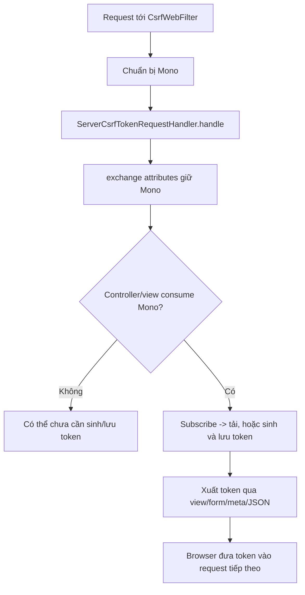
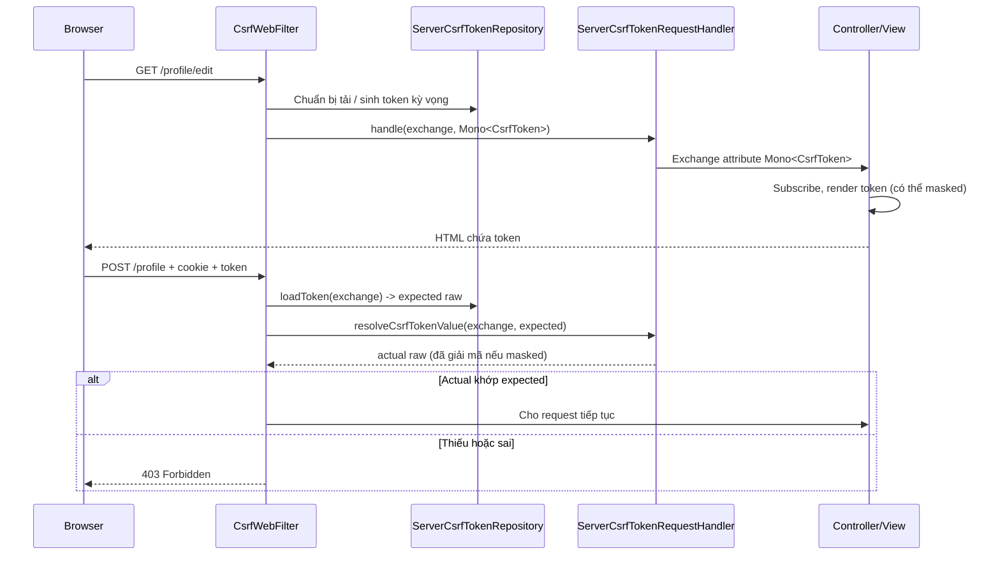

# ServerCsrfTokenRequestHandler và exchange attributes

> **Chương:** CSRF trên Reactive  
> **Đích học tập:** Hiểu cách Spring Security WebFlux công bố `Mono<CsrfToken>` trong `ServerWebExchange`, cách `ServerCsrfTokenRequestHandler` đọc token từ request và sự khác biệt giữa token lưu trữ, token trong view và token gửi trở lại.

Trong module `SPRING_SECURITY_HTTP_PROTECTION`, người học áp dụng nhiều lớp phòng vệ HTTP và trình duyệt như CSRF, CORS, security headers, CSP, HSTS, HTTP firewall và bảo vệ session, cấu hình cho Servlet lẫn Reactive, kiểm thử tình huống tấn công và chẩn đoán xung đột bảo mật. Bài này tập trung vào **Spring WebFlux**. Khi `CsrfWebFilter` đã có token kỳ vọng từ `ServerCsrfTokenRepository`, **`ServerCsrfTokenRequestHandler`** đưa token đến phần giao diện và giải quyết token mà trình duyệt gửi ngược về. Hiểu hợp đồng này giúp xử lý những lỗi `403 Forbidden` do token chưa được subscribe, sai tên attribute hoặc trộn token thô với token đã XOR masking.

## 1. Vai trò giữa repository, filter và handler

CSRF xảy ra khi trang độc hại khiến trình duyệt gửi request đến ứng dụng mà nạn nhân đã đăng nhập. Trình duyệt có thể tự gửi cookie xác thực, vì vậy yêu cầu thay đổi dữ liệu cần **CSRF token do client chủ động gửi** trong form hoặc header, không chỉ cookie.

| Thành phần | Trách nhiệm | Có trực tiếp quyết định `403`? |
| --- | --- | --- |
| `ServerCsrfTokenRepository` | Tạo, tải và lưu **token kỳ vọng**, mặc định trong `WebSession`. | Không. |
| `ServerCsrfTokenRequestHandler` | Công bố `Mono<CsrfToken>` cho ứng dụng và đọc/biến đổi **token thực tế** trong request. | Không. |
| `CsrfWebFilter` | Quyết định request nào cần CSRF, phối hợp hai thành phần trên, so token và chặn khi không hợp lệ. | **Có.** |

Ví dụ khi `POST /profile` có cookie phiên và header `X-CSRF-TOKEN`: repository tải token kỳ vọng, handler đọc token từ header (có thể giải mã XOR masking), rồi filter so sánh. Nếu thiếu hoặc sai, request bị từ chối trước controller. Với `GET /profile`, matcher mặc định không yêu cầu CSRF token, nhưng những lớp xác thực và phân quyền khác vẫn có hiệu lực.

**Phân biệt stack:** WebFlux dùng `ServerWebExchange`, `SecurityWebFilterChain`, `ServerHttpSecurity` và `ServerCsrfTokenRequestHandler`. Servlet dùng `HttpServletRequest`, `SecurityFilterChain`, `HttpSecurity` và `CsrfTokenRequestHandler`; không dùng nhầm class của hai hệ.

## 2. Hợp đồng của `ServerCsrfTokenRequestHandler`

`org.springframework.security.web.server.csrf.ServerCsrfTokenRequestHandler` mở rộng `ServerCsrfTokenRequestResolver`. Hai chức năng chính:

```java
// Chữ ký rút gọn để đọc hiểu, không phải mã cần tự khai báo lại.
public interface ServerCsrfTokenRequestHandler
        extends ServerCsrfTokenRequestResolver {

    void handle(ServerWebExchange exchange, Mono<CsrfToken> csrfToken);

    @Override
    Mono<String> resolveCsrfTokenValue(
        ServerWebExchange exchange, CsrfToken csrfToken);
}
```

Trong API hiện hành, `resolveCsrfTokenValue` là phương thức `default` của `ServerCsrfTokenRequestHandler` kế thừa hợp đồng resolver; các handler có sẵn cung cấp cách phân giải cụ thể.

**`handle(exchange, csrfToken)`** nhận publisher token do CSRF filter chuẩn bị. Nó công bố token qua exchange attributes để view/controller ở phía sau sử dụng. Handler cũng có thể thay đổi **cách token được trình bày**; ví dụ thêm XOR masking khi xuất token vào HTML. Hàm này trả `void`, nên chỉ gắn publisher vào attribute chưa chứng minh token đã được tải, tạo và lưu.

**`resolveCsrfTokenValue(exchange, csrfToken)`** trả `Mono<String>` chứa token mà client gửi trong request, thường từ header hoặc form parameter. Với handler XOR, kết quả là chuỗi **đã bỏ masking**, dùng để so với raw token kỳ vọng. Khi không thấy token, nó có thể trả `Mono.empty()`; đó **không phải** là kết quả kiểm tra hợp lệ.

`CsrfToken` cung cấp `getToken()`, `getHeaderName()` và `getParameterName()`. Repository trong session thường chọn `X-CSRF-TOKEN` và `_csrf`; repository cookie thường chọn `X-XSRF-TOKEN` và `_csrf`. Tên có thể được tùy chỉnh, nên giao diện tốt nhất lấy tên thực từ `CsrfToken`.

## 3. `ServerWebExchange` giữ token dưới key nào?

Trong pipeline WebFlux, token được công bố dưới exchange attribute có key:

```java
CsrfToken.class.getName()
// "org.springframework.security.web.server.csrf.CsrfToken"
```

**Kiểu dữ liệu của value là `Mono<CsrfToken>`, không phải `CsrfToken`.** Ví dụ đọc an toàn:

```java
import org.springframework.security.web.server.csrf.CsrfToken;
import org.springframework.web.server.ServerWebExchange;
import reactor.core.publisher.Mono;

final class CsrfExchangeReader {
    Mono<CsrfToken> current(ServerWebExchange exchange) {
        Mono<CsrfToken> tokenMono =
            exchange.getAttribute(CsrfToken.class.getName());

        if (tokenMono == null) {
            return Mono.error(new IllegalStateException(
                "Không tìm thấy CSRF attribute; kiểm tra security chain"));
        }
        return tokenMono;
    }
}
```

Các nơi chứa token dễ bị nhầm:

| Nơi xuất hiện | Tên/key thường gặp | Giá trị |
| --- | --- | --- |
| `ServerWebExchange.getAttributes()` được handler công bố | `CsrfToken.class.getName()` | **`Mono<CsrfToken>`** |
| Model dùng trong view | `_csrf` | **`CsrfToken`** sau khi publisher đã được consume, nếu model đã được bổ sung |
| Hidden input trong HTML | `name="_csrf"` | Chuỗi mà client sẽ gửi trong form |
| Header trong HTTP request | `X-CSRF-TOKEN` hoặc `X-XSRF-TOKEN` | Chuỗi mà client chủ động gửi |
| Session hoặc cookie | Tên thuộc repository | **Token kỳ vọng**, dùng cho việc đối chiếu |

`_csrf` **không phải** key mặc định của exchange publisher. Những đoạn sau không đúng với hợp đồng thông thường:

```java
// Sai: cố ép giá trị Mono thành CsrfToken.
CsrfToken token = exchange.getAttribute(CsrfToken.class.getName());

// Sai: key của HTML form không phải key của Mono trong exchange.
Mono<CsrfToken> tokenMono = exchange.getAttribute("_csrf");
```

Exchange attribute có phạm vi **request hiện tại**, không tự trở thành session attribute, cookie hoặc response header. Filter chạy trước `CsrfWebFilter` trong chuỗi bảo mật cũng không thể mặc định thấy attribute chưa được thiết lập. Cần import đúng `org.springframework.security.web.server.csrf.CsrfToken`, tránh nhầm class Servlet tại `org.springframework.security.web.csrf.CsrfToken`.

### Publisher lazy và thời điểm token được sinh

`Mono<CsrfToken>` là **mô tả công việc Reactive**. Token có thể chỉ được tải/sinh và lưu khi publisher được **subscribe**. Chẳng hạn `GET /news` không có form có thể không đòi hỏi token; `GET /profile/edit` thì cần consume publisher để render form.



Tránh gọi `.block()` trên WebFlux event loop, hoặc `.subscribe()` thủ công trong controller rồi trả response ngay: chúng có thể làm nghẽn thread, làm mất lỗi và tạo race với `Set-Cookie`. Hãy **trả publisher** trong chuỗi xử lý HTTP bằng `map`/`flatMap`/`then`.

## 4. Handler mặc định và XOR masking chống BREACH

Spring Security cung cấp hai handler cơ bản:

| Handler | Phát token cho giao diện | Nhận token khách gửi |
| --- | --- | --- |
| `ServerCsrfTokenRequestAttributeHandler` | Công bố token không XOR masking. | Đọc token **thô** từ header hoặc form. |
| `XorServerCsrfTokenRequestAttributeHandler` | Thêm masking ngẫu nhiên khi công bố token, nhằm giảm rủi ro BREACH. | Giải mã **masked token** từ header/form trước khi filter đối chiếu. |

Trong Spring Security **5.8**, handler mặc định là `ServerCsrfTokenRequestAttributeHandler`. Từ **6.0**, mặc định là `XorServerCsrfTokenRequestAttributeHandler`. Đây là điểm đáng chú ý khi nâng cấp Spring Security hoặc đưa một SPA trước đây đọc token thô từ cookie vào cấu hình mới.

**Raw token và masked token khác nhau:** Ví dụ token được lưu trong repository là `RAW_123`. View đầu tiên có thể xuất `MASK_ABC` và view kế tiếp xuất `MASK_XYZ`. Hai chuỗi có thể giải mã về cùng `RAW_123`. **Không kết luận session đổi chỉ vì `getToken()` ở view có giá trị khác nhau giữa hai GET.**

Lớp masking phục vụ giảm nguy cơ suy đoán token qua thay đổi kích thước response nén (BREACH). Nó **không** ngăn XSS, không thay thế CSP, HTTPS, CORS hoặc các chính sách cookie.



## 5. Cấu hình handler trong WebFlux

Cấu hình điển hình dùng CSRF và XOR handler mặc định:

```java
import org.springframework.context.annotation.Bean;
import org.springframework.context.annotation.Configuration;
import org.springframework.security.config.Customizer;
import org.springframework.security.config.annotation.web.reactive.EnableWebFluxSecurity;
import org.springframework.security.config.web.server.ServerHttpSecurity;
import org.springframework.security.web.server.SecurityWebFilterChain;

@Configuration
@EnableWebFluxSecurity
class ReactiveSecurityConfig {
    @Bean
    SecurityWebFilterChain securityWebFilterChain(ServerHttpSecurity http) {
        return http
            .authorizeExchange(exchanges -> exchanges
                .pathMatchers("/csrf", "/login", "/assets/**").permitAll()
                .anyExchange().authenticated())
            .formLogin(Customizer.withDefaults())
            .csrf(Customizer.withDefaults())
            .build();
    }
}
```

`csrf(Customizer.withDefaults())` chỉ làm rõ ý đồ học tập: CSRF vốn bật mặc định. `permitAll()` cho phép lấy token nhưng không tự bỏ CSRF ở request `POST`. Ứng dụng vẫn cần xác thực và phân quyền phù hợp.

Nếu thực sự cần nhận **raw token**, có thể cấu hình:

```java
import org.springframework.security.web.server.csrf.ServerCsrfTokenRequestAttributeHandler;

// Thay .csrf(Customizer.withDefaults()) trong builder ở trên bằng:
.csrf(csrf -> csrf
    .csrfTokenRequestHandler(new ServerCsrfTokenRequestAttributeHandler())
)
```

Đây là **đoạn cấu hình thay thế**, không phải một phương thức độc lập ở cấp file. Khi bỏ masking, phải đánh giá tác động tới form/view phản chiếu token vào response nén. Với giao diện server-rendered thông thường, ưu tiên giữ XOR handler mặc định.

## 6. Controller đọc token qua exchange attribute

### 6.1. Endpoint trả token cho frontend

Một endpoint dùng token **đã qua request handler**, không tự gọi repository:

```java
import org.springframework.http.CacheControl;
import org.springframework.http.ResponseEntity;
import org.springframework.security.web.server.csrf.CsrfToken;
import org.springframework.web.bind.annotation.GetMapping;
import org.springframework.web.bind.annotation.RestController;
import org.springframework.web.server.ServerWebExchange;
import reactor.core.publisher.Mono;

@RestController
class CsrfEndpoint {
    record TokenView(String headerName, String parameterName, String token) {}

    @GetMapping("/csrf")
    Mono<ResponseEntity<TokenView>> token(ServerWebExchange exchange) {
        Mono<CsrfToken> publisher =
            exchange.getAttribute(CsrfToken.class.getName());

        if (publisher == null) {
            return Mono.error(new IllegalStateException(
                "CsrfWebFilter chưa công bố token trong exchange"));
        }

        return publisher.map(csrf -> ResponseEntity.ok()
            .cacheControl(CacheControl.noStore())
            .body(new TokenView(
                csrf.getHeaderName(),
                csrf.getParameterName(),
                csrf.getToken())));
    }
}
```

Controller trả publisher nên framework có thể subscribe token theo lifecycle HTTP; token cần được lưu trước khi client thực hiện POST kế tiếp. `Cache-Control: no-store` giảm nguy cơ cache phản hồi chứa token. Giữ endpoint trong **vùng truy cập tin cậy** (thường cùng origin), không cho các origin không tin cậy đọc token qua CORS và không log token.

Frontend cùng origin:

```javascript
const response = await fetch("/csrf", {
  credentials: "same-origin",
  cache: "no-store"
});
if (!response.ok) throw new Error("Không lấy được CSRF token");
const csrf = await response.json();

const saved = await fetch("/profile", {
  method: "POST",
  credentials: "same-origin",
  headers: {
    [csrf.headerName]: csrf.token,
    "Content-Type": "application/json"
  },
  body: JSON.stringify({ displayName: "Lan" })
});
if (!saved.ok) throw new Error("Cập nhật không thành công");
```

Với XOR handler mặc định, **gửi nguyên giá trị** `csrf.token` mà endpoint trả về. Nếu dùng session repository, giữ cookie session giữa GET và POST. Nếu dùng cookie repository, cũng cần gửi cookie chứa token kỳ vọng ở request POST.

### 6.2. Đưa token vào model để render HTML form

Khi view engine không tự consume `Mono<CsrfToken>`, controller có thể chuẩn bị đối tượng token:

```java
import org.springframework.security.web.server.csrf.CsrfToken;
import org.springframework.stereotype.Controller;
import org.springframework.ui.Model;
import org.springframework.web.bind.annotation.GetMapping;
import org.springframework.web.server.ServerWebExchange;
import reactor.core.publisher.Mono;

@Controller
class ProfileFormController {
    @GetMapping("/profile/edit")
    Mono<String> edit(ServerWebExchange exchange, Model model) {
        Mono<CsrfToken> publisher =
            exchange.getAttribute(CsrfToken.class.getName());
        if (publisher == null) {
            return Mono.error(new IllegalStateException(
                "Không có CSRF token publisher"));
        }

        return publisher.map(csrf -> {
            model.addAttribute("_csrf", csrf);
            return "profile-edit"; // Tên view, ví dụ Thymeleaf.
        });
    }
}
```

Template `profile-edit.html` minh họa cách tự đặt hidden field:

```html
<form action="/profile" method="post">
  <input type="hidden"
         th:name="${_csrf.parameterName}"
         th:value="${_csrf.token}"/>
  <input name="displayName" type="text"/>
  <button type="submit">Lưu</button>
</form>
```

Đây là form **đặt hidden input trực tiếp**. Khi dùng Thymeleaf tích hợp `RequestDataValueProcessor` và `th:action`, Spring Security có thể tự chèn field CSRF cho POST; hãy chọn một cách hiển thị thống nhất để tránh field trùng nhau. Cần phân biệt key `_csrf` của **model** với key `CsrfToken.class.getName()` của **exchange**. Nếu chỉ đặt nguyên `Mono` vào model, kết quả tùy mức tích hợp Reactive của view engine và có thể không có giá trị token như mong đợi.

## 7. SPA đọc cookie raw và handler hỗn hợp

Với `CookieServerCsrfTokenRepository.withHttpOnlyFalse()`, JavaScript có thể đọc cookie `XSRF-TOKEN` rồi chủ động gửi raw token trong header `X-XSRF-TOKEN`. Tuy nhiên handler XOR mặc định đợi **token đã masking**; gửi raw token với handler XOR có thể trả `403`.

Hai chiến lược chính:

| Nguồn token client dùng | Cách gửi | Handler phù hợp |
| --- | --- | --- |
| View/endpoint trả token đã masking | Gửi nguyên token vào header/form | `XorServerCsrfTokenRequestAttributeHandler` (mặc định) |
| JavaScript đọc raw token từ cookie `XSRF-TOKEN` | Gửi raw token trong header `X-XSRF-TOKEN` | Plain handler hoặc handler hỗn hợp quy định rõ raw header |

Handler hỗn hợp dưới đây **giữ masked token cho view** nhưng giải quyết **raw token khi có HTTP header**:

```java
import org.springframework.security.web.server.csrf.CsrfToken;
import org.springframework.security.web.server.csrf.ServerCsrfTokenRequestAttributeHandler;
import org.springframework.security.web.server.csrf.ServerCsrfTokenRequestHandler;
import org.springframework.security.web.server.csrf.XorServerCsrfTokenRequestAttributeHandler;
import org.springframework.web.server.ServerWebExchange;
import reactor.core.publisher.Mono;

public final class SpaCsrfHandler implements ServerCsrfTokenRequestHandler {
    private final ServerCsrfTokenRequestHandler plain =
        new ServerCsrfTokenRequestAttributeHandler();
    private final ServerCsrfTokenRequestHandler xor =
        new XorServerCsrfTokenRequestAttributeHandler();

    @Override
    public void handle(ServerWebExchange exchange, Mono<CsrfToken> csrfToken) {
        xor.handle(exchange, csrfToken); // Token xuất ra view vẫn masked.
    }

    @Override
    public Mono<String> resolveCsrfTokenValue(
            ServerWebExchange exchange, CsrfToken csrfToken) {
        boolean hasHeader = exchange.getRequest().getHeaders()
            .containsKey(csrfToken.getHeaderName());

        return hasHeader
            ? plain.resolveCsrfTokenValue(exchange, csrfToken)
            : xor.resolveCsrfTokenValue(exchange, csrfToken);
    }
}
```

Kết hợp với repository cookie:

```java
import org.springframework.security.web.server.csrf.CookieServerCsrfTokenRepository;

// Thay .csrf(...) trong SecurityWebFilterChain:
.csrf(csrf -> csrf
    .csrfTokenRepository(CookieServerCsrfTokenRepository.withHttpOnlyFalse())
    .csrfTokenRequestHandler(new SpaCsrfHandler())
)
```

**Hợp đồng chính xác của cấu hình này:** Mọi header CSRF có mặt đều được đọc là **raw token**; form parameter không có header được giải mã theo XOR. Do đó **không gửi masked token lấy từ endpoint `GET /csrf` qua header** khi dùng handler hỗn hợp nói trên, vì nhánh header sẽ coi đó là raw. Frontend phải thống nhất cách lấy và gửi token. Nếu muốn chấp nhận cả raw lẫn masked header, hãy thiết kế quy ước khác và kiểm thử rõ từng đường đi; không tùy tiện nhận mọi dạng token.

Khi dùng plain handler thuần túy, không còn XOR masking cho view. Trước khi bỏ bảo vệ BREACH, đánh giá xem ứng dụng có phản chiếu token vào nội dung nén hay không.

## 8. Token trong form, JSON và multipart

Các handler request attribute có sẵn tìm token theo tên header hoặc tham số form do `CsrfToken` cung cấp. **Không mặc định trích token từ một trường của JSON body.**

| Loại request | Nơi đưa token |
| --- | --- |
| Form `application/x-www-form-urlencoded` | Input hidden có tên `_csrf` hoặc tên đã cấu hình |
| AJAX/JSON `application/json` | Header `X-CSRF-TOKEN` / `X-XSRF-TOKEN` |
| Upload `multipart/form-data` | Ưu tiên **header** để có thể kiểm tra trước khi đọc body lớn |
| `GET`/`HEAD`/`OPTIONS`/`TRACE` | Matcher CSRF mặc định không yêu cầu token; endpoint vẫn phải tuân thủ safe HTTP semantics |

`ServerCsrfTokenRequestAttributeHandler` và handler XOR kế thừa có tùy chọn:

```java
var handler = new ServerCsrfTokenRequestAttributeHandler();
handler.setTokenFromMultipartDataEnabled(true);
```

Theo API, đọc token từ **multipart body bị tắt mặc định**. Chỉ bật nếu thật sự cần; server có thể phải đọc và phân tích nội dung upload trước khi xác minh CSRF, làm tăng chi phí và rủi ro từ request lớn. Với upload qua JavaScript, gửi token qua header thường hợp lý hơn.

CORS là một cơ chế khác: `OPTIONS` preflight có thể bị từ chối nếu cấu hình origin/header không khớp, trước khi `POST` thật được gửi. Với header CSRF tùy chỉnh, cần cấu hình CORS cho phép đúng header và origin tin cậy. Không tắt CSRF để sửa lỗi preflight.

## 9. Kiểm thử handler với Reactor `StepVerifier`

Tách thử nghiệm handler khỏi thử nghiệm filter giúp xác định lỗi do **exchange attribute** hay do bảo vệ HTTP. Ví dụ dưới dùng `spring-test`, `spring-security-web`, `reactor-test` và JUnit 5.

### 9.1. Plain handler: attribute là Mono và đọc header raw

```java
import org.junit.jupiter.api.Test;
import org.springframework.mock.http.server.reactive.MockServerHttpRequest;
import org.springframework.mock.web.server.MockServerWebExchange;
import org.springframework.security.web.server.csrf.CsrfToken;
import org.springframework.security.web.server.csrf.DefaultCsrfToken;
import org.springframework.security.web.server.csrf.ServerCsrfTokenRequestAttributeHandler;
import reactor.core.publisher.Mono;
import reactor.test.StepVerifier;

import static org.junit.jupiter.api.Assertions.*;

class PlainCsrfHandlerTest {
    @Test
    void exposesMonoAndReadsRawHeader() {
        var exchange = MockServerWebExchange.from(
            MockServerHttpRequest.post("/profile")
                .header("X-CSRF-TOKEN", "example-token"));

        CsrfToken expected =
            new DefaultCsrfToken("X-CSRF-TOKEN", "_csrf", "example-token");
        var handler = new ServerCsrfTokenRequestAttributeHandler();
        handler.handle(exchange, Mono.just(expected));

        Mono<CsrfToken> exposed =
            exchange.getAttribute(CsrfToken.class.getName());
        assertNotNull(exposed);

        StepVerifier.create(exposed)
            .assertNext(token -> assertEquals("example-token", token.getToken()))
            .verifyComplete();

        StepVerifier.create(handler.resolveCsrfTokenValue(exchange, expected))
            .expectNext("example-token")
            .verifyComplete();
    }
}
```

`handle` đưa publisher vào exchange; `resolveCsrfTokenValue` giải quyết giá trị từ request. Test này **chưa kiểm tra filter có trả `403` hay không**, vì handler không quyết định việc đó.

### 9.2. XOR handler: masked token giải mã về raw token

```java
import org.junit.jupiter.api.Test;
import org.springframework.mock.http.server.reactive.MockServerHttpRequest;
import org.springframework.mock.web.server.MockServerWebExchange;
import org.springframework.security.web.server.csrf.CsrfToken;
import org.springframework.security.web.server.csrf.DefaultCsrfToken;
import org.springframework.security.web.server.csrf.XorServerCsrfTokenRequestAttributeHandler;
import reactor.core.publisher.Mono;
import reactor.test.StepVerifier;

import static org.junit.jupiter.api.Assertions.*;

class XorCsrfHandlerTest {
    @Test
    void maskedRequestTokenResolvesToRawToken() {
        CsrfToken expected =
            new DefaultCsrfToken("X-CSRF-TOKEN", "_csrf", "server-raw-token");
        var get = MockServerWebExchange.from(
            MockServerHttpRequest.get("/profile/edit"));

        var handler = new XorServerCsrfTokenRequestAttributeHandler();
        handler.handle(get, Mono.just(expected));
        Mono<CsrfToken> exposed =
            get.getAttribute(CsrfToken.class.getName());
        assertNotNull(exposed);

        Mono<String> roundTrip = exposed.flatMap(masked -> {
            assertNotEquals(expected.getToken(), masked.getToken());
            var post = MockServerWebExchange.from(
                MockServerHttpRequest.post("/profile")
                    .header("X-CSRF-TOKEN", masked.getToken()));
            return handler.resolveCsrfTokenValue(post, expected);
        });

        StepVerifier.create(roundTrip)
            .expectNext("server-raw-token")
            .verifyComplete();
    }
}
```

Test không cố định giá trị masked cụ thể vì masking có thành phần ngẫu nhiên. Nó kiểm tra đúng bản chất: token được công bố **khác raw**, nhưng handler đưa token client gửi về giá trị tương ứng để filter so sánh.

### 9.3. Kiểm thử từ chối/cho qua ở tầng WebTestClient

Với client đã bind vào application context và `.apply(springSecurity())`, cùng endpoint `POST /profile` trả 2xx, phần thân hai test có thể là:

```java
// Cần static imports từ SecurityMockServerConfigurers: mockUser, csrf.
client.mutateWith(mockUser())
    .post().uri("/profile")
    .exchange()
    .expectStatus().isForbidden();

client.mutateWith(mockUser()).mutateWith(csrf())
    .post().uri("/profile")
    .exchange()
    .expectStatus().is2xxSuccessful();
```

`mockUser()` giúp test không thất bại vì thiếu xác thực. `csrf()` là tiện ích **kiểm thử**, không phải cách sản xuất token cho trình duyệt thật. Khi muốn kiểm thử session/cookie end-to-end, thực hiện hai request liên tiếp với cookie jar và token lấy qua `GET /csrf`/view, rồi thử thiếu token, token sai và token thuộc phiên khác.

## 10. Chẩn đoán các lỗi dễ gặp

| Dấu hiệu | Nguyên nhân có thể | Hướng xử lý |
| --- | --- | --- |
| `exchange.getAttribute(CsrfToken.class.getName()) == null` | Request không đi qua `CsrfWebFilter`, dùng security chain khác, import sai class hoặc filter chạy quá sớm | Kiểm tra chain và package `web.server.csrf`; đọc attribute ở controller/filter sau CSRF. |
| Exception do ép kiểu attribute | Đang coi `Mono<CsrfToken>` là `CsrfToken` | Consume publisher rồi lấy `CsrfToken` qua `map`/`flatMap`. |
| Trang form không thấy `_csrf` | Publisher chưa được consume hoặc model chưa có token | Đưa token thật vào model, hoặc dùng tích hợp Thymeleaf hỗ trợ CSRF. |
| Form có token nhưng POST `403` | Token sai session hoặc raw/masked không khớp handler | Kiểm tra cookie, repository, cách render token và tên form/header. |
| SPA có `XSRF-TOKEN` và `X-XSRF-TOKEN` mà vẫn `403` | Gửi raw header trong khi handler mặc định giải mã masked token | Chọn handler tương thích hoặc dùng token đã masking từ endpoint. |
| `GET /csrf` không phát cookie/session mong đợi | Publisher không được subscribe, cookie bị từ chối hoặc security chain khác | Trả publisher từ endpoint và kiểm tra `Set-Cookie`, `SameSite`, `Secure`, `Path`. |
| JSON có field `"_csrf"` nhưng POST `403` | Handler không tự parse token trong JSON body | Đặt token trong HTTP header. |
| Upload multipart có token hidden nhưng `403` | Chế độ giải quyết token từ multipart body bị tắt | Gửi header, hoặc cân nhắc bật tùy chọn multipart có kiểm soát. |
| Chỉ cross-origin bị lỗi | CORS preflight/credentials không phù hợp hoặc cookie bị chặn | Kiểm tra `OPTIONS` trước, origin cho phép, tên header và chính sách cookie. |
| Token nhìn thấy thay đổi giữa các GET | XOR masking đổi theo lần công bố | Đây có thể là hành vi bình thường; đừng dùng chuỗi masked làm dấu hiệu phiên đã đổi. |

Khi chẩn đoán `403`: xác định `SecurityWebFilterChain` → `CsrfWebFilter` → key exchange attribute → publisher đã subscribe → repository/session → request handler (raw/XOR) → header hoặc form thực tế. Chỉ log **tên header, HTTP method, trạng thái và vị trí lỗi**, tránh log giá trị token hay session ID.

## 11. Bài tập và những điểm cần nhớ

1. Tạo `GET /csrf` và `POST /profile`. Kiểm thử POST thiếu token, token giả và token hợp lệ; xác nhận hai tình huống đầu bị `403` và tình huống cuối qua CSRF.
2. Với XOR handler mặc định, gọi `GET /csrf` hai lần. So giá trị token **được công bố**, giải thích vì sao chúng có thể khác nhau dù session vẫn giữ nguyên.
3. Chuyển sang `ServerCsrfTokenRequestAttributeHandler` và so hành vi raw token với handler XOR; ghi nhận đánh đổi về BREACH.
4. Nếu dùng `CookieServerCsrfTokenRepository` cho SPA, kết hợp handler tương thích; xác minh header, form và cookie bằng Network tab. Thử thêm request JSON và multipart.

**Cần nhớ:** Handler công bố **`Mono<CsrfToken>`** dưới key **`CsrfToken.class.getName()`** trong `ServerWebExchange`; muốn render phải consume publisher. Handler nhận/giải mã token của browser, còn **`CsrfWebFilter`** quyết định yêu cầu hợp lệ. Token raw, token masked, tên attribute và HTTP header phải được dùng đúng vai trò. CSRF bổ trợ cho các lớp phòng vệ khác trong `SPRING_SECURITY_HTTP_PROTECTION`, không thay xác thực, phân quyền, CORS hoặc bảo vệ session.

## Tài liệu tham khảo chính thức

- [Spring Security — CSRF cho WebFlux](https://docs.spring.io/spring-security/reference/reactive/exploits/csrf.html)
- [Spring Security API — ServerCsrfTokenRequestHandler](https://docs.spring.io/spring-security/reference/api/java/org/springframework/security/web/server/csrf/ServerCsrfTokenRequestHandler.html)
- [Spring Security API — ServerCsrfTokenRequestAttributeHandler](https://docs.spring.io/spring-security/reference/api/java/org/springframework/security/web/server/csrf/ServerCsrfTokenRequestAttributeHandler.html)
- [Spring Security API — XorServerCsrfTokenRequestAttributeHandler](https://docs.spring.io/spring-security/reference/api/java/org/springframework/security/web/server/csrf/XorServerCsrfTokenRequestAttributeHandler.html)
- [Spring Security API — CsrfWebFilter](https://docs.spring.io/spring-security/reference/api/java/org/springframework/security/web/server/csrf/CsrfWebFilter.html)
- [Spring Security — Reactive test with CSRF](https://docs.spring.io/spring-security/reference/reactive/test/web/csrf.html)
