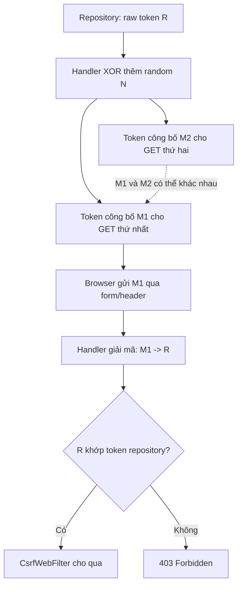
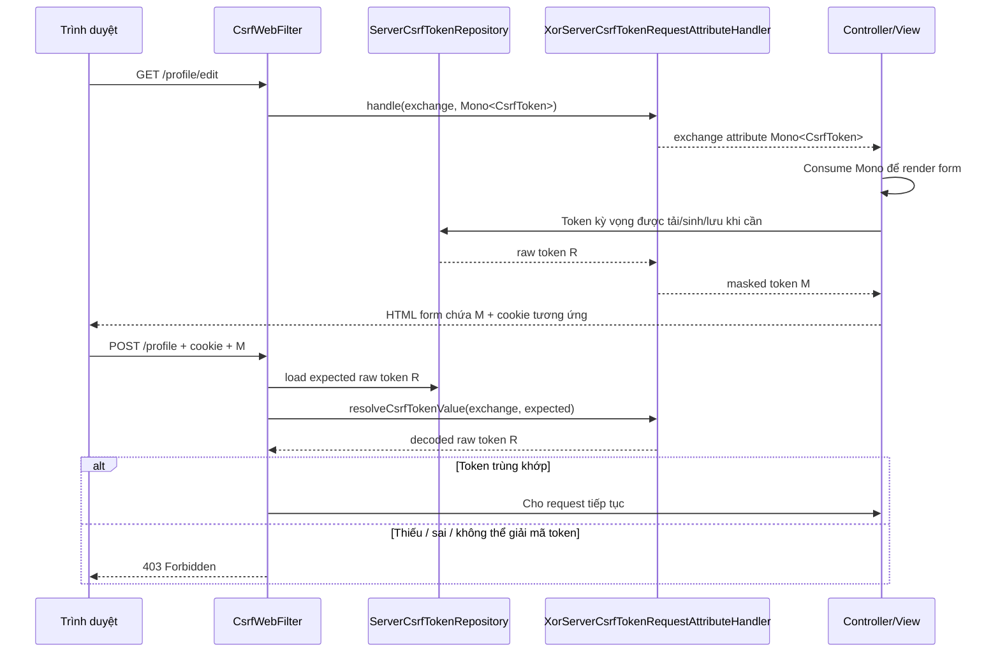

# XorServerCsrfTokenRequestAttributeHandler theo phiên bản

> **Chương:** CSRF trên Reactive  
> **Phạm vi:** Spring Security **WebFlux** và những thay đổi liên quan đến `XorServerCsrfTokenRequestAttributeHandler` từ Spring Security 5.8, 6.x đến 7.x. Những ví dụ Java dùng `ServerHttpSecurity` và `SecurityWebFilterChain`.

Trong module `SPRING_SECURITY_HTTP_PROTECTION`, người học triển khai các lớp phòng vệ HTTP và trình duyệt như CSRF, CORS, security headers, CSP, HSTS, HTTP firewall và bảo vệ session cho cả Servlet lẫn Reactive. Bài này giải thích **vì sao Spring Security WebFlux chuyển handler CSRF mặc định sang XOR từ phiên bản 6.0**, token được xuất ra giao diện thay đổi như thế nào, các vấn đề thường gặp khi nâng cấp ứng dụng SPA và cách kiểm thử/chẩn đoán lỗi mà không phải tắt CSRF.

## 1. Vấn đề: token CSRF có thể bị lộ qua kênh nén

Một ứng dụng WebFlux dùng cookie/session đăng nhập cần chống **Cross-Site Request Forgery (CSRF)**. Trình duyệt có thể tự gửi cookie xác thực theo yêu cầu do một website độc hại tạo ra. Vì vậy, request thay đổi dữ liệu như `POST`, `PUT`, `PATCH` và `DELETE` cần kèm **CSRF token** mà giao diện hợp lệ chủ động gửi bằng header hoặc form parameter.

Giả sử repository đang giữ một token `rawToken = "R"` gắn với phiên. Nếu mỗi trang HTML đưa ra **đúng chuỗi R** và máy chủ nén response, trong một số điều kiện kẻ tấn công có thể khai thác **BREACH**: quan sát sự thay đổi kích thước response nén qua các yêu cầu được kiểm soát để suy đoán dần bí mật nằm trong nội dung phản hồi.

**XOR masking** làm token được phản chiếu vào response **khác nhau mỗi lần xuất**, dù repository vẫn giữ nguyên raw token. Nhờ vậy, attacker khó thu được tín hiệu kích thước ổn định để suy đoán chuỗi thô. Khi token đã masking được gửi về qua form/header, request handler giải mã nó rồi giao raw token cho `CsrfWebFilter` so với giá trị kỳ vọng.

Điều cần phân biệt:

| Khái niệm | Ý nghĩa |
| --- | --- |
| **Raw token** | Giá trị CSRF token kỳ vọng do `ServerCsrfTokenRepository` tạo/lưu; dùng làm mốc đối chiếu. |
| **Masked token** | Dạng biểu diễn chứa thành phần ngẫu nhiên do `XorServerCsrfTokenRequestAttributeHandler` tạo để xuất ra view/response. |
| **Actual token** | Chuỗi client gửi trong header/form; handler giải quyết thành raw token trước khi kiểm tra. |
| **BREACH** | Rủi ro rò rỉ bí mật phản chiếu qua chênh lệch kích thước response nén, trong những điều kiện tấn công thích hợp. |

XOR masking **không phải mã hóa để giữ bí mật với JavaScript cùng origin**. Client hợp lệ có thể nhận rồi gửi lại masked token; nếu ứng dụng có XSS, script độc hại cùng origin thường cũng có thể lấy token. Vì thế vẫn cần HTTPS, CSP/chống XSS, cấu hình CORS, cookie và session phù hợp.

## 2. Bảng tương thích theo phiên bản Spring Security

**Phần quan trọng nhất của bài:** sự kiện class xuất hiện ở một phiên bản và sự kiện class trở thành **mặc định** là hai mốc khác nhau.

| Dòng phiên bản | `ServerCsrfTokenRequestHandler` / XOR trên WebFlux | Mặc định đối với CSRF token | Hành động khi nâng cấp |
| --- | --- | --- | --- |
| **5.7 trở về trước** | Chưa có các class handler mới giới thiệu từ 5.8. | Cơ chế xử lý token cũ; không áp dụng cách cấu hình `csrfTokenRequestHandler(...)` của 5.8+. | Muốn đổi hành vi phải xem API của đúng bản 5.7; tránh sao chép mã handler mới vào dự án cũ. |
| **5.8.x** | Giới thiệu `ServerCsrfTokenRequestAttributeHandler` và **`XorServerCsrfTokenRequestAttributeHandler`**. | **Plain handler** `ServerCsrfTokenRequestAttributeHandler`. XOR là tùy chọn **opt-in**. | Có thể bật XOR để chuẩn bị chuyển lên 6.x; cần chỉnh client đang gửi raw token. |
| **6.0.x và các bản 6.x** | Hai handler vẫn có sẵn. | **XOR handler** trở thành mặc định. | Kiểm tra form/SPA, đặc biệt `CookieServerCsrfTokenRepository` và header đọc từ cookie. |
| **7.0.x và tài liệu 7.x** | API WebFlux vẫn có `XorServerCsrfTokenRequestAttributeHandler`. | Tài liệu/Javadoc 7.x vẫn ghi **XOR mặc định**. | Giữ nguyên các bài kiểm thử raw/masked, đồng thời kiểm tra thay đổi API khác của phiên bản đích. |

Nguồn đối chiếu: [Spring Security 7.0 – CSRF for WebFlux](https://docs.spring.io/spring-security/reference/7.0/reactive/exploits/csrf.html) (ghi rõ mặc định 5.8 và từ 6.0), [Javadoc XOR 7.x](https://docs.spring.io/spring-security/reference/api/java/org/springframework/security/web/server/csrf/XorServerCsrfTokenRequestAttributeHandler.html) (`Since: 5.8`) và [Javadoc `CsrfWebFilter`](https://docs.spring.io/spring-security/reference/api/java/org/springframework/security/web/server/csrf/CsrfWebFilter.html).

**Không suy ra mặc định chỉ từ số phiên bản Spring Boot:** dự án có thể dùng BOM hoặc override một phần dependency. Khi lỗi chỉ xảy ra sau deploy, hãy kiểm tra **phiên bản `spring-security-web`, `spring-security-config` thực tế lúc runtime**, class handler đã cấu hình và cả phiên bản framework phía client. Không phải mọi thay đổi trên Servlet được áp dụng y hệt cho Reactive.

### Phân biệt tên class Servlet và Reactive

| Servlet | WebFlux |
| --- | --- |
| `XorCsrfTokenRequestAttributeHandler` | **`XorServerCsrfTokenRequestAttributeHandler`** |
| `CsrfTokenRequestAttributeHandler` | `ServerCsrfTokenRequestAttributeHandler` |
| `CsrfTokenRequestHandler` | `ServerCsrfTokenRequestHandler` |
| `HttpServletRequest` | `ServerWebExchange` |
| `HttpSecurity` / `SecurityFilterChain` | **`ServerHttpSecurity` / `SecurityWebFilterChain`** |

Không import `org.springframework.security.web.csrf.XorCsrfTokenRequestAttributeHandler` vào cấu hình WebFlux. Class đúng ở package `org.springframework.security.web.server.csrf`.

## 3. XOR masking hoạt động ở ranh giới nào?

`XorServerCsrfTokenRequestAttributeHandler` là `final class` **kế thừa `ServerCsrfTokenRequestAttributeHandler`**, implements `ServerCsrfTokenRequestHandler` và `ServerCsrfTokenRequestResolver`. Nó có hai phương thức quan trọng:

```java
// Hợp đồng chính, viết rút gọn để học.
void handle(ServerWebExchange exchange, Mono<CsrfToken> csrfToken);

Mono<String> resolveCsrfTokenValue(
    ServerWebExchange exchange, CsrfToken expected);
```

**`handle`:** nhận publisher chứa raw token do filter chuẩn bị; gắn `Mono<CsrfToken>` vào exchange attribute với key `CsrfToken.class.getName()`. Với XOR handler, `getToken()` trên đối tượng được công bố là giá trị **masked**, còn repository tiếp tục giữ raw token.

**`resolveCsrfTokenValue`:** trích token gửi trong header/form, **bỏ masking** để thu raw token (hoặc phát rỗng nếu không có token hợp lệ theo hợp đồng), giúp filter so khớp với `expected.getToken()`.

Mô hình thuật toán ở mức khái niệm:

1. Repository sinh/lưu raw token `R`.
2. Khi cần công bố token, handler tạo chuỗi ngẫu nhiên `N` bằng `SecureRandom`.
3. Handler tạo phần được XOR từ `R` và `N`, rồi đóng gói thành masked token `M` để gửi trong form/view/endpoint.
4. Client gửi `M` qua header hoặc form parameter.
5. Handler đọc `M`, khôi phục `R`, sau đó filter so với token kỳ vọng.

Đây là **mô tả cơ chế**, không phải định dạng dây (wire format) được ứng dụng tự mã hóa/giải mã. Các chi tiết byte/encoding là việc của Spring Security; đừng tự tách, giải Base64 rồi XOR trong frontend.



**M1 khác M2 không chứng minh repository đã đổi token.** Token ở response thay đổi do lớp masking ngẫu nhiên. Ngược lại, token ở repository có thể thật sự thay đổi khi session hết hạn, bị xóa hoặc authentication/session chuyển trạng thái; muốn xác định nguyên nhân cần kiểm tra vòng đời lưu trữ, không dựa vào so sánh hai chuỗi masked.

### Mỗi `Mono` cần được consume đúng cách

`CsrfWebFilter` công bố `Mono<CsrfToken>` trong `ServerWebExchange` dưới key `CsrfToken.class.getName()`. Việc có attribute **không có nghĩa token đã được tính**. Khi ứng dụng render form hoặc endpoint token, phải **subscribe** qua pipeline WebFlux để kích hoạt thao tác tải/sinh/lưu token.

```java
Mono<CsrfToken> tokenPublisher =
    exchange.getAttribute(CsrfToken.class.getName());

// Đúng: cho framework subscribe khi tạo response.
return tokenPublisher.map(token -> token.getToken());

// Tránh block() trong Netty event loop hoặc subscribe() thủ công.
```

Đoạn trên chỉ minh họa cách consume publisher trong một phương thức trả `Mono<String>`; cần kiểm tra `tokenPublisher != null` trong mã thật. Để hiển thị token, lấy giá trị đã được handler công bố, không bỏ qua handler và gửi raw token trực tiếp từ repository.

## 4. Luồng xử lý từ GET form đến POST sau khi nâng cấp



Với matcher mặc định, `GET`, `HEAD`, `OPTIONS`, `TRACE` không cần CSRF token; những method như `POST`/`PUT`/`PATCH`/`DELETE` cần. Tuy nhiên, một GET **có hiển thị form** vẫn cần lấy token để trả cho browser. Mọi endpoint GET phải giữ semantics **chỉ đọc**.

**Lưu ý về báo lỗi:** Một `403` có thể đến từ CSRF, phân quyền hoặc cấu hình khác. Xác minh filter nào từ chối request trước khi thay đổi handler; nếu request không đi qua `CsrfWebFilter` thì sửa handler XOR sẽ không giải quyết nguyên nhân.

## 5. Cấu hình theo từng dòng phiên bản

### 5.1. Spring Security 5.8: bật XOR chủ động

Trong 5.8, `ServerCsrfTokenRequestAttributeHandler` vẫn là mặc định. Nếu muốn chuẩn bị migration sang 6.x, có thể khai báo XOR tường minh:

```java
import org.springframework.context.annotation.Bean;
import org.springframework.context.annotation.Configuration;
import org.springframework.security.config.annotation.web.reactive.EnableWebFluxSecurity;
import org.springframework.security.config.web.server.ServerHttpSecurity;
import org.springframework.security.web.server.SecurityWebFilterChain;
import org.springframework.security.web.server.csrf.XorServerCsrfTokenRequestAttributeHandler;

@Configuration
@EnableWebFluxSecurity
class CsrfSecurityConfig {

    @Bean
    SecurityWebFilterChain webFilterChain(ServerHttpSecurity http) {
        return http
            .authorizeExchange(exchanges -> exchanges
                .pathMatchers("/csrf", "/login").permitAll()
                .anyExchange().authenticated())
            .csrf(csrf -> csrf.csrfTokenRequestHandler(
                new XorServerCsrfTokenRequestAttributeHandler()))
            .build();
    }
}
```

Đây là cấu hình WebFlux cho **5.8+**, không phù hợp nguyên trạng với 5.7. Cấu hình cụ thể khác như form login hoặc OAuth2 phải bổ sung tùy cơ chế xác thực của ứng dụng. Handler XOR chỉ là một phần bảo vệ CSRF, không thay `authorizeExchange`.

### 5.2. Spring Security 6.x/7.x: giữ XOR mặc định

Với 6.0 trở lên, **không cần tự tạo handler XOR** khi dùng cấu hình mặc định:

```java
import org.springframework.context.annotation.Bean;
import org.springframework.context.annotation.Configuration;
import org.springframework.security.config.Customizer;
import org.springframework.security.config.annotation.web.reactive.EnableWebFluxSecurity;
import org.springframework.security.config.web.server.ServerHttpSecurity;
import org.springframework.security.web.server.SecurityWebFilterChain;

@Configuration
@EnableWebFluxSecurity
class DefaultReactiveCsrfConfig {

    @Bean
    SecurityWebFilterChain webFilterChain(ServerHttpSecurity http) {
        return http
            .authorizeExchange(exchanges -> exchanges
                .pathMatchers("/csrf", "/login").permitAll()
                .anyExchange().authenticated())
            .csrf(Customizer.withDefaults())
            .build();
    }
}
```

`csrf(Customizer.withDefaults())` ghi rõ ý đồ; CSRF **đã bật mặc định**. Đoạn này là một **phương án thay thế** ví dụ 5.8 ở trên; không đăng ký đồng thời hai bean chain áp dụng cùng request nếu chưa thiết kế thứ tự/matcher.

### 5.3. Khi buộc phải nhận token thô giống mặc định 5.8

Spring Security 6.x/7.x cho phép chọn lại plain handler:

```java
import org.springframework.security.web.server.csrf.ServerCsrfTokenRequestAttributeHandler;

// Thay .csrf(Customizer.withDefaults()) trong builder:
.csrf(csrf -> csrf.csrfTokenRequestHandler(
    new ServerCsrfTokenRequestAttributeHandler()))
```

Cách này cho handler nhận **raw token** nhưng đồng thời **tắt XOR masking chống BREACH** cho những vị trí dùng handler đó để công bố token. Đây là thay đổi có đánh đổi an ninh: cần đánh giá form/view nén, tương thích SPA và cách token đi qua response. Nếu frontend có thể lấy masked token từ một view/endpoint, nên giữ handler XOR thay vì bỏ bảo vệ để tránh `403`.

### 5.4. Có cần sửa `SecureRandom` không?

`XorServerCsrfTokenRequestAttributeHandler` có API `setSecureRandom(SecureRandom)` để thay nguồn byte ngẫu nhiên sử dụng khi masking:

```java
import java.security.SecureRandom;
import org.springframework.security.web.server.csrf.XorServerCsrfTokenRequestAttributeHandler;

var handler = new XorServerCsrfTokenRequestAttributeHandler();
handler.setSecureRandom(new SecureRandom());

// Dùng trong .csrf(csrf -> csrf.csrfTokenRequestHandler(handler)).
```

Trong hầu hết ứng dụng, **không cần thay RNG mặc định**. Nếu tiêm RNG để kiểm thử, tránh sử dụng PRNG dự đoán được ở production. Không tự triển khai XOR để “tối ưu hiệu năng”, cũng không log seed/byte ngẫu nhiên hoặc raw token.

## 6. Cách cung cấp masked token cho browser

### 6.1. Endpoint `GET /csrf` sử dụng exchange attribute

Ví dụ phù hợp cho Spring Security **5.8 khi bật XOR** và **6.x/7.x theo mặc định**:

```java
import org.springframework.http.CacheControl;
import org.springframework.http.ResponseEntity;
import org.springframework.security.web.server.csrf.CsrfToken;
import org.springframework.web.bind.annotation.GetMapping;
import org.springframework.web.bind.annotation.RestController;
import org.springframework.web.server.ServerWebExchange;
import reactor.core.publisher.Mono;

@RestController
class CsrfTokenController {
    record TokenPayload(String headerName, String parameterName, String token) {}

    @GetMapping("/csrf")
    Mono<ResponseEntity<TokenPayload>> getToken(ServerWebExchange exchange) {
        Mono<CsrfToken> publisher =
            exchange.getAttribute(CsrfToken.class.getName());

        if (publisher == null) {
            return Mono.error(new IllegalStateException(
                "CsrfWebFilter chưa công bố token cho request"));
        }

        return publisher.map(value -> ResponseEntity.ok()
            .cacheControl(CacheControl.noStore())
            .body(new TokenPayload(
                value.getHeaderName(),
                value.getParameterName(),
                value.getToken())));
    }
}
```

Endpoint này consume publisher để đảm bảo token được chuẩn bị trong lifecycle HTTP. Response có thể trả **masked token**; browser phải gửi **chính giá trị đó** và cùng cookie/session liên quan trong request kế tiếp. Đừng gọi trực tiếp `repository.loadToken()` rồi gửi raw token qua API này khi XOR handler vẫn hoạt động.

Frontend cùng origin:

```javascript
const response = await fetch("/csrf", {
  credentials: "same-origin",
  cache: "no-store"
});
if (!response.ok) throw new Error("Không lấy được CSRF token");
const csrf = await response.json();

const result = await fetch("/profile", {
  method: "POST",
  credentials: "same-origin",
  headers: {
    [csrf.headerName]: csrf.token,
    "Content-Type": "application/json"
  },
  body: JSON.stringify({ displayName: "Lan" })
});
if (!result.ok) throw new Error("Cập nhật hồ sơ thất bại");
```

Giữ endpoint trong origin tin cậy; không cấu hình CORS để website bất kỳ đọc token. Với dữ liệu chứa token, ưu tiên `Cache-Control: no-store`; không ghi token trong access log hay telemetry.

### 6.2. Render HTML form

Nếu view engine không tự gắn hidden CSRF field, controller có thể đưa token vào model:

```java
import org.springframework.security.web.server.csrf.CsrfToken;
import org.springframework.stereotype.Controller;
import org.springframework.ui.Model;
import org.springframework.web.bind.annotation.GetMapping;
import org.springframework.web.server.ServerWebExchange;
import reactor.core.publisher.Mono;

@Controller
class ProfilePage {
    @GetMapping("/profile/edit")
    Mono<String> edit(ServerWebExchange exchange, Model model) {
        Mono<CsrfToken> publisher =
            exchange.getAttribute(CsrfToken.class.getName());
        if (publisher == null) {
            return Mono.error(new IllegalStateException("Không có CSRF token"));
        }
        return publisher.map(csrf -> {
            model.addAttribute("_csrf", csrf);
            return "profile-edit";
        });
    }
}
```

Template Thymeleaf có thể dùng hidden input (cú pháp ở đây là **template**, không phải giá trị hardcode):

```html
<form action="/profile" method="post">
  <input type="hidden"
         th:name="${_csrf.parameterName}"
         th:value="${_csrf.token}"/>
  <input type="text" name="displayName"/>
  <button type="submit">Lưu</button>
</form>
```

Với tích hợp Thymeleaf và `RequestDataValueProcessor`, Spring Security có thể tự chèn token khi dùng `th:action`. Chọn cách tự xuất token hoặc để view engine xử lý sao cho nhất quán, tránh hidden field trùng lặp. Token đưa vào view **đã qua handler** nên có thể masked; không suy ra token trong session bị thay mỗi lần render.

## 7. Tình huống nâng cấp SPA: cookie thô gặp XOR mặc định

Đây là lỗi nâng cấp từ 5.8 sang 6.0+ thường được chú ý nhất:

1. Ứng dụng chọn `CookieServerCsrfTokenRepository.withHttpOnlyFalse()`. Repository lưu **raw token** vào cookie `XSRF-TOKEN`; JavaScript đọc cookie.
2. SPA đặt raw token vào header `X-XSRF-TOKEN`.
3. Trong 5.8 mặc định plain handler, giá trị raw thường được chấp nhận khi khớp cookie.
4. Khi nâng cấp lên 6.0+, XOR handler mặc định mong **masked token** được handler phát hành. Header raw có thể bị từ chối với `403` dù cookie và header chứa cùng chuỗi.

**Lỗi không nằm ở tên cookie hoặc xác thực** nếu chúng vẫn đúng. Cần đồng bộ **chiến lược phát token** và **cách request handler đọc token**.

| Phương án | Client gửi | Cấu hình handler | Đánh đổi |
| --- | --- | --- | --- |
| **A. Giữ XOR, cấp token qua view/endpoint** | Masked token được trả bởi handler | XOR mặc định | Giữ BREACH protection; frontend cần cơ chế lấy token trước request ghi. |
| **B. SPA đọc raw cookie** | Raw token trong `X-XSRF-TOKEN` | Plain handler | Dễ tương thích ứng dụng cũ, nhưng mất masking ở nơi token được xuất. |
| **C. Handler kết hợp** | Header raw từ cookie, form masked | Handler tự chọn resolver theo nguồn token | Có thể giữ masking cho form; cần quy ước rõ ràng và kiểm thử hai đường đi. |

### Mẫu handler kết hợp cho WebFlux 5.8+

Trong ứng dụng vừa có SPA vừa có HTML form, có thể dùng **delegation** giữa plain và XOR (class XOR là `final` nên không kế thừa nó):

```java
import org.springframework.security.web.server.csrf.CsrfToken;
import org.springframework.security.web.server.csrf.ServerCsrfTokenRequestAttributeHandler;
import org.springframework.security.web.server.csrf.ServerCsrfTokenRequestHandler;
import org.springframework.security.web.server.csrf.XorServerCsrfTokenRequestAttributeHandler;
import org.springframework.web.server.ServerWebExchange;
import reactor.core.publisher.Mono;

public final class SpaCsrfTokenRequestHandler
        implements ServerCsrfTokenRequestHandler {

    private final ServerCsrfTokenRequestHandler raw =
        new ServerCsrfTokenRequestAttributeHandler();
    private final ServerCsrfTokenRequestHandler xor =
        new XorServerCsrfTokenRequestAttributeHandler();

    @Override
    public void handle(ServerWebExchange exchange, Mono<CsrfToken> token) {
        xor.handle(exchange, token); // Token xuất qua view/attribute có masking.
    }

    @Override
    public Mono<String> resolveCsrfTokenValue(
            ServerWebExchange exchange, CsrfToken token) {
        boolean containsHeader = exchange.getRequest().getHeaders()
            .containsKey(token.getHeaderName());
        return containsHeader
            ? raw.resolveCsrfTokenValue(exchange, token)
            : xor.resolveCsrfTokenValue(exchange, token);
    }
}
```

Đưa vào Spring Security WebFlux:

```java
import org.springframework.security.web.server.csrf.CookieServerCsrfTokenRepository;

// Đoạn thay thế .csrf(...) của SecurityWebFilterChain:
.csrf(csrf -> csrf
    .csrfTokenRepository(CookieServerCsrfTokenRepository.withHttpOnlyFalse())
    .csrfTokenRequestHandler(new SpaCsrfTokenRequestHandler()))
```

**Hợp đồng của ví dụ này:** hễ có header CSRF, giá trị được xem là **raw**; khi không có header, form parameter được xem là **masked**. Do đó, **không gửi masked token của `GET /csrf` qua header** khi dùng chính handler kết hợp này. Nếu ứng dụng cần chấp nhận masked header và raw cookie header cùng lúc, phải thiết kế nguồn/kiểu header phân biệt, thay vì mơ hồ chấp nhận nhiều biểu diễn trên một header.

Với repository cookie, JavaScript cần có khả năng đọc `XSRF-TOKEN` khi chọn phương án B/C; `withHttpOnlyFalse()` cho phép điều đó, đồng thời tăng yêu cầu bảo vệ XSS và kiểm soát `Path`/`Domain`. **Cookie tự động gửi không thay thế việc client chủ động thêm header.**

### Điều xảy ra sau login, logout và session hết hạn

Token có thể bị xóa/đổi khi vòng đời xác thực hoặc session thay đổi. Một SPA không nên giữ mãi token đã cache trong bộ nhớ; sau login/logout, khi token được thu hồi hoặc khi request nhận `403` hợp lý, client có thể cần lấy token mới rồi thực hiện lại thao tác theo chính sách ứng dụng. Đừng viết vòng lặp retry vô hạn với request làm thay đổi dữ liệu: ưu tiên hiển thị lỗi và kiểm soát side effect.

## 8. Kiểm thử theo phiên bản bằng Reactor `StepVerifier`

Để kiểm tra hợp đồng XOR mà không cần mạng, test trực tiếp `XorServerCsrfTokenRequestAttributeHandler`. Dùng JUnit 5, `spring-test`, `spring-security-web`, `reactor-test` (phiên bản dependency tương thích với hệ Spring đang dùng).

### 8.1. XOR: token được công bố là masked, khi gửi về giải mã thành raw

```java
import org.junit.jupiter.api.Test;
import org.springframework.mock.http.server.reactive.MockServerHttpRequest;
import org.springframework.mock.web.server.MockServerWebExchange;
import org.springframework.security.web.server.csrf.CsrfToken;
import org.springframework.security.web.server.csrf.DefaultCsrfToken;
import org.springframework.security.web.server.csrf.XorServerCsrfTokenRequestAttributeHandler;
import reactor.core.publisher.Mono;
import reactor.test.StepVerifier;

import static org.junit.jupiter.api.Assertions.*;

class XorCsrfHandlerTest {
    @Test
    void maskedTokenResolvesBackToExpectedRawToken() {
        CsrfToken expected =
            new DefaultCsrfToken("X-CSRF-TOKEN", "_csrf", "raw-secret-example");
        var handler = new XorServerCsrfTokenRequestAttributeHandler();

        var getExchange = MockServerWebExchange.from(
            MockServerHttpRequest.get("/profile/edit"));
        handler.handle(getExchange, Mono.just(expected));

        Mono<CsrfToken> exposed =
            getExchange.getAttribute(CsrfToken.class.getName());
        assertNotNull(exposed);

        Mono<String> roundTrip = exposed.flatMap(masked -> {
            assertNotEquals(expected.getToken(), masked.getToken());

            var postExchange = MockServerWebExchange.from(
                MockServerHttpRequest.post("/profile")
                    .header(expected.getHeaderName(), masked.getToken()));

            return handler.resolveCsrfTokenValue(postExchange, expected);
        });

        StepVerifier.create(roundTrip)
            .expectNext(expected.getToken())
            .verifyComplete();
    }
}
```

Test này tách riêng tầng handler: token masked **khác raw** và giải mã đúng về raw. Không kiểm tra một chuỗi masked cố định vì chứa ngẫu nhiên. Với bản 5.7, class này chưa có; test chỉ áp dụng từ **5.8+**.

### 8.2. Plain handler: cùng token raw được công bố và tiếp nhận

```java
import org.junit.jupiter.api.Test;
import org.springframework.mock.http.server.reactive.MockServerHttpRequest;
import org.springframework.mock.web.server.MockServerWebExchange;
import org.springframework.security.web.server.csrf.CsrfToken;
import org.springframework.security.web.server.csrf.DefaultCsrfToken;
import org.springframework.security.web.server.csrf.ServerCsrfTokenRequestAttributeHandler;
import reactor.core.publisher.Mono;
import reactor.test.StepVerifier;

class PlainCsrfHandlerTest {
    @Test
    void acceptsRawHeaderToken() {
        CsrfToken token =
            new DefaultCsrfToken("X-CSRF-TOKEN", "_csrf", "raw-secret-example");
        var exchange = MockServerWebExchange.from(
            MockServerHttpRequest.post("/profile")
                .header(token.getHeaderName(), token.getToken()));

        var handler = new ServerCsrfTokenRequestAttributeHandler();
        handler.handle(exchange, Mono.just(token));

        StepVerifier.create(
                handler.resolveCsrfTokenValue(exchange, token))
            .expectNext(token.getToken())
            .verifyComplete();
    }
}
```

Hai test trên cho thấy **sự khác biệt của hai handler**, nhưng chưa khẳng định `CsrfWebFilter` được cấu hình đúng hay request có bị chặn trong ứng dụng.

### 8.3. Test tích hợp WebFlux với `WebTestClient`

Với `spring-security-test` và một endpoint `POST /profile` trong application context test, kiểm tra cả đường đi CSRF:

```java
// Trong bài test có WebTestClient bindToApplicationContext(...).apply(springSecurity()).
// Static import: SecurityMockServerConfigurers.mockUser và .csrf.
client.mutateWith(mockUser())
    .post().uri("/profile")
    .exchange()
    .expectStatus().isForbidden();

client.mutateWith(mockUser()).mutateWith(csrf())
    .post().uri("/profile")
    .exchange()
    .expectStatus().is2xxSuccessful();
```

Khi nâng cấp 5.8 → 6.x/7.x, **thêm kịch bản HTTP thật**: client mở `GET /csrf` hoặc form để nhận masked token, giữ cookie, rồi gửi POST bằng đúng token ấy. Dùng cùng một bộ test chạy trên mỗi cấu hình/version được hỗ trợ để xác định khác biệt do handler thay vì do cookie hay controller.

### Ma trận kịch bản nên kiểm tra

| Kịch bản | XOR handler | Plain handler |
| --- | --- | --- |
| GET view công bố token | Giá trị có masking, có thể thay đổi mỗi lần | Token thô, thường ổn định khi repository chưa đổi |
| POST thiếu token | Bị CSRF từ chối | Bị CSRF từ chối |
| POST gửi masked token hợp lệ, đúng session/cookie | **Qua lớp CSRF** | Không bảo đảm; plain không giải mã XOR |
| POST gửi raw token trực tiếp từ cookie | Thường **403** do thiếu masking | Qua CSRF nếu token trùng repository |
| POST gửi token của session khác **khi dùng WebSession repository** | Bị từ chối | Bị từ chối |
| POST header không trùng token ở cookie khi dùng CookieServerCsrfTokenRepository | Bị từ chối | Bị từ chối |
| POST form bị lỗi sau login/logout | Kiểm tra token đã bị thu hồi và lấy lại | Kiểm tra token đã bị thu hồi và lấy lại |
| CORS preflight `OPTIONS` | Không cần CSRF token mặc định | Không cần CSRF token mặc định |

## 9. Chẩn đoán lỗi thường gặp sau khi nâng cấp

| Triệu chứng | Điểm cần kiểm tra | Hướng xử lý |
| --- | --- | --- |
| Chỉ sau khi nâng 5.8 → 6.x, SPA POST bị `403` | SPA có đang gửi **raw cookie token** với XOR mặc định? | Dùng token đã masking qua view/endpoint, hoặc chọn plain/hybrid handler có kiểm soát. |
| GET trang hợp lệ, POST sai token | Cookie phiên, token kỳ vọng, tên header và dạng raw/masked không trùng | Dùng Network tab so tên header/cookie và vòng đời token; không log nguyên token. |
| Token view đổi sau mỗi refresh nhưng POST vẫn đúng | Handler XOR sinh masking ngẫu nhiên mỗi request | Đây thường là hành vi mong đợi; đừng dùng giá trị masked để phát hiện xoay session. |
| Lấy trực tiếp raw token từ repository để render form | Bỏ qua handler XOR, form gửi raw token | Lấy `Mono<CsrfToken>` được công bố trong `ServerWebExchange`. |
| `CsrfToken.class.getName()` trả `null` | Sai security chain, import class Servlet hoặc filter chưa chạy | Kiểm tra package `web.server.csrf` và thứ tự `WebFilter`. |
| Form không nhận được token | `Mono<CsrfToken>` không được consume | Dùng `map`/`flatMap`/view integration; tránh `subscribe()` thủ công. |
| Cookie có raw token nhưng header không có | Browser tự gửi cookie, frontend không tự gắn header | Cấu hình client thêm `X-XSRF-TOKEN`, hoặc dùng masked token từ endpoint. |
| `POST` chưa đến server do preflight | CORS không cho phép header/origin/credentials | Cấu hình CORS riêng; `OPTIONS` không cần CSRF token trong matcher mặc định. |
| Mã import XOR class bị lỗi khi dùng Spring Security 5.7 | Handler WebFlux giới thiệu từ 5.8 | Dùng API phù hợp 5.7 hoặc nâng dependency đúng BOM trước khi áp dụng ví dụ. |
| Test pass với `csrf()` nhưng browser bị `403` | Mock CSRF không kiểm thử đầy đủ raw/masked/cookie lifecycle | Thêm test từ GET lấy token → POST gửi cookie/header qua HTTP thật. |

**Trình tự điều tra có hiệu quả:** kiểm tra version runtime → `SecurityWebFilterChain` đang áp dụng → loại request handler → nguồn token do repository lưu → exchange attribute token đã consume → header/form + cookie của POST → xử lý lỗi của `CsrfWebFilter`. Phân biệt `403` CSRF với `403` phân quyền. Không ghi giá trị token, session ID hoặc nội dung cookie bí mật vào log.

## 10. Bài thực hành nâng cấp

1. Với cấu hình WebFlux **5.8**, dùng plain handler mặc định, tạo `GET /csrf` và `POST /profile`. Gửi raw token hợp lệ và ghi nhận kết quả.
2. Chuyển handler sang `XorServerCsrfTokenRequestAttributeHandler` trong cùng 5.8; quan sát token từ GET thay đổi và xác nhận POST chỉ hợp lệ khi gửi đúng dạng masked.
3. Đối chiếu cấu hình tương đương trên **6.x/7.x**, nơi XOR là mặc định. Bỏ cấu hình XOR tường minh và chạy lại các kịch bản.
4. Thêm `CookieServerCsrfTokenRepository.withHttpOnlyFalse()`, mô phỏng SPA gửi raw `X-XSRF-TOKEN`. Ghi lại `403` khi không tương thích, sau đó chọn **một** chiến lược sửa: masked endpoint, plain handler hoặc hybrid handler.
5. Kiểm tra GET an toàn, POST thiếu token, POST token của phiên khác khi dùng WebSession repository, POST header không khớp cookie token khi dùng cookie repository, login/logout làm mới token, browser cookie policy và CORS preflight. Tổng hợp kết quả theo phiên bản, **không** ghi token thật trong báo cáo.

**Điểm cốt lõi:** `XorServerCsrfTokenRequestAttributeHandler` xuất hiện từ **5.8** nhưng chỉ là **mặc định từ 6.0**; tài liệu 7.x tiếp tục sử dụng XOR. Token trong exchange là `Mono<CsrfToken>`, khi đưa ra view có thể được masking khác nhau giữa các request. Handler nhận token masked để khôi phục raw token cho `CsrfWebFilter`, trong khi SPA đọc raw cookie cần chiến lược tương thích rõ ràng. Đây là một trong nhiều lớp bảo vệ HTTP được áp dụng cùng xác thực, session, CORS, CSP và security headers.

## Tài liệu tham khảo chính thức

- [Spring Security 7.0 – CSRF cho WebFlux, phần Configure ServerCsrfTokenRequestHandler](https://docs.spring.io/spring-security/reference/7.0/reactive/exploits/csrf.html)
- [Spring Security – XorServerCsrfTokenRequestAttributeHandler Javadoc](https://docs.spring.io/spring-security/reference/api/java/org/springframework/security/web/server/csrf/XorServerCsrfTokenRequestAttributeHandler.html)
- [Spring Security – ServerCsrfTokenRequestAttributeHandler Javadoc](https://docs.spring.io/spring-security/reference/api/java/org/springframework/security/web/server/csrf/ServerCsrfTokenRequestAttributeHandler.html)
- [Spring Security – CsrfWebFilter Javadoc](https://docs.spring.io/spring-security/reference/api/java/org/springframework/security/web/server/csrf/CsrfWebFilter.html)
- [Spring Security 5.8 – Reactive CSRF API](https://docs.spring.io/spring-security/site/docs/5.8.x/api/org/springframework/security/web/server/csrf/package-summary.html)
- [Spring Security 5.7 – ServerHttpSecurity API](https://docs.spring.io/spring-security/site/docs/5.7.0/api/org/springframework/security/config/web/server/ServerHttpSecurity.html)
