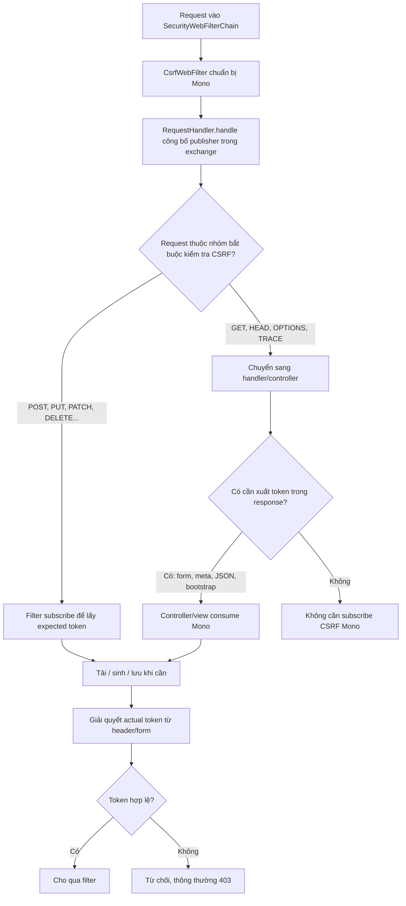

# Mono<CsrfToken> và thời điểm đăng ký để lấy token

> **Chương:** CSRF trên Reactive  
> **Trọng tâm:** Khi nào `Mono<CsrfToken>` thực sự được **subscribe** trong Spring Security WebFlux, vì sao GET có thể chưa tạo token, cách phát token cho form/SPA và cách kiểm chứng tính lazy trong một pipeline không chặn.

Trong module `SPRING_SECURITY_HTTP_PROTECTION`, người học áp dụng các lớp phòng vệ HTTP và trình duyệt của Spring Security: CSRF, CORS, security headers, CSP, HSTS, HTTP firewall và bảo vệ session, đồng thời cấu hình cho Servlet lẫn Reactive, kiểm thử kịch bản tấn công và chẩn đoán xung đột bảo mật khi triển khai. Bài này đi vào một đặc trưng quan trọng của **Reactive CSRF**: `CsrfWebFilter` không nhất thiết phải tạo hoặc đọc token ngay khi có request. Token được đại diện bằng **`Mono<CsrfToken>`**, còn công việc lấy và lưu token được kích hoạt vào **thời điểm subscription**.

## 1. Tại sao thời điểm subscribe quan trọng với CSRF?

Khi trình duyệt đã đăng nhập bằng cookie/session, một website độc hại có thể khiến trình duyệt gửi request đến ứng dụng mà cookie xác thực vẫn được đính kèm. CSRF protection yêu cầu thêm một **token mà client chủ động gửi**, ví dụ trong hidden field `_csrf` hoặc header `X-CSRF-TOKEN`. Server so sánh token này với token kỳ vọng trước khi xử lý một request thay đổi dữ liệu.

Nếu mọi `GET` đọc dữ liệu đều phải lập tức tải/sinh và lưu token, ứng dụng có thể đụng đến session hoặc phát cookie ngay cả khi không có form, không cần token. WebFlux giải quyết điều này bằng cách **công bố một publisher**, rồi chỉ yêu cầu giá trị khi thực sự cần:

- Một **GET chỉ trả dữ liệu công khai** thường không cần CSRF token để hoàn tất request.
- Một **GET hiển thị form hoặc trả token cho SPA** phải **consume** publisher để có token đưa ra browser.
- Một **POST/PUT/PATCH/DELETE được bảo vệ** phải lấy token kỳ vọng và token khách gửi để kiểm tra, nên công việc tương ứng được thực thi trong pipeline filter.

Điểm chính là phân biệt **có một đối tượng `Mono`** với **đã đăng ký thực thi `Mono`**. Một `Mono<CsrfToken>` nằm trong `ServerWebExchange.getAttributes()` chưa chứng minh rằng token đã được tạo, đã lưu hoặc cookie đã xuất hiện ở response.

## 2. Ai tạo publisher, ai đăng ký, ai lưu token?

| Thành phần | Vai trò |
| --- | --- |
| `CsrfWebFilter` | Áp dụng bảo vệ CSRF, chuẩn bị publisher chứa token, phối hợp matcher, repository và request handler. |
| `ServerCsrfTokenRepository` | Tạo (`generateToken`), tải (`loadToken`), lưu/xóa (`saveToken`) token kỳ vọng. |
| `ServerCsrfTokenRequestHandler` | Công bố publisher token trong exchange; giải quyết token thực tế từ request header/form. |
| `XorServerCsrfTokenRequestAttributeHandler` | Handler mặc định từ Spring Security 6, xuất biểu diễn token có XOR masking để giảm rủi ro BREACH. |
| WebFlux controller/view | Consume publisher khi cần đưa token vào HTML form, meta tag hoặc JSON response. |
| Reactor subscriber | Kích hoạt công việc đã mô tả trong publisher; với HTTP, framework thường thực hiện subscription. |

Spring Security công bố publisher dưới key:

```java
CsrfToken.class.getName()
// "org.springframework.security.web.server.csrf.CsrfToken"
```

Value trong `ServerWebExchange.getAttributes()` có kiểu **`Mono<CsrfToken>`**. **Nó không phải một `CsrfToken` đã được giải quyết**, cũng không mặc nhiên nằm dưới key `_csrf` của form HTML.

```java
import org.springframework.security.web.server.csrf.CsrfToken;
import org.springframework.web.server.ServerWebExchange;
import reactor.core.publisher.Mono;

Mono<CsrfToken> csrfPublisher =
    exchange.getAttribute(CsrfToken.class.getName());
```

Đoạn này chỉ đúng khi nằm trong một phương thức có biến `exchange` và request đã đi qua `CsrfWebFilter` của security chain. `csrfPublisher` có thể là `null` nếu filter không áp dụng hoặc attribute chưa được công bố; cần kiểm tra trường hợp đó trong code thật.

**Về tự động lưu:** Javadoc `CsrfWebFilter` nêu rõ khi token mới được tạo, token sẽ **tự được lưu lúc publisher được subscribe**. Vì vậy khi dùng publisher mà filter công bố, một controller hiển thị token không cần tự gọi `repository.generateToken()` rồi `repository.saveToken()`. Nếu tự gọi hai phương thức repository bên ngoài pipeline filter, lập trình viên phải tự đảm bảo thứ tự lưu rồi mới trả token.

## 3. Dòng thời gian đăng ký theo loại HTTP request



**Matcher mặc định** xem `GET`, `HEAD`, `OPTIONS` và `TRACE` là các method không cần CSRF token để kiểm tra yêu cầu. Điều đó chỉ đúng khi chúng được dùng với ngữ nghĩa **không làm thay đổi dữ liệu**. Không được triển khai `GET /delete?id=42` để xóa bản ghi rồi hy vọng CSRF filter sẽ chặn.

| Tình huống | Ai cần token? | Subscription dự kiến |
| --- | --- | --- |
| `GET /health` trả trạng thái | Không | Không cần subscribe publisher CSRF chỉ vì request tồn tại. |
| `GET /profile/edit` render HTML form POST | View/controller | Phải consume token trước khi response HTML được tạo. |
| `GET /csrf` trả JSON token | Controller | Publisher trả từ controller được WebFlux subscribe. |
| `GET /csrf/bootstrap` chỉ khởi tạo cookie token | Controller | Có thể dùng `tokenMono.then()` để subscribe nhưng bỏ giá trị. |
| `POST /profile` thiếu token | `CsrfWebFilter` | Filter tải token kỳ vọng và từ chối request nếu không có actual token hợp lệ. |
| `POST /profile` có token hợp lệ | `CsrfWebFilter` | Filter xác minh, rồi mới cho request tiếp tục đến handler nghiệp vụ. |

Việc request **không cần kiểm tra CSRF** không có nghĩa request không bao giờ tạo session: những cơ chế khác như đăng nhập, lưu flash/session hoặc nghiệp vụ có thể sử dụng `WebSession` riêng.

### Publisher “lạnh” và kết quả bất đồng bộ

`Mono` trong Reactor thường biểu diễn một tác vụ **lazy/cold**: tạo publisher chưa thực thi ngay. Tùy publisher và operator, mỗi subscription có thể kích hoạt lại tác vụ; `cache()` thay đổi hành vi bằng cách lưu lại tín hiệu đầu tiên. Không suy đoán trạng thái token chỉ từ việc đã gọi `map` hoặc `doOnNext`.

```java
import java.util.concurrent.atomic.AtomicInteger;
import reactor.core.publisher.Mono;

AtomicInteger executions = new AtomicInteger();
Mono<String> lazy = Mono.defer(() -> {
    executions.incrementAndGet();
    return Mono.just("token-demo");
});

// Ở đây executions.get() vẫn bằng 0.
Mono<String> transformed = lazy.map(String::toUpperCase);
// Ở đây executions.get() vẫn bằng 0.

// Khi framework hoặc StepVerifier subscribe transformed,
// bộ đếm mới tăng và Mono phát "TOKEN-DEMO".
```

Đoạn ví dụ chỉ minh họa **semantics của Reactor**, không phải cách tự tạo CSRF token thật. Dùng publisher `Mono<CsrfToken>` do `CsrfWebFilter` công bố trong ứng dụng để giữ nhất quán với repository và request handler.

## 4. Những operator nên dùng và sai lầm cần tránh

| Cách viết | Tác dụng | Có làm subscribe ngay không? |
| --- | --- | --- |
| `Mono<CsrfToken> mono = exchange.getAttribute(...)` | Lấy tham chiếu publisher | **Không** |
| `mono.map(CsrfToken::getToken)` | Mô tả biến đổi giá trị khi publisher chạy | **Không** |
| `mono.doOnNext(token -> ...)` | Gắn callback khi phát giá trị | **Không** |
| `mono.flatMap(token -> save(token).thenReturn(token))` | Kết hợp tác vụ bất đồng bộ cần chờ | **Không**, trừ khi pipeline được subscribe |
| `return mono.map(token -> ResponseEntity.ok(...))` | Trả pipeline HTTP để WebFlux subscribe | **Có**, khi framework ghi response |
| `return mono.then()` trong handler trả `Mono<Void>` | Subscribe và bỏ giá trị, vẫn chờ completion | **Có**, khi framework thực thi handler |
| `mono.subscribe()` trong controller | Đăng ký thủ công tách khỏi response lifecycle | Có nhưng **không nên dùng** |
| `mono.block()` trong event loop | Chặn thread để chờ kết quả | Có nhưng **sai mô hình non-blocking** |

Lỗi thường gặp là:

```java
// SAI: publisher không thuộc response pipeline; không ai đảm bảo nó chạy.
Mono<CsrfToken> csrf = exchange.getAttribute(CsrfToken.class.getName());
csrf.map(CsrfToken::getToken);
return Mono.just("form");
```

Và:

```java
// SAI: gọi subscribe() thủ công rồi trả response trước khi lưu/xử lý xong.
Mono<CsrfToken> csrf = exchange.getAttribute(CsrfToken.class.getName());
csrf.subscribe(token -> log.debug("Token đã phát")); // Còn có nguy cơ lộ token!
return Mono.just("form");
```

Trong ví dụ thứ hai, **không được log token thật**. Đây là anti-pattern để nhận diện, không phải cách triển khai. Tương tự, tránh `.block()` trong thread Reactor Netty; chặn event loop có thể gây nghẽn, timeout và lỗi liên quan non-blocking scheduler.

Nếu tự compose repository riêng, chuỗi tạo token phải giữ thứ tự:

```java
Mono<CsrfToken> createdAndSaved =
    repository.generateToken(exchange)
        .flatMap(token -> repository.saveToken(exchange, token)
            .thenReturn(token));
```

Đây chỉ là ví dụ **khi chủ động quản lý repository**; với `Mono<CsrfToken>` do `CsrfWebFilter` cung cấp, framework đã đảm nhiệm đường sinh/lưu token mới. `thenReturn(token)` phát token **sau khi** `saveToken` phát tín hiệu hoàn tất; nếu save lỗi thì pipeline phải phát lỗi, không được trả token chưa lưu.

## 5. Cấu hình Spring Security WebFlux để thử nghiệm

`CsrfWebFilter` hoạt động trong `SecurityWebFilterChain` tạo từ `ServerHttpSecurity`. Ví dụ tối thiểu cho ứng dụng dùng session/form login và endpoint lấy token:

```java
import org.springframework.context.annotation.Bean;
import org.springframework.context.annotation.Configuration;
import org.springframework.security.config.Customizer;
import org.springframework.security.config.annotation.web.reactive.EnableWebFluxSecurity;
import org.springframework.security.config.web.server.ServerHttpSecurity;
import org.springframework.security.web.server.SecurityWebFilterChain;

@Configuration
@EnableWebFluxSecurity
class ReactiveSecurityConfig {

    @Bean
    SecurityWebFilterChain securityWebFilterChain(ServerHttpSecurity http) {
        return http
            .authorizeExchange(exchanges -> exchanges
                .pathMatchers("/csrf", "/csrf/bootstrap", "/login").permitAll()
                .anyExchange().authenticated())
            .formLogin(Customizer.withDefaults())
            .csrf(Customizer.withDefaults()) // CSRF vốn đã bật mặc định.
            .build();
    }
}
```

Trong cấu hình mặc định, repository là `WebSessionServerCsrfTokenRepository`, nên browser phải giữ cookie phiên khi lấy token và khi gửi POST. Spring Security 6 trở lên mặc định dùng `XorServerCsrfTokenRequestAttributeHandler` để xuất token có masking. Không thay handler bằng class Servlet; WebFlux dùng các class thuộc package `org.springframework.security.web.server.csrf`.

## 6. Đúng thời điểm subscribe ở endpoint phát token

Một API thường gặp cho SPA là `GET /csrf` trả tên header và token. Cách sau **trả chính publisher đã được handler chuẩn bị**, để WebFlux quyết định thời điểm subscription:

```java
import org.springframework.http.CacheControl;
import org.springframework.http.ResponseEntity;
import org.springframework.security.web.server.csrf.CsrfToken;
import org.springframework.web.bind.annotation.GetMapping;
import org.springframework.web.bind.annotation.RestController;
import org.springframework.web.server.ServerWebExchange;
import reactor.core.publisher.Mono;

@RestController
class CsrfTokenEndpoint {

    record TokenView(String headerName, String parameterName, String token) {}

    @GetMapping("/csrf")
    Mono<ResponseEntity<TokenView>> csrf(ServerWebExchange exchange) {
        Mono<CsrfToken> tokenMono =
            exchange.getAttribute(CsrfToken.class.getName());

        if (tokenMono == null) {
            return Mono.error(new IllegalStateException(
                "CsrfWebFilter chưa công bố token trên exchange"));
        }

        return tokenMono.map(csrf -> ResponseEntity.ok()
            .cacheControl(CacheControl.noStore())
            .body(new TokenView(
                csrf.getHeaderName(),
                csrf.getParameterName(),
                csrf.getToken())));
    }
}
```

**Tại sao ví dụ này đúng?** Controller không subscribe thủ công mà **trả `Mono<ResponseEntity<TokenView>>`** cho WebFlux. Khi chuẩn bị response, framework subscribe, `CsrfToken` được tính, và nếu là token mới thì `CsrfWebFilter` lưu token theo repository. Kết quả HTTP được tạo sau khi token có giá trị.

**Tại sao lấy exchange attribute thay vì gọi repository trực tiếp?** Request handler mặc định từ Spring Security 6 có thể đưa ra **masked token** chống BREACH. Repository lưu **raw token kỳ vọng**, nên đọc raw token trực tiếp rồi gửi cho client có thể không tương thích với handler XOR khi client gửi lại.

Gọi API từ JavaScript cùng origin:

```javascript
const response = await fetch("/csrf", {
  credentials: "same-origin",
  cache: "no-store"
});
if (!response.ok) throw new Error("Không lấy được CSRF token");
const csrf = await response.json();

const update = await fetch("/profile", {
  method: "POST",
  credentials: "same-origin",
  headers: {
    "Content-Type": "application/json",
    [csrf.headerName]: csrf.token
  },
  body: JSON.stringify({ displayName: "Lan" })
});
if (!update.ok) throw new Error("Yêu cầu không được chấp nhận");
```

Client cần gửi cookie phiên liên quan cả **GET lẫn POST**. Nếu dùng repository cookie, cookie `XSRF-TOKEN` cũng phải có trong POST; cookie tự gửi **không tự tạo header CSRF**. Đừng đưa token vào localStorage dùng lâu dài hoặc log giá trị token trong client.

## 7. GET bootstrap: cần subscribe nhưng không cần trả token trong body

Với frontend đọc CSRF token trực tiếp từ cookie, có trường hợp chỉ cần **kích hoạt publisher** để repository tạo cookie `XSRF-TOKEN`, không cần gửi token trong JSON body. Một endpoint minh họa:

```java
import org.springframework.security.web.server.csrf.CsrfToken;
import org.springframework.web.bind.annotation.GetMapping;
import org.springframework.web.bind.annotation.RestController;
import org.springframework.web.server.ServerWebExchange;
import reactor.core.publisher.Mono;

@RestController
class CsrfBootstrapEndpoint {

    @GetMapping("/csrf/bootstrap")
    Mono<Void> bootstrap(ServerWebExchange exchange) {
        Mono<CsrfToken> tokenMono =
            exchange.getAttribute(CsrfToken.class.getName());

        if (tokenMono == null) {
            return Mono.error(new IllegalStateException(
                "Không có CSRF publisher trong request"));
        }

        // Consume Mono khi WebFlux subscribe, nhưng bỏ giá trị CsrfToken.
        return tokenMono.then();
    }
}
```

`then()` **không bỏ qua publisher nguồn**: nó subscribe, chờ token được xử lý, bỏ onNext và chỉ phát completion hoặc error. Với `CookieServerCsrfTokenRepository`, token mới có thể tạo `Set-Cookie` trong response GET. Browser chỉ gửi cookie ấy trong **request sau**. Nếu repository đã đọc được token hợp lệ từ cookie request hiện tại, không cần cấp token mới chỉ vì bootstrap được gọi.

Để JavaScript **đọc trực tiếp** giá trị cookie `XSRF-TOKEN`, có thể dùng `CookieServerCsrfTokenRepository.withHttpOnlyFalse()`; phải đồng bộ request handler với **token thô** đọc từ cookie. Ví dụ handler `ServerCsrfTokenRequestAttributeHandler` chấp nhận raw token, nhưng **tắt XOR masking chống BREACH**. Giữ XOR và lấy token đã masking từ endpoint `GET /csrf` thường phù hợp hơn nếu không cần đọc cookie trực tiếp.

**Không lầm tưởng `return Mono.empty()` tương đương `return tokenMono.then()`.** `Mono.empty()` chỉ tạo publisher rỗng, không dẫn đến subscription vào nguồn CSRF; nếu không có thành phần khác consume publisher thì có thể không có token/cookie mới.

### Một trường hợp đặc biệt: response đã được commit

Cookie được phát qua HTTP response headers. Nếu bạn tự subscribe token trong một callback **sau khi response đã commit**, repository có thể không còn cơ hội thêm `Set-Cookie` cho token mới, hoặc bạn sẽ mất quan hệ thứ tự giữa việc cấp token và ghi response. Hãy kết hợp token vào **publisher được trả từ controller** như `tokenMono.map(...)` hoặc `tokenMono.then()` để việc cấp token tham gia vào vòng đời response.

## 8. Trang HTML và thời điểm hiển thị token

Trong ứng dụng render HTML bằng Thymeleaf hoặc view engine khác, một form `POST` cần có token **ngay khi render response GET**. Nếu view engine không tự subscribe `Mono<CsrfToken>`, controller có thể đặt token vào model sau khi publisher phát giá trị:

```java
import org.springframework.security.web.server.csrf.CsrfToken;
import org.springframework.stereotype.Controller;
import org.springframework.ui.Model;
import org.springframework.web.bind.annotation.GetMapping;
import org.springframework.web.server.ServerWebExchange;
import reactor.core.publisher.Mono;

@Controller
class ProfilePageController {

    @GetMapping("/profile/edit")
    Mono<String> edit(ServerWebExchange exchange, Model model) {
        Mono<CsrfToken> tokenMono =
            exchange.getAttribute(CsrfToken.class.getName());
        if (tokenMono == null) {
            return Mono.error(new IllegalStateException("Thiếu CSRF token publisher"));
        }

        return tokenMono.map(token -> {
            model.addAttribute("_csrf", token);
            return "profile-edit";
        });
    }
}
```

View `profile-edit.html` có thể khai báo hidden field trực tiếp:

```html
<form action="/profile" method="post">
  <input type="hidden"
         th:name="${_csrf.parameterName}"
         th:value="${_csrf.token}"/>
  <input type="text" name="displayName"/>
  <button type="submit">Lưu hồ sơ</button>
</form>
```

Đây là template HTML, **không hardcode giá trị token**. Khi dùng `th:action` cùng tích hợp Spring Security/Thymeleaf, view engine có thể tự thêm hidden field CSRF qua `CsrfRequestDataValueProcessor`; tránh xuất trùng field nếu đã được tích hợp tự động.

### Dùng `@ControllerAdvice` khi cần nhiều view

Nếu nhiều trang cần token và view engine không tự consume publisher, tài liệu Spring Security giới thiệu mô hình `@ControllerAdvice` với `@ModelAttribute`. Ví dụ dưới dùng key `_csrf` theo `CsrfRequestDataValueProcessor.DEFAULT_CSRF_ATTR_NAME`:

```java
import org.springframework.security.web.reactive.result.view.CsrfRequestDataValueProcessor;
import org.springframework.security.web.server.csrf.CsrfToken;
import org.springframework.web.bind.annotation.ControllerAdvice;
import org.springframework.web.bind.annotation.ModelAttribute;
import org.springframework.web.server.ServerWebExchange;
import reactor.core.publisher.Mono;

@ControllerAdvice
class CsrfViewAdvice {

    @ModelAttribute
    Mono<CsrfToken> csrfToken(ServerWebExchange exchange) {
        Mono<CsrfToken> tokenMono =
            exchange.getAttribute(CsrfToken.class.getName());
        if (tokenMono == null) {
            return Mono.empty();
        }
        return tokenMono.doOnNext(token ->
            exchange.getAttributes().put(
                CsrfRequestDataValueProcessor.DEFAULT_CSRF_ATTR_NAME,
                token));
    }
}
```

`doOnNext` chỉ đăng ký một **side effect khi token được phát**; nó không tự subscribe. `@ModelAttribute` trả `Mono<CsrfToken>` để framework xử lý trước khi render view. Cách này thuận tiện nhưng có thể khiến **nhiều request view** chủ động yêu cầu token, kể cả view không có form. Hãy lựa chọn phạm vi advice phù hợp, tránh vô tình tăng số lượt tải session chỉ để cấp token.

## 9. Cookie, session, XOR và những trường hợp token trông “thay đổi”

| Nguồn token | Khi subscribe trên GET cần token | Điều cần giữ sang POST |
| --- | --- | --- |
| `WebSessionServerCsrfTokenRepository` (mặc định) | Nếu chưa có, tạo và lưu token trong `WebSession`. Việc lưu thuộc tính có thể làm session bắt đầu. | Cookie nhận diện **cùng WebSession**, kèm token thực tế trong header/form. |
| `CookieServerCsrfTokenRepository` | Nếu request chưa có token cookie, có thể phát `Set-Cookie: XSRF-TOKEN=...`. | Browser gửi lại cookie token và client chủ động đưa token trong header/form. |
| `XorServerCsrfTokenRequestAttributeHandler` | Token **được công bố** có thể chứa masking ngẫu nhiên mới mỗi lần lấy. | Gửi **nguyên token đã masking** mà handler cung cấp; handler giải mã khi so khớp. |

Một token hiển thị trên hai response GET **có thể khác nhau vì XOR masking**, dù raw token trong repository không đổi. Đừng dùng so sánh hai chuỗi token hiển thị làm phép kiểm tra “session có bị reset không?”. Nếu cần tìm nguyên nhân, theo dõi trạng thái session và thời điểm token thực sự được sinh/lưu ở lớp repository, tránh log token thô.

### Session hết hạn hoặc login/logout

Sau khi session hết hạn hoặc token bị thu hồi, một SPA giữ token cũ từ response trước có thể bị `403` ở request unsafe. Cần lấy token mới qua GET/view và đồng bộ cookie. Login và logout có thể làm token/session thay đổi; xem lại luồng client sau xác thực, không giữ token cũ vô thời hạn. Không tự động retry vô hạn các request có tác dụng thay đổi dữ liệu.

### Nhiều subscription trong cùng request

Publisher cold có thể chạy lại khi subscribe nhiều lần. Với token có XOR masking, hai lần công bố có thể không cho cùng chuỗi hiển thị; với repository lưu token, còn phải tính tới thứ tự đọc/tạo/lưu. Thường chỉ cần **một luồng cấp token được framework quản lý**. Không chia sẻ một publisher token qua cache toàn cục cho nhiều session. Nếu viết custom pipeline và cần chia sẻ kết quả giữa nhiều subscriber **trong cùng request**, chỉ cân nhắc `cache()` theo phạm vi request sau khi hiểu rõ hệ quả của replay, lifecycle và invalidation.

## 10. Kiểm thử tính lazy và vòng đời HTTP

### 10.1. `StepVerifier` minh họa subscription, không cần server

Test sau xác nhận việc khai báo `Mono.defer` và áp dụng operator không tự chạy; chỉ `StepVerifier` subscribe mới kích hoạt nguồn:

```java
import java.util.concurrent.atomic.AtomicInteger;
import org.junit.jupiter.api.Test;
import reactor.core.publisher.Mono;
import reactor.test.StepVerifier;

import static org.junit.jupiter.api.Assertions.assertEquals;

class MonoSubscriptionTest {

    @Test
    void workBeginsOnlyAfterSubscription() {
        AtomicInteger executions = new AtomicInteger();
        Mono<String> publisher = Mono.defer(() -> {
            executions.incrementAndGet();
            return Mono.just("csrf-demo");
        });

        Mono<String> mapped = publisher.map(String::toUpperCase);
        assertEquals(0, executions.get());

        StepVerifier.create(mapped)
            .expectNext("CSRF-DEMO")
            .verifyComplete();
        assertEquals(1, executions.get());

        StepVerifier.create(mapped)
            .expectNext("CSRF-DEMO")
            .verifyComplete();
        assertEquals(2, executions.get());
    }
}
```

Test này chứng minh nguyên lý Reactor, **không phải** test Spring Security tạo token hai lần. Trong ứng dụng thật, publisher và cách lưu/cache token còn do `CsrfWebFilter`, handler và repository quyết định.

### 10.2. Test filter với repository đếm thao tác

Để xác minh GET không consume publisher thì không gọi repository, có thể tạo repository giả đếm các thao tác và gắn vào `CsrfWebFilter`. Ví dụ chạy độc lập với session store:

```java
import java.util.concurrent.atomic.AtomicInteger;
import org.junit.jupiter.api.Test;
import org.springframework.mock.http.server.reactive.MockServerHttpRequest;
import org.springframework.mock.web.server.MockServerWebExchange;
import org.springframework.security.web.server.csrf.CsrfToken;
import org.springframework.security.web.server.csrf.CsrfWebFilter;
import org.springframework.security.web.server.csrf.DefaultCsrfToken;
import org.springframework.security.web.server.csrf.ServerCsrfTokenRepository;
import org.springframework.web.server.ServerWebExchange;
import org.springframework.web.server.WebFilterChain;
import reactor.core.publisher.Mono;
import reactor.test.StepVerifier;

import static org.junit.jupiter.api.Assertions.assertEquals;

class CsrfSubscriptionTest {
    static final class CountingRepository implements ServerCsrfTokenRepository {
        final AtomicInteger loads = new AtomicInteger();
        final AtomicInteger generates = new AtomicInteger();
        final AtomicInteger saves = new AtomicInteger();

        @Override
        public Mono<CsrfToken> generateToken(ServerWebExchange exchange) {
            return Mono.fromSupplier(() -> {
                generates.incrementAndGet();
                return new DefaultCsrfToken(
                    "X-CSRF-TOKEN", "_csrf", "demo-token");
            });
        }

        @Override
        public Mono<CsrfToken> loadToken(ServerWebExchange exchange) {
            return Mono.defer(() -> {
                loads.incrementAndGet();
                return Mono.empty();
            });
        }

        @Override
        public Mono<Void> saveToken(
                ServerWebExchange exchange, CsrfToken token) {
            return Mono.fromRunnable(saves::incrementAndGet).then();
        }
    }

    @Test
    void safeGetWithoutConsumerDoesNotLoadToken() {
        var repository = new CountingRepository();
        var filter = new CsrfWebFilter();
        filter.setCsrfTokenRepository(repository);
        var exchange = MockServerWebExchange.from(
            MockServerHttpRequest.get("/public"));
        WebFilterChain chain = current -> Mono.empty();

        StepVerifier.create(filter.filter(exchange, chain))
            .verifyComplete();

        assertEquals(0, repository.loads.get());
        assertEquals(0, repository.generates.get());
        assertEquals(0, repository.saves.get());
    }

    @Test
    void safeGetWithConsumerLoadsAndSavesNewToken() {
        var repository = new CountingRepository();
        var filter = new CsrfWebFilter();
        filter.setCsrfTokenRepository(repository);
        var exchange = MockServerWebExchange.from(
            MockServerHttpRequest.get("/csrf"));

        WebFilterChain chain = current -> {
            Mono<CsrfToken> published =
                current.getAttribute(CsrfToken.class.getName());
            return published == null ? Mono.error(
                new IllegalStateException("Thiếu publisher")) : published.then();
        };

        StepVerifier.create(filter.filter(exchange, chain))
            .verifyComplete();

        assertEquals(1, repository.loads.get());
        assertEquals(1, repository.generates.get());
        assertEquals(1, repository.saves.get());
    }
}
```

Repository giả luôn trả `Mono.empty()` khi tải token và không lưu trạng thái thật; mục đích của test là **quan sát thời điểm filter subscribe và gọi phương thức**, không phải xác minh CSRF production. Bài test tích hợp phải dùng repository thật để kiểm tra token được giữ qua nhiều request.

### 10.3. Kiểm thử tích hợp ở tầng `WebTestClient`

Với `spring-security-test`, một client đã được bind vào application context và `.apply(springSecurity())` có thể xác nhận:

```java
// Thân các bài test; cần static import mockUser() và csrf()
// từ SecurityMockServerConfigurers, cùng POST /profile trả 2xx.
client.mutateWith(mockUser())
    .post().uri("/profile")
    .exchange()
    .expectStatus().isForbidden();

client.mutateWith(mockUser()).mutateWith(csrf())
    .post().uri("/profile")
    .exchange()
    .expectStatus().is2xxSuccessful();
```

`csrf()` là tiện ích **kiểm thử**. Nó không tái hiện toàn bộ lifecycle của browser, vì vậy hãy bổ sung một luồng HTTP thực: GET `/csrf` → lưu cookie response → POST kèm cookie và header token → thử lại sau session timeout hoặc logout. Với cookie repository, kiểm tra `Set-Cookie` ở GET và `Cookie` ở POST, vì token cookie ở **response của request trước**, không tự xuất hiện trong request vừa xử lý.

### Ma trận kịch bản nên chạy

| Bước | Kỳ vọng |
| --- | --- |
| GET công khai không đọc token | Không phải sinh token chỉ vì `CsrfWebFilter` hiện diện; những filter khác vẫn có thể dùng session. |
| GET `/csrf`, publisher được consume | Có token trong response, và repository có thể lưu token kỳ vọng mới nếu chưa tồn tại. |
| GET `/csrf/bootstrap`, `tokenMono.then()` | Token được kích hoạt dù response không chứa token trong body. |
| GET endpoint trả `Mono.empty()`, không consume token | Không có bảo đảm token mới được tạo hoặc lưu. |
| POST không có CSRF token | Thường `403` ở lớp CSRF. |
| POST token hợp lệ và đúng session/cookie | Qua lớp CSRF, còn phụ thuộc authentication/authorization. |
| POST token cũ sau khi session hết hạn hoặc token bị xóa | Không còn token kỳ vọng tương ứng; cần lấy token mới. |
| SPA gửi raw cookie khi handler yêu cầu masked token | Có thể `403` dù cookie/header cùng giá trị thô. |

## 11. Chẩn đoán những lỗi thường gặp

| Triệu chứng | Nguyên nhân có thể | Hướng xử lý |
| --- | --- | --- |
| `exchange.getAttribute(CsrfToken.class.getName())` là `null` | CSRF filter không áp dụng, controller chạy ngoài security chain hoặc dùng nhầm class `CsrfToken` của Servlet | Kiểm tra `SecurityWebFilterChain` và import `org.springframework.security.web.server.csrf.CsrfToken`. |
| Có `Mono<CsrfToken>` nhưng response không có token | Publisher chưa được consume; chỉ gọi `map` hoặc `doOnNext` rồi bỏ kết quả | Trả publisher qua handler/view và để WebFlux subscribe. |
| `GET /csrf/bootstrap` không tạo cookie | Handler trả `Mono.empty()` hoặc token không được subscribe; cookie bị browser từ chối | Dùng `tokenMono.then()`, kiểm tra `Set-Cookie`, `SameSite`, `Secure`, `Path`. |
| Lần đầu form POST `403` | GET form không consume publisher hoặc token/cookie của GET không đi cùng POST | Consume token trước render, giữ cùng cookie phiên và gửi header/form thích hợp. |
| `subscribe()` thủ công làm lỗi lúc có lúc không | Thao tác cấp token chạy ngoài HTTP response pipeline, race với commit | Compose bằng `flatMap`/`map`/`then` rồi trả `Mono` từ controller. |
| Có `block()` trong request, latency tăng | Chặn Reactor Netty event loop | Dùng operator không chặn và driver Reactive cho I/O. |
| Token trong view thay đổi giữa hai GET | XOR masking ngẫu nhiên, không nhất thiết repository tạo token mới | So sánh vòng đời repository/session khi cần, không so trực tiếp chuỗi masked. |
| SPA đọc `XSRF-TOKEN` nhưng POST `403` | Raw token không tương thích XOR handler hoặc frontend không gửi header | Đồng bộ request handler với dạng token, kiểm tra header `X-XSRF-TOKEN`. |
| `403` chỉ xảy ra sau login/logout | Token hoặc session đã bị thay đổi/thu hồi, SPA còn cache giá trị cũ | Lấy token mới theo phiên hiện tại trước request ghi tiếp theo. |
| CORS preflight `OPTIONS` không thành công | CORS origin/header chưa cho phép; POST chưa được gửi | Chẩn đoán CORS riêng; không tắt CSRF để xử lý lỗi preflight. |

**Quy trình xem log hiệu quả:** HTTP method → security chain → exchange attribute có publisher? → publisher đã được consume? → repository có token kỳ vọng? → cookie/session còn hợp lệ? → request handler nhận dạng raw/masked? → header/form thực tế? → lỗi do CSRF hay phân quyền. Chỉ ghi **tên header, loại hành động, HTTP status và vị trí lỗi**, tuyệt đối không log token thô hoặc session ID.

## 12. Bài thực hành và ghi nhớ

1. Tạo một WebFlux ứng dụng với `GET /public`, `GET /csrf`, `GET /csrf/bootstrap` và `POST /profile`. Gắn repository đếm thao tác trong môi trường test để quan sát sự khác nhau giữa GET không dùng token, GET trả token và GET bootstrap.
2. Thay `return tokenMono.then()` bằng `return Mono.empty()` ở bootstrap để quan sát vì sao không còn bảo đảm cấp token mới; sau đó khôi phục mã đúng.
3. Thử gửi POST thiếu token, header sai, header hợp lệ và token thuộc session khác khi dùng `WebSessionServerCsrfTokenRepository`.
4. Tạo form Thymeleaf và xác nhận hidden input được render **sau khi token publisher được consume**. Với Spring Security 6+, thử hai lần GET để thấy token xuất ra có thể thay đổi do XOR masking.
5. Thử cookie repository và kiểm tra cookie ở **response bootstrap** so với cookie ở **request POST**. Kiểm tra thêm login/logout, timeout, CORS preflight và chính sách cookie trên browser.

**Những ý chính cần ghi nhớ:** `CsrfWebFilter` công bố **`Mono<CsrfToken>`** trong exchange, token mới sẽ được lưu **khi publisher được subscribe**. GET an toàn có thể không cần token, nhưng GET render form, GET phát token và POST cần kiểm tra CSRF phải làm cho token sẵn sàng trong pipeline. Cách đúng là **compose publisher rồi trả cho framework**, không gọi `subscribe()` hoặc `block()` thủ công. Đừng nhầm token raw trong repository với token đã masking do request handler xuất ra.

## Tài liệu chính thức

- [Spring Security 7.x — CSRF for WebFlux](https://docs.spring.io/spring-security/reference/reactive/exploits/csrf.html)
- [Spring Security — CsrfWebFilter API, token mới được lưu khi subscribe](https://docs.spring.io/spring-security/reference/api/java/org/springframework/security/web/server/csrf/CsrfWebFilter.html)
- [Spring Security — ServerCsrfTokenRepository API](https://docs.spring.io/spring-security/reference/api/java/org/springframework/security/web/server/csrf/ServerCsrfTokenRepository.html)
- [Spring Security — ServerCsrfTokenRequestHandler API](https://docs.spring.io/spring-security/reference/api/java/org/springframework/security/web/server/csrf/ServerCsrfTokenRequestHandler.html)
- [Spring Security — CsrfRequestDataValueProcessor API](https://docs.spring.io/spring-security/reference/api/java/org/springframework/security/web/reactive/result/view/CsrfRequestDataValueProcessor.html)
- [Project Reactor — Mono API](https://projectreactor.io/docs/core/release/api/reactor/core/publisher/Mono.html)
- [Spring Security — Reactive test with CSRF](https://docs.spring.io/spring-security/reference/reactive/test/web/csrf.html)
