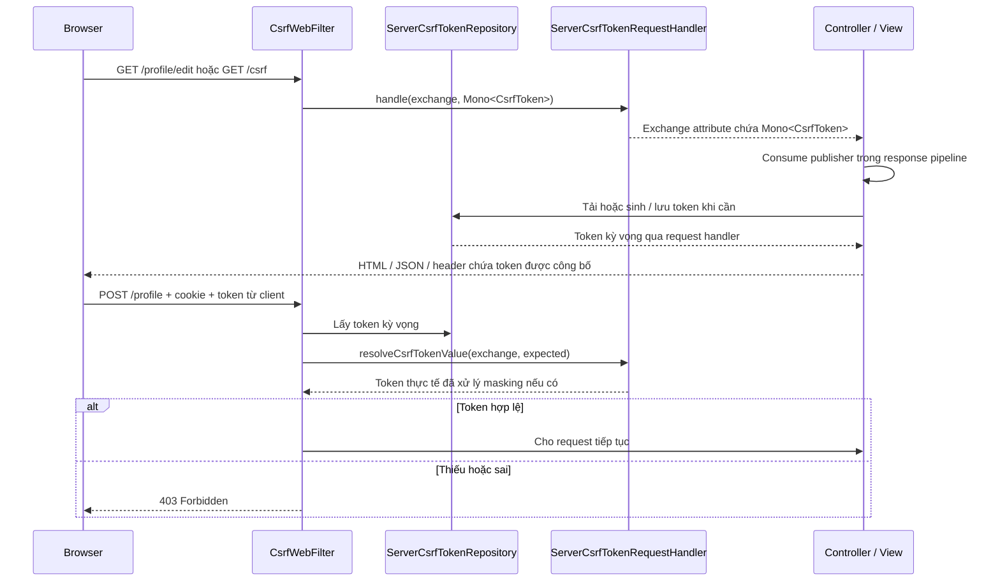

# Đưa token vào view hoặc phản hồi cho client

> **Chương:** CSRF trên Reactive  
> **Phạm vi:** Spring Security cho **Spring WebFlux** (Reactive), với `CsrfWebFilter`, `ServerWebExchange`, `Mono<CsrfToken>` và `SecurityWebFilterChain`.  
> **Kết quả học tập:** Người học có thể cung cấp CSRF token cho HTML form, meta tag, JavaScript/SPA và HTTP response; chọn cách phù hợp, giữ đúng phiên và kiểm thử cả luồng GET → POST.

Trong module `SPRING_SECURITY_HTTP_PROTECTION`, người học áp dụng các lớp phòng vệ HTTP và trình duyệt của Spring Security, từ CSRF, CORS, security headers, CSP, HSTS đến HTTP firewall và bảo vệ session. Module bao quát cả Servlet lẫn Reactive, cùng những bài kiểm thử tấn công web và tình huống xung đột cấu hình khi triển khai. Bài này giải quyết câu hỏi **sau khi Spring Security đã quản lý CSRF token, làm sao gửi token đó tới đúng client để yêu cầu thay đổi dữ liệu được xác minh?**

## 1. Nguyên tắc: client phải chủ động gửi token

Một trình duyệt đã đăng nhập thường tự đính kèm cookie phiên khi truy cập đúng website. Trang do kẻ tấn công kiểm soát có thể lợi dụng việc đó để phát sinh request thay đổi dữ liệu. Để phòng **Cross-Site Request Forgery (CSRF)**, server yêu cầu một **token mà client chủ động đưa vào form parameter hoặc header**; trình duyệt không tự thêm trường đó như cookie.

Vì vậy việc "đưa token vào view hoặc phản hồi cho client" chỉ là **nửa đầu** của vòng kiểm tra:

1. Server lấy CSRF token từ pipeline của `CsrfWebFilter` và **xuất nó cho giao diện hợp lệ** (form, meta tag, JSON hoặc response header).
2. Client giữ cookie/session liên quan, rồi **đưa chính token được nhận** vào request `POST`, `PUT`, `PATCH` hoặc `DELETE`.
3. `CsrfWebFilter` dùng repository và request handler để so token client gửi với token kỳ vọng; thiếu/sai sẽ bị chặn, thường trả `403 Forbidden`.

Trình duyệt tự gửi **cookie phiên** hoặc **cookie `XSRF-TOKEN`** không có nghĩa nó đã gửi CSRF token qua form/header. Request với cookie nhưng không có token chủ động vẫn có thể bị `403`.

| Nơi xuất token | Client dùng như thế nào? | Phù hợp với |
| --- | --- | --- |
| Hidden input của HTML form | Browser submit trường `_csrf` cùng form POST | Trang server-rendered, Thymeleaf |
| Meta tag trong HTML | JavaScript đọc meta rồi gắn token vào request header | Trang HTML có gọi fetch/AJAX |
| JSON từ `GET /csrf` | JavaScript đọc `token` và `headerName` rồi gửi header | SPA, frontend API |
| HTTP response header | Client đọc header token rồi dùng trong request tiếp theo | Client tùy chỉnh, frontend biết xử lý header |
| Cookie `XSRF-TOKEN` | JavaScript đọc cookie rồi tự đặt header `X-XSRF-TOKEN` | SPA chọn cookie repository và request handler tương thích |

Không phương án nào thay thế xác thực, phân quyền, HTTPS, CORS, CSP hoặc bảo vệ session.

## 2. Lấy token đúng nguồn trong WebFlux

Trên **WebFlux**, `CsrfWebFilter` cung cấp publisher **`Mono<CsrfToken>`** thông qua `ServerWebExchange.getAttributes()`, với key `CsrfToken.class.getName()`:

```java
import org.springframework.security.web.server.csrf.CsrfToken;
import org.springframework.web.server.ServerWebExchange;
import reactor.core.publisher.Mono;

// Đặt trong controller hoặc filter đã đi qua CsrfWebFilter.
Mono<CsrfToken> csrfPublisher =
    exchange.getAttribute(CsrfToken.class.getName());
```

Đây là `org.springframework.security.web.server.csrf.CsrfToken` của **Reactive**, khác `org.springframework.security.web.csrf.CsrfToken` của Servlet. Giá trị exchange attribute là **`Mono<CsrfToken>` chứ không phải một `CsrfToken` đã tính xong**. Nếu request chưa qua CSRF filter, được xử lý ở chain khác hoặc CSRF bị vô hiệu hóa, attribute có thể là `null`.

`Mono` có tính **lazy**. Với một GET không hiển thị form, chưa cần subscribe token. Khi view/controller cần token, phải **đưa publisher vào pipeline trả response** để WebFlux subscribe: ví dụ `return csrfPublisher.map(...)` hoặc `return csrfPublisher.then()`. Với token mới, `CsrfWebFilter` chịu trách nhiệm sinh và lưu theo repository khi publisher được subscribe.

**Lấy token đã qua request handler, không lấy raw token trực tiếp từ repository để hiển thị.** Từ Spring Security 6, `XorServerCsrfTokenRequestAttributeHandler` là mặc định, công bố giá trị token có **XOR masking** nhằm giảm rủi ro BREACH. Raw token lưu trong repository và token hiển thị có thể khác nhau. Client gửi lại **nguyên chuỗi được handler công bố**, rồi handler sẽ giải mã trước khi filter so sánh.



### Cấu hình bảo mật dùng xuyên suốt bài

Ví dụ các phần sau giả sử ứng dụng dùng Spring WebFlux, bảo vệ `POST /profile` và cho phép truy cập endpoint phát token:

```java
import org.springframework.context.annotation.Bean;
import org.springframework.context.annotation.Configuration;
import org.springframework.security.config.Customizer;
import org.springframework.security.config.annotation.web.reactive.EnableWebFluxSecurity;
import org.springframework.security.config.web.server.ServerHttpSecurity;
import org.springframework.security.web.server.SecurityWebFilterChain;

@Configuration
@EnableWebFluxSecurity
public class ReactiveSecurityConfig {

    @Bean
    SecurityWebFilterChain securityWebFilterChain(ServerHttpSecurity http) {
        return http
            .authorizeExchange(exchanges -> exchanges
                .pathMatchers("/assets/**", "/login", "/csrf",
                    "/csrf/header", "/csrf/bootstrap")
                    .permitAll()
                .anyExchange().authenticated())
            .formLogin(Customizer.withDefaults())
            .csrf(Customizer.withDefaults())
            .build();
    }
}
```

`csrf(Customizer.withDefaults())` chỉ làm rõ chủ đích: CSRF **được bật mặc định**. Với cấu hình này, repository mặc định là `WebSessionServerCsrfTokenRepository`. Hãy giữ cùng cookie session khi lấy token và gửi POST. Các ví dụ controller được trình bày như những phương án tích hợp; không cần bật tất cả trong một ứng dụng.

## 3. Cách 1 — Thymeleaf tự thêm token vào HTML form

Khi dùng Thymeleaf với tích hợp Spring Security/WebFlux thích hợp, `RequestDataValueProcessor` / `CsrfRequestDataValueProcessor` có thể **tự thêm hidden CSRF input** cho form dùng HTTP method không an toàn. Đây là cách ít mã nhất trong một ứng dụng server-rendered.

```java
import org.springframework.stereotype.Controller;
import org.springframework.web.bind.annotation.GetMapping;

@Controller
class ProfilePageController {
    @GetMapping("/profile/edit")
    String edit() {
        return "profile-edit"; // Tên template Thymeleaf.
    }
}
```

`profile-edit.html`:

```html
<form th:action="@{/profile}" method="post">
  <label>Tên hiển thị
    <input type="text" name="displayName"/>
  </label>
  <button type="submit">Cập nhật</button>
</form>
```

Khi tích hợp CSRF hoạt động, **HTML được render** có thể chứa thêm một input tương đương:

```html
<input type="hidden" name="_csrf" value="token-duoc-server-render"/>
```

Chuỗi trong ví dụ là **minh họa HTML đầu ra**, không phải token để hardcode. Với Spring Security 6+, token được render có thể ở dạng **masked**, nên nó có thể khác nhau qua các lần tải trang mà vẫn hợp lệ.

Để tự xác minh, mở Developer Tools → Elements/Network và xem HTML thực sự được trả ra. Một template có `th:action` không tự chứng minh token sẽ hiện diện nếu engine chưa được tích hợp đúng với Spring Security.

## 4. Cách 2 — Chủ động đưa token vào Model hoặc request attribute

Không phải view engine nào cũng tự subscribe `Mono<CsrfToken>` hoặc dùng `CsrfRequestDataValueProcessor`. Khi đó controller có thể **consume publisher** và đặt `CsrfToken` vào `Model` dưới key `_csrf`.

```java
import org.springframework.security.web.server.csrf.CsrfToken;
import org.springframework.stereotype.Controller;
import org.springframework.ui.Model;
import org.springframework.web.bind.annotation.GetMapping;
import org.springframework.web.server.ServerWebExchange;
import reactor.core.publisher.Mono;

@Controller
class ExplicitCsrfFormController {

    @GetMapping("/profile/form")
    Mono<String> form(ServerWebExchange exchange, Model model) {
        Mono<CsrfToken> source =
            exchange.getAttribute(CsrfToken.class.getName());

        if (source == null) {
            return Mono.error(new IllegalStateException(
                "CSRF publisher không tồn tại trong exchange"));
        }

        return source.map(token -> {
            model.addAttribute("_csrf", token);
            return "profile-form";
        });
    }
}
```

`profile-form.html`:

```html
<form action="/profile" method="post">
  <input type="hidden"
         th:name="${_csrf.parameterName}"
         th:value="${_csrf.token}"/>
  <input type="text" name="displayName"/>
  <button type="submit">Lưu</button>
</form>
```

Sử dụng `csrf.getParameterName()` thay vì cố định `_csrf` cho phép hỗ trợ repository được tùy chỉnh tên parameter. `source.map(...)` giúp token được tính khi framework subscribe và **có mặt trong model trước khi render**.

**Tránh xuất field hai lần:** Nếu đã khai báo hidden input thủ công, cần xác minh view engine có tự thêm input qua `th:action`/`RequestDataValueProcessor` hay không. Trong ví dụ này, form dùng `action` thuần; cách render token được kiểm soát trực tiếp bởi template.

### Dùng `@ControllerAdvice` cho nhiều view

Khi nhiều controller HTML đều cần token, Spring Security giới thiệu cách đưa token vào exchange attribute chuẩn `_csrf` bằng `@ControllerAdvice` và `@ModelAttribute`:

```java
import org.springframework.security.web.reactive.result.view.CsrfRequestDataValueProcessor;
import org.springframework.security.web.server.csrf.CsrfToken;
import org.springframework.web.bind.annotation.ControllerAdvice;
import org.springframework.web.bind.annotation.ModelAttribute;
import org.springframework.web.server.ServerWebExchange;
import reactor.core.publisher.Mono;

@ControllerAdvice
class CsrfViewAdvice {

    @ModelAttribute
    Mono<CsrfToken> csrfToken(ServerWebExchange exchange) {
        Mono<CsrfToken> source =
            exchange.getAttribute(CsrfToken.class.getName());

        if (source == null) {
            return Mono.empty();
        }

        return source.doOnNext(token ->
            exchange.getAttributes().put(
                CsrfRequestDataValueProcessor.DEFAULT_CSRF_ATTR_NAME,
                token));
    }
}
```

`doOnNext` chỉ **gắn thao tác** sẽ xảy ra khi token được phát; nó **không tự subscribe**. `@ModelAttribute` trả publisher để Spring WebFlux giải quyết trong vòng đời xử lý model/view. Key `CsrfRequestDataValueProcessor.DEFAULT_CSRF_ATTR_NAME` tương ứng `_csrf`, được dùng để chèn token vào hidden input cho các form phù hợp.

Nên áp dụng advice ở phạm vi controller/view cần thiết: advice được áp dụng rộng có thể làm những request không cần form cũng consume CSRF publisher, từ đó tăng số lần đọc/tạo session. Không dùng cả advice và controller tự thêm token một cách thiếu chủ đích.

## 5. Cách 3 — Meta tags: đưa token vào HTML cho JavaScript

Một trang HTML vừa render form vừa gửi `fetch`/AJAX có thể công bố token và **tên header** dưới dạng meta tag. Giả sử `_csrf` đã được đưa vào model theo cách 2, trong phần `<head>` của Thymeleaf:

```html
<head>
  <meta name="_csrf" th:content="${_csrf.token}"/>
  <meta name="_csrf_header" th:content="${_csrf.headerName}"/>
</head>
```

JavaScript cùng origin có thể đọc những giá trị đó và gắn vào HTTP header:

```javascript
const token = document.querySelector('meta[name="_csrf"]')?.content;
const headerName = document.querySelector('meta[name="_csrf_header"]')?.content;

if (!token || !headerName) {
  throw new Error("Trang chưa được render CSRF meta tags");
}

const response = await fetch("/profile", {
  method: "POST",
  credentials: "same-origin",
  headers: {
    [headerName]: token,
    "Content-Type": "application/json"
  },
  body: JSON.stringify({ displayName: "Lan" })
});
if (!response.ok) {
  throw new Error("Không cập nhật được hồ sơ");
}
```

Với cấu hình repository session, cookie phiên vẫn phải đi cùng POST. **Meta tag nằm trong response HTML**; trình duyệt không tự lấy nó để thêm header. Đoạn JavaScript thực hiện công việc đó.

Đặc biệt, không đưa CSRF token vào URL/query string: URL dễ đi vào browser history, server log, analytics hoặc header `Referer`. Nội dung HTML chứa token cũng cần kiểm soát cache và chống XSS.

## 6. Cách 4 — Endpoint JSON `GET /csrf` cho SPA và API client

Khi frontend chủ yếu dùng JSON, có thể trả token qua endpoint riêng. Endpoint này có thể cho client lấy token **theo nhu cầu**, không bắt mọi GET khác tạo token.

```java
import java.util.Map;
import org.springframework.http.CacheControl;
import org.springframework.http.ResponseEntity;
import org.springframework.security.web.server.csrf.CsrfToken;
import org.springframework.web.bind.annotation.GetMapping;
import org.springframework.web.bind.annotation.RestController;
import org.springframework.web.server.ServerWebExchange;
import reactor.core.publisher.Mono;

@RestController
class CsrfApiController {

    @GetMapping("/csrf")
    Mono<ResponseEntity<Map<String, String>>> csrf(ServerWebExchange exchange) {
        Mono<CsrfToken> source =
            exchange.getAttribute(CsrfToken.class.getName());

        if (source == null) {
            return Mono.error(new IllegalStateException(
                "CSRF chưa được áp dụng cho request này"));
        }

        return source.map(token -> ResponseEntity.ok()
            .cacheControl(CacheControl.noStore())
            .body(Map.of(
                "token", token.getToken(),
                "headerName", token.getHeaderName(),
                "parameterName", token.getParameterName()
            )));
    }
}
```

Response minh họa:

```json
{
  "token": "gia-tri-token-cho-request-tiep-theo",
  "headerName": "X-CSRF-TOKEN",
  "parameterName": "_csrf"
}
```

Đây là **giá trị ví dụ**; token thật được tạo trong pipeline Spring Security. Nếu repository là `CookieServerCsrfTokenRepository`, tên header mặc định có thể là `X-XSRF-TOKEN`. Vì vậy hãy dùng giá trị `headerName` từ response.

Client cùng origin:

```javascript
const tokenResponse = await fetch("/csrf", {
  credentials: "same-origin",
  cache: "no-store"
});
if (!tokenResponse.ok) throw new Error("Không tải được CSRF token");
const csrf = await tokenResponse.json();

const response = await fetch("/profile", {
  method: "POST",
  credentials: "same-origin",
  headers: {
    [csrf.headerName]: csrf.token,
    "Content-Type": "application/json"
  },
  body: JSON.stringify({ displayName: "Lan" })
});
if (!response.ok) throw new Error("Yêu cầu không thành công");
```

**Vì sao `map` quan trọng?** Trả `source.map(...)` khiến token được tính trong chính publisher mà WebFlux dùng tạo response. Nếu token mới cần lưu vào session hoặc cookie, công việc đó có cơ hội hoàn tất trước khi response phát ra. Không gọi `source.subscribe(...)` rồi trả `Mono.just(...)` độc lập, vì response có thể được gửi trước khi token/cookie sẵn sàng.

**Lưu ý khi `GET /csrf` được `permitAll`:** client chưa đăng nhập có thể lấy token cho phiên ẩn danh. Token chống CSRF **không phải bí mật dùng để xác thực**; việc được phép lấy token không trao quyền cập nhật dữ liệu. Khi xác thực hoặc session thay đổi, client có thể cần lấy token mới trước request unsafe tiếp theo. Không cho origin không tin cậy đọc JSON token qua CORS.

## 7. Cách 5 — Phát token trong HTTP response header

Một client có thể thích đọc token trực tiếp từ **response header** của một endpoint GET:

```java
import org.springframework.http.CacheControl;
import org.springframework.http.ResponseEntity;
import org.springframework.security.web.server.csrf.CsrfToken;
import org.springframework.web.bind.annotation.GetMapping;
import org.springframework.web.bind.annotation.RestController;
import org.springframework.web.server.ServerWebExchange;
import reactor.core.publisher.Mono;

@RestController
class CsrfHeaderController {

    @GetMapping("/csrf/header")
    Mono<ResponseEntity<Void>> csrfHeader(ServerWebExchange exchange) {
        Mono<CsrfToken> source =
            exchange.getAttribute(CsrfToken.class.getName());

        if (source == null) {
            return Mono.error(new IllegalStateException(
                "CSRF publisher không tồn tại"));
        }

        return source.map(token -> ResponseEntity.ok()
            .cacheControl(CacheControl.noStore())
            .header(token.getHeaderName(), token.getToken())
            .<Void>build());
    }
}
```

Với `WebSessionServerCsrfTokenRepository`, response có thể chứa `X-CSRF-TOKEN`; với cookie repository, tên header token mặc định là `X-XSRF-TOKEN`. Có thể xem tại Developer Tools → Network → Response Headers.

Ví dụ client biết trước tên header:

```javascript
const response = await fetch("/csrf/header", {
  credentials: "same-origin",
  cache: "no-store"
});
if (!response.ok) throw new Error("Không lấy được header CSRF");

const csrfToken = response.headers.get("X-CSRF-TOKEN");
if (!csrfToken) throw new Error("Header CSRF chưa có");

await fetch("/profile", {
  method: "POST",
  credentials: "same-origin",
  headers: { "X-CSRF-TOKEN": csrfToken }
});
```

Đoạn JavaScript cuối giả định **repository session mặc định** với tên header `X-CSRF-TOKEN`. Nếu đổi repository hoặc `setHeaderName(...)`, thay tên header tương ứng. Với frontend khác origin, JavaScript chỉ đọc được custom response header khi CORS cấu hình `Access-Control-Expose-Headers` phù hợp. **Chỉ expose token cho các origin thực sự được tin cậy**; kiểm soát CORS request header, credentials và cookie riêng biệt.

Không viết token vào HTTP header trên **mọi** response nếu không có nhu cầu. Phát token theo endpoint có chủ đích giúp hạn chế cache, tránh để token xuất hiện ở những response không liên quan và dễ kiểm thử đường đi hơn.

## 8. Cách 6 — Cookie cho SPA: chỉ dùng khi client và handler tương thích

`CookieServerCsrfTokenRepository` đưa **raw token kỳ vọng** vào cookie `XSRF-TOKEN`. Một số frontend đọc cookie đó rồi chủ động gửi raw token trong header `X-XSRF-TOKEN`. Đây là một phương án khác với JSON/meta/header trả token đã qua request handler.

Ví dụ cấu hình đơn giản cho SPA chủ động dùng **raw cookie token**:

```java
import org.springframework.security.web.server.csrf.CookieServerCsrfTokenRepository;
import org.springframework.security.web.server.csrf.ServerCsrfTokenRequestAttributeHandler;

// Thay .csrf(Customizer.withDefaults()) trong SecurityWebFilterChain bằng:
.csrf(csrf -> csrf
    .csrfTokenRepository(CookieServerCsrfTokenRepository.withHttpOnlyFalse())
    .csrfTokenRequestHandler(new ServerCsrfTokenRequestAttributeHandler())
)
```

Trong cấu hình đó:

- `withHttpOnlyFalse()` cho JavaScript đọc cookie `XSRF-TOKEN`. Khi không cần đọc cookie trực tiếp, nên giữ `HttpOnly`.
- Plain request handler chấp nhận **raw token** từ header, nhưng **bỏ lớp XOR masking chống BREACH** mặc định từ Spring Security 6. Cần cân nhắc đánh đổi này, nhất là khi ứng dụng đồng thời render HTML response nén chứa token.
- Cookie `XSRF-TOKEN` không tự tạo request header `X-XSRF-TOKEN`. JavaScript hoặc thư viện frontend phải thêm header. Đừng dựa vào việc cookie tự được gửi để bỏ qua bước này.

Nếu muốn giữ XOR mặc định, hãy lấy **masked token** qua view, meta tag hoặc `GET /csrf` như các mục trước và gửi nguyên token ấy; không tự thay bằng raw token lấy từ cookie. Với ứng dụng vừa có HTML form vừa có SPA gửi raw cookie header, có thể thiết kế handler hỗn hợp; nhưng phải quy định rõ header raw hay masked và kiểm thử cả hai đường đi.

**Bootstrap cookie và deferred token:** Khi cookie token chưa tồn tại, Spring Security có thể chỉ ghi `Set-Cookie` khi publisher được subscribe. Endpoint GET chỉ kích hoạt publisher:

```java
import org.springframework.security.web.server.csrf.CsrfToken;
import org.springframework.web.bind.annotation.GetMapping;
import org.springframework.web.bind.annotation.RestController;
import org.springframework.web.server.ServerWebExchange;
import reactor.core.publisher.Mono;

@RestController
class CsrfCookieBootstrapController {

    @GetMapping("/csrf/bootstrap")
    Mono<Void> bootstrap(ServerWebExchange exchange) {
        Mono<CsrfToken> source =
            exchange.getAttribute(CsrfToken.class.getName());
        if (source == null) {
            return Mono.error(new IllegalStateException("Thiếu CSRF publisher"));
        }
        return source.then();
    }
}
```

`source.then()` subscribe nguồn khi WebFlux xử lý response rồi bỏ giá trị token; `Mono.empty()` độc lập **không thực hiện công việc của nguồn**. Nếu dùng endpoint này, phải cho phép GET `/csrf/bootstrap` qua `authorizeExchange` và đảm bảo cookie `Path`/`Domain`/`SameSite`/`Secure` phù hợp.

## 9. Kịch bản thử nghiệm từ GET đến POST

### 9.1. Kiểm thử endpoint JSON bằng `StepVerifier`

Trước khi kiểm thử toàn bộ bảo mật, có thể kiểm tra trực tiếp controller `CsrfApiController` với mock exchange. Test này kiểm tra **đọc đúng exchange attribute và đưa token ra response**, không thay thế kiểm thử `CsrfWebFilter`.

```java
import org.junit.jupiter.api.Test;
import org.springframework.mock.http.server.reactive.MockServerHttpRequest;
import org.springframework.mock.web.server.MockServerWebExchange;
import org.springframework.security.web.server.csrf.CsrfToken;
import org.springframework.security.web.server.csrf.DefaultCsrfToken;
import reactor.core.publisher.Mono;
import reactor.test.StepVerifier;

import static org.junit.jupiter.api.Assertions.*;

class CsrfApiControllerTest {
    @Test
    void emitsTokenAndHeaderNameWithoutCaching() {
        var exchange = MockServerWebExchange.from(
            MockServerHttpRequest.get("/csrf"));

        CsrfToken provided = new DefaultCsrfToken(
            "X-CSRF-TOKEN", "_csrf", "example-token");
        exchange.getAttributes().put(
            CsrfToken.class.getName(), Mono.just(provided));

        StepVerifier.create(new CsrfApiController().csrf(exchange))
            .assertNext(result -> {
                assertEquals(200, result.getStatusCode().value());
                assertEquals("no-store", result.getHeaders().getCacheControl());
                assertNotNull(result.getBody());
                assertEquals("example-token", result.getBody().get("token"));
                assertEquals(
                    "X-CSRF-TOKEN", result.getBody().get("headerName"));
            })
            .verifyComplete();
    }

    @Test
    void reportsMissingCsrfAttribute() {
        var exchange = MockServerWebExchange.from(
            MockServerHttpRequest.get("/csrf"));

        StepVerifier.create(new CsrfApiController().csrf(exchange))
            .expectError(IllegalStateException.class)
            .verify();
    }
}
```

Trong bài test, token `example-token` chỉ là dữ liệu mock. Hành vi masking thực tế do request handler của `CsrfWebFilter` quyết định trong một request đi qua security chain.

### 9.2. Test tích hợp bằng `WebTestClient`

Với `spring-security-test`, `WebTestClient` gắn application context thật và áp dụng `springSecurity()`, ta cần kiểm tra cả hai chiều:

```java
// Trích thân các bài test; POST /profile phải tồn tại và trả 2xx
// khi request đã được xác thực và CSRF hợp lệ.
// Import static SecurityMockServerConfigurers.mockUser, csrf.

client.mutateWith(mockUser())
    .post().uri("/profile")
    .exchange()
    .expectStatus().isForbidden();

client.mutateWith(mockUser()).mutateWith(csrf())
    .post().uri("/profile")
    .exchange()
    .expectStatus().is2xxSuccessful();
```

Test `csrf()` thuận tiện nhưng **không kiểm tra cookie jar và token trả ra từ view/JSON/header**. Với bài này, cần thêm một kiểm thử HTTP có trạng thái: request GET `/csrf` → nhận token và cookie → gửi lại cookie cùng header trong POST `/profile` → xác nhận request hợp lệ. Sau đó thử thiếu header, header sai, token của phiên khác và session hết hạn. Không lấy token/cookie từ log production để dựng test.

### Ma trận kiểm thử theo cách xuất token

| Phương án | GET/response cần kiểm tra | POST cần kiểm tra |
| --- | --- | --- |
| Thymeleaf tự chèn token | HTML có hidden input hợp lệ | Form submit đúng field cùng cookie phiên |
| Model + hidden input thủ công | `_csrf` thực sự có token; không có field trùng | Form field đúng tên token |
| Meta tags | HTML có `_csrf` và `_csrf_header` | fetch gắn header đúng tên |
| JSON `GET /csrf` | Body có `token`, `headerName`; `Cache-Control: no-store` | Header mang token được trả về, cookie nhất quán |
| `GET /csrf/header` | Response header chứa token, không bị cache dùng chung | Client đọc header rồi gửi lại |
| Cookie repository | `Set-Cookie: XSRF-TOKEN=...` sau bootstrap; cookie path hợp lệ | Browser gửi cookie và client chủ động gửi raw header tương thích |

## 10. Triệu chứng và cách chẩn đoán

| Triệu chứng | Nguyên nhân cần kiểm tra | Hướng xử lý |
| --- | --- | --- |
| View có form nhưng không có input `_csrf` | Thiếu tích hợp Thymeleaf/`RequestDataValueProcessor` hoặc token publisher không được consume | Kiểm tra HTML render thật, thêm model/advice hoặc input thủ công đúng cách. |
| Form có hai hidden input `_csrf` | Đồng thời dùng chèn tự động và input thủ công | Chọn một cách chèn, kiểm tra giá trị field trên POST. |
| `exchange.getAttribute(CsrfToken.class.getName())` là `null` | Request đi vào chain khác, CSRF filter không áp dụng hoặc import nhầm class Servlet | Kiểm tra `SecurityWebFilterChain` và package `web.server.csrf`. |
| Endpoint JSON trả token nhưng POST `403` | Client quên gửi cookie, dùng token của session khác, token cũ sau login hoặc gửi raw thay cho masked | Kiểm tra GET/POST cùng session, tên header và handler XOR. |
| Response có `XSRF-TOKEN` nhưng JavaScript không đọc được | Cookie `HttpOnly`, `Path` hoặc `Domain` khác | Xác định nguồn token: đọc qua endpoint nếu muốn giữ HttpOnly, hoặc cấu hình cookie có chủ đích. |
| Cookie `XSRF-TOKEN` có mặt nhưng POST vẫn `403` | Chưa đưa token vào `X-XSRF-TOKEN`, hoặc raw cookie không khớp XOR handler | Thêm header phù hợp; đồng bộ chiến lược raw/masked. |
| Không đọc được custom response header từ frontend khác origin | Chưa expose response header qua CORS hoặc origin chưa được phép | Cấu hình `Access-Control-Expose-Headers` cho đúng origin tin cậy, đồng thời xét credentials/cookie. |
| `POST` không xảy ra, chỉ thấy `OPTIONS` thất bại | CORS preflight không cho phép header CSRF | Kiểm tra `Access-Control-Allow-Headers` và policy origin; không tắt CSRF để sửa CORS. |
| Sau login/logout form/SPA dùng token cũ bị `403` | Token/session được thu hồi hoặc thay đổi | Cấp token mới cho phiên hiện tại; tránh cache token lâu dài. |
| Form trả token nhưng trình duyệt bị redirect trước POST | Cookie có `SameSite`/`Secure`/`Path` không phù hợp hoặc authentication đổi phiên | Kiểm tra trình tự redirect, `Set-Cookie` và cookie thực gửi qua Network tab. |
| Token bị lộ trong log / cache | Response token được lưu trữ ngoài ý muốn | Dùng `Cache-Control: no-store` cho endpoint, tránh logging token và cấu hình cache/proxy an toàn. |

**Quy trình chẩn đoán đề xuất:** xác nhận GET có thực sự xuất token → token do request handler công bố hay đọc thẳng repository → publisher có được subscribe → response gửi cookie nào → POST có cùng cookie/session → header/form đúng tên và raw/masked đúng handler → `403` đến từ CSRF hay phân quyền. Ghi lại HTTP method và status, tránh ghi giá trị token/session ID.

## 11. Lựa chọn cách xuất token theo kiến trúc

| Kiến trúc | Lựa chọn thường phù hợp | Lý do |
| --- | --- | --- |
| WebFlux + Thymeleaf form | Để Thymeleaf/Spring Security chèn token tự động | Ít mã và dùng integration chuẩn. |
| View engine khác hoặc cần toàn quyền kiểm soát form | Consume `Mono` rồi đặt `_csrf` vào model | Chủ động kiểm tra tên/value của hidden input. |
| SSR HTML có nhiều AJAX | Meta tags dùng token đã qua handler | JavaScript lấy tên header và token từ HTML cùng origin. |
| SPA gọi JSON cùng origin | `GET /csrf` trả token + headerName, không cache | Tách vòng lấy token và request unsafe, dễ test. |
| HTTP client tự xử lý header | Endpoint GET trả token trong response header | Không cần JSON body, nhưng client phải biết tên header. |
| SPA đã thiết kế với cookie token | `CookieServerCsrfTokenRepository` và handler tương thích | Phù hợp thư viện frontend đọc cookie, nhưng cần quyết định rõ raw/XOR và cookie policy. |

**Nguyên tắc xuyên suốt:** Chỉ phát token cho client hợp lệ, chọn nơi xuất thuận tiện cho loại client, đồng thời giữ đúng cookie/session và dạng raw/masked do request handler quy định. Token CSRF không cấp quyền; xác thực/phân quyền, chống XSS, CORS, CSP, HTTPS, HSTS và bảo vệ session vẫn phải được cấu hình độc lập.

## 12. Bài thực hành

1. Dùng một WebFlux app có `GET /profile/edit`, `GET /csrf` và `POST /profile`. Lần lượt render token bằng Thymeleaf tự động và bằng model thủ công; kiểm tra HTML và request POST.
2. Thêm meta tags rồi gửi fetch JSON. Cố ý bỏ header CSRF và quan sát `403`; thêm lại header để xác nhận yêu cầu qua được filter.
3. Thử endpoint JSON và response header. Kiểm tra `Cache-Control: no-store`, cookie giữ nguyên giữa hai request và tên header nếu tùy chỉnh repository.
4. Chuyển qua cookie repository trong môi trường test. So sánh `Set-Cookie` lúc GET với `Cookie` của request tiếp theo; thử gửi cookie mà không gửi header và phân tích `403`.
5. Trên Spring Security 6+, thử XOR handler mặc định và plain handler. Quan sát token hiển thị, cách client gửi token và đánh đổi bảo vệ BREACH; không đưa token thật vào báo cáo.

Sau bài thực hành, người học cần tự giải thích được **tại sao `Mono<CsrfToken>` phải được consume để phát token, vì sao `_csrf` trong model khác exchange attribute, và vì sao GET lấy token hợp lệ chưa đủ nếu POST không gửi token chủ động cùng phiên**.

## Tài liệu tham khảo chính thức

- [Spring Security — CSRF for WebFlux, Include the CSRF Token](https://docs.spring.io/spring-security/reference/reactive/exploits/csrf.html)
- [Spring Security — CsrfWebFilter API](https://docs.spring.io/spring-security/reference/api/java/org/springframework/security/web/server/csrf/CsrfWebFilter.html)
- [Spring Security — ServerCsrfTokenRequestHandler API](https://docs.spring.io/spring-security/reference/api/java/org/springframework/security/web/server/csrf/ServerCsrfTokenRequestHandler.html)
- [Spring Security — CsrfRequestDataValueProcessor API](https://docs.spring.io/spring-security/reference/api/java/org/springframework/security/web/reactive/result/view/CsrfRequestDataValueProcessor.html)
- [Spring Security — CookieServerCsrfTokenRepository API](https://docs.spring.io/spring-security/reference/api/java/org/springframework/security/web/server/csrf/CookieServerCsrfTokenRepository.html)
- [Spring Security — Reactive CSRF testing](https://docs.spring.io/spring-security/reference/reactive/test/web/csrf.html)
