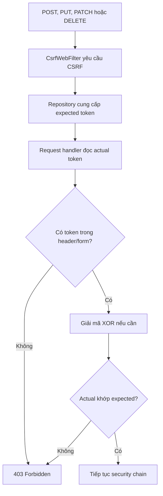

# Nhận token từ header hoặc tham số theo cơ chế hỗ trợ

> **Chương:** CSRF trên Reactive  
> **Trọng tâm:** Cách Spring Security WebFlux đọc CSRF token thực tế từ HTTP header hoặc tham số form; phân biệt JSON, multipart, token thô và token XOR-masked; kiểm thử và xử lý lỗi.

Trong module `SPRING_SECURITY_HTTP_PROTECTION`, người học áp dụng các lớp phòng vệ HTTP và trình duyệt của Spring Security: CSRF, CORS, security headers, CSP, HSTS, HTTP firewall và bảo vệ session, cho cả Servlet lẫn Reactive. Bài này tập trung vào **WebFlux/Reactive**: khi một yêu cầu `POST`, `PUT`, `PATCH` hoặc `DELETE` đến ứng dụng, Spring Security **tìm CSRF token từ nguồn nào**, lúc nào header hay form parameter được hỗ trợ, và vì sao có chuỗi `_csrf` trong request vẫn có thể nhận `403 Forbidden`.

## 1. Vì sao vị trí token trong HTTP request quan trọng?

Khi người dùng đã đăng nhập bằng cookie/session, trình duyệt có thể tự gắn cookie vào yêu cầu gửi đến ứng dụng dù yêu cầu đó do một website độc hại khởi tạo. Để ngăn **Cross-Site Request Forgery (CSRF)**, ứng dụng đòi thêm **token được client chủ động gửi** trong form hoặc header, chứ không chỉ dựa vào cookie xác thực.

Hai giá trị phải được phân biệt:

- **Expected token:** Token kỳ vọng do `ServerCsrfTokenRepository` sinh/lưu, thường trong `WebSession` hoặc trong cookie `XSRF-TOKEN` nếu dùng cookie repository.
- **Actual token:** Token mà frontend chủ động gửi trong HTTP header hoặc form parameter; `ServerCsrfTokenRequestHandler` trích xuất giá trị này để `CsrfWebFilter` đối chiếu với expected token.

Chỉ có cookie `XSRF-TOKEN` trên request **không đồng nghĩa** đã cung cấp actual token. Cookie được trình duyệt tự mang theo; JS hoặc HTML form phải gửi token qua đường được handler hỗ trợ. Với các request cần bảo vệ CSRF, token thiếu hoặc không khớp bị chặn trước controller.



**`CsrfWebFilter` mới quyết định chặn hay cho qua.** Repository giữ token kỳ vọng, request handler giải quyết token thực tế. Các HTTP method như `GET`, `HEAD`, `OPTIONS`, `TRACE` không cần token theo matcher CSRF mặc định, nhưng endpoint GET phải thực sự không gây thay đổi dữ liệu.

## 2. API nhận token: `ServerCsrfTokenRequestHandler`

Trên WebFlux, `ServerCsrfTokenRequestHandler` kế thừa `ServerCsrfTokenRequestResolver`; hợp đồng chính có thể đọc dưới dạng rút gọn:

```java
public interface ServerCsrfTokenRequestResolver {
    Mono<String> resolveCsrfTokenValue(
        ServerWebExchange exchange, CsrfToken expected);
}

public interface ServerCsrfTokenRequestHandler
        extends ServerCsrfTokenRequestResolver {
    void handle(ServerWebExchange exchange, Mono<CsrfToken> token);
}
```

`resolveCsrfTokenValue` trả `Mono<String>` chứa actual token, hoặc `Mono.empty()` nếu không có token hợp lệ để giải quyết. `Mono.empty()` **không** có nghĩa CSRF đã vượt qua kiểm tra. `handle` công bố publisher `Mono<CsrfToken>` cho ứng dụng/view qua exchange attribute; nó không trực tiếp trả `403`.

Hai handler có sẵn cần biết:

| Handler WebFlux | Cách xử lý token từ header/form | Sử dụng |
| --- | --- | --- |
| `ServerCsrfTokenRequestAttributeHandler` | Đọc token từ **HTTP header hoặc form data**, giữ giá trị thô. | Khi cần nhận raw token và đã đánh giá việc bỏ masking. |
| `XorServerCsrfTokenRequestAttributeHandler` | Đọc header/form, **giải mã XOR-masked token** thành raw token. | **Mặc định từ Spring Security 6.0**, cung cấp bảo vệ BREACH. |

Cả hai class nằm trong package `org.springframework.security.web.server.csrf`. Không import nhầm `CsrfTokenRequestHandler` hoặc `XorCsrfTokenRequestAttributeHandler` của Servlet.

### Các nguồn thực sự được hỗ trợ

| Vị trí gửi token | Có được handler chuẩn nhận diện? | Lưu ý |
| --- | --- | --- |
| HTTP header có tên `csrfToken.getHeaderName()` | **Có** | Phù hợp `fetch`, JSON, SPA, upload. |
| Form field `csrfToken.getParameterName()` trong body `application/x-www-form-urlencoded` | **Có** | Đường thông thường của HTML form POST. |
| Form field trong `multipart/form-data` | **Có thể bật** | `setTokenFromMultipartDataEnabled(true)`, **mặc định tắt**. |
| Property `"_csrf"` trong JSON body | **Không mặc định** | Handler không parse JSON để tìm token. Dùng header. |
| Cookie `XSRF-TOKEN` tự đi theo request | **Không phải actual token** | Cookie repository dùng làm nguồn expected token; vẫn cần header/form. |
| Query string `?_csrf=...` | **Không phải nguồn form chuẩn được cam kết** | Tránh truyền token qua URL vì dễ lọt vào log, history và `Referer`. |

Header và form parameter là **hai cách mang cùng một giá trị token logic**, không phải hai lớp xác thực độc lập. Khi cả hai được gửi với giá trị khác nhau, đừng thiết kế ứng dụng dựa vào thứ tự ưu tiên ngầm; chọn một vị trí token nhất quán cho từng loại client và kiểm thử phiên bản thư viện đang dùng.

## 3. Tên header và tên tham số đến từ đâu?

`CsrfToken` cung cấp:

```java
csrfToken.getToken();         // Giá trị token.
csrfToken.getHeaderName();    // Tên header mà client phải gửi.
csrfToken.getParameterName(); // Tên field trong form.
```

| Repository Reactive | Header mặc định | Form field mặc định | Nơi giữ expected token |
| --- | --- | --- | --- |
| `WebSessionServerCsrfTokenRepository` (**mặc định**) | `X-CSRF-TOKEN` | `_csrf` | Thuộc tính `WebSession` |
| `CookieServerCsrfTokenRepository` | `X-XSRF-TOKEN` | `_csrf` | Cookie `XSRF-TOKEN` |

Đừng hardcode tên header theo repository **khác** với repository đang cấu hình. Ví dụ dùng session repository và frontend gửi `X-XSRF-TOKEN` có thể bị `403` dù giá trị token nhìn có vẻ đúng, vì resolver đang tìm `X-CSRF-TOKEN`.

Khi tùy chỉnh:

```java
import org.springframework.security.web.server.csrf.WebSessionServerCsrfTokenRepository;

var repository = new WebSessionServerCsrfTokenRepository();
repository.setHeaderName("X-APP-CSRF");
repository.setParameterName("_app_csrf");

// Trong builder ServerHttpSecurity:
.csrf(csrf -> csrf.csrfTokenRepository(repository))
```

Đây là **trích đoạn cấu hình**, không phải code Java độc lập. Sau khi đổi tên, form phải gửi `_app_csrf` và AJAX phải gửi `X-APP-CSRF`. Việc đổi tên header không tự đổi tên thuộc tính lưu token trong session.

## 4. Cấu hình Spring Security WebFlux chuẩn

CSRF được bật mặc định cho WebFlux, ví dụ dưới làm rõ cấu hình và endpoint cấp token:

```java
import org.springframework.context.annotation.Bean;
import org.springframework.context.annotation.Configuration;
import org.springframework.security.config.Customizer;
import org.springframework.security.config.annotation.web.reactive.EnableWebFluxSecurity;
import org.springframework.security.config.web.server.ServerHttpSecurity;
import org.springframework.security.web.server.SecurityWebFilterChain;

@Configuration
@EnableWebFluxSecurity
public class ReactiveSecurityConfig {
    @Bean
    SecurityWebFilterChain securityWebFilterChain(ServerHttpSecurity http) {
        return http
            .authorizeExchange(exchanges -> exchanges
                .pathMatchers("/csrf", "/login", "/assets/**").permitAll()
                .anyExchange().authenticated())
            .formLogin(Customizer.withDefaults())
            .csrf(Customizer.withDefaults())
            .build();
    }
}
```

`csrf(Customizer.withDefaults())` chỉ ghi rõ ý định: CSRF vốn đang bật mặc định. `permitAll()` cho `GET /csrf` giúp client lấy token nhưng **không tắt CSRF** ở `POST /login` hoặc những request ghi dữ liệu. Xác thực/phân quyền tiếp tục hoạt động riêng.

Trong Spring Security 6+, cấu hình mặc định dùng `WebSessionServerCsrfTokenRepository` và `XorServerCsrfTokenRequestAttributeHandler`. Nếu chạy Spring Security 5.8, mặc định của request handler là plain handler; ứng dụng cần lưu ý khác biệt này khi nâng cấp.

## 5. Lấy token từ HTTP header — trường hợp JSON/AJAX

Với API nhận JSON, CSRF token nên nằm ở **request header**. `Content-Type: application/json` không khiến một property `"_csrf"` trong JSON body trở thành form field cho CSRF resolver.

### 5.1. Endpoint GET trả token đúng dạng handler công bố

Trong WebFlux, `CsrfWebFilter` công bố `Mono<CsrfToken>` dưới exchange attribute có key `CsrfToken.class.getName()`. View/controller nên lấy **publisher này**, không đọc trực tiếp raw token từ repository, vì mặc định XOR handler có thể phát token đã masking.

```java
import org.springframework.http.CacheControl;
import org.springframework.http.ResponseEntity;
import org.springframework.security.web.server.csrf.CsrfToken;
import org.springframework.web.bind.annotation.GetMapping;
import org.springframework.web.bind.annotation.RestController;
import org.springframework.web.server.ServerWebExchange;
import reactor.core.publisher.Mono;

@RestController
class CsrfEndpoint {
    record CsrfView(String headerName, String parameterName, String token) {}

    @GetMapping("/csrf")
    Mono<ResponseEntity<CsrfView>> csrf(ServerWebExchange exchange) {
        Mono<CsrfToken> publisher =
            exchange.getAttribute(CsrfToken.class.getName());
        if (publisher == null) {
            return Mono.error(new IllegalStateException(
                "CSRF filter chưa công bố token trên exchange"));
        }

        return publisher.map(token -> ResponseEntity.ok()
            .cacheControl(CacheControl.noStore())
            .body(new CsrfView(
                token.getHeaderName(),
                token.getParameterName(),
                token.getToken())));
    }
}
```

`map` giúp việc tải/sinh/lưu token nằm trong pipeline mà WebFlux subscribe. Nếu token mới cần được lưu vào session hoặc cookie, thao tác này tham gia vào lifecycle HTTP. Không gọi `publisher.subscribe()` thủ công và trả response trước khi lưu token hoàn tất.

### 5.2. Gửi JSON qua `fetch`, token nằm ở header

```javascript
const tokenResponse = await fetch("/csrf", {
  credentials: "same-origin",
  cache: "no-store"
});
if (!tokenResponse.ok) throw new Error("Không tải được CSRF token");
const csrf = await tokenResponse.json();

const response = await fetch("/profile", {
  method: "POST",
  credentials: "same-origin",
  headers: {
    "Content-Type": "application/json",
    [csrf.headerName]: csrf.token
  },
  body: JSON.stringify({ displayName: "Lan" })
});
if (!response.ok) throw new Error("Không cập nhật được hồ sơ");
```

Phải giữ cookie phiên/token tương ứng ở cả GET và POST. Header CSRF không phải bằng chứng người dùng đã đăng nhập; sau khi vượt CSRF, yêu cầu vẫn chịu xác thực và phân quyền.

Ví dụ **không được hỗ trợ mặc định** (vì chỉ đặt token trong JSON body):

```http
POST /profile HTTP/1.1
Content-Type: application/json

{"displayName":"Lan","_csrf":"token-tu-server"}
```

`ServerCsrfTokenRequestAttributeHandler` không tự parse JSON field `_csrf` để xác minh request. Controller có thể đọc JSON **sau** bước CSRF; điều đó không giúp request vượt qua filter. Đưa token vào header thay vì tự thiết kế resolver đọc JSON body, vốn có thể gây khó khăn khi body là Reactive stream chỉ tiêu thụ một lần.

## 6. Lấy token từ form parameter

HTML form POST thông thường gửi body `application/x-www-form-urlencoded`. Trong body đó, tên field token phải khớp `CsrfToken.getParameterName()`, ví dụ `_csrf`.

### 6.1. Controller cung cấp token cho Thymeleaf

```java
import org.springframework.security.web.server.csrf.CsrfToken;
import org.springframework.stereotype.Controller;
import org.springframework.ui.Model;
import org.springframework.web.bind.annotation.GetMapping;
import org.springframework.web.server.ServerWebExchange;
import reactor.core.publisher.Mono;

@Controller
class ProfileFormController {
    @GetMapping("/profile/edit")
    Mono<String> edit(ServerWebExchange exchange, Model model) {
        Mono<CsrfToken> publisher =
            exchange.getAttribute(CsrfToken.class.getName());
        if (publisher == null) {
            return Mono.error(
                new IllegalStateException("Không có CSRF token publisher"));
        }
        return publisher.map(token -> {
            model.addAttribute("_csrf", token);
            return "profile-edit";
        });
    }
}
```

Trong template `profile-edit.html`:

```html
<form action="/profile" method="post">
  <input type="hidden"
         th:name="${_csrf.parameterName}"
         th:value="${_csrf.token}"/>
  <label>Tên hiển thị
    <input type="text" name="displayName"/>
  </label>
  <button type="submit">Lưu</button>
</form>
```

Khi render, phần tử tương đương `<input name="_csrf" value="...">` được submit cùng form. Value phải do handler công bố, **không hardcode token**. Trên Spring Security 6+, giá trị có thể là **masked token** và được handler giải mã khi request POST về server.

Nếu dùng Thymeleaf kết hợp `th:action`/`CsrfRequestDataValueProcessor`, framework có thể **tự chèn** hidden input. Chọn rõ một cách: dựa vào integration tự động **hoặc** tự đưa token vào model và xuất input; tránh có hai field `_csrf` trùng tên trên cùng form.

### 6.2. Form data khác JSON body và query string

| Request | Cách truyền token | Ghi chú |
| --- | --- | --- |
| `application/x-www-form-urlencoded` | Body có `_csrf=...` | Handler hỗ trợ. |
| HTML form POST có hidden input `_csrf` | Body form | Handler hỗ trợ khi enctype phù hợp. |
| `application/json` chứa property `"_csrf"` | JSON body | Không tự được handler đọc. |
| `/profile?_csrf=...` | URL/query | Không nên dựa vào; token trong URL có thể lộ. |
| `multipart/form-data` có part `_csrf` | Multipart body | Muốn nhận dạng phải bật tùy chọn. |

Khi điều tra `403`, mở Network tab để xác minh browser đang gửi **Form Data**, **Request Payload** hay query string; ba vị trí này **không tương đương** với CSRF request handler.

## 7. Multipart: giới hạn có chủ đích

Để đọc token từ một multipart part, server có thể phải **parse body upload trước khi xác minh CSRF**. Điều này tốn tài nguyên và có thể cho client chưa được tin cậy gửi lượng dữ liệu lớn trước bước kiểm tra. Vì vậy tùy chọn đọc token từ multipart body **tắt mặc định**.

Spring Security WebFlux hỗ trợ bật rõ ràng:

```java
import org.springframework.security.web.server.csrf.XorServerCsrfTokenRequestAttributeHandler;

var handler = new XorServerCsrfTokenRequestAttributeHandler();
handler.setTokenFromMultipartDataEnabled(true);

// Trong builder ServerHttpSecurity:
.csrf(csrf -> csrf.csrfTokenRequestHandler(handler))
```

Đây là trích đoạn tùy chỉnh, không phải Java statement độc lập. Với frontend có JavaScript, **ưu tiên header** để tránh phải bật parser multipart chỉ nhằm lấy token:

```javascript
const csrf = await fetch("/csrf", {
  credentials: "same-origin"
}).then(response => response.json());

const formData = new FormData();
formData.append("avatar", fileInput.files[0]);

const result = await fetch("/profile/avatar", {
  method: "POST",
  credentials: "same-origin",
  headers: { [csrf.headerName]: csrf.token },
  body: formData
});
if (!result.ok) throw new Error("Upload không thành công");
```

Khi gửi `FormData` bằng `fetch`, **không tự đặt `Content-Type: multipart/form-data`** vì browser cần tự bổ sung tham số `boundary`. Với HTML multipart form không có JavaScript, chỉ bật `setTokenFromMultipartDataEnabled(true)` khi đã đánh giá hạn mức upload, tài nguyên máy chủ và nhu cầu nghiệp vụ. Tránh đưa CSRF token vào query string để né parsing.

## 8. Raw token và XOR masking khi nhận header hoặc form

Từ Spring Security **6.0**, `XorServerCsrfTokenRequestAttributeHandler` là mặc định trong WebFlux. Handler này **mask token khi công bố** để giảm rủi ro **BREACH** (suy đoán bí mật bị phản chiếu qua response nén). Khi client gửi masked token trở lại qua form hoặc header, handler sẽ giải mã thành **raw token** để `CsrfWebFilter` đối chiếu.

| Bước | Token |
| --- | --- |
| Repository giữ expected token | Raw token `R` |
| GET render form hoặc trả JSON | Masked token `M1` |
| GET lần hai | Masked token `M2`, có thể khác `M1` |
| Client gửi form/header | `M1` hoặc `M2` đã cấp |
| XOR handler giải mã | Raw token `R` |
| `CsrfWebFilter` so khớp | So với `R` từ repository |

Không tự kiểm tra bằng cách so chuỗi masked token từ HTML với raw token lưu trong session hoặc cookie. **Chuỗi khác nhau không có nghĩa token không hợp lệ**; mask ngẫu nhiên khiến giá trị công bố có thể đổi mỗi lần GET.

### 8.1. SPA đọc raw cookie và gửi header

`CookieServerCsrfTokenRepository.withHttpOnlyFalse()` cho JavaScript đọc cookie `XSRF-TOKEN` rồi gửi raw token qua header `X-XSRF-TOKEN`. Tuy nhiên XOR handler mặc định mong **masked token** đã được handler phát hành; raw header có thể bị `403` dù cookie và header chứa cùng chuỗi.

Có hai chiến lược:

1. **Giữ XOR:** Client lấy masked token từ `GET /csrf` hoặc view, rồi gửi nguyên giá trị đó qua header/form.
2. **Nhận raw cookie token:** Cấu hình plain handler hoặc handler hỗn hợp nhận raw header. Với plain handler, **mất bảo vệ XOR/BREACH** khi xuất token vào response; cần đánh giá rủi ro của ứng dụng.

Ví dụ cấu hình plain handler nếu đã quyết định dùng raw cookie token:

```java
import org.springframework.security.web.server.csrf.CookieServerCsrfTokenRepository;
import org.springframework.security.web.server.csrf.ServerCsrfTokenRequestAttributeHandler;

// Thay đoạn .csrf(...) trong builder ServerHttpSecurity:
.csrf(csrf -> csrf
    .csrfTokenRepository(CookieServerCsrfTokenRepository.withHttpOnlyFalse())
    .csrfTokenRequestHandler(new ServerCsrfTokenRequestAttributeHandler()))
```

Đây là phương án thay thế, không đăng ký đồng thời nhiều handler áp dụng cùng đường request. Với ứng dụng vừa có SPA raw header vừa có form server-rendered masked, cần thiết kế handler hỗn hợp theo quy ước rõ ràng và kiểm thử cả hai dạng token. Không tắt CSRF chỉ để chữa lỗi raw/masked.

## 9. CORS, cookie và quyền truy cập: ba nguyên nhân hay bị nhầm với CSRF

### 9.1. CORS preflight khi frontend khác origin

Một request có custom header `X-CSRF-TOKEN` hoặc `X-XSRF-TOKEN` từ origin khác có thể yêu cầu **preflight `OPTIONS`**. Nếu CORS không cho phép origin, HTTP method, header hoặc credentials phù hợp, browser có thể **không gửi POST thực tế**. Lỗi này khác với `403` do token CSRF.

Kiểm tra riêng:

- Frontend đang cùng origin hay khác origin?
- Server có cho phép đúng header CSRF trong `Access-Control-Allow-Headers` không?
- Khi dùng cookie, cấu hình credentials và `Access-Control-Allow-Origin` có chỉ định origin tin cậy, không dùng wildcard thiếu kiểm soát không?
- Header `Cookie` thực tế có được gửi ở request POST không?

Không tắt CSRF để sửa lỗi CORS. CORS quản lý quyền truy cập cross-origin của script; CSRF bảo vệ request có credential do browser tự gửi. Hai cơ chế bổ sung cho nhau.

### 9.2. Cookie/session không còn tương ứng

Với `WebSessionServerCsrfTokenRepository`, cùng một client phải gửi **cookie session phù hợp** khi GET lấy token và khi POST. Với repository cookie, request POST phải kèm **cookie `XSRF-TOKEN`** để repository tải expected token, và frontend vẫn phải gửi actual token trong header/form.

`SameSite`, `Secure`, `Path`, `Domain`, các redirect đăng nhập và thuộc tính `credentials` của `fetch` ảnh hưởng việc cookie có theo request hay không. Một header đúng theo response GET cũ có thể không khớp phiên/token kỳ vọng mới sau timeout hoặc login/logout.

### 9.3. CSRF token không cấp quyền

Token CSRF không phải `Authorization: Bearer ...` và không chứng minh người dùng được phép sửa dữ liệu. Request vượt qua CSRF vẫn có thể nhận `401 Unauthorized` hoặc `403 Forbidden` do authentication/authorization. Hãy xác định **filter nào đã chặn request** trước khi đổi handler, repository hoặc CORS.

## 10. Kiểm thử resolver với Reactor StepVerifier

Unit test trực tiếp request handler giúp khẳng định **nguồn token được nhận diện**. Ví dụ dùng `spring-test`, `spring-security-web`, `reactor-test` và JUnit 5. Ta chủ động dùng plain handler ở hai test đầu để tách kiểm tra vị trí token khỏi XOR masking; production vẫn có thể giữ XOR mặc định.

### 10.1. Header đúng tên và trường hợp không có token

```java
import org.junit.jupiter.api.Test;
import org.springframework.mock.http.server.reactive.MockServerHttpRequest;
import org.springframework.mock.web.server.MockServerWebExchange;
import org.springframework.security.web.server.csrf.CsrfToken;
import org.springframework.security.web.server.csrf.DefaultCsrfToken;
import org.springframework.security.web.server.csrf.ServerCsrfTokenRequestAttributeHandler;
import reactor.test.StepVerifier;

class CsrfHeaderResolverTest {
    private final ServerCsrfTokenRequestAttributeHandler handler =
        new ServerCsrfTokenRequestAttributeHandler();

    private final CsrfToken expected =
        new DefaultCsrfToken("X-CSRF-TOKEN", "_csrf", "test-token");

    @Test
    void readsTokenFromHeader() {
        var exchange = MockServerWebExchange.from(
            MockServerHttpRequest.post("/profile")
                .header("X-CSRF-TOKEN", "test-token"));

        StepVerifier.create(handler.resolveCsrfTokenValue(exchange, expected))
            .expectNext("test-token")
            .verifyComplete();
    }

    @Test
    void missingHeaderAndFormTokenReturnsEmpty() {
        var exchange = MockServerWebExchange.from(
            MockServerHttpRequest.post("/profile"));

        StepVerifier.create(handler.resolveCsrfTokenValue(exchange, expected))
            .verifyComplete();
    }
}
```

`Mono.empty()` ở test thứ hai cho thấy resolver không tìm thấy actual token. Nó **không** đồng nghĩa request vượt qua CSRF; filter sẽ đối chiếu và từ chối khi không có token phù hợp.

### 10.2. Form URL-encoded được hỗ trợ; JSON property không được parse

```java
import org.junit.jupiter.api.Test;
import org.springframework.http.MediaType;
import org.springframework.mock.http.server.reactive.MockServerHttpRequest;
import org.springframework.mock.web.server.MockServerWebExchange;
import org.springframework.security.web.server.csrf.DefaultCsrfToken;
import org.springframework.security.web.server.csrf.ServerCsrfTokenRequestAttributeHandler;
import reactor.test.StepVerifier;

class CsrfFormResolverTest {
    private final ServerCsrfTokenRequestAttributeHandler handler =
        new ServerCsrfTokenRequestAttributeHandler();

    @Test
    void readsUrlEncodedFormParameter() {
        var exchange = MockServerWebExchange.from(
            MockServerHttpRequest.post("/profile")
                .contentType(MediaType.APPLICATION_FORM_URLENCODED)
                .body("_csrf=test-token&displayName=Lan"));

        var expected = new DefaultCsrfToken(
            "X-CSRF-TOKEN", "_csrf", "test-token");

        StepVerifier.create(handler.resolveCsrfTokenValue(exchange, expected))
            .expectNext("test-token")
            .verifyComplete();
    }

    @Test
    void doesNotReadJsonPropertyAsFormData() {
        var exchange = MockServerWebExchange.from(
            MockServerHttpRequest.post("/profile")
                .contentType(MediaType.APPLICATION_JSON)
                .body("{\"_csrf\":\"test-token\"}"));

        var expected = new DefaultCsrfToken(
            "X-CSRF-TOKEN", "_csrf", "test-token");

        StepVerifier.create(handler.resolveCsrfTokenValue(exchange, expected))
            .verifyComplete();
    }
}
```

Trong các test này, `expected` truyền **tên header và tên tham số** cho resolver; việc token thực tế có đúng với expected value hay không sẽ được `CsrfWebFilter` kiểm tra ở tầng tích hợp.

### 10.3. XOR handler giải mã token masked từ header

```java
import org.junit.jupiter.api.Test;
import org.springframework.mock.http.server.reactive.MockServerHttpRequest;
import org.springframework.mock.web.server.MockServerWebExchange;
import org.springframework.security.web.server.csrf.CsrfToken;
import org.springframework.security.web.server.csrf.DefaultCsrfToken;
import org.springframework.security.web.server.csrf.XorServerCsrfTokenRequestAttributeHandler;
import reactor.core.publisher.Mono;
import reactor.test.StepVerifier;

import static org.junit.jupiter.api.Assertions.*;

class CsrfXorResolverTest {
    @Test
    void maskedHeaderResolvesToExpectedRawValue() {
        CsrfToken raw = new DefaultCsrfToken(
            "X-CSRF-TOKEN", "_csrf", "raw-test-token");
        var handler = new XorServerCsrfTokenRequestAttributeHandler();
        var get = MockServerWebExchange.from(
            MockServerHttpRequest.get("/profile/edit"));

        handler.handle(get, Mono.just(raw));
        Mono<CsrfToken> published =
            get.getAttribute(CsrfToken.class.getName());
        assertNotNull(published);

        Mono<String> roundTrip = published.flatMap(masked -> {
            assertNotEquals(raw.getToken(), masked.getToken());
            var post = MockServerWebExchange.from(
                MockServerHttpRequest.post("/profile")
                    .header(raw.getHeaderName(), masked.getToken()));
            return handler.resolveCsrfTokenValue(post, raw);
        });

        StepVerifier.create(roundTrip)
            .expectNext(raw.getToken())
            .verifyComplete();
    }
}
```

Kết quả minh họa: **token được công bố có thể khác raw token, nhưng vẫn được handler phục hồi đúng**. Không snapshot giá trị masked cụ thể vì có thành phần ngẫu nhiên. Các unit test này không kiểm tra việc trả `403` do handler không chịu trách nhiệm quyết định access denied.

## 11. Kiểm thử toàn bộ luồng WebFlux bằng WebTestClient

Với `spring-security-test`, một `WebTestClient` được bind vào application context và áp dụng `springSecurity()` có thể kiểm tra filter trước khi controller chạy. Với endpoint `POST /profile` trả 2xx khi hợp lệ:

```java
// Trích phần thân hai bài test; cần static import mockUser() và csrf()
// từ SecurityMockServerConfigurers.

client.mutateWith(mockUser())
    .post().uri("/profile")
    .exchange()
    .expectStatus().isForbidden();

client.mutateWith(mockUser()).mutateWith(csrf())
    .post().uri("/profile")
    .exchange()
    .expectStatus().is2xxSuccessful();
```

`csrf()` là tiện ích test, không phải cơ chế phát token cho browser production. Để kiểm tra **đúng vị trí nhận token trên HTTP thật**, cần thêm chuỗi request có cookie jar:

1. `GET /csrf` hoặc trang form để lấy token đã qua request handler.
2. Giữ cookie phiên/token từ response GET.
3. `POST` với đúng cookie và token trong **header** hoặc **form URL-encoded**.
4. Thử thiếu header/form, tên header sai, JSON body chỉ có property `_csrf`, cookie của phiên khác và raw header với XOR handler.
5. Với upload, kiểm tra header hoạt động khi multipart token parsing vẫn tắt; chỉ bật parsing body khi thật sự cần.

| Kịch bản POST | Kỳ vọng ở lớp CSRF |
| --- | --- |
| Thiếu cả header và form field | `403` |
| Header đúng tên, token hợp lệ và đúng session/cookie | Qua CSRF |
| Header sai tên, không có form field | `403` |
| Body URL-encoded có `_csrf` hợp lệ | Qua CSRF |
| JSON body có property `_csrf` nhưng không header | `403` |
| Multipart chỉ có hidden part, cấu hình mặc định | Không dựa vào part; dùng header hoặc bật cấu hình |
| Raw cookie header khi XOR handler mong masked token | Có thể `403` |
| `OPTIONS` preflight | Matcher CSRF mặc định không đòi token, nhưng CORS có thể từ chối |

“Qua CSRF” **không bảo đảm response 2xx**: xác thực, phân quyền, validation và logic nghiệp vụ vẫn có thể ngăn request.

## 12. Chẩn đoán sự cố nhận token

| Dấu hiệu | Nguyên nhân cần xác minh | Cách khắc phục |
| --- | --- | --- |
| Form có hidden `_csrf` nhưng POST `403` | Tên tham số không khớp, body không thực sự URL-encoded, token thuộc session khác | Kiểm tra Form Data và cookie trong Network tab. |
| JSON body chứa `_csrf` vẫn `403` | Handler không parse JSON field | Gửi token trong header đúng `getHeaderName()`. |
| AJAX đã gửi header nhưng `403` | Header sai tên, token raw/masked không phù hợp hoặc cookie thiếu | So tên header từ `CsrfToken`, dạng token và session. |
| Cookie `XSRF-TOKEN` có nhưng request vẫn `403` | Frontend chưa gửi `X-XSRF-TOKEN`, hoặc handler XOR không chấp nhận raw token | Thêm header và chọn chiến lược raw/masked nhất quán. |
| Upload multipart có token nhưng bị từ chối | Mặc định tắt đọc token từ multipart part | Ưu tiên header; chỉ bật `setTokenFromMultipartDataEnabled(true)` khi đã đánh giá rủi ro. |
| Chỉ frontend khác origin không gọi được POST | CORS chặn preflight hoặc cookie bị policy trình duyệt chặn | Kiểm tra `OPTIONS`, allowed origins/headers, credentials và cookie `SameSite`. |
| Token xuất ra form khác token trong repository | XOR masking bình thường | Gửi nguyên masked token; handler tự giải mã. |
| GET làm thay đổi dữ liệu nhưng không bị yêu cầu token | Matcher CSRF xem GET là safe | Thiết kế endpoint ghi dữ liệu dùng method unsafe đúng semantics. |
| Token có vẻ hợp lệ nhưng response `403` | Authorization hoặc một security filter khác từ chối | Tách CSRF access denied khỏi lỗi phân quyền. |
| Lỗi sau login/logout | Session/token đã bị thay hoặc xóa; client còn dùng token cũ | Lấy token mới từ GET/view và giữ cookie hiện hành. |

**Quy trình điều tra:** HTTP method và security chain → expected token từ repository → request handler plain/XOR → token thực tế nằm ở header hay form → cookie/session → CORS nếu cross-origin → nguyên nhân `401`/`403`. Không ghi raw token hoặc session ID vào log.

## 13. Bài thực hành và các điểm cần nhớ

**Bài tập:** Tạo WebFlux app với `GET /csrf`, `GET /profile/edit` và `POST /profile`, sử dụng `WebSessionServerCsrfTokenRepository` và XOR handler mặc định. Thử form field hợp lệ, AJAX header hợp lệ, JSON body chỉ có field `_csrf`, tên header sai, thiếu cookie session và upload multipart gửi token qua header. Sau đó đổi sang `CookieServerCsrfTokenRepository`, quan sát raw token trong cookie và giải thích vì sao cần đồng bộ handler. Ghi status và vị trí token, không ghi giá trị token thật.

**Ghi nhớ:**

1. **`ServerCsrfTokenRequestAttributeHandler` nhận token từ HTTP header hoặc dữ liệu form**, không tự tìm một property trong JSON body.
2. Tên header lấy từ **`CsrfToken.getHeaderName()`**; tên form parameter lấy từ **`getParameterName()`**. Repository quyết định tên mặc định và có thể được tùy chỉnh.
3. **Multipart token parsing tắt mặc định**. Với upload có JavaScript, dùng header giúp tránh phải đọc body chỉ để kiểm tra CSRF.
4. Từ Spring Security 6, XOR handler là mặc định; token **masked** từ view/endpoint được giải mã thành raw trước khi so với expected token.
5. CSRF là một lớp bảo vệ trong `SPRING_SECURITY_HTTP_PROTECTION`, không thay authentication, authorization, CORS, CSP, HTTPS, HSTS hoặc bảo vệ session.

## Tài liệu tham khảo chính thức

- [Spring Security — CSRF for WebFlux](https://docs.spring.io/spring-security/reference/reactive/exploits/csrf.html)
- [API — ServerCsrfTokenRequestAttributeHandler](https://docs.spring.io/spring-security/reference/api/java/org/springframework/security/web/server/csrf/ServerCsrfTokenRequestAttributeHandler.html)
- [API — ServerCsrfTokenRequestHandler](https://docs.spring.io/spring-security/reference/api/java/org/springframework/security/web/server/csrf/ServerCsrfTokenRequestHandler.html)
- [API — ServerCsrfTokenRequestResolver](https://docs.spring.io/spring-security/reference/api/java/org/springframework/security/web/server/csrf/ServerCsrfTokenRequestResolver.html)
- [API — XorServerCsrfTokenRequestAttributeHandler](https://docs.spring.io/spring-security/reference/api/java/org/springframework/security/web/server/csrf/XorServerCsrfTokenRequestAttributeHandler.html)
- [API — CookieServerCsrfTokenRepository](https://docs.spring.io/spring-security/reference/api/java/org/springframework/security/web/server/csrf/CookieServerCsrfTokenRepository.html)
- [Spring Security — Testing Reactive CSRF](https://docs.spring.io/spring-security/reference/reactive/test/web/csrf.html)
